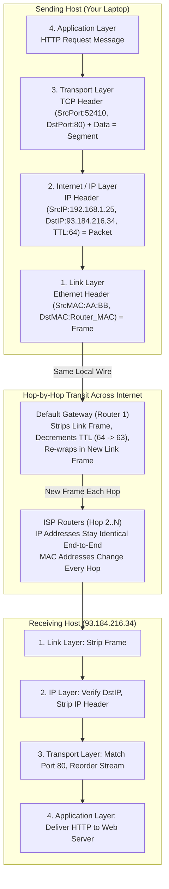
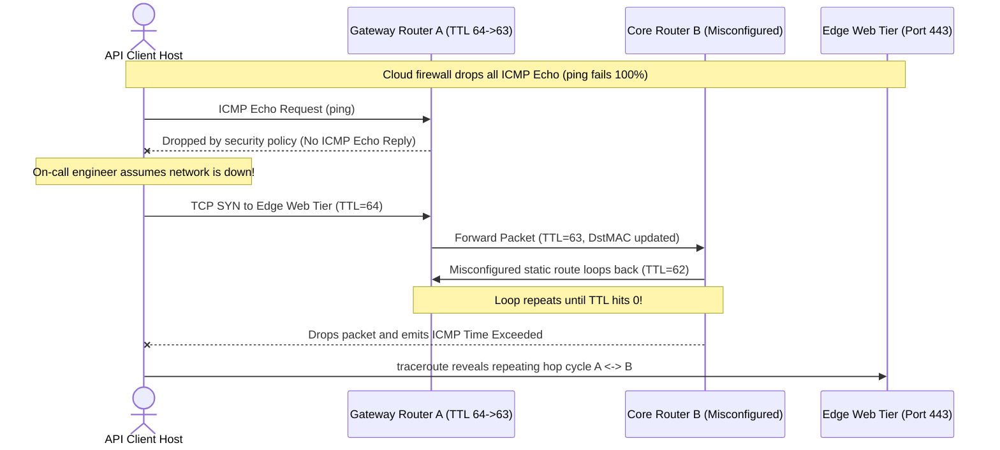

# Networking Mental Model & OSI/TCP/IP

> **Prerequisites:** Linux terminal environment (Ubuntu/WSL2, native Linux, or macOS) with `ip`, `ping`, `traceroute`, and `curl`.  
> **Estimated Reading Time:** 25 minutes  
> **Target Audience:** Backend Engineers, Site Reliability Engineers, Cloud & Platform Engineers.  
> **Free PDF Notes:** [SD-B-001: OSI Model for System Design](https://backendroadmap.com/notes/system-design/SD-B-001.pdf), [SD-B-002: TCP/IP Model](https://backendroadmap.com/notes/system-design/SD-B-002.pdf), [Phase 2, Networking (PDF)](https://backendroadmap.com/notes/system-design/Phase2_Networking_Notes.pdf)

> [!TIP]
> **The Golden Rule of Network Layering:** Never troubleshoot all layers at once. Always anchor every symptom to one of the four operational layers: **Link** (same wire, MAC addresses), **Internet/IP** (across networks, IP addresses and hop TTL), **Transport** (which process and how reliably, ports and TCP/UDP), or **Application** (what the bytes mean, DNS/HTTP/TLS).

---

## 1. Architectural Mental Model: Layering, Encapsulation & End-to-End Travel

Networking looks like a pile of unrelated acronyms until you have a mental model to hang them on. That model is **layering**: every protocol (IP, TCP, DNS, HTTP, TLS) lives at a specific layer and performs one focused job, trusting the layer below it to handle the rest.

### Why Layering Exists
Imagine writing a single monolithic program that turns "fetch this web page" directly into Wi-Fi radio waves—handling RF timing, global internet routing, lost-packet recovery, and HTTP parsing in one blob. Switching from Wi-Fi to Ethernet would force a total rewrite.

Layering applies strict **separation of concerns**. Each lower layer exposes a narrow service contract to the layer above it and hides its implementation details—identical to swapping a PostgreSQL driver beneath clean business logic without rewriting application rules.

### The Practical 4-Layer TCP/IP Stack & Encapsulation

Textbooks teach the seven-layer **OSI model**, and you will hear phrases like "Layer 3 issue" (IP/routing) or "Layer 7 proxy" (HTTP). In day-to-day backend debugging, however, the **four-layer TCP/IP model** is what maps directly to Linux tools and packet headers:



### How a Packet Travels: `curl http://example.com` Step by Step

1. **Name to Address (Application / DNS):** Before any TCP connection opens, the application queries DNS (module 02) to translate `example.com` into an IP address such as `93.184.216.34`.
2. **Encapsulation (Application -> Transport -> IP):** HTTP builds the `GET /` request message. TCP wraps it in a **segment** (ephemeral source port + destination port `80`). IP wraps that in a **packet** (your IP as source, `93.184.216.34` as destination, and initial `TTL=64` on Linux).
3. **Leave the Local Network (Link):** Because `93.184.216.34` is outside your local subnet, your host puts the packet into an Ethernet/Wi-Fi **frame** addressed to your **default gateway's MAC address** (resolved via ARP).
4. **Hop-by-Hop Routing Across the Internet:** Every **router** along the path inspects only the destination IP, consults its routing table, decrements TTL by 1, strips the old Link frame, and wraps the unchanged IP packet in a fresh Link frame for the next hop. **IP addresses stay identical end to end; MAC addresses change on every hop.**
5. **Arrival & Decapsulation:** The server strips the Link frame, verifies its destination IP, passes the segment to TCP for port `80`, and hands the clean byte stream up to the web server.
6. **The Return Trip:** The server replies to *your* IP and ephemeral source port over its own routing path (which may differ from the outbound path). Your kernel's TCP stack matches the response to `curl` and prints the page.

### The IP TTL Field & How `traceroute` Works
Every IP header carries a **TTL (Time To Live)** byte—not a clock, but a **hop counter** (commonly `64` on Linux, `128` on Windows, `255` on network gear). Each router decrements TTL by `1`. When a router decrements TTL to `0`, it drops the packet and returns an **ICMP Time Exceeded** message to the sender, preventing infinite routing loops.

`traceroute` (and `tracepath`) exploit this mechanism deliberately:
- Probe 1 starts with **TTL=1** -> expires at Router 1 -> ICMP reply reveals Hop 1.
- Probe 2 starts with **TTL=2** -> expires at Router 2 -> ICMP reply reveals Hop 2.
- Probes increment `TTL=3, 4, ...` until the destination is reached. Routers configured to suppress ICMP replies print `* * *`.

### Best-Effort Below, Reliability Above ("Smart Edges, Dumb Core")
The IP layer is strictly **best-effort**: packets can be dropped, duplicated, delayed, or reordered without recovery inside the network core. Keeping the core simple allowed the internet to scale globally. When an application needs guaranteed, ordered bytes (HTTP, SSH, databases), **TCP** adds reliability at the endpoints; when timeliness beats perfection (video calls, gaming, DNS queries), **UDP** preserves IP's low-overhead best-effort delivery.

---

## 2. Taxonomic Comparison: TCP/IP vs. OSI & Address Scoping

| TCP/IP Layer | Equivalent OSI Layers | PDU Name | Primary Identifier | Key Protocols | Operational Scope |
| :--- | :--- | :--- | :--- | :--- | :--- |
| **4. Application** | Layer 7 (App), Layer 6 (Pres), Layer 5 (Session) | **Message** | Hostname, URI, Method | HTTP, HTTPS/TLS, DNS, SSH | End-to-End Process Semantics |
| **3. Transport** | Layer 4 (Transport) | **Segment** (TCP) / **Datagram** (UDP) | **Port Number** (0–65535) | TCP, UDP, QUIC | Process-to-Process on Hosts |
| **2. Internet / IP** | Layer 3 (Network) | **Packet** | **IP Address** (IPv4/IPv6) + TTL | IP, ICMP, BGP | End-to-End Across Networks |
| **1. Link** | Layer 2 (Data Link), Layer 1 (Physical) | **Frame** | **MAC Address** (48-bit) | Ethernet, Wi-Fi (802.11), ARP | Single Local Wire / Hop Only |

### Address & Reliability Comparison

| Property | IP Address (Layer 3 / Internet) | MAC Address (Layer 2 / Link) |
| :--- | :--- | :--- |
| **Scope** | Logical, end-to-end across routers (unless rewritten by NAT) | Physical, strictly local to one broadcast segment (wire/radio) |
| **Behavior Across Hops** | **Unchanged** source/destination as routers forward the packet | **Rewritten at every router hop** to the next interface's hardware address |
| **Linux Inspection** | `ip addr`, `ip route` | `ip link`, `ip neigh` (ARP table) |

---

## 3. Systematic Reference: Command Reference & Flag Breakdowns

| Command | What it does | Example |
| :--- | :--- | :--- |
| `ip addr` | Shows this host's network interfaces and their IP addresses | `ip addr show eth0` |
| `ip route` | Shows the routing table, including the default gateway | `ip route` |
| `ip neigh` | Shows the ARP/neighbor table mapping IPs to MAC addresses on the local link | `ip neigh` |
| `ping` | Sends ICMP echo requests to test basic reachability | `ping -c 4 example.com` |
| `traceroute` | Shows the hop-by-hop path (routers) to a destination | `traceroute example.com` |
| `curl` | Makes an application-layer request (HTTP by default) | `curl -v http://example.com` |

### Flag Breakdowns
- `ip addr show eth0` — `show` selects the display action; `eth0` limits output to that one interface instead of all of them.
- `ping -c 4 example.com` — `-c 4` sends exactly 4 packets then stops (otherwise `ping` runs until you press Ctrl-C); `example.com` is the target, resolved via DNS first.
- `curl -v http://example.com` — `-v` (verbose) prints the connection steps, the request headers it sent, and the response headers, letting you see the layers at work; the URL's `http://` selects the application protocol and implies port 80.

---

## 4. Production War Story: The ICMP Blackhole & TTL Loop Misdiagnosis



### The Incident
During a network maintenance window, an internal checkout microservice stopped reaching its upstream payment gateway. On-call engineers immediately ran `ping payments.internal` and saw `100% packet loss`. Assuming a firewall or physical link outage, the team escalated to cloud networking for 55 minutes before testing layer-by-layer.

### Post-Mortem Metrics
- **Severity:** SEV-2 (Partial Service Degradation)
- **Mean Time to Detect (MTTD):** 4 minutes (HTTP 5xx synthetic monitor alert)
- **Mean Time to Resolution (MTTR):** 68 minutes

### Root Cause Analysis
Two separate facts collided:
1. Edge security policies intentionally dropped inbound ICMP Echo requests (`ping` always reported `100% loss` even on healthy days). Using `ping` as an uptime proxy masked the real issue.
2. When engineers finally separated layers with `getent hosts` (DNS succeeded) and `traceroute -n` (IP hop walk), hops 4 and 5 bounced infinitely between two core routers until **TTL hit 0**, proving an **IP-layer routing loop** rather than an application crash or firewall block.

### The Fix & Architectural Hardening
1. Reverted the asymmetric static route causing the `Router A <-> Router B` bounce.
2. Standardized the incident runbook to test **Layer 7 Name Resolution** (`getent hosts`), **Layer 3 Path** (`traceroute`/`ip route get`), and **Layer 4 TCP Handshake** (`nc -zv` / `curl -v`) independently instead of treating `ping` silence as host unavailability.

---

## 5. Multi-Language Production Code: Layer-by-Layer Connectivity Prober

Production observability probes separate **DNS lookup**, **TCP handshake**, and **HTTP application exchange** into isolated timed phases—mirroring the exact layer model so failures pinpoint which layer broke.

````carousel
### Go (`net` + `net/http/httptrace`)
```go
package main

import (
	"context"
	"fmt"
	"net"
	"net/http"
	"net/http/httptrace"
	"time"
)

type LayerReport struct {
	ResolvedIPs []string
	DNSDuration time.Duration
	TCPDuration time.Duration
	HTTPStatus  int
	FailedLayer string
}

func ProbeLayered(ctx context.Context, targetURL string) (LayerReport, error) {
	var rep LayerReport
	var dnsStart, tcpStart time.Time

	trace := &httptrace.ClientTrace{
		DNSStart: func(_ httptrace.DNSStartInfo) { dnsStart = time.Now() },
		DNSDone: func(info httptrace.DNSDoneInfo) {
			rep.DNSDuration = time.Since(dnsStart)
			for _, addr := range info.Addrs {
				rep.ResolvedIPs = append(rep.ResolvedIPs, addr.String())
			}
		},
		ConnectStart: func(_, _ string) { tcpStart = time.Now() },
		ConnectDone: func(_, _ string, err error) {
			rep.TCPDuration = time.Since(tcpStart)
			if err != nil {
				rep.FailedLayer = "Transport/IP"
			}
		},
	}

	req, err := http.NewRequestWithContext(httptrace.WithClientTrace(ctx, trace), http.MethodGet, targetURL, nil)
	if err != nil {
		rep.FailedLayer = "Application"
		return rep, err
	}

	client := &http.Client{Timeout: 5 * time.Second}
	resp, err := client.Do(req)
	if err != nil {
		if rep.FailedLayer == "" {
			if _, ok := err.(*net.OpError); ok {
				rep.FailedLayer = "Transport/IP"
			} else {
				rep.FailedLayer = "Application/DNS"
			}
		}
		return rep, err
	}
	defer resp.Body.Close()

	rep.HTTPStatus = resp.StatusCode
	return rep, nil
}

func main() {
	ctx, cancel := context.WithTimeout(context.Background(), 5*time.Second)
	defer cancel()

	report, err := ProbeLayered(ctx, "http://example.com")
	if err != nil {
		fmt.Printf("Probe failed at [%s]: %v\n", report.FailedLayer, err)
		return
	}
	fmt.Printf("IPs=%v DNS=%s TCP=%s HTTP=%d\n",
		report.ResolvedIPs, report.DNSDuration.Round(time.Millisecond),
		report.TCPDuration.Round(time.Millisecond), report.HTTPStatus)
}
```
<!-- slide -->
### TypeScript (`dns/promises` + `net` + `http`)
```typescript
import dns from 'node:dns/promises';
import net from 'node:net';
import http from 'node:http';

interface LayerProbeResult {
  layerFailed?: 'DNS' | 'Transport/IP' | 'Application';
  resolvedIp?: string;
  dnsMs: number;
  tcpMs: number;
  statusCode?: number;
}

export async function probeLayered(hostname: string, port = 80): Promise<LayerProbeResult> {
  const result: LayerProbeResult = { dnsMs: 0, tcpMs: 0 };

  // Layer 7 (Name Resolution): DNS lookup separated from socket connect
  const dnsStart = performance.now();
  try {
    const lookup = await dns.lookup(hostname, { family: 4 });
    result.resolvedIp = lookup.address;
    result.dnsMs = Math.round(performance.now() - dnsStart);
  } catch {
    result.dnsMs = Math.round(performance.now() - dnsStart);
    result.layerFailed = 'DNS';
    return result;
  }

  // Layer 3/4 (IP + Transport): Raw TCP three-way handshake timing
  const tcpStart = performance.now();
  try {
    await new Promise<void>((resolve, reject) => {
      const socket = net.createConnection({ host: result.resolvedIp!, port, timeout: 3000 });
      socket.once('connect', () => {
        socket.destroy();
        resolve();
      });
      socket.once('timeout', () => {
        socket.destroy();
        reject(new Error('TCP timeout'));
      });
      socket.once('error', reject);
    });
    result.tcpMs = Math.round(performance.now() - tcpStart);
  } catch {
    result.tcpMs = Math.round(performance.now() - tcpStart);
    result.layerFailed = 'Transport/IP';
    return result;
  }

  // Layer 7 (Application): HTTP request/response exchange
  result.statusCode = await new Promise<number>((resolve, reject) => {
    const req = http.get({ host: result.resolvedIp, port, headers: { Host: hostname }, timeout: 3000 }, (res) => {
      res.resume();
      resolve(res.statusCode ?? 0);
    });
    req.on('error', reject);
  }).catch(() => {
    result.layerFailed = 'Application';
    return undefined;
  });

  return result;
}

probeLayered('example.com', 80).then((res) => console.log(JSON.stringify(res)));
```
<!-- slide -->
### Python (`socket` + `http.client`)
```python
import http.client
import socket
import time
from dataclasses import dataclass
from typing import Optional


@dataclass
class LayerReport:
    resolved_ip: Optional[str] = None
    dns_ms: float = 0.0
    tcp_ms: float = 0.0
    http_status: Optional[int] = None
    failed_layer: Optional[str] = None


def probe_layered(hostname: str, port: int = 80, timeout: float = 3.0) -> LayerReport:
    report = LayerReport()

    # Step 1: Application-layer DNS resolution (separate from IP/TCP)
    t0 = time.perf_counter()
    try:
        addr_info = socket.getaddrinfo(hostname, port, socket.AF_INET, socket.SOCK_STREAM)
        report.resolved_ip = addr_info[0][4][0]
    except socket.gaierror:
        report.dns_ms = round((time.perf_counter() - t0) * 1000, 2)
        report.failed_layer = "DNS"
        return report
    report.dns_ms = round((time.perf_counter() - t0) * 1000, 2)

    # Step 2: Internet/IP + Transport TCP 3-way handshake
    t1 = time.perf_counter()
    try:
        with socket.create_connection((report.resolved_ip, port), timeout=timeout):
            pass
    except OSError:
        report.tcp_ms = round((time.perf_counter() - t1) * 1000, 2)
        report.failed_layer = "Transport/IP"
        return report
    report.tcp_ms = round((time.perf_counter() - t1) * 1000, 2)

    # Step 3: Application HTTP request over established transport
    conn = http.client.HTTPConnection(report.resolved_ip, port=port, timeout=timeout)
    try:
        conn.request("GET", "/", headers={"Host": hostname})
        resp = conn.getresponse()
        resp.read()
        report.http_status = resp.status
    except Exception:
        report.failed_layer = "Application"
    finally:
        conn.close()

    return report


if __name__ == "__main__":
    print(probe_layered("example.com", 80))
```
<!-- slide -->
### C# (`System.Net` + `System.Net.Sockets` + `HttpClient`)
```csharp
using System;
using System.Diagnostics;
using System.Net;
using System.Net.Http;
using System.Net.Sockets;
using System.Threading;
using System.Threading.Tasks;

public record LayerProbeResult(
    string? ResolvedIp,
    long DnsMs,
    long TcpMs,
    int? HttpStatus,
    string? FailedLayer);

public static class LayeredProber
{
    public static async Task<LayerProbeResult> ProbeAsync(string host, int port = 80, CancellationToken ct = default)
    {
        var sw = Stopwatch.StartNew();
        IPAddress targetIp;
        try
        {
            var addresses = await Dns.GetHostAddressesAsync(host, AddressFamily.InterNetwork, ct);
            targetIp = addresses[0];
        }
        catch (SocketException)
        {
            return new LayerProbeResult(null, sw.ElapsedMilliseconds, 0, null, "DNS");
        }
        long dnsMs = sw.ElapsedMilliseconds;

        sw.Restart();
        try
        {
            using var tcp = new TcpClient();
            using var timeoutCts = CancellationTokenSource.CreateLinkedTokenSource(ct);
            timeoutCts.CancelAfter(TimeSpan.FromSeconds(3));
            await tcp.ConnectAsync(targetIp, port, timeoutCts.Token);
        }
        catch (Exception)
        {
            return new LayerProbeResult(targetIp.ToString(), dnsMs, sw.ElapsedMilliseconds, null, "Transport/IP");
        }
        long tcpMs = sw.ElapsedMilliseconds;

        try
        {
            using var client = new HttpClient { Timeout = TimeSpan.FromSeconds(3) };
            using var req = new HttpRequestMessage(HttpMethod.Get, $"http://{targetIp}:{port}/");
            req.Headers.Host = host;
            using var resp = await client.SendAsync(req, ct);
            return new LayerProbeResult(targetIp.ToString(), dnsMs, tcpMs, (int)resp.StatusCode, null);
        }
        catch (Exception)
        {
            return new LayerProbeResult(targetIp.ToString(), dnsMs, tcpMs, null, "Application");
        }
    }
}
```
````

---

## 6. Practical Hands-On Verification CLI Workflows

Run these workflows in order to observe every layer directly on your machine:

### Workflow 1: See Your Own Layers & Find Your Default Gateway
1. **See your own layers.** Run `ip addr`. Identify your loopback interface (`lo`, always `127.0.0.1`) and your main interface (often `eth0` in WSL2). Note its IP address and its MAC address (the `link/ether` line).
2. **Find your gateway.** Run `ip route`. The line starting `default via <IP>` is your gateway—the next hop for anything not on your local network. Write down that IP.
3. **Map the local link.** Run `ping -c 1 <your-gateway-IP>` then `ip neigh`. You should now see the gateway's IP paired with a MAC address and state `REACHABLE`. This is the link layer resolving an IP to hardware.

```bash
ip addr
ip route
ping -c 1 172.28.16.1
ip neigh
```
**Expected Output:**
```text
1: lo: <LOOPBACK,UP,LOWER_UP> ... inet 127.0.0.1/8 scope host lo
2: eth0: <BROADCAST,MULTICAST,UP,LOWER_UP> ... link/ether 00:15:5d:8a:11:02
    inet 172.28.20.5/20 brd 172.28.31.255 scope global eth0

default via 172.28.16.1 dev eth0 proto kernel
172.28.16.1 dev eth0 lladdr 00:15:5d:8a:11:01 REACHABLE
```

### Workflow 2: Watch a Packet's Path and the TTL Climb
4. **Watch a packet's path and the TTL climb.** Run `traceroute example.com` (install with `sudo apt install traceroute` if missing) or `tracepath example.com`. Each numbered line is one router hop, and each corresponds to a probe sent with a starting TTL of 1, 2, 3, and so on—the hop count *is* the TTL that expired there. The first hop is usually your gateway, then several ISP routers, ending at or near the destination. Some hops show `* * *` when a router declines to send the ICMP Time Exceeded reply—that's normal. To make the TTL mechanism explicit, also run `ping -c 1 example.com` and look at the `ttl=` value in the reply: it's the *remaining* TTL when the packet arrived, so `64 - ttl` (or `128 - ttl`, `255 - ttl` depending on the sender's start) roughly tells you how many hops away the responder was.

```bash
traceroute example.com
ping -c 1 example.com
```
**Expected Output:**
```text
traceroute to example.com (93.184.216.34), 30 hops max, 60 byte packets
 1  172.28.16.1  0.38 ms  0.34 ms  0.31 ms
 2  192.168.1.1  1.42 ms  1.35 ms  1.30 ms
 3  * * *
 4  93.184.216.34  14.21 ms  14.10 ms  13.98 ms

64 bytes from 93.184.216.34: icmp_seq=1 ttl=56 time=14.1 ms
```

### Workflow 3: See Encapsulation in Words & Separate Name Resolution from IP Connectivity
5. **See encapsulation in words.** Run `curl -v http://example.com >/dev/null`. In the verbose output, identify: the DNS/connect step (`Trying 93.184...`), the TCP connection (`Connected to ... port 80`), and the application request (lines starting `>`) and response (lines starting `<`). Map each to a layer.
6. **Separate name resolution from connection.** Run `getent hosts example.com` to see just the address lookup (application-layer DNS, step 1), then `ping -c 2 <that-IP>` to test reachability of the address directly (IP layer, no DNS). Notice you split step 1 from steps 3–5.
7. **Reliable vs best-effort, felt.** Run `ping -c 20 example.com` and watch the summary line. Note the packet loss percentage and round-trip times. Expected: usually 0% loss on a good connection, times in the tens of milliseconds. This is IP being best-effort—occasional loss here is expected and normal, and no one retransmits it.

```bash
curl -v http://example.com >/dev/null
getent hosts example.com
ping -c 2 93.184.216.34
ping -c 20 example.com | tail -n 3
```
**Expected Output:**
```text
*   Trying 93.184.216.34:80...
* Connected to example.com (93.184.216.34) port 80 (#0)
> GET / HTTP/1.1
< HTTP/1.1 200 OK

93.184.216.34   example.com
20 packets transmitted, 20 received, 0% packet loss, time 19025ms
```

### Workflow 4: Diagnose and Fix a Made-Up Name (Layer Isolation)
8. **Diagnose and fix: a made-up name.** Run `curl -v http://example.invalid`. It fails early with something like `Could not resolve host`. Decide *which layer* failed. It never reached TCP or IP—the failure is at step 1 (name resolution), not connectivity. Now confirm your diagnosis: `curl -v http://example.com` succeeds, proving the lower layers are fine and only the name was bad. The fix for a "could not resolve host" is always a naming/DNS problem, never a cable or firewall problem—recognizing the layer tells you where *not* to waste time.

```bash
curl -v http://example.invalid
curl -s -o /dev/null -w '%{http_code}\n' http://example.com
```
**Expected Output:**
```text
* Could not resolve host: example.invalid
curl: (6) Could not resolve host: example.invalid
200
```

### Independent Challenge
Using only what this module covered, write a short prose account (no commands shown to a reader) of exactly what happens, layer by layer, when you run `curl http://example.com` on your laptop and get a page back—from the DNS lookup through the return of the HTTP response. Then actually run the relevant commands from this module to *verify* each claim you made (that a gateway is used, that multiple router hops exist, that a specific IP answered). This combines the mental model with hands-on observation; you are checking your story against reality.

<details>
<summary>Stuck? One hint</summary>

Build your narrative around the four layers in order, and remember the crucial asymmetry: the *IP addresses* (source and destination) stay the same for the whole trip end to end, but the *MAC addresses* change at every single hop because the link layer only ever moves a frame to the next directly-connected device. Use `traceroute` to prove the "many hops" claim and `ip neigh` to prove the "first hop is a MAC on my local link" claim.

</details>

---

## 7. Common Mistakes & Troubleshooting

- **Confusing IP addresses with MAC addresses.** IP addresses are logical and end-to-end (they identify a host anywhere); MAC addresses are physical and hop-local (they only matter between two directly connected devices). If you catch yourself thinking a MAC address travels across the internet, stop—it doesn't.
- **Assuming the path out equals the path back.** Routing is per-packet and directional. `traceroute` shows only the forward path; the return path can differ entirely.
- **Treating `ping` failure as "the internet is down."** `ping` uses ICMP, which many hosts and firewalls deliberately drop. A host can serve web traffic perfectly while refusing to answer `ping`. Never conclude "unreachable" from ICMP alone.
- **Over-formalizing OSI.** Do not burn time memorizing "session" and "presentation" layers. For real troubleshooting, "which of link / IP / transport / application broke?" is the question that pays off.
- **Forgetting `lo`.** `127.0.0.1` (loopback) never leaves your machine. Reaching a service on loopback proves nothing about network connectivity to other hosts.

---

## 8. Operational Validation Checkpoints

<details>
<summary><strong>Question 1: Ping Fails 100%, Yet HTTPS Traffic Flows Normally</strong></summary>

**Scenario:** An alert fires in staging claiming `api.payments.example` is down because a monitoring script running `ping -c 3 api.payments.example` recorded 100% packet loss. However, `curl -I https://api.payments.example` returns `HTTP/2 200` in 18 ms.

Why did `ping` fail while `curl` succeeded, and which layers are proven healthy?

**Answer:**
`ping` uses **ICMP Echo** packets at the Internet/IP layer, whereas HTTPS uses **TCP port 443** (Transport) carrying HTTP/TLS (Application). Cloud load balancers and server firewalls routinely drop ICMP packets silently while permitting TCP 443. Because `curl` succeeded, DNS (Application), IP routing (Internet), TCP handshake (Transport), and HTTP/TLS (Application) are all verified healthy—never rely on ICMP silence alone to declare a host dead.

</details>

<details>
<summary><strong>Question 2: Packet Capture Shows Unexpected Source MAC Address</strong></summary>

**Scenario:** A developer inspects a `tcpdump` capture on a cloud server (`10.0.2.50`) receiving traffic from a client (`198.51.100.14`) across the internet. The developer panics because the Ethernet source MAC address in the captured frame belongs to the datacenter router rather than the client's laptop.

Is this a spoofing attack or expected networking behavior? Explain why.

**Answer:**
It is completely expected behavior. **MAC addresses operate strictly at the Link layer (same physical/L2 wire)** and are stripped and rewritten by every router along the path. Only the **IP addresses** (`198.51.100.14 -> 10.0.2.50`) remain end-to-end across hops. The server will always see its local upstream router's MAC address as the source MAC for remote traffic.

</details>

<details>
<summary><strong>Question 3: Traceroute Prints Three Asterisks on Hop 4, Then Succeeds on Hop 8</strong></summary>

**Scenario:** While diagnosing latency to a partner endpoint, `traceroute` prints `* * *` on hops 4 and 5, yet hops 6, 7, and the final destination at hop 8 return normal round-trip times.

What caused `* * *` on hops 4 and 5, and does it indicate packet loss at those routers?

**Answer:**
No—it almost always means the routers at hops 4 and 5 forwarded the probe packets normally (decrementing TTL and passing higher-TTL probes onward), OR dropped the probe's ICMP Time Exceeded response due to rate-limiting or firewall policy. Because hop 8 responded cleanly, the end-to-end IP path is intact.

</details>

---

## 9. Checkpoint Quiz

Write down your answer to each question before expanding it—checking without attempting first is the single easiest way to fool yourself into thinking you've learned this.

1. Name the four practical layers, top to bottom, and one protocol or job at each.
2. As a packet crosses the internet, which address stays the same end-to-end and which changes at every hop?
3. What does "best-effort" mean at the IP layer, and which layer adds reliability when needed?
4. When you unwrap received data, in what order do the layers strip their headers?
5. Why can a server serve web pages fine but not answer `ping`?
6. In `curl http://example.com`, which layer's job is turning `example.com` into an IP address?
7. What is a "default gateway" and when is it used?
8. What is the TTL field in the IP header, what happens when it reaches zero, and how does `traceroute` exploit this to map the path?

<details>
<summary>Show answers</summary>

1. Application (HTTP/DNS/SSH), Transport (TCP/UDP, ports, reliability), Internet/IP (IP addresses, routing between networks), Link (Ethernet/Wi-Fi, MAC addresses, same wire).
2. The IP addresses (source and destination) stay the same end-to-end; the MAC addresses change at every hop.
3. Best-effort means IP will attempt delivery but does not guarantee it—packets may be dropped, duplicated, delayed, or reordered. TCP (transport layer) adds reliability on top.
4. Reverse order of wrapping: strip the link/Ethernet frame, then the IP header, then the transport (TCP/UDP) header, then hand the application message up.
5. `ping` uses ICMP, which firewalls or the host may deliberately drop, while TCP port 80/443 web traffic is allowed. ICMP silence does not mean the host is down.
6. The application layer, via DNS (a separate lookup step before any TCP connection is made).
7. The router the host sends packets to when the destination is *not* on the local network—the exit point toward everywhere else.
8. TTL (Time To Live) is a hop counter in the IP header, decremented by 1 at every router. When it hits zero the router drops the packet and sends an ICMP "Time Exceeded" back to the sender (preventing infinite routing loops). `traceroute` sends probes with TTL=1, 2, 3… so each dies one hop further along and the resulting Time Exceeded replies reveal each router in turn.

</details>

---

## 10. Free PDF Notes & Sources

Download the notes for each video on this page as a printable PDF, with every diagram and interview questions: [SD-B-001: OSI Model for System Design](https://backendroadmap.com/notes/system-design/SD-B-001.pdf), [SD-B-002: TCP/IP Model](https://backendroadmap.com/notes/system-design/SD-B-002.pdf). Each section in one file: [Phase 2, Networking (PDF)](https://backendroadmap.com/notes/system-design/Phase2_Networking_Notes.pdf).

---

## Next Step

[01 — IP addressing & subnetting](../01-ip-addressing-and-subnetting/README.md): now that you know packets travel by IP address, learn exactly how those addresses are structured, split into networks, and how a host decides "local or gateway?"
