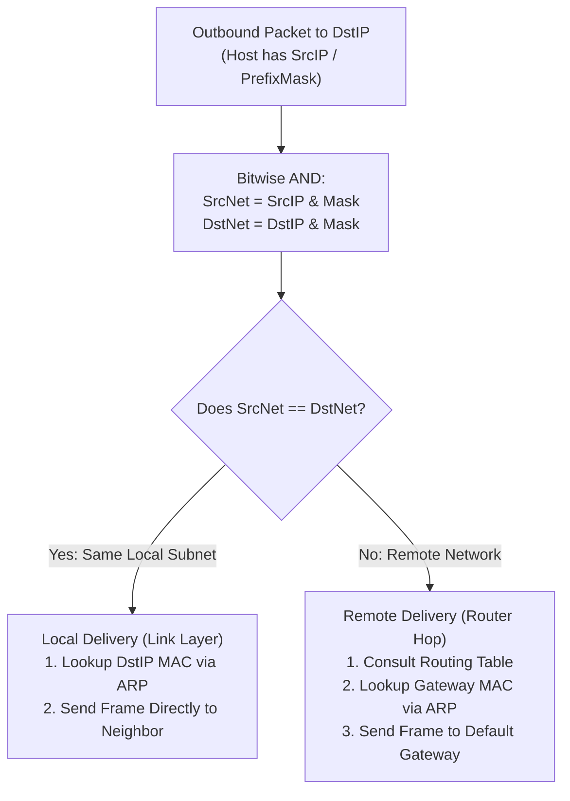
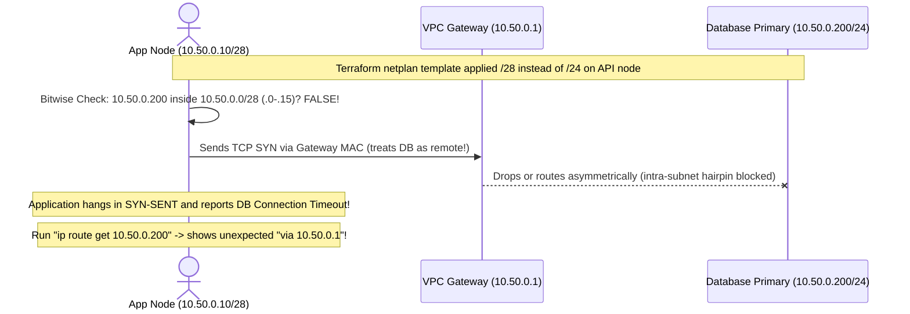

# IP Addressing & Subnetting

> **Prerequisites:** [00 — Networking Mental Model & OSI/TCP/IP](../00-networking-mental-model-and-osi-tcpip/README.md) and a Linux terminal with `ip` and `ipcalc` (`sudo apt install ipcalc`).  
> **Estimated Reading Time:** 30 minutes  
> **Target Audience:** Backend Engineers, Network/Cloud Engineers, Site Reliability Engineers.  
> **Free PDF Notes:** [SD-B-006: IP Addresses, Subnets & CIDR](https://backendroadmap.com/notes/system-design/SD-B-006.pdf), [Phase 2, Networking (PDF)](https://backendroadmap.com/notes/system-design/Phase2_Networking_Notes.pdf)

> [!TIP]
> **The Golden Rule of Subnetting:** An IP address without a subnet mask is incomplete. Before transmitting any packet, a host performs a bitwise AND (`IP & Mask`) on both its own address and the destination: **identical network bits mean local Link-layer delivery (ARP); differing network bits mean forward to the Default Gateway**.

---

## 1. Architectural Mental Model: CIDR Boundaries, Local-vs-Gateway, VLSM & Supernetting

Every routing decision, firewall rule, and cloud VPC CIDR block you will configure relies on subnetting. If you can look at `10.0.4.7/22` and immediately compute its network range, you will avoid misreading route tables, opening overly broad security groups, and guessing why two hosts fail to communicate.

### What an IP Address & Subnet Mask Are
An **IPv4 address** is a single 32-bit unsigned integer written as four decimal **octets** (0–255), such as `192.168.1.10`. An address belongs to a **network interface**, not the whole machine—a server with two NICs holds two IP addresses.

A **subnet mask** partitions those 32 bits into:
- **Network bits** (leading 1-bits, shared by everyone on the same local network—the "street").
- **Host bits** (trailing 0-bits, unique per device on that network—the "house number").

### CIDR Notation & Computing Network, Broadcast, and Usable Range
Instead of writing `255.255.255.0`, **CIDR (Classless Inter-Domain Routing)** appends `/prefix` to count network bits: `/24` means 24 network bits and `32 - 24 = 8` host bits.
- Total addresses = `2^(host bits)` (e.g., `/24` = `2^8 = 256`).
- Two addresses are always reserved: the **network address** (all host bits `0`, e.g. `192.168.1.0`) and the **broadcast address** (all host bits `1`, e.g. `192.168.1.255`).
- **Usable hosts** = `2^(host bits) - 2` (e.g., `256 - 2 = 254`).

**The Block-Size Trick (Worked Example: `10.0.4.7/22`):**
1. `/22` puts `22` bits in the network part: octets 1 & 2 (`16` bits) are full (`255.255`), and `6` bits fall into octet 3 (`252`, leaving `2` network-varying bits -> `10` total host bits).
2. **Block size** in the interesting octet = `256 - mask_octet` = `256 - 252 = 4`.
3. Valid network boundaries step by `4` starting at `0`: `10.0.0.0`, `10.0.4.0`, `10.0.8.0`...
4. Largest multiple `<= 4` is `4`, so `10.0.4.7/22` belongs to network **`10.0.4.0/22`**, ending just before `10.0.8.0` at broadcast **`10.0.7.255`**, with **usable hosts `10.0.4.1`–`10.0.7.254`** (`2^10 - 2 = 1022` hosts).

### The "Local or Gateway?" Kernel Decision



If you configure the wrong subnet mask (for example `/28` instead of `/24`), the host misclassifies an on-LAN neighbor as remote and ships traffic to the gateway—breaking local reachability immediately.

### Public, Private (RFC 1918), and Special Ranges
Private ranges can be reused inside any organization or VPC, but are never routed on the public internet (requiring NAT, module 05):
- `10.0.0.0/8` (`10.0.0.0` – `10.255.255.255`): ~16.7 million addresses.
- `172.16.0.0/12` (`172.16.0.0` – `172.31.255.255`): **only 16 through 31**, not all of `172.x`!
- `192.168.0.0/16` (`192.168.0.0` – `192.168.255.255`): 65,536 addresses.
- **Special ranges:** `127.0.0.0/8` (loopback, stays on local host) and `169.254.0.0/16` (link-local fallback—seeing this usually means DHCP failed).

### VLSM & Supernetting (Route Aggregation)
- **VLSM (Variable Length Subnet Masking):** Real networks need different sizes—an office LAN needs 100 hosts, while a router link needs 2. Carving `10.0.0.0/24` sequentially into a `/25` (126 usable), then a `/26` (62 usable) from remaining space, then a `/30` (2 usable) uses VLSM. Rule: blocks must start on valid boundaries for their own mask and never overlap.
- **Supernetting (CIDR Route Aggregation):** Combining contiguous, equal-size blocks into one shorter prefix—e.g., `192.168.0.0/24` through `192.168.3.0/24` combine into `192.168.0.0/22`. **Two mandatory rules:** (1) the first block must align on the wider mask's boundary (`192.168.0.0` is a multiple of 4; `192.168.1.0` is not!), and (2) all blocks must be contiguous with zero gaps.

### IPv6 in One Breath
IPv4's 32 bits (~4.3 billion addresses) ran out, so IPv6 uses **128 bits** in eight 4-hex-digit groups (`2001:0db8:0000:0000:0000:ff00:0042:8329`). Dropping leading zeros and collapsing one contiguous run of all-zero groups to `::` yields `2001:db8::ff00:42:8329`. Prefix notation works identically (`/64` is standard subnet size; `fe80::/10` is link-local; `::1` is loopback).

---

## 2. Taxonomic Comparison: CIDR Prefix Reference & Special IPv4 Blocks

| CIDR | Dotted Subnet Mask | Host Bits | Interesting Octet Block Size | Total Addresses | Usable Hosts | Common Use Case |
| :--- | :--- | :--- | :--- | :--- | :--- | :--- |
| `/32` | `255.255.255.255` | 0 | 1 | 1 | 1 (host route) | Single host firewall rule / loopback |
| `/30` | `255.255.255.252` | 2 | 4 | 4 | **2** | Point-to-point router link |
| `/29` | `255.255.255.248` | 3 | 8 | 8 | **6** | Tiny management / DMZ subnet |
| `/28` | `255.255.255.240` | 4 | 16 | 16 | **14** | Small service subnet |
| `/26` | `255.255.255.192` | 6 | 64 | 64 | **62** | Medium office or container tier |
| `/25` | `255.255.255.128` | 7 | 128 | 128 | **126** | Half of a `/24` LAN |
| `/24` | `255.255.255.0` | 8 | 1 (4th) / 256 | 256 | **254** | Standard LAN / VPC subnet |
| `/22` | `255.255.252.0` | 10 | 4 (3rd octet) | 1,024 | **1,022** | Multi-tier lab / medium VPC |
| `/16` | `255.255.0.0` | 16 | 1 (2nd octet) | 65,536 | **65,534** | Large enterprise / cloud VPC |

### IPv4 Address Class & Scope Matrix

| Address Range | Classification | Routable on Public Internet? | Operational Meaning |
| :--- | :--- | :--- | :--- |
| `10.0.0.0/8` | RFC 1918 Private | No | Internal corporate / cloud VPCs |
| `172.16.0.0/12` | RFC 1918 Private | No | Docker bridges, internal subnets (`172.16`–`172.31` only) |
| `192.168.0.0/16` | RFC 1918 Private | No | Home / small office LANs |
| `127.0.0.0/8` | Loopback | No (Never leaves host) | Local IPC (`127.0.0.1`) |
| `169.254.0.0/16` | Link-Local (APIPA) | No | Self-assigned fallback when DHCP fails (or cloud metadata `169.254.169.254`) |
| `172.15.x.x` / `172.32.x.x` | Public Unicast | **Yes** | Commonly mistaken for RFC 1918 private! |

---

## 3. Systematic Reference: Command Reference & Flag Breakdowns

| Command | What it does | Example |
| :--- | :--- | :--- |
| `ip addr` | Shows interfaces, their IP addresses, and prefix lengths | `ip -brief addr` |
| `ip route` | Shows which subnets are reachable directly vs via the gateway | `ip route get 8.8.8.8` |
| `ipcalc` | Calculates network, broadcast, and host range from a CIDR | `ipcalc 10.0.4.7/22` |
| `ping` | Tests reachability of a specific address | `ping -c 3 192.168.1.1` |
| `ip addr add` | Assigns an address+mask to an interface (needs sudo) | `sudo ip addr add 10.0.0.5/24 dev eth0` |
| `ip addr del` | Removes an address from an interface (needs sudo) | `sudo ip addr del 10.0.0.5/24 dev eth0` |

### Flag Breakdowns
- `ip -brief addr` — `-brief` (or `-br`) prints one compact line per interface (name, state, addresses) instead of the verbose multi-line default; far easier to scan.
- `ip route get 8.8.8.8` — `get` asks the kernel to show exactly which route and gateway *this specific destination* would use, resolving the "local or gateway?" decision for you.
- `ipcalc 10.0.4.7/22` — takes an address in CIDR form and prints the network address, broadcast, netmask, and usable host range; add `-b` on some versions to suppress the binary display.
- `sudo ip addr add 10.0.0.5/24 dev eth0` — `add` assigns a new address; `10.0.0.5/24` is the address plus prefix length (mask); `dev eth0` names the interface it's bound to.

---

## 4. Production War Story: The `/28` Subnet Mask Typo Isolating Database Replicas



### The Incident
Following a bare-metal Kubernetes worker expansion inside `10.50.0.0/24`, three newly provisioned API nodes failed health checks with `PostgreSQL connection timed out` to `10.50.0.200`, even though existing nodes in the exact same rack connected in `< 1 ms`.

### Post-Mortem Metrics
- **Severity:** SEV-1 (Degraded Checkout Capacity)
- **Mean Time to Detect (MTTD):** 2 minutes
- **Mean Time to Resolution (MTTR):** 41 minutes

### Root Cause Analysis
The provisioning template hardcoded `/28` (`255.255.255.240`, spanning `.0`–`.15`) instead of `/24`. The new node at `10.50.0.10/28` evaluated `10.50.0.200` as outside its local subnet, so it refused to ARP for `.200` and instead forwarded database traffic to the default gateway `10.50.0.1`, where strict anti-spoofing/hairpin rules dropped the packets.

### The Fix & Architectural Hardening
1. Ran `ip route get 10.50.0.200` on the broken node—seeing `via 10.50.0.1` instead of direct `dev eth0` instantly exposed the mask mismatch.
2. Corrected the netplan interface mask to `10.50.0.10/24` and added automated CIDR mask assertions in CI provisioning tests.

---

## 5. Multi-Language Production Code: CIDR Inspector & Local-vs-Gateway Evaluator

The implementations below compute network/broadcast addresses, usable host counts, RFC 1918 classification, and the kernel's exact **local vs. gateway** decision from any CIDR input.

````carousel
### Go (`net/netip`)
```go
package main

import (
	"encoding/binary"
	"fmt"
	"net/netip"
)

type SubnetSummary struct {
	CIDR       string
	Network    netip.Addr
	Broadcast  netip.Addr
	UsableHost uint64
	IsPrivate  bool
}

func InspectCIDR(cidr string) (SubnetSummary, error) {
	prefix, err := netip.ParsePrefix(cidr)
	if err != nil {
		return SubnetSummary{}, err
	}
	masked := prefix.Masked()
	addr := masked.Addr()
	if !addr.Is4() {
		return SubnetSummary{}, fmt.Errorf("expected IPv4 CIDR, got %s", cidr)
	}

	b := addr.As4()
	netInt := binary.BigEndian.Uint32(b[:])
	hostBits := 32 - masked.Bits()
	var total uint64 = 1 << hostBits
	var usable uint64
	if hostBits >= 2 {
		usable = total - 2
	}

	bcastInt := netInt | uint32(total-1)
	var bcastBytes [4]byte
	binary.BigEndian.PutUint32(bcastBytes[:], bcastInt)

	return SubnetSummary{
		CIDR:       masked.String(),
		Network:    addr,
		Broadcast:  netip.AddrFrom4(bcastBytes),
		UsableHost: usable,
		IsPrivate:  addr.IsPrivate(),
	}, nil
}

func RouteDecision(localCIDR string, targetIP string) (string, error) {
	p, err := netip.ParsePrefix(localCIDR)
	if err != nil {
		return "", err
	}
	dst, err := netip.ParseAddr(targetIP)
	if err != nil {
		return "", err
	}
	if p.Contains(dst) {
		return "LOCAL (Direct ARP + Link Frame)", nil
	}
	return "REMOTE (Forward to Default Gateway)", nil
}

func main() {
	s, _ := InspectCIDR("10.0.4.7/22")
	decision, _ := RouteDecision("10.0.4.7/22", "10.0.7.100")
	fmt.Printf("%s -> Net: %s Bcast: %s Usable: %d Private: %v\n",
		s.CIDR, s.Network, s.Broadcast, s.UsableHost, s.IsPrivate)
	fmt.Println("10.0.7.100 decision:", decision)
}
```
<!-- slide -->
### TypeScript (Bitwise Unsigned 32-Bit CIDR Math)
```typescript
function ipToUint32(ip: string): number {
  const parts = ip.split('.').map(Number);
  if (parts.length !== 4 || parts.some((n) => Number.isNaN(n) || n < 0 || n > 255)) {
    throw new Error(`Invalid IPv4 address: ${ip}`);
  }
  return (((parts[0] << 24) >>> 0) + (parts[1] << 16) + (parts[2] << 8) + parts[3]) >>> 0;
}

function uint32ToIp(num: number): string {
  return [(num >>> 24) & 255, (num >>> 16) & 255, (num >>> 8) & 255, num & 255].join('.');
}

export function inspectSubnet(cidr: string) {
  const [ipStr, prefixStr] = cidr.split('/');
  const prefix = Number(prefixStr);
  if (prefix < 0 || prefix > 32) throw new Error(`Invalid prefix: /${prefix}`);

  const ipInt = ipToUint32(ipStr);
  const mask = prefix === 0 ? 0 : (0xffffffff << (32 - prefix)) >>> 0;
  const network = (ipInt & mask) >>> 0;
  const broadcast = (network | (~mask >>> 0)) >>> 0;
  const hostBits = 32 - prefix;
  const usableHosts = hostBits >= 2 ? 2 ** hostBits - 2 : 0;

  return {
    cidr: `${uint32ToIp(network)}/${prefix}`,
    network: uint32ToIp(network),
    broadcast: uint32ToIp(broadcast),
    mask: uint32ToIp(mask),
    usableHosts,
    contains: (targetIp: string) => ((ipToUint32(targetIp) & mask) >>> 0) === network,
  };
}

const net = inspectSubnet('10.0.4.7/22');
console.log(net);
console.log('10.0.7.100 local?', net.contains('10.0.7.100') ? 'LOCAL (ARP)' : 'REMOTE (Gateway)');
```
<!-- slide -->
### Python (`ipaddress` Standard Library)
```python
import ipaddress
from typing import Dict, Any


def inspect_cidr(cidr: str) -> Dict[str, Any]:
    iface = ipaddress.IPv4Interface(cidr)
    net = iface.network
    usable = max(net.num_addresses - 2, 0)
    return {
        "network": str(net.network_address),
        "netmask": str(net.netmask),
        "broadcast": str(net.broadcast_address),
        "usable_hosts": usable,
        "is_private": net.is_private,
        "is_link_local": net.is_link_local,
    }


def local_or_gateway(local_cidr: str, target_ip: str) -> str:
    local_net = ipaddress.IPv4Interface(local_cidr).network
    dst = ipaddress.IPv4Address(target_ip)
    if dst in local_net:
        return f"LOCAL: {dst} is inside {local_net} -> deliver directly via ARP"
    return f"REMOTE: {dst} is outside {local_net} -> send to default gateway"


if __name__ == "__main__":
    print(inspect_cidr("10.0.4.7/22"))
    print(local_or_gateway("10.0.4.7/22", "10.0.8.1"))
```
<!-- slide -->
### C# (`System.Net` Bitwise CIDR Evaluator)
```csharp
using System;
using System.Buffers.Binary;
using System.Net;

public record SubnetReport(string Network, string Broadcast, string Mask, long UsableHosts);

public static class SubnetCalculator
{
    public static uint ToUInt32(IPAddress ip) =>
        BinaryPrimitives.ReadUInt32BigEndian(ip.GetAddressBytes());

    public static IPAddress FromUInt32(uint value)
    {
        Span<byte> bytes = stackalloc byte[4];
        BinaryPrimitives.WriteUInt32BigEndian(bytes, value);
        return new IPAddress(bytes);
    }

    public static SubnetReport Inspect(string cidr)
    {
        var parts = cidr.Split('/');
        uint ip = ToUInt32(IPAddress.Parse(parts[0]));
        int prefix = int.Parse(parts[1]);
        uint mask = prefix == 0 ? 0u : uint.MaxValue << (32 - prefix);
        uint network = ip & mask;
        uint broadcast = network | ~mask;
        long usable = (32 - prefix) >= 2 ? (1L << (32 - prefix)) - 2 : 0;

        return new SubnetReport(
            FromUInt32(network).ToString(),
            FromUInt32(broadcast).ToString(),
            FromUInt32(mask).ToString(),
            usable);
    }

    public static bool IsLocal(string localCidr, string destinationIp)
    {
        var parts = localCidr.Split('/');
        int prefix = int.Parse(parts[1]);
        uint mask = prefix == 0 ? 0u : uint.MaxValue << (32 - prefix);
        uint localNet = ToUInt32(IPAddress.Parse(parts[0])) & mask;
        uint dstNet = ToUInt32(IPAddress.Parse(destinationIp)) & mask;
        return localNet == dstNet;
    }
}
```
````

---

## 6. Practical Hands-On Verification CLI Workflows

### Workflow 1: Inspect Your Subnet & Compute Boundaries by Hand
1. **Read your own subnet.** Run `ip -brief addr`. Take your `eth0` address with its `/prefix` and run `ipcalc <that-address>`. Confirm the network address, broadcast, and host range.
2. **Subnet by hand, then check.** Without tools, compute the network and broadcast for `192.168.10.130/26`. (Hint: `/26` -> mask octet `192` -> block size `64` -> boundaries `0, 64, 128, 192`.) Then verify with `ipcalc 192.168.10.130/26`.
3. **Same network or not?** Given `10.1.2.3/23` and `10.1.3.200/23`, decide by hand whether they're in the same subnet, then verify with `ipcalc` on each.

```bash
ip -brief addr
ipcalc 172.28.20.5/20
ipcalc 192.168.10.130/26
ipcalc 10.1.2.3/23
ipcalc 10.1.3.200/23
```
**Expected Output:**
```text
# 172.28.20.5/20 -> Network: 172.28.16.0/20, Broadcast: 172.28.31.255, Hosts: 4094
# 192.168.10.130/26 -> Network: 192.168.10.128/26, Broadcast: 192.168.10.191, Hosts: .129-.190
# 10.1.2.3/23 & 10.1.3.200/23 -> Both fall in 10.1.2.0/23 (spanning 10.1.2.0-10.1.3.255)
```

### Workflow 2: Kernel Local-vs-Gateway Decision, Host Counts & Private Ranges
4. **Let the kernel decide local vs remote.** Run `ip route get <an-IP-on-your-subnet>` and `ip route get 8.8.8.8`. Compare: the on-subnet one shows a direct `dev` with no `via`; the remote one shows `via <gateway>`. You've watched the "local or gateway?" decision happen.
5. **Count the hosts.** For each of `/30`, `/29`, `/28`, `/24`, `/16`, state the number of usable hosts from memory (`2^(32-prefix) - 2`), then confirm a couple with `ipcalc`. Expected: `/30` -> 2, `/29` -> 6, `/28` -> 14, `/24` -> 254, `/16` -> 65534.
6. **Spot the private ranges.** For `172.15.0.1`, `172.20.0.1`, `192.168.5.5`, `10.255.255.254`, and `169.254.10.10`, label each as private, public, or special. Expected: `172.15` is *public* (private is only 16–31); `172.20` private; `192.168.5.5` private; `10.255.255.254` private; `169.254.x` link-local (DHCP-failure fallback).

```bash
ip route get 172.28.20.99
ip route get 8.8.8.8
ipcalc 10.0.0.1/30
```
**Expected Output:**
```text
172.28.20.99 dev eth0 src 172.28.20.5 uid 1000
8.8.8.8 via 172.28.16.1 dev eth0 src 172.28.20.5 uid 1000
Hosts/Net: 2 (10.0.0.1 - 10.0.0.2)
```

### Workflow 3: Assign Addresses & Diagnose/Fix a Wrong Subnet Mask
7. **Create and remove an address.** On a throwaway interface (or `eth0`, carefully), run `sudo ip addr add 10.99.99.2/24 dev eth0`, confirm with `ip -br addr`, then `sudo ip addr del 10.99.99.2/24 dev eth0`. Expected: the address appears then disappears. (Don't remove your primary address.)
8. **Diagnose and fix: wrong subnet mask.** Set up the failure: `sudo ip addr add 10.50.0.10/28 dev eth0`. Now `ip route get 10.50.0.200`—with a `/28`, `10.50.0.200` is *outside* your `10.50.0.0/28` block (which ends at `.15`), so the kernel routes it via the gateway even though you intended them to be neighbors on a `/24`. The symptom "host on the same LAN is unreachable" is classically a mask that's too narrow. **Fix:** remove and re-add with the correct mask—`sudo ip addr del 10.50.0.10/28 dev eth0` then `sudo ip addr add 10.50.0.10/24 dev eth0`—and re-run `ip route get 10.50.0.200` to confirm it's now treated as local (direct `dev`, no `via`). Clean up with `ip addr del` afterward.

```bash
sudo ip addr add 10.50.0.10/28 dev eth0
ip route get 10.50.0.200
sudo ip addr del 10.50.0.10/28 dev eth0
sudo ip addr add 10.50.0.10/24 dev eth0
ip route get 10.50.0.200
sudo ip addr del 10.50.0.10/24 dev eth0
```
**Expected Output:**
```text
# With /28 (broken):
10.50.0.200 via 172.28.16.1 dev eth0 src 172.28.20.5
# Fixed with /24 (local):
10.50.0.200 dev eth0 src 10.50.0.10
```

### Workflow 4: VLSM Carving & Supernetting Boundary Verification
9. **VLSM by hand.** Given `192.168.20.0/24`, carve out a subnet for 100 hosts, then a subnet for 50 hosts from what's left, then a subnet for 2 hosts (a point-to-point link) from what's left after that. Work out each prefix length and boundary before checking: `/25` (`192.168.20.0/25`, 126 usable) for the first; `/26` (`192.168.20.128/26`, 62 usable) for the second; `/30` (`192.168.20.192/30`, 2 usable) for the third. Confirm each with `ipcalc`.
10. **Supernet four /24s and check the boundary rule.** Given `10.4.0.0/24`, `10.4.1.0/24`, `10.4.2.0/24`, `10.4.3.0/24`, verify by hand that these summarize cleanly into `10.4.0.0/22` (compute the `/22`'s block size in the third octet—`4`—and confirm `10.4.0.0` is a multiple of it and all four `/24`s are contiguous with no gap). Then try summarizing `10.4.1.0/24` through `10.4.4.0/24` instead—explain why this set does *not* summarize into one clean CIDR block.

```bash
ipcalc 192.168.20.0/25
ipcalc 192.168.20.128/26
ipcalc 192.168.20.192/30
ipcalc 10.4.0.0/22
```
**Expected Output:**
```text
# 192.168.20.0/25 -> .1 - .126 (126 usable)
# 192.168.20.128/26 -> .129 - .190 (62 usable)
# 192.168.20.192/30 -> .193 - .194 (2 usable)
# 10.4.0.0/22 -> 10.4.0.0 - 10.4.3.255 (1022 usable)
```

### Independent Challenge
You are handed the block `172.16.0.0/22` for a small lab and told to carve it into four equal subnets, one per team, each needing at least 100 usable hosts. Determine the correct prefix length for the four subnets, list the network address, usable range, and broadcast for each, and state which subnet the address `172.16.2.150` lands in. This builds directly on the "local or gateway?" and block-size ideas here; it also leans on the layering model from **module 00**—specifically why a host on team 2's subnet reaching a host on team 3's subnet must go through a gateway rather than delivering directly.

<details>
<summary>Stuck? One hint</summary>

Four equal subnets means borrowing 2 host bits from the `/22` (because `2^2 = 4`), giving you four `/24`s. Check the host count survives the requirement: a `/24` has 254 usable hosts, comfortably above 100. Now just step through the third octet in blocks of 1 (since these are `/24`s within the `/22`): the four networks are `172.16.0.0`, `172.16.1.0`, `172.16.2.0`, `172.16.3.0`. Place `172.16.2.150` by its third octet.

</details>

---

## 7. Common Mistakes & Troubleshooting

- **Off-by-one on the block size.** The block size is `256 - mask_octet`, and networks start at multiples of it *including zero*. Forgetting the zero boundary (`x.x.0.0`) is the most common subnetting error.
- **Assuming 172 is all private.** Only `172.16.0.0` through `172.31.255.255` (a `/12`) is private. `172.15.x.x` and `172.32.x.x` are public. This trips people constantly.
- **Forgetting the two reserved addresses.** The network and broadcast addresses are not assignable to hosts. A `/30` (common for point-to-point links) has 4 addresses but only 2 usable.
- **Confusing prefix length with host count directly.** `/24` is not "24 hosts." It's 24 network bits, leaving 8 host bits = 254 usable. Always convert to host bits first.
- **A `169.254.x.x` address means something failed.** If a host self-assigned a link-local address, it means it never got a real one (DHCP failure). Don't try to route through it—fix the address assignment.
- **Trying to supernet blocks that don't start on a valid boundary, or that have a gap.** `10.4.1.0/24` through `10.4.4.0/24` looks like four contiguous `/24`s but does *not* summarize into one clean CIDR block, because `10.4.1.0` is not a multiple of the `/22` block size (4) in the third octet—the valid `/22` boundaries are `10.4.0.0`, `10.4.4.0`, `10.4.8.0`... A summary route must start exactly on its own boundary, not wherever your blocks happen to begin.
- **Changing your primary address over SSH/WSL.** Deleting the address you're connected through will drop your session. Practice `ip addr add/del` on a spare address, not your lifeline.

---

## 8. Operational Validation Checkpoints

<details>
<summary><strong>Question 1: Cloud Allowlist Accidentally Permits Public Internet IP Space</strong></summary>

**Scenario:** An engineer writes a security group rule allowing internal administration from `172.0.0.0/8`, assuming all `172.x.x.x` addresses are private RFC 1918 space.

What is the security impact of this rule, and what exact CIDR block should replace it?

**Answer:**
Only `172.16.0.0/12` (`172.16.0.0`–`172.31.255.255`) is RFC 1918 private space! Allowing `172.0.0.0/8` opens administrative access to millions of public internet IP addresses (`172.0.0.0`–`172.15.255.255` and `172.32.0.0`–`172.255.255.255`). Replace the rule immediately with `172.16.0.0/12` (or the exact VPC subnet CIDR).

</details>

<details>
<summary><strong>Question 2: Newly Booted VM Reports 169.254.42.19</strong></summary>

**Scenario:** A newly launched Linux VM fails to join the cluster. Running `ip -brief addr` shows `eth0 UP 169.254.42.19/16` instead of an expected `10.20.4.x/24` address.

What happened, and why won't adding static routes fix it?

**Answer:**
`169.254.0.0/16` is the **link-local (APIPA)** fallback block. The host sent DHCP requests during boot and received no response, so the OS self-assigned a link-local address that routers never forward across subnets. Fix the DHCP server / subnet interface configuration rather than tweaking routing tables.

</details>

<details>
<summary><strong>Question 3: Failed Route Summarization for Four Contiguous /24s</strong></summary>

**Scenario:** A network engineer allocates `10.4.1.0/24`, `10.4.2.0/24`, `10.4.3.0/24`, and `10.4.4.0/24` to a new region and tries to advertise a single `/22` summary route upstream.

Why is that mathematically invalid, and how would you represent those four networks safely?

**Answer:**
A `/22` prefix has block size `4` in the third octet, so valid `/22` boundaries are `10.4.0.0/22` (covering `.0`–`.3`) and `10.4.4.0/22` (covering `.4`–`.7`). `10.4.1.0` does not start on a `/22` boundary, and attempting to summarize with `10.4.0.0/22` omits `.4` while erroneously claiming `.0`. You must either advertise `10.4.1.0/24`, `10.4.2.0/23` (covering `.2`–`.3`), and `10.4.4.0/24`, or allocate `10.4.0.0`–`10.4.3.0` on a proper `/22` boundary.

</details>

---

## 9. Checkpoint Quiz

Write down your answer to each question before expanding it—checking without attempting first is the single easiest way to fool yourself into thinking you've learned this.

1. Convert `/26` to a dotted-decimal mask and state how many usable hosts it provides.
2. What is the network address and broadcast for `10.20.30.200/27`?
3. Are `192.168.1.100/24` and `192.168.2.100/24` in the same subnet? What happens when the first tries to reach the second?
4. Which of these are private: `10.0.0.1`, `172.31.255.1`, `172.32.0.1`, `192.168.0.1`?
5. Why does a host need the subnet mask, not just its own address, to send a packet?
6. What does a `169.254.x.x` address usually indicate?
7. How many usable hosts in a `/30`, and what is it commonly used for?
8. What is VLSM, and why do real address plans end up with subnets of different prefix lengths instead of one uniform size?
9. What two conditions must hold for a set of contiguous `/24` blocks to be summarized into a single, shorter-prefix supernet route?

<details>
<summary>Show answers</summary>

1. `/26` = `255.255.255.192` (26 one-bits). Host bits = 6, so `2^6 - 2 = 62` usable hosts.
2. `/27` -> mask octet 224, block size 32. `200` falls in the block starting at `192`. Network `10.20.30.192`, broadcast `10.20.30.223`, hosts `.193`–`.222`.
3. No—different network parts (`192.168.1` vs `192.168.2`). The first host sees the destination as remote and sends it to its default gateway rather than delivering directly.
4. Private: `10.0.0.1`, `172.31.255.1`, `192.168.0.1`. Public: `172.32.0.1` (private range stops at 172.31).
5. The mask tells the host which bits are network vs host, which is how it decides whether a destination is local (deliver directly) or remote (send to the gateway). Without it, that decision is impossible.
6. Link-local self-assignment—the host failed to obtain an address (e.g., DHCP didn't answer).
7. `2^2 - 2 = 2` usable hosts. Commonly used for point-to-point links between two routers, where exactly two addresses are needed.
8. VLSM means giving each subnet the prefix length its own host count actually needs (a `/25` for 100 hosts, a `/30` for a 2-host link), instead of forcing every subnet in a network to share one uniform mask—the result is an irregular patchwork of different-length blocks carved sequentially out of the original allocation.
9. Supernetting (route aggregation/summarization) combines several contiguous, equal-size blocks into one wider, less-specific prefix, but only if the first block starts exactly on a valid boundary for the wider mask and there's no gap between the blocks—otherwise they can't be expressed as one clean CIDR route and must stay separate (or be summarized as more than one route).

</details>

---

## 10. Free PDF Notes & Sources

Download these notes as a printable PDF, with every diagram and interview questions: [SD-B-006: IP Addresses, Subnets & CIDR](https://backendroadmap.com/notes/system-design/SD-B-006.pdf). Each section in one file: [Phase 2, Networking (PDF)](https://backendroadmap.com/notes/system-design/Phase2_Networking_Notes.pdf).

---

## Next Step

[02 — DNS fundamentals](../02-dns-fundamentals/README.md): you can now reason about addresses, but humans use names. Learn how `example.com` becomes an IP before any packet is ever sent.
