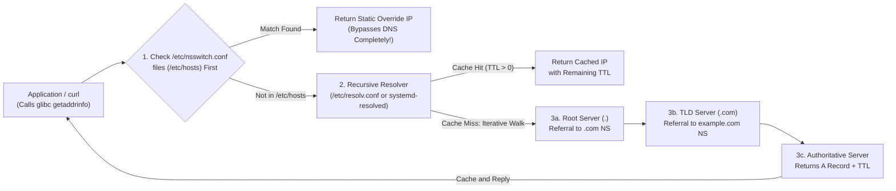
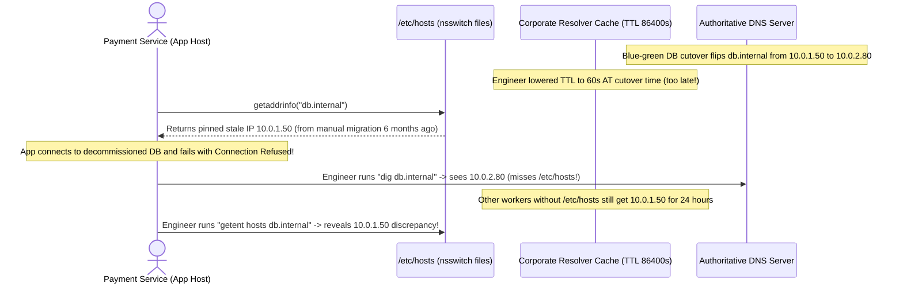

# DNS Fundamentals

> **Prerequisites:** [01 — IP Addressing & Subnetting](../01-ip-addressing-and-subnetting/README.md) and a Linux terminal with `dig`, `host`, `getent`, and `resolvectl`.  
> **Estimated Reading Time:** 25 minutes  
> **Target Audience:** Backend Engineers, Site Reliability Engineers, Cloud Architects.  
> **Free PDF Notes:** [SD-B-008: How DNS Resolution Works](https://backendroadmap.com/notes/system-design/SD-B-008.pdf), [SD-B-009: DNS Traffic Management](https://backendroadmap.com/notes/system-design/SD-B-009.pdf), [Phase 2, Networking (PDF)](https://backendroadmap.com/notes/system-design/Phase2_Networking_Notes.pdf)

> [!TIP]
> **The Golden Rule of DNS Debugging:** Always split **name resolution** from **network connectivity**, and never assume `dig` sees what your application sees. `dig` queries DNS servers directly, whereas applications follow `/etc/nsswitch.conf` (`getent hosts`), which normally checks `/etc/hosts` **before** contacting `/etc/resolv.conf`.

---

## 1. Architectural Mental Model: Hierarchy, Resolver Chain & Linux Lookup Order

Nearly every connection starts with a hostname, not an IP address. DNS is the distributed hierarchical database that runs **before** any TCP SYN packet is ever sent—and when DNS misbehaves, failures masquerade as "the server is down" or "the network dropped packets."

### The Domain Name Hierarchy (Right to Left)
Read `www.example.com.` from right to left (most general to most specific):
- `.` (trailing dot, usually implied): **Root** zone.
- `com`: **Top-Level Domain (TLD)**.
- `example`: **Second-Level / Registered Domain** controlled by an organization.
- `www`: **Subdomain / Host** inside `example.com`.

Each tier delegates authority downward. Root servers point to `.com` TLD servers; `.com` servers point to `example.com`'s **authoritative** name servers; authoritative servers hold the actual zone records.

### Recursive Queries vs. Iterative Resolution



- **Recursive query:** Your application asks the resolver, *"Find me the final IP for `www.example.com`."*
- **Iterative queries:** On a cache miss, the resolver walks Root -> TLD -> Authoritative server step by step (*"Who should I ask next?"*), then caches the result for **TTL seconds**.

### Caching & TTL (Not IP TTL!)
Every DNS record carries a **TTL (Time To Live)** in **seconds** dictating how long caches may hold the answer.
- **Name-collision warning:** IP-header TTL (module 00) is a *router hop counter*; DNS TTL is a *cache lifetime in seconds*. They share three letters and nothing else.
- **Propagation delay & migrations:** Old values remain cached worldwide until their TTL expires. Lower a record's TTL (e.g., to `60s`) *at least one full old-TTL cycle before* a migration—lowering it simultaneously with the IP change does not clear previously cached copies!

### Resolution Order on Linux
Applications call the C library (`getaddrinfo`), which reads `/etc/nsswitch.conf`—typically `hosts: files dns`. Thus `/etc/hosts` (`files`) overrides all of DNS silently. In WSL2 and containers, `/etc/resolv.conf` is often auto-generated, making `cat /etc/resolv.conf` and `getent hosts` essential before blaming upstream networks.

---

## 2. Taxonomic Comparison: DNS Record Types & Diagnostic Tools

| Record Type | Maps From -> To | Example Value | Operational Rule / Caveat |
| :--- | :--- | :--- | :--- |
| **A** | Name -> IPv4 address | `93.184.216.34` | Core IPv4 host record; multiple A records provide basic DNS round-robin |
| **AAAA** | Name -> IPv6 address | `2606:2800:220:1::...` | Modern dual-stack apps prefer AAAA when IPv6 is present |
| **CNAME** | Name -> Canonical Name (alias) | `www.example.com -> example.com` | **Cannot coexist** with other records (like MX/SOA/NS) at the same hostname/apex |
| **MX** | Domain -> Mail exchanger + priority | `10 mail.example.com` | Lower integer priority wins; points to hostnames (never raw IPs) |
| **NS** | Zone -> Authoritative name servers | `ns1.example.com` | Defines delegation boundaries from parent zone to authoritative zone |
| **TXT** | Name -> Arbitrary text string | `"v=spf1 include:..."` | Domain ownership verification, SPF/DKIM/DMARC email security |
| **PTR** | Reverse IP -> Hostname | `34.216.184.93.in-addr.arpa` | Reverse DNS (`dig -x`); many cloud IPs omit PTR or map to generic provider names |
| **SOA** | Zone -> Administrative metadata | Serial, Refresh, Min/Negative TTL | Governs zone replication and **negative caching TTL** (NXDOMAIN cache lifetime) |

### Diagnostic Tool Resolution Path Comparison

| Tool | Honors `/etc/hosts`? | Uses `/etc/resolv.conf`? | Displays DNS TTL & Authority? | Best Operational Use |
| :--- | :--- | :--- | :--- | :--- |
| **`getent hosts`** | **Yes** (follows `nsswitch.conf`) | Yes | No | Proving exactly what applications (`curl`, Python, Go) actually resolve |
| **`dig`** | **No** (queries DNS directly) | Yes (unless `@server` given) | **Yes** | Checking real DNS records, TTL countdowns, and bypassing local hosts overrides |
| **`dig @<server>`** | No | Overrides with `<server>` | **Yes** | Comparing local resolver cache vs. `8.8.8.8` or authoritative NS |
| **`dig +trace`** | No | Root hints walk | **Yes** | Walking delegation from `.` -> TLD -> Authoritative NS, bypassing all caches |
| **`resolvectl`** | Reports OS resolver view | Shows per-interface `systemd-resolved` | Yes (`resolvectl query`) | Inspecting split-DNS / VPN resolver routing and local cache flush |

---

## 3. Systematic Reference: Command Reference & Flag Breakdowns

| Command | What it does | Example |
| :--- | :--- | :--- |
| `dig` | Full-detail DNS query tool; shows the answer, TTL, and query path | `dig example.com A` |
| `dig @server` | Queries a *specific* DNS server, bypassing your default resolver | `dig @8.8.8.8 example.com` |
| `dig +trace` | Walks the delegation from the root, showing each referral | `dig +trace example.com` |
| `dig +short` | Prints just the answer, nothing else | `dig +short example.com` |
| `host` | Simple name-to-address lookup | `host example.com` |
| `getent hosts` | Resolves a name the way applications do (honors `/etc/hosts`) | `getent hosts example.com` |
| `nslookup` | Interactive/legacy lookup tool | `nslookup example.com` |
| `resolvectl` | Shows/queries systemd-resolved's configuration and cache | `resolvectl status` |

### Flag Breakdowns
- `dig @8.8.8.8 example.com A` — `@8.8.8.8` directs the query to that specific server instead of your configured resolver (great for comparing what different servers return); `example.com` is the name; `A` is the record type to request.
- `dig +trace example.com` — `+trace` makes `dig` itself perform the iterative walk from the root servers down, printing each delegation step, so you see the whole resolver chain rather than a cached final answer.
- `dig +short +noall +answer example.com` — `+short` collapses output to the bare answer; alternatively `+noall +answer` shows just the answer section with TTLs, useful for reading TTL values while staying concise.

---

## 4. Production War Story: The `/etc/hosts` Ghost Pin & Stale 24-Hour TTL Migration



### The Incident
During a primary database migration, engineers switched `db.internal` from `10.0.1.50` to `10.0.2.80` and lowered the DNS TTL from `86400` (24 hours) to `60` seconds at the time of cutover. Half the fleet kept failing with `Connection refused` to the old host, while one legacy node stayed broken even after caches expired.

### Post-Mortem Metrics
- **Severity:** SEV-1 (Write-Path Outage)
- **Mean Time to Detect (MTTD):** 1 minute
- **Mean Time to Resolution (MTTR):** 47 minutes (manual cache flush + hosts cleanup)

### Root Cause Analysis
1. **Stale Cache Freeze:** Lowering TTL at cutover time does *not* invalidate resolvers that already cached the old `86400s` record prior to cutover.
2. **Diagnostic Blindspot:** On the legacy node, `dig db.internal` returned the new IP `10.0.2.80`, misleading responders into blaming firewalls—because `dig` ignores `/etc/hosts`, where an old manual override (`10.0.1.50 db.internal`) had been left behind months earlier.

### The Fix & Architectural Hardening
1. Ran `getent hosts db.internal` vs `dig db.internal` to expose the `/etc/hosts` override immediately and deleted the static entry.
2. Enforced a migration runbook policy: lower DNS TTL to `60s` **at least 24–48 hours prior** to cutover, verify remaining TTL via `dig +noall +answer`, and ban manual `/etc/hosts` entries via configuration management.

---

## 5. Multi-Language Production Code: DNS Lookup Verifier & Latency Profiler

Production clients separate DNS resolution from socket establishment and inspect both IPv4 (`A`), IPv6 (`AAAA`), `TXT`, and `MX` records cleanly with strict context timeouts.

````carousel
### Go (`net.Resolver`)
```go
package main

import (
	"context"
	"fmt"
	"net"
	"time"
)

func InspectDNS(ctx context.Context, domain string, customDNS string) {
	// Default system resolver (uses /etc/hosts + /etc/resolv.conf)
	start := time.Now()
	ips, err := net.DefaultResolver.LookupHost(ctx, domain)
	fmt.Printf("[System getaddrinfo] %s -> %v (err=%v) in %s\n",
		domain, ips, err, time.Since(start).Round(time.Millisecond))

	// Direct custom DNS resolver (bypasses /etc/hosts, mirrors dig @server)
	directResolver := &net.Resolver{
		PreferGo: true,
		Dial: func(ctx context.Context, network, address string) (net.Conn, error) {
			d := net.Dialer{Timeout: 2 * time.Second}
			return d.DialContext(ctx, "udp", customDNS+":53")
		},
	}

	startDirect := time.Now()
	directIPs, err := directResolver.LookupIP(ctx, "ip4", domain)
	fmt.Printf("[Direct @%s]      %s -> %v (err=%v) in %s\n",
		customDNS, domain, directIPs, err, time.Since(startDirect).Round(time.Millisecond))

	txts, _ := directResolver.LookupTXT(ctx, domain)
	fmt.Printf("[TXT @%s]         %v\n", customDNS, txts)
}

func main() {
	ctx, cancel := context.WithTimeout(context.Background(), 5*time.Second)
	defer cancel()
	InspectDNS(ctx, "example.com", "8.8.8.8")
}
```
<!-- slide -->
### TypeScript (`node:dns/promises`)
```typescript
import dns from 'node:dns/promises';

export async function compareOsVsDirectDns(domain: string, dnsServer = '8.8.8.8') {
  // 1. OS resolver (calls getaddrinfo -> honors /etc/hosts + /etc/resolv.conf)
  const osStart = performance.now();
  const osResult = await dns.lookup(domain, { all: true }).catch((err) => err.message);
  const osMs = Math.round(performance.now() - osStart);

  // 2. Direct DNS Resolver instance (bypasses /etc/hosts, queries custom server)
  const resolver = new dns.Resolver({ timeout: 2500, tries: 2 });
  resolver.setServers([dnsServer]);

  const dnsStart = performance.now();
  const [aRecords, aaaaRecords, mxRecords] = await Promise.all([
    resolver.resolve4(domain, { ttl: true }).catch(() => []),
    resolver.resolve6(domain, { ttl: true }).catch(() => []),
    resolver.resolveMx(domain).catch(() => []),
  ]);
  const dnsMs = Math.round(performance.now() - dnsStart);

  return {
    domain,
    osGetaddrinfo: { result: osResult, durationMs: osMs },
    directServer: dnsServer,
    directQueryMs: dnsMs,
    aRecords,
    aaaaRecords,
    mxRecords,
  };
}

compareOsVsDirectDns('example.com').then((out) => console.log(JSON.stringify(out, null, 2)));
```
<!-- slide -->
### Python (`socket` System Resolution Profiler)
```python
import socket
import time
from typing import Dict, List


def resolve_system_records(hostname: str) -> Dict[str, object]:
    """
    Resolves hostname via OS getaddrinfo (honoring /etc/nsswitch.conf & /etc/hosts),
    separating IPv4 (A) and IPv6 (AAAA) results with exact latency timing.
    """
    t0 = time.perf_counter()
    try:
        entries = socket.getaddrinfo(hostname, None, socket.AF_UNSPEC, socket.SOCK_STREAM)
    except socket.gaierror as exc:
        return {
            "hostname": hostname,
            "error": str(exc),
            "duration_ms": round((time.perf_counter() - t0) * 1000, 2),
        }

    elapsed_ms = round((time.perf_counter() - t0) * 1000, 2)
    ipv4: List[str] = []
    ipv6: List[str] = []
    for family, _, _, _, sockaddr in entries:
        ip = sockaddr[0]
        if family == socket.AF_INET and ip not in ipv4:
            ipv4.append(ip)
        elif family == socket.AF_INET6 and ip not in ipv6:
            ipv6.append(ip)

    return {
        "hostname": hostname,
        "ipv4_a": ipv4,
        "ipv6_aaaa": ipv6,
        "duration_ms": elapsed_ms,
    }


if __name__ == "__main__":
    print(resolve_system_records("example.com"))
```
<!-- slide -->
### C# (`System.Net.Dns` Dual-Stack Resolver Inspector)
```csharp
using System;
using System.Diagnostics;
using System.Linq;
using System.Net;
using System.Net.Sockets;
using System.Threading;
using System.Threading.Tasks;

public static class DnsInspector
{
    public static async Task InspectHostAsync(string hostname, CancellationToken ct = default)
    {
        var sw = Stopwatch.StartNew();
        try
        {
            // Honors OS nsswitch/hosts order, matching application behavior
            IPHostEntry entry = await Dns.GetHostEntryAsync(hostname, ct);
            sw.Stop();

            var ipv4 = entry.AddressList
                .Where(a => a.AddressFamily == AddressFamily.InterNetwork)
                .Select(a => a.ToString());
            var ipv6 = entry.AddressList
                .Where(a => a.AddressFamily == AddressFamily.InterNetworkV6)
                .Select(a => a.ToString());

            Console.WriteLine($"Host: {entry.HostName} ({sw.ElapsedMilliseconds}ms)");
            Console.WriteLine($"  IPv4 (A):    {string.Join(", ", ipv4)}");
            Console.WriteLine($"  IPv6 (AAAA): {string.Join(", ", ipv6)}");
        }
        catch (SocketException ex)
        {
            Console.Error.WriteLine($"DNS resolution failed for {hostname}: {ex.SocketErrorCode}");
        }
    }
}
```
````

---

## 6. Practical Hands-On Verification CLI Workflows

### Workflow 1: Basic Lookups, App Resolution vs. `dig`, and Alternate Resolvers
1. **A basic lookup.** Run `dig example.com A`. Identify the `ANSWER SECTION`, the returned IP, and the TTL (the number before `IN A`).
2. **Just the answer.** Run `dig +short example.com` and `getent hosts example.com`. Note that `getent` is what your applications actually use (it consults `/etc/hosts` first), while `dig` always talks to a DNS server.
3. **Query a specific server.** Run `dig @8.8.8.8 example.com` and `dig @1.1.1.1 example.com`. Comparing answers from different resolvers is how you check whether a stale or wrong answer is local to you.

```bash
dig example.com A
dig +short example.com
getent hosts example.com
dig @8.8.8.8 example.com +noall +answer
dig @1.1.1.1 example.com +noall +answer
```
**Expected Output:**
```text
;; ANSWER SECTION:
example.com.        1842    IN  A   93.184.216.34

93.184.216.34
93.184.216.34   example.com
```

### Workflow 2: Caching TTL Countdown, Record Types, Delegation Trace & PTR
4. **Watch caching happen.** Run `dig example.com` twice in quick succession and compare the TTL values. Expected: the second query shows a *lower* TTL (counting down) if served from your resolver's cache; when it hits zero the resolver refetches.
5. **Explore record types.** Run `dig example.com MX`, `dig example.com NS`, `dig example.com TXT`, and `dig example.com AAAA`. Expected: NS lists authoritative name servers; MX may be empty for `example.com`; AAAA shows an IPv6 address; TXT shows any text records.
6. **Trace the delegation.** Run `dig +trace example.com`. Read it top to bottom: root servers -> `.com` servers -> authoritative servers -> final answer.
7. **Reverse lookup.** Take an IP from exercise 1 and run `dig -x <that-IP>`. This asks for the PTR record.

```bash
dig example.com +noall +answer && sleep 2 && dig example.com +noall +answer
dig example.com NS +short
dig example.com AAAA +short
dig +trace example.com | head -n 25
dig -x 8.8.8.8 +short
```
**Expected Output:**
```text
example.com.        1840    IN  A   93.184.216.34
example.com.        1838    IN  A   93.184.216.34
a.iana-servers.net.
b.iana-servers.net.
dns.google.
```

### Workflow 3: Diagnose and Fix `/etc/hosts` Overrides & Broken Resolvers
8. **Diagnose and fix: DNS not resolving.** Create the failure with a bad `/etc/hosts` override: `echo "127.0.0.1 example.com" | sudo tee -a /etc/hosts`, then `getent hosts example.com` (returns `127.0.0.1`!) and `curl -v http://example.com` (connects to your own machine and fails). Notice `dig example.com` still returns the *real* IP—because `dig` ignores `/etc/hosts`. That discrepancy (`dig` right, `getent`/`curl` wrong) is the fingerprint of a hosts-file override. **Fix:** remove the bad line—`sudo sed -i '/127.0.0.1 example.com/d' /etc/hosts`—then confirm `getent hosts example.com` again returns the real IP. This is the exact reason to check `/etc/hosts` and compare `dig` vs `getent` when a name resolves wrongly.
9. **Diagnose and fix: broken resolver.** Inspect `/etc/resolv.conf` (`cat /etc/resolv.conf`). Imagine it listed an unreachable `nameserver 10.0.0.253`. The symptom: every DNS lookup hangs then times out, but `dig @8.8.8.8 example.com` (bypassing the configured resolver) works instantly. That split—direct-to-8.8.8.8 works, default resolver hangs—points straight at a bad `nameserver` entry rather than at the network or the destination. (Don't edit WSL2's auto-generated resolv.conf permanently; just reason through the diagnosis.)

```bash
echo "127.0.0.1 example.com" | sudo tee -a /etc/hosts
getent hosts example.com
dig +short example.com
sudo sed -i '/127.0.0.1 example.com/d' /etc/hosts
getent hosts example.com
cat /etc/resolv.conf
```
**Expected Output:**
```text
# While broken override exists:
127.0.0.1       example.com   # getent sees override
93.184.216.34                 # dig ignores /etc/hosts!
# After removing override:
93.184.216.34   example.com
```

### Independent Challenge
A teammate reports that `api.internal.example` "won't connect" from their machine, but it works from yours. Design and carry out a diagnosis that distinguishes among four possibilities: (a) the name doesn't resolve at all on their box, (b) it resolves to a *different* IP than on yours, (c) it resolves correctly but the host is unreachable, or (d) a stale cache is involved. You must combine this module with **module 01**—because part of the diagnosis is checking whether the IP it resolves to is even in a routable/expected subnet versus a private or wrong range. Write down which command distinguishes each case.

<details>
<summary>Stuck? One hint</summary>

Split "resolve" from "reach." First compare `getent hosts api.internal.example` on both machines—if the IPs differ, suspect `/etc/hosts` or different resolvers (`cat /etc/resolv.conf`). Then check whether the resolved IP is even sane using your module-01 subnet knowledge (is it a `169.254.x`, a wrong private range, or a real one?). Only after the name resolves to a correct, expected IP do you test reachability of that IP directly with `ping`/`curl`. Comparing `dig` (real DNS) against `getent` (honors `/etc/hosts`) tells you whether a static override is in play.

</details>

---

## 7. Common Mistakes & Troubleshooting

- **Treating a resolution failure as a connectivity failure.** "Could not resolve host" never means the network is down—it means the name step failed. Don't check cables and firewalls for a DNS problem.
- **Forgetting `/etc/hosts` wins.** A stray line there silently overrides real DNS. When `dig` and `curl`/`getent` disagree, `/etc/hosts` is the prime suspect.
- **Trusting your local cache during a migration.** After a DNS change, your machine may serve the old value until TTL expires. Query the authoritative server (`dig @<authoritative-NS>`) or use `+trace` to see truth.
- **Confusing CNAME with a redirect.** A CNAME is a DNS-level alias resolved before any connection; it is not an HTTP redirect. Chained CNAMEs add lookups and latency.
- **Assuming `dig` reflects what apps see.** `dig` bypasses `/etc/hosts` and sometimes uses a different resolver path than the C library. For "what will my app actually get," use `getent hosts`.
- **Ignoring TTL when planning changes.** Lower the TTL *before* a migration, not during it—lowering it after the change still leaves old-TTL copies cached.
- **IP TTL and DNS TTL share a name and nothing else.** The TTL you saw in module 00 is an IP-header *hop counter* decremented by each router (a packet is dropped when it hits zero). The TTL here is a *caching duration in seconds* telling resolvers how long they may keep a DNS record before refetching. Same three letters, completely unrelated mechanisms—a DNS TTL of 3600 has nothing to do with hops, and an IP TTL of 64 has nothing to do with time. Don't let the collision confuse a diagnosis.

---

## 8. Operational Validation Checkpoints

<details>
<summary><strong>Question 1: `dig` Returns the New IP, While `curl` Still Hits the Old Host</strong></summary>

**Scenario:** After migrating `billing.internal` from `10.0.1.10` to `10.0.2.20`, `dig billing.internal +short` on a worker node returns `10.0.2.20`. Yet `curl -v http://billing.internal` on the exact same node still tries to connect to `10.0.1.10`.

What explains this discrepancy, and what single command proves it?

**Answer:**
`dig` queries the DNS resolver directly and **ignores `/etc/hosts`**, whereas `curl` uses glibc `getaddrinfo` via `/etc/nsswitch.conf`, which consults `/etc/hosts` (`files`) before `dns`. Running `getent hosts billing.internal` will reveal `10.0.1.10` from a forgotten static line in `/etc/hosts` (or an application-level JVM/pool DNS cache).

</details>

<details>
<summary><strong>Question 2: Lowering DNS TTL Moments Before Cutover</strong></summary>

**Scenario:** A domain has an `A` record with `TTL=86400` (24 hours). Five minutes before switching production to a disaster-recovery datacenter, an engineer changes the IP and updates the TTL to `60`. Half of global customers continue reaching the dead datacenter for hours.

Why did setting `TTL=60` fail to speed up propagation?

**Answer:**
Recursive resolvers worldwide already cached the *previous* record along with its `86400s` expiration timer before the cutover happened. They will not ask the authoritative server again—and therefore will never see the new `60s` TTL or the new IP—until their existing 24-hour cache expires. You must lower TTL to `60s` **at least 24 hours ahead of the cutover**.

</details>

<details>
<summary><strong>Question 3: CNAME Added at Zone Apex Breaks Inbound Email</strong></summary>

**Scenario:** A startup points its root domain `example.com` to a PaaS hostname using a `CNAME` record (`example.com CNAME app.paas.net`). Immediately, `MX` mail delivery for `@example.com` and `NS` delegation break.

Why does a `CNAME` violate DNS rules here, and what is the standard workaround?

**Answer:**
Per RFC 1034, a domain label holding a `CNAME` **cannot coexist with any other record type** (such as `NS`, `SOA`, or `MX`) at the exact same name—and the zone apex (`example.com`) always requires `SOA` and `NS` records. Instead, use an `A`/`AAAA` record at the apex (or provider-specific `ALIAS`/`ANAME` flattening) and reserve `CNAME` for subdomains like `www.example.com`.

</details>

---

## 9. Checkpoint Quiz

Write down your answer to each question before expanding it—checking without attempting first is the single easiest way to fool yourself into thinking you've learned this.

1. In the resolver chain, what is the difference between a recursive query and an iterative query?
2. Your app resolves `foo.example` to the wrong IP, but `dig foo.example` returns the right one. What's the most likely cause?
3. What does a record's TTL control, and why does that cause "DNS changes take up to 24 hours"?
4. Which record type maps a name to another name, and what restriction comes with it?
5. You changed an A record but still see the old IP. Name two ways to see the authoritative (real) current value.
6. What's the difference between what `dig` consults and what `getent hosts` consults?
7. Reading `www.example.com` right to left, name the root, TLD, and registered domain.

<details>
<summary>Show answers</summary>

1. Recursive: "find me the complete final answer"—what your program asks its resolver. Iterative: "just tell me the next step/referral"—what the resolver asks each server as it walks root -> TLD -> authoritative.
2. `/etc/hosts` (or `/etc/nsswitch.conf` order) is overriding DNS for that name, since `dig` ignores `/etc/hosts` but the app doesn't.
3. TTL is how many seconds caches may keep the record before refetching. Old values linger in caches worldwide until their TTL expires, so changes appear to "propagate" slowly.
4. CNAME. A name with a CNAME cannot also hold other record types at the same level.
5. Query the authoritative name server directly (`dig @<NS> ...`), or use `dig +trace` to walk from the root and bypass caches.
6. `dig` queries DNS servers directly (ignoring `/etc/hosts`); `getent hosts` follows the system resolver order (`/etc/nsswitch.conf`), which normally checks `/etc/hosts` first, so it reflects what applications actually get.
7. Root = the implied trailing `.`; TLD = `com`; registered/second-level domain = `example` (with `www` a subdomain of it).

</details>

---

## 10. Free PDF Notes & Sources

Download the notes for each video on this page as a printable PDF, with every diagram and interview questions: [SD-B-008: How DNS Resolution Works](https://backendroadmap.com/notes/system-design/SD-B-008.pdf), [SD-B-009: DNS Traffic Management](https://backendroadmap.com/notes/system-design/SD-B-009.pdf). Each section in one file: [Phase 2, Networking (PDF)](https://backendroadmap.com/notes/system-design/Phase2_Networking_Notes.pdf).

---

## Next Step

[03 — TCP, UDP, ports & sockets](../03-tcp-udp-ports-and-sockets/README.md): the name is resolved to an address—now learn how the transport layer actually opens a connection to a program on that host, reliably or not.
