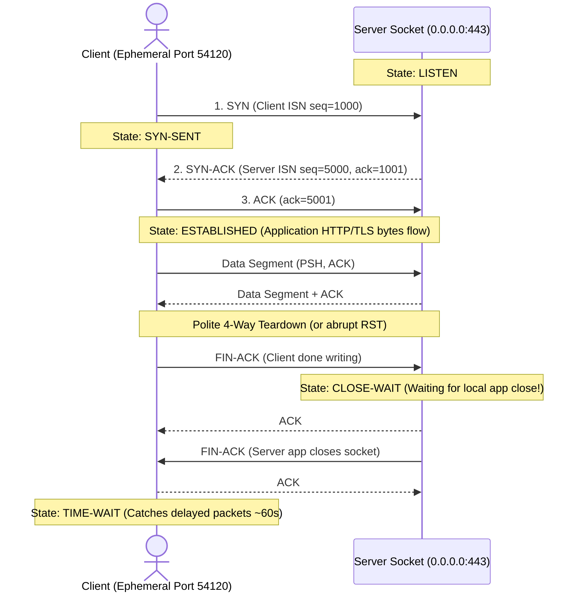
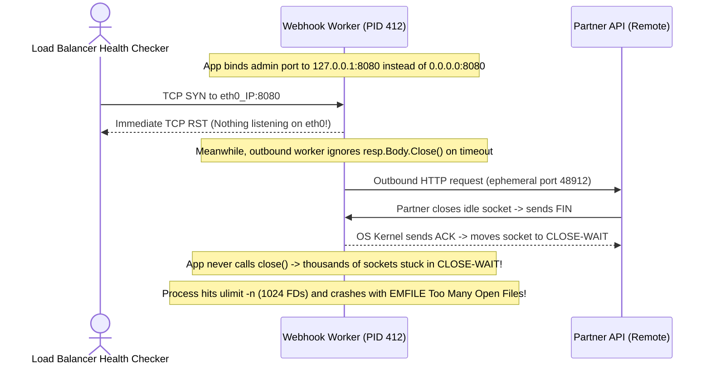

# TCP, UDP, Ports & Sockets

> **Prerequisites:** [02 — DNS Fundamentals](../02-dns-fundamentals/README.md) and a Linux terminal with `ss`, `nc` (netcat), `curl`, and `tcpdump`.  
> **Estimated Reading Time:** 30 minutes  
> **Target Audience:** Backend Engineers, Systems Engineers, Site Reliability Engineers.  
> **Free PDF Notes:** [SD-B-003: TCP Explained](https://backendroadmap.com/notes/system-design/SD-B-003.pdf), [SD-B-004: TCP Handshake, FIN/RST & TIME_WAIT](https://backendroadmap.com/notes/system-design/SD-B-004.pdf), [SD-B-005: UDP vs TCP](https://backendroadmap.com/notes/system-design/SD-B-005.pdf), [SD-B-007: Ports, Sockets & Routing](https://backendroadmap.com/notes/system-design/SD-B-007.pdf), [Phase 2, Networking (PDF)](https://backendroadmap.com/notes/system-design/Phase2_Networking_Notes.pdf)

> [!TIP]
> **The Golden Rule of Transport Troubleshooting:** **Instant `Connection refused` (TCP RST)** means the destination host is alive and reachable, but nothing is listening on that port. **Slow `Connection timed out` (stuck in `SYN-SENT`)** means your packets never got a reply—pointing to a firewall drop, dead host, or broken route. Always inspect `ss -tlnp` on the target before blaming the network.

---

## 1. Architectural Mental Model: Ports, 4-Tuple Sockets & TCP/UDP State Machines

The IP layer gets packets to the right **machine**; the transport layer routes them to the right **process** on that machine and decides whether delivery is reliable or best-effort. Every `Connection refused`, `Connection timed out`, and `Address already in use` you debug is a transport-layer event.

### Ports, Ephemeral Ports & the 4-Tuple
A **port number** (`0`–`65535`) is the apartment number after the IP street address:
- `0–1023`: **Well-known** privileged ports (HTTP `80`, HTTPS `443`, SSH `22`, DNS `53`; binding requires root/`CAP_NET_BIND_SERVICE`).
- `1024–49151`: **Registered** application ports (e.g., PostgreSQL `5432`, custom APIs `8080`).
- `49152–65535` (or Linux `32768–60999`): **Ephemeral** client source ports automatically chosen per outbound connection.

Every TCP connection is uniquely identified by a **4-tuple**: `(source IP, source port, destination IP, destination port)`. That is why a single server listening on `0.0.0.0:443` can handle tens of thousands of simultaneous clients—every client connection differs in source IP or ephemeral source port.

### Listening Sockets vs. Connected Sockets
A **socket** is the OS kernel file descriptor handle for one endpoint:
- **Listening socket:** Bound to `IP:port` (e.g., `0.0.0.0:443` or `127.0.0.1:8080`), waiting in `LISTEN` state to accept incoming connections.
- **Connected socket:** Created per accepted client, keyed to that client's exact **4-tuple**, leaving the listener free to accept more.

### TCP 3-Way Handshake, Teardown & Socket States



TCP builds a **reliable, ordered byte stream** over best-effort IP using sequence numbers, ACKs, retransmissions, and congestion control—at the cost of handshake RTT latency and kernel state.

### UDP: Connectionless, Low-Latency Datagrams
**UDP** adds only source/destination ports and a checksum to IP: **no handshake, no ACK, no retransmission, no ordering**. DNS queries, audio/video calls, and real-time gaming prefer UDP because retrying or skipping a lost packet is faster than stalling the entire stream (head-of-line blocking). Note that closed UDP ports may return ICMP "Port Unreachable" or stay completely silent, making `nc -zv -u` unreliable for reachability checks.

---

## 2. Taxonomic Comparison: TCP vs. UDP & Diagnostic Socket States

| Feature | TCP (Transmission Control Protocol) | UDP (User Datagram Protocol) |
| :--- | :--- | :--- |
| **Connection Model** | Connection-oriented (3-way SYN/SYN-ACK/ACK handshake) | Connectionless (single datagram, zero handshake) |
| **Delivery & Ordering** | Reliable, in-order byte stream with retransmission | Best-effort, unordered individual datagrams |
| **Latency Overhead** | At least 1 full RTT before first data byte (unless TFO) | Zero setup RTT; data leaves on packet 1 |
| **Closed Port Symptom** | Immediate **TCP RST** (`Connection refused`) | ICMP Port Unreachable or total silence |
| **Common Protocols** | HTTP/1.1, HTTP/2, HTTPS, SSH, PostgreSQL, Redis | DNS, DHCP, VoIP/WebRTC, QUIC (HTTP/3), Gaming |

### Reading `ss` TCP Connection States

| Socket State | Meaning | Diagnostic Signal |
| :--- | :--- | :--- |
| **`LISTEN`** | Server socket awaiting new clients | Verify bind IP: `127.0.0.1` (local only) vs `0.0.0.0` (all NICs) |
| **`ESTABLISHED`** | 3-way handshake complete; bytes flowing | Healthy active connections |
| **`SYN-SENT`** | Client sent `SYN`, waiting for `SYN-ACK` | Stuck here = packet dropped by firewall, dead host, or wrong IP |
| **`TIME-WAIT`** | Active closer lingering briefly (~60s) for stray packets | Normal on busy clients/proxies; clears automatically |
| **`CLOSE-WAIT`** | Remote sent `FIN`, local app has **not** closed socket | **Growing piles indicate an application file-descriptor/socket leak!** |

---

## 3. Systematic Reference: Command Reference & Flag Breakdowns

| Command | What it does | Example |
| :--- | :--- | :--- |
| `ss` | Shows sockets: listening ports, connections, and their states | `ss -tlnp` |
| `ss` (filtered) | Filters sockets by state or port | `ss -tan state established` |
| `nc` (netcat) | Opens or listens on TCP/UDP ports; a Swiss-army connection tool | `nc -zv example.com 443` |
| `nc -l` | Listens on a port (acts as a tiny server) | `nc -l 9000` |
| `curl` | Connects over TCP to test an application port | `curl -v telnet://example.com:80` |
| `tcpdump` | Captures packets so you can see SYN/ACK/FIN/RST | `sudo tcpdump -n -i any tcp port 80` |
| `/dev/tcp` | Bash built-in for a raw TCP connection test | `bash -c 'echo > /dev/tcp/example.com/443'` |

### Flag Breakdowns
- `ss -tlnp` — `-t` TCP only; `-l` listening sockets only; `-n` numeric (don't resolve ports to names, faster and clearer); `-p` show the owning process (needs sudo for others' processes). This is the single most useful "what's listening here?" command.
- `ss -tan state established` — `-t` TCP; `-a` all sockets (listening and non); `-n` numeric; `state established` filters to just established connections.
- `nc -zv example.com 443` — `-z` zero-I/O mode (just check if the port is open, send no data); `-v` verbose (prints success/failure); the host and port to test. Perfect for "is this port reachable?"
- `nc -l 9000` — `-l` listen mode, turning netcat into a minimal server on port 9000 so you can test connectivity to yourself.
- `sudo tcpdump -n -i any tcp port 80` — `-n` don't resolve IPs/ports to names; `-i any` capture on all interfaces; `tcp port 80` a filter expression limiting capture to TCP traffic on port 80.

---

## 4. Production War Story: The `CLOSE-WAIT` FD Leak & Loopback Bind Trap



### The Incident
A production webhook service began returning `500` errors with `socket: too many open files` every 6 hours, while newly deployed canary instances failed load balancer readiness checks immediately with `Connection refused`.

### Post-Mortem Metrics
- **Severity:** SEV-1 (Worker Pool Exhaustion)
- **Mean Time to Detect (MTTD):** 3 minutes
- **Mean Time to Resolution (MTTR):** 38 minutes

### Root Cause Analysis
Two transport mistakes appeared side by side:
1. **Unclosed Sockets (`CLOSE-WAIT` Leak):** The worker's HTTP client occasionally returned early on response parsing errors without closing the underlying TCP stream. When the remote peer closed (`FIN`), the Linux kernel moved those sockets to **`CLOSE-WAIT`**, holding file descriptors open indefinitely until the process hit `ulimit -n`.
2. **Loopback-Only Bind:** The canary's health server listened on `127.0.0.1:8080`. Local `curl localhost:8080` succeeded inside SSH sessions, while external load balancer health checks received immediate `RST` (`Connection refused`).

### The Fix & Architectural Hardening
1. Verified the leak with `ss -tan state close-wait | wc -l` and fixed every HTTP/socket code path to enforce deterministic cleanup (`defer conn.Close()` / `with` / `using` / `try-finally`).
2. Switched the listener bind address to `0.0.0.0:8080` (verified via `ss -tlnp`) and added an alert on per-process `CLOSE-WAIT` counts.

---

## 5. Multi-Language Production Code: Bounded-Timeout Listener & Leak-Free Client

Each implementation below demonstrates listening on `0.0.0.0`, accepting concurrent **connected sockets** per client **4-tuple**, enforcing strict timeouts so callers never hang indefinitely in `SYN-SENT`, and deterministically closing sockets to prevent `CLOSE-WAIT` leaks.

````carousel
### Go (`net.Listen` + Bounded Dialer)
```go
package main

import (
	"context"
	"fmt"
	"io"
	"net"
	"time"
)

// ProbeTCP verifies port reachability with a strict timeout, distinguishing
// instant RST (refused) from packet drops (timeout in SYN-SENT).
func ProbeTCP(ctx context.Context, addr string) error {
	dialer := net.Dialer{Timeout: 2 * time.Second}
	conn, err := dialer.DialContext(ctx, "tcp", addr)
	if err != nil {
		return err
	}
	defer conn.Close() // Guarantees FIN exchange; prevents CLOSE-WAIT leaks
	fmt.Printf("Connected: local=%s -> remote=%s\n", conn.LocalAddr(), conn.RemoteAddr())
	return nil
}

func StartEchoServer(addr string) error {
	// Binding 0.0.0.0 accepts connections on all interfaces (not just 127.0.0.1)
	ln, err := net.Listen("tcp", addr)
	if err != nil {
		return err
	}
	defer ln.Close()
	fmt.Println("Listening on", ln.Addr())

	for {
		conn, err := ln.Accept() // Returns a dedicated connected socket per 4-tuple
		if err != nil {
			return err
		}
		go func(c net.Conn) {
			defer c.Close()
			_ = c.SetDeadline(time.Now().Add(10 * time.Second))
			_, _ = io.Copy(c, c)
		}(conn)
	}
}

func main() {
	go func() { _ = StartEchoServer("0.0.0.0:19000") }()
	time.Sleep(100 * time.Millisecond)
	_ = ProbeTCP(context.Background(), "127.0.0.1:19000")
}
```
<!-- slide -->
### TypeScript (`node:net`)
```typescript
import net from 'node:net';

export function startTcpEchoServer(port: number, host = '0.0.0.0'): net.Server {
  const server = net.createServer((socket) => {
    // Each client gets its own connected socket keyed by its 4-tuple
    socket.setTimeout(10_000);
    socket.on('data', (chunk) => socket.write(chunk));
    socket.on('timeout', () => socket.end()); // Polite FIN teardown
    socket.on('error', () => socket.destroy());
  });

  server.listen(port, host, () => {
    console.log(`Listening on ${host}:${port}`);
  });
  return server;
}

export function probeTcpPort(host: string, port: number, timeoutMs = 2000): Promise<string> {
  return new Promise((resolve, reject) => {
    const socket = net.createConnection({ host, port });
    socket.setTimeout(timeoutMs);

    socket.once('connect', () => {
      const tuple = `${socket.localAddress}:${socket.localPort} -> ${socket.remoteAddress}:${socket.remotePort}`;
      socket.end(); // Sends FIN cleanly; avoids CLOSE-WAIT accumulation
      resolve(tuple);
    });
    socket.once('timeout', () => {
      socket.destroy();
      reject(new Error(`Timeout (SYN-SENT drop/unreachable) connecting to ${host}:${port}`));
    });
    socket.once('error', (err: NodeJS.ErrnoException) => {
      socket.destroy();
      reject(new Error(`TCP error (${err.code}): ${err.message}`));
    });
  });
}

const srv = startTcpEchoServer(19001);
probeTcpPort('127.0.0.1', 19001)
  .then((tuple) => console.log('4-tuple:', tuple))
  .finally(() => srv.close());
```
<!-- slide -->
### Python (`socket` Context Managers)
```python
import socket
import threading


def handle_client(conn: socket.socket, addr: tuple) -> None:
    # Context manager guarantees close() even on exceptions -> no CLOSE-WAIT leak
    with conn:
        conn.settimeout(10.0)
        while True:
            data = conn.recv(4096)
            if not data:
                break  # Peer sent FIN
            conn.sendall(data)


def run_tcp_server(host: str = "0.0.0.0", port: int = 19002) -> None:
    with socket.socket(socket.AF_INET, socket.SOCK_STREAM) as srv:
        srv.setsockopt(socket.SOL_SOCKET, socket.SO_REUSEADDR, 1)
        srv.bind((host, port))
        srv.listen(128)
        conn, addr = srv.accept()
        threading.Thread(target=handle_client, args=(conn, addr), daemon=True).start()


def probe_tcp(host: str, port: int, timeout: float = 2.0) -> str:
    try:
        with socket.create_connection((host, port), timeout=timeout) as sock:
            return f"OPEN 4-tuple: {sock.getsockname()} -> {sock.getpeername()}"
    except ConnectionRefusedError:
        return f"REFUSED (RST): host reachable, nothing listening on {host}:{port}"
    except TimeoutError:
        return f"TIMEOUT (SYN-SENT): packet dropped or host unreachable at {host}:{port}"


if __name__ == "__main__":
    t = threading.Thread(target=run_tcp_server, daemon=True)
    t.start()
    print(probe_tcp("127.0.0.1", 19002))
```
<!-- slide -->
### C# (`TcpListener` & `TcpClient` Deterministic Disposal)
```csharp
using System;
using System.Net;
using System.Net.Sockets;
using System.Threading;
using System.Threading.Tasks;

public static class TcpDiagnostics
{
    public static async Task<string> ProbePortAsync(string host, int port, int timeoutMs = 2000)
    {
        using var client = new TcpClient(); // Dispose guarantees socket close (no CLOSE-WAIT)
        using var cts = new CancellationTokenSource(timeoutMs);
        try
        {
            await client.ConnectAsync(host, port, cts.Token);
            return $"OPEN 4-tuple: {client.Client.LocalEndPoint} -> {client.Client.RemoteEndPoint}";
        }
        catch (OperationCanceledException)
        {
            return $"TIMEOUT (SYN-SENT): {host}:{port} dropped or unreachable";
        }
        catch (SocketException ex) when (ex.SocketErrorCode == SocketError.ConnectionRefused)
        {
            return $"REFUSED (RST): {host}:{port} reachable, no listening socket";
        }
    }

    public static async Task StartListenerAsync(int port, CancellationToken ct)
    {
        var listener = new TcpListener(IPAddress.Any, port); // 0.0.0.0:port
        listener.Start();
        try
        {
            using TcpClient accepted = await listener.AcceptTcpClientAsync(ct);
            await using NetworkStream stream = accepted.GetStream();
            byte[] buf = new byte[1024];
            int n = await stream.ReadAsync(buf, ct);
            if (n > 0) await stream.WriteAsync(buf.AsMemory(0, n), ct);
        }
        finally
        {
            listener.Stop();
        }
    }
}
```
````

---

## 6. Practical Hands-On Verification CLI Workflows

### Workflow 1: Inspect Listening Sockets & Stand Up a Temporary Listener
1. **See what's listening.** Run `ss -tlnp`. Read each line: local `address:port`, state `LISTEN`, and the process. Note the difference between something bound to `127.0.0.1:x` (loopback only) and `0.0.0.0:x` (all interfaces).
2. **Stand up a listener and connect.** In terminal A run `nc -l 9000`. In terminal B run `nc -zv 127.0.0.1 9000`—expect `succeeded`/`open`. Then in B run `ss -tlnp | grep 9000` to see your listener's socket. Stop A and re-run the `nc -zv`—now expect `Connection refused`.

```bash
ss -tlnp
# Terminal A: nc -l 9000
# Terminal B:
nc -zv 127.0.0.1 9000
ss -tlnp | grep 9000
```
**Expected Output:**
```text
Connection to 127.0.0.1 9000 port [tcp/*] succeeded!
LISTEN 0 1 0.0.0.0:9000 0.0.0.0:* users:(("nc",pid=1421,fd=3))
# After stopping Terminal A:
nc: connect to 127.0.0.1 port 9000 (tcp) failed: Connection refused
```

### Workflow 2: Capture the 3-Way Handshake, Probe Remote Ports & Compare UDP vs. TCP
3. **Watch the handshake.** In terminal A run `sudo tcpdump -n -i any tcp port 443`. In terminal B run `curl -s https://example.com >/dev/null`. In A's capture, identify the `[S]` (SYN), `[S.]` (SYN-ACK), and `[.]` (ACK) flags of the three-way handshake, then the `[F]`/`[R]` at teardown.
4. **Test remote ports.** Run `nc -zv example.com 443` (expect open) and `nc -zv -w 3 example.com 81` (expect timeout or refused).
5. **Read connection states & 6. Ephemeral ports and the 4-tuple.** Run `curl -s https://example.com >/dev/null &` a few times quickly, and during them `ss -tan state established` (or inspect `TIME-WAIT` immediately afterward). Notice each connection has the same remote `IP:443` but a *different local ephemeral port*—the 4-tuple in action.
7. **UDP vs TCP behavior.** Run `dig example.com` while capturing with `sudo tcpdump -n -i any udp port 53`. Note DNS uses UDP—a single query and response, no handshake. Contrast with the TCP handshake you saw in exercise 3.

```bash
nc -zv example.com 443
nc -zv -w 3 example.com 81
ss -tan
sudo tcpdump -n -i any -c 4 udp port 53
```
**Expected Output:**
```text
Connection to example.com (93.184.216.34) 443 port [tcp/https] succeeded!
nc: connect to example.com port 81 (tcp) timed out: Operation now in progress
# tcpdump udp port 53 shows 2 packets (query + response) with zero SYN/ACK!
```

### Workflow 3: Diagnose & Fix Wrong-Interface Bind and Dead-Port Refusal vs. Drop
8. **Diagnose and fix: service on the wrong interface.** Start a listener bound only to loopback: `nc -l 127.0.0.1 9000` in terminal A. From terminal B, `nc -zv 127.0.0.1 9000` succeeds, but `nc -zv <your-eth0-IP> 9000` **fails**—the service is listening on `127.0.0.1` only, so it's unreachable from any real interface. Confirm with `ss -tlnp | grep 9000` (you'll see `127.0.0.1:9000`, not `0.0.0.0:9000`). **Fix:** stop it and rebind to all interfaces—`nc -l 0.0.0.0 9000`—then `nc -zv <your-eth0-IP> 9000` succeeds. "Works on localhost but not from other hosts" almost always means a service bound to `127.0.0.1` instead of `0.0.0.0`; `ss -tlnp` shows it instantly.
9. **Diagnose and fix: connect to a dead port.** Run `curl -v --connect-timeout 3 http://127.0.0.1:9999`. You get `Connection refused` immediately (a RST—the host is up, no socket listening). Contrast with `curl -v --connect-timeout 3 http://10.255.255.1:9999`, which *hangs* then times out (no host / packets dropped, no RST). The distinction—instant refused vs slow timeout—tells you "host up, nothing listening" versus "can't even reach the host," a diagnostic split you'll use constantly.

```bash
ss -tlnp | grep 9000
curl -v --connect-timeout 3 http://127.0.0.1:9999
curl -v --connect-timeout 3 http://10.255.255.1:9999
```
**Expected Output:**
```text
# 127.0.0.1:9999 (instant RST):
* connect to 127.0.0.1 port 9999 failed: Connection refused
# 10.255.255.1:9999 (3s timeout):
* Connection timed out after 3001 milliseconds
```

### Independent Challenge
You're told an internal HTTP service "should be running on port 8080 on host X but clients can't reach it." Without being given any commands, construct a diagnosis that determines, in order: whether anything is listening on 8080 at all, whether it's bound to the right interface, whether the TCP handshake completes from a client, and—if it does complete but the client still fails—whether the problem has moved *above* the transport layer. This requires combining this module with **module 02 (DNS)**: part of "clients can't reach it" may be that clients resolve host X's name to the wrong address entirely, so verify the name-to-address step before ever touching ports.

<details>
<summary>Stuck? One hint</summary>

Work bottom-up but start one layer higher than you think: first confirm the client resolves host X to the IP you expect (`getent hosts X` — module 02), because a wrong IP makes every port test meaningless. Then on the server use `ss -tlnp` to prove something is in LISTEN on 8080 and check whether it's `0.0.0.0:8080` or `127.0.0.1:8080`. From the client, `nc -zv X 8080` tests whether the handshake completes. If the handshake completes but the app still fails, the transport layer did its job and the fault is application-layer (HTTP), which is the next module.

</details>

---

## 7. Common Mistakes & Troubleshooting

- **Confusing "connection refused" with "connection timed out."** Refused = host reachable, nothing listening (a RST came back, fast). Timed out = no response at all, usually a firewall dropping packets or a wrong/dead address (slow). These point to completely different fixes.
- **Binding to `127.0.0.1` and expecting external access.** A service on loopback is invisible to other hosts. Bind to `0.0.0.0` (or a specific external interface) for reachability. `ss -tlnp` reveals which.
- **Panicking over TIME-WAIT.** Many TIME-WAIT sockets on a busy client are normal and harmless; they clear on their own. CLOSE-WAIT piling up, by contrast, is a real app bug.
- **Assuming UDP "connections."** UDP is connectionless—there's no handshake and often no error when a port is closed, so `nc -zv -u` results are unreliable. UDP reachability often needs application-level confirmation.
- **Forgetting privileged ports need root.** Binding a port below 1024 without privileges fails with "permission denied," which looks like a code bug but is a permissions issue.
- **"Address already in use."** A previous process still holds the port (often in TIME-WAIT or still running). Find it with `ss -tlnp` before assuming your code is wrong.

---

## 8. Operational Validation Checkpoints

<details>
<summary><strong>Question 1: Service Works via Localhost, Refuses Connections from Other Hosts</strong></summary>

**Scenario:** A newly deployed Python microservice responds with `200 OK` when you run `curl http://127.0.0.1:8080/health` on the server itself, yet requests from an upstream proxy to the server's LAN IP `10.0.3.15:8080` immediately fail with `Connection refused`.

What is the cause, and what `ss` output confirms it?

**Answer:**
The application bound its listening socket strictly to loopback (`127.0.0.1:8080`), so the kernel refuses traffic arriving on `eth0` (`10.0.3.15`) with a TCP `RST`. Running `ss -tlnp | grep 8080` will display `LISTEN ... 127.0.0.1:8080` instead of `0.0.0.0:8080` (or `*:8080`). Reconfigure the app to bind `0.0.0.0:8080`.

</details>

<details>
<summary><strong>Question 2: 15,000 `TIME-WAIT` Sockets vs. 2,500 `CLOSE-WAIT` Sockets</strong></summary>

**Scenario:** On Host A (an API gateway making short outbound HTTP calls), `ss -tan` shows 15,000 sockets in `TIME-WAIT`. On Host B (a backend worker), `ss -tan` shows 2,500 sockets in `CLOSE-WAIT` growing linearly every hour.

Which host has a code bug, and why?

**Answer:**
**Host B** has a file-descriptor/socket leak bug. `CLOSE-WAIT` means the remote peer already closed (`FIN`), and the local application has failed to call `close()` on its socket descriptor—these never clear until the process exits or crashes. Host A's `TIME-WAIT` sockets are normal TCP lingering after active closures (`2*MSL`) and clear automatically (though HTTP keep-alive connection pooling reduces churn).

</details>

<details>
<summary><strong>Question 3: `nc -zv -u` Reports Succeeded on a Dead UDP Port</strong></summary>

**Scenario:** An SRE runs `nc -zv -u 10.0.4.20 5353` to verify whether a custom UDP telemetry collector is running, sees `succeeded`, and closes the ticket—yet zero telemetry arrives.

Why is `nc -zv -u` misleading for UDP services?

**Answer:**
UDP is connectionless and has no `SYN`/`SYN-ACK` handshake. When netcat sends a UDP probe and receives neither an immediate ICMP Port Unreachable nor a timeout failure (or when a firewall silently drops the UDP packet), `nc` often reports success even though nothing is listening. Always verify UDP services on the host with `ss -ulnp` or via an application-level query/response.

</details>

---

## 9. Checkpoint Quiz & Cumulative Review

### Checkpoint Quiz
Write down your answer to each question before expanding it—checking without attempting first is the single easiest way to fool yourself into thinking you've learned this.

1. What does a port number identify, and what does an IP address identify? Why does a connection need both ends' IPs *and* ports?
2. List the three steps of the TCP three-way handshake and what each one signals.
3. You see a socket in state `LISTEN` vs `ESTABLISHED` vs `SYN-SENT`. What does each tell you about where a connection stands?
4. Give two concrete differences between TCP and UDP, and one service that fits each and why.
5. Why can one web server on `0.0.0.0:443` handle thousands of simultaneous clients? Reference the 4-tuple.
6. What's the difference in observed behavior between connecting to a port with nothing listening versus a port a firewall is dropping?
7. A service works via `curl 127.0.0.1:8080` but not from another host. What's the most likely cause and which command confirms it?
8. What does a growing pile of `CLOSE-WAIT` sockets usually indicate, and how does that differ from many `TIME-WAIT` sockets?

<details>
<summary>Show answers</summary>

1. A port identifies which program/socket on a host; an IP identifies which host. A connection is a 4-tuple (source IP+port, destination IP+port); both ends' ports are needed so the OS can demultiplex which specific conversation each packet belongs to.
2. SYN (client requests a connection, sends its initial sequence number), SYN-ACK (server accepts, sends its own sequence number and acknowledges the client's), ACK (client acknowledges the server's—connection established, data can flow).
3. LISTEN: a server socket waiting for incoming connections (service is ready). ESTABLISHED: handshake complete, data flowing. SYN-SENT: the client sent a SYN and is still waiting for the SYN-ACK—stuck here means the reply never came (firewall drop, host down, wrong address).
4. TCP is connection-oriented, reliable, ordered (handshake, acks, retransmission); UDP is connectionless, best-effort, unordered, no handshake. HTTP/SSH/databases use TCP (every byte must arrive correctly); DNS/voice/video/gaming use UDP (timeliness beats completeness, loss is cheaper to tolerate or retry).
5. Every client connection is a distinct 4-tuple (differing in source IP and/or source port), so the server distinguishes them all even though its side is always `IP:443`. The single listening socket only accepts; each accepted connection is its own connected socket keyed by the 4-tuple.
6. Nothing listening -> an immediate RST -> "connection refused" (fast). Firewall dropping -> no response at all -> "connection timed out" (slow).
7. The service is bound to `127.0.0.1` (loopback only) instead of `0.0.0.0` (all interfaces). `ss -tlnp` confirms it by showing `127.0.0.1:8080` rather than `0.0.0.0:8080`.
8. Many CLOSE-WAIT usually means an application bug—the remote closed but the local app isn't closing its sockets (a leak). Many TIME-WAIT is normal on a busy client (recently closed connections lingering briefly) and clears on its own.

</details>

### Cumulative Review (Modules 00–03)
Closed-book. Don't reopen earlier modules while attempting these. These deliberately mix concepts across modules 00–03.

1. You run `curl http://shop.example`. Walk from the name to the first byte of the HTTP request, naming which layer/step handles: resolving the name, deciding whether the destination is local or via the gateway, choosing a source port, and establishing the connection.
2. A host is `10.0.5.40/29`. It tries to reach `10.0.5.44` on port 22 and it fails. Explain, using addressing *and* transport reasoning, at least two distinct things that could be wrong and how you'd tell them apart.
3. `dig example.com` returns the correct IP, but `nc -zv example.com 443` times out. Which layers are proven working and which is suspect? What single follow-up test narrows it further?
4. Why does DNS traditionally use UDP while HTTP uses TCP? Tie your answer to what each protocol guarantees and what each application can tolerate.
5. A connection sits in SYN-SENT and never advances. Relate this to the three-way handshake: which specific packet is missing, and name two lower-layer causes.
6. Explain how one server on `0.0.0.0:443` handles 5,000 simultaneous clients, referencing the 4-tuple and the difference between a listening socket and a connected socket.
7. `getent hosts api.example` returns `169.254.10.5`. Before you even test the port, why is this address already a red flag, and what does it usually mean?
8. Put SYN, SYN-ACK, ACK, and RST on the mental-model layer stack: which layer are they, and what does each tell you when you see it in a `tcpdump` capture?

<details>
<summary>Show answers</summary>

1. Name -> IP is DNS at the application layer (module 02), a separate step before any packet. Local-vs-gateway is the IP layer applying the subnet mask (module 01/00). Choosing a source port and doing the handshake is TCP at the transport layer (module 03), using an ephemeral source port and destination port 80. Only after the SYN/SYN-ACK/ACK completes does the HTTP request go out (module 00 encapsulation).
2. `10.0.5.40/29` covers `10.0.5.40`–`.47`, so `.44` *is* on the same subnet—good. Possibilities: (a) nothing is listening on 22 on `.44` (would give an immediate "connection refused"/RST); (b) a firewall is dropping the SYN (would give a slow *timeout*, connection stuck in SYN-SENT); (c) the host is down (also timeout). Tell them apart by the speed and nature of failure: instant refused vs slow timeout, and by checking `ss -tlnp` on `.44` and any firewall rules.
3. DNS/application resolution works and the name is correct. The suspect is transport/IP reachability to port 443—likely a firewall dropping the SYN or the host being down (timeout, not refused). Follow up with `ping <IP>` and/or `curl -v --connect-timeout 3` to distinguish "host unreachable" from "port filtered," and try another port to see if it's port-specific.
4. DNS queries are small, single request/response, and can simply be retried if lost—timeliness beats the overhead of a TCP handshake, so UDP fits. HTTP needs every byte of a page/response delivered correctly and in order, so it needs TCP's reliability and ordering despite the setup cost.
5. The SYN-ACK (server's reply) never came back. Lower-layer causes: a firewall dropping the SYN or the SYN-ACK, the destination host being down/unreachable, or the wrong IP so no one answers.
6. Every client's connection is a distinct 4-tuple (their source IP+port differs), so the server distinguishes them even though its side is always `IP:443`. The single listening socket only accepts; each accepted connection becomes its own connected socket keyed by the 4-tuple, so thousands coexist.
7. `169.254.x.x` is link-local—a self-assigned address that appears when the host failed to get a real one (module 01). It's not a routable service address, so any port test is pointless; fix address assignment/DNS first.
8. They're transport-layer (TCP). SYN = a client is trying to open a connection; SYN-ACK = the server accepted and replied (path works both ways so far); ACK = handshake complete, data can flow; RST = abrupt refusal/reset, typically "no socket listening on that port" or a forced close. Seeing SYN but no SYN-ACK means the request left but nothing came back—look lower (firewall/host).

</details>

---

## 10. Free PDF Notes & Sources

Download the notes for each video on this page as a printable PDF, with every diagram and interview questions: [SD-B-003: TCP Explained](https://backendroadmap.com/notes/system-design/SD-B-003.pdf), [SD-B-004: TCP Handshake, FIN/RST & TIME_WAIT](https://backendroadmap.com/notes/system-design/SD-B-004.pdf), [SD-B-005: UDP vs TCP](https://backendroadmap.com/notes/system-design/SD-B-005.pdf), [SD-B-007: Ports, Sockets & Routing](https://backendroadmap.com/notes/system-design/SD-B-007.pdf). Each section in one file: [Phase 2, Networking (PDF)](https://backendroadmap.com/notes/system-design/Phase2_Networking_Notes.pdf).

---

## Next Step

[05 — Routing, NAT & firewalls](../05-routing-nat-and-firewalls/README.md): you have a reliable TCP connection between two hosts—now learn how packets actually choose a path between them, get their addresses translated, and are permitted or blocked along the way. The application protocols that ride on TCP are taught in the backend track: [HTTP protocol basics](../../../backend/01-request-response-fundamentals/01-http-protocol-basics/README.md) and [TLS, SSL and HTTPS](../../../backend/01-request-response-fundamentals/09-tls-ssl-and-https/README.md).
