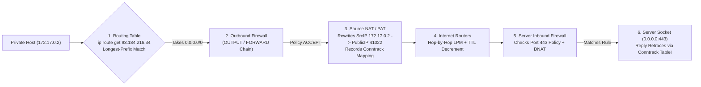
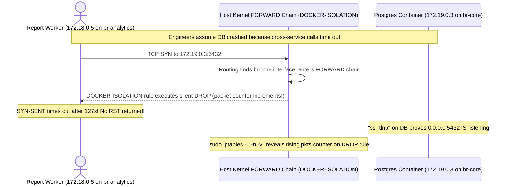

# Routing, NAT & Firewalls

> **Prerequisites:** [03 — TCP, UDP, Ports & Sockets](../03-tcp-udp-ports-and-sockets/README.md) and a Linux terminal with `ip`, `traceroute`, `iptables`/`nft`, and `nc`.  
> **Estimated Reading Time:** 30 minutes  
> **Target Audience:** Backend Engineers, Cloud Infrastructure Engineers, Site Reliability Engineers.

> [!TIP]
> **The Golden Rule of Packet Traversal:** Always trace a packet in strict kernel pipeline order: **Routing Table (Longest-Prefix Match) -> Outbound Firewall -> Source NAT (Masquerade/PAT) -> Network Hops -> Inbound Firewall / DNAT**. Outbound connectivity succeeding proves nothing about inbound reachability, and a timeout demands checking both `ip route get` and firewall drop counters.

---

## 1. Architectural Mental Model: Longest-Prefix Routing, NAT & Stateful Firewalls

Every packet leaving your machine answers three questions: **which direction should it go** (routing), **what source address should it carry across network boundaries** (NAT), and **is it permitted** (firewalls). These three mechanisms govern every cloud VPC route table, NAT gateway, container bridge, and security group.

### The Routing Table & Longest-Prefix Matching
A host or router forwards packets using its **routing table**, selecting the **most specific matching prefix (longest prefix match)**:
- **Directly connected routes:** Subnets attached to a local NIC (e.g., `172.28.16.0/20 dev eth0 scope link`).
- **Default route (`0.0.0.0/0`):** Least specific match (0 prefix bits), acting as the catch-all gateway for the rest of the internet.

If a table has both `10.0.0.0/8 via A` and `10.5.0.0/16 via B`, traffic to `10.5.1.1` takes `B` because `/16` is more specific than `/8`. No single router holds the whole internet map—forwarding is a relay race where each router chooses its own next hop independently (populated statically or dynamically via BGP).

### NAT: SNAT / PAT vs. DNAT
Private RFC 1918 addresses (`10/8`, `172.16/12`, `192.168/16`) cannot route on the public internet. **NAT (Network Address Translation)** rewrites packet headers at network boundaries:
- **Source NAT / PAT (Masquerade):** Rewrites the source IP (and ephemeral source port) of outbound packets to the gateway's public IP, recording a flow entry in a translation table so reply packets rewrite back to the private host.
- **Destination NAT (DNAT / Port Forwarding):** Rewrites the destination `IP:port` of *inbound* packets to redirect traffic from an external IP to an internal server or container.

Because SNAT relies on outbound initiation to populate its table, **NAT is outbound-friendly and inbound-hostile**: containers and laptops can `curl` the internet freely, while inbound connections fail unless explicit DNAT port forwarding exists.

### Firewalls: Policy, Statefulness & Drop vs. Reject
A **firewall** permits or blocks packets by source/destination IP, port, protocol, and chain direction (`INPUT`, `OUTPUT`, `FORWARD`):
- **Default Policy:** `DROP` (default-deny, standard in production/cloud security groups) vs. `ACCEPT` (default-allow).
- **Stateful vs. Stateless:** **Stateful** firewalls (`nftables`, `iptables conntrack`, AWS/Azure security groups) track active connections so permitting outbound initiation automatically allows return replies; **stateless** firewalls (cloud NACLs) filter every packet independently in both directions.
- **Silent `DROP` vs. `REJECT` vs. Closed Port:** A closed port sends TCP `RST` (**instant `Connection refused`**); a firewall `DROP` discards silently (**slow `Connection timed out`**); `REJECT` sends ICMP unreachable immediately.

### End-to-End Packet Journey Combining All Three



---

## 2. Taxonomic Comparison: NAT Flavors, Firewalls & Failure Fingerprints

| Mechanism | Rewrites / Inspects | Directionality | Operational Behavior |
| :--- | :--- | :--- | :--- |
| **SNAT / PAT (`MASQUERADE`)** | Rewrites **Source IP + Port** | Outbound initiation | Lets many private hosts share one public IP; blocks unsolicited inbound |
| **DNAT (Port Forward)** | Rewrites **Destination IP + Port** | Inbound initiation | Exposes a private container/VM port via an external IP:port |
| **Stateful Firewall** | Tracks connection 5-tuple (`conntrack`) | Tracks session state | Rule on initiating direction automatically permits return traffic |
| **Stateless Firewall / NACL** | Inspects each packet independently | Strict per-direction | Requires explicit inbound **and** outbound ephemeral-port rules |

### Failure Symptom Diagnostic Matrix

| Observed Client Symptom | Timing | Kernel / Network Cause | Next Verification Command |
| :--- | :--- | :--- | :--- |
| **`Connection refused`** | Instant (`< 5 ms`) | Host reachable; no socket listening (TCP `RST`) | `ss -tlnp` on destination host |
| **`Connection timed out`** | Slow (`3s–120s`) | Silent firewall `DROP`, asymmetric route, or dead host | `ip route get <dst>` and `sudo iptables -L -n -v` |
| **`No route to host`** | Fast or after ARP fail | Missing route entry or local ARP / ICMP reject | `ip route` and `ip neigh` |
| **Outbound OK, Inbound Fails** | Timeout externally | NAT asymmetry without DNAT, or `INPUT`/`DOCKER-ISOLATION` drop | `sudo iptables -t nat -L -n -v` |

---

## 3. Systematic Reference: Command Reference & Flag Breakdowns

| Command | What it does | Example |
| :--- | :--- | :--- |
| `ip route` | Shows the routing table | `ip route` |
| `ip route get` | Shows which route/gateway a specific destination uses | `ip route get 8.8.8.8` |
| `ip route add` | Adds a static route (needs sudo) | `sudo ip route add 10.9.0.0/24 via 10.0.0.1` |
| `traceroute` | Reveals the routers (hops) toward a destination | `traceroute -n example.com` |
| `sudo iptables -L -n -v` | Lists firewall rules and packet counts (legacy but readable) | `sudo iptables -L -n -v` |
| `sudo nft list ruleset` | Lists the modern nftables firewall ruleset | `sudo nft list ruleset` |
| `sudo iptables -t nat -L -n` | Shows NAT rules (masquerade/DNAT) | `sudo iptables -t nat -L -n` |
| `nc -zv` | Tests whether a port is reachable (times out when firewalled) | `nc -zv host 443` |

### Flag Breakdowns
- `sudo ip route add 10.9.0.0/24 via 10.0.0.1` — `add` inserts a route; `10.9.0.0/24` is the destination prefix; `via 10.0.0.1` is the next-hop router to send matching packets to. Add `dev eth0` to pin the interface.
- `traceroute -n example.com` — `-n` prints numeric IPs instead of resolving each hop to a name (faster, and avoids DNS noise while you're diagnosing routing). Each line is a hop, exploiting TTL as covered in module 00.
- `sudo iptables -L -n -v` — `-L` list rules; `-n` numeric (don't resolve addresses/ports); `-v` verbose (shows packet and byte counters per rule, so you can see which rule is actually catching traffic). The counters are the key diagnostic: a rule with rising drop counts is catching your packets.
- `sudo iptables -t nat -L -n` — `-t nat` selects the NAT table (default is `filter`); reveals `MASQUERADE`/`SNAT` (source rewriting) and `DNAT` (port forwarding) rules.

---

## 4. Production War Story: Cross-Bridge Silent Drops & Overlapping Private CIDRs



### The Incident
After splitting a monolith into microservice stacks using separate Docker Compose bridges (`br-core` `172.19.0.0/16` and `br-analytics` `172.18.0.0/16`), the `report` worker stopped reaching PostgreSQL, timing out on every query while the `web` service on `br-core` remained completely healthy.

### Post-Mortem Metrics
- **Severity:** SEV-1 (Reporting Pipeline Stall)
- **Mean Time to Detect (MTTD):** 5 minutes
- **Mean Time to Resolution (MTTR):** 34 minutes

### Root Cause Analysis
1. Both `br-core` and `br-analytics` had valid subnet routes via the Linux host bridge interfaces, and `ss -tlnp` proved PostgreSQL was listening on `0.0.0.0:5432`.
2. However, Docker intentionally inserts `DOCKER-ISOLATION` rules into the kernel `FORWARD` chain to **silently `DROP`** traffic crossing between distinct user-defined bridges, creating a clean timeout instead of a fast `Connection refused`.
3. Separately, a VPN tunnel into a partner network conflicted because both sides used `192.168.1.0/24` (overlapping private CIDR ambiguity).

### The Fix & Architectural Hardening
1. Checked `sudo iptables -L -n -v` and observed rising packet counters on the `DOCKER-ISOLATION` `DROP` rule.
2. Attached `report` to the shared `br-core` network rather than hand-patching ephemeral `iptables` rules, and standardized VPC/VPN CIDR planning to ban overlapping `192.168.1.0/24` blocks.

---

## 5. Multi-Language Production Code: Longest-Prefix Route Matcher & Stateful Conntrack Simulator

Each implementation models the kernel's two core operations from this module: **Longest-Prefix Match (LPM)** across CIDR routes (falling back to `0.0.0.0/0`) and **stateful NAT/firewall flow tracking** (permitting replies for tracked outbound flows while rejecting unsolicited inbound packets).

````carousel
### Go (Longest-Prefix Match + Stateful Conntrack)
```go
package main

import (
	"fmt"
	"net/netip"
	"sort"
)

type Route struct {
	Prefix  netip.Prefix
	NextHop string
	Dev     string
}

type FlowKey struct {
	SrcIP, DstIP     netip.Addr
	SrcPort, DstPort uint16
	Proto            string
}

func LongestPrefixMatch(routes []Route, dst netip.Addr) (Route, bool) {
	var best Route
	bestBits := -1
	for _, r := range routes {
		if r.Prefix.Contains(dst) && r.Prefix.Bits() > bestBits {
			best = r
			bestBits = r.Prefix.Bits()
		}
	}
	return best, bestBits >= 0
}

type StatefulFirewall struct {
	conntrack map[FlowKey]bool
}

func (fw *StatefulFirewall) AllowPacket(pkt FlowKey, outbound bool) string {
	reverse := FlowKey{SrcIP: pkt.DstIP, DstIP: pkt.SrcIP, SrcPort: pkt.DstPort, DstPort: pkt.SrcPort, Proto: pkt.Proto}
	if outbound {
		fw.conntrack[pkt] = true
		return "ACCEPT (Outbound initiates flow + records conntrack)"
	}
	if fw.conntrack[reverse] {
		return "ACCEPT (Inbound matches stateful RELATED/ESTABLISHED flow)"
	}
	return "DROP (Unsolicited inbound rejected by default-deny policy)"
}

func main() {
	routes := []Route{
		{Prefix: netip.MustParsePrefix("0.0.0.0/0"), NextHop: "172.28.16.1", Dev: "eth0"},
		{Prefix: netip.MustParsePrefix("10.0.0.0/8"), NextHop: "10.0.0.1", Dev: "tun0"},
		{Prefix: netip.MustParsePrefix("10.5.0.0/16"), NextHop: "10.5.0.1", Dev: "wg0"},
	}
	sort.Slice(routes, func(i, j int) bool { return routes[i].Prefix.Bits() > routes[j].Prefix.Bits() })

	dst := netip.MustParseAddr("10.5.1.1")
	win, _ := LongestPrefixMatch(routes, dst)
	fmt.Printf("ip route get %s -> prefix %s via %s dev %s\n", dst, win.Prefix, win.NextHop, win.Dev)

	fw := &StatefulFirewall{conntrack: make(map[FlowKey]bool)}
	out := FlowKey{SrcIP: netip.MustParseAddr("172.17.0.2"), DstIP: netip.MustParseAddr("93.184.216.34"), SrcPort: 51000, DstPort: 443, Proto: "TCP"}
	reply := FlowKey{SrcIP: netip.MustParseAddr("93.184.216.34"), DstIP: netip.MustParseAddr("172.17.0.2"), SrcPort: 443, DstPort: 51000, Proto: "TCP"}
	fmt.Println("Outbound:", fw.AllowPacket(out, true))
	fmt.Println("Reply:   ", fw.AllowPacket(reply, false))
}
```
<!-- slide -->
### TypeScript (LPM Route Table + SNAT/Stateful Filter)
```typescript
interface RouteEntry {
  cidr: string;
  via: string;
  dev: string;
}

function ipToUint(ip: string): number {
  const [a, b, c, d] = ip.split('.').map(Number);
  return (((a << 24) >>> 0) + (b << 16) + (c << 8) + d) >>> 0;
}

export function resolveRoute(table: RouteEntry[], destinationIp: string): RouteEntry | null {
  const dstInt = ipToUint(destinationIp);
  let winner: RouteEntry | null = null;
  let longestPrefix = -1;

  for (const route of table) {
    const [netStr, prefixStr] = route.cidr.split('/');
    const prefix = Number(prefixStr);
    const mask = prefix === 0 ? 0 : (0xffffffff << (32 - prefix)) >>> 0;
    if (((dstInt & mask) >>> 0) === ((ipToUint(netStr) & mask) >>> 0) && prefix > longestPrefix) {
      longestPrefix = prefix;
      winner = route;
    }
  }
  return winner;
}

const table: RouteEntry[] = [
  { cidr: '0.0.0.0/0', via: '192.168.1.1', dev: 'eth0' },
  { cidr: '10.0.0.0/8', via: '10.0.0.1', dev: 'eth1' },
  { cidr: '10.5.0.0/16', via: '10.5.0.254', dev: 'tun0' },
];

console.log('10.5.1.1 ->', resolveRoute(table, '10.5.1.1'));
console.log('8.8.8.8  ->', resolveRoute(table, '8.8.8.8'));
```
<!-- slide -->
### Python (`ipaddress` LPM Router & NAT Table)
```python
import ipaddress
from dataclasses import dataclass
from typing import Dict, List, Optional, Tuple


@dataclass
class Route:
    network: ipaddress.IPv4Network
    next_hop: Optional[str]
    device: str


def longest_prefix_match(routes: List[Route], dest_ip: str) -> Optional[Route]:
    target = ipaddress.IPv4Address(dest_ip)
    matches = [r for r in routes if target in r.network]
    if not matches:
        return None
    return max(matches, key=lambda r: r.network.prefixlen)


class PatNatGateway:
    def __init__(self, public_ip: str) -> None:
        self.public_ip = public_ip
        self.next_port = 40000
        self.table: Dict[Tuple[str, int], Tuple[str, int]] = {}

    def outbound(self, private_ip: str, private_port: int) -> Tuple[str, int]:
        key = (private_ip, private_port)
        if key not in self.table:
            self.table[key] = (self.public_ip, self.next_port)
            self.next_port += 1
        return self.table[key]

    def inbound(self, dst_ip: str, dst_port: int) -> str:
        for priv, pub in self.table.items():
            if pub == (dst_ip, dst_port):
                return f"TRANSLATE REPLY -> {priv[0]}:{priv[1]}"
        return "DROP (No pre-existing NAT/conntrack mapping)"


if __name__ == "__main__":
    table = [
        Route(ipaddress.IPv4Network("0.0.0.0/0"), "172.28.16.1", "eth0"),
        Route(ipaddress.IPv4Network("10.0.0.0/8"), "10.0.0.1", "tun0"),
        Route(ipaddress.IPv4Network("10.5.0.0/16"), "10.5.0.1", "wg0"),
    ]
    print("LPM 10.5.1.1:", longest_prefix_match(table, "10.5.1.1"))
    gw = PatNatGateway("203.0.113.10")
    pub = gw.outbound("172.17.0.2", 52100)
    print("SNAT out:", pub, "| Reply:", gw.inbound(*pub), "| Unsolicited:", gw.inbound("203.0.113.10", 8080))
```
<!-- slide -->
### C# (Longest-Prefix Router & Stateful Flow Engine)
```csharp
using System;
using System.Buffers.Binary;
using System.Collections.Generic;
using System.Linq;
using System.Net;

public record RouteRule(string Cidr, string Via, string Device);

public static class KernelRoutingSimulator
{
    private static uint ToUInt(IPAddress ip) =>
        BinaryPrimitives.ReadUInt32BigEndian(ip.GetAddressBytes());

    public static RouteRule? MatchLongestPrefix(IEnumerable<RouteRule> table, string destinationIp)
    {
        uint dst = ToUInt(IPAddress.Parse(destinationIp));
        RouteRule? best = null;
        int bestPrefix = -1;

        foreach (var rule in table)
        {
            var parts = rule.Cidr.Split('/');
            int prefix = int.Parse(parts[1]);
            uint mask = prefix == 0 ? 0u : uint.MaxValue << (32 - prefix);
            uint net = ToUInt(IPAddress.Parse(parts[0])) & mask;
            if ((dst & mask) == net && prefix > bestPrefix)
            {
                bestPrefix = prefix;
                best = rule;
            }
        }
        return best;
    }

    public static void Main()
    {
        var routes = new[]
        {
            new RouteRule("0.0.0.0/0", "192.168.1.1", "eth0"),
            new RouteRule("10.0.0.0/8", "10.0.0.1", "eth1"),
            new RouteRule("10.5.0.0/16", "10.5.0.1", "wg0"),
        };
        Console.WriteLine(MatchLongestPrefix(routes, "10.5.99.2"));
    }
}
```
````

---

## 6. Practical Hands-On Verification CLI Workflows

### Workflow 1: Inspect Routing Tables, Longest-Prefix Match & NAT Source Rewriting
1. **Read your routing table.** Run `ip route`. Identify the `default via ...` line (your catch-all) and the directly-connected line for your subnet (`<subnet>/prefix dev eth0 ... scope link`).
2. **Watch longest-prefix matching.** Run `ip route get 8.8.8.8` (takes the default) and `ip route get <an-IP-on-your-subnet>` (takes the connected route, no `via`). The kernel is choosing the most specific match for you.
3. **See NAT's effect on your source address.** Run `curl -s https://ifconfig.me` (or `https://api.ipify.org`). The address returned is your *public* NAT address, not your private `eth0` address from `ip addr`.

```bash
ip route
ip route get 8.8.8.8
ip route get 172.28.20.50
curl -s https://ifconfig.me && echo ""
```
**Expected Output:**
```text
default via 172.28.16.1 dev eth0 proto kernel
172.28.16.0/20 dev eth0 proto kernel scope link src 172.28.20.5
8.8.8.8 via 172.28.16.1 dev eth0 src 172.28.20.5
172.28.20.50 dev eth0 src 172.28.20.5
203.0.113.42
```

### Workflow 2: Manage Static Routes & Inspect Host Firewall + NAT Tables
4. **Add and remove a static route.** Run `sudo ip route add 10.123.0.0/24 via <your-gateway>`, confirm with `ip route get 10.123.0.5` (now shows your added next hop), then `sudo ip route del 10.123.0.0/24`.
5. **Inspect the firewall.** Run `sudo iptables -L -n -v` (or `sudo nft list ruleset`). Identify the default policy on each chain (`policy ACCEPT`/`DROP`) and any rules with nonzero packet counters.
6. **Inspect NAT rules.** Run `sudo iptables -t nat -L -n -v`. Look for `MASQUERADE` (source NAT) entries—Docker adds these for its bridge networks.

```bash
sudo ip route add 10.123.0.0/24 via 172.28.16.1
ip route get 10.123.0.5
sudo ip route del 10.123.0.0/24
sudo iptables -L -n -v
sudo iptables -t nat -L -n -v
```
**Expected Output:**
```text
10.123.0.5 via 172.28.16.1 dev eth0 src 172.28.20.5
Chain INPUT (policy ACCEPT 124 packets, 9820 bytes) ...
Chain POSTROUTING ... MASQUERADE all -- 172.17.0.0/16 0.0.0.0/0
```

### Workflow 3: Refused vs. Dropped & Diagnosing a Blocking Firewall Rule
7. **Refused vs dropped, revisited.** First establish the baseline: start `nc -l 0.0.0.0 9000` and from another terminal `nc -zv <eth0-IP> 9000 -w 3` succeeds. Now add a firewall drop and observe the change: `sudo iptables -A INPUT -p tcp --dport 9000 -j DROP`, then re-run `nc -zv <eth0-IP> 9000 -w 3`—it now **times out** instead of connecting. Remove the rule: `sudo iptables -D INPUT -p tcp --dport 9000 -j DROP`.
8. **Diagnose and fix: a firewall rule blocking traffic.** Set up the failure: `sudo iptables -A INPUT -p tcp --dport 8080 -j DROP`, then start a listener `nc -l 0.0.0.0 8080` and from another terminal `nc -zv <eth0-IP> 8080 -w 3`. It times out. Now diagnose without assuming: `ss -tlnp | grep 8080` confirms the service *is* listening (so it's not a "nothing listening" refusal), and the *timeout rather than refused* points at a drop, not a dead port. Find the culprit: `sudo iptables -L INPUT -n -v` shows a DROP rule on dport 8080 with a rising packet counter. **Fix:** delete the rule—`sudo iptables -D INPUT -p tcp --dport 8080 -j DROP`—and re-test; the connect now succeeds. The lesson: listening + timeout (not refused) + a matching DROP rule with climbing counters = firewall block, and the fix is the rule, not the service.

```bash
sudo iptables -A INPUT -p tcp --dport 8080 -j DROP
ss -tlnp | grep 8080
nc -zv -w 3 172.28.20.5 8080
sudo iptables -L INPUT -n -v
sudo iptables -D INPUT -p tcp --dport 8080 -j DROP
nc -zv -w 3 172.28.20.5 8080
```
**Expected Output:**
```text
nc: connect to 172.28.20.5 port 8080 (tcp) timed out: Operation now in progress
    pkts bytes target     prot opt in     out     source               destination
       3   180 DROP       tcp  --  *      *       0.0.0.0/0            0.0.0.0/0            tcp dpt:8080
Connection to 172.28.20.5 8080 port [tcp/*] succeeded!
```

### Independent Challenge
Two Docker containers, `web` and `db`, sit on the same user-defined bridge network; `web` can reach `db` but a third container `report` on a *different* bridge network cannot reach `db` at all, timing out. Design a diagnosis that determines whether the failure is routing (no route between the two bridge subnets), NAT (translation hiding addresses), or firewall (a rule dropping cross-network traffic), and decide what would make `report` able to reach `db`. Combine this module with **module 01 (subnetting)**: start by establishing whether the two bridge networks are even in the same subnet or different ones, because that alone determines whether this is a "same-LAN" or a "needs-routing-between-networks" problem.

<details>
<summary>Stuck? One hint</summary>

First get the facts from module 01: `docker network inspect` each bridge and note their subnets—if `db`'s network and `report`'s network are different subnets, then reaching across requires routing between them, and Docker's default is precisely *not* to route or allow that (isolation is intentional). A timeout (not "connection refused") plus confirmation via `ss` that `db` is listening points away from "nothing listening" and toward a routing/firewall block between the bridges. Check `sudo iptables -L -n -v` for the Docker `DOCKER-ISOLATION`/`FORWARD` chain drops between bridge interfaces. The clean fix is to put `report` on the *same* network as `db` (or attach it to both), not to hand-edit iptables.

</details>

---

## 7. Common Mistakes & Troubleshooting

- **Blaming the firewall when it's routing (or vice versa).** A timeout can be either. Check `ip route get <dest>` for a sane path *and* the firewall counters before concluding. If there's no route at all, no firewall rule matters.
- **Expecting inbound to work because outbound does.** NAT is asymmetric by nature. "My container reaches the internet, so the internet should reach my container" is wrong—inbound needs an explicit port forward (DNAT).
- **Ignoring the direction and default policy of firewall chains.** A rule on `INPUT` doesn't affect `OUTPUT` or `FORWARD`. And a permissive-looking ruleset with a `policy DROP` at the end still blocks anything not explicitly allowed.
- **Overlapping/duplicate private subnets.** Two networks both using `192.168.1.0/24` can't route to each other cleanly—addresses are ambiguous. This bites when connecting home/VPN/cloud networks that all defaulted to the same range.
- **Reading refused as firewalled.** "Connection refused" is a RST from a reachable host with nothing listening—a firewall *drop* gives a timeout instead. Don't go rewriting firewall rules for a refused connection.
- **Forgetting stateful return traffic.** On a stateful firewall you usually only need a rule for the initiating direction; adding redundant return-path rules (or removing them and expecting breakage) reflects a misunderstanding of connection tracking.

---

## 8. Operational Validation Checkpoints

<details>
<summary><strong>Question 1: Container Calls External APIs Fine, Inbound Webhooks Time Out</strong></summary>

**Scenario:** A backend container can fetch packages and call external APIs via `curl https://api.stripe.com`, yet external webhook providers attempting to reach port `8080` on the host's public IP time out completely.

Which mechanism explains this asymmetry, and how do you enable inbound access?

**Answer:**
Docker's default bridge applies **Source NAT (`MASQUERADE`)** to outbound packets—creating ephemeral conntrack return entries automatically—while providing no path for unsolicited external traffic targeting port `8080`. You must configure an explicit **Destination NAT (DNAT / port publish)** such as `docker run -p 8080:8080` and verify host firewall `INPUT`/`FORWARD` rules permit port `8080`.

</details>

<details>
<summary><strong>Question 2: Stateless Cloud NACL Blocks HTTPS Return Traffic</strong></summary>

**Scenario:** On a cloud subnet protected by a **stateless** Network ACL (NACL), an engineer adds an inbound `ALLOW TCP 443` rule from `0.0.0.0/0` and an outbound `ALLOW TCP 443` rule. Clients still time out when calling the API over HTTPS.

Why does a stateless NACL break HTTPS replies here?

**Answer:**
Unlike a stateful security group, a stateless firewall does **not** remember active flows. Clients connect *from* random **ephemeral ports** (`1024–65535`) *to* destination port `443`. When the server replies, the packet's **destination port is the client's ephemeral port**, not `443`! On a stateless NACL, you must explicitly permit outbound TCP to ephemeral ports `1024–65535` (or `32768–65535`).

</details>

<details>
<summary><strong>Question 3: Longest-Prefix Route Conflict Across VPN Tunnel</strong></summary>

**Scenario:** A server's routing table contains `0.0.0.0/0 via 172.28.16.1 dev eth0`, `10.0.0.0/8 via 10.0.0.1 dev eth1`, and `10.5.0.0/16 via 10.5.0.1 dev tun0`. Traffic to `10.5.2.9` is sent out `tun0`, while traffic to `10.9.2.9` goes out `eth1`.

Why did `10.5.2.9` pick `tun0` instead of `eth1` even though `10.0.0.0/8` also matches `10.5.2.9`?

**Answer:**
Routers and Linux kernels use **longest-prefix matching**: `/16` matches 16 bits (`10.5.*`), which is strictly more specific than `/8` (`10.*`). Regardless of table row order, the longest matching prefix (`10.5.0.0/16 via tun0`) always wins.

</details>

---

## 9. Checkpoint Quiz

Write down your answer to each question before expanding it—checking without attempting first is the single easiest way to fool yourself into thinking you've learned this.

1. When a routing table has several matching routes, which one is used, and where does the default route (`0.0.0.0/0`) fall in that ordering?
2. Why can an internal host initiate a connection out through NAT but an external host can't initiate one in?
3. What's the difference in observed failure between a port blocked by a firewall drop and a port with nothing listening?
4. What does "stateful" mean for a firewall, and how does it change the rules you must write?
5. Your container reaches the internet fine but you can't connect to a server running inside it. Which mechanism explains this and what's the fix?
6. Two networks both use `192.168.1.0/24` and can't talk. What's the underlying problem?
7. How does `ip route get <dest>` help you separate a routing problem from a firewall problem?
8. What is DNAT (port forwarding) and how does it differ from the source NAT your router does by default?

<details>
<summary>Show answers</summary>

1. The most specific match wins (longest prefix). `0.0.0.0/0` is the least specific possible, so it only applies when no more-specific route matches—the catch-all for "everything else."
2. Outbound traffic creates a NAT mapping so replies can be translated back. An external host has no pre-existing mapping to reach, and the internal private address isn't routable on the internet, so inbound initiation has nowhere to land without an explicit forward.
3. A firewall drop gives no response, so the client *times out* (slow). Nothing listening gives an immediate RST, i.e. "connection refused" (fast).
4. Stateful means the firewall tracks connections, so allowing an outbound flow automatically permits its return traffic. You only need rules for the initiating direction rather than both directions.
5. NAT—it's outbound-friendly, inbound-hostile. The fix is an explicit port forward (DNAT) mapping an external `IP:port` to the internal container's `IP:port`.
6. Overlapping subnets: the same address range exists on both sides, so a destination like `192.168.1.10` is ambiguous and can't be routed unambiguously between them. Re-address one network.
7. It shows the exact route and next hop the kernel would use. If there's no route or a wrong gateway, it's a routing problem; if the route is sane but packets still don't arrive (and it times out), suspect the firewall.
8. DNAT rewrites the *destination* of inbound packets to redirect an external `IP:port` to an internal host—it enables inbound access. Default source NAT (masquerade/PAT) rewrites the *source* of outbound packets so many private hosts share one public IP.

</details>

---

## 10. Sources & Further Reading

- Linux kernel netfilter connection tracking (`conntrack`) and `ip-route(8)` longest-prefix matching behavior.
- [01 — IP Addressing & Subnetting](../01-ip-addressing-and-subnetting/README.md) for CIDR mask foundations used by route tables.

---

## Next Step

[06 — Load balancing concepts](../06-load-balancing-concepts/README.md): now that packets can route, translate, and pass firewalls, learn how one virtual address is spread across many backend servers—and why that changes how you read failures.
