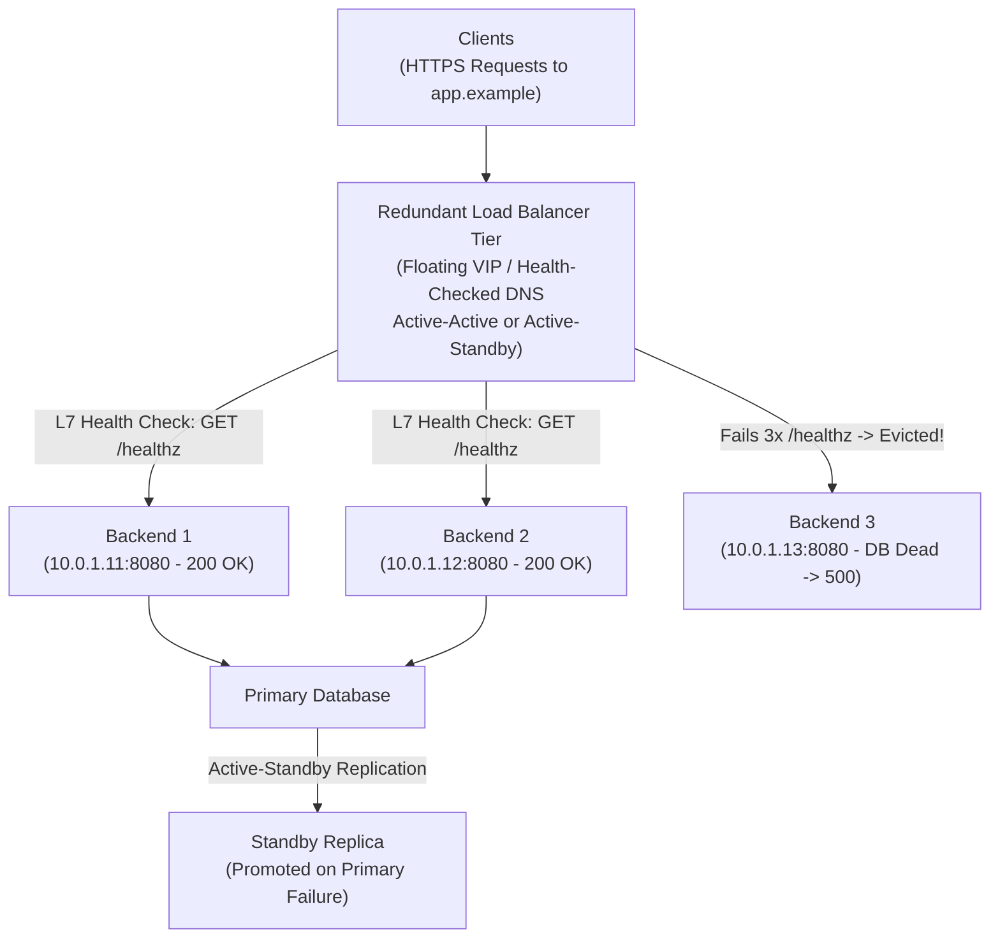
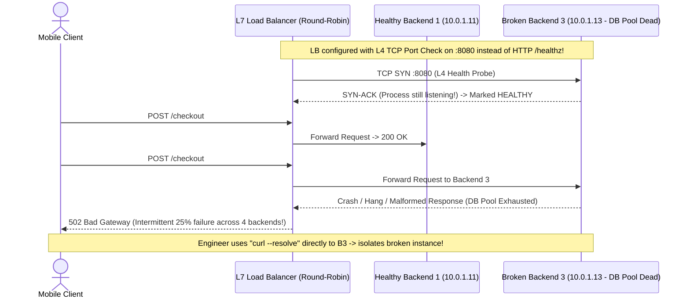

# Load Balancing Concepts

> **Prerequisites:** [05 — Routing, NAT & Firewalls](../05-routing-nat-and-firewalls/README.md), [HTTP protocol basics](../../../backend/01-request-response-fundamentals/01-http-protocol-basics/README.md), and a Linux terminal with `curl`, `nc`, and `ss`.  
> **Estimated Reading Time:** 30 minutes  
> **Target Audience:** Backend Engineers, Distributed Systems Engineers, Site Reliability Engineers.

> [!TIP]
> **The Golden Rule of Load Balancing:** **Redundancy without deep health checks is theater.** When clients receive intermittent `502 Bad Gateway` or `504 Gateway Timeout` responses through a VIP, the client-to-balancer hop is usually healthy—immediately bypass the VIP with `curl --resolve` to isolate which specific backend or balancer-to-backend hop is broken.

---

## 1. Architectural Mental Model: VIPs, L4 vs. L7, Health Checks & Recursive HA

A single server cannot scale horizontally or survive crashes, so production traffic enters through a **load balancer** presenting a single **Virtual IP (VIP)** in front of a pool of **backends** (targets/upstreams). Clients talk to one stable endpoint while work spreads across healthy servers behind it.

### Layer 4 vs. Layer 7 Load Balancing
Framed by the TCP/IP mental model (module 00), the decisive split is which layer the balancer inspects:
- **Layer 4 (Transport):** Inspects IP addresses and TCP/UDP ports (module 03) only. Picks a backend on connection setup and forwards packets/bytes transparently. Ultra-fast and protocol-agnostic (works for PostgreSQL, Redis, UDP game servers), but cannot route on HTTP path, headers, or cookies.
- **Layer 7 (Application):** Speaks HTTP/HTTPS ([HTTP protocol basics](../../../backend/01-request-response-fundamentals/01-http-protocol-basics/README.md)). Terminates client TCP/TLS, reads URL paths, `Host` headers, and cookies, routes `/api` vs `/web` to distinct pools, and enforces per-request policies.

### High Availability & Recursive Health Checks



- **Active-Active vs. Active-Standby:** **Active-active** runs multiple nodes serving traffic concurrently (full capacity utilized, zero failover pause, degraded headroom on failure); **active-standby (active-passive)** keeps one warm standby replicating state (simpler write-conflict avoidance, idle capacity cost, brief failover detection gap).
- **Redundancy at Every Tier:** One load balancer in front of 10 backends is still a single point of failure! Run **two or more load balancers** behind a floating VIP or health-checked DNS, plus a primary/replica data tier.
- **Health Checks Make Redundancy Real:** **Active** checks probe endpoints periodically; **passive** checks watch live errors. Shallow **L4 TCP checks** only verify port accept—an app whose DB pool crashed can still accept TCP connections while throwing `500`s! Deep **L7 `/healthz` checks** test real readiness (`200 OK` only when dependencies work) with consecutive-success thresholds to avoid flapping.

### Distribution Algorithms & Session Stickiness
- **Round robin:** Cycles evenly per request/connection—great for identical backends and uniform requests.
- **Least connections:** Picks the backend with fewest active connections—essential when request durations vary widely.
- **Weighted variants:** Assign capacity ratios to heterogeneous servers.
- **Hash-based (`IP` or key):** Maps the same client consistently to one backend.
- **Session persistence (stickiness):** Cookies (L7) or IP hash (L4) pin a user to one backend holding in-memory session state, which skews load and loses sessions if that node dies. Prefer **stateless backends** storing sessions in shared Redis/DB.

### Reading Failures Through the Balancer
A `502 Bad Gateway` or `504 Gateway Timeout` ([HTTP responses and status codes](../../../backend/01-request-response-fundamentals/05-http-responses-and-status-codes/README.md)) means the **balancer reached the client fine** but failed on the **VIP -> backend** hop. "Fails 1 in 4 times" screams one unhealthy backend stuck in round-robin rotation.

---

## 2. Taxonomic Comparison: L4 vs. L7, Algorithms & HA Patterns

| Dimension | Layer 4 (Transport LB) | Layer 7 (Application LB) |
| :--- | :--- | :--- |
| **Inspected Data** | Src/Dst IP, TCP/UDP Ports | HTTP Method, Path, `Host` Header, Cookies, TLS SNI |
| **TLS Termination** | Passthrough to backends | Terminates TLS at LB (re-encrypts or plain HTTP behind) |
| **Routing Flexibility** | Port-level pool only | Route `/api` vs `/static`, Canary headers, rewrites |
| **Protocol Support** | Any TCP/UDP (PostgreSQL, SSH, DNS, gRPC raw) | HTTP/1.1, HTTP/2, gRPC, WebSockets |
| **Cloud Equivalents** | Azure Load Balancer, AWS NLB | Azure Application Gateway / Container Apps, AWS ALB |

### Distribution Algorithms & HA Modes

| Algorithm / HA Mode | Best Fit | Hidden Trade-Off |
| :--- | :--- | :--- |
| **Round Robin** | Stateless APIs with uniform fast requests | Skewed CPU if a few requests take 10s vs 10ms |
| **Least Connections** | Mixed workloads / long-lived WebSockets | Slightly more balancer state tracking |
| **Source IP / Cookie Hash** | Legacy stateful apps needing affinity | Hotspot imbalances + session loss on backend crash |
| **Active-Active** | Stateless web/API tiers, multi-LB pools | Remaining nodes absorb extra load during a crash |
| **Active-Standby** | Single-writer primary databases, floating-IP LBs | Standby hardware sits idle; brief failover window |

---

## 3. Systematic Reference: Command Reference & Flag Breakdowns

Load balancers are usually managed platforms, but you can observe and simulate the concepts with standard tools.

| Command | What it does | Example |
| :--- | :--- | :--- |
| `curl` (repeated) | Hits a VIP repeatedly to observe distribution across backends | `for i in $(seq 6); do curl -s http://vip/whoami; done` |
| `curl -H` | Sends a specific Host/header so an L7 balancer routes it | `curl -H 'Host: api.example' http://vip/` |
| `curl --resolve` | Forces a hostname to a specific IP, bypassing DNS to test a backend directly | `curl --resolve app.example:443:10.0.0.5 https://app.example/` |
| `curl -w` | Prints timing/status details to compare backends | `curl -s -o /dev/null -w '%{http_code} %{time_total}\n' http://vip/` |
| `nc -zv` | L4-style health check: is the backend's port open? | `nc -zv 10.0.0.5 8080` |
| `ss -tan` | Shows connection distribution/states (from module 03) | `ss -tan state established` |

### Flag Breakdowns
- `curl --resolve app.example:443:10.0.0.5 https://app.example/` — `--resolve name:port:addr` forces `app.example:443` to connect to `10.0.0.5` while *still* sending the correct SNI/Host for `app.example`, so you can test one specific backend behind a VIP without changing DNS. Essential for "is it the balancer or this backend?"
- `curl -s -o /dev/null -w '%{http_code} %{time_total}\n' http://vip/` — `-s` silent, `-o /dev/null` discard body, `-w` write out chosen variables (here the HTTP status and total time). Loop it to spot one slow/erroring backend among many.
- `curl -H 'Host: api.example' http://vip/` — `-H` adds/overrides a header; setting `Host` lets you exercise an L7 balancer's host-based routing without DNS for that name.

---

## 4. Production War Story: The Shallow TCP Check & 25% `502` Storm



### The Incident
Following a credential rotation across a 4-node checkout cluster, `backend-3` failed to connect to PostgreSQL and threw unhandled errors on every `/checkout` request. Monitoring showed `25%` HTTP `502 Bad Gateway` failures through the load balancer VIP, yet the balancer dashboard reported **4/4 backends HEALTHY**.

### Post-Mortem Metrics
- **Severity:** SEV-1 (25% Checkout Failure Rate)
- **Mean Time to Detect (MTTD):** 2 minutes
- **Mean Time to Resolution (MTTR):** 19 minutes

### Root Cause Analysis
The load balancer used a shallow **L4 TCP port check** on port `8080`. Although `backend-3` had lost database connectivity, its HTTP listener socket stayed open, accepted the balancer's TCP handshake, and remained in rotation—turning 1 in every 4 round-robin requests into a `502`.

### The Fix & Architectural Hardening
1. Used `curl --resolve app.example:443:<backend-ip>` against each of the four backend IPs directly to pinpoint `backend-3` in under 2 minutes.
2. Replaced TCP-only probes with deep **L7 `GET /healthz`** checks verifying database pool readiness (with `unhealthy_threshold=2`, `healthy_threshold=3` hysteresis) and added a second active-active load balancer node.

---

## 5. Multi-Language Production Code: Health-Checked L7 Reverse-Proxy Balancer

Each implementation constructs an L7 HTTP balancer with active `/healthz` probing, atomic backend eviction on failure, least-connections or round-robin selection, and proper `502 Bad Gateway` handling when zero healthy upstreams remain.

````carousel
### Go (`net/http/httputil` + Active `/healthz` Loop)
```go
package main

import (
	"fmt"
	"net/http"
	"net/http/httputil"
	"net/url"
	"sync/atomic"
	"time"
)

type Backend struct {
	URL     *url.URL
	Proxy   *httputil.ReverseProxy
	Healthy atomic.Bool
	Active  atomic.Int64
}

type LoadBalancer struct {
	backends []*Backend
	rrIndex  atomic.Uint64
}

func NewBackend(rawURL string) (*Backend, error) {
	u, err := url.Parse(rawURL)
	if err != nil {
		return nil, err
	}
	b := &Backend{URL: u, Proxy: httputil.NewSingleHostReverseProxy(u)}
	b.Healthy.Store(true)
	return b, nil
}

func (lb *LoadBalancer) StartHealthChecks(interval time.Duration) {
	client := &http.Client{Timeout: 1 * time.Second}
	go func() {
		for range time.Tick(interval) {
			for _, b := range lb.backends {
				resp, err := client.Get(b.URL.String() + "/healthz")
				ok := err == nil && resp.StatusCode == http.StatusOK
				if resp != nil {
					resp.Body.Close()
				}
				b.Healthy.Store(ok) // L7 readiness controls rotation membership
			}
		}
	}()
}

// NextLeastConn selects the healthy backend with fewest active in-flight requests
func (lb *LoadBalancer) NextLeastConn() *Backend {
	var best *Backend
	for _, b := range lb.backends {
		if !b.Healthy.Load() {
			continue
		}
		if best == nil || b.Active.Load() < best.Active.Load() {
			best = b
		}
	}
	return best
}

func (lb *LoadBalancer) ServeHTTP(w http.ResponseWriter, r *http.Request) {
	target := lb.NextLeastConn()
	if target == nil {
		http.Error(w, "502 Bad Gateway: zero healthy backends", http.StatusBadGateway)
		return
	}
	target.Active.Add(1)
	defer target.Active.Add(-1)
	target.Proxy.ServeHTTP(w, r)
}

func main() {
	b1, _ := NewBackend("http://127.0.0.1:8081")
	b2, _ := NewBackend("http://127.0.0.1:8082")
	lb := &LoadBalancer{backends: []*Backend{b1, b2}}
	lb.StartHealthChecks(5 * time.Second)
	fmt.Println("L7 Health-Checked LB listening on :8080")
	_ = http.ListenAndServe(":8080", lb)
}
```
<!-- slide -->
### TypeScript (L7 HTTP Balancer + Active `/healthz` Probe)
```typescript
import http from 'node:http';

interface Upstream {
  host: string;
  port: number;
  healthy: boolean;
  activeConns: number;
}

const pool: Upstream[] = [
  { host: '127.0.0.1', port: 8081, healthy: true, activeConns: 0 },
  { host: '127.0.0.1', port: 8082, healthy: true, activeConns: 0 },
];

// Active L7 health probe checks HTTP 200 on /healthz (not just TCP port open!)
setInterval(() => {
  for (const backend of pool) {
    const req = http.get(
      { host: backend.host, port: backend.port, path: '/healthz', timeout: 1000 },
      (res) => {
        res.resume();
        backend.healthy = res.statusCode === 200;
      }
    );
    req.on('error', () => { backend.healthy = false; });
    req.on('timeout', () => { req.destroy(); backend.healthy = false; });
  }
}, 3000);

function pickLeastConnections(): Upstream | undefined {
  return pool
    .filter((b) => b.healthy)
    .sort((a, b) => a.activeConns - b.activeConns)[0];
}

const server = http.createServer((clientReq, clientRes) => {
  const upstream = pickLeastConnections();
  if (!upstream) {
    clientRes.writeHead(502, { 'Content-Type': 'text/plain' });
    clientRes.end('502 Bad Gateway: no healthy backends');
    return;
  }

  upstream.activeConns++;
  const proxyReq = http.request(
    { host: upstream.host, port: upstream.port, path: clientReq.url, method: clientReq.method, headers: clientReq.headers },
    (proxyRes) => {
      clientRes.writeHead(proxyRes.statusCode ?? 502, proxyRes.headers);
      proxyRes.pipe(clientRes);
      proxyRes.on('end', () => { upstream.activeConns--; });
    }
  );
  proxyReq.on('error', () => {
    upstream.activeConns--;
    upstream.healthy = false; // Passive eviction on upstream error
    if (!clientRes.headersSent) {
      clientRes.writeHead(502);
      clientRes.end('502 Bad Gateway');
    }
  });
  clientReq.pipe(proxyReq);
});

server.listen(8080, () => console.log('L7 LB listening on :8080'));
```
<!-- slide -->
### Python (Thread-Safe Round-Robin & Active L7 Health Monitor)
```python
import threading
import time
import urllib.error
import urllib.request
from dataclasses import dataclass
from typing import List, Optional


@dataclass
class Backend:
    url: str
    healthy: bool = True
    active_conns: int = 0


class L7LoadBalancer:
    def __init__(self, urls: List[str]) -> None:
        self.backends = [Backend(u) for u in urls]
        self._lock = threading.Lock()
        self._rr_cursor = 0

    def health_check_once(self) -> None:
        for b in self.backends:
            try:
                with urllib.request.urlopen(f"{b.url}/healthz", timeout=1.0) as resp:
                    is_ok = resp.status == 200
            except (urllib.error.URLError, TimeoutError):
                is_ok = False
            with self._lock:
                b.healthy = is_ok

    def pick_round_robin(self) -> Optional[Backend]:
        with self._lock:
            n = len(self.backends)
            for _ in range(n):
                candidate = self.backends[self._rr_cursor % n]
                self._rr_cursor += 1
                if candidate.healthy:
                    return candidate
        return None

    def pick_least_connections(self) -> Optional[Backend]:
        with self._lock:
            healthy = [b for b in self.backends if b.healthy]
            return min(healthy, key=lambda b: b.active_conns) if healthy else None


if __name__ == "__main__":
    lb = L7LoadBalancer(["http://127.0.0.1:8081", "http://127.0.0.1:8082"])
    print("Round-robin initial:", lb.pick_round_robin(), lb.pick_round_robin())
    lb.backends[1].healthy = False
    print("After B2 fails /healthz:", lb.pick_round_robin(), lb.pick_round_robin())
```
<!-- slide -->
### C# (`HttpClient` Pool with Active L7 Health Probing & Least Connections)
```csharp
using System;
using System.Collections.Generic;
using System.Linq;
using System.Net.Http;
using System.Threading;
using System.Threading.Tasks;

public sealed class UpstreamNode
{
    public Uri BaseUri { get; }
    public volatile bool Healthy = true;
    public int ActiveConnections;

    public UpstreamNode(string url) => BaseUri = new Uri(url);
}

public sealed class LeastConnectionBalancer
{
    private readonly List<UpstreamNode> _pool;
    private readonly HttpClient _probeClient = new() { Timeout = TimeSpan.FromSeconds(1) };

    public LeastConnectionBalancer(IEnumerable<string> urls) =>
        _pool = urls.Select(u => new UpstreamNode(u)).ToList();

    public async Task RunHealthChecksAsync(CancellationToken ct)
    {
        foreach (var node in _pool)
        {
            try
            {
                using var resp = await _probeClient.GetAsync(new Uri(node.BaseUri, "/healthz"), ct);
                node.Healthy = resp.IsSuccessStatusCode;
            }
            catch
            {
                node.Healthy = false; // Evict failing backend from rotation
            }
        }
    }

    public UpstreamNode? SelectBackend() =>
        _pool.Where(n => n.Healthy)
             .OrderBy(n => Volatile.Read(ref n.ActiveConnections))
             .FirstOrDefault();

    public async Task<HttpResponseMessage> ForwardAsync(HttpClient client, string path, CancellationToken ct)
    {
        var target = SelectBackend() ?? throw new HttpRequestException("502 Bad Gateway: no healthy upstream");
        Interlocked.Increment(ref target.ActiveConnections);
        try
        {
            return await client.GetAsync(new Uri(target.BaseUri, path), ct);
        }
        finally
        {
            Interlocked.Decrement(ref target.ActiveConnections);
        }
    }
}
```
````

---

## 6. Practical Hands-On Verification CLI Workflows

These use Docker (from your earlier track) to build a tiny load-balanced setup. If Docker isn't available, read them as a thought exercise and do the `curl`/`nc` observation parts against any real site.

### Workflow 1: Build Two Distinct Backends & Observe Round-Robin + Stickiness
1. **Two backends that identify themselves.** Start two simple web servers that echo their own name, on different ports: `docker run -d --name b1 -p 8081:80 ...` (or two `python3 -m http.server` instances in directories containing different `index.html` files). Confirm each responds distinctly with `curl localhost:8081` and `curl localhost:8082`.
2. **Round-robin by hand.** Write a loop that alternates: `for i in $(seq 6); do curl -s localhost:808$((i%2+1)); done`. Observe the responses alternating between backends—you've simulated round-robin distribution.
3. **L4 vs L7 in your head.** For each of these needs, decide L4 or L7 and why: route `/api` and `/web` to different pools; balance a raw PostgreSQL (TCP 5432) service; terminate TLS centrally; balance a UDP game server. Expected: L7, L4, L7, L4 respectively.
7. **Observe stickiness vs not.** With your round-robin loop from exercise 2, note there's *no* stickiness—consecutive requests land on different backends. Reason about what would break if `b1` held a login session and request 2 went to `b2`. Expected: the session wouldn't be found on `b2`—the "logged in, then randomly logged out" symptom.

```bash
mkdir -p /tmp/b1 /tmp/b2
echo "backend-1" > /tmp/b1/index.html
echo "backend-2" > /tmp/b2/index.html
python3 -m http.server 8081 -d /tmp/b1 >/dev/null 2>&1 &
python3 -m http.server 8082 -d /tmp/b2 >/dev/null 2>&1 &
for i in $(seq 6); do curl -s http://localhost:808$((i%2+1))/; done
```
**Expected Output:**
```text
backend-2
backend-1
backend-2
backend-1
backend-2
backend-1
```

### Workflow 2: L4 vs. L7 Health Checks & Bypassing the VIP with `curl --resolve`
4. **Simulate a health check.** Run an L4 check `nc -zv localhost 8081` (port open = pass) and an L7 check `curl -s -o /dev/null -w '%{http_code}\n' localhost:8081/` (200 = pass). Now stop the app process but imagine the port still accepted connections—note how the L4 check would falsely pass while the L7 check catches the real failure.
5. **Test a backend directly through a fake VIP name.** Pick any HTTPS site and run `curl --resolve example.com:443:93.184.216.34 https://example.com/ -I`. You forced the name to a specific address while keeping correct SNI. Expected: a normal 200/headers, proving you can target one backend behind a name. This is the core "is it the LB or this backend?" technique.
6. **Compare backend timings.** Loop `curl -s -o /dev/null -w '%{http_code} %{time_total}\n'` against your two backends several times. Expected: similar codes/times when both are healthy; a divergent slow or erroring line is how you'd spot a bad backend in a pool.

```bash
nc -zv localhost 8081
curl -s -o /dev/null -w '%{http_code} %{time_total}\n' http://localhost:8081/
curl --resolve example.com:443:93.184.216.34 https://example.com/ -I | head -n 3
```
**Expected Output:**
```text
Connection to localhost 8081 port [tcp/*] succeeded!
200 0.002145
HTTP/2 200
```

### Workflow 3: Diagnose & Fix One Unhealthy Backend Still in Rotation + HA Scenarios
8. **Diagnose and fix: one unhealthy backend still in rotation.** Simulate it: keep `b1` healthy but make `b2` return errors (stop its app but leave a listener, or serve a page that 500s). Run the round-robin loop from exercise 2 with `-w '%{http_code}\n'`. You see an alternating pattern like `200, 500, 200, 500`—exactly the "fails every other request" symptom. Diagnose: hit each backend directly (`curl localhost:8081` vs `curl localhost:8082`) to identify *which* backend is bad—`b2` returns 500 while `b1` returns 200. The root cause is that the "balancer" is still sending traffic to an unhealthy backend because nothing removed it. **Fix (conceptual):** the health check must be deep enough (L7 `/healthz`, not just L4 port-open) to detect `b2`'s failure and pull it from rotation; operationally, remove/repair `b2`. Re-run the loop after "removing" `b2` (only curl `b1`) to confirm a clean `200, 200, 200`. The lesson: intermittent, patterned failures = one bad backend + an inadequate health check.
9. **Active-active vs active-standby, by scenario.** For each, decide which pattern fits better and why: (a) two backends serving stateless API requests where you want to use all available capacity all the time; (b) a primary/replica database where concurrent writes to both sides would cause conflicts; (c) two load balancer instances in front of your backend pool. Expected: (a) active-active—no reason to waste idle capacity when requests are stateless and either instance can serve any request; (b) active-standby—a single writable primary avoids write conflicts, the replica takes over only on failure; (c) either works in practice, but many real setups use active-standby with a floating IP for simplicity, or active-active behind DNS/anycast for larger scale—the key requirement either way is that *something* health-checks the balancer tier itself, not which pattern you pick.

```bash
# Clean up temporary python servers when done:
pkill -f "http.server 8081" || true
pkill -f "http.server 8082" || true
```
**Expected Output:**
```text
# Before removing unhealthy b2: 200 / 500 / 200 / 500
# After L7 /healthz evicts b2:  200 / 200 / 200 / 200
```

### Independent Challenge
Users of a web app report that they get logged out at random and occasionally see a `502`, but only "sometimes." You have a load balancer in front of four backends. Design an investigation that determines (a) whether the intermittent logouts are a session-persistence/state problem and (b) whether the `502`s trace to one specific unhealthy backend that the health check isn't catching. You must combine this module with **HTTP status semantics** ([HTTP responses and status codes](../../../backend/01-request-response-fundamentals/05-http-responses-and-status-codes/README.md)): use HTTP status semantics and direct-to-backend requests to distinguish a client-side 4xx from a backend 5xx, and to tell "the LB can't reach the backend" from "the backend itself errors."

<details>
<summary>Stuck? One hint</summary>

Attack the two symptoms separately. For the logouts: the "random" nature across multiple backends screams session state living in one backend's memory with no stickiness (or failed stickiness)—reproduce by forcing requests to different backends (`curl --resolve` to each) after logging in and see if the session survives. For the 502s: a 502 is a backend/upstream failure, not a client error, so hit each backend *directly* (bypassing the VIP with `--resolve`) and compare status codes—if one backend consistently errors while the VIP only fails "sometimes," the health check is too shallow to evict it. Round-robin over four backends means roughly one in four requests is the culprit.

</details>

---

## 7. Common Mistakes & Troubleshooting

- **Blaming the app for a 502/504.** These are gateway errors—the balancer couldn't reach or get a timely reply from a backend. Debug the balancer->backend hop and backend health, not the client's request.
- **Health checks that are too shallow.** A TCP-only (L4) check passes as long as *something* accepts the port, even if the app returns 500s or its database is down. Use an L7 `/healthz` that reflects real readiness.
- **Reaching for stickiness instead of statelessness.** Sticky sessions paper over in-memory state but unbalance load and lose sessions on failover. Prefer stateless backends with a shared session store.
- **Testing only through the VIP.** When something fails "sometimes," you can't tell which backend is bad from the VIP alone. Use `curl --resolve` to hit each backend directly and isolate the offender.
- **Assuming round robin means perfectly even load.** Round robin distributes *requests*, not *work*. If some requests are far heavier, least-connections or weighting fits better.
- **Treating the load balancer itself as immune to failure.** A single balancer instance is a single point of failure in front of your redundant backends—run redundant balancer instances too (active-active or active-standby), or the backend redundancy you built doesn't actually give you high availability.
- **Calling two instances "redundant" with no failure detection wired up.** Redundancy only pays off if something actually notices a failed instance and reroutes around it—the same health-check mechanism this module already covers, applied at every tier (balancer, backend, database), not just once at the backend layer.
- **Forgetting the balancer terminates TLS (L7).** If the L7 balancer terminates TLS, the backend often speaks plain HTTP behind it—cert problems and encryption expectations differ on each hop. Don't debug the backend as if it must present the public cert.

---

## 8. Operational Validation Checkpoints

<details>
<summary><strong>Question 1: 1-in-5 Requests Fail With 502 Despite "100% Healthy" Dashboard</strong></summary>

**Scenario:** An API pool has 5 backends behind an L7 load balancer configured with a TCP port-`8080` health check. Roughly 20% of customer API calls fail with `502 Bad Gateway`, yet the balancer control plane reports all 5 targets healthy.

Why didn't the balancer evict the failing node, and how do you isolate it in 30 seconds?

**Answer:**
A TCP port-open probe only checks whether the OS kernel accepts a 3-way handshake on `:8080`. One of the five backends has a broken worker/database dependency (returning invalid/dropped responses) while still accepting TCP connections. Run `curl --resolve api.example:443:<backend-ip> -I https://api.example/` against all 5 backend IPs directly to pinpoint the single failing instance, then upgrade the balancer health probe to an L7 `GET /healthz` checking real dependency readiness.

</details>

<details>
<summary><strong>Question 2: Severe CPU Skew Under Round-Robin Scheduling</strong></summary>

**Scenario:** A fleet of 4 identical servers sits behind a round-robin balancer. Two endpoints share the pool: `/ping` (1 ms) and `/export-csv` (12 seconds). One backend spikes to 100% CPU and starts timing out while two peers sit nearly idle.

Why did round robin fail to balance load, and what algorithm fixes it?

**Answer:**
Round robin equalizes **request count**, not **active work**. By bad luck or periodic batch bursts, multiple slow `/export-csv` requests can land sequentially on the same backend while fast `/ping` requests land elsewhere. Switching to **Least Connections** steers every incoming request to whichever healthy backend currently holds the fewest active connections, automatically routing around busy nodes.

</details>

<details>
<summary><strong>Question 3: "High Availability" Architecture Fails During Single-Node Maintenance</strong></summary>

**Scenario:** A team proudly presents an architecture diagram featuring 1 cloud load balancer VM, 4 web backends, and 2 database servers (primary + standby replica with manual failover script). During routine patching of the load balancer VM, the entire platform goes offline for 12 minutes.

Identify the two missing HA ingredients in this architecture.

**Answer:**
1. **Redundant Balancer Tier:** A single load balancer in front of 4 backends is a single point of failure—deploy at least two load balancers (active-active behind DNS/anycast or active-standby with a floating VIP).
2. **Automated Health-Checked Failover:** Redundancy without failure detection and automated rerouting is theater—both the load balancer tier and the primary/replica database require automated health probes and promotion mechanisms so failover happens without manual intervention.

</details>

---

## 9. Checkpoint Quiz

Write down your answer to each question before expanding it—checking without attempting first is the single easiest way to fool yourself into thinking you've learned this.

1. What does a Layer 4 balancer see that a Layer 7 balancer additionally sees, and give one thing only L7 can do.
2. Why can a TCP-only health check keep an actually-broken backend in rotation?
3. A user reports being "randomly logged out." What load-balancing concept is the likely cause, and what's the cleaner fix than sticky sessions?
4. A client gets an intermittent `502`. Whose hop should you investigate and why?
5. When is least-connections a better algorithm than round robin?
6. How does `curl --resolve` help you decide whether a problem is the load balancer or one backend?
7. What is a VIP, and what two benefits does putting one in front of a pool provide?
8. You need to balance a raw non-HTTP TCP service and also route HTTP by URL path. Which layer of balancing does each require?
9. What's the difference between active-active and active-standby redundancy, and why is "we have two of everything" not sufficient on its own to claim high availability?

<details>
<summary>Show answers</summary>

1. L4 sees IP addresses and ports (transport). L7 additionally reads the HTTP content—path, headers, host, cookies—so only L7 can do things like route `/api` vs `/web`, rewrite requests, or terminate TLS with per-request logic.
2. A TCP check only verifies something is accepting connections on the port. An app can accept connections while returning 500s or with a dead dependency, so the port-open check passes and the balancer keeps sending it traffic.
3. In-memory session state on one backend without (working) session persistence—requests land on different backends that don't have the session. The cleaner fix is stateless backends storing session state in a shared store (DB/cache), removing the need for stickiness.
4. The balancer->backend hop. A 502 means the balancer reached the client but couldn't get a good response from a backend, so the fault is upstream of the balancer, not in the client's request.
5. When request durations vary a lot, so simple rotation can pile long-lived connections onto one backend. Least-connections steers new work to the least-busy backend.
6. It forces a hostname to resolve to one specific backend IP while keeping correct SNI/Host, letting you test each backend directly and compare with the VIP—isolating whether the fault is the balancer/config or a particular backend.
7. A virtual IP is the single stable address clients hit, fronting many backends. Benefits: load distribution across backends and high availability (a failed backend is removed from rotation without downtime).
8. The raw TCP service needs L4 (it's not HTTP, so there's no content to route on); URL-path routing needs L7 (it must read the HTTP request path).
9. Active-active runs multiple instances handling traffic simultaneously (shared work, no failover event, some idle headroom lost when one dies); active-standby keeps one idle replica ready to take over on failure (simpler, but wastes standby capacity and has a real failover gap). "Two of everything" isn't sufficient because redundancy only provides real availability if something actually detects a failed instance and reroutes around it—the same health-check idea this module teaches for backends has to exist at every redundant tier, not just be assumed.

</details>

---

## 10. Sources & Further Reading

- [HTTP protocol basics](../../../backend/01-request-response-fundamentals/01-http-protocol-basics/README.md) — Layer 7 request/header semantics routed by L7 load balancers.
- [HTTP responses and status codes](../../../backend/01-request-response-fundamentals/05-http-responses-and-status-codes/README.md) — Diagnosing `502 Bad Gateway` vs `504 Gateway Timeout` vs backend `500`.

---

## Next Step

[07 — Network troubleshooting toolkit](../07-network-troubleshooting-toolkit/README.md): you now understand every layer's failure mode—time to combine them into one repeatable diagnostic method and the tools that support it.
