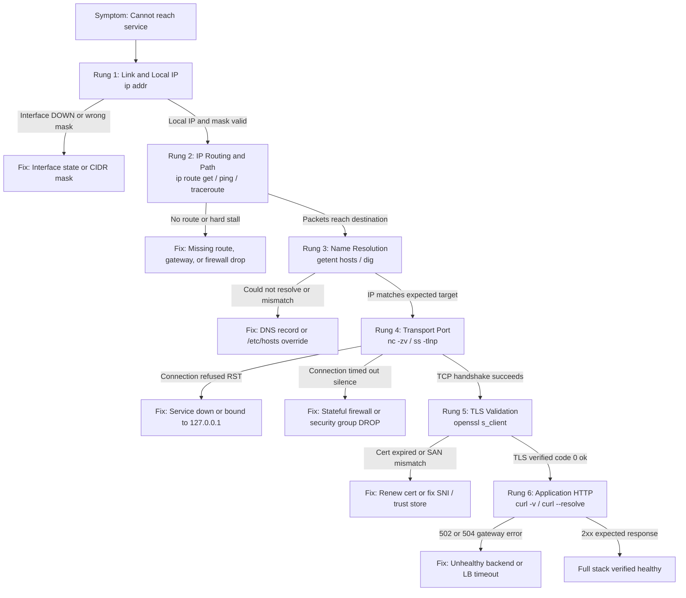
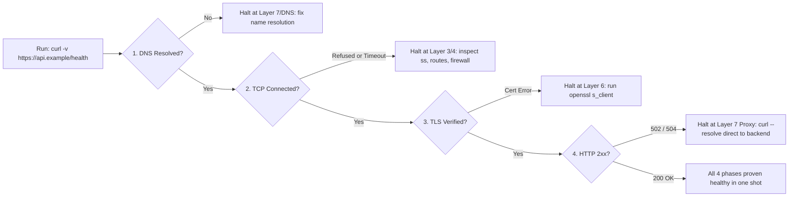
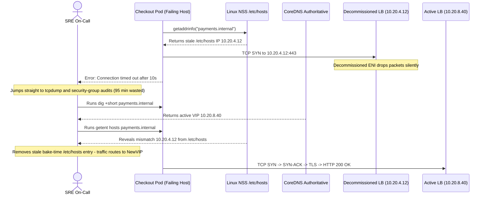

# Network Troubleshooting Toolkit

> **Prerequisites:** Modules 00–06 (Layer Model, Addressing & Subnets, DNS, TCP/UDP, HTTP, Routing/NAT/Firewalls, Load Balancing) and a Linux terminal (`ip`, `ping`, `traceroute`, `getent`, `dig`, `nc`, `ss`, `curl`, `openssl`, `tcpdump`).  
> **Estimated Reading Time:** 35 minutes  
> **Target Audience:** Backend Engineers, Site Reliability Engineers, Cloud Network Architects.

> [!TIP]
> **The Golden Rule of Network Troubleshooting:** Never debug at Layer 7 when Layer 3 is broken. Test one layer at a time in strict order—or bisect from the middle—letting the exact manner of failure (`Could not resolve host`, `Connection refused`, `Connection timed out`, TLS error, `502`/`504`) eliminate half the stack before you capture a single packet.

---

## 1. Why This Matters & Architectural Mental Model

Everything in this track converges here. Real network problems do not announce which layer they are on—you get "it doesn't work," and your job is to localize the fault fast without thrashing. A repeatable, layer-by-layer method turns a vague outage into a bounded search: prove each layer works from the bottom up (or bisect), and the first failing layer tells you exactly where the fault is and, just as importantly, where it *isn't*. This method is what you will carry into the Azure track, where the exact same failures wear cloud-service names.

### The Layered Diagnostic Ladder



### The Six Rungs in Strict Order

Ask, and answer with a command, each question bottom-up using the mental model from module 00:

1. **Link/local:** Does this host have a correct IP and mask? (`ip addr`, module 01)
2. **IP/routing:** Is there a route to the destination, and can packets reach it? (`ip route get`, `ping`, `traceroute`, modules 01/05)
3. **DNS:** Does the name resolve to the right address? (`getent hosts`, `dig`, module 02)
4. **Transport:** Does the TCP handshake to the target port complete? (`nc -zv`, `ss`, module 03)
5. **TLS:** Does the certificate validate? (`openssl s_client`, `curl -v`; see [TLS, SSL and HTTPS](../../../backend/01-request-response-fundamentals/09-tls-ssl-and-https/README.md))
6. **Application:** Does the service return the right HTTP response? (`curl -v`, status codes, modules 04/06)

The power of ordering is that a pass at a lower layer **rules out** everything below when a higher layer fails, and a failure at a lower layer means you needn't touch anything above it yet. "Could not resolve host" (step 3) means stop checking firewalls; "connection refused" means stop checking DNS. Half of troubleshooting speed is knowing which layers to *ignore*.

### Bisecting Instead of Scanning & Varying One Variable

You don't always have to start at the bottom. When layers are many, **bisect**: test the middle first and halve the search space.



Can you resolve the name? Yes → DNS and below are probably fine, focus above. Does TCP connect but TLS fail? Then everything through transport works; it's a cert problem. Each test should eliminate roughly half the remaining possibilities. Pair this with **change the one thing that varies**: if it works from host A but not host B, or works to an IP but not by name, the difference *is* the clue — resolve name vs address, one subnet vs another, one backend vs the VIP (module 06).

### TTL, `traceroute`, and Packet Capture Confirmation

* **TTL and `traceroute`:** `traceroute`/`tracepath` work via the IP **TTL** field (module 00). Probes are sent with `TTL=1, 2, 3, ...`, each expiring one hop further and eliciting an ICMP **Time Exceeded** message naming that router. *Where* the trace stops advancing (the last replying hop before permanent `* * *`) localizes a path break. Remember: many routers rate-limit or suppress ICMP, so middle-hop `* * *` that later resumes is normal noise—only a trace that *stops and never resumes* short of the target is a signal. Because routing can be asymmetric (module 05), `traceroute` shows only the forward path.
* **Confirming with `tcpdump`:** When higher-level tools disagree with your mental model, drop to `tcpdump` to observe ground truth on the wire: Did the SYN leave this host? Did a SYN-ACK return or only silence (firewall drop)? Is the app sending a RST? Filter narrowly by host and port (`host ... and tcp port ...`) to *confirm* a hypothesis, never to go fishing blindly.

### Pragmatic Diagnostic Checklist

For "I can't reach service X":
`getent hosts X` (resolve name) → sanity-check the IP against expected subnet (module 01) → `ip route get <ip>` / `ping` (and `traceroute` if it fails) → `nc -zv X <port>` (reading refused vs timeout) → `openssl s_client` / `curl -v` (cert validation) → `curl -v` (HTTP status class) → narrow `tcpdump` only if layers disagree.

---

## 2. Taxonomic Comparison & Systematic Command Reference

### Failure Manner Diagnostic Matrix

Before running a second command, read the exact failure text—the manner of failure names the layer immediately:

| Error / Failure Manner | Implicated Layer | Underlying Network / Kernel Event | Immediate Confirming Command | Layers Proven Healthy |
| :--- | :--- | :--- | :--- | :--- |
| **Could not resolve host** | Name Resolution (DNS) | `getaddrinfo()` / NSS or DNS query failed before any app packet | `getent hosts <name>` then `dig +short <name>` | None tested above link; DNS broken |
| **Connection refused (fast, RST)** | Transport (Layer 4) | Host reachable; kernel returned TCP `RST` because no socket listens on IP:port | `ss -tlnp \| grep :<port>` on target host | Link, IP routing, firewall, DNS |
| **Connection timed out (slow, silence)** | Network / Firewall (L3/L4) | `SYN` packets silently dropped (firewall `DROP`), dead next hop, or asymmetric route | `ip route get <ip>` then `traceroute -n <ip>` | DNS (if name resolved to valid IP) |
| **TLS / certificate error** | Presentation / TLS (L6) | TCP 3-way handshake succeeded; cert expired, untrusted CA, or SAN/SNI mismatch | `openssl s_client -connect host:443 -servername host` | Link, IP routing, DNS, TCP port 443 |
| **HTTP `4xx` vs `5xx` (`502`/`504`)** | Application / Reverse Proxy (L7) | `4xx`: client request error; `502`/`504`: LB→backend hop refused, reset, or timed out | `curl --resolve host:443:<backend-ip> https://host/` | Client→LB link, DNS, TCP, frontend TLS |

### Command Reference

| Command | What it does | Example |
| :--- | :--- | :--- |
| `ip addr` / `ip route get` | Layer 1–3: address, mask, and chosen route to a destination | `ip route get 10.0.0.9` |
| `ping` | Layer 3 reachability via ICMP | `ping -c 3 example.com` |
| `traceroute` / `tracepath` | Maps the hop-by-hop path via TTL; localizes where a path breaks | `traceroute -n example.com` |
| `getent hosts` / `dig` | Layer 7 name resolution (app-view vs raw DNS) | `getent hosts api.example` |
| `nc -zv` | Layer 4 port reachability; refused vs timeout | `nc -zv api.example 443 -w 3` |
| `ss -tlnp` | Local listening sockets and states | `ss -tlnp` |
| `curl -v` | Layers 4–7 in one shot: connect, TLS, request, response | `curl -v https://api.example/health` |
| `openssl s_client` | Layer 6 TLS handshake and certificate detail | `openssl s_client -connect api.example:443 -servername api.example` |
| `tcpdump` | Ground-truth packet capture to confirm a hypothesis | `sudo tcpdump -n -i any host api.example and tcp port 443` |

### Flag Breakdowns

- `traceroute -n example.com` — `-n` numeric output (no reverse DNS per hop), so a slow/broken DNS doesn't stall or confuse the trace; each numbered line is one TTL step revealing one router.
- `nc -zv api.example 443 -w 3` — `-z` scan without sending data, `-v` verbose result, `-w 3` cap the wait at 3 seconds so a firewalled (timing-out) port fails quickly and legibly instead of hanging.
- `curl -v https://api.example/health` — `-v` surfaces every layer in order (DNS/connect, TLS handshake and cert, request `>`, response `<`), making it the single best first command for an HTTPS problem.
- `sudo tcpdump -n -i any host api.example and tcp port 443` — `-n` numeric; `-i any` all interfaces; the filter `host ... and tcp port 443` restricts capture to the relevant conversation so the output is readable. Add `-c 20` to stop after 20 packets.

---

## 3. Production War Story Post-Mortem: The Two-Hour `tcpdump` Rabbit Hole



### The Incident
Following a base-image refresh in `us-east-1b`, 25% of checkout nodes began failing calls to `https://payments.internal/charge` with `Connection timed out`. Nodes running the previous AMI continued working normally. Convinced a network ACL or firewall change had rolled out in that availability zone, engineers opened emergency firewall tickets and ran unfiltered `tcpdump` captures on NAT gateways for nearly two hours.

### Post-Mortem Telemetry
* **Severity:** SEV-1 (25% checkout failure rate across one zone)
* **Mean Time to Detect (MTTD):** 3 minutes (synthetic checkout monitors alerted)
* **Mean Time to Resolution (MTTR):** 114 minutes (delayed by skipping Rung 3: `getent` vs `dig`)
* **Impact:** Elevated payment retry storms and degraded order throughput during peak traffic

### Root Cause Analysis
1. **Skipped Layer Ordering:** Because `payments.internal` did not return `"Could not resolve host"`, responders assumed DNS was healthy and jumped straight to Layer 4/packet capture.
2. **Application-View vs Raw DNS Split:** An image-builder test script had left `10.20.4.12 payments.internal` inside `/etc/hosts` in the new AMI. Because `/etc/nsswitch.conf` checks `files` before `dns`, `getaddrinfo()` resolved the service to an old, decommissioned VIP whose firewall silently dropped traffic (`ETIMEDOUT`), while `dig` bypassed `/etc/hosts` and showed the healthy new VIP (`10.20.8.40`).

### The Fix & Architectural Hardening
1. **Immediate Remediation:** Removed the hardcoded `/etc/hosts` line via fleet configuration management and rebuilt the golden AMI without build-time host overrides.
2. **Diagnostic Policy:** Mandatory pre-capture check comparing `getent hosts <target>` against `dig +short <target>` and comparing one failing host against one healthy host ("change one variable at a time").
3. **CI Image Guard:** Added an automated Packer validation check asserting `/etc/hosts` contains only `localhost` entries prior to AMI promotion.

---

## 4. Multi-Language Production Implementation: Layered Diagnostic Probe

In production automation and health-checking agents, never reduce connectivity checks to a boolean "reachable/unreachable." Model the exact 6-rung ladder programmatically so every failure emits the precise failing layer and manner.

````carousel
### Go (`net`, `crypto/tls`, `net/http` Layered Probe)
```go
package main

import (
	"context"
	"crypto/tls"
	"errors"
	"fmt"
	"net"
	"net/http"
	"syscall"
	"time"
)

type ProbeResult struct {
	Layer   string
	Manner  string
	Target  string
	Healthy bool
	Detail  string
}

func RunLayeredProbe(ctx context.Context, host, port, path string) ProbeResult {
	addr := net.JoinHostPort(host, port)

	// Rung 3: DNS Resolution
	ips, err := net.DefaultResolver.LookupIP(ctx, "ip4", host)
	if err != nil || len(ips) == 0 {
		return ProbeResult{Layer: "L7-DNS", Manner: "RESOLVE_FAIL", Target: host, Detail: fmt.Sprint(err)}
	}
	resolved := net.JoinHostPort(ips[0].String(), port)

	// Rung 4: TCP Transport (classify ECONNREFUSED vs ETIMEDOUT)
	dialer := &net.Dialer{Timeout: 3 * time.Second}
	conn, err := dialer.DialContext(ctx, "tcp", resolved)
	if err != nil {
		manner := "TCP_TIMEOUT"
		if errors.Is(err, syscall.ECONNREFUSED) {
			manner = "TCP_REFUSED"
		}
		return ProbeResult{Layer: "L4-TCP", Manner: manner, Target: resolved, Detail: err.Error()}
	}
	conn.Close()

	// Rung 5: TLS Handshake & Certificate Validation
	tlsDialer := &tls.Dialer{
		NetDialer: dialer,
		Config:    &tls.Config{ServerName: host, MinVersion: tls.VersionTLS12},
	}
	tConn, err := tlsDialer.DialContext(ctx, "tcp", addr)
	if err != nil {
		return ProbeResult{Layer: "L6-TLS", Manner: "CERT_OR_TLS_FAIL", Target: addr, Detail: err.Error()}
	}
	tConn.Close()

	// Rung 6: Application HTTP Check
	client := &http.Client{Timeout: 4 * time.Second}
	req, _ := http.NewRequestWithContext(ctx, http.MethodGet, fmt.Sprintf("https://%s%s", host, path), nil)
	resp, err := client.Do(req)
	if err != nil {
		return ProbeResult{Layer: "L7-HTTP", Manner: "HTTP_TRANSPORT_FAIL", Target: host, Detail: err.Error()}
	}
	defer resp.Body.Close()

	return ProbeResult{
		Layer:   "L7-HTTP",
		Manner:  fmt.Sprintf("HTTP_%d", resp.StatusCode),
		Target:  resolved,
		Healthy: resp.StatusCode >= 200 && resp.StatusCode < 400,
		Detail:  resp.Status,
	}
}

func main() {
	ctx, cancel := context.WithTimeout(context.Background(), 10*time.Second)
	defer cancel()
	fmt.Printf("%+v\n", RunLayeredProbe(ctx, "example.com", "443", "/"))
}
```
<!-- slide -->
### TypeScript (Node.js `dns`, `net`, `tls`, `https` Probe)
```typescript
import { lookup } from 'dns/promises';
import net from 'net';
import tls from 'tls';
import https from 'https';

interface DiagnosticReport {
  layer: 'DNS' | 'TCP' | 'TLS' | 'HTTP';
  manner: string;
  healthy: boolean;
  resolvedIp?: string;
  detail: string;
}

async function testTcp(ip: string, port: number, timeoutMs = 3000): Promise<void> {
  return new Promise((resolve, reject) => {
    const sock = net.createConnection({ host: ip, port });
    sock.setTimeout(timeoutMs);
    sock.on('connect', () => { sock.destroy(); resolve(); });
    sock.on('timeout', () => { sock.destroy(); reject(Object.assign(new Error('ETIMEDOUT'), { code: 'ETIMEDOUT' })); });
    sock.on('error', (err) => { sock.destroy(); reject(err); });
  });
}

async function testTls(host: string, ip: string, port: number): Promise<void> {
  return new Promise((resolve, reject) => {
    const sock = tls.connect({ host: ip, port, servername: host, timeout: 3000 }, () => {
      if (!sock.authorized) {
        const err = new Error(String(sock.authorizationError));
        sock.destroy();
        reject(err);
        return;
      }
      sock.destroy();
      resolve();
    });
    sock.on('error', (err) => { sock.destroy(); reject(err); });
  });
}

export async function diagnoseHttpsEndpoint(host: string, port = 443, path = '/'): Promise<DiagnosticReport> {
  let resolvedIp: string;
  try {
    const res = await lookup(host, { family: 4 });
    resolvedIp = res.address;
  } catch (err: any) {
    return { layer: 'DNS', manner: 'RESOLVE_FAIL', healthy: false, detail: err.code || err.message };
  }

  try {
    await testTcp(resolvedIp, port);
  } catch (err: any) {
    const manner = err.code === 'ECONNREFUSED' ? 'TCP_REFUSED' : 'TCP_TIMEOUT';
    return { layer: 'TCP', manner, healthy: false, resolvedIp, detail: err.message };
  }

  try {
    await testTls(host, resolvedIp, port);
  } catch (err: any) {
    return { layer: 'TLS', manner: 'CERT_VALIDATION_FAIL', healthy: false, resolvedIp, detail: err.message };
  }

  return new Promise((resolve) => {
    const req = https.request({ hostname: host, port, path, method: 'HEAD', timeout: 3000 }, (res) => {
      const code = res.statusCode ?? 500;
      resolve({
        layer: 'HTTP',
        manner: `HTTP_${code}`,
        healthy: code >= 200 && code < 400,
        resolvedIp,
        detail: `Status ${code}`,
      });
    });
    req.on('error', (err) => resolve({ layer: 'HTTP', manner: 'HTTP_ERROR', healthy: false, resolvedIp, detail: err.message }));
    req.end();
  });
}
```
<!-- slide -->
### Python (`socket`, `ssl`, `urllib` Layered Ladder)
```python
import socket
import ssl
import urllib.request
import urllib.error
from dataclasses import dataclass
from typing import Optional


@dataclass
class ProbeOutcome:
    layer: str
    manner: str
    healthy: bool
    resolved_ip: Optional[str] = None
    detail: str = ""


def probe_service(host: str, port: int = 443, path: str = "/", timeout: float = 3.0) -> ProbeOutcome:
    # Rung 3: DNS resolution (NSS / getaddrinfo)
    try:
        infos = socket.getaddrinfo(host, port, socket.AF_INET, socket.SOCK_STREAM)
        ip = infos[0][4][0]
    except socket.gaierror as exc:
        return ProbeOutcome("DNS", "RESOLVE_FAIL", False, detail=str(exc))

    # Rung 4: TCP transport connect
    try:
        with socket.create_connection((ip, port), timeout=timeout):
            pass
    except ConnectionRefusedError as exc:
        return ProbeOutcome("TCP", "TCP_REFUSED", False, ip, str(exc))
    except (TimeoutError, socket.timeout) as exc:
        return ProbeOutcome("TCP", "TCP_TIMEOUT", False, ip, str(exc))
    except OSError as exc:
        return ProbeOutcome("TCP", "TCP_UNREACHABLE", False, ip, str(exc))

    # Rung 5: TLS validation (SNI + system trust store)
    ctx = ssl.create_default_context()
    try:
        with socket.create_connection((ip, port), timeout=timeout) as raw:
            with ctx.wrap_socket(raw, server_hostname=host) as tls_sock:
                _ = tls_sock.getpeercert()
    except ssl.SSLCertVerificationError as exc:
        return ProbeOutcome("TLS", "CERT_VERIFY_FAIL", False, ip, str(exc))
    except ssl.SSLError as exc:
        return ProbeOutcome("TLS", "TLS_HANDSHAKE_FAIL", False, ip, str(exc))

    # Rung 6: HTTP response check
    try:
        req = urllib.request.Request(f"https://{host}:{port}{path}", method="HEAD")
        with urllib.request.urlopen(req, timeout=timeout) as resp:
            return ProbeOutcome("HTTP", f"HTTP_{resp.status}", 200 <= resp.status < 400, ip, "OK")
    except urllib.error.HTTPError as exc:
        return ProbeOutcome("HTTP", f"HTTP_{exc.code}", False, ip, exc.reason)
    except urllib.error.URLError as exc:
        return ProbeOutcome("HTTP", "HTTP_FAIL", False, ip, str(exc.reason))


if __name__ == "__main__":
    print(probe_service("example.com"))
```
<!-- slide -->
### C# (`System.Net.Sockets`, `SslStream`, `HttpClient` Probe)
```csharp
using System;
using System.Net;
using System.Net.Http;
using System.Net.Security;
using System.Net.Sockets;
using System.Threading;
using System.Threading.Tasks;

public record LayerProbeResult(string Layer, string Manner, bool Healthy, string? ResolvedIp, string Detail);

public static class LayeredNetworkProbe
{
    public static async Task<LayerProbeResult> DiagnoseAsync(string host, int port = 443, string path = "/")
    {
        IPAddress ip;
        try
        {
            var addrs = await Dns.GetHostAddressesAsync(host);
            ip = addrs[0];
        }
        catch (SocketException ex)
        {
            return new LayerProbeResult("DNS", "RESOLVE_FAIL", false, null, ex.Message);
        }

        using var tcp = new TcpClient();
        using var cts = new CancellationTokenSource(TimeSpan.FromSeconds(3));
        try
        {
            await tcp.ConnectAsync(ip, port, cts.Token);
        }
        catch (OperationCanceledException)
        {
            return new LayerProbeResult("TCP", "TCP_TIMEOUT", false, ip.ToString(), "Timed out after 3s");
        }
        catch (SocketException ex)
        {
            var manner = ex.SocketErrorCode == SocketError.ConnectionRefused ? "TCP_REFUSED" : "TCP_UNREACHABLE";
            return new LayerProbeResult("TCP", manner, false, ip.ToString(), ex.Message);
        }

        try
        {
            await using var ssl = new SslStream(tcp.GetStream(), false);
            await ssl.AuthenticateAsClientAsync(new SslClientAuthenticationOptions { TargetHost = host }, cts.Token);
        }
        catch (Exception ex)
        {
            return new LayerProbeResult("TLS", "CERT_OR_TLS_FAIL", false, ip.ToString(), ex.Message);
        }

        using var http = new HttpClient { Timeout = TimeSpan.FromSeconds(4) };
        try
        {
            using var resp = await http.GetAsync($"https://{host}:{port}{path}");
            return new LayerProbeResult("HTTP", $"HTTP_{(int)resp.StatusCode}", resp.IsSuccessStatusCode, ip.ToString(), resp.ReasonPhrase ?? "");
        }
        catch (Exception ex)
        {
            return new LayerProbeResult("HTTP", "HTTP_FAIL", false, ip.ToString(), ex.Message);
        }
    }
}
```
````

---

## 5. Practical Hands-On Verification CLI Workflows & Lab Exercises

### Workflow 1: Run the Full Baseline Ladder & Bisect with `curl -v`

1. **Run the full ladder once, cleanly.** Pick a working target (`example.com`) and run, in order: `getent hosts example.com`, `ip route get <that-IP>`, `ping -c2 <that-IP>`, `nc -zv example.com 443 -w3`, `curl -sI https://example.com`. Note how each confirms one layer.

```bash
TARGET_IP=$(getent hosts example.com | awk '{print $1; exit}')
echo "Resolved IP: $TARGET_IP"
ip route get "$TARGET_IP"
ping -c 2 "$TARGET_IP"
nc -zv example.com 443 -w 3
curl -sI https://example.com | head -n 5
```

**Expected Output:**

```text
Resolved IP: 93.184.215.14
93.184.215.14 via 172.25.16.1 dev eth0 src 172.25.24.10 uid 1000
... 2 packets transmitted, 2 received, 0% packet loss ...
Connection to example.com (93.184.215.14) 443 port [tcp/https] succeeded!
HTTP/2 200
```

2. **Watch TTL climb hop by hop.** Run `traceroute -n example.com` (or `tracepath example.com`). Observe the hop numbers increasing (1, 2, 3, …) — each is a probe whose TTL expired one router further along. Then run `ping -c1 example.com` and read the `ttl=` in the reply (the *remaining* TTL). Expected: a sequence of hops ending near the target; some middle hops may be `* * *` (ICMP suppressed) yet the trace still reaches the end.

3. **Localize a break with `traceroute`.** Run `traceroute -n 10.255.255.1` (an unreachable private address). Watch it advance a few hops (your gateway, maybe upstream) then stall on `* * *` and never arrive. Expected: the last replying hop tells you how far the packet got before the path breaks — that boundary is where you'd investigate.

4. **Read failure manner instantly.** Run each and name the layer from the error alone before analyzing:

```bash
curl -v http://example.invalid 2>&1 | head -n 4
curl -v --connect-timeout 3 http://127.0.0.1:9999 2>&1 | tail -n 3
curl -v --connect-timeout 3 http://10.255.255.1:8080 2>&1 | tail -n 3
```

**Expected Output:**

```text
* Could not resolve host: example.invalid
* connect to 127.0.0.1 port 9999 failed: Connection refused
* Connection timed out after 3001 milliseconds
```
*(Three distinct failure manners → three different layers—DNS, Transport/RST, Routing/Firewall—with zero deep analysis needed.)*

5. **Bisect a made-up problem.** Given "can't reach `https://example.com`," decide your *first* test to eliminate the most possibilities, then justify it. Run `curl -v https://example.com` and note it collapses DNS+TCP+TLS+HTTP into one output you can read top to bottom to find the first failing line. Expected: you can point at the exact line where a failure would first appear.

### Workflow 2: Ground-Truth Packet Capture, DNS Split Checks & Layered Fault Injection

6. **Capture a healthy handshake.** In terminal A: `sudo tcpdump -n -i any host example.com and tcp port 443 -c 12`. In terminal B: `curl -sI https://example.com >/dev/null`. In A, identify SYN `[S]`, SYN-ACK `[S.]`, ACK `[.]`, then TLS data. Expected: the handshake precedes any encrypted payload — ground truth for module 03/04.

7. **Compare app-view vs raw DNS.** Run `getent hosts example.com` and `dig +short example.com`. When these ever disagree, `/etc/hosts` is overriding DNS (module 02). Expected: they agree now; you know how to spot when they won't.

8. **Diagnose and fix (integrated): a service you can't reach.** Create a layered failure and walk the ladder. Start a listener on the wrong interface: `nc -l 127.0.0.1 8080` in one terminal. From another, run the ladder against `<eth0-IP>:8080`: `getent hosts localhost` (resolves), `ping -c1 <eth0-IP>` (reachable), `nc -zv <eth0-IP> 8080 -w3` (**fails** — refused, because the listener is bound to loopback only). `ss -tlnp | grep 8080` reveals `127.0.0.1:8080`, not `0.0.0.0:8080`. **Fix:** rebind — `nc -l 0.0.0.0 8080` — and the port test passes. The method, not the memorized answer, is the point: each rung either passed (rule it out) or failed (stop and fix there).

9. **Diagnose and fix: DNS-then-TLS chain.** Consider a report "our HTTPS API is broken." Run `curl -v https://expired.badssl.com`. The ladder shows DNS resolves, TCP connects (`Connected to ...`), and the failure is the *certificate* (`certificate has expired`) — so every layer through transport is proven fine and the fix lives with the cert owner ([TLS, SSL and HTTPS](../../../backend/01-request-response-fundamentals/09-tls-ssl-and-https/README.md) maps each certificate error to its owner), not the network. Contrast by running the ladder against `https://example.com`, which passes all rungs. Expected: you can state precisely which rung failed and therefore who owns the fix.

### Independent Challenge

You're handed a fresh, unfamiliar failure: "the monitoring dashboard at `https://dash.internal.example` shows blank and sometimes returns 504, but only for people in the London office." With no commands given, design the complete diagnostic plan — the exact sequence of layers you'd test, what a pass/fail at each would tell you, and where the "only London" and "sometimes 504" clues steer you. You must combine this module's method with **module 06 (load balancing)**: a `504` and an intermittent, location-correlated symptom should immediately make you think about health checks, a specific unhealthy backend, and the balancer→backend hop, not just raw connectivity.

<details>
<summary>Stuck? One hint</summary>

Walk the ladder but let the two clues bias your bisection. "Only London" is a *what varies* signal (module 07 method) — compare `getent hosts dash.internal.example` and `traceroute` from a London host vs a working one; a different resolved IP or a path that breaks at a specific hop localizes it fast. "Sometimes 504" is a module-06 signal: a gateway timeout on some requests but not others suggests one unhealthy backend still in rotation behind the balancer, so hit backends directly with `curl --resolve` and compare status/timing. Confirm whichever hypothesis with a narrow `tcpdump` only if the higher-level tools leave doubt.

</details>

---

## 6. Common Mistakes & Troubleshooting

- **Jumping straight to `tcpdump`.** The capture is for *confirming* a hypothesis, not forming one. The error manner and the layered ladder usually name the layer first, in seconds.
- **Skipping DNS.** Half of "it's down" reports are name-resolution problems. Always confirm `getent hosts` returns the *expected* address before testing ports or blaming the server.
- **Reading `* * *` in `traceroute` as failure.** Middle hops routinely suppress ICMP. Only a trace that stalls and *never* reaches the destination localizes a break; a gap that later resumes is noise.
- **Ignoring the failure manner.** Refused, timeout, resolve-fail, and cert-error each point at a different layer *before* you investigate. Rushing past the error text throws away the biggest clue.
- **Testing only through the front door.** If a load balancer is involved, test backends directly (`curl --resolve`) — the VIP hides which backend is bad (module 06).
- **Not changing one variable at a time.** "Works from A not B" or "works by IP not name" is the answer in disguise. Hold everything constant except the suspected variable.
- **Forgetting asymmetric routing.** `traceroute` shows only the outbound path; a problem on the return path won't appear in it.

---

## 7. Operational Validation Checkpoints & Self-Assessment

### Operational Validation Checkpoints

<details>
<summary><strong>Checkpoint 1: Transport Succeeds, HTTPS Fails</strong></summary>

**Scenario:** An internal billing service fails with `curl: (60) SSL: no alternative certificate subject name matches target host name 'billing.internal'`. Running `nc -zv billing.internal 443 -w 3` succeeds immediately.

1. Which layers are proven healthy, and which exact component owns the fix?
2. What single command displays the exact SANs and expiry the server actually returned?

**Answer:**
1. DNS resolution, IP routing, firewall traversal, and TCP port 443 listening socket are all proven healthy because the TCP 3-way handshake completed and the TLS ServerHello/Certificate arrived. The fault is strictly at Layer 6 (certificate Subject Alternative Name mismatch), owned by the certificate/reverse-proxy operator—not the network team.
2. Run `openssl s_client -connect billing.internal:443 -servername billing.internal </dev/null 2>/dev/null | openssl x509 -noout -text | grep -A1 "Subject Alternative Name"` (or `curl -v https://billing.internal`).

</details>

<details>
<summary><strong>Checkpoint 2: Interpreting `traceroute` Stars and Return Paths</strong></summary>

**Scenario:** From host A, `traceroute -n 10.40.2.15` prints hops `1`, `2`, `* * *` at hop `3`, then hops `4` and `5` reaching `10.40.2.15`. Yet `curl --connect-timeout 3 http://10.40.2.15:8080/health` times out.

Why is hop `3` a red herring, and what two tools quickly isolate the real cause of the `curl` timeout?

**Answer:**
1. Hop `3` showing `* * *` followed by hops `4` and `5` reaching the destination is normal ICMP rate-limiting/suppression at router 3—packets forwarded past hop 3 successfully.
2. First check `nc -zv 10.40.2.15 8080 -w 3` (and `ss -tlnp` + `iptables -L -n` on `10.40.2.15`) to check for a firewall `DROP` on port `8080`. Second, run `traceroute -n <host-A-IP>` *backwards* from `10.40.2.15`, because asymmetric routing could mean return packets from `10.40.2.15` are dropped on a completely different return path.

</details>

<details>
<summary><strong>Checkpoint 3: One-in-Three `504 Gateway Timeout` Behind a VIP</strong></summary>

**Scenario:** Clients calling `https://orders.example.com/status` receive `HTTP/1.1 504 Gateway Timeout` roughly one-third of the time. The remaining two-thirds return `200 OK` in 12 ms.

Outline the two-step verification workflow that isolates the exact failing hop without touching client firewalls or DNS.

**Answer:**
1. A steady ~1/3 ratio of `504` responses points to 1 unhealthy or deadlocked backend out of 3 in the load balancer pool whose health check is failing to evict it (e.g., a shallow TCP check passing while worker threads hang).
2. Bypass the VIP and probe each backend IP directly using `curl --resolve orders.example.com:443:<backend-ip> -sv https://orders.example.com/status -m 5` across all three pool members; the member that hangs/times out is the culprit, and the LB health check should be upgraded from TCP-only to an L7 `/healthz` check.

</details>

### Checkpoint Quiz

Write down your answer to each question before expanding it — checking without attempting first is the single easiest way to fool yourself into thinking you've learned this.

1. Why does testing layers in order (bottom-up) make troubleshooting faster? What does a *pass* at a lower layer let you do?
2. Match each failure manner to the layer it implicates: "could not resolve host," "connection refused," "connection timed out," "certificate has expired."
3. What is the single most useful first command for an HTTPS problem, and why does it bisect so well?
4. In `traceroute` output, what does a run of `* * *` in the *middle* of the trace mean versus a trace that stalls and never reaches the destination?
5. Explain the mechanism by which `traceroute` maps hops, in terms of the IP TTL field.
6. You can `nc -zv host 443` but `curl https://host` fails. Which layer is proven fine and which is suspect?
7. When should you reach for `tcpdump`, and why is it usually a tool of confirmation rather than discovery?
8. "Works from host A but not host B." Why is that difference itself the most valuable clue, and what's your next step?

<details>
<summary>Show answers</summary>

1. Because a failure at a lower layer makes every test above it meaningless, and a pass at a lower layer rules out everything below it. A pass lets you *stop checking* those layers and focus the search upward — half of speed is knowing which layers to ignore.
2. "Could not resolve host" → DNS/name resolution (application, before any packet). "Connection refused" → transport: host reachable, nothing listening. "Connection timed out" → routing/firewall: packets dropped or no route. "Certificate has expired" → TLS: transport is fine, certificate validation failed.
3. `curl -v https://host` — it exercises DNS, TCP, TLS, and HTTP in one ordered, readable output, so the first failing line names the layer and eliminates roughly half the possibilities at once.
4. Middle `* * *` usually means those routers suppress/rate-limit ICMP Time Exceeded but still forward — normal noise. A trace that stalls and never reaches the destination localizes a real break to just past the last replying hop.
5. `traceroute` sends probes with TTL=1, 2, 3, …; each router decrements TTL and, at zero, drops the packet and returns an ICMP Time Exceeded. So the probe with TTL=n expires at the nth router, which reveals itself — walking the TTL up maps the path one hop at a time.
6. Transport (TCP to 443) is proven fine; the suspect is TLS/certificate validation (or TLS version/cipher/SNI). Inspect the cert with `curl -v` or `openssl s_client -servername`.
7. Reach for `tcpdump` only after the layered ladder and failure manner have produced a hypothesis you need to confirm (e.g., "did the SYN even leave?" "is the server sending a RST?"). It's confirmation because starting there means reading raw packets without a theory — slow and noisy — when the error text and ladder usually name the layer first.
8. Because the difference between the working and failing case *is* the fault, in disguise. Next step: hold everything else constant and compare the one variable — resolve the name on both (`getent hosts`), check routes/paths (`traceroute`), or test the same backend from both — to isolate what actually differs.

</details>

### Cumulative Review (Modules 04–07)

Closed-book. Don't reopen earlier modules while attempting these. These deliberately mix concepts across modules 04–07.

1. A client gets `curl: (60) certificate ... expired` for `https://api.example`. Which layers (04's stack) are already proven working the moment you see that message, and who owns the fix?
2. Requests to a VIP fail with `504` about one time in three. Combine module 06 and 07: what does the ratio suggest, how do you confirm which backend is at fault, and why is a `504` (not `404`) the deciding clue?
3. `traceroute -n dest` advances to hop 4 then shows `* * *` for the rest and never arrives. Give two different explanations and the follow-up test that distinguishes "path genuinely breaks after hop 4" from "hops just suppress ICMP."
4. You can `nc -zv host 443` successfully but `curl https://host` fails. Name the two most likely causes and the single command that tells them apart.
5. An L7 load balancer terminates TLS and talks plain HTTP to backends. A backend returns `500`. Explain what status the client sees and why debugging the backend's certificate would be a waste of time.
6. Order these into a bisection plan for "can't reach `https://svc.example`," and justify why your first test eliminates the most: `openssl s_client`, `getent hosts`, `nc -zv ... 443`, `curl -v`.
7. Explain, tying together IP TTL (module 00/05) and the troubleshooting use of traceroute, why the hop count in traceroute output *is* the TTL that expired at each router — and why the return path might differ from what you see.
8. A health check is a plain TCP connect to port 8080. A backend's app is deadlocked but its socket still accepts connections. Predict what clients experience and how you'd redesign the check (module 06) so the balancer evicts that backend.

<details>
<summary>Show answers</summary>

1. DNS resolved, TCP connected, and the TLS handshake got far enough to receive the certificate — so link, IP, transport, and DNS are all fine; only certificate *validation* failed. The fix is the certificate (renew it), owned by the server operator, not anything on the client or network.
2. Roughly one-in-three failures across a pool suggests one unhealthy backend out of ~three still in rotation. Confirm by hitting each backend directly with `curl --resolve` and comparing status/timing. A `504` (gateway timeout) means the balancer couldn't get a timely response from a backend — a backend/upstream problem — whereas a `404` would be a client/request error, so the 504 is what points you at the balancer→backend hop.
3. (a) The path genuinely breaks after hop 4 (no route / firewall / dead segment beyond it); (b) hops 5+ simply suppress ICMP Time Exceeded but forwarding still works. Distinguish by testing the actual destination service directly — `nc -zv dest <port>` or `curl`: if the service responds, forwarding works and the `* * *` was just ICMP suppression; if it also times out, the path really breaks past hop 4.
4. TLS/certificate validation failure or a TLS-version/cipher/SNI mismatch — transport is fine (443 reachable) but the handshake or cert check fails. `curl -v https://host` (or `openssl s_client -connect host:443 -servername host`) shows exactly which: the cert dates/names/issuer or the negotiated protocol.
5. The client sees `502` (or the backend's error surfaced by the LB) — a gateway/upstream error. Because the L7 balancer terminated TLS and speaks plain HTTP to the backend, the backend isn't presenting the public certificate at all, so its cert is irrelevant to a `500`; debug the backend app/logs, not its TLS.
6. First run `curl -v https://svc.example` — it exercises DNS, TCP, TLS, and HTTP in one readable, ordered output, so the first failing line names the layer and eliminates the most at once. If it's ambiguous, drop to the specific tools: `getent hosts` (DNS), `nc -zv 443` (transport), `openssl s_client` (TLS). Starting with the all-in-one bisects fastest.
7. `traceroute` sends probes with increasing TTL (1, 2, 3, …); each router decrements TTL and, when it hits zero, drops the packet and returns an ICMP Time Exceeded — so the hop that replies at TTL=n is exactly the nth router, making the hop count equal to the TTL that expired there. The return path can differ because routing is per-packet and directional (asymmetric), so the ICMP replies (and the real return traffic) may traverse different routers than the forward probes.
8. Clients get connections accepted but then hang/timeout (or 504 through a balancer) because the deadlocked app never responds, yet the TCP-only check keeps passing and the balancer keeps sending traffic. Redesign the check as an L7 request to a `/healthz` endpoint that returns 200 only when the app is truly serving (ideally checking key dependencies), so a deadlocked backend fails the check and is pulled from rotation.

</details>

---

## Next

[08 — Routing protocols](../08-routing-protocols/README.md): module 05 covered forwarding and static routes; now see how routers learn routes from *each other* automatically — RIP, OSPF, and BGP — and add that to your diagnostic toolkit.
