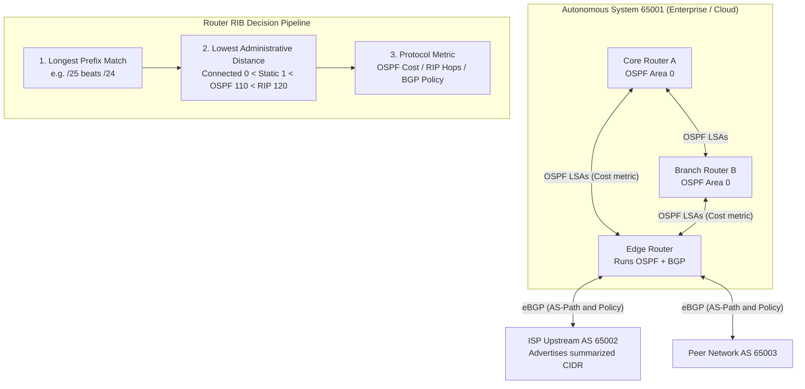
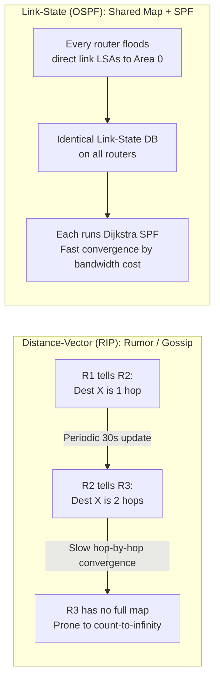
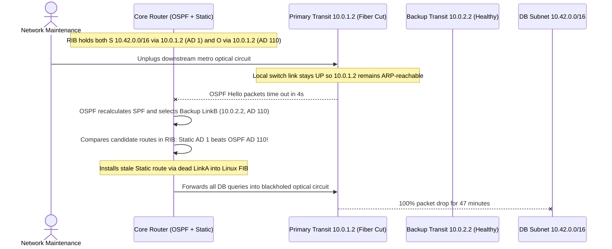

# Routing Protocols

> **Prerequisites:** Module 01 (CIDR & Subnets), Module 05 (Routing Tables, Static Routes, NAT & Firewalls), and a Linux environment with FRRouting (`frr`, `vtysh`, `ip route`).  
> **Estimated Reading Time:** 35 minutes  
> **Target Audience:** Backend Engineers, Site Reliability Engineers, Cloud Network Architects.

> [!TIP]
> **The Golden Rule of Dynamic Routing:** A router selects a route in strict hierarchy: **Longest Prefix Match** first, then **lowest Administrative Distance (AD)** across protocol sources, and only *then* the protocol's internal metric (cost, hop count, or BGP attributes). When dynamic routing ignores an obviously better path, check for a stale lower-AD static route overriding it.

---

## 1. Why This Matters & Architectural Mental Model

Module 05 gave you the routing table and told you entries get populated "statically (you configure them) or dynamically (routers exchange reachability with protocols)" — then moved on. That's fine for a single host or a small lab, but it's not how the internet, or any network with more than a handful of routers, actually works. Nobody hand-types routes into thousands of routers, and nobody could keep them correct as links fail and topologies change. **Dynamic routing protocols** let routers discover the network and each other's routes automatically, and react to failures in seconds instead of waiting for a human to notice and fix a static route. This module is where "the routing table" from module 05 stops being something *you* fill in and becomes something the network fills in *for* you — and gives you the vocabulary (RIP, OSPF, BGP, administrative distance) you'll need the moment a real outage traces back to "the router picked the wrong path."

### Static vs Dynamic Routing

* **Static routing** is what module 05 already covered: an administrator manually configures each route (`ip route add ...`). It's predictable, requires no protocol overhead, and is completely fine for small, stable topologies (a handful of subnets, one path between them) — which is exactly why this track used it. It does not scale: every topology change (a new subnet, a failed link) requires manually updating every affected router, and nothing detects or reroutes around a failure on its own.
* **Dynamic routing** replaces manual configuration with a **routing protocol**: routers periodically exchange reachability information with their neighbors, build up a picture of the network, and compute routes automatically — including automatically removing routes through a link that just failed. The tradeoff is complexity (a protocol to configure, understand, and secure) in exchange for scale and self-healing.

### IGP vs EGP & How Routers Select Paths



Routing protocols split into two categories by *scope*:

* **IGP (Interior Gateway Protocol)** — runs *within* a single organization's network (one **autonomous system**, or AS — a network under one administrative control). RIP and OSPF are IGPs.
* **EGP (Exterior Gateway Protocol)** — runs *between* different autonomous systems — between organizations, e.g. between your ISP and the next ISP over. BGP is the only EGP in real use today; it's the protocol that makes the *internet itself* a connected network of independently-run networks.

The practical distinction: you might run OSPF inside your company's network to route between your own subnets, while your edge router speaks BGP to your ISP to reach everything outside it. Different jobs, different protocols, often both running on the same router at once.

### Distance-Vector vs Link-State: Two Ways to Compute a Route



* **Distance-vector** protocols (RIP) work like gossip: each router tells its directly-connected neighbors "here's every destination I know about, and how many hops away it is," and each neighbor adds one hop and passes it on. No router ever sees the whole topology — just what its neighbors report. Simple to implement, but slow to converge after a failure (routes propagate hop-by-hop, one gossip round at a time) and historically prone to routing loops during that convergence window.
* **Link-state** protocols (OSPF) work like a shared map: every router floods information about its own direct links to *every* other router in the area (not just neighbors), so every router ends up with an identical, complete picture of the topology, and independently runs a shortest-path algorithm (Dijkstra's) over that full picture. Faster, more accurate convergence, but more CPU/memory to hold the full map and more complex to configure.

### Protocol Deep Dives: RIP, OSPF, and BGP

* **RIP (Routing Information Protocol):** The simple, mostly-historical distance-vector protocol. RIP picks routes by **hop count** only — the path with the fewest routers in between wins, regardless of whether the "shorter" path is 3 slow satellite links and the "longer" one is 4 fast fiber links. It's capped at 15 hops (16 means "unreachable"), which alone rules it out for large networks. RIP is largely a teaching and legacy protocol today — you'll rarely deploy it in a modern network — but its simplicity is exactly why it's the right first protocol to actually configure and watch converge by hand, which is what this module's exercises use it for.
* **OSPF (Open Shortest Path First):** The dominant IGP in real enterprise networks. It's link-state (full topology map, Dijkstra shortest-path), picks routes by **cost** (an administrator-tunable metric, commonly derived from link bandwidth — a faster link gets a lower cost and wins over a hop-count-shorter but slower path, exactly what RIP can't express) and organizes large networks into **areas** to keep the flooded topology information from growing without bound — a **backbone area (Area 0)** that every other area must connect to, keeping the design hierarchical rather than one enormous flat flood domain. Because it reacts to link failures via flooding rather than periodic gossip, OSPF converges far faster than RIP after a topology change.
* **BGP (Border Gateway Protocol):** The EGP that connects autonomous systems to each other — it's what makes "the internet" one routable network made of thousands of independently-run networks instead of thousands of disconnected islands. It's a **path-vector** protocol: each route carries the actual list of AS numbers it passed through (the **AS-path**), which both lets a router pick a route and, critically, lets it detect and reject a route that loops back through its own AS. BGP doesn't optimize for pure speed or hop count the way RIP/OSPF do — real-world route selection weighs policy (business relationships between networks — who's a paid transit provider vs a peer), AS-path length, and several other attributes, because BGP routing decisions are as much about *who's willing to carry your traffic and under what commercial terms* as about the technically shortest path. This is also the protocol behind module 01's **CIDR route aggregation/summarization**: an ISP advertises one summarized prefix upstream via BGP instead of every individual customer subnet, keeping the global routing table from growing unmanageably as the internet scales.

### Administrative Distance: When a Router Hears About the Same Route Twice

A router can learn a route to the same destination from more than one source — a static route you configured *and* OSPF learning the same prefix dynamically, for instance. **Administrative distance (AD)** is the tie-breaker: a lower AD wins, regardless of the metric either source would otherwise use.

A static route (AD 1) overrides an OSPF-learned route to the same destination (AD 110) even if OSPF's path is objectively better by its own cost metric — this is a common, very real source of "why is traffic taking the path I *didn't* configure OSPF to prefer" confusion, and the fix is almost always "a leftover static route is winning by AD, delete it or raise its AD" rather than anything wrong with the dynamic protocol itself.

---

## 2. Taxonomic Comparison & Systematic Command Reference

### Routing Protocol Architecture Matrix

| Protocol | Category | Algorithm Type | Routing Metric / Selection | Typical Convergence | Loop Prevention Mechanism | Primary Use Case |
| :--- | :--- | :--- | :--- | :--- | :--- | :--- |
| **Static** | Manual | Admin-configured | None (AD 1) | Never (manual fix) | Careful human design | Small networks, stub gateways, default routes |
| **RIP (v2)** | IGP | Distance-vector | Hop count (max 15; 16 = unreachable) | Slow (30–180s timers) | Split horizon, poison reverse, max 15 hops | Legacy labs, simple learning topologies |
| **OSPF** | IGP | Link-state (Dijkstra SPF) | Cost (inverse bandwidth) | Fast (sub-second to few sec) | Full topology view + Area 0 hierarchy | Enterprise & data center interior routing |
| **BGP (v4)** | EGP | Path-vector | Policy (LocalPref, AS-Path, MED) | Moderate (policy-driven) | AS-Path contains own ASN check | Internet backbone, ISP/cloud peering |

### Administrative Distance (AD) Tie-Breaker Defaults

| Source | Typical AD | Operational Meaning |
| :--- | :---: | :--- |
| **Directly connected** | `0` | Subnet lives directly on an active local interface |
| **Static route** | `1` | Manually configured `ip route` (overrides all IGPs for the exact same prefix) |
| **eBGP (External BGP)** | `20` | Learned from an external Autonomous System |
| **OSPF** | `110` | Dynamically computed shortest-path interior route |
| **RIP** | `120` | Dynamically learned distance-vector interior route |
| **Unreachable / unusable** | `255` | Route ignored and never installed into the forwarding table |

### Command Reference (FRRouting / `vtysh`)

This module uses **FRRouting (FRR)**, the standard open-source router software also used inside many real network appliances, running directly on your WSL2 Ubuntu box (or between netns/Docker "routers" the way the capstone builds a lab).

| Command | What it does | Example |
| :--- | :--- | :--- |
| `sudo apt install frr` | Installs FRR (`ripd`/`ospfd`/`bgpd` daemons + `vtysh` CLI) | `sudo apt install frr` |
| `sudo vtysh` | Opens FRR's interactive router CLI (Cisco-style) | `sudo vtysh` |
| `show ip route` | Shows the current routing table with the source of each route (`C`=connected, `S`=static, `O`=OSPF, `R`=RIP) | `show ip route` |
| `show ip ospf neighbor` | Lists OSPF neighbors and their adjacency state | `show ip ospf neighbor` |
| `show ip route rip` | Shows only RIP-learned routes | `show ip route rip` |
| `router rip` / `network <cidr>` | Enables RIP and advertises a connected network into it (config mode) | `router rip` then `network 10.0.1.0/24` |
| `router ospf` / `network <cidr> area 0` | Enables OSPF and assigns a network to an area (config mode) | `router ospf` then `network 10.0.1.0/24 area 0` |

### Flag & Output Notes

- `show ip route` output codes tell you the *source* of each entry at a glance — `C` (connected), `S` (static), `O` (OSPF), `R` (RIP) — which is exactly what you need to spot an administrative-distance conflict: two entries for the same prefix with different source codes means AD is the tiebreaker.
- `show ip ospf neighbor` state should reach `Full` for a working adjacency; stuck at `Init` or `2-Way` means the neighbor relationship never completed — check that both sides are in the same area and can reach each other at the link layer first (module 00/05's toolkit).

---

## 3. Production War Story Post-Mortem: The Stale Static Route Blackhole



### The Incident
During a planned optical circuit swap on Primary Link A between two regional data centers, engineers expected OSPF to reconverge traffic to Backup Link B within 5 seconds. Instead, all database replication and API queries targeting `10.42.0.0/16` dropped completely. `show ip ospf neighbor` showed healthy `Full` adjacencies over Backup Link B, yet zero packets reached the destination.

### Post-Mortem Telemetry
* **Severity:** SEV-1 (Complete cross-region database partition)
* **Mean Time to Detect (MTTD):** 2 minutes (replication lag and API `504` alerts fired)
* **Mean Time to Resolution (MTTR):** 47 minutes (engineers verified OSPF LSDB and neighbor states before inspecting `show ip route` source codes)
* **Impact:** Read-replica lag exceeded SLA and cross-region writes halted

### Root Cause Analysis
1. **Leftover Migration Static Route:** Two years earlier during an initial rack bring-up, an engineer added `ip route 10.42.0.0/16 10.0.1.2` before enabling OSPF.
2. **AD Overrides Dynamic Convergence:** Because the local Ethernet port toward the optical converter stayed physically `UP`, the kernel kept the static route active. Even after OSPF detected the remote peer loss via missed Hellos and computed a valid backup path via `10.0.2.2` (`O`, AD 110), the router's RIB preferred the static entry (`S`, AD 1) purely by Administrative Distance.

### The Fix & Architectural Hardening
1. **Immediate Fix:** Removed the stale static route (`no ip route 10.42.0.0/16 10.0.1.2`), allowing FRR's `zebra` daemon to install the OSPF route immediately.
2. **Architectural Hardening:** Eliminated manual static routes on OSPF-participating transit fabrics; enforced automated CI drift checks inspecting `show ip route` for `S` entries overlapping `O` prefixes; enabled BFD (Bidirectional Forwarding Detection) on OSPF adjacencies for sub-second failover.

---

## 4. Multi-Language Production Implementation: RIB Route Selector & OSPF Cost Engine

In routing control planes and cloud network emulators, selecting the winning route requires evaluating **Longest Prefix Match**, **Administrative Distance**, and **Protocol Metric** in strict order.

````carousel
### Go (RIB Longest-Prefix + AD Tie-Breaker)
```go
package main

import (
	"fmt"
	"net/netip"
	"sort"
)

type SourceProtocol string

const (
	ProtoConnected SourceProtocol = "C"
	ProtoStatic    SourceProtocol = "S"
	ProtoEBGP      SourceProtocol = "B"
	ProtoOSPF      SourceProtocol = "O"
	ProtoRIP       SourceProtocol = "R"
)

var DefaultAD = map[SourceProtocol]int{
	ProtoConnected: 0,
	ProtoStatic:    1,
	ProtoEBGP:      20,
	ProtoOSPF:      110,
	ProtoRIP:       120,
}

type RouteEntry struct {
	Prefix   netip.Prefix
	NextHop  string
	Protocol SourceProtocol
	AD       int
	Metric   int
}

// SelectBestRoute resolves destination IP using LPM -> lowest AD -> lowest metric.
func SelectBestRoute(rib []RouteEntry, dest netip.Addr) (RouteEntry, bool) {
	var candidates []RouteEntry
	for _, r := range rib {
		if r.AD < 255 && r.Prefix.Contains(dest) {
			candidates = append(candidates, r)
		}
	}
	if len(candidates) == 0 {
		return RouteEntry{}, false
	}

	sort.Slice(candidates, func(i, j int) bool {
		if candidates[i].Prefix.Bits() != candidates[j].Prefix.Bits() {
			return candidates[i].Prefix.Bits() > candidates[j].Prefix.Bits() // 1. Longest Prefix Match
		}
		if candidates[i].AD != candidates[j].AD {
			return candidates[i].AD < candidates[j].AD // 2. Lowest Administrative Distance
		}
		return candidates[i].Metric < candidates[j].Metric // 3. Lowest Protocol Metric
	})
	return candidates[0], true
}

func OSPFCost(refBandwidthMbps, linkBandwidthMbps int) int {
	if cost := refBandwidthMbps / linkBandwidthMbps; cost >= 1 {
		return cost
	}
	return 1
}

func main() {
	rib := []RouteEntry{
		{Prefix: netip.MustParsePrefix("10.42.0.0/16"), NextHop: "10.0.1.2 (stale)", Protocol: ProtoStatic, AD: DefaultAD[ProtoStatic], Metric: 0},
		{Prefix: netip.MustParsePrefix("10.42.0.0/16"), NextHop: "10.0.2.2 (backup)", Protocol: ProtoOSPF, AD: DefaultAD[ProtoOSPF], Metric: OSPFCost(10000, 1000)},
		{Prefix: netip.MustParsePrefix("10.42.10.0/24"), NextHop: "10.0.3.2 (specific)", Protocol: ProtoOSPF, AD: DefaultAD[ProtoOSPF], Metric: 20},
	}

	best, ok := SelectBestRoute(rib, netip.MustParseAddr("10.42.10.55"))
	fmt.Printf("Found=%v Winning Route: %+v\n", ok, best)
}
```
<!-- slide -->
### TypeScript (RIB Longest-Prefix + AD Tie-Breaker)
```typescript
type ProtocolCode = 'C' | 'S' | 'B' | 'O' | 'R';

const ADMIN_DISTANCE: Record<ProtocolCode, number> = {
  C: 0,
  S: 1,
  B: 20,
  O: 110,
  R: 120,
};

interface RouteCandidate {
  cidr: string;
  nextHop: string;
  protocol: ProtocolCode;
  ad?: number;
  metric: number;
}

function ipToUint32(ip: string): number {
  return ip.split('.').reduce((acc, octet) => ((acc << 8) | Number(octet)) >>> 0, 0);
}

function prefixMatches(cidr: string, destIp: string): { matched: boolean; bits: number } {
  const [netStr, bitsStr] = cidr.split('/');
  const bits = Number(bitsStr);
  const mask = bits === 0 ? 0 : (~0 << (32 - bits)) >>> 0;
  return {
    matched: (ipToUint32(netStr) & mask) === (ipToUint32(destIp) & mask),
    bits,
  };
}

export function selectActiveRoute(rib: RouteCandidate[], destIp: string): RouteCandidate | null {
  const matches = rib
    .map((r) => ({ route: r, ad: r.ad ?? ADMIN_DISTANCE[r.protocol], match: prefixMatches(r.cidr, destIp) }))
    .filter((x) => x.ad < 255 && x.match.matched);

  if (matches.length === 0) return null;

  matches.sort((a, b) => {
    if (a.match.bits !== b.match.bits) return b.match.bits - a.match.bits; // 1. Longest Prefix Match
    if (a.ad !== b.ad) return a.ad - b.ad; // 2. Lowest Administrative Distance
    return a.route.metric - b.route.metric; // 3. Lowest Protocol Metric
  });

  return matches[0].route;
}

export function calculateOspfCost(linkMbps: number, referenceMbps = 10000): number {
  return Math.max(1, Math.floor(referenceMbps / linkMbps));
}
```
<!-- slide -->
### Python (RIB Selector & `ipaddress` Tie-Breaker)
```python
import ipaddress
from dataclasses import dataclass
from typing import Dict, List, Optional

DEFAULT_AD: Dict[str, int] = {
    "C": 0,    # Directly Connected
    "S": 1,    # Static
    "B": 20,   # eBGP
    "O": 110,  # OSPF
    "R": 120,  # RIP
}


@dataclass(frozen=True)
class RouteEntry:
    prefix: ipaddress.IPv4Network
    next_hop: str
    protocol: str
    ad: int
    metric: int


def select_best_route(rib: List[RouteEntry], destination: str) -> Optional[RouteEntry]:
    target = ipaddress.IPv4Address(destination)
    matching = [r for r in rib if r.ad < 255 and target in r.prefix]
    if not matching:
        return None

    # Sort priority: Longest Prefix (-prefixlen), Lowest AD (+ad), Lowest Metric (+metric)
    return min(matching, key=lambda r: (-r.prefix.prefixlen, r.ad, r.metric))


def ospf_cost(link_mbps: int, ref_mbps: int = 10_000) -> int:
    return max(1, ref_mbps // link_mbps)


if __name__ == "__main__":
    rib = [
        RouteEntry(ipaddress.IPv4Network("10.42.0.0/16"), "10.0.1.2", "S", DEFAULT_AD["S"], 0),
        RouteEntry(ipaddress.IPv4Network("10.42.0.0/16"), "10.0.2.2", "O", DEFAULT_AD["O"], ospf_cost(1000)),
    ]
    print("Winner:", select_best_route(rib, "10.42.5.10"))
```
<!-- slide -->
### C# (RIB Selector & OSPF Cost Evaluator)
```csharp
using System;
using System.Collections.Generic;
using System.Linq;
using System.Net;

public enum RoutingProtocol { Connected, Static, EBGP, OSPF, RIP }

public record RouteEntry(IPAddress Network, int PrefixLength, string NextHop, RoutingProtocol Protocol, int AD, int Metric)
{
    public bool Contains(IPAddress dest)
    {
        uint net = ToUInt32(Network);
        uint ip = ToUInt32(dest);
        uint mask = PrefixLength == 0 ? 0u : uint.MaxValue << (32 - PrefixLength);
        return (net & mask) == (ip & mask);
    }

    private static uint ToUInt32(IPAddress addr)
    {
        byte[] bytes = addr.GetAddressBytes();
        if (BitConverter.IsLittleEndian) Array.Reverse(bytes);
        return BitConverter.ToUInt32(bytes, 0);
    }
}

public static class RoutingEngine
{
    public static readonly IReadOnlyDictionary<RoutingProtocol, int> DefaultAD = new Dictionary<RoutingProtocol, int>
    {
        [RoutingProtocol.Connected] = 0,
        [RoutingProtocol.Static] = 1,
        [RoutingProtocol.EBGP] = 20,
        [RoutingProtocol.OSPF] = 110,
        [RoutingProtocol.RIP] = 120,
    };

    public static RouteEntry? SelectBestRoute(IEnumerable<RouteEntry> rib, IPAddress destination) =>
        rib.Where(r => r.AD < 255 && r.Contains(destination))
           .OrderByDescending(r => r.PrefixLength) // 1. Longest Prefix Match
           .ThenBy(r => r.AD)                     // 2. Lowest Administrative Distance
           .ThenBy(r => r.Metric)                 // 3. Lowest Protocol Metric
           .FirstOrDefault();

    public static int ComputeOspfCost(int linkMbps, int refMbps = 10_000) => Math.Max(1, refMbps / linkMbps);
}
```
````

---

## 5. Practical Hands-On Verification CLI Workflows & Lab Exercises

Requires FRR (`sudo apt install frr`) in WSL2, and two or three network namespaces or Docker containers acting as separate "routers" connected by veth pairs or a bridge (reuse the lab-building approach from the capstone, module 12) — or, at minimum, run these against a single-router FRR instance to read its own table and syntax before wiring up multiple routers.

### Workflow 1: Inspect FRR Routes, Source Codes & OSPF Adjacencies

1. **Install and enter FRR.** `sudo apt install frr`, enable the daemons you need by editing `/etc/frr/daemons` (set `ripd=yes` and `ospfd=yes`), restart with `sudo systemctl restart frr`, then `sudo vtysh`. Run `show ip route` and confirm you see your existing connected routes with the `C` code — this is FRR reading the same kernel routing table `ip route` shows you, just with source annotations.

```bash
sudo apt update && sudo apt install -y frr
sudo sed -i 's/^ripd=no/ripd=yes/; s/^ospfd=no/ospfd=yes/' /etc/frr/daemons
sudo systemctl restart frr
sudo vtysh -c "show ip route"
```

**Expected Output:**

```text
Codes: K - kernel route, C - connected, S - static, R - RIP,
       O - OSPF, I - IS-IS, B - BGP, E - EIGRP, N - NHRP,
       T - Table, v - VNC, V - VNC-Direct, A - Babel, F - PBR,
       > - selected route, * - FIB route, q - queued, r - rejected

C>* 10.0.1.0/24 is directly connected, eth0, 00:04:12
K>* 0.0.0.0/0 [0/0] via 10.0.1.1, eth0, 00:04:12
```

### Workflow 2: RIP vs. OSPF Convergence & AD Conflict Injection

2. **Configure RIP on a two-router lab and watch it converge.** Build two namespaces/containers connected via a shared subnet, each also connected to its own private subnet (so each "router" has a network the other doesn't yet know about). On each, enter `router rip` and `network <its-connected-subnets>`. Within ~30 seconds, run `show ip route rip` on router A — expect to see router B's private subnet appear, learned automatically, with no static route configured for it. This is RIP's gossip in action.

3. **Break a link and time convergence.** With RIP still running from exercise 2, disconnect (or `ip link set down`) the link between the two routers. Time how long `show ip route rip` takes to remove the now-unreachable route. Expected: RIP takes noticeably longer (its periodic-update timers are on the order of tens of seconds) than you'd want for a production failover — this is the concrete, observed version of "distance-vector converges slowly," not just a claim from the Concepts section.

4. **Same lab, OSPF instead of RIP.** Disable RIP, configure `router ospf` / `network ... area 0` on both routers instead. Run `show ip ospf neighbor` and confirm the adjacency reaches `Full`, then `show ip route` and confirm the same cross-router route appears, now with the `O` code. Repeat exercise 3's link-break test and compare convergence time — expect OSPF to notice and reroute meaningfully faster.

```bash
# Inspect OSPF neighbor adjacency and OSPF-learned routes via vtysh
sudo vtysh -c "show ip ospf neighbor"
sudo vtysh -c "show ip route ospf"
```

**Expected Output:**

```text
Neighbor ID     Pri State           Dead Time Address         Interface            RXmtL RqstL DBsmL
10.0.2.1          1 Full/DR           34.210s 10.0.12.2       veth-r1:10.0.12.1        0     0     0

O>* 10.20.2.0/24 [110/20] via 10.0.12.2, veth-r1, weight 1, 00:01:08
```
*(Notice `[110/20]` — Administrative Distance `110` and OSPF cost metric `20`!)*

5. **Trigger and observe an administrative-distance conflict.** With OSPF from exercise 4 still learning router B's subnet correctly, manually add a static route to that same subnet pointing at a deliberately wrong next hop: `ip route add <b's-subnet> via <wrong-ip>`. Run `show ip route` — expect the static route (`S`, AD 1) to be installed and preferred over the OSPF route (`O`, AD 110) *even though it's wrong*, and confirm traffic to that subnet now actually breaks. Remove the bad static route and confirm OSPF's route takes over again immediately.

### Independent Challenge

No lab given. You inherit a network where a specific subnet is unreachable, and `show ip route` on the router shows an `S` (static) entry for it pointing at a next hop that no longer exists (a decommissioned device), while OSPF is confirmed (via `show ip ospf neighbor` on a full adjacency, and by checking a neighboring router's own table) to have a valid, working route to the same subnet. Using this module's administrative-distance table, explain exactly why the OSPF route isn't being used despite being correct and reachable, and state the fix. Then explain why simply raising OSPF's administrative distance (instead of removing the bad static route) would be the wrong fix, even though it would technically also resolve this specific symptom.

<details>
<summary>Stuck? One hint</summary>

The static route's AD (1) beats OSPF's AD (110) regardless of which one actually works — administrative distance is a pure trust-ranking of the *source*, not a check of whether the route is currently valid. The correct fix is removing (or correcting) the stale static route, restoring OSPF's dynamically-learned, currently-correct route to being used. Raising OSPF's AD above the static route's would only "fix" this one symptom by coincidence and would make *every future* legitimate static route on this router lose to OSPF instead — the actual problem is one specific stale entry, not a general policy about which protocol should be trusted more, and fixing a specific-entry problem by changing a global trust ranking is solving the wrong-scoped problem.

</details>

---

## 6. Common Mistakes & Troubleshooting

- **Confusing "shorter path" (hop count) with "better path."** RIP's hop-count metric can prefer a path over slow links simply because it has fewer routers in between — exercise 3's kind of scenario is why OSPF's cost-based (bandwidth-aware) metric is preferred for anything beyond a small, uniform-link network.
- **Forgetting that a stale static route silently wins over a correct dynamic one.** Administrative distance doesn't care whether a route still works — exercise 5 and the independent challenge are both this exact trap, and it's a genuinely common real-world outage cause.
- **Assuming OSPF adjacency = working routes.** A neighbor stuck at `Init`/`2-Way` instead of `Full` means routes aren't actually being exchanged yet — check adjacency state before assuming the protocol itself is broken.
- **Treating BGP like "OSPF but for the internet."** BGP's route selection is policy-and-relationship-driven (who's paying whom, AS-path preferences), not simply "shortest/fastest path" — assuming BGP always picks the technically optimal route is a common misconception.
- **Running a routing protocol without understanding its convergence time.** A protocol that takes 30-60 seconds to notice and route around a failure (RIP) is a real, measurable availability gap for a service that needs sub-second failover — pick the protocol (and tune its timers) to match what the service actually needs, don't assume "it's dynamic routing, it'll just handle it" covers every case equally fast.

---

## 7. Operational Validation Checkpoints & Self-Assessment

### Operational Validation Checkpoints

<details>
<summary><strong>Checkpoint 1: Longest Prefix Match vs. Administrative Distance</strong></summary>

**Scenario:** On a core router, `show ip route` displays two routes:
- `S>* 10.50.0.0/16 [1/0] via 192.168.1.1`
- `O>* 10.50.20.0/24 [110/10] via 192.168.2.1`

A packet arrives destined for `10.50.20.45`. Which next hop does the router forward the packet to (`192.168.1.1` or `192.168.2.1`), and why doesn't Static AD `1` beat OSPF AD `110` here?

**Answer:**
The router forwards the packet to **`192.168.2.1` (the OSPF route)**. Administrative distance *only* breaks ties for the **exact same prefix**. Because `10.50.20.0/24` is a more specific match (24 bits) than `10.50.0.0/16` (16 bits), **Longest Prefix Match** always decides first before AD is ever compared.

</details>

<details>
<summary><strong>Checkpoint 2: OSPF Neighbor Stuck in `Init` or `2-Way`</strong></summary>

**Scenario:** Two routers R1 and R2 have link connectivity (`ping` passes), and both have `router ospf` configured. However, `show ip ospf neighbor` on R1 shows R2 stuck in `Init` (or `ExStart` / `2-Way` on a point-to-point link), and `show ip route` shows no `O` routes from R2.

Name three concrete protocol mismatches that halt OSPF before reaching `Full`, and why no routes are exchanged yet.

**Answer:**
Until neighbors exchange full Link-State Databases (LSDBs) and reach **`Full`** state, they do not trust each other's topology advertisements. Common blockers are:
1. **Area ID mismatch** (R1 configured `area 0`, R2 configured `area 1`).
2. **Hello/Dead timer mismatch** or **MTU mismatch** (blocks `ExStart` LSDB exchange even after `2-Way`).
3. **Authentication key mismatch** or **unidirectional firewall** dropping OSPF protocol `89` (IP protocol 89) packets in one direction (`Init` state).

</details>

<details>
<summary><strong>Checkpoint 3: BGP Policy & AS-Path Loop Rejection</strong></summary>

**Scenario:** Router Edge-1 (in `AS 65100`) peers via eBGP with two upstream transit ISPs (`AS 3356` and `AS 174`). Edge-1 receives an advertisement for `203.0.113.0/24` via `AS 174` with AS-path `[174, 64500, 65100]`, and via `AS 3356` with AS-path `[3356, 2914, 7018]`.

Which path does Edge-1 reject unconditionally, and why might Edge-1 still prefer a longer AS-path over a shorter one on valid paths?

**Answer:**
1. Edge-1 **rejects `[174, 64500, 65100]` unconditionally** because its own ASN (`65100`) appears inside the AS-path—BGP's built-in loop prevention rule drops any route containing its own AS number.
2. On valid paths, BGP weighs **commercial policy** (e.g., `Local_Preference` set higher for a cheaper/paid peering link than a costly transit link) *before* comparing AS-path length.

</details>

### Checkpoint Quiz

Write down your answer to each question before expanding it — checking without attempting first is the single easiest way to fool yourself into thinking you've learned this.

1. What's the practical difference between static and dynamic routing, and what does dynamic routing cost you in exchange for scale and self-healing?
2. What's the difference between an IGP and an EGP, and which category does BGP fall into?
3. Contrast distance-vector and link-state routing in terms of what each router actually knows about the topology.
4. Why is RIP's hop-count metric a poor fit for a network with links of very different speeds, and what does OSPF use instead?
5. What is administrative distance, and why can a static route "win" over a dynamically-learned route to the same destination even when the static route is wrong?
6. Why does BGP's route selection depend on more than just "shortest path," unlike RIP or OSPF?

<details>
<summary>Show answers</summary>

1. Static routing is manually configured by an administrator and never changes on its own; dynamic routing has routers exchange reachability information via a protocol and compute/update routes automatically, including reacting to failures without human intervention. The cost is protocol complexity — configuration, resource usage, and a new class of things that can go wrong (protocol misconfiguration, slow convergence, administrative-distance conflicts) in exchange for not needing to hand-maintain every route as the network changes.
2. An IGP (like RIP or OSPF) runs within a single autonomous system (one organization's network); an EGP runs between autonomous systems. BGP is the EGP — it's what connects independently-run networks (like ISPs) into the single routable internet.
3. Distance-vector (RIP): each router only knows what its direct neighbors report (hop counts to destinations), with no view of the full topology — "gossip." Link-state (OSPF): every router floods its own direct links to every other router in the area, so every router ends up with an identical, complete map of the topology and computes shortest paths independently over that full picture.
4. Hop count treats every link as equal regardless of actual speed, so RIP can prefer a path with fewer, slower links over a path with more, faster links. OSPF uses a cost metric commonly derived from link bandwidth, so faster links are preferred even if the path has more hops.
5. Administrative distance is a per-source trust ranking used to break ties when a router learns a route to the same destination from more than one source (e.g. static config vs OSPF) — a lower AD always wins, regardless of whether that route's metric, or even its basic correctness, is actually better. A static route (AD 1) beats an OSPF route (AD 110) purely by source ranking, even if the static route points at a dead next hop and the OSPF route is valid and working.
6. Because BGP connects independently-operated networks with real business relationships (transit customers, peers, paid agreements) — route selection has to reflect policy (who's willing/paid to carry the traffic) in addition to path length, unlike RIP/OSPF which operate within one organization's network where "shortest/cheapest technical path" is the only consideration that matters.

</details>

---

## Next

[09 — VPN & IPSec](../09-vpn-and-ipsec/README.md): now that you understand how routes get learned across a network, learn how two networks connect *securely* across a network neither of them controls — the untrusted public internet.
