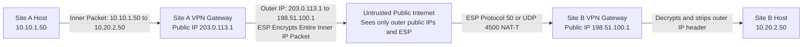
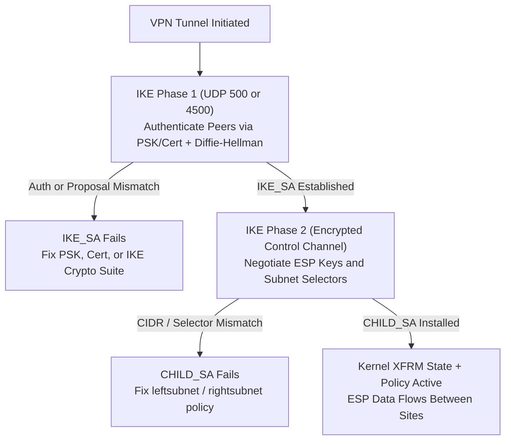
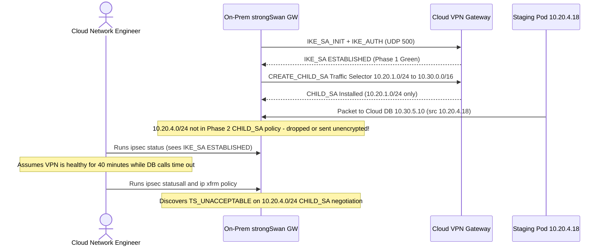

# VPN & IPSec

> **Prerequisites:** Module 01 (Private IPv4 & CIDR), Module 05 (Routing, NAT & Firewalls), [TLS, SSL and HTTPS](../../../backend/01-request-response-fundamentals/09-tls-ssl-and-https/README.md), and Linux namespaces with `strongswan` (`ipsec`, `ip xfrm`, `tcpdump`).  
> **Estimated Reading Time:** 35 minutes  
> **Target Audience:** Backend Engineers, Site Reliability Engineers, Cloud Network Architects.

> [!TIP]
> **The Golden Rule of VPN & IPSec Operations:** Never treat "the VPN is down" as a single undifferentiated problem. Separate **IKE Phase 1 (`IKE_SA`)** authentication failures from **IPSec Phase 2 (`CHILD_SA`)** traffic-selector/encryption failures, and audit both sides for **overlapping private CIDR ranges** before building a single tunnel.

---

## 1. Why This Matters & Architectural Mental Model

Module 05's firewalls decide what's allowed through, and TLS ([TLS, SSL and HTTPS](../../../backend/01-request-response-fundamentals/09-tls-ssl-and-https/README.md)) protects one connection's payload. Neither solves a different, common need: connecting two entire private networks — your office LAN and your cloud VNet, or a remote employee's laptop and your company network — *as if* they were on the same private network, across the public internet, where anyone in between could otherwise read or tamper with every packet. A **VPN (Virtual Private Network)** is that connection: an encrypted tunnel carrying private traffic across an untrusted network. This is also directly the mechanism behind Azure's VPN Gateway and every "connect on-prem to the cloud" story in the next track — understand it here as pure networking, and the Azure version is just this with a managed control plane.

### Tunneling & IPSec ESP Tunnel Mode Encapsulation



A VPN's core trick is **tunneling**: taking an entire original packet (source, destination, payload — often using private addresses that aren't routable on the internet at all, exactly module 01's private ranges) and wrapping it inside a *new* outer packet whose source and destination are the two VPN endpoints' *public* addresses. The outer packet is what actually traverses the internet; at the far end, the VPN device strips the outer wrapping and delivers the original inner packet onto the remote private network. From either private network's point of view, the other network is just... there, reachable, the way module 05 described a directly-connected subnet — the tunnel makes physically distant networks behave as logically adjacent ones. Encryption is a separate, additional property layered on top of tunneling (you can tunnel without encrypting — GRE does this — but a VPN specifically adds encryption so the tunneled traffic is unreadable in transit).

### Site-to-Site vs Remote-Access VPNs

* **Site-to-site VPN** — connects two entire networks (your office and your cloud VNet, or two office branches) via VPN devices/gateways at each site. Every host on either private network can reach every host on the other, transparently, with no per-device VPN client needed — the tunnel is between the *networks*, not between individual machines.
* **Remote-access VPN** — connects a single device (an employee's laptop) into a private network. The device runs VPN client software, connects to a VPN gateway/concentrator, and — once connected — behaves as if it's physically on that private network, able to reach internal-only resources it couldn't reach from the open internet.

Both use the same underlying tunneling/encryption mechanisms; the difference is entirely about *what's on each end of the tunnel* — a whole network's gateway device, or one client machine.

### IPSec: Protocols (`AH` vs `ESP`) and Modes (`Transport` vs `Tunnel`)

**IPSec (IP Security)** isn't one protocol but a *suite* — a standard, widely-implemented framework most site-to-site VPNs (and many remote-access ones) are built on. Two protocols within it matter most:

* **AH (Authentication Header)** — guarantees the packet wasn't tampered with and really came from who it claims (integrity + authentication), but does **not** encrypt the payload — the data itself is still readable in transit. Rarely used alone in practice, because "tamper-proof but readable" isn't what most VPN use cases actually need.
* **ESP (Encapsulating Security Payload)** — provides integrity *and* authentication *and* encryption (confidentiality) — the payload is actually unreadable to anyone intercepting it. This is what almost every real-world IPSec VPN uses; AH-only deployments are uncommon.

IPSec also runs in two **modes**, which decide *how much* of the original packet gets wrapped:

* **Transport mode** — encrypts only the payload of the original IP packet, leaving the original IP header exposed. Used for host-to-host protection where both ends are the actual traffic's real source/destination — less common for VPNs specifically.
* **Tunnel mode** — encrypts the *entire* original packet (header included) and wraps it inside a brand-new outer IP packet with the VPN gateways' own addresses. This is what site-to-site VPNs use: it's what lets private, non-routable inner addresses traverse the public internet safely inside a routable outer packet, exactly the tunneling behavior described above.

### IKE Two-Phase Negotiation & Failure Separation



Before ESP can encrypt anything, both VPN endpoints need to agree on encryption keys and algorithms — and they have to do that negotiation *itself* securely, without ever transmitting the actual shared key in the open. **IKE (Internet Key Exchange)** is the protocol that does this, typically in two phases: **Phase 1** establishes a secure, authenticated channel between the two endpoints themselves (using Diffie-Hellman key exchange — the same category of "agree on a shared secret over a public channel without ever transmitting the secret itself" trick TLS's handshake uses); **Phase 2** uses that now-secure channel to negotiate the actual IPSec (ESP) parameters — the keys and algorithms that will encrypt the real tunneled traffic. The practical takeaway: a VPN connection has two distinct negotiation layers (IKE, then IPSec/ESP) with their own separate configuration and their own separate ways to fail — "IKE Phase 1 failed" and "Phase 2/IPSec failed" are genuinely different troubleshooting situations, not interchangeable "the VPN is down."

### SSL/TLS VPNs & The Overlapping Private Range Trap

* **SSL/TLS VPNs (browser-friendly alternative):** Not every VPN uses IPSec. **SSL VPNs** (sometimes marketed as "TLS VPN") use the same TLS mechanism that HTTPS uses instead of IPSec's separate IKE/ESP machinery — commonly delivered as a browser-accessible portal (clientless, reaching specific internal web apps through a gateway) or a lightweight client that tunnels traffic over a standard TLS connection. The practical advantage: TLS traffic on port 443 passes through far more restrictive firewalls/proxies than IPSec's protocols and ports typically do, since it's indistinguishable at the network level from ordinary HTTPS traffic — a real, common reason organizations choose SSL VPN specifically for remote-access scenarios where users connect from unpredictable, locked-down networks (hotel wifi, a client's corporate firewall).
* **The classic VPN failure mode: overlapping private ranges:** Module 05 already warned about this in passing; it's worth stating directly here because VPNs are where it bites hardest. Two private networks connected by a VPN — say, your office (`192.168.1.0/24`) and a partner's office (also, coincidentally, `192.168.1.0/24`) — cannot be unambiguously routed once tunneled together: a packet destined for `192.168.1.50` could mean either network's host. This is not a VPN misconfiguration to "fix" with a setting — it requires re-addressing one of the two networks (or, in some products, NAT applied specifically at the VPN boundary to translate the overlap away) before the tunnel can work correctly. Always check both sides' address ranges *before* building a site-to-site VPN, not after it mysteriously misroutes.

---

## 2. Taxonomic Comparison & Systematic Command Reference

### IPSec Protocol & Encapsulation Mode Matrix

| Dimension | Protocol / Mode | Confidentiality (Encrypted) | Integrity & Auth | Inner IP Header Protected? | Typical Deployment |
| :--- | :--- | :---: | :---: | :---: | :--- |
| **Protocol** | **AH (Protocol 51)** | No (plaintext payload) | Yes | Partial (breaks behind NAT) | Legacy auth-only links; rare in VPNs |
| **Protocol** | **ESP (Protocol 50 / UDP 4500)** | **Yes** | Yes | Yes (in Tunnel Mode) | Standard for nearly all real IPSec VPNs |
| **Mode** | **Transport Mode** | ESP payload only | Yes | **No** (original IP exposed) | Host-to-host encryption on routable IPs |
| **Mode** | **Tunnel Mode** | **Entire inner packet** | Yes | **Yes** (new outer IP added) | Site-to-site VPN gateways across internet |

### VPN Architecture Comparison

| Attribute | Site-to-Site IPSec VPN | Remote-Access IPSec VPN | SSL/TLS VPN |
| :--- | :--- | :--- | :--- |
| **Tunnel Endpoints** | Gateway-to-gateway (LAN to VNet/LAN) | Laptop/mobile agent to VPN concentrator | Browser/lightweight client to TLS gateway |
| **Firewall Tolerance** | Requires UDP `500`/`4500` & ESP (`50`) | Often blocked by hotel/guest Wi-Fi | High (rides TCP `443` like HTTPS) |
| **Per-Host Client Needed?** | No (transparent to internal hosts) | Yes | Optional (portal or thin agent) |

### Command Reference (`strongswan` & Kernel XFRM)

This module's hands-on work uses **strongSwan** (a widely-used open-source IPSec implementation) on WSL2 Ubuntu, connecting two network namespaces the way earlier modules built small labs.

| Command | What it does | Example |
| :--- | :--- | :--- |
| `sudo apt install strongswan` | Installs the strongSwan IPSec daemon and `ipsec` CLI | `sudo apt install strongswan` |
| `sudo ipsec status` | Shows current IPSec connection states | `sudo ipsec status` |
| `sudo ipsec statusall` | Detailed status including IKE/ESP algorithm negotiation | `sudo ipsec statusall` |
| `sudo ipsec up <name>` | Manually brings up a configured tunnel | `sudo ipsec up site-to-site` |
| `sudo ipsec down <name>` | Tears down a tunnel | `sudo ipsec down site-to-site` |
| `sudo tcpdump -i any esp` | Captures ESP traffic to confirm packets are actually encrypted on the wire | `sudo tcpdump -i eth0 esp` |
| `ip xfrm state` | Shows the kernel's active IPSec security associations (keys/algorithms in use) | `ip xfrm state` |

### Flag & Output Notes

- `sudo ipsec statusall` output distinguishes `IKE_SA` (the Phase 1 channel) from `CHILD_SA` (the Phase 2/ESP tunnel) — if a tunnel isn't passing traffic, this is the first place to see *which* phase actually failed, rather than treating "the VPN is down" as one undifferentiated problem.
- `sudo tcpdump -i any esp` filters specifically for ESP-protocol packets — seeing them on the wire (and being unable to read their contents, unlike plain IP traffic) is the direct, observable proof that tunnel-mode encryption is actually happening, not just configured.
- `ip xfrm state` is the kernel's own view of active IPSec security associations — useful to confirm the negotiated encryption algorithm matches what you configured, and that a security association actually exists at all (an empty result means no active tunnel, regardless of what a config file says should exist).

---

## 3. Production War Story Post-Mortem: The Green `IKE_SA` Illusion



### The Incident
After provisioning a new staging subnet `10.20.4.0/24` on-prem to query databases inside a cloud VNet (`10.30.0.0/16`), every connection timed out. The network dashboard queried `ipsec status` and reported the site-to-site VPN as **Up / Established**, causing engineers to spend 40 minutes investigating cloud firewall rules and database security groups.

### Post-Mortem Telemetry
* **Severity:** SEV-2 (All cross-site connectivity from the newly deployed staging subnet blocked)
* **Mean Time to Detect (MTTD):** 6 minutes (staging integration suite failed)
* **Mean Time to Resolution (MTTR):** 58 minutes
* **Impact:** Delayed release verification pipeline and triggered spurious security-group edits

### Root Cause Analysis
1. **Monitoring Only Phase 1:** The monitoring script checked `IKE_SA` (`ESTABLISHED`), ignoring whether the `CHILD_SA` for `10.20.4.0/24` actually existed.
2. **Asymmetric Phase 2 Traffic Selectors:** On-prem strongSwan added `10.20.4.0/24` to `leftsubnet`, while the managed Cloud VPN gateway remained configured only for `10.20.1.0/24`. During Phase 2, the cloud side rejected the new selector with `TS_UNACCEPTABLE`. Without a matching kernel `xfrm` policy for `10.20.4.0/24`, outbound packets never entered the ESP tunnel.

### The Fix & Architectural Hardening
1. **Immediate Fix:** Added `10.20.4.0/24` to the Cloud VPN local network gateway selectors, bounced the `CHILD_SA`, and confirmed installation via `ip xfrm state` and `sudo tcpdump -i eth0 esp`.
2. **Architectural Hardening:** Migrated from policy-based selectors to a **route-based VPN (VTI)** carrying BGP routes dynamically; added alerting specifically on `CHILD_SA` selector state and empty `ip xfrm policy` entries; added CI CIDR-overlap validation before any new branch/VNet peering.

---

## 4. Multi-Language Production Implementation: CIDR Overlap Pre-Flight & ESP Overhead Validator

Before automating site-to-site VPN provisioning in Terraform, custom controllers, or cloud APIs, run pre-flight validation to guarantee **zero overlapping RFC 1918 CIDRs** and compute accurate **Tunnel-Mode ESP MTU** limits.

````carousel
### Go (IPSec CIDR Overlap & Tunnel MTU Validator)
```go
package main

import (
	"fmt"
	"net/netip"
)

type SiteVPNConfig struct {
	Name          string
	LocalSubnets  []netip.Prefix
	RemoteSubnets []netip.Prefix
	NatTraversal  bool // adds 8-byte UDP header (port 4500)
}

// ValidateNoOverlap returns an error pair if any local and remote subnet overlap.
func ValidateNoOverlap(cfg SiteVPNConfig) error {
	for _, local := range cfg.LocalSubnets {
		for _, remote := range cfg.RemoteSubnets {
			if local.Overlaps(remote) {
				return fmt.Errorf(
					"CIDR overlap detected on tunnel %q: local %s overlaps remote %s (re-address or apply boundary NAT)",
					cfg.Name, local, remote,
				)
			}
		}
	}
	return nil
}

// EffectiveTunnelMTU estimates inner payload MTU for AES-256-GCM ESP Tunnel Mode over 1500B Ethernet.
func EffectiveTunnelMTU(baseLinkMTU int, natTraversal bool) int {
	const (
		outerIPv4Header = 20
		espHeader       = 8  // SPI (4) + Sequence (4)
		gcmIV           = 8  // AES-GCM explicit IV
		espTrailerICV   = 18 // Pad + PadLen(1) + NextHdr(1) + 16B ICV
	)
	overhead := outerIPv4Header + espHeader + gcmIV + espTrailerICV
	if natTraversal {
		overhead += 8 // UDP 4500 encapsulation
	}
	return baseLinkMTU - overhead
}

func main() {
	cfg := SiteVPNConfig{
		Name:          "hq-to-cloud",
		LocalSubnets:  []netip.Prefix{netip.MustParsePrefix("192.168.1.0/24")},
		RemoteSubnets: []netip.Prefix{netip.MustParsePrefix("192.168.1.128/25")},
		NatTraversal:  true,
	}
	if err := ValidateNoOverlap(cfg); err != nil {
		fmt.Println("PRE-FLIGHT REJECTED:", err)
	}
	fmt.Printf("Safe inner MTU over 1500B WAN with NAT-T: %d bytes\n", EffectiveTunnelMTU(1500, true))
}
```
<!-- slide -->
### TypeScript (IPSec Policy Conflict & MTU Estimator)
```typescript
interface CidrBlock {
  cidr: string;
  start: number;
  end: number;
}

function parseCidr(cidr: string): CidrBlock {
  const [ipStr, bitsStr] = cidr.split('/');
  const bits = Number(bitsStr);
  const ip = ipStr.split('.').reduce((acc, oct) => ((acc << 8) | Number(oct)) >>> 0, 0);
  const mask = bits === 0 ? 0 : (~0 << (32 - bits)) >>> 0;
  const start = (ip & mask) >>> 0;
  const hostMask = (~mask) >>> 0;
  const end = (start | hostMask) >>> 0;
  return { cidr, start, end };
}

export function detectVpnSubnetOverlaps(localCidrs: string[], remoteCidrs: string[]): string[] {
  const locals = localCidrs.map(parseCidr);
  const remotes = remoteCidrs.map(parseCidr);
  const conflicts: string[] = [];

  for (const l of locals) {
    for (const r of remotes) {
      if (l.start <= r.end && r.start <= l.end) {
        conflicts.push(`Ambiguous routing: local ${l.cidr} overlaps remote ${r.cidr}`);
      }
    }
  }
  return conflicts;
}

export function calculateEspTunnelMtu(wireMtu = 1500, natT = true): number {
  const overhead = 20 + (natT ? 8 : 0) + 8 + 8 + 18; // OuterIP + NAT-T + ESP + IV + Trailer/ICV
  return wireMtu - overhead;
}
```
<!-- slide -->
### Python (Site-to-Site CIDR Validator & Tunnel Overhead)
```python
import ipaddress
from typing import List, Tuple


def find_overlapping_cidrs(
    local_subnets: List[str], remote_subnets: List[str]
) -> List[Tuple[str, str]]:
    """Pre-flight validator ensuring Phase 2 traffic selectors cannot create routing ambiguity."""
    locals_net = [ipaddress.IPv4Network(c, strict=False) for c in local_subnets]
    remotes_net = [ipaddress.IPv4Network(c, strict=False) for c in remote_subnets]
    conflicts: List[Tuple[str, str]] = []

    for l_net in locals_net:
        for r_net in remotes_net:
            if l_net.overlaps(r_net):
                conflicts.append((str(l_net), str(r_net)))
    return conflicts


def estimate_esp_tunnel_mtu(link_mtu: int = 1500, nat_traversal: bool = True) -> int:
    # Outer IPv4 (20) + optional UDP NAT-T (8) + ESP HDR (8) + GCM IV (8) + Pad/Trailer/ICV (18)
    overhead = 20 + (8 if nat_traversal else 0) + 8 + 8 + 18
    return link_mtu - overhead


if __name__ == "__main__":
    overlaps = find_overlapping_cidrs(["10.20.0.0/16"], ["10.30.0.0/16", "10.20.4.0/24"])
    print("Overlaps:", overlaps)
    print("Effective Tunnel MTU:", estimate_esp_tunnel_mtu(1500, True))
```
<!-- slide -->
### C# (IPSec CIDR Overlap Detector & MTU Guard)
```csharp
using System;
using System.Collections.Generic;
using System.Net;

public readonly record struct PrefixRange(string Original, uint Start, uint End)
{
    public static PrefixRange Parse(string cidr)
    {
        var parts = cidr.Split('/');
        byte[] bytes = IPAddress.Parse(parts[0]).GetAddressBytes();
        if (BitConverter.IsLittleEndian) Array.Reverse(bytes);
        uint ip = BitConverter.ToUInt32(bytes, 0);
        int bits = int.Parse(parts[1]);
        uint mask = bits == 0 ? 0u : uint.MaxValue << (32 - bits);
        uint start = ip & mask;
        uint end = start | ~mask;
        return new PrefixRange(cidr, start, end);
    }

    public bool Overlaps(PrefixRange other) => Start <= other.End && other.Start <= End;
}

public static class VpnPreflightValidator
{
    public static List<string> CheckConflicts(IEnumerable<string> localCidrs, IEnumerable<string> remoteCidrs)
    {
        var conflicts = new List<string>();
        foreach (var l in localCidrs)
        {
            var lr = PrefixRange.Parse(l);
            foreach (var r in remoteCidrs)
            {
                var rr = PrefixRange.Parse(r);
                if (lr.Overlaps(rr))
                    conflicts.Add($"Conflict: {lr.Original} overlaps {rr.Original}");
            }
        }
        return conflicts;
    }

    public static int EstimateTunnelMtu(int wireMtu = 1500, bool natTraversal = true) =>
        wireMtu - (20 + (natTraversal ? 8 : 0) + 8 + 8 + 18);
}
```
````

---

## 5. Practical Hands-On Verification CLI Workflows & Lab Exercises

Requires `sudo apt install strongswan` and two network namespaces connected via a shared "internet" link (reuse the netns-building approach from module 05/12).

### Workflow 1: Inspect `IKE_SA` vs `CHILD_SA` & Kernel `xfrm` Associations

```bash
# 1. Inspect Phase 1 (IKE_SA) and Phase 2 (CHILD_SA) status separately
sudo ipsec statusall

# 2. Verify active ESP Security Associations installed in the Linux kernel
sudo ip xfrm state

# 3. Verify encrypted ESP traffic on the outer public interface
sudo tcpdump -n -i eth0 esp -c 6
```

**Expected Output:**

```text
Security Associations (1 up, 0 connecting):
site-to-site[1]: ESTABLISHED 2 minutes ago, 203.0.113.1[203.0.113.1]...198.51.100.1[198.51.100.1]
site-to-site{1}:  INSTALLED, TUNNEL, reqid 1, ESP SPIs: c4a19b2e_i c9f83110_o
site-to-site{1}:   10.10.0.0/24 === 10.20.0.0/24

src 203.0.113.1 dst 198.51.100.1
    proto esp spi 0xc9f83110 reqid 1 mode tunnel
    aead rfc4106(gcm(aes)) 0x... 128

14:22:01.104112 IP 203.0.113.1 > 198.51.100.1: ESP(spi=0xc9f83110,seq=0x1), length 120
```
*(Notice: `[1]` is the Phase 1 `IKE_SA`, `{1}` is the Phase 2 `CHILD_SA`, and `tcpdump` sees only encrypted `ESP` between the two public gateway IPs!)*

### Lab Exercises

1. **Build two "sites" and confirm they can't reach each other's private subnet without a VPN.** Set up two namespaces, each with its own private subnet behind it (simulating two offices) and a shared public link between their "gateway" interfaces (simulating the internet). Confirm a host on site A's private subnet **cannot** ping a host on site B's private subnet yet — there's no route, and even if there were, the addresses are private and this is meant to simulate crossing the public internet. This is your before-state.

2. **Configure a site-to-site IPSec tunnel and confirm connectivity.** Install strongSwan on both gateway namespaces, configure a basic pre-shared-key tunnel in `/etc/ipsec.conf` (site A's private subnet as `leftsubnet`, site B's as `rightsubnet`, each gateway's public-facing address as `left`/`right`), `sudo ipsec up <name>` on both sides, and confirm with `sudo ipsec status` that the tunnel is `ESTABLISHED`. Re-run the ping from exercise 1 — expect it to succeed now, tunneled across the "internet" link.

3. **Watch encryption happen on the wire.** With the tunnel up, run `sudo tcpdump -i <public-interface> esp` on the shared link while pinging across the tunnel from exercise 2. Expected: you see ESP packets on the public-facing capture (proving the traffic is actually tunneled and encrypted at that point), while a capture taken *inside* either private subnet shows the original, unencrypted ICMP packets — the encryption boundary is exactly at the tunnel, not before or after it.

4. **Break Phase 1 and diagnose it specifically.** Deliberately mismatch the pre-shared key on one side's config, restart the tunnel, and run `sudo ipsec statusall`. Expected: the `IKE_SA` never reaches an established state — confirm the log output (`sudo journalctl -u strongswan` or `/var/log/syslog`) shows an authentication failure specifically at the IKE/Phase 1 stage, distinct from what a Phase 2/subnet-mismatch failure would show (exercise 5). Fix the key mismatch and confirm `ESTABLISHED` returns.

5. **Break Phase 2 instead and compare the failure signature.** Restore the correct key, but now deliberately misconfigure one side's `rightsubnet` to a different (wrong) CIDR than site B's actual private range. Expected: `sudo ipsec statusall` now shows the `IKE_SA` established (Phase 1 succeeded — the endpoints authenticated each other fine) but the `CHILD_SA` (Phase 2/the actual tunnel) fails or never installs correctly — a visibly different failure point than exercise 4's, proving the two phases really do fail independently and distinguishably.

6. **Diagnose and fix: the overlapping-subnet VPN.** Reconfigure site B's private subnet to be identical to site A's (e.g. both `10.10.10.0/24`) and attempt to bring the tunnel up again with otherwise-correct config. Reason through (you don't need to fully resolve strongSwan's specific error) why this is fundamentally different from exercises 4 and 5's misconfigurations — this isn't a wrong key or wrong subnet *typo*, it's a structurally ambiguous routing situation that no IPSec setting alone can resolve. State what the actual fix has to be (from the Concepts section).

### Independent Challenge

No lab given. A company has a working site-to-site VPN between their office and their cloud VNet. Remote employees, working from home or hotel wifi, also need access to internal-only resources, but IT reports that IPSec-based remote-access VPN connections frequently fail to establish from hotel and coffee-shop networks specifically, while the existing site-to-site tunnel (between two fixed, known networks) has never had this problem. Explain the likely networking reason IPSec struggles specifically in these unpredictable-network scenarios, and recommend (with justification, using this module's concepts) an alternative VPN approach better suited to this specific remote-access case — while keeping the existing, working site-to-site tunnel as-is.

<details>
<summary>Stuck? One hint</summary>

Many hotel/public/corporate-guest networks restrictively firewall outbound traffic to "web-looking" ports/protocols only, and IPSec's IKE/ESP traffic (not standard TCP port 443 HTTP(S) traffic) is a common, specific casualty of that kind of restrictive filtering — it simply gets blocked by a firewall the user has no control over, long before it reaches the company's VPN gateway at all. An **SSL/TLS VPN** for the remote-access case specifically solves this: it rides over a standard TLS connection on port 443, indistinguishable from ordinary HTTPS traffic to any firewall in between, so it survives exactly the restrictive networks IPSec struggles on. The fixed, known site-to-site tunnel between two company-controlled networks has no such unpredictable-firewall problem in the path, which is why it's never shown this symptom — this is precisely the site-to-site-vs-remote-access, IPSec-vs-SSL-VPN distinction the Concepts section draws, applied to a real mixed deployment where both approaches coexist for different use cases.

</details>

---

## 6. Common Mistakes & Troubleshooting

- **Treating "the VPN is down" as one problem instead of checking IKE Phase 1 vs IPSec/Phase 2 separately.** Exercises 4 and 5 show these fail independently with different signatures — `statusall`'s `IKE_SA` vs `CHILD_SA` distinction is the first thing to check, not a symptom to guess at.
- **Building a site-to-site VPN without checking for overlapping private ranges first.** Exercise 6's trap, and a genuinely common real-world VPN failure — this requires re-addressing one side, not a config tweak, so it's much cheaper to catch before building the tunnel than after.
- **Assuming AH is "IPSec" the way ESP is.** AH authenticates but never encrypts — almost every real VPN you'll actually deploy or troubleshoot uses ESP (with encryption), not AH alone.
- **Assuming transport mode is what site-to-site VPNs use.** Site-to-site tunnels need tunnel mode specifically, to wrap the entire original (often privately-addressed) packet inside a new, publicly-routable outer packet — transport mode leaves the original header exposed and doesn't provide this.
- **Not accounting for restrictive networks in remote-access VPN design.** IPSec's non-web-standard traffic is a common casualty of hotel/guest-network firewalls — an SSL VPN riding on TLS/443 is the standard fix for this specific, real deployment problem (the independent challenge).

---

## 7. Operational Validation Checkpoints & Self-Assessment

### Operational Validation Checkpoints

<details>
<summary><strong>Checkpoint 1: `IKE_SA` Established, Zero Traffic Flowing</strong></summary>

**Scenario:** Running `sudo ipsec statusall` shows `office-to-aws[3]: ESTABLISHED`, yet `ip xfrm state` returns completely empty output and pings across the tunnel time out.

Which negotiation phase succeeded, which phase failed, and what two configuration mismatches most commonly cause this exact symptom?

**Answer:**
1. **IKE Phase 1 (`IKE_SA`) succeeded**—both gateways authenticated and built the control channel. **IPSec Phase 2 (`CHILD_SA`) failed**—no ESP security association was installed in the kernel (`ip xfrm state` is empty).
2. Common causes: mismatched Phase 2 **traffic selectors** (`leftsubnet`/`rightsubnet` CIDRs do not agree cleanly) or mismatched Phase 2 **ESP proposal/PFS Diffie-Hellman group** settings.

</details>

<details>
<summary><strong>Checkpoint 2: Why `ping` Passes While Large HTTPS Transfers Hang Across the VPN</strong></summary>

**Scenario:** After bringing up an IPSec ESP Tunnel Mode VPN across the internet, `ping -c 4 10.20.1.10` succeeds immediately and `ssh` connects, yet large API JSON responses hang midway through.

Using Tunnel Mode encapsulation mechanics, explain why small packets pass while 1500-byte packets fail—and how lowering inner MTU/TCP MSS fixes it.

**Answer:**
IPSec ESP Tunnel Mode adds ~54–62 bytes of outer IP + NAT-T + ESP headers/trailers to every packet. A 1500-byte inner packet swells to ~1560 bytes, exceeding the internet's 1500-byte Ethernet MTU. If an intermediate router drops DF-bit packets and ICMP "Fragmentation Needed" is blocked by a firewall (PMTUD blackhole), small pings/SYN packets fit, while full-sized data segments vanish silently. Clamping TCP MSS (e.g., `1360`–`1400` bytes) on the VPN interface guarantees encapsulated packets stay below `1500` bytes.

</details>

<details>
<summary><strong>Checkpoint 3: Acquisition Network Overlap (`192.168.10.0/24` on Both Ends)</strong></summary>

**Scenario:** Your company acquires a startup whose office LAN uses `192.168.10.0/24`—the exact same CIDR already assigned to your corporate accounting LAN. Management wants a site-to-site IPSec tunnel up by Monday.

Why can't strongSwan simply tunnel `192.168.10.0/24` to `192.168.10.0/24`, and what are the two valid engineering fixes?

**Answer:**
Once linked by a tunnel, routing for `192.168.10.50` becomes fundamentally ambiguous—every gateway would view that destination as directly connected on its own local LAN rather than forwarding across the tunnel.
**Valid fixes:**
1. **Re-address one network** (long-term clean solution: move the smaller office to an unused range like `10.88.10.0/24`).
2. **Apply 1:1 Boundary NAT (NETMAP)** at the VPN gateway as a temporary bridge (e.g., translating the acquired office's `192.168.10.0/24` to a virtual `172.31.10.0/24` at the tunnel boundary).

</details>

### Checkpoint Quiz

Write down your answer to each question before expanding it — checking without attempting first is the single easiest way to fool yourself into thinking you've learned this.

1. What does "tunneling" mean, and how is it different from (but complementary to) encryption?
2. What's the difference between a site-to-site VPN and a remote-access VPN?
3. What's the difference between AH and ESP within IPSec, and which one do almost all real deployments actually use?
4. Why do site-to-site VPNs use IPSec tunnel mode rather than transport mode?
5. What does IKE do, and why does it matter that it happens in two distinct phases when you're troubleshooting a broken tunnel?
6. Why can two private networks with identical (overlapping) address ranges not be connected by a VPN without first re-addressing one of them?
7. Why might an SSL/TLS VPN succeed on a restrictive public network where an IPSec VPN fails?

<details>
<summary>Show answers</summary>

1. Tunneling wraps an entire original packet inside a new outer packet addressed between two VPN endpoints, so the inner packet (which may use private, non-internet-routable addresses) can traverse a public network via the outer packet's public addressing. Encryption is a separate, additional property — you can tunnel without encrypting (e.g. GRE) — a VPN specifically combines tunneling with encryption so the tunneled contents are also unreadable in transit.
2. A site-to-site VPN connects two entire networks via gateway devices at each end, transparently linking every host on both sides with no per-device client needed. A remote-access VPN connects a single client device into a private network, requiring VPN client software on that device.
3. AH provides integrity and authentication but does not encrypt the payload (contents remain readable in transit); ESP provides integrity, authentication, *and* encryption. Almost all real-world IPSec deployments use ESP, since "tamper-proof but readable" alone rarely meets actual VPN requirements.
4. Tunnel mode encrypts and wraps the *entire* original packet (including its header) inside a new outer packet with the VPN gateways' own addresses — this is what allows privately-addressed inner traffic to be carried across the public internet inside a publicly-routable outer packet. Transport mode only encrypts the payload and leaves the original header exposed, which doesn't provide the address-hiding tunneling behavior site-to-site VPNs need.
5. IKE negotiates encryption keys/algorithms between the two VPN endpoints without ever transmitting the shared secret itself in the open — Phase 1 establishes a secure channel between the endpoints (via Diffie-Hellman), Phase 2 uses that channel to negotiate the actual IPSec/ESP tunnel parameters. It matters for troubleshooting because Phase 1 and Phase 2 fail independently with different symptoms (an authentication mismatch fails Phase 1; a subnet/policy mismatch can fail Phase 2 even with Phase 1 succeeding) — checking which phase actually failed narrows the diagnosis immediately instead of treating "VPN down" as one undifferentiated problem.
6. Because once tunneled together, a destination address like `192.168.1.50` would be ambiguous — it could mean either network's host — and no VPN setting can resolve that ambiguity; the routing itself is broken by definition until the overlap is removed by re-addressing one side (or applying boundary NAT specifically to translate the overlap away, where supported).
7. Because SSL/TLS VPN traffic rides over a standard TLS connection, typically on port 443, which is indistinguishable at the network level from ordinary HTTPS browsing traffic — restrictive networks (hotels, guest wifi, locked-down corporate firewalls) that block IPSec's IKE/ESP traffic specifically usually still allow standard HTTPS traffic through, so the SSL VPN survives filtering the IPSec VPN does not.

</details>

---

## Next

[10 — CDN & reverse proxy](../10-cdn-and-reverse-proxy/README.md): VPNs connect private networks securely across the public internet; now look at the opposite direction — serving *public* content to everyone, fast and close to them, and shielding your real servers while doing it.
