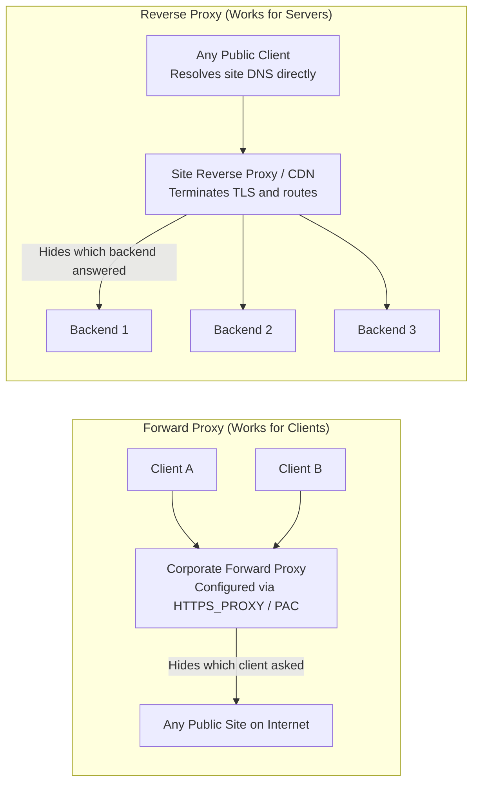
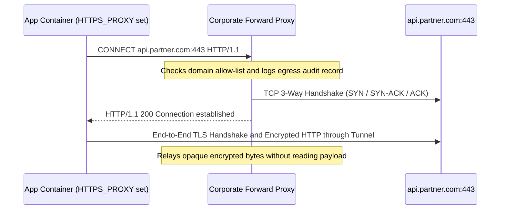
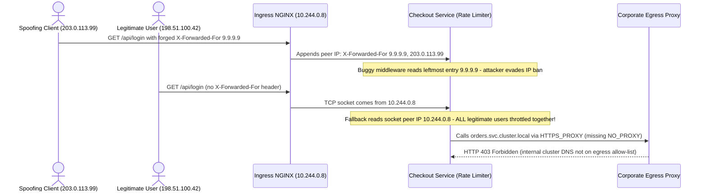

# CDN & Reverse Proxy

> **Prerequisites:** Module 04 (HTTP), Module 05 (Firewalls & NAT), Module 06 (Load Balancing), and Docker (`ubuntu/squid`, `nginx`).  
> **Estimated Reading Time:** 35 minutes  
> **Target Audience:** Backend Engineers, Site Reliability Engineers, Cloud Architects.  
> **Free PDF Notes:** [SD-B-017: Forward vs Reverse Proxy](https://backendroadmap.com/notes/system-design/SD-B-017.pdf) | [Phase 2, Networking (PDF)](https://backendroadmap.com/notes/system-design/Phase2_Networking_Notes.pdf)

> [!TIP]
> **The Golden Rule of Proxies:** Always ask *"Who is it working for?"* A **forward proxy** acts for *clients* (explicitly configured via `HTTPS_PROXY` or PAC); a **reverse proxy** acts for *servers* (reached transparently via DNS). Behind a reverse proxy, never trust the leftmost `X-Forwarded-For` entry—extract the client IP right-to-left using only trusted proxy hops.

---

## 1. Why This Matters & Architectural Mental Model

Module 06 put a load balancer between clients and your servers. That box is one kind of **proxy**: a host that accepts a connection, makes a second connection of its own, and relays between them. Proxies show up on both sides of almost every real connection. A **forward proxy** works for the *clients*: the corporate egress proxy your laptop, CI runners and containers must go through to reach the internet. A **reverse proxy** works for the *servers*: the NGINX, Envoy or cloud gateway that terminates TLS and hides your backends. Mixing the two up is a classic interview slip. In practice it also leads to real debugging mistakes: you blame the app for a `502` the proxy generated, you read the proxy's IP as the client's, or you spend an hour on a container that "has no internet" when it was simply never told about the egress proxy.

This module is about the two kinds of proxy at the network level: who configures each one, what the request looks like on each hop, and what each hides. A CDN is a distributed reverse proxy with a cache, and it gets a short section here that points to its full treatment in the backend track.

### One Question Tells Them Apart: Who Is It Working For?



* **Forward proxy:** The *client* is configured to use it (browser setting, `HTTPS_PROXY` variable, a PAC file), and it can reach *any* destination the policy allows. The destination sees the proxy's IP, not the client's.
* **Reverse proxy:** The *client* has no idea it's there: DNS for `api.example.com` simply resolves to the proxy, which forwards to a backend it chooses. The client sees one address; the backends are never reachable directly.

A quick test when you meet an unfamiliar proxy: if the client had to be told about it, it's a forward proxy. If the client just connected to the site's public address, it's a reverse proxy.

### Forward Proxies: Egress Control & Wire Mechanics



Companies put forward proxies on the path out of their network for reasons that are all about the *client* side:

* **Egress control and filtering:** Only the proxy may talk to the internet; the firewall (module 05) blocks direct outbound traffic, and the proxy enforces an allow-list of domains. This is how a security team stops a compromised build server from calling an attacker's server.
* **Auditing:** Every outbound request is logged in one place.
* **Caching shared downloads:** Many machines fetching the same package hit the proxy's copy.
* **A stable source IP:** Partners can allow-list the proxy's one public address instead of every machine behind it (the same effect NAT gives you, but at the application layer).

On the wire, a client using a forward proxy connects to the *proxy*, not the destination. For plain HTTP it sends the full URL in the request line, so the proxy knows where to go:

```http
GET http://example.com/ HTTP/1.1      ← absolute URL, not just "/"
Host: example.com
```

For HTTPS the proxy can't read the request, so the client asks it to open a raw TCP **tunnel** with `CONNECT`, and then runs TLS with the real server *through* that tunnel:

```http
CONNECT example.com:443 HTTP/1.1
Host: example.com:443

HTTP/1.1 200 Connection established     ← from the proxy; now TLS starts end to end
```

The proxy sees the destination name and port but not the content. (Some corporate proxies do **TLS interception**: they terminate TLS with their own certificate, which works only because the company installed its private CA in every laptop's trust store. Containers and CI images that lack that CA fail with `"unable to get local issuer certificate"`.)

Most command-line tools and language runtimes pick up a forward proxy from environment variables: `HTTP_PROXY`, `HTTPS_PROXY` and `NO_PROXY` (a list of hosts and suffixes to reach directly, usually internal names and `localhost`). Lowercase versions are also read, inconsistently, by different tools. A container does not inherit your shell's variables, so "works on my laptop, times out in Docker" is very often just a missing `HTTPS_PROXY`.

### Reverse Proxies: The Servers' Front Door

A reverse proxy sits in the same position as module 06's load balancer, and real software (NGINX, HAProxy, Envoy, Traefik, cloud application gateways) does both jobs at once. What it takes off your app servers:

* **TLS termination** in one place, so certificates live on the proxy and backends speak plain HTTP on the internal network ([TLS, SSL and HTTPS](../../../backend/01-request-response-fundamentals/09-tls-ssl-and-https/README.md) covers where to terminate).
* **Load balancing and health checks** across backend instances (module 06).
* **Buffering slow clients:** The proxy absorbs a slow mobile upload or download so an app worker isn't tied up for its whole duration. This is why Python app servers like Gunicorn are always run behind NGINX.
* **Compression, caching, rate limiting, request routing** by host or path.
* **Hiding topology:** Probing the public address tells an attacker nothing about how many backends exist or where they are.

The cost of that hiding: the backend's TCP connection comes from the proxy, so its socket shows the *proxy's* IP for every request. The proxy has to pass the original client details along as headers: `X-Forwarded-For` (client IP, with each proxy appending to the list), `X-Forwarded-Proto` (was it HTTPS?), `X-Forwarded-Host`, or the standard `Forwarded` header. A backend must trust those headers **only** from its own proxy, since any client can send a fake `X-Forwarded-For`. Configuring this in NGINX, line by line, is in [Nginx: reverse proxy and load balancing](../../02-docker/12-nginx-reverse-proxy-and-load-balancing/README.md).

A common production chain combines several reverse proxies:
`client → CDN edge → NGINX → Gunicorn → Uvicorn workers`. Each hop is a separate TCP (and maybe TLS) connection, with its own timeouts and its own logs.

### Reading Failures Through a Proxy & Where CDNs Fit

Because a proxy holds two connections, it can fail on either side, and it answers the client itself when the backend side breaks. Learn to recognise responses the proxy generated:

* **`502 Bad Gateway`**: the proxy reached for a backend and got nothing usable: connection refused, connection reset, or a malformed reply. The app is usually down or listening on the wrong port.
* **`504 Gateway Timeout`**: the backend accepted the connection but didn't answer within the proxy's timeout. The app is slow or stuck.
* **`503 Service Unavailable`**: often the proxy has no healthy backend left in the pool.
* **`407 Proxy Authentication Required`**: a *forward* proxy wants credentials before it will relay your request.

The error page's `Server:` header and styling usually name the proxy (an `nginx` page means NGINX answered, not your app). Then do what module 06 taught: skip the proxy and hit the backend directly (its own port, or `curl --resolve` to its IP). If the backend works directly, the problem is in the proxy hop: config, timeout, or a header it rewrote or dropped.

**Where CDNs fit:** A **CDN** is a reverse proxy with a cache, run by someone else at hundreds of points of presence close to your users. Everything above applies (it terminates TLS, hides your origin, and adds `X-Forwarded-For`-style headers), and on top of that it serves cached copies so most requests never reach you. Cache hits and misses, cache keys, purging, origin shielding and reading a real CDN's `Age`/`X-Cache` headers are taught in one place: [CDN and edge caching](../../../backend/01-request-response-fundamentals/12-cdn-and-edge-caching/README.md).

---

## 2. Taxonomic Comparison & Systematic Command Reference

### Forward Proxy vs. Reverse Proxy vs. CDN Matrix

| Dimension | Forward Proxy | Reverse Proxy | CDN (Edge Proxy) |
| :--- | :--- | :--- | :--- |
| **Works For** | Clients (egress path) | Origin servers (ingress path) | Origin servers (globally distributed edge) |
| **Client Aware?** | Yes (`HTTPS_PROXY`, OS/browser, PAC) | No (DNS resolves to reverse proxy IP) | No (Anycast DNS routes to nearest PoP) |
| **Hides** | Client identity & internal topology | Backend IPs, count, and internal topology | Origin IP, scaling, and static/cached origin load |
| **HTTPS Wire Behavior** | `CONNECT host:443` tunnel (or TLS MITM CA) | Terminates TLS; speaks HTTP/TLS internally | Terminates TLS at PoP close to user |
| **Primary Control** | Domain allow-list, auditing, egress IP | TLS termination, buffering, routing, LB | Global caching (`Age`/`X-Cache`), WAF, DDoS shield |

### Proxy Status Code Diagnostic Matrix

| HTTP Code | Proxy Type | Meaning on the Wire | First Inspection Step |
| :---: | :--- | :--- | :--- |
| **`502 Bad Gateway`** | Reverse | Backend refused, reset, or returned invalid HTTP | Check `Server:` header & proxy error log; `curl --resolve` direct to backend |
| **`504 Gateway Timeout`** | Reverse | Backend accepted TCP but exceeded proxy read timeout | Profile slow backend handler or mismatched keepalive/upstream timeout |
| **`503 Service Unavailable`** | Reverse | No healthy backends left in upstream pool or maintenance | Inspect LB health checks and backend `/healthz` responses |
| **`407 Proxy Auth Required`** | Forward | Egress proxy requires credentials (`Proxy-Authorization`) | Verify proxy creds / service account config |

### Command Reference

| Command | What it does | Example |
| :--- | :--- | :--- |
| `curl -x` | Sends a request through a forward proxy | `curl -x http://localhost:3128 -v http://example.com/` |
| `HTTPS_PROXY` / `NO_PROXY` | Environment variables most tools read to find a forward proxy | `HTTPS_PROXY=http://localhost:3128 curl -sI https://example.com/` |
| `curl --noproxy` | Bypasses any configured proxy for the listed hosts | `curl --noproxy '*' -sI https://example.com/` |
| `curl -v` (through a reverse proxy) | Shows which server actually answered (`Server:`, `Via:` headers) | `curl -sv http://localhost:8080/ -o /dev/null` |
| `curl --resolve` | Skips DNS and the front proxy to hit a specific backend IP | `curl --resolve api.example.com:443:10.0.1.5 https://api.example.com/` |
| `env \| grep -i proxy` | Shows which proxy variables a shell or container actually has | `docker exec app env \| grep -i proxy` |

### Flag & Output Notes

- `curl -x http://localhost:3128 -v http://example.com/` — `-x` (or `--proxy`) names the forward proxy. In `-v` output, curl connects to `localhost:3128`, not to `example.com`, and the request line carries the absolute URL. For an `https://` URL, `-v` shows `CONNECT example.com:443` followed by `200 Connection established` and then the normal TLS handshake.
- `curl --noproxy '*'` — ignore every proxy variable for this request. Useful to prove whether a failure comes from the proxy or the destination.
- `Via:` — a header some proxies add naming themselves; together with `Server:` it tells you which hop produced a response.

---

## 3. Production War Story Post-Mortem: The Rate-Limiter Self-DDoS & Internal Proxy Loop



### The Incident
Immediately after moving a customer-facing API onto a hardened Kubernetes cluster behind NGINX Ingress and a Squid egress proxy, two simultaneous failures struck: (1) legitimate users across the globe received `429 Too Many Requests` within 30 seconds of launch while brute-force bots bypassed throttling completely; (2) internal microservice calls to `orders.svc.cluster.local` began failing with HTTP `403`.

### Post-Mortem Telemetry
* **Severity:** SEV-1 (Global customer rate-limit lockout + internal service mesh outage)
* **Mean Time to Detect (MTTD):** 2 minutes (`429` and `403` error rate alarms)
* **Mean Time to Resolution (MTTR):** 34 minutes
* **Impact:** All external web logins throttled and order checkout calls blocked

### Root Cause Analysis
1. **Unvalidated Leftmost `X-Forwarded-For` + Socket Fallback:** The API trusted the leftmost element of `X-Forwarded-For` without stripping trusted proxy hops—allowing bots to rotate fake IPs in headers—while NGINX lacked `proxy_set_header X-Forwarded-For $proxy_add_x_forwarded_for` on one route, causing the app to rate-limit NGINX's internal pod IP (`10.244.0.8`) globally.
2. **Global `HTTPS_PROXY` Without `NO_PROXY`:** Adding `HTTPS_PROXY=http://egress-squid:3128` to the pod environment caused service-to-service calls targeting `.svc.cluster.local` to leave toward the corporate egress proxy, which rejected internal domain names with `403`.

### The Fix & Architectural Hardening
1. **Reverse Proxy Trust Boundary:** Configured NGINX `set_real_ip_from` for trusted CDN/LB CIDRs and updated application middleware to extract the real client IP **right-to-left**, verifying the TCP peer IP belongs to a trusted reverse proxy before reading headers.
2. **Scoped Egress Variables:** Added `NO_PROXY=.svc.cluster.local,.cluster.local,localhost,127.0.0.1,10.0.0.0/8` alongside `HTTPS_PROXY` in Helm templates.

---

## 4. Multi-Language Production Implementation: Trusted `X-Forwarded-For` Extractor & `NO_PROXY` Matcher

Never grab `xff.split(',')[0]`. Walk `X-Forwarded-For` **from right to left**, stripping only IPs belonging to your trusted reverse proxies (`remoteAddr` first!), and always match `NO_PROXY` rules cleanly for internal domains and CIDRs.

````carousel
### Go (`net/netip` Right-to-Left XFF Extractor & `NO_PROXY` Matcher)
```go
package main

import (
	"fmt"
	"net/netip"
	"strings"
)

func isTrustedProxy(ip netip.Addr, trusted []netip.Prefix) bool {
	for _, p := range trusted {
		if p.Contains(ip) {
			return true
		}
	}
	return false
}

// ExtractClientIP validates socket peer IP first, then strips trusted proxies right-to-left.
func ExtractClientIP(remotePeerIP, xffHeader string, trustedProxies []netip.Prefix) string {
	peer, err := netip.ParseAddr(strings.TrimSpace(remotePeerIP))
	if err != nil {
		return remotePeerIP
	}
	if !isTrustedProxy(peer, trustedProxies) || strings.TrimSpace(xffHeader) == "" {
		return peer.String() // Untrusted direct client: ignore any spoofed XFF header
	}

	parts := strings.Split(xffHeader, ",")
	for i := len(parts) - 1; i >= 0; i-- {
		candidate, err := netip.ParseAddr(strings.TrimSpace(parts[i]))
		if err != nil {
			break // Malformed forged entry: fall back safely
		}
		if !isTrustedProxy(candidate, trustedProxies) {
			return candidate.String()
		}
	}
	return peer.String()
}

func ShouldBypassProxy(host, noProxyEnv string) bool {
	host = strings.ToLower(strings.TrimSpace(host))
	for _, rule := range strings.Split(noProxyEnv, ",") {
		r := strings.ToLower(strings.TrimSpace(rule))
		if r == "" {
			continue
		}
		if r == "*" || r == host {
			return true
		}
		if strings.HasPrefix(r, ".") && strings.HasSuffix(host, r) {
			return true
		}
		if prefix, err := netip.ParsePrefix(r); err == nil {
			if ip, err := netip.ParseAddr(host); err == nil && prefix.Contains(ip) {
				return true
			}
		}
	}
	return false
}

func main() {
	trusted := []netip.Prefix{netip.MustParsePrefix("10.244.0.0/16"), netip.MustParsePrefix("172.16.0.0/12")}
	fmt.Println("Real Client IP:", ExtractClientIP("10.244.0.8", "6.6.6.6, 198.51.100.42, 172.16.1.4", trusted))
	fmt.Println("Bypass Proxy:", ShouldBypassProxy("orders.svc.cluster.local", ".svc.cluster.local,localhost,10.0.0.0/8"))
}
```
<!-- slide -->
### TypeScript (Trusted XFF Extractor & `NO_PROXY` Evaluator)
```typescript
export function extractRealClientIp(
  socketPeerIp: string,
  xForwardedFor: string | undefined,
  trustedProxyIps: Set<string>
): string {
  // Never trust X-Forwarded-For unless the immediate TCP connection came from our proxy
  if (!trustedProxyIps.has(socketPeerIp) || !xForwardedFor) {
    return socketPeerIp;
  }

  const hops = xForwardedFor
    .split(',')
    .map((ip) => ip.trim())
    .filter(Boolean);

  // Walk right-to-left: skip trusted reverse proxies, return the first untrusted client IP
  for (let i = hops.length - 1; i >= 0; i--) {
    if (!trustedProxyIps.has(hops[i])) {
      return hops[i];
    }
  }
  return socketPeerIp;
}

export function shouldBypassForwardProxy(hostname: string, noProxy: string): boolean {
  const host = hostname.toLowerCase();
  const entries = noProxy
    .split(',')
    .map((s) => s.trim().toLowerCase())
    .filter(Boolean);

  return entries.some((rule) => {
    if (rule === '*' || rule === host) return true;
    const suffix = rule.startsWith('.') ? rule : `.${rule}`;
    return host.endsWith(suffix);
  });
}
```
<!-- slide -->
### Python (Trusted Proxy Right-to-Left Extraction & `NO_PROXY` Check)
```python
import ipaddress
from typing import List


def extract_client_ip(peer_ip: str, xff_header: str, trusted_cidrs: List[str]) -> str:
    nets = [ipaddress.ip_network(c, strict=False) for c in trusted_cidrs]
    peer = ipaddress.ip_address(peer_ip.strip())

    def is_trusted(addr: ipaddress._BaseAddress) -> bool:
        return any(addr in n for n in nets)

    if not is_trusted(peer) or not xff_header.strip():
        return str(peer)

    for raw in reversed(xff_header.split(",")):
        try:
            hop = ipaddress.ip_address(raw.strip())
        except ValueError:
            return str(peer)
        if not is_trusted(hop):
            return str(hop)
    return str(peer)


def matches_no_proxy(host: str, no_proxy: str) -> bool:
    h = host.strip().lower()
    for rule in (r.strip().lower() for r in no_proxy.split(",") if r.strip()):
        if rule == "*" or rule == h:
            return True
        if rule.startswith(".") and h.endswith(rule):
            return True
        try:
            if ipaddress.ip_address(h) in ipaddress.ip_network(rule, strict=False):
                return True
        except ValueError:
            pass
    return False


if __name__ == "__main__":
    print(extract_client_ip("10.244.0.8", "6.6.6.6, 198.51.100.42", ["10.244.0.0/16"]))
    print(matches_no_proxy("orders.svc.cluster.local", ".svc.cluster.local,localhost"))
```
<!-- slide -->
### C# (Trusted Proxy Client IP Resolver & `NO_PROXY` Filter)
```csharp
using System;
using System.Collections.Generic;
using System.Linq;
using System.Net;

public static class ProxyHeaderUtility
{
    public static string ExtractClientIp(IPAddress peerIp, string? xForwardedFor, ISet<IPAddress> trustedProxies)
    {
        if (!trustedProxies.Contains(peerIp) || string.IsNullOrWhiteSpace(xForwardedFor))
            return peerIp.ToString();

        var hops = xForwardedFor.Split(',', StringSplitOptions.RemoveEmptyEntries | StringSplitOptions.TrimEntries);
        for (int i = hops.Length - 1; i >= 0; i--)
        {
            if (!IPAddress.TryParse(hops[i], out var hopIp))
                return peerIp.ToString();

            if (!trustedProxies.Contains(hopIp))
                return hopIp.ToString();
        }
        return peerIp.ToString();
    }

    public static bool ShouldBypassProxy(string host, string noProxy)
    {
        var h = host.Trim().ToLowerInvariant();
        return noProxy.Split(',', StringSplitOptions.RemoveEmptyEntries | StringSplitOptions.TrimEntries)
            .Select(r => r.ToLowerInvariant())
            .Any(rule => rule == "*" || rule == h || (rule.StartsWith('.') && h.EndsWith(rule)));
    }
}
```
````

---

## 5. Practical Hands-On Verification CLI Workflows & Lab Exercises

You need Docker (from the Docker track). The forward-proxy exercises use the `ubuntu/squid` image; the reverse-proxy ones use NGINX and a small echo server that prints back the request it received.

### Workflow 1: Forward Proxy HTTP & HTTPS `CONNECT` Verification

1. **Run a forward proxy and use it explicitly.** Start Squid: `docker run -d --name fwd -p 3128:3128 ubuntu/squid`. Then run `curl -x http://localhost:3128 -v http://example.com/ -o /dev/null`. Expected: curl's `Connected to localhost ... port 3128` line (not example.com), and a request line of `GET http://example.com/ HTTP/1.1`. Check `docker logs fwd` or `docker exec fwd tail /var/log/squid/access.log` to see the proxy's log entry for your request.

2. **Watch the CONNECT tunnel for HTTPS.** Run:

```bash
curl -x http://localhost:3128 -v https://example.com/ -o /dev/null 2>&1 | grep -E 'CONNECT|established|SSL connection|subject'
```

**Expected Output:**

```text
* CONNECT example.com:443 HTTP/1.1
< HTTP/1.1 200 Connection established
* CONNECT phase completed
* SSL connection using TLSv1.3 / TLS_AES_256_GCM_SHA384
*  subject: C=US; ST=California; L=Los Angeles; O=Internet Corporation for Assigned Names and Numbers; CN=www.example.org
```
*(The proxy relayed encrypted bytes it could not read; its access log shows only `CONNECT example.com:443`.)*

3. **Use the environment variables instead.** Run `HTTPS_PROXY=http://localhost:3128 curl -sI https://example.com/` and confirm a new `CONNECT` line in the Squid log. Now add `NO_PROXY=example.com` to the same command and confirm the log gets *no* new entry, because curl went direct.

### Workflow 2: Reverse Proxy `X-Forwarded-For`, `502` Diagnosis & Locked Container Egress

4. **Put a reverse proxy in front of an echo server.** Create a network and a backend that echoes requests back as JSON:
   `docker network create rp && docker run -d --name echo --network rp mendhak/http-https-echo`.
   Write `nginx.conf`:

   ```nginx
   events {}
   http {
     server {
       listen 80;
       location / {
         proxy_pass http://echo:8080;
       }
     }
   }
   ```

   Start NGINX:
   `docker run -d --name rev --network rp -p 8080:80 -v "$PWD/nginx.conf:/etc/nginx/nginx.conf:ro" nginx`.
   Run `curl -s localhost:8080/ | python3 -m json.tool | grep -E '"ip"|forwarded|host'`.
   Expected: the backend reports the *NGINX container's* IP as the client, and no `x-forwarded-for` header. From the backend's point of view, every user on earth is the proxy.

5. **Forward the client's identity.** Add these lines inside the `location` block, then `docker exec rev nginx -s reload`:

   ```nginx
   proxy_set_header Host $host;
   proxy_set_header X-Forwarded-For $proxy_add_x_forwarded_for;
   proxy_set_header X-Forwarded-Proto $scheme;
   ```

   Repeat the `curl`. Expected: `x-forwarded-for` now carries your real address (the Docker bridge gateway, as seen from the proxy). Then send a fake one: `curl -s -H 'X-Forwarded-For: 6.6.6.6' localhost:8080/`. Expected: the header becomes `6.6.6.6, <your address>`. The proxy appends; it doesn't replace. That's why a backend must take the address its *own* proxy added, not the leftmost value a client could have forged.

6. **Diagnose and fix: a 502 that isn't the app's error.** Stop the backend: `docker stop echo`, then `curl -si localhost:8080/ | head -5`.

```bash
docker stop echo
curl -si localhost:8080/ | head -5
```

**Expected Output:**

```text
HTTP/1.1 502 Bad Gateway
Server: nginx/1.27.x
Content-Type: text/html
```
NGINX generated this response; your app never saw the request. **Diagnose**: `docker logs rev` shows `connect() failed` or `host not found` for the upstream. Check the backend directly (`docker ps -a` shows `echo` exited). **Fix**: `docker start echo`, wait a moment, and confirm `curl localhost:8080/` returns 200 again. If it still fails, restart NGINX too: it may have cached the old container IP for `echo`. The lesson is to read the `Server:` header before opening the app's logs.

7. **Diagnose and fix: "the container has no internet."** Simulate an egress-only network: block direct outbound access from a test container by giving it a network with no route out, while the proxy can still reach the internet:

   ```bash
   docker network create --internal locked
   docker network connect locked fwd
   docker run --rm --network locked curlimages/curl -sS -m 5 https://example.com/ -o /dev/null
   ```

   Expected: a timeout or "could not resolve host". It looks like a broken network, but in a proxied environment it is the designed behaviour: only the proxy may go out. **Fix**: tell the container about the proxy:
   `docker run --rm --network locked -e HTTPS_PROXY=http://fwd:3128 curlimages/curl -sSI https://example.com/`.
   Expected: a `200` response through Squid. In real environments, set `HTTPS_PROXY`/`NO_PROXY` in the Dockerfile, the Compose file or the Docker daemon's proxy config, not by hand.

   Clean up: `docker rm -f fwd rev echo && docker network rm rp locked`.

### Independent Challenge

No lab given. A Python service runs on Kubernetes inside a corporate network. It must call a partner's public API over HTTPS, and it is itself exposed to users through an ingress reverse proxy. Three bugs are reported: (a) calls to the partner API time out after 30 seconds, but the same `curl` works from a developer's laptop; (b) once `HTTPS_PROXY` is set, the partner calls work but calls to an internal service `orders.svc.cluster.local` start failing with `403` from the proxy; (c) the service's rate limiter blocks all users at once, because it thinks every request comes from the same IP. For each, name which proxy is involved (forward or reverse), the mechanism, and the fix.

<details>
<summary>Stuck? One hint</summary>

(a) is the forward proxy: the laptop has `HTTPS_PROXY` set (or a system proxy setting) and the pod doesn't, so its direct outbound connection is dropped by the egress firewall. Set `HTTPS_PROXY` in the pod spec. (b) is the same forward proxy over-applied: with no `NO_PROXY`, internal calls also go to the proxy, which refuses destinations outside its allow-list. Add `NO_PROXY=.svc.cluster.local,.cluster.local,localhost,127.0.0.1` (plus your internal domains). (c) is the reverse proxy: the app is reading the socket's peer address, which is always the ingress controller. Configure the ingress to send `X-Forwarded-For`, and have the app trust that header only from the ingress's address range.

</details>

---

## 6. Common Mistakes & Troubleshooting

- **Confusing a reverse proxy with a forward proxy.** Ask whose agent it is. A forward proxy hides clients and is configured on the client side; a reverse proxy hides servers and is reached through the site's own DNS.
- **Treating a proxy's 502/504 as an application bug.** Check the `Server:` header and the proxy's own logs first, then hit the backend directly. `502` means the backend was unreachable or broken; `504` means it was too slow.
- **Logging or rate-limiting on the socket address behind a reverse proxy.** Every request appears to come from the proxy. Use `X-Forwarded-For`, and trust it only from your own proxy.
- **Trusting the leftmost `X-Forwarded-For` value.** Clients can send that header themselves. Take the entry your own proxy appended.
- **Forgetting containers don't inherit proxy settings.** A shell's `HTTPS_PROXY` isn't passed into `docker run`, CI jobs or pods unless you set it there.
- **Setting `HTTPS_PROXY` without `NO_PROXY`.** Internal traffic then goes to the egress proxy too, which is slow at best and refused at worst.
- **Missing the corporate CA in container images.** With TLS interception, every HTTPS call fails certificate validation inside images that don't trust the company's private CA. Add the CA to the image's trust store; don't disable verification.

---

## 7. Operational Validation Checkpoints & Self-Assessment

### Operational Validation Checkpoints

<details>
<summary><strong>Checkpoint 1: Defeating Forged `X-Forwarded-For` Headers</strong></summary>

**Scenario:** An API sits behind Cloudflare CDN (`173.245.48.0/20`) and an internal NGINX ingress (`10.244.0.8`). A client sends `X-Forwarded-For: 1.2.3.4` directly to Cloudflare from real IP `203.0.113.55`. When the request hits your Python app, the socket peer is `10.244.0.8` and `X-Forwarded-For` is `1.2.3.4, 203.0.113.55, 173.245.48.12`.

Which IP must your app log as the true client IP, and why must it ignore `1.2.3.4`?

**Answer:**
The true client IP is **`203.0.113.55`**. Walking right-to-left: the TCP socket peer (`10.244.0.8`) is your trusted NGINX ingress; `173.245.48.12` is your trusted Cloudflare edge; the next hop moving left is `203.0.113.55`, which is not a trusted proxy—so that is the real client IP appended by Cloudflare. `1.2.3.4` was injected by the client before reaching Cloudflare and must be discarded.

</details>

<details>
<summary><strong>Checkpoint 2: Corporate TLS Interception Inside Docker Builds</strong></summary>

**Scenario:** A `pip install` or `curl` inside a Docker container behind a corporate forward proxy passes TCP and `CONNECT`, then fails with `unable to get local issuer certificate`—yet the exact same URL works on your host laptop.

What is the corporate forward proxy doing, and what is the secure fix?

**Answer:**
The corporate forward proxy is performing **TLS interception (MITM decryption)** for inspection, re-signing the upstream certificate with the company's private internal Root CA. Your laptop trusts that private CA; the minimal Docker base image does not. **Fix:** Copy the corporate root CA `.crt` into `/usr/local/share/ca-certificates/` and run `update-ca-certificates` (or set `SSL_CERT_FILE` / `REQUESTS_CA_BUNDLE`)—never disable TLS verification (`-k` / `verify=False`).

</details>

<details>
<summary><strong>Checkpoint 3: Isolating `502` vs `504` in a Multi-Hop Chain</strong></summary>

**Scenario:** A request travels `client → CDN → NGINX → Gunicorn`. Users receive HTTP `504 Gateway Timeout` with `Server: nginx` after exactly 60.0 seconds.

Which hop failed, which hop generated the `504`, and how do you confirm the diagnosis directly?

**Answer:**
NGINX generated the `504` (`Server: nginx`, matching NGINX's default 60s `proxy_read_timeout`) because **Gunicorn accepted the TCP connection from NGINX but did not complete an HTTP response within 60 seconds**. Bypass NGINX from inside the host/cluster with `curl --resolve` or direct request to Gunicorn's bind port (e.g., `curl -i http://127.0.0.1:8000/slow-endpoint`) to observe the slow or deadlocked worker directly.

</details>

### Checkpoint Quiz

Write down your answer to each question before expanding it — checking without attempting first is the single easiest way to fool yourself into thinking you've learned this.

1. What is the one question that separates a forward proxy from a reverse proxy, and what does each one hide?
2. How does a client end up using a forward proxy, and how does it end up using a reverse proxy?
3. What does an HTTP request line look like when sent through a forward proxy, and why is HTTPS handled differently?
4. Name four jobs a reverse proxy takes off your application servers.
5. Behind a reverse proxy, your app logs the same IP for every request. Why, and what's the fix?
6. You get a `502 Bad Gateway` with `Server: nginx`. Who generated it, what does it usually mean, and what do you check first?
7. A build in a container times out fetching packages but works on your laptop on the same corporate network. What's the likely cause?
8. How is a CDN related to a reverse proxy?

<details>
<summary>Show answers</summary>

1. "Who is it working for?" A forward proxy works for clients and hides which client made the request from the destination. A reverse proxy works for servers and hides which backend answered, and how many backends exist, from the client.
2. A forward proxy must be configured on the client side: browser or OS settings, a PAC file, or `HTTP_PROXY`/`HTTPS_PROXY` variables. A reverse proxy needs nothing from the client: the site's DNS name resolves to the proxy, so the client connects to it without knowing.
3. For plain HTTP the request line carries the full URL (`GET http://example.com/ HTTP/1.1`) so the proxy knows where to forward it. For HTTPS the proxy can't read the encrypted request, so the client sends `CONNECT example.com:443`, the proxy opens a TCP tunnel, and TLS runs end to end through it. The proxy sees only the destination host and port.
4. Any four: TLS termination, load balancing and health checks, buffering slow clients, compression, response caching, rate limiting, host/path routing, and hiding backend topology.
5. The app's TCP connection comes from the proxy, so the socket's peer address is always the proxy. Have the proxy add `X-Forwarded-For` (and `X-Forwarded-Proto`), and have the app read it only when the request arrived from the proxy's own address.
6. NGINX generated it, not the application. It usually means NGINX could not get a usable response from the backend (refused, reset, or the backend is down or on the wrong port). Check the proxy's error log, then hit the backend directly to see whether it's up.
7. The laptop has the corporate forward proxy configured, but the container doesn't inherit those settings, and the egress firewall drops direct outbound connections. Set `HTTPS_PROXY` (and `NO_PROXY` for internal hosts) in the container's environment.
8. A CDN is a reverse proxy with a cache, operated at many points of presence close to users. It terminates TLS and hides your origin like any reverse proxy, and also serves cached copies so most requests never reach you.

</details>

---

## Further reading & sources

- [MDN: Proxy servers and tunneling](https://developer.mozilla.org/en-US/docs/Web/HTTP/Proxy_servers_and_tunneling) - forward vs reverse proxies, the `CONNECT` method and proxy-related headers.
- [MDN: X-Forwarded-For](https://developer.mozilla.org/en-US/docs/Web/HTTP/Headers/X-Forwarded-For) - the header format and the security caveats of trusting it.
- [RFC 7239: Forwarded HTTP Extension](https://www.rfc-editor.org/rfc/rfc7239) - the standard `Forwarded` header that replaces the `X-Forwarded-*` family.
- [Cloudflare: What is a reverse proxy?](https://www.cloudflare.com/learning/cdn/glossary/reverse-proxy/) - a side-by-side diagram of forward and reverse proxies.
- [Docker: Use a proxy server with the Docker CLI](https://docs.docker.com/engine/cli/proxy/) - passing `HTTP_PROXY`/`NO_PROXY` into containers and builds.

## Free PDF notes

Download these notes as a printable PDF, with every diagram and interview questions: [SD-B-017: Forward vs Reverse Proxy](https://backendroadmap.com/notes/system-design/SD-B-017.pdf). Each section in one file: [Phase 2, Networking (PDF)](https://backendroadmap.com/notes/system-design/Phase2_Networking_Notes.pdf).

## Next

[12 — Capstone project](../12-capstone-project/README.md): put the whole toolkit — layering, addressing, DNS, TCP/UDP, routing/NAT/firewalls, routing protocols, VPNs, load balancing and proxies — to work diagnosing and fixing a chain of deliberately broken connectivity problems across a small multi-host lab. WebSockets and gRPC, which change how proxies and load balancers behave, are covered in the backend track: [WebSockets and Server-Sent Events](../../../backend/06-background-processing-and-realtime/07-websockets-and-server-sent-events/README.md) and [gRPC fundamentals](../../../backend/11-advanced-api-paradigms/01-grpc-fundamentals/README.md).
