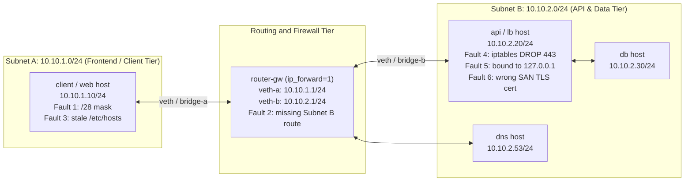
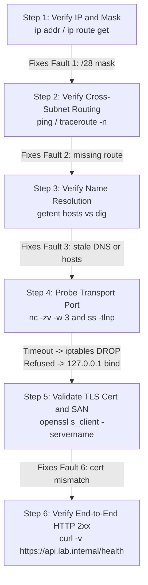
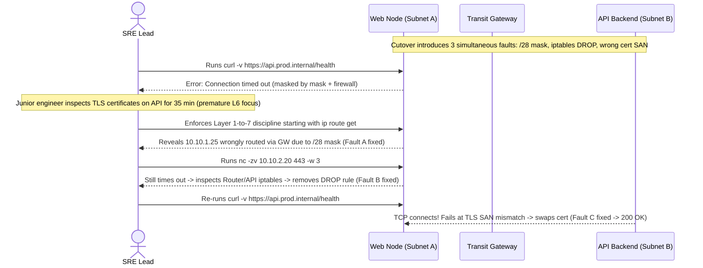

# Capstone Project: Diagnose and Fix a Broken Multi-Host Network

> **Prerequisites:** Modules 00–11 (Full Track 1 Networking Stack) and a WSL2 Ubuntu / Linux terminal with `iproute2`, `iptables`/`nft`, `nc`, `ss`, `curl`, `openssl`, `tcpdump` (or Docker).  
> **Estimated Reading & Lab Time:** 90–120 minutes  
> **Target Audience:** Backend Engineers, Site Reliability Engineers, Cloud Network Architects.

> [!TIP]
> **The Golden Rule of Multi-Fault Recovery:** Never fix faults in the order they appear in a ticket or fault list. Fix strictly **bottom-up by network layer** (`Mask/Link` → `Routing` → `DNS` → `Firewall/Socket Bind` → `TLS` → `HTTP`)—a single lower-layer fault invalidates every higher-layer test above it.

---

## 1. Why This Matters & Lab Topology Architecture

Reading about troubleshooting and doing it are different skills. This capstone forces you to combine everything — the layer model, addressing and subnets, DNS, TCP/ports, TLS, routing/NAT/firewalls, routing protocols, VPNs, load balancing, CDN/reverse proxy, WebSocket/gRPC, and the diagnostic method — against a scenario that is *deliberately broken in several independent ways at once*, the way real outages actually arrive. No solution is provided, only the broken scenario and a precise definition of "fixed." If you can work this end to end from memory, you are ready for the Azure networking track, where the exact same failure modes reappear wearing service names.

### Reference Multi-Subnet Lab Topology & Fault Injection Map



### Strict Bottom-Up Triage Sequence



---

## 2. Taxonomic Fault Matrix & Diagnostic Command Toolkit

### Capstone Fault-to-Layer-to-Signature Reference

| Fault # | Origin Module | Symptom Observed | Failure Manner | Implicated Layer | Single Confirming Command |
| :---: | :--- | :--- | :--- | :--- | :--- |
| **1** | Module 01 (Subnets) | Same-LAN peer `10.10.1.20` routed via GW or unreachable | Timeout / wrong `via` route | L2/L3 Local Subnet | `ip route get 10.10.1.20` |
| **2** | Module 05 (Routing) | Cross-subnet `ping 10.10.2.20` stalls at router or returns net unreachable | Timeout / ICMP Unreachable | L3 IP Routing | `ip route` & `traceroute -n 10.10.2.20` |
| **3** | Module 02 (DNS) | Client connects to wrong IP or fails name lookup | Resolve fail / wrong IP | L7 Name Resolution | `getent hosts <name>` vs `dig +short <name>` |
| **4** | Module 05 (Firewall) | `nc -zv` hangs 3 seconds until timeout | Timeout (silent `DROP`) | L3/L4 Firewall | `sudo iptables -L -n -v` |
| **5** | Module 03 (Sockets) | `nc -zv` fails immediately with `Connection refused` | Refused (TCP `RST`) | L4 Socket Bind | `ss -tlnp` on server host |
| **6** | [TLS, SSL & HTTPS](../../../backend/01-request-response-fundamentals/09-tls-ssl-and-https/README.md) | TCP connects, then TLS rejects hostname or expiry | Certificate validation error | L6 TLS Presentation | `openssl s_client -connect <host>:443 -servername <name>` |

### Module 07 Diagnostic Toolkit (Authorized Tools Only)

| Tool | Layer Verified | Primary Diagnostic Question Answered |
| :--- | :---: | :--- |
| `ip addr` / `ip route get` | L1–L3 | Does this host have the right CIDR mask, and does the kernel route same-subnet peers directly vs across a gateway? |
| `ping` / `traceroute -n` | L3 | Is IP bidirectional reachability intact, and at which exact hop does the forward path die? |
| `getent hosts` / `dig` | DNS | Does OS NSS resolution (`/etc/hosts` + DNS) agree with the authoritative DNS record? |
| `nc -zv <host> <port> -w 3` | L4 | Does the port accept TCP (`succeeded`), silently drop (`timed out`), or actively reject (`refused`)? |
| `ss -tlnp` | L4 | Is the server daemon actually bound to `0.0.0.0:<port>` (or the routable NIC) rather than `127.0.0.1`? |
| `openssl s_client` | L6 | Does the server certificate chain validate (`Verify return code: 0 (ok)`) for the requested `-servername`? |
| `curl -v` | L4–L7 | Does the complete DNS → TCP → TLS → HTTP pipeline return the expected `2xx` status? |
| `sudo tcpdump -n -i any` | Wire | Ground truth: did `SYN` leave, did `SYN-ACK`/`RST` return, and are both directions symmetric? |

---

## 3. Production War Story Post-Mortem: The Triple-Fault Region Cutover



### The Incident
During a dual-subnet rack migration, three independent scripts ran out of order: one applied `/28` instead of `/24` on the web tier, a baseline hardening playbook re-applied an `iptables DROP` on port `443`, and Ansible deployed a staging TLS certificate (`*.staging.internal`) onto the production API tier. Monitoring simply alerted `"API Health Check Down"`. For 35 minutes, responders repeatedly inspected application containers and TLS configs without testing whether packets even left the web subnet properly.

### Post-Mortem Telemetry
* **Severity:** SEV-1 (Complete web-to-API blackout post-cutover)
* **Mean Time to Detect (MTTD):** 1 minute
* **Mean Time to Resolution (MTTR):** 49 minutes (35 minutes lost jumping layers; 14 minutes once bottom-up triage started)
* **Impact:** Full API unavailability until all three layered faults were sequentially isolated and cleared

### Root Cause Analysis & Lesson
1. **Masking Effect:** A lower-layer drop (`iptables DROP` and mis-scoped `/28` route) prevents TCP from ever reaching the TLS handshake. You cannot observe Fault C (TLS SAN mismatch) until Faults A and B are fixed.
2. **Layer-by-Layer Unmasking:** Switching strictly to the Module 07 ladder exposed Fault A (`ip route get`), then Fault B (`nc -zv -w 3` + `iptables -L -n -v`), and only then surfaced Fault C (`curl -v` / `openssl s_client`) cleanly.

---

## 4. Multi-Language Production Implementation: Automated Capstone Acceptance Suite

After diagnosing manually with CLI tools, automate your acceptance verification across every host path. Each implementation tests the complete **L3/L4/L6/L7 acceptance checklist** and formats a structured diagnosis log entry showing the exact layer that failed.

````carousel
### Go (Multi-Target Acceptance & Diagnosis Suite)
```go
package main

import (
	"context"
	"crypto/tls"
	"errors"
	"fmt"
	"net"
	"net/http"
	"syscall"
	"time"
)

type CheckTarget struct {
	Name       string
	ExpectedIP string
	Port       string
	HealthPath string
}

type DiagnosisEntry struct {
	Target   string
	Layer    string
	Manner   string
	Resolved string
	Passed   bool
	Detail   string
}

func VerifyTarget(ctx context.Context, t CheckTarget) DiagnosisEntry {
	ips, err := net.DefaultResolver.LookupHost(ctx, t.Name)
	if err != nil || len(ips) == 0 {
		return DiagnosisEntry{Target: t.Name, Layer: "DNS", Manner: "RESOLVE_FAIL", Detail: fmt.Sprint(err)}
	}
	if t.ExpectedIP != "" && ips[0] != t.ExpectedIP {
		return DiagnosisEntry{Target: t.Name, Layer: "DNS", Manner: "WRONG_IP", Resolved: ips[0], Detail: fmt.Sprintf("expected %s got %s", t.ExpectedIP, ips[0])}
	}

	addr := net.JoinHostPort(ips[0], t.Port)
	d := &net.Dialer{Timeout: 3 * time.Second}
	raw, err := d.DialContext(ctx, "tcp", addr)
	if err != nil {
		manner := "TIMEOUT (routing or firewall DROP)"
		if errors.Is(err, syscall.ECONNREFUSED) {
			manner = "REFUSED (wrong bind interface or service down)"
		}
		return DiagnosisEntry{Target: t.Name, Layer: "L4-TCP", Manner: manner, Resolved: ips[0], Detail: err.Error()}
	}
	raw.Close()

	tlsDialer := &tls.Dialer{NetDialer: d, Config: &tls.Config{ServerName: t.Name}}
	tc, err := tlsDialer.DialContext(ctx, "tcp", addr)
	if err != nil {
		return DiagnosisEntry{Target: t.Name, Layer: "L6-TLS", Manner: "CERT_VALIDATION_FAIL", Resolved: ips[0], Detail: err.Error()}
	}
	tc.Close()

	client := &http.Client{Timeout: 4 * time.Second}
	resp, err := client.Get(fmt.Sprintf("https://%s:%s%s", t.Name, t.Port, t.HealthPath))
	if err != nil {
		return DiagnosisEntry{Target: t.Name, Layer: "L7-HTTP", Manner: "HTTP_ERROR", Resolved: ips[0], Detail: err.Error()}
	}
	defer resp.Body.Close()

	passed := resp.StatusCode >= 200 && resp.StatusCode < 300
	return DiagnosisEntry{Target: t.Name, Layer: "L7-HTTP", Manner: resp.Status, Resolved: ips[0], Passed: passed, Detail: "End-to-end ladder check"}
}

func main() {
	ctx, cancel := context.WithTimeout(context.Background(), 15*time.Second)
	defer cancel()
	res := VerifyTarget(ctx, CheckTarget{Name: "example.com", Port: "443", HealthPath: "/"})
	fmt.Printf("%+v\n", res)
}
```
<!-- slide -->
### TypeScript (Capstone Acceptance Runner)
```typescript
import { lookup } from 'dns/promises';
import net from 'net';
import tls from 'tls';
import https from 'https';

interface AcceptanceSpec {
  hostname: string;
  expectedIp: string;
  port: number;
  healthPath: string;
}

interface AcceptanceLog {
  hostname: string;
  passed: boolean;
  failedLayer?: 'DNS' | 'TCP' | 'TLS' | 'HTTP';
  failureManner: string;
  confirmingDetail: string;
}

export async function runAcceptanceCheck(spec: AcceptanceSpec): Promise<AcceptanceLog> {
  let ip: string;
  try {
    ip = (await lookup(spec.hostname, { family: 4 })).address;
    if (spec.expectedIp && ip !== spec.expectedIp) {
      return {
        hostname: spec.hostname,
        passed: false,
        failedLayer: 'DNS',
        failureManner: 'DNS_MISMATCH',
        confirmingDetail: `Expected ${spec.expectedIp}, resolved ${ip}`,
      };
    }
  } catch (err: any) {
    return { hostname: spec.hostname, passed: false, failedLayer: 'DNS', failureManner: 'RESOLVE_FAIL', confirmingDetail: err.message };
  }

  try {
    await new Promise<void>((resolve, reject) => {
      const s = net.createConnection({ host: ip, port: spec.port });
      s.setTimeout(3000);
      s.on('connect', () => { s.destroy(); resolve(); });
      s.on('timeout', () => { s.destroy(); reject(new Error('ETIMEDOUT')); });
      s.on('error', (e) => { s.destroy(); reject(e); });
    });
  } catch (err: any) {
    const manner = err.code === 'ECONNREFUSED' ? 'TCP_REFUSED (127.0.0.1 bind or stopped)' : 'TCP_TIMEOUT (route or iptables DROP)';
    return { hostname: spec.hostname, passed: false, failedLayer: 'TCP', failureManner: manner, confirmingDetail: err.message };
  }

  try {
    await new Promise<void>((resolve, reject) => {
      const sock = tls.connect({ host: ip, port: spec.port, servername: spec.hostname, timeout: 3000 }, () => {
        if (!sock.authorized) {
          const e = new Error(String(sock.authorizationError));
          sock.destroy();
          reject(e);
          return;
        }
        sock.destroy();
        resolve();
      });
      sock.on('error', (e) => { sock.destroy(); reject(e); });
    });
  } catch (err: any) {
    return { hostname: spec.hostname, passed: false, failedLayer: 'TLS', failureManner: 'CERT_ERROR', confirmingDetail: err.message };
  }

  return new Promise((resolve) => {
    const req = https.request({ hostname: spec.hostname, port: spec.port, path: spec.healthPath, timeout: 3000 }, (res) => {
      const ok = (res.statusCode ?? 0) >= 200 && (res.statusCode ?? 0) < 300;
      resolve({ hostname: spec.hostname, passed: ok, failedLayer: ok ? undefined : 'HTTP', failureManner: `HTTP_${res.statusCode}`, confirmingDetail: `Status ${res.statusCode}` });
    });
    req.on('error', (e) => resolve({ hostname: spec.hostname, passed: false, failedLayer: 'HTTP', failureManner: 'HTTP_ERROR', confirmingDetail: e.message }));
    req.end();
  });
}
```
<!-- slide -->
### Python (Automated Multi-Host Acceptance & Log Generator)
```python
import socket
import ssl
import urllib.request
import urllib.error
from dataclasses import dataclass


@dataclass
class FaultLogEntry:
    target: str
    passed: bool
    layer: str
    manner: str
    detail: str


def verify_capstone_path(hostname: str, expected_ip: str = "", port: int = 443, path: str = "/") -> FaultLogEntry:
    try:
        resolved_ip = socket.gethostbyname(hostname)
    except socket.gaierror as exc:
        return FaultLogEntry(hostname, False, "DNS", "RESOLVE_FAIL", str(exc))

    if expected_ip and resolved_ip != expected_ip:
        return FaultLogEntry(hostname, False, "DNS", "STALE_RECORD", f"expected {expected_ip}, got {resolved_ip}")

    try:
        with socket.create_connection((resolved_ip, port), timeout=3.0):
            pass
    except ConnectionRefusedError as exc:
        return FaultLogEntry(hostname, False, "TCP", "REFUSED (check ss -tlnp)", str(exc))
    except (TimeoutError, socket.timeout) as exc:
        return FaultLogEntry(hostname, False, "TCP", "TIMEOUT (check ip route / iptables)", str(exc))

    try:
        ctx = ssl.create_default_context()
        with socket.create_connection((resolved_ip, port), timeout=3.0) as sock:
            with ctx.wrap_socket(sock, server_hostname=hostname):
                pass
    except ssl.SSLError as exc:
        return FaultLogEntry(hostname, False, "TLS", "CERT_ERROR", str(exc))

    try:
        with urllib.request.urlopen(f"https://{hostname}:{port}{path}", timeout=3.0) as resp:
            ok = 200 <= resp.status < 300
            return FaultLogEntry(hostname, ok, "HTTP", f"HTTP_{resp.status}", "Healthy")
    except urllib.error.HTTPError as exc:
        return FaultLogEntry(hostname, False, "HTTP", f"HTTP_{exc.code}", exc.reason)


if __name__ == "__main__":
    print(verify_capstone_path("example.com"))
```
<!-- slide -->
### C# (Automated Capstone Verification Runner)
```csharp
using System;
using System.Net;
using System.Net.Http;
using System.Net.Security;
using System.Net.Sockets;
using System.Threading;
using System.Threading.Tasks;

public record CapstoneCheckResult(string Target, bool Passed, string Layer, string Manner, string Detail);

public static class CapstoneVerifier
{
    public static async Task<CapstoneCheckResult> VerifyAsync(string host, string? expectedIp = null, int port = 443, string path = "/")
    {
        IPAddress resolved;
        try
        {
            var ips = await Dns.GetHostAddressesAsync(host);
            resolved = ips[0];
            if (!string.IsNullOrEmpty(expectedIp) && resolved.ToString() != expectedIp)
                return new CapstoneCheckResult(host, false, "DNS", "WRONG_IP", $"Expected {expectedIp}, got {resolved}");
        }
        catch (SocketException ex)
        {
            return new CapstoneCheckResult(host, false, "DNS", "RESOLVE_FAIL", ex.Message);
        }

        using var tcp = new TcpClient();
        using var cts = new CancellationTokenSource(TimeSpan.FromSeconds(3));
        try
        {
            await tcp.ConnectAsync(resolved, port, cts.Token);
        }
        catch (OperationCanceledException)
        {
            return new CapstoneCheckResult(host, false, "TCP", "TIMEOUT (routing or firewall DROP)", "Connect timed out");
        }
        catch (SocketException ex)
        {
            return new CapstoneCheckResult(host, false, "TCP", ex.SocketErrorCode == SocketError.ConnectionRefused ? "REFUSED (wrong bind)" : "UNREACHABLE", ex.Message);
        }

        try
        {
            await using var ssl = new SslStream(tcp.GetStream(), false);
            await ssl.AuthenticateAsClientAsync(new SslClientAuthenticationOptions { TargetHost = host }, cts.Token);
        }
        catch (Exception ex)
        {
            return new CapstoneCheckResult(host, false, "TLS", "CERT_VALIDATION_FAIL", ex.Message);
        }

        using var http = new HttpClient { Timeout = TimeSpan.FromSeconds(4) };
        var resp = await http.GetAsync($"https://{host}:{port}{path}");
        return new CapstoneCheckResult(host, resp.IsSuccessStatusCode, "HTTP", $"HTTP_{(int)resp.StatusCode}", resp.ReasonPhrase ?? "");
    }
}
```
````

---

## 5. Multi-Stage Engineering Lab: Setup, Faults, Diagnosis & Acceptance

### Stage 1: Setup — Build the Lab

You will build a small multi-host network on your WSL2 Ubuntu machine using **either** approach you're comfortable with from your earlier tracks:

- **Option A — network namespaces (`ip netns`):** create three isolated namespaces connected by virtual ethernet (`veth`) pairs through a bridge, simulating three hosts on one or two subnets plus a "router" namespace between two subnets. This keeps everything in pure Linux networking with no extra software.

```bash
# Example Option A skeleton: 2 subnets (10.10.1.0/24 and 10.10.2.0/24) joined by router-gw
sudo ip netns add client
sudo ip netns add router-gw
sudo ip netns add api

sudo ip link add veth-c type veth peer name veth-rc
sudo ip link add veth-a type veth peer name veth-ra
sudo ip link set veth-c netns client
sudo ip link set veth-rc netns router-gw
sudo ip link set veth-ra netns router-gw
sudo ip link set veth-a netns api

sudo ip netns exec client ip addr add 10.10.1.10/24 dev veth-c
sudo ip netns exec client ip link set veth-c up && sudo ip netns exec client ip link set lo up
sudo ip netns exec client ip route add default via 10.10.1.1

sudo ip netns exec router-gw ip addr add 10.10.1.1/24 dev veth-rc
sudo ip netns exec router-gw ip addr add 10.10.2.1/24 dev veth-ra
sudo ip netns exec router-gw ip link set veth-rc up && sudo ip netns exec router-gw ip link set veth-ra up
sudo ip netns exec router-gw sysctl -w net.ipv4.ip_forward=1

sudo ip netns exec api ip addr add 10.10.2.20/24 dev veth-a
sudo ip netns exec api ip link set veth-a up && sudo ip netns exec api ip link set lo up
sudo ip netns exec api ip route add default via 10.10.2.1
```

**Expected Output (Healthy Baseline):**

```text
net.ipv4.ip_forward = 1
# Running: sudo ip netns exec client ping -c 2 10.10.2.20
2 packets transmitted, 2 received, 0% packet loss
```

- **Option B — Docker containers on user-defined bridge networks:** create two user-defined bridge networks and place containers on them (a `web` frontend, an `api` backend, a `db`, and a small DNS or a load-balancer container), using the Docker networking you already know.

Either way, you need at minimum: two subnets, a routing point between them, a name-resolution mechanism (a hosts file or a small DNS), at least one HTTPS service with a certificate, and a firewall you can add rules to (`iptables`/`nft`). Build it working first, verify end-to-end connectivity with your module-07 ladder, and snapshot the working commands — you'll need a known-good reference.

### Stage 2: The Break — Introduce the Six Independent Faults

Once it works, introduce **the following chain of independent faults** (do this from a script a colleague "wrote," or have a partner set them, so you don't know which are active — that's more realistic and more valuable). Each is drawn directly from an earlier module:

1. **Wrong subnet mask (module 01):** one host is configured with a prefix too narrow (e.g. `/28` where the network is `/24`), so some addresses it should treat as local are wrongly sent to the gateway — or a peer on the same LAN becomes unreachable.
2. **Missing / wrong route (module 05):** the router namespace/host is missing a route to one of the subnets, or a host's default route points at the wrong next hop, so cross-subnet traffic dies.
3. **DNS misconfigured (module 02):** a service name resolves to the wrong address (a stale `/etc/hosts` entry or a bad record), so clients "connect" to the wrong place or fail to resolve entirely.
4. **Firewall blocking a port (module 05):** an `iptables` DROP rule silently blocks the API's port on one host, producing timeouts (not refusals) from clients.
5. **Service on the wrong interface (module 03):** one service is bound to `127.0.0.1` instead of `0.0.0.0`, so it works locally but is unreachable from other hosts.
6. **TLS certificate mismatch ([TLS, SSL and HTTPS](../../../backend/01-request-response-fundamentals/09-tls-ssl-and-https/README.md)):** the HTTPS service presents a certificate whose name doesn't match the hostname clients use (or an expired/self-signed cert not in the client trust store), so TCP connects but the handshake fails validation.

### Stage 3: Your Task & Written Diagnosis Log

Using **only the troubleshooting toolkit and method from module 07** — `ip addr`/`ip route`, `ping`, `traceroute`/`tracepath`, `getent`/`dig`, `nc`, `ss`, `curl`, `openssl s_client`, and `tcpdump` — locate and fix every fault so the whole system works end to end. Work the layered ladder; for each fault, write down (a) the symptom you observed, (b) the manner of failure (refused/timeout/resolve-fail/cert-error) and what layer it pointed to, (c) the single command that confirmed the root cause, and (d) the fix. Do not fix by guessing and restarting — each fix must follow from a diagnosis. The written diagnosis log is as much the deliverable as the working system.

Use this structured log table as you clear each layer:

| Fault # | (a) Symptom Observed | (b) Failure Manner & Layer | (c) Single Confirming Command | (d) Fix Applied |
| :---: | :--- | :--- | :--- | :--- |
| **1** | | | | |
| **2** | | | | |
| **3** | | | | |
| **4** | | | | |
| **5** | | | | |
| **6** | | | | |

### Stage 4: Acceptance Criteria — What "Fixed" Looks Like

You are done when **all** of the following pass, and you can explain why each was failing:

- [ ] Every host has a correct IP and subnet mask; `ip route get <peer>` treats same-subnet peers as local (direct `dev`, no `via`) and other subnets via the correct router.
- [ ] Cross-subnet traffic works both directions: a host on subnet A can reach a host on subnet B and get replies (verified with `ping` and a real service test, not just one direction).
- [ ] Every service name resolves to the *correct* address from every client (`getent hosts <name>` matches the intended IP; `getent` and `dig`/the authoritative source agree).
- [ ] Every service is reachable on its port from the hosts that need it: `nc -zv <host> <port>` succeeds (no timeouts from firewall drops, no refusals from wrong-interface binds), and `ss -tlnp` on each server shows the service on `0.0.0.0` (or the correct interface), not stuck on `127.0.0.1`.
- [ ] The HTTPS service validates cleanly: `curl https://<name>/` succeeds *without* `-k`, and `openssl s_client -connect <host>:443 -servername <name>` reports `Verify return code: 0 (ok)` with matching names and valid dates.
- [ ] The full application path returns healthy HTTP: `curl -v https://<name>/<health-path>` returns a `2xx`, and if a load balancer is present, requests succeed consistently across repeated calls (no intermittent `502`/`504` from an unhealthy backend still in rotation).
- [ ] You have a written diagnosis log: for each of the (at least) six faults, the symptom, the failure manner, the confirming command, and the fix — proving each was diagnosed, not stumbled upon.

### Stage 5: Hints (Not a Solution)

<details>
<summary>Hint 1 — where to start</summary>

Don't fix in the order the faults are listed — fix in *layer* order, bottom-up, because a lower-layer fault masks everything above it. If addressing/routing is broken, no DNS, port, or TLS test above it is trustworthy yet. Run the module-07 ladder against one failing path and fix the *first* rung that fails before looking higher.

</details>

<details>
<summary>Hint 2 — let the failure manner narrow it</summary>

Before deep analysis, read the manner: *resolve-fail* → DNS (fault 3); *timeout* on a port → firewall drop or routing (faults 2, 4); *refused* on a port → nothing listening / wrong interface (fault 5); *cert error after TCP connects* → TLS (fault 6); a same-LAN peer unreachable while others work → suspect the subnet mask (fault 1). The error text often names the fault before you run a second command.

</details>

<details>
<summary>Hint 3 — the tools that isolate each layer</summary>

`ip route get <dest>` separates "no route" from everything else. `getent hosts` vs `dig` separates a hosts-file override from real DNS. `ss -tlnp` on the server distinguishes `127.0.0.1` (wrong interface) from `0.0.0.0`. `nc -zv` with `-w 3` makes a firewall timeout fail fast and legibly, and *refused vs timeout* separates fault 5 from fault 4. `openssl s_client -servername ...` shows the cert's names/dates for fault 6. `traceroute` localizes where cross-subnet routing dies for fault 2.

</details>

<details>
<summary>Hint 4 — don't trust one direction or one host</summary>

Cross-subnet and NAT problems are often asymmetric — test both directions and from more than one host. "Works from the router but not from the client," or "resolves right on host A but wrong on host B," is the difference that pinpoints the fault. Change one variable at a time.

</details>

---

## 6. Common Mistakes & Before You Move On

### Common Triage Mistakes

- **Fixing faults out of layer order.** Trying to debug TLS certificates or HTTP `502` responses while a `/28` mask or missing `ip route` breaks Layer 3 reachability wastes time and produces misleading errors.
- **Passing `curl -k` to "make HTTPS work."** Bypassing certificate verification hides Fault 6 instead of fixing the SAN mismatch or missing CA trust chain.
- **Testing only one direction or from only the router.** Always verify from the actual `client` namespace/container to `api` and confirm return traffic (`ping` + `tcpdump`).

### Before You Move On

Do this project once with the faults set for you, then — a few days later — rebuild the lab, re-introduce a *different* mix of the same faults, and diagnose it again **from memory**, without rereading module 07. The goal isn't to recall a specific answer but to make the layered ladder automatic, because the Azure networking track next is largely these same failures (wrong subnet, missing route, blocked port, broken name resolution, cert mismatch, unhealthy backend) expressed as VNets, route tables, NSGs, private DNS zones, and load balancer health probes. If the method is second nature here, the cloud version will feel like renaming what you already know.

---

## 7. Operational Validation Checkpoints

<details>
<summary><strong>Checkpoint 1: The `/28` Subnet Mask Illusion</strong></summary>

**Scenario:** Two hosts sit on the same `10.10.1.0/24` bridge: `client` (`10.10.1.10`) and `web` (`10.10.1.25`). `client` can reach `10.10.1.1` (gateway) and `10.10.1.12`, yet fails to reach `10.10.1.25` directly. Running `ip route get 10.10.1.25` on `client` prints:
`10.10.1.25 via 10.10.1.1 dev veth-c src 10.10.1.10`

Why is the kernel sending traffic for a same-LAN peer through the default gateway (`via 10.10.1.1`), and how do you confirm the exact misconfiguration?

**Answer:**
`10.10.1.10/28` covers only `10.10.1.0–10.10.1.15`. Because `10.10.1.25` falls outside `.0–.15`, the host assumes `.25` lives on a remote network and ships it to the default gateway `10.10.1.1` instead of ARPing directly on the local LAN. Run `ip addr show dev veth-c` to spot `/28`, delete it, and re-add `10.10.1.10/24`.

</details>

<details>
<summary><strong>Checkpoint 2: Separating `iptables DROP` (Fault 4) from `127.0.0.1` Bind (Fault 5)</strong></summary>

**Scenario:** From `client`, `ping -c 2 10.10.2.20` succeeds in `0.2 ms`. Now you run `nc -zv 10.10.2.20 443 -w 3` and observe two possible outcomes on two different broken ports:
- Port `443` fails in **0.002 seconds** with `Connection refused`.
- Port `8443` hangs for **3.000 seconds** and exits with `Operation timed out`.

Match each port immediately to Fault 4 vs Fault 5 and state the single confirming command on `api` for each.

**Answer:**
- **Port `443` (`Connection refused`, fast TCP `RST`):** **Fault 5** — packets reached `api`'s kernel, which returned `RST` because nothing is listening on `10.10.2.20:443` (likely bound to `127.0.0.1:443`). Confirm with `ss -tlnp | grep 443`.
- **Port `8443` (`Operation timed out`, slow silence):** **Fault 4** — packets are silently dropped mid-path or on `api`'s firewall before the TCP stack replies. Confirm with `sudo iptables -L -n -v` (inspecting `DROP` packet counters incrementing during the probe).

</details>

<details>
<summary><strong>Checkpoint 3: Unmasking Fault 6 After Clearing Lower Layers</strong></summary>

**Scenario:** After fixing Faults 1–5, `nc -zv api.lab.internal 443 -w 3` succeeds, but `curl https://api.lab.internal/health` fails with `SSL certificate problem: self-signed certificate` (or `subject name does not match`).

Why would running `curl -k https://api.lab.internal/health` fail acceptance criterion #5, and what command verifies the exact repaired certificate chain?

**Answer:**
Running `curl -k` disables TLS identity verification, leaving clients vulnerable to MITM impersonation and violating acceptance criterion #5 (`curl https://<name>/` must succeed *without* `-k`). Fix the server cert SANs or install the signing CA into `/usr/local/share/ca-certificates/` + `update-ca-certificates`, then verify with `openssl s_client -connect 10.10.2.20:443 -servername api.lab.internal </dev/null` and confirm `Verify return code: 0 (ok)`.

</details>

---

## Next

You've completed Track 1. Continue to the **Azure networking** track, where these platform-agnostic fundamentals become concrete Azure constructs — VNets and subnets, network security groups, route tables and NAT gateways, private DNS, and managed load balancers — and the diagnostic instincts you built here transfer directly.
