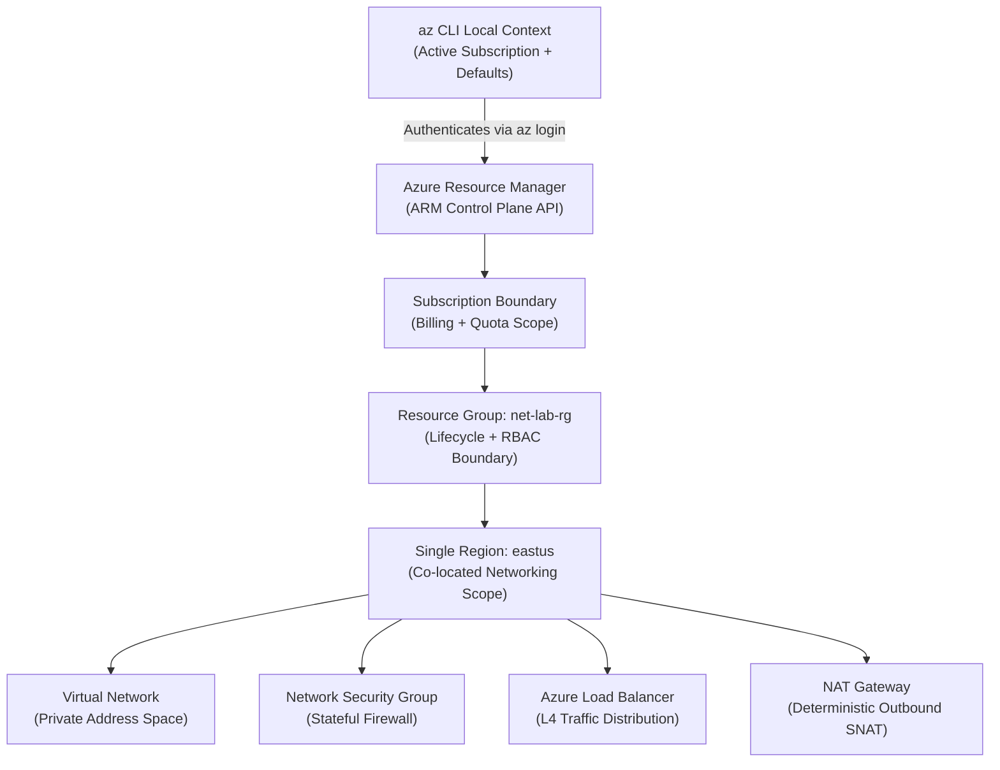
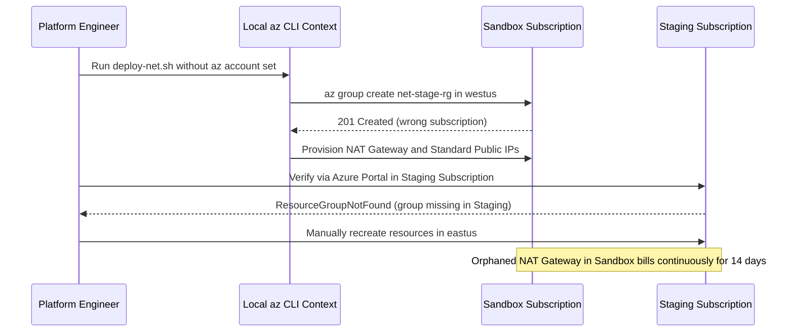

# Azure Networking Overview & CLI Setup

> **Prerequisites:** Active Azure subscription (`Contributor` or `Network Contributor` role), Azure CLI (`az` >= 2.50), and foundational networking concepts (CIDR, TCP/UDP, DNS, NAT, stateful firewalls).  
> **Estimated Reading Time:** 20 minutes  
> **Target Audience:** Backend Engineers, Cloud Infrastructure Engineers, Platform / SRE Teams.

> [!TIP]
> **The Golden Rule of Azure CLI & ARM Networking:** Every Azure networking resource belongs to **one Resource Group** inside **one Subscription**, and most `az network ... create` commands are **not idempotent**. Always verify `az account show` before mutating infrastructure, keep each module's resources inside a single region, and inspect existing state with `show` before running `create` or `update`.

---

## 1. Why This Matters & Architectural Mental Model

Every command in this track runs against your real subscription, so before you create anything you need a working, authenticated `az` CLI pointed at the right subscription in the right region. This module also gives you the mental map — which Azure resource is the implementation of each general-networking concept you already know — so the rest of the track is translation, not relearning.

### The Azure Resource Manager Model
Everything in Azure is a *resource* (a VNet, a public IP, an NSG), every resource lives in exactly one *resource group*, and every resource group lives in one *subscription*. A resource group is a management and lifecycle boundary: deleting the group deletes everything in it, which is exactly why `az group delete` is your cleanup button throughout this track. Resources also have a *location* (region, e.g. `eastus`); most networking resources are regional, meaning a VNet in `eastus` cannot directly contain a NIC in `westus`.



### The Azure CLI and the Network Command Group
The `az` CLI groups commands by resource type. Almost everything in this track lives under `az network ...` — for example `az network vnet create`, `az network nsg rule create`, `az network lb probe create`. The `network` command group ships with the CLI core (it is not a separate installed extension the way some preview features are), so if `az` works, `az network` works. You will confirm this in the exercises.

### Regions, Names, and Idempotency
Pick one region and stick with it for a whole module — cross-region wiring adds latency, cost, and failure modes you don't want while learning. Resource names must be unique within their scope (e.g. a VNet name is unique within its resource group; a public DNS name label must be globally unique). Most `az network ... create` commands are **not** idempotent — running create twice usually errors or edits in place, so prefer `create` once then `update`.

---

## 2. Taxonomic Comparison: General Networking Mapped onto Azure

You already know these concepts from track 1. Here is the Azure name for each:

| General concept (track 1) | Azure implementation |
|---|---|
| A private network you carve into subnets | **Virtual Network (VNet)** + **subnets** |
| Stateful firewall / packet filter | **Network Security Group (NSG)** |
| L4 (TCP/UDP) load balancer | **Azure Load Balancer** (Standard SKU) |
| L7 (HTTP) reverse proxy / load balancer | **Application Gateway** |
| Managed authoritative DNS hosting | **Azure DNS** (public zones) / **Private DNS zones** |
| Split-horizon / internal DNS | **Private DNS zone** linked to a VNet |
| Source NAT for outbound internet | **NAT Gateway** (or Load Balancer outbound rules) |
| A routed connection between two networks | **VNet peering** |
| Centralized egress firewall / perimeter | **Azure Firewall** |
| Web Application Firewall (OWASP rules) | **WAF** (on Application Gateway or Front Door) |

Keep this table nearby; the rest of the track fills in the details of each row.

### Scope, Uniqueness, and Mutation Semantics

| Scope Level | Boundary Purpose | Uniqueness Examples | Mutation Behavior |
|---|---|---|---|
| **Tenant / Entra ID** | Identity & authentication plane | User principals, Service Principals | `az login` issues tokens scoped to tenant |
| **Subscription** | Billing, quotas, RBAC ceiling | Resource group names (`net-lab-rg`) | `az account set` switches local CLI pointer |
| **Resource Group** | Lifecycle & batch teardown (`az group delete`) | VNet names (`hub-vnet`), NSG names (`web-nsg`) | Deleting RG permanently purges all child resources |
| **Regional** | Physical Azure region (`eastus`, `westeurope`) | VNet-to-NIC attachment, Standard LB/NAT locality | Cross-region peering works; cross-region NIC attachment fails |
| **Global / Public** | Internet-routable Azure endpoints | Public DNS labels (`<label>.eastus.cloudapp.azure.com`), DNS zones | Collisions fail globally even across different tenants |

---

## 3. Command Reference & Flag Breakdowns

| Command | What it does | Example |
|---|---|---|
| `az login` | Authenticates the CLI to Azure | `az login` |
| `az account show` | Shows the currently active subscription | `az account show --output table` |
| `az account list` | Lists subscriptions you can access | `az account list --output table` |
| `az account set` | Sets the active (default) subscription | `az account set --subscription "My Sub"` |
| `az group create` | Creates a resource group | `az group create --name net-lab-rg --location eastus` |
| `az group list` | Lists resource groups | `az group list --output table` |
| `az group delete` | Deletes a resource group and everything in it | `az group delete --name net-lab-rg --yes --no-wait` |
| `az version` | Shows CLI and extension versions | `az version` |
| `az configure` | Sets CLI defaults (e.g. default group/location) | `az configure --defaults group=net-lab-rg location=eastus` |

Flag breakdown — `az group create --name net-lab-rg --location eastus`:
- `--name` (`-n`): the resource group's name, unique within the subscription.
- `--location` (`-l`): the region metadata for the group; resources inside can technically be elsewhere, but keep them together for simplicity.

Flag breakdown — `az group delete --name net-lab-rg --yes --no-wait`:
- `--name` (`-n`): which group to delete.
- `--yes`: skips the interactive "are you sure?" confirmation.
- `--no-wait`: returns immediately instead of blocking until deletion finishes; the delete continues server-side.

Flag breakdown — `az configure --defaults group=net-lab-rg location=eastus`:
- `--defaults`: stores key=value defaults so you can omit `--resource-group` and `--location` on later commands. Convenient, but be aware later exercises spell out the flags explicitly for clarity.

---

## 4. Production War Story Post-Mortem: Wrong-Subscription Deployment & Orphaned Billing

- **Severity:** SEV-2
- **Detection Time:** 14 days (monthly cloud FinOps budget alert) / 35 minutes active triage
- **Resolution Time:** 20 minutes
- **Impact:** A platform provisioning script ran against a developer sandbox subscription instead of the isolated staging subscription, creating orphaned Standard Public IPs, Load Balancers, and NAT Gateways across two regions and accruing \$1,180 in unmonitored idle charges while leaving staging deployments reporting `ResourceGroupNotFound`.

### What Happened



### Root Cause Analysis
1. **Unpinned CLI Context:** The engineer switched subscriptions earlier in the day (`az account set`) and never asserted `az account show` inside the provisioning workflow.
2. **Misinterpreted `ResourceGroupNotFound`:** Assuming a transient ARM failure instead of checking `az account list`, the team re-ran creation manually in the target subscription without cleaning up the first subscription.
3. **Zero Post-Session Inventory:** Neither `az resource list` nor `az group delete` was run on the sandbox resource group after troubleshooting.

### The Fix & Architectural Hardening
1. **Explicit Subscription Guards:** Every automation script now pins `--subscription` or fails immediately if `az account show --query id -o tsv` does not match the expected subscription UUID.
2. **Strict Region & Tagging Hygiene:** Configured `az configure --defaults` only for ephemeral local terminals and enforced explicit `--resource-group` and `--location` flags in shared scripts.
3. **Teardown Habit:** Standardized `az resource list -g <rg> --output table` and `az group delete --name <rg> --yes --no-wait` at the close of every lab and sandbox run.

---

## 5. Multi-Language Production Implementation: ARM Subscription & Region Preflight Guardrail

Before provisioning VNets, NSGs, or Load Balancers programmatically, production tooling verifies the active subscription ID, ensures target Resource Groups match the mandated region, and audits existing `Microsoft.Network` assets to catch orphaned billable resources.

````carousel
```go
package main

import (
	"context"
	"fmt"
	"log"
	"os"
	"strings"

	"github.com/Azure/azure-sdk-for-go/sdk/azidentity"
	"github.com/Azure/azure-sdk-for-go/sdk/resourcemanager/resources/armresources"
)

// VerifyPreflight asserts subscription alignment, validates RG region locality,
// and inventories existing Microsoft.Network resources to prevent billing leaks.
func VerifyPreflight(ctx context.Context, expectedSubID, rgName, expectedRegion string) error {
	cred, err := azidentity.NewDefaultAzureCredential(nil)
	if err != nil {
		return fmt.Errorf("azure auth failed: %w", err)
	}

	rgClient, err := armresources.NewResourceGroupsClient(expectedSubID, cred, nil)
	if err != nil {
		return fmt.Errorf("rg client init failed: %w", err)
	}

	rgResp, err := rgClient.Get(ctx, rgName, nil)
	if err != nil {
		return fmt.Errorf("resource group %q missing in subscription %s: %w", rgName, expectedSubID, err)
	}

	actualLoc := strings.ToLower(*rgResp.Location)
	if actualLoc != strings.ToLower(expectedRegion) {
		return fmt.Errorf("region sprawl detected: RG %q is in %s, expected %s", rgName, actualLoc, expectedRegion)
	}

	resClient, err := armresources.NewClient(expectedSubID, cred, nil)
	if err != nil {
		return fmt.Errorf("resource client init failed: %w", err)
	}

	pager := resClient.NewListByResourceGroupPager(rgName, nil)
	networkCount := 0
	for pager.More() {
		page, err := pager.NextPage(ctx)
		if err != nil {
			return fmt.Errorf("listing resources failed: %w", err)
		}
		for _, r := range page.Value {
			if r.Type != nil && strings.HasPrefix(*r.Type, "Microsoft.Network/") {
				networkCount++
				fmt.Printf("LIVE_NET_ASSET: %s (%s) in %s\n", *r.Name, *r.Type, *r.Location)
			}
		}
	}
	fmt.Printf("PREFLIGHT_OK: sub=%s rg=%s region=%s network_assets=%d\n",
		expectedSubID, rgName, actualLoc, networkCount)
	return nil
}

func main() {
	subID := os.Getenv("AZURE_SUBSCRIPTION_ID")
	if subID == "" {
		log.Fatal("AZURE_SUBSCRIPTION_ID must be explicitly pinned")
	}
	if err := VerifyPreflight(context.Background(), subID, "net-lab-rg", "eastus"); err != nil {
		log.Fatal(err)
	}
}
```
<!-- slide -->
```typescript
import { DefaultAzureCredential } from "@azure/identity";
import { ResourceManagementClient } from "@azure/arm-resources";

interface PreflightReport {
  subscriptionId: string;
  resourceGroup: string;
  region: string;
  networkAssets: Array<{ name: string; type: string; location: string }>;
}

export async function runNetworkPreflight(
  expectedSubId: string,
  rgName: string,
  expectedRegion: string
): Promise<PreflightReport> {
  if (!expectedSubId) {
    throw new Error("AZURE_SUBSCRIPTION_ID must be explicitly pinned.");
  }

  const credential = new DefaultAzureCredential();
  const client = new ResourceManagementClient(credential, expectedSubId);

  const rg = await client.resourceGroups.get(rgName);
  const actualRegion = (rg.location ?? "").toLowerCase();
  if (actualRegion !== expectedRegion.toLowerCase()) {
    throw new Error(
      `Region mismatch on ${rgName}: got ${actualRegion}, expected ${expectedRegion}`
    );
  }

  const networkAssets: PreflightReport["networkAssets"] = [];
  for await (const res of client.resources.listByResourceGroup(rgName)) {
    if (res.type?.startsWith("Microsoft.Network/")) {
      networkAssets.push({
        name: res.name ?? "unknown",
        type: res.type,
        location: res.location ?? actualRegion,
      });
    }
  }

  return {
    subscriptionId: expectedSubId,
    resourceGroup: rgName,
    region: actualRegion,
    networkAssets,
  };
}
```
<!-- slide -->
```python
import os
from azure.identity import DefaultAzureCredential
from azure.mgmt.resource import ResourceManagementClient


def verify_arm_preflight(
    expected_sub_id: str, rg_name: str, expected_region: str
) -> dict:
    if not expected_sub_id:
        raise ValueError("AZURE_SUBSCRIPTION_ID must be set explicitly.")

    credential = DefaultAzureCredential()
    client = ResourceManagementClient(credential, expected_sub_id)

    rg = client.resource_groups.get(rg_name)
    actual_region = (rg.location or "").lower()
    if actual_region != expected_region.lower():
        raise RuntimeError(
            f"Region drift on {rg_name}: found {actual_region}, expected {expected_region}"
        )

    network_assets = []
    for res in client.resources.list_by_resource_group(rg_name):
        if res.type and res.type.startswith("Microsoft.Network/"):
            network_assets.append(
                {"name": res.name, "type": res.type, "location": res.location}
            )

    return {
        "subscription_id": expected_sub_id,
        "resource_group": rg_name,
        "region": actual_region,
        "network_assets": network_assets,
    }


if __name__ == "__main__":
    sub_id = os.environ.get("AZURE_SUBSCRIPTION_ID", "")
    report = verify_arm_preflight(sub_id, "net-lab-rg", "eastus")
    print(report)
```
<!-- slide -->
```csharp
using System;
using System.Collections.Generic;
using System.Threading.Tasks;
using Azure.Identity;
using Azure.ResourceManager;
using Azure.ResourceManager.Resources;

public static class ArmNetworkPreflight
{
    public static async Task VerifyAsync(
        string expectedSubId, string rgName, string expectedRegion)
    {
        if (string.IsNullOrWhiteSpace(expectedSubId))
            throw new ArgumentException("Subscription ID must be explicitly pinned.");

        var armClient = new ArmClient(new DefaultAzureCredential(), expectedSubId);
        SubscriptionResource sub = await armClient.GetDefaultSubscriptionAsync();

        if (!string.Equals(sub.Data.SubscriptionId, expectedSubId, StringComparison.OrdinalIgnoreCase))
            throw new InvalidOperationException($"Wrong subscription active: {sub.Data.SubscriptionId}");

        ResourceGroupResource rg = await sub.GetResourceGroupAsync(rgName);
        string actualLoc = rg.Data.Location.Name;

        if (!string.Equals(actualLoc, expectedRegion, StringComparison.OrdinalIgnoreCase))
            throw new InvalidOperationException($"Region sprawl: {rgName} in {actualLoc}, expected {expectedRegion}");

        var netAssets = new List<string>();
        await foreach (var res in rg.GetGenericResourcesAsync())
        {
            if (res.Data.ResourceType.Namespace.Equals("Microsoft.Network", StringComparison.OrdinalIgnoreCase))
                netAssets.Add($"{res.Data.Name} ({res.Data.ResourceType})");
        }

        Console.WriteLine($"PREFLIGHT_OK: sub={expectedSubId} rg={rgName} assets={netAssets.Count}");
    }
}
```
````

---

## 6. Practical Hands-On Verification CLI Workflows

Run these steps sequentially in your terminal to validate your CLI setup and ARM lifecycle hygiene.

### Exercise 1–4: Authenticate, Pin Subscription & Verify Network Core
1. **Log in.** Run `az login`. A browser window opens; complete the sign-in. On success the CLI prints a JSON/table list of subscriptions you can reach.
   ```bash
   az login
   az account show --output table
   ```
   **Expected Output:**
   ```text
   Name                 CloudName    SubscriptionId                        State    IsDefault
   -------------------  -----------  ------------------------------------  -------  -----------
   Pay-As-You-Go-Lab    AzureCloud   11111111-2222-3333-4444-555555555555  Enabled  True
   ```
   > Verify: `az account show --output table` prints a subscription with an `IsDefault` of `True`.

2. **Inspect your subscriptions.** Run `az account list --output table`. Note the `Name` and `SubscriptionId` of the one you intend to use for this track.
   ```bash
   az account list --output table
   ```

3. **Set the active subscription.** If the default isn't the one you want:
   ```bash
   az account set --subscription "<your-subscription-name-or-id>"
   ```
   Re-run `az account show --output table` and confirm the name matches.

4. **Confirm the CLI and network commands work.** Run:
   ```bash
   az version
   az network -h
   ```
   `az version` prints `azure-cli` and a version number; `az network -h` prints a long list of subgroups (`vnet`, `nsg`, `public-ip`, `lb`, ...). If those appear, the network command group is available — nothing to install.

### Exercise 5–7: Resource Group Creation, CLI Defaults & Asset Inventory
5. **Create your lab resource group.**
   ```bash
   az group create --name net-lab-rg --location eastus
   az group list --output table
   ```
   **Expected Output:**
   ```text
   Name        Location    Status
   ----------  ----------  ---------
   net-lab-rg  eastus      Succeeded
   ```
   > Verify: `az group list --output table` shows `net-lab-rg` with `Location` `eastus` and `ProvisioningState` `Succeeded`.

6. **Set CLI defaults (optional convenience).**
   ```bash
   az configure --defaults group=net-lab-rg location=eastus
   ```
   Later modules still write out `--resource-group` for clarity, but this saves typing if you experiment on your own.

7. **List everything in the group.** Run:
   ```bash
   az resource list --resource-group net-lab-rg --output table
   ```
   Right now it should be empty (or nearly so). This is the command you'll use throughout the track to see what you've actually created — and what you forgot to delete.

### Exercise 8–9: Diagnose Wrong Subscription & Teardown
8. **Diagnose and fix: wrong subscription.** Simulate a common mistake. Suppose you have two subscriptions and accidentally created `net-lab-rg` in the wrong one. Run `az group show --name net-lab-rg --output table`. If it errors with `"ResourceGroupNotFound"` even though you just created it, the likely cause is that your active subscription changed (or was never the one you created it in). Fix it:
   ```bash
   az account list --output table
   az account set --subscription "<correct-one>"
   az group show --name net-lab-rg --output table
   ```
   The lesson: **"not found" errors in Azure are frequently a wrong-subscription or wrong-resource-group problem, not a missing resource.**

9. **Cleanup.** You can keep `net-lab-rg` for module 01, or delete it now:
   ```bash
   az group delete --name net-lab-rg --yes --no-wait
   ```
   The group in this module holds no billable resources, so keeping it costs nothing. Module 01 assumes you're logged in but creates its own group.

### Independent Challenge
Without copying the exercises above, prove to yourself that you can go from a cold terminal to a ready state entirely from memory: authenticate, select the correct subscription, create a resource group named `challenge-rg` in a region of your choice, confirm it exists and is empty, then delete it. Combine this with nothing prior (this is module 00) but do write down each command before running it. Remember to delete `challenge-rg` at the end so you leave no resources behind.

<details><summary>Stuck? One hint</summary>

The four verbs you need, in order, are `login`, `set` (on `az account`), `create` (on `az group`), and `delete` (on `az group`). Use `--output table` on the `show`/`list` commands to read results at a glance, and `--yes` to avoid the delete confirmation prompt.

</details>

---

## 7. Common Mistakes & Troubleshooting

- **Operating in the wrong subscription.** The single most common Azure CLI mistake. Always confirm with `az account show` before creating resources.
- **Region sprawl.** Creating resources in mixed regions makes peering and cost tracking harder. Pick one region per module.
- **Assuming `create` is idempotent.** Re-running a create can error or silently change configuration. When unsure of current state, use `show` first.
- **Forgetting `--yes` / `--no-wait` on delete.** In scripts, a delete without `--yes` blocks on a prompt; without `--no-wait` it blocks until finished.
- **Cost pitfall (habit-forming):** even though nothing here bills, get in the habit *now* of ending every session with `az resource list -g <rg> --output table` to see what's live. In later modules an overlooked resource is real money.

---

## 8. Operational Validation Checkpoints

<details><summary><strong>Operational Checkpoint 1: CI Pipeline Reports ResourceGroupNotFound Mid-Deploy</strong></summary>

**Scenario:** Your deployment runner ran `az group create -n prod-net-rg -l eastus` successfully 5 minutes ago in step 1. Step 2 ran in a fresh shell container or after a runner context change and immediately failed on `az network vnet create -g prod-net-rg ...` with `ResourceGroupNotFound`. What happened and what two commands confirm and fix it?

**Answer:** The CLI session in step 2 is pointing to a different default subscription than step 1. Run `az account show --output table` to inspect the current context, `az account list --output table` to locate the target subscription, and `az account set --subscription "<target-sub-id>"` (or pass `--subscription <id>` explicitly on every command).

</details>

<details><summary><strong>Operational Checkpoint 2: Non-Idempotent Script Re-Run & Region Sprawl</strong></summary>

**Scenario:** An engineer updates a deployment script to add a second region and runs `az network vnet create -g net-lab-rg -n core-vnet -l westus` against an existing `eastus` VNet setup. Why is this problematic in two distinct ways?

**Answer:** First, `az network ... create` commands are generally non-idempotent—re-running `create` on an existing resource can fail or overwrite attributes unexpectedly (`show` + `update` should be used instead). Second, placing networking resources in `westus` while your `net-lab-rg` VNet/LB stack lives in `eastus` introduces cross-region latency, inter-region data transfer charges, and breaks regional attachments like NIC-to-VNet binding.

</details>

<details><summary><strong>Operational Checkpoint 3: Hanging Teardown Script in Automation</strong></summary>

**Scenario:** Your nightly cleanup script executes `az group delete --name sandbox-rg` and hangs indefinitely in CI until the job times out. Which two flags fix both the hang and the synchronous wait?

**Answer:** Add `--yes` (to skip the interactive `Are you sure you want to perform this operation?` prompt) and `--no-wait` (to return control to the CI shell immediately while Azure executes deletion asynchronously on the control plane).

</details>

---

## 9. Checkpoint Quiz

Write down your answer to each question before expanding it — checking without attempting first is the single easiest way to fool yourself into thinking you've learned this.

1. What is the relationship between a subscription, a resource group, and a resource?
2. Which Azure resource is the implementation of "a stateful firewall"? Which is the L7 load balancer?
3. Do you need to install a separate CLI extension to run `az network vnet create`? How would you confirm?
4. What does `az group delete --name X --yes --no-wait` do, flag by flag?
5. You run `az group show -n myrg` and get `"ResourceGroupNotFound"` even though you're sure you created it. What's the most likely cause and how do you confirm?
6. Why does this track tell you to keep all resources in one region per module?

<details><summary>Show answers</summary>

1. A resource belongs to exactly one resource group; a resource group belongs to exactly one subscription. Deleting a resource group deletes all resources in it.
2. Stateful firewall → **Network Security Group (NSG)**. L7 load balancer → **Application Gateway**.
3. No — the `network` command group is part of the CLI core. Confirm with `az network -h` (it lists subgroups like `vnet`, `nsg`, `lb`) or just run an `az network vnet list`.
4. `--name X`: target group; `--yes`: skip the confirmation prompt; `--no-wait`: return immediately and let deletion continue server-side.
5. Most likely you're in the wrong active subscription (or the group is in a different subscription). Confirm with `az account show` and `az account list --output table`, then `az account set` to the right one.
6. Cross-region resources add latency and cost, complicate VNet peering, and make cleanup/cost tracking harder — regional co-location keeps the lab simple.

</details>

---

## Sources & Further Reading
- [Microsoft Learn: Azure Resource Manager overview](https://learn.microsoft.com/azure/azure-resource-manager/management/overview)
- [Microsoft Learn: Azure CLI `az network` reference](https://learn.microsoft.com/cli/azure/network)
- [Microsoft Learn: Azure Virtual Network overview](https://learn.microsoft.com/azure/virtual-network/virtual-networks-overview)

## Next
[01 — Virtual networks & subnets](../01-virtual-networks-and-subnets/README.md): carve your first VNet into subnets and see how Azure reserves IPs inside every subnet.
