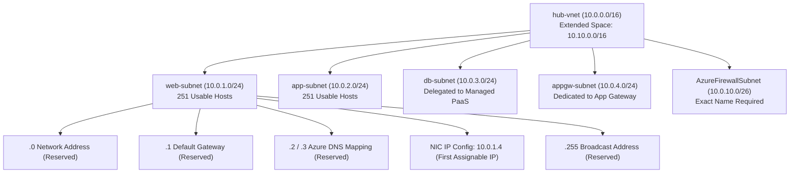
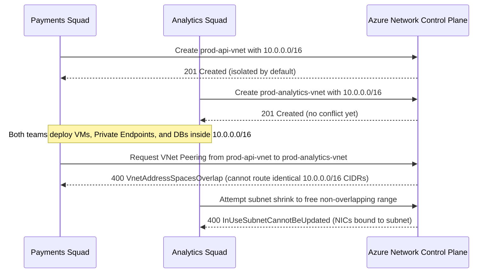

# Virtual Networks & Subnets

> **Prerequisites:** Module 00 (`az` CLI authenticated with an active subscription) and binary/CIDR IPv4 subnetting fundamentals.  
> **Estimated Reading Time:** 25 minutes  
> **Target Audience:** Backend Engineers, Cloud Architects, Platform / SRE Teams.

> [!TIP]
> **The Golden Rule of Azure VNet Planning:** Plan non-overlapping RFC 1918 `/16` address spaces from day one as if **every VNet will eventually peer**, and always subtract **5** (not 2) from every subnet's address capacity (`2^(32 - prefix) - 5`) because Azure reserves `.0`, `.1`, `.2`, `.3`, and the broadcast IP in every subnet.

---

## 1. Why This Matters & Architectural Mental Model

A Virtual Network (VNet) is the foundation every other Azure networking resource attaches to — NSGs, load balancers, private endpoints, and Container Apps environments all live inside or connect to VNets. Get the address-space and subnet decisions wrong and you'll be renumbering later, which in Azure often means recreating resources. This module is the "IP planning + subnetting" you know from track 1, applied to Azure's specific rules.

### What a VNet Is
A VNet is Azure's implementation of the private network you carve into subnets in track 1. It is defined by one or more **address spaces** in CIDR notation (e.g. `10.0.0.0/16`), it is scoped to a single region and subscription, and it is isolated by default — nothing outside it can reach in, and (with default system routes) resources inside can reach the internet outbound and each other. You subdivide the address space into **subnets**, each its own CIDR range that must fit within the VNet's address space and must not overlap other subnets in the same VNet.

### Address Space Planning (and Why Overlap is Fatal)
Use private RFC 1918 ranges (`10.0.0.0/8`, `172.16.0.0/12`, `192.168.0.0/16`), exactly as in track 1. The one rule that bites hardest in Azure: **two VNets you ever intend to peer must not have overlapping address spaces.** Peering (module 05) is just routing between VNets, and you cannot route between two networks that both claim `10.0.0.0/16`. Plan address spaces up front as if every VNet will eventually connect — e.g. hub `10.0.0.0/16`, spoke-A `10.1.0.0/16`, spoke-B `10.2.0.0/16`.

### Azure Reserves Five Addresses in Every Subnet
This is the Azure-specific subnetting detail. In track 1 you learned a subnet reserves a network address and a broadcast address. Azure reserves **five** addresses in every subnet: the first (`.0`, network), the next three (`.1` default gateway, `.2` and `.3` for Azure DNS mapping), and the last (broadcast). So a `/24` subnet (256 addresses) gives you **251** usable host IPs, not 254. This is why Azure requires subnets to be at least `/29` (the smallest, leaving 3 usable) and recommends `/28` or larger for anything real.

### Subnets as Delegation and Policy Boundaries & NIC IP Configuration
A subnet in Azure is more than an IP range — it's the attachment point for NSGs (module 02), route tables (module 07), service endpoints, and private endpoints (module 05). Some Azure services require a **delegated** or **dedicated** subnet: Azure Firewall must live in a subnet named exactly `AzureFirewallSubnet`, Application Gateway needs its own subnet, and some services (like Container Apps) require subnet *delegation* that reserves the subnet for that service's exclusive use. Trying to delegate an already-in-use subnet, or putting Firewall anywhere but `AzureFirewallSubnet`, are common early failures.

Resources don't sit "in" a subnet directly — a resource has a **network interface (NIC)**, and the NIC has an **IP configuration** that binds to a subnet and gets a private IP (dynamic by default, or static if you set it). A VM, load balancer backend, or private endpoint is really "a NIC with an IP config in this subnet." You'll rarely create NICs by hand in this track, but knowing the layering explains error messages later.



---

## 2. Taxonomic Comparison: Subnet Sizing & Dedicated Service Subnets

### Azure Subnet Sizing & The 5-IP Reservation Rule

| CIDR Prefix | Total Addresses | Reserved by Azure | Usable Host IPs | First Assignable IP (`.0` Base) | Recommended Usage |
|---|---|---|---|---|---|
| `/30` | 4 | 5 required | **Invalid (Rejected)** | N/A | Rejected by Azure ARM validation |
| `/29` | 8 | 5 (`.0–.3`, `.7`) | **3** | `.4` | Minimum allowed; tiny single-purpose links only |
| `/28` | 16 | 5 (`.0–.3`, `.15`) | **11** | `.4` | Minimum recommended for small PaaS/private endpoints |
| `/27` | 32 | 5 (`.0–.3`, `.31`) | **27** | `.4` | `GatewaySubnet` minimum, Bastion or small tiers |
| `/26` | 64 | 5 (`.0–.3`, `.63`) | **59** | `.4` | `AzureFirewallSubnet` & `AzureBastionSubnet` minimum |
| `/24` | 256 | 5 (`.0–.3`, `.255`) | **251** | `.4` | Standard workload & Application Gateway subnets |

### Dedicated & Delegated Subnet Requirements

| Service | Exact Subnet Name Required? | Minimum Size | Can Share with VMs? | Key Constraint |
|---|---|---|---|---|
| **Azure Firewall** | **Yes:** `AzureFirewallSubnet` | `/26` | No | Case-sensitive exact name; fails deployment otherwise |
| **VPN / ExpressRoute Gateway** | **Yes:** `GatewaySubnet` | `/27` (recommended) | No | Do not attach NSGs without extreme care |
| **Azure Bastion** | **Yes:** `AzureBastionSubnet` | `/26` | No | Dedicated exclusively to Bastion hosts |
| **Application Gateway** | No (e.g. `appgw-subnet`) | `/24` (autoscaling) | No | Cannot mix VMs or other NICs in same subnet |
| **Delegated PaaS** (e.g. PostgreSQL Flex) | No (e.g. `db-subnet`) | `/28`+ | No | Subnet must be empty before applying `--delegations` |

---

## 3. Command Reference & Flag Breakdowns

| Command | What it does | Example |
|---|---|---|
| `az network vnet create` | Creates a VNet and optionally a first subnet | `az network vnet create -g net-lab-rg -n hub-vnet --address-prefixes 10.0.0.0/16 --subnet-name web-subnet --subnet-prefixes 10.0.1.0/24` |
| `az network vnet list` | Lists VNets | `az network vnet list -g net-lab-rg -o table` |
| `az network vnet show` | Shows one VNet's details | `az network vnet show -g net-lab-rg -n hub-vnet` |
| `az network vnet subnet create` | Adds a subnet to an existing VNet | `az network vnet subnet create -g net-lab-rg --vnet-name hub-vnet -n db-subnet --address-prefixes 10.0.2.0/24` |
| `az network vnet subnet list` | Lists subnets in a VNet | `az network vnet subnet list -g net-lab-rg --vnet-name hub-vnet -o table` |
| `az network vnet subnet update` | Edits a subnet (delegation, NSG, route table) | `az network vnet subnet update -g net-lab-rg --vnet-name hub-vnet -n db-subnet --delegations Microsoft.DBforPostgreSQL/flexibleServers` |
| `az network vnet subnet show` | Shows one subnet | `az network vnet subnet show -g net-lab-rg --vnet-name hub-vnet -n web-subnet` |
| `az network vnet update` | Edits VNet-level settings (e.g. add address space) | `az network vnet update -g net-lab-rg -n hub-vnet --address-prefixes 10.0.0.0/16 10.10.0.0/16` |

Flag breakdown — `az network vnet create -g net-lab-rg -n hub-vnet --address-prefixes 10.0.0.0/16 --subnet-name web-subnet --subnet-prefixes 10.0.1.0/24`:
- `-g` (`--resource-group`): the group to create the VNet in.
- `-n` (`--name`): the VNet name (unique within the group).
- `--address-prefixes`: one or more CIDR blocks for the whole VNet.
- `--subnet-name`: name of a first subnet created in the same call (optional).
- `--subnet-prefixes`: the CIDR for that first subnet; must fit inside `--address-prefixes` and not overlap other subnets.

Flag breakdown — `az network vnet subnet create -g net-lab-rg --vnet-name hub-vnet -n db-subnet --address-prefixes 10.0.2.0/24`:
- `--vnet-name`: which existing VNet to add the subnet to.
- `-n` (`--name`): subnet name.
- `--address-prefixes`: the subnet's CIDR; must fit the VNet and not overlap.

Flag breakdown — `az network vnet subnet update ... --delegations Microsoft.DBforPostgreSQL/flexibleServers`:
- `--delegations`: hands the subnet to a specific Azure service. Once delegated, that subnet is reserved for that service and can't host arbitrary NICs.

---

## 4. Production War Story Post-Mortem: Overlapping `/16` Collision & Subnet Exhaustion

- **Severity:** SEV-1
- **Detection Time:** 2 hours prior to multi-region database cutover
- **Resolution Time:** 6 hours (forced VNet rebuild and DNS/LB re-pointing)
- **Impact:** Two independent product squads deployed `prod-api-vnet` and `prod-analytics-vnet` using the default `10.0.0.0/16` template. When infrastructure attempted to establish VNet peering for private database replication, Azure rejected peering immediately, forcing an emergency VNet migration under a live maintenance window.

### What Happened



### Root Cause Analysis
1. **Unplanned Address Allocation:** Neither team checked a central IPAM registry, defaulting to `10.0.0.0/16` in separate templates.
2. **In-Place Renumbering Impossibility:** Once NICs and PaaS delegations occupy a subnet, you cannot resize or move the overlapping CIDR block without deleting or migrating the attached workloads.
3. **Underestimated 5-IP Tax:** A secondary private-endpoint subnet created at `/29` (only 3 usable IPs) hit immediate IP exhaustion on the fourth replica.

### The Fix & Architectural Hardening
1. **Centralized Non-Overlapping `/16` Allocation:** Assigned `10.0.0.0/16` to Hub, `10.1.0.0/16` to Payments Spoke, and `10.2.0.0/16` to Analytics Spoke, migrating Analytics workloads to a newly built VNet.
2. **Pre-Provisioning CIDR Guardrails:** Enforced automated overlap validation against all existing subscription VNets plus a minimum `/28` subnet rule in CI/CD pipelines.

---

## 5. Multi-Language Production Implementation: Azure CIDR & VNet Overlap Validator

Before invoking `az network vnet create`, production tooling validates Azure's exact rules: minimum `/29` subnet size (`usable >= 3` after subtracting 5 reserved IPs), strict containment inside the parent VNet prefix, zero overlap across peered VNets/subnets, and exact casing for `AzureFirewallSubnet`.

````carousel
```go
package main

import (
	"fmt"
	"net/netip"
)

const azureReservedPerSubnet = 5

type SubnetSpec struct {
	Name   string
	Prefix string
}

type VNetSpec struct {
	Name          string
	AddressSpaces []string
	Subnets       []SubnetSpec
}

// ValidateVNetPlan enforces Azure's 5-IP reservation math, prefix containment,
// special subnet naming, and zero overlap across VNets planned for peering.
func ValidateVNetPlan(vnets []VNetSpec) error {
	var allVNetPrefixes []netip.Prefix

	for _, v := range vnets {
		var vPrefixes []netip.Prefix
		for _, pStr := range v.AddressSpaces {
			p, err := netip.ParsePrefix(pStr)
			if err != nil {
				return fmt.Errorf("invalid VNet prefix %q: %w", pStr, err)
			}
			for _, existing := range allVNetPrefixes {
				if p.Overlaps(existing) {
					return fmt.Errorf("peering conflict: VNet %s (%s) overlaps %s", v.Name, p, existing)
				}
			}
			vPrefixes = append(vPrefixes, p)
			allVNetPrefixes = append(allVNetPrefixes, p)
		}

		var vSubnets []netip.Prefix
		for _, sub := range v.Subnets {
			sp, err := netip.ParsePrefix(sub.Prefix)
			if err != nil {
				return fmt.Errorf("invalid subnet prefix %q: %w", sub.Prefix, err)
			}
			if !sp.Addr().Is4() {
				return fmt.Errorf("subnet %s must be IPv4", sub.Name)
			}
			if sp.Bits() > 29 {
				return fmt.Errorf("subnet %s (%s) smaller than Azure minimum /29", sub.Name, sp)
			}
			usable := (1 << (32 - sp.Bits())) - azureReservedPerSubnet
			if sub.Name == "AzureFirewallSubnet" && sp.Bits() > 26 {
				return fmt.Errorf("AzureFirewallSubnet must be /26 or larger (got %s)", sp)
			}

			contained := false
			for _, vp := range vPrefixes {
				if vp.Contains(sp.Addr()) && sp.Bits() >= vp.Bits() {
					contained = true
					break
				}
			}
			if !contained {
				return fmt.Errorf("subnet %s (%s) outside VNet %s spaces", sub.Name, sp, v.Name)
			}
			for _, seen := range vSubnets {
				if sp.Overlaps(seen) {
					return fmt.Errorf("subnet %s (%s) overlaps %s in %s", sub.Name, sp, seen, v.Name)
				}
			}
			vSubnets = append(vSubnets, sp)
			fmt.Printf("SUBNET_VALID: %s/%s prefix=%s usable_ips=%d\n", v.Name, sub.Name, sp, usable)
		}
	}
	return nil
}

func main() {
	plan := []VNetSpec{
		{Name: "hub-vnet", AddressSpaces: []string{"10.0.0.0/16"}, Subnets: []SubnetSpec{
			{Name: "AzureFirewallSubnet", Prefix: "10.0.10.0/26"},
			{Name: "web-subnet", Prefix: "10.0.1.0/24"},
		}},
		{Name: "spoke-a", AddressSpaces: []string{"10.1.0.0/16"}, Subnets: []SubnetSpec{
			{Name: "app-subnet", Prefix: "10.1.1.0/24"},
		}},
	}
	if err := ValidateVNetPlan(plan); err != nil {
		panic(err)
	}
}
```
<!-- slide -->
```typescript
interface SubnetPlan {
  name: string;
  cidr: string;
}

interface VNetPlan {
  name: string;
  addressSpaces: string[];
  subnets: SubnetPlan[];
}

function parseCidr(cidr: string): { start: number; end: number; prefix: number } {
  const [ipStr, prefixStr] = cidr.split("/");
  const prefix = Number(prefixStr);
  const octets = ipStr.split(".").map(Number);
  if (octets.length !== 4 || octets.some((o) => o < 0 || o > 255) || prefix < 0 || prefix > 32) {
    throw new Error(`Invalid IPv4 CIDR: ${cidr}`);
  }
  const ipNum =
    ((octets[0] << 24) | (octets[1] << 16) | (octets[2] << 8) | octets[3]) >>> 0;
  const mask = prefix === 0 ? 0 : (~0 << (32 - prefix)) >>> 0;
  const start = (ipNum & mask) >>> 0;
  const size = Math.pow(2, 32 - prefix);
  return { start, end: start + size - 1, prefix };
}

function overlaps(a: { start: number; end: number }, b: { start: number; end: number }): boolean {
  return a.start <= b.end && b.start <= a.end;
}

export function validateAzureTopology(vnets: VNetPlan[]): void {
  const globalRanges: Array<{ name: string; range: ReturnType<typeof parseCidr> }> = [];

  for (const vnet of vnets) {
    const vnetRanges = vnet.addressSpaces.map((c) => parseCidr(c));
    for (const vr of vnetRanges) {
      for (const existing of globalRanges) {
        if (overlaps(vr, existing.range)) {
          throw new Error(`Peering overlap between ${vnet.name} and ${existing.name}`);
        }
      }
      globalRanges.push({ name: vnet.name, range: vr });
    }

    const subnetRanges: Array<{ name: string; range: ReturnType<typeof parseCidr> }> = [];
    for (const sub of vnet.subnets) {
      const sr = parseCidr(sub.cidr);
      if (sr.prefix > 29) {
        throw new Error(`Subnet ${sub.name} (${sub.cidr}) fails Azure minimum /29 rule`);
      }
      const usable = Math.pow(2, 32 - sr.prefix) - 5;
      if (sub.name === "AzureFirewallSubnet" && sr.prefix > 26) {
        throw new Error(`AzureFirewallSubnet requires /26 or larger`);
      }
      if (!vnetRanges.some((vr) => sr.start >= vr.start && sr.end <= vr.end)) {
        throw new Error(`Subnet ${sub.name} (${sub.cidr}) outside ${vnet.name} space`);
      }
      for (const prev of subnetRanges) {
        if (overlaps(sr, prev.range)) {
          throw new Error(`Subnet ${sub.name} overlaps ${prev.name} in ${vnet.name}`);
        }
      }
      subnetRanges.push({ name: sub.name, range: sr });
      console.log(`VALID: ${vnet.name}/${sub.name} -> ${usable} Azure usable IPs`);
    }
  }
}
```
<!-- slide -->
```python
import ipaddress
from dataclasses import dataclass

AZURE_RESERVED_IPS = 5


@dataclass
class SubnetSpec:
    name: str
    cidr: str


@dataclass
class VNetSpec:
    name: str
    address_spaces: list[str]
    subnets: list[SubnetSpec]


def validate_azure_vnet_plan(vnets: list[VNetSpec]) -> None:
    seen_vnets: list[tuple[str, ipaddress.IPv4Network]] = []

    for vnet in vnets:
        vnet_nets = [ipaddress.IPv4Network(c, strict=True) for c in vnet.address_spaces]
        for net in vnet_nets:
            for other_name, other_net in seen_vnets:
                if net.overlaps(other_net):
                    raise ValueError(
                        f"Peering collision: {vnet.name} ({net}) overlaps {other_name} ({other_net})"
                    )
            seen_vnets.append((vnet.name, net))

        seen_subnets: list[tuple[str, ipaddress.IPv4Network]] = []
        for sub in vnet.subnets:
            snet = ipaddress.IPv4Network(sub.cidr, strict=True)
            if snet.prefixlen > 29:
                raise ValueError(f"Subnet {sub.name} ({snet}) is smaller than Azure /29 minimum")
            if sub.name == "AzureFirewallSubnet" and snet.prefixlen > 26:
                raise ValueError("AzureFirewallSubnet must be /26 or larger")
            if not any(snet.subnet_of(vn) for vn in vnet_nets):
                raise ValueError(f"Subnet {sub.name} ({snet}) is not inside {vnet.name}")
            for prev_name, prev_net in seen_subnets:
                if snet.overlaps(prev_net):
                    raise ValueError(f"Subnet {sub.name} overlaps {prev_name} in {vnet.name}")

            usable = snet.num_addresses - AZURE_RESERVED_IPS
            first_host = snet.network_address + 4
            seen_subnets.append((sub.name, snet))
            print(f"OK {vnet.name}/{sub.name}: {usable} usable, first IP = {first_host}")


if __name__ == "__main__":
    validate_azure_vnet_plan([
        VNetSpec("hub-vnet", ["10.0.0.0/16"], [
            SubnetSpec("AzureFirewallSubnet", "10.0.10.0/26"),
            SubnetSpec("web-subnet", "10.0.1.0/24"),
        ]),
        VNetSpec("spoke-a", ["10.1.0.0/16"], [
            SubnetSpec("app-subnet", "10.1.1.0/24"),
        ]),
    ])
```
<!-- slide -->
```csharp
using System;
using System.Collections.Generic;
using System.Linq;
using System.Net;

public sealed record SubnetSpec(string Name, string Cidr);
public sealed record VNetSpec(string Name, IReadOnlyList<string> AddressSpaces, IReadOnlyList<SubnetSpec> Subnets);

public static class AzureVNetPlanner
{
    private const int AzureReservedCount = 5;

    private static (uint Start, uint End, int Prefix) ParseCidr(string cidr)
    {
        var parts = cidr.Split('/');
        int prefix = int.Parse(parts[1]);
        byte[] bytes = IPAddress.Parse(parts[0]).GetAddressBytes();
        if (BitConverter.IsLittleEndian) Array.Reverse(bytes);
        uint ip = BitConverter.ToUInt32(bytes, 0);
        uint mask = prefix == 0 ? 0u : uint.MaxValue << (32 - prefix);
        uint start = ip & mask;
        uint size = 1u << (32 - prefix);
        return (start, start + size - 1, prefix);
    }

    public static void Validate(IEnumerable<VNetSpec> vnets)
    {
        var globalSpaces = new List<(string VNet, uint Start, uint End)>();
        foreach (var vnet in vnets)
        {
            var spaces = vnet.AddressSpaces.Select(ParseCidr).ToList();
            foreach (var sp in spaces)
            {
                foreach (var g in globalSpaces)
                {
                    if (sp.Start <= g.End && g.Start <= sp.End)
                        throw new InvalidOperationException($"Peering conflict: {vnet.Name} overlaps {g.VNet}");
                }
                globalSpaces.Add((vnet.Name, sp.Start, sp.End));
            }

            var seenSubnets = new List<(string Name, uint Start, uint End)>();
            foreach (var sub in vnet.Subnets)
            {
                var sr = ParseCidr(sub.Cidr);
                if (sr.Prefix > 29)
                    throw new InvalidOperationException($"{sub.Name} ({sub.Cidr}) violates Azure /29 minimum.");
                if (sub.Name == "AzureFirewallSubnet" && sr.Prefix > 26)
                    throw new InvalidOperationException("AzureFirewallSubnet requires /26 or larger.");
                if (!spaces.Any(sp => sr.Start >= sp.Start && sr.End <= sp.End))
                    throw new InvalidOperationException($"{sub.Name} outside VNet {vnet.Name}.");
                if (seenSubnets.Any(s => sr.Start <= s.End && s.Start <= sr.End))
                    throw new InvalidOperationException($"{sub.Name} overlaps sibling subnet.");

                long usable = (1L << (32 - sr.Prefix)) - AzureReservedCount;
                seenSubnets.Add((sub.Name, sr.Start, sr.End));
                Console.WriteLine($"VALID: {vnet.Name}/{sub.Name} -> {usable} usable IPs");
            }
        }
    }
}
```
````

---

## 6. Practical Hands-On Verification CLI Workflows

Assumes you're logged in (module 00). Create a fresh group for this module:
```bash
az group create --name vnet-lab-rg --location eastus
```

### Exercise 1–4: Create VNet, Add Subnets, Verify 5-IP Reservation & System Routes
1. **Create a VNet with a first subnet.**
   ```bash
   az network vnet create -g vnet-lab-rg -n hub-vnet \
     --address-prefixes 10.0.0.0/16 \
     --subnet-name web-subnet --subnet-prefixes 10.0.1.0/24
   az network vnet show -g vnet-lab-rg -n hub-vnet -o table
   az network vnet subnet list -g vnet-lab-rg --vnet-name hub-vnet -o table
   ```
   **Expected Output:**
   ```text
   AddressPrefix    Name        PrivateEndpointNetworkPolicies    ProvisioningState
   ---------------  ----------  --------------------------------  -------------------
   10.0.1.0/24      web-subnet  Disabled                          Succeeded
   ```
   > Verify: `az network vnet show -g vnet-lab-rg -n hub-vnet -o table` shows the VNet; `az network vnet subnet list -g vnet-lab-rg --vnet-name hub-vnet -o table` shows `web-subnet` with prefix `10.0.1.0/24`.

2. **Add two more subnets.**
   ```bash
   az network vnet subnet create -g vnet-lab-rg --vnet-name hub-vnet \
     -n app-subnet --address-prefixes 10.0.2.0/24
   az network vnet subnet create -g vnet-lab-rg --vnet-name hub-vnet \
     -n db-subnet --address-prefixes 10.0.3.0/24
   ```
   > Verify: the subnet list now shows three subnets, none overlapping.

3. **Prove the five-reserved-IPs rule.** Look at the usable range. A `/24` has 256 addresses but Azure reserves `.0`, `.1`, `.2`, `.3`, and `.255`. Confirm your understanding by predicting the first assignable IP in `web-subnet` (answer: `10.0.1.4`). You can see this in action once you place a resource; for now, reason it out.

4. **Inspect the default outbound and gateway behavior.** Run:
   ```bash
   az network vnet subnet show -g vnet-lab-rg --vnet-name hub-vnet \
     -n web-subnet
   ```
   Note there is no explicit route table or NSG attached yet — the subnet relies on Azure's default system routes (local VNet, internet, etc.), the same defaults you'll override in modules 02 and 07.

### Exercise 5–9: Dedicated Subnets, Extension, Diagnosing Overlap & Size Errors, Cleanup
5. **Create a dedicated subnet for a future gateway.** Application Gateway needs its own subnet. Add one now so module 06 is ready:
   ```bash
   az network vnet subnet create -g vnet-lab-rg --vnet-name hub-vnet \
     -n appgw-subnet --address-prefixes 10.0.4.0/24
   ```

6. **Add a second address space.** Suppose you're running low on room. Extend the VNet:
   ```bash
   az network vnet update -g vnet-lab-rg -n hub-vnet \
     --address-prefixes 10.0.0.0/16 10.10.0.0/16
   ```
   > Verify: `az network vnet show` now lists both prefixes under `addressSpace.addressPrefixes`.

7. **Diagnose and fix: overlapping subnet.** Try to create a subnet that overlaps an existing one:
   ```bash
   az network vnet subnet create -g vnet-lab-rg --vnet-name hub-vnet \
     -n bad-subnet --address-prefixes 10.0.1.128/25
   ```
   This fails because `10.0.1.128/25` overlaps `web-subnet` (`10.0.1.0/24`). Read the error (`NetcfgInvalidSubnet` / overlap). Fix it by choosing a non-overlapping range that still fits the VNet:
   ```bash
   az network vnet subnet create -g vnet-lab-rg --vnet-name hub-vnet \
     -n good-subnet --address-prefixes 10.0.5.0/24
   ```
   > Verify: `good-subnet` appears; `bad-subnet` does not.

8. **Diagnose and fix: subnet too small.** Try a `/30` subnet:
   ```bash
   az network vnet subnet create -g vnet-lab-rg --vnet-name hub-vnet \
     -n tiny-subnet --address-prefixes 10.0.6.0/30
   ```
   A `/30` (4 addresses) can't satisfy Azure's five-reserved rule and is rejected as too small. Fix by using at least `/29`:
   ```bash
   az network vnet subnet create -g vnet-lab-rg --vnet-name hub-vnet \
     -n small-subnet --address-prefixes 10.0.6.0/29
   ```
   > Verify: `small-subnet` (`/29`) is created — it has 3 usable IPs.

9. **Cleanup.** VNets and subnets themselves are free, but delete the group so you start module 02 clean (and so nothing lingers):
   ```bash
   az group delete --name vnet-lab-rg --yes --no-wait
   ```

### Independent Challenge
Design and build address space for a future hub-and-spoke lab **without any overlaps**, since you'll peer these in module 05. Create three VNets in one resource group: a hub (`10.0.0.0/16`) with a subnet reserved for a firewall, and two spokes (`10.1.0.0/16` and `10.2.0.0/16`), each with one workload subnet. Verify none of the ranges overlap and that the firewall subnet is named correctly for Azure Firewall. This combines this module's subnetting with module 00's resource-group discipline. Delete the resource group when you're done so nothing is left behind.

<details><summary>Stuck? One hint</summary>

Azure Firewall requires a subnet named **exactly** `AzureFirewallSubnet` (case-sensitive) and recommends it be at least `/26`. The three VNets use different `/16` second octets (0, 1, 2) precisely so their ranges never collide when peered.

</details>

---

## 7. Common Mistakes & Troubleshooting

- **Overlapping address spaces across VNets.** Fine until you try to peer, then unfixable without renumbering. Plan non-overlapping `/16`s up front.
- **Forgetting Azure reserves five IPs per subnet.** Your first host is `.4`, and a `/29` gives only 3 usable addresses.
- **Wrong name for special subnets.** `AzureFirewallSubnet` and (later) `GatewaySubnet` must be named exactly; App Gateway needs its own dedicated subnet with nothing else in it.
- **Trying to delegate or resize a subnet that already has resources.** Azure blocks it; you must empty the subnet first.
- **Cost note:** VNets and subnets are free. The cost creeps in with what you *attach* to them (public IPs, gateways, firewalls) in later modules — so a VNet-only lab left running is harmless, but get in the habit of deleting the group anyway.

---

## 8. Operational Validation Checkpoints

<details><summary><strong>Operational Checkpoint 1: Delegating an Active Workload Subnet to Managed PostgreSQL</strong></summary>

**Scenario:** You created `db-subnet` (`10.0.3.0/24`) and placed a temporary Bastion jump VM NIC inside it to test connectivity. Now you run `az network vnet subnet update ... --delegations Microsoft.DBforPostgreSQL/flexibleServers` and Azure rejects the command. Why?

**Answer:** A delegated subnet is reserved exclusively for that PaaS service and cannot hold arbitrary existing NICs. Remove or move the jump VM's NIC out of `db-subnet` first, then apply the delegation on the empty subnet.

</details>

<details><summary><strong>Operational Checkpoint 2: Sizing a Micro-Subnet for 10 Private Endpoints</strong></summary>

**Scenario:** Your architecture calls for deploying 10 Private Endpoints (1 private IP each) into a dedicated `pe-subnet`. An engineer suggests a `/28` subnet (`16` total addresses), while another asks if `/29` (`8` addresses) works if you split them across two `/29`s. Evaluate both options under Azure's 5-IP reservation math.

**Answer:** A single `/28` provides `16 - 5 = 11` usable IPs, which fits 10 Private Endpoints with 1 IP to spare (tight, leaving minimal room for growth). Two `/29`s only provide `3 + 3 = 6` usable IPs total (`8 - 5 = 3` per subnet), which falls short of 10 and wastes 10 IPs to Azure's per-subnet reservation overhead. Use `/28` (or `/27` for growth).

</details>

<details><summary><strong>Operational Checkpoint 3: Peering Two Acquired Subsidiaries Both Using 10.10.0.0/16</strong></summary>

**Scenario:** Two acquired teams each deployed workloads in `10.10.0.0/16`. One team suggests adding a second non-overlapping space `10.20.0.0/16` via `az network vnet update` while keeping their existing `10.10.0.0/16` subnets so they can peer immediately. Does adding a second address space solve the peering block?

**Answer:** No. VNet peering validates **all** address spaces on both VNets; as long as both VNets still contain `10.10.0.0/16`, peering will be rejected with `VnetAddressSpacesOverlap`. One VNet must migrate workloads out of `10.10.0.0/16` and remove that prefix (or use a NAT/NVA overlap workaround, which defeats native peering).

</details>

---

## 9. Checkpoint Quiz

Write down your answer to each question before expanding it — checking without attempting first is the single easiest way to fool yourself into thinking you've learned this.

1. How many usable host IPs does a `/24` subnet give you in Azure, and why not 254?
2. Two teams each built a VNet using `10.0.0.0/16`. What breaks when they try to connect them, and why?
3. What is the smallest subnet size Azure allows, and how many usable addresses does it have?
4. Where must Azure Firewall's subnet live, and what must it be named?
5. What's the difference between a VNet's address space and a subnet's address prefix?
6. Can you shrink or delegate a subnet that already contains a running resource? What do you do instead?
7. What's the first assignable private IP in a subnet defined as `10.0.1.0/24`?

<details><summary>Show answers</summary>

1. 251. Azure reserves five addresses per subnet: `.0` (network), `.1` (gateway), `.2` and `.3` (Azure DNS mapping), and `.255` (broadcast).
2. Peering breaks — you can't route between two networks with overlapping address ranges. There's no fix short of renumbering one VNet.
3. `/29`, which yields 3 usable addresses (8 total minus 5 reserved).
4. In the same VNet, in a subnet named exactly `AzureFirewallSubnet` (case-sensitive), recommended `/26` or larger.
5. The address space is the full CIDR range(s) the VNet owns; a subnet prefix is a smaller CIDR carved out of that space. Subnets must fit inside the address space and not overlap each other.
6. No. You must remove the resources from the subnet first, then modify or delegate it.
7. `10.0.1.4` (`.0`–`.3` are reserved).

</details>

---

## Sources & Further Reading
- [Microsoft Learn: Plan virtual networks](https://learn.microsoft.com/azure/virtual-network/concepts-and-best-practices)
- [Microsoft Learn: Virtual network subnets & IP allocation](https://learn.microsoft.com/azure/virtual-network/virtual-networks-faq#are-there-any-restrictions-on-using-ip-addresses-within-these-subnets)
- [Microsoft Learn: Subnet delegation overview](https://learn.microsoft.com/azure/virtual-network/subnet-delegation-overview)

## Next
[02 — Network Security Groups](../02-network-security-groups/README.md): attach Azure's stateful firewall to your subnets and control who can reach what.
