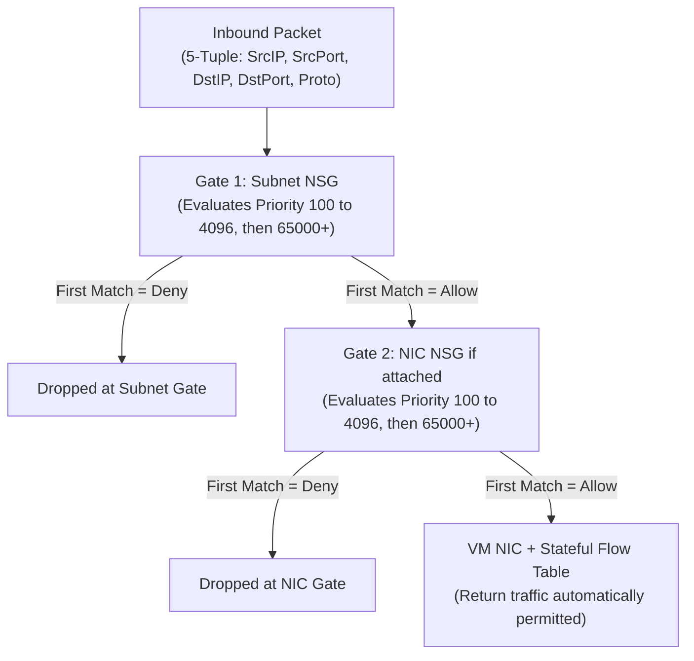
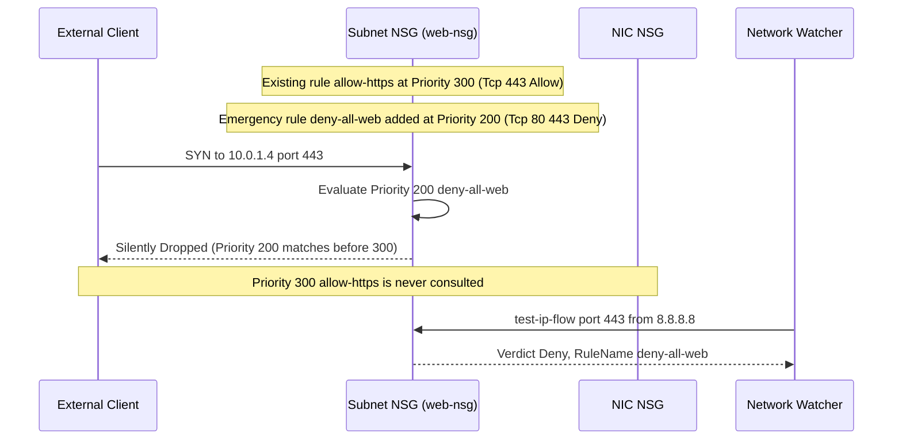

# Network Security Groups

> **Prerequisites:** Module 01 (VNets & subnets) and stateful firewall fundamentals from [networking-fundamentals module 05](../../04-networking-fundamentals/README.md).  
> **Estimated Reading Time:** 25 minutes  
> **Target Audience:** Backend Engineers, Cloud Security Engineers, Site Reliability Engineers.

> [!TIP]
> **The Golden Rule of NSG Evaluation:** NSGs process rules strictly in ascending **priority** order (`100` to `4096`, then `65000+` defaults) and halt on the **first match**. When both a Subnet NSG and a NIC NSG exist, traffic must independently pass **both** gates (Subnet then NIC inbound; NIC then Subnet outbound). Always check lower-numbered `Deny` rules before trusting a higher-numbered `Allow`.

---

## 1. Why This Matters & Architectural Mental Model

An NSG is how you actually control traffic in Azure — without one, subnets rely only on default rules that allow all intra-VNet traffic and all outbound internet. Nearly every "why can't I reach my VM/app?" problem in Azure comes down to an NSG rule, its priority, or which resource it's attached to. This is the firewall concept from track 1, implemented as an Azure resource with some very specific ordering and default-rule behavior you must know cold.

### An NSG Is Azure's Stateful Firewall
An NSG is Azure's implementation of the stateful packet-filtering firewall from [networking-fundamentals module 05](../../04-networking-fundamentals/README.md). It holds a prioritized list of allow/deny rules for inbound and outbound traffic, matching on source/destination IP (or tag), port, and protocol. Because it's **stateful**, you only write a rule for the initiating direction — if you allow inbound TCP 443, the return traffic is automatically permitted; you don't write a matching outbound rule for responses.

### Attachment: Subnet vs NIC
An NSG can be associated to a **subnet** (applies to every resource in it) or to a **NIC** (applies to that one resource), or both. When both apply, inbound traffic is evaluated against the subnet NSG **then** the NIC NSG (and the reverse order outbound); traffic must pass *both*. Prefer subnet-level NSGs for broad policy and use NIC-level sparingly — two NSGs on the same path is a classic source of "it's allowed in one place but still blocked" confusion.

### Rules, Priority, and Evaluation Order
Each rule has a **priority** from 100 to 4096 (lower number = evaluated first). Rules are processed in priority order and the **first match wins** — once a packet matches a rule, no lower-priority rule is consulted. This is the detail that breaks people: a broad `Deny` at priority 200 will shadow a specific `Allow` at priority 300, because 200 is evaluated first. Leave gaps between priorities (100, 200, 300...) so you can insert rules later.

### Default Rules and Service Tags
Every NSG has hidden **default rules** at priorities 65000–65500 you can't delete (only override with higher-priority rules): allow all inbound within the VNet (`AllowVnetInBound`), allow inbound from Azure Load Balancer, deny all other inbound (`DenyAllInBound`); and outbound, allow all VNet + all internet, deny the rest. Rules reference **service tags** — symbolic names like `VirtualNetwork`, `Internet`, `AzureLoadBalancer`, `Storage`, `Sql` — instead of hardcoded IP ranges. Use tags instead of IP literals wherever possible; Azure keeps the underlying ranges current for you.

### Application Security Groups (ASGs)
An **ASG** lets you group NICs by role (e.g. `web-servers`, `db-servers`) and then write NSG rules whose source/destination is the ASG name instead of an IP range. Add a new web VM to the `web-servers` ASG and it inherits the rules — no NSG edits. ASGs make rules readable and stable as your fleet changes; they're the Azure answer to "firewall rules that reference roles, not addresses."



---

## 2. Taxonomic Comparison: Default Rules, Attachment Scopes & Grouping

### Azure Immutable Default NSG Rules (`65000`–`65500`)

| Direction | Priority | Default Rule Name | Source | Destination | Action | Overridable? |
|---|---|---|---|---|---|---|
| **Inbound** | `65000` | `AllowVnetInBound` | `VirtualNetwork` | `VirtualNetwork` | Allow | Yes (add priority `100`–`4096` Deny) |
| **Inbound** | `65001` | `AllowAzureLoadBalancerInBound` | `AzureLoadBalancer` | `*` | Allow | Yes (warning: breaks LB health probes) |
| **Inbound** | `65500` | `DenyAllInBound` | `*` | `*` | Deny | Yes (add priority `100`–`4096` Allow) |
| **Outbound** | `65000` | `AllowVnetOutBound` | `VirtualNetwork` | `VirtualNetwork` | Allow | Yes |
| **Outbound** | `65001` | `AllowInternetOutBound` | `*` | `Internet` | Allow | Yes |
| **Outbound** | `65500` | `DenyAllOutBound` | `*` | `*` | Deny | Yes |

### Subnet NSG vs NIC NSG vs Service Tags vs ASGs

| Mechanism | Scope / Abstraction | Best Practice Usage | Operational Trade-Off |
|---|---|---|---|
| **Subnet NSG** | All NICs inside one subnet | Primary policy boundary (`web-subnet`, `db-subnet`) | Recommended default; easy to audit in one place |
| **NIC NSG** | Single VM / resource NIC | Rare exception overrides for a single host | Creates dual-gate evaluation with Subnet NSG |
| **Service Tag** | Azure-managed IP prefix group (`Internet`, `Storage`, `Sql`, `AzureLoadBalancer`) | Replacing brittle public Azure CIDR allowlists | Automatically updated by Microsoft across regions |
| **ASG** | Role-based NIC membership (`web-servers`, `db-servers`) | Dynamic horizontal scaling rules inside VNets | All NICs in an ASG rule must belong to the same VNet |

---

## 3. Command Reference & Flag Breakdowns

| Command | What it does | Example |
|---|---|---|
| `az network nsg create` | Creates an NSG | `az network nsg create -g nsg-lab-rg -n web-nsg` |
| `az network nsg rule create` | Adds a rule to an NSG | `az network nsg rule create -g nsg-lab-rg --nsg-name web-nsg -n allow-https --priority 300 --access Allow --direction Inbound --protocol Tcp --destination-port-ranges 443 --source-address-prefixes Internet` |
| `az network nsg rule list` | Lists rules (add `--include-default`) | `az network nsg rule list -g nsg-lab-rg --nsg-name web-nsg --include-default -o table` |
| `az network nsg rule update` | Edits a rule | `az network nsg rule update -g nsg-lab-rg --nsg-name web-nsg -n allow-https --priority 250` |
| `az network vnet subnet update` | Attaches an NSG to a subnet | `az network vnet subnet update -g nsg-lab-rg --vnet-name lab-vnet -n web-subnet --network-security-group web-nsg` |
| `az network asg create` | Creates an Application Security Group | `az network asg create -g nsg-lab-rg -n web-servers` |
| `az network watcher test-ip-flow` | Simulates whether traffic is allowed/denied | `az network watcher test-ip-flow -g nsg-lab-rg --vm myvm --direction Inbound --protocol TCP --local 10.0.1.4:443 --remote 8.8.8.8:12345` |

Flag breakdown — `az network nsg rule create ... -n allow-https --priority 300 --access Allow --direction Inbound --protocol Tcp --destination-port-ranges 443 --source-address-prefixes Internet`:
- `-n` (`--name`): rule name.
- `--priority`: 100–4096; lower is evaluated first; must be unique per direction in the NSG.
- `--access`: `Allow` or `Deny`.
- `--direction`: `Inbound` or `Outbound`.
- `--protocol`: `Tcp`, `Udp`, `Icmp`, or `*` (any).
- `--destination-port-ranges`: port(s) the traffic is going to (e.g. `443`, `80 443`, `1000-2000`).
- `--source-address-prefixes`: source IP CIDR(s) or a service tag like `Internet` or `VirtualNetwork`.

Flag breakdown — `az network watcher test-ip-flow -g ... --vm myvm --direction Inbound --protocol TCP --local 10.0.1.4:443 --remote 8.8.8.8:12345`:
- `--vm`: the VM whose effective NSG rules are evaluated.
- `--direction`: direction of the simulated packet.
- `--local`: the VM-side `IP:port`.
- `--remote`: the other end's `IP:port`.
- Returns `Allow`/`Deny` **and the name of the matching rule** — the single best NSG debugging tool.

---

## 4. Production War Story Post-Mortem: Priority Shadowing Blackout on Checkout API

- **Severity:** SEV-1
- **Detection Time:** 3 minutes (synthetic HTTPS probe alert)
- **Resolution Time:** 34 minutes
- **Impact:** 100% of external HTTPS (`443`) traffic to `checkout-api` dropped across `eastus` immediately after an emergency security change meant to block plain HTTP (`80`).

### What Happened



### Root Cause Analysis
1. **Priority Shadowing (`200 < 300`):** The emergency rule `deny-all-web` included ports `80 443` at priority `200`, intercepting TCP `443` before `allow-https` (`300`) could evaluate.
2. **No Flow Simulation:** The change bypassed `az network watcher test-ip-flow` verification and relied solely on visual inspection of `allow-https` still existing in the rule list.

### The Fix & Architectural Hardening
1. **Immediate Mitigation:** Moved `allow-https` to priority `150` (`az network nsg rule update ... --priority 150`) and removed `443` from `deny-all-web`.
2. **Preventive Guardrails:** Standardized priority bands (`100–199` explicit allows, `200–299` explicit denies, `300+` ASG/tier allows), prohibited NIC-level NSGs except for quarantine, and added an automated priority-shadowing linter in CI.

---

## 5. Multi-Language Production Implementation: NSG Priority Shadowing & Security Auditor

The scripts below model Azure's exact first-match NSG evaluation order (`100`–`4096`), detect when a lower-priority-number `Deny` rule shadows a higher-priority-number `Allow` rule, and flag unsafe `22`/`3389` exposure to `Internet`.

````carousel
```go
package main

import (
	"fmt"
	"sort"
)

type SecurityRule struct {
	Name      string
	Priority  int
	Direction string // "Inbound" | "Outbound"
	Access    string // "Allow" | "Deny"
	Protocol  string // "Tcp" | "Udp" | "*"
	SrcPrefix string
	DstPorts  []string
}

func overlapsPort(a, b []string) bool {
	for _, pa := range a {
		for _, pb := range b {
			if pa == "*" || pb == "*" || pa == pb {
				return true
			}
		}
	}
	return false
}

// AuditNSGRules sorts rules ascending and catches priority shadowing and exposed SSH/RDP.
func AuditNSGRules(rules []SecurityRule) []string {
	sort.Slice(rules, func(i, j int) bool {
		return rules[i].Priority < rules[j].Priority
	})

	var findings []string
	for i, r := range rules {
		if r.Direction == "Inbound" && r.Access == "Allow" &&
			(r.SrcPrefix == "Internet" || r.SrcPrefix == "*" || r.SrcPrefix == "0.0.0.0/0") &&
			overlapsPort(r.DstPorts, []string{"22", "3389"}) {
			findings = append(findings, fmt.Sprintf(
				"CRITICAL_EXPOSURE: rule %q (prio %d) exposes mgmt port to %s",
				r.Name, r.Priority, r.SrcPrefix))
		}
		if r.Access == "Allow" {
			for j := 0; j < i; j++ {
				earlier := rules[j]
				if earlier.Direction == r.Direction && earlier.Access == "Deny" &&
					(earlier.Protocol == "*" || earlier.Protocol == r.Protocol) &&
					(earlier.SrcPrefix == "*" || earlier.SrcPrefix == r.SrcPrefix) &&
					overlapsPort(earlier.DstPorts, r.DstPorts) {
					findings = append(findings, fmt.Sprintf(
						"SHADOWED_ALLOW: %q (prio %d) shadowed by earlier Deny %q (prio %d)",
						r.Name, r.Priority, earlier.Name, earlier.Priority))
				}
			}
		}
	}
	return findings
}

func main() {
	rules := []SecurityRule{
		{Name: "deny-all-web", Priority: 200, Direction: "Inbound", Access: "Deny", Protocol: "Tcp", SrcPrefix: "Internet", DstPorts: []string{"80", "443"}},
		{Name: "allow-https", Priority: 300, Direction: "Inbound", Access: "Allow", Protocol: "Tcp", SrcPrefix: "Internet", DstPorts: []string{"443"}},
	}
	for _, f := range AuditNSGRules(rules) {
		fmt.Println(f)
	}
}
```
<!-- slide -->
```typescript
interface NsgRule {
  name: string;
  priority: number;
  direction: "Inbound" | "Outbound";
  access: "Allow" | "Deny";
  protocol: "Tcp" | "Udp" | "*";
  sourceAddressPrefix: string;
  destinationPortRanges: string[];
}

function portsOverlap(a: string[], b: string[]): boolean {
  return a.some((pa) => b.some((pb) => pa === "*" || pb === "*" || pa === pb));
}

export function auditNsgPolicy(rules: NsgRule[]): string[] {
  const sorted = [...rules].sort((a, b) => a.priority - b.priority);
  const issues: string[] = [];

  for (let i = 0; i < sorted.length; i++) {
    const rule = sorted[i];
    if (
      rule.direction === "Inbound" &&
      rule.access === "Allow" &&
      ["Internet", "*", "0.0.0.0/0"].includes(rule.sourceAddressPrefix) &&
      portsOverlap(rule.destinationPortRanges, ["22", "3389"])
    ) {
      issues.push(`EXPOSED_MGMT: ${rule.name} (prio ${rule.priority}) opens 22/3389 to ${rule.sourceAddressPrefix}`);
    }

    if (rule.access === "Allow") {
      for (let j = 0; j < i; j++) {
        const prev = sorted[j];
        if (
          prev.direction === rule.direction &&
          prev.access === "Deny" &&
          (prev.protocol === "*" || prev.protocol === rule.protocol) &&
          (prev.sourceAddressPrefix === "*" || prev.sourceAddressPrefix === rule.sourceAddressPrefix) &&
          portsOverlap(prev.destinationPortRanges, rule.destinationPortRanges)
        ) {
          issues.push(
            `SHADOWED_RULE: ${rule.name} (prio ${rule.priority}) is blocked by ${prev.name} (prio ${prev.priority})`
          );
        }
      }
    }
  }
  return issues;
}
```
<!-- slide -->
```python
from dataclasses import dataclass


@dataclass(frozen=True)
class NsgRule:
    name: str
    priority: int
    direction: str  # Inbound | Outbound
    access: str     # Allow | Deny
    protocol: str   # Tcp | Udp | *
    source_prefix: str
    dest_ports: tuple[str, ...]


def _ports_overlap(a: tuple[str, ...], b: tuple[str, ...]) -> bool:
    return any(pa == "*" or pb == "*" or pa == pb for pa in a for pb in b)


def audit_nsg_rules(rules: list[NsgRule]) -> list[str]:
    ordered = sorted(rules, key=lambda r: r.priority)
    findings: list[str] = []

    for idx, rule in enumerate(ordered):
        if (
            rule.direction == "Inbound"
            and rule.access == "Allow"
            and rule.source_prefix in {"Internet", "*", "0.0.0.0/0"}
            and _ports_overlap(rule.dest_ports, ("22", "3389"))
        ):
            findings.append(
                f"CRITICAL_MGMT_EXPOSURE: {rule.name} (prio {rule.priority}) allows {rule.source_prefix}"
            )

        if rule.access == "Allow":
            for prev in ordered[:idx]:
                if (
                    prev.direction == rule.direction
                    and prev.access == "Deny"
                    and prev.protocol in {"*", rule.protocol}
                    and prev.source_prefix in {"*", rule.source_prefix}
                    and _ports_overlap(prev.dest_ports, rule.dest_ports)
                ):
                    findings.append(
                        f"SHADOWED_ALLOW: {rule.name} (prio {rule.priority}) shadowed by {prev.name} (prio {prev.priority})"
                    )
    return findings


if __name__ == "__main__":
    sample = [
        NsgRule("deny-all-web", 200, "Inbound", "Deny", "Tcp", "Internet", ("80", "443")),
        NsgRule("allow-https", 300, "Inbound", "Allow", "Tcp", "Internet", ("443",)),
    ]
    print(audit_nsg_rules(sample))
```
<!-- slide -->
```csharp
using System;
using System.Collections.Generic;
using System.Linq;

public sealed record NsgRule(
    string Name,
    int Priority,
    string Direction,
    string Access,
    string Protocol,
    string SourcePrefix,
    IReadOnlyList<string> DestPorts);

public static class NsgAuditor
{
    private static bool PortsOverlap(IReadOnlyList<string> a, IReadOnlyList<string> b) =>
        a.Any(pa => b.Any(pb => pa == "*" || pb == "*" || pa == pb));

    public static IReadOnlyList<string> Audit(IEnumerable<NsgRule> rules)
    {
        var ordered = rules.OrderBy(r => r.Priority).ToList();
        var findings = new List<string>();

        for (int i = 0; i < ordered.Count; i++)
        {
            var r = ordered[i];
            if (r.Direction == "Inbound" && r.Access == "Allow" &&
                (r.SourcePrefix is "Internet" or "*" or "0.0.0.0/0") &&
                PortsOverlap(r.DestPorts, new[] { "22", "3389" }))
            {
                findings.Add($"EXPOSED_MGMT: {r.Name} (prio {r.Priority}) exposes 22/3389 to {r.SourcePrefix}");
            }

            if (r.Access == "Allow")
            {
                for (int j = 0; j < i; j++)
                {
                    var prev = ordered[j];
                    if (prev.Direction == r.Direction && prev.Access == "Deny" &&
                        (prev.Protocol == "*" || prev.Protocol == r.Protocol) &&
                        (prev.SourcePrefix == "*" || prev.SourcePrefix == r.SourcePrefix) &&
                        PortsOverlap(prev.DestPorts, r.DestPorts))
                    {
                        findings.Add($"SHADOWED_ALLOW: {r.Name} (prio {r.Priority}) blocked by {prev.Name} (prio {prev.Priority})");
                    }
                }
            }
        }
        return findings;
    }
}
```
````

---

## 6. Practical Hands-On Verification CLI Workflows

Set up a group, VNet, and subnet:
```bash
az group create --name nsg-lab-rg --location eastus
az network vnet create -g nsg-lab-rg -n lab-vnet \
  --address-prefixes 10.0.0.0/16 \
  --subnet-name web-subnet --subnet-prefixes 10.0.1.0/24
```

### Exercise 1–4: Create NSG, Inspect Default Rules & Allow Scoped Inbound
1. **Create an NSG and attach it to the subnet.**
   ```bash
   az network nsg create -g nsg-lab-rg -n web-nsg
   az network vnet subnet update -g nsg-lab-rg --vnet-name lab-vnet \
     -n web-subnet --network-security-group web-nsg
   ```
   > Verify: `az network vnet subnet show -g nsg-lab-rg --vnet-name lab-vnet -n web-subnet` now shows a `networkSecurityGroup` reference.

2. **Inspect the default rules.**
   ```bash
   az network nsg rule list -g nsg-lab-rg --nsg-name web-nsg \
     --include-default -o table
   ```
   **Expected Output:**
   ```text
   Name                           Priority    SourceAddressPrefix    Access    Direction    DestinationPortRange
   -----------------------------  ----------  ---------------------  --------  -----------  ----------------------
   AllowVnetInBound               65000       VirtualNetwork         Allow     Inbound      *
   AllowAzureLoadBalancerInBound  65001       AzureLoadBalancer      Allow     Inbound      *
   DenyAllInBound                 65500       *                      Deny      Inbound      *
   AllowVnetOutBound              65000       VirtualNetwork         Allow     Outbound     *
   AllowInternetOutBound          65001       *                      Allow     Outbound     *
   DenyAllOutBound                65500       *                      Deny      Outbound     *
   ```
   > Verify: you see `AllowVnetInBound`, `AllowAzureLoadBalancerInBound`, `DenyAllInBound` (65000–65500) and the outbound equivalents. You have no custom rules yet.

3. **Allow HTTPS from the internet.**
   ```bash
   az network nsg rule create -g nsg-lab-rg --nsg-name web-nsg \
     -n allow-https --priority 300 --access Allow --direction Inbound \
     --protocol Tcp --destination-port-ranges 443 \
     --source-address-prefixes Internet
   ```
   > Verify: rule list (without `--include-default`) shows `allow-https`.

4. **Allow SSH only from your IP.** Replace `<your-ip>` with your actual public IP (find it at whatismyip or `curl ifconfig.me`):
   ```bash
   az network nsg rule create -g nsg-lab-rg --nsg-name web-nsg \
     -n allow-ssh-mgmt --priority 310 --access Allow --direction Inbound \
     --protocol Tcp --destination-port-ranges 22 \
     --source-address-prefixes <your-ip>/32
   ```
   This is far safer than opening 22 to `Internet`.

### Exercise 5–9: Service Tags, ASGs, Priority Shadowing Fix, Flow Simulation & Cleanup
5. **Use service tags instead of IP ranges.** Add an outbound rule allowing only Azure Storage:
   ```bash
   az network nsg rule create -g nsg-lab-rg --nsg-name web-nsg \
     -n allow-storage-out --priority 300 --access Allow --direction Outbound \
     --protocol Tcp --destination-port-ranges 443 \
     --destination-address-prefixes Storage
   ```
   Note you referenced the `Storage` tag, not any IP range.

6. **Create and use an ASG.**
   ```bash
   az network asg create -g nsg-lab-rg -n web-servers
   az network nsg rule update -g nsg-lab-rg --nsg-name web-nsg \
     -n allow-https --destination-asgs web-servers
   ```
   (In a real deployment you'd add each web NIC to `web-servers`; here you're learning the wiring.)

7. **Diagnose and fix: a broad deny shadows a specific allow.** Add a deliberately misordered pair of rules:
   ```bash
   az network nsg rule create -g nsg-lab-rg --nsg-name web-nsg \
     -n deny-all-web --priority 200 --access Deny --direction Inbound \
     --protocol Tcp --destination-port-ranges 80 443 \
     --source-address-prefixes Internet
   ```
   Now your `allow-https` at priority 300 never fires, because `deny-all-web` at 200 is evaluated first and matches 443. **Diagnose:** list rules and note the priority ordering — 200 < 300, first match wins, so 443 is denied. **Fix:** either raise `allow-https` above the deny, or narrow the deny. Give the allow a lower (earlier) priority than the deny:
   ```bash
   az network nsg rule update -g nsg-lab-rg --nsg-name web-nsg \
     -n allow-https --priority 150
   ```
   Now 443 is allowed (150) before the deny (200) is reached. This priority-ordering trap is the most common NSG bug in production.

8. **Verify with the flow simulator (if you have a VM).** If you place a VM in the subnet, `az network watcher test-ip-flow` tells you the verdict *and* the matching rule name — the definitive way to confirm exercise 7's fix rather than guessing:
   ```bash
   az network watcher test-ip-flow -g nsg-lab-rg --vm myvm \
     --direction Inbound --protocol TCP \
     --local 10.0.1.4:443 --remote 8.8.8.8:12345
   ```
   **Expected Output:**
   ```json
   {
     "access": "Allow",
     "ruleName": "securityRules/allow-https"
   }
   ```
   Without a VM, reason through the priority list instead.

9. **Cleanup.** NSGs are free, but delete the group to stay tidy:
   ```bash
   az group delete --name nsg-lab-rg --yes --no-wait
   ```

### Independent Challenge
Build a two-tier NSG design combining this module with **module 01**. In a fresh resource group, create a VNet with a `web-subnet` and a `db-subnet`. Put an NSG on each. The web NSG should allow HTTPS from the internet and SSH only from your IP; the db NSG should allow the database port (say TCP 5432) **only from the web subnet's address range** and deny it from everywhere else, including the internet. Prove the ordering is correct by listing the effective rules and reasoning about which fires first. Clean up the resource group afterward.

<details><summary>Stuck? One hint</summary>

For the db rule, set `--source-address-prefixes` to the web subnet's CIDR (or better, use the `VirtualNetwork` service tag combined with a higher-priority deny for `Internet`). Remember NSGs are stateful — you do not need a corresponding outbound rule for the database's replies. Confirm the ordering by listing rules with `--include-default` and checking that no broad deny sits at a lower priority number than your allows.

</details>

---

## 7. Common Mistakes & Troubleshooting

- **Priority ordering.** Lowest number wins and first match stops evaluation. A broad deny at a low priority silently shadows specific allows above it in number. This is *the* NSG bug.
- **Two NSGs on the same path.** Traffic must pass both the subnet NSG and the NIC NSG. If one allows and the other denies, it's denied — check both.
- **Opening management ports to `Internet`.** Never open 22/3389 to `Internet`; scope to your IP or use a bastion.
- **Forgetting statefulness.** You do not write return-path rules. Adding redundant outbound "response" rules just adds confusion.
- **Editing default rules.** You can't delete them; you override by adding a higher-priority (lower-number) custom rule.
- **Cost note:** NSGs themselves are free, so leaving one attached costs nothing — but a misconfigured NSG that blocks a health probe can make a *billable* Load Balancer or App Gateway (later modules) look broken while still charging you. Debug the NSG first.

---

## 8. Operational Validation Checkpoints

<details><summary><strong>Operational Checkpoint 1: Dual Subnet + NIC NSG Mystery Drop</strong></summary>

**Scenario:** A backend VM sits inside `app-subnet`. The subnet NSG (`app-nsg`) explicitly allows TCP `8080` from `10.0.1.0/24` at priority `100`. However, clients in `10.0.1.0/24` still time out connecting to port `8080`. What must you inspect next and in what evaluation order does an inbound packet traverse the gates?

**Answer:** Inspect whether a **NIC-level NSG** is attached directly to the VM's network interface. Inbound traffic evaluates the **Subnet NSG first**, then the **NIC NSG second**; traffic must pass **both**. If the NIC NSG lacks a matching allow (or hits its default `DenyAllInBound` at `65500`), the packet is dropped even though the Subnet NSG allowed it.

</details>

<details><summary><strong>Operational Checkpoint 2: Blocking Intra-VNet Lateral Movement Between Sibling Subnets</strong></summary>

**Scenario:** You attach a brand-new empty NSG to `db-subnet`. Before adding any custom rules, can a VM in `web-subnet` (`10.0.1.0/24`) connect to PostgreSQL port `5432` inside `db-subnet` (`10.0.3.0/24`)? How do you block lateral access from other subnets (e.g., `dev-subnet`) while permitting `web-subnet`?

**Answer:** Yes, initially it can—because every NSG includes the immutable default rule `AllowVnetInBound` at priority `65000`, which permits all traffic across the entire VNet. To restrict `db-subnet`, create an `Allow` rule for TCP `5432` from `10.0.1.0/24` at priority `200`, and an explicit `Deny` rule for source `VirtualNetwork` (or `*`) at priority `300` so `AllowVnetInBound` (`65000`) is overridden for untrusted subnets.

</details>

<details><summary><strong>Operational Checkpoint 3: Overriding AllowInternetOutBound Safely</strong></summary>

**Scenario:** Compliance requires blocking all outbound internet access from `db-subnet` except HTTPS (`443`) to Azure Storage accounts. Which service tags and priorities do you configure on `db-nsg`?

**Answer:** Add an Outbound `Allow` rule at priority `200` for destination service tag `Storage` on TCP `443`, followed by an Outbound `Deny` rule at priority `300` for destination service tag `Internet` (protocol `*`, ports `*`) to override the default `AllowInternetOutBound` (`65001`) while preserving intra-VNet traffic (`AllowVnetOutBound` at `65000`).

</details>

---

## 9. Checkpoint Quiz

Write down your answer to each question before expanding it — checking without attempting first is the single easiest way to fool yourself into thinking you've learned this.

1. An NSG has an `Allow` rule for TCP 443 at priority 300 and a `Deny` rule for TCP 443 at priority 200. Is 443 allowed or denied? Why?
2. Why don't you need to write an outbound rule to permit the responses to an allowed inbound connection?
3. What's the difference between attaching an NSG to a subnet vs. a NIC, and what happens when both are present?
4. What is a service tag, and give two examples. Why prefer them over IP literals?
5. Which default rule blocks inbound internet traffic, and at what priority range? Can you delete it?
6. What problem do Application Security Groups solve?
7. What single `az` command tells you both whether traffic is allowed and which rule decided it?

<details><summary>Show answers</summary>

1. Denied. Priority 200 is evaluated before 300, and the first matching rule wins, so the deny fires and the allow is never reached.
2. NSGs are stateful; the return traffic of an allowed flow is automatically permitted.
3. Subnet NSG applies to all resources in the subnet; NIC NSG applies to one resource. When both exist, traffic must pass both (subnet then NIC inbound; reverse outbound). If either denies, it's denied.
4. A symbolic name for an Azure-maintained set of IP ranges (e.g. `Internet`, `VirtualNetwork`, `Storage`, `AzureLoadBalancer`). They stay current automatically and are more readable than hardcoded CIDRs.
5. `DenyAllInBound`, in the 65000–65500 default range. You can't delete it; you override it with a higher-priority custom allow.
6. They let rules reference role-based groups of NICs instead of IP ranges, so rules stay stable as machines are added/removed.
7. `az network watcher test-ip-flow`.

</details>

---

## Sources & Further Reading
- [Microsoft Learn: Network security groups overview](https://learn.microsoft.com/azure/virtual-network/network-security-groups-overview)
- [Microsoft Learn: Virtual network service tags](https://learn.microsoft.com/azure/virtual-network/service-tags-overview)
- [Microsoft Learn: Application security groups](https://learn.microsoft.com/azure/virtual-network/application-security-groups)
- [Microsoft Learn: Diagnose VM network traffic filter problems (`test-ip-flow`)](https://learn.microsoft.com/azure/network-watcher/diagnose-vm-network-traffic-filter-problem)

## Next
[03 — Azure DNS & Private DNS](../03-azure-dns-and-private-dns/README.md): host public and private DNS zones and see why a private zone silently fails to resolve until it's linked to your VNet.
