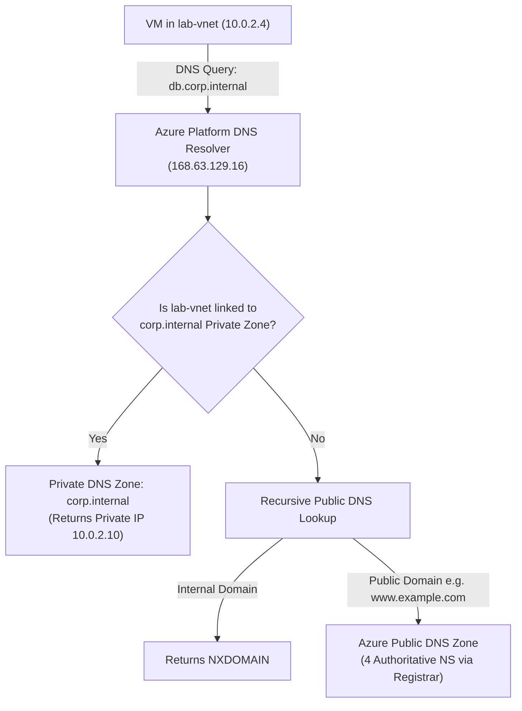
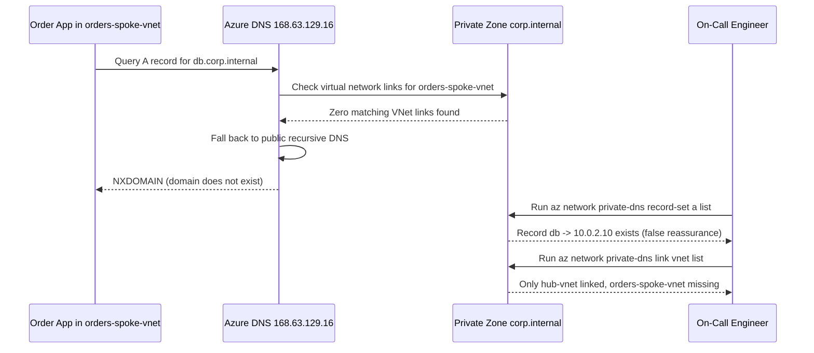

# Azure DNS & Private DNS

> **Prerequisites:** Modules 01–02 (VNets, subnets, NSGs) and DNS fundamentals (A, NS, SOA records, recursive vs authoritative resolution, split-horizon DNS).  
> **Estimated Reading Time:** 30 minutes  
> **Target Audience:** Backend Engineers, Cloud Architects, Platform / SRE Teams.

> [!TIP]
> **The Golden Rule of Azure Private DNS:** Creating a Private DNS zone and adding `A` records changes **zero** resolution behavior until you create a **Virtual Network Link** joining the zone to each querying VNet. Always treat **name resolution (`168.63.129.16`)** and **packet reachability (NSGs)** as strictly separate layers.

---

## 1. Why This Matters & Architectural Mental Model

Almost everything reaches a service by name, not IP — so DNS is where a lot of "the network is fine but it still won't connect" problems actually live. Azure splits this into public DNS zones (authoritative hosting for a domain you own) and private DNS zones (internal name resolution inside your VNets). The single most common private-DNS failure — a zone that exists but resolves nothing — comes from forgetting one link, and you'll deliberately reproduce and fix it here.

### Azure DNS Public Zones
A public DNS zone is Azure's implementation of the managed authoritative DNS hosting from track 1: you host a domain you own (e.g. `example.com`), Azure gives you four name servers, and you create records (`A`, `AAAA`, `CNAME`, `MX`, `TXT`, etc.) in the zone. To make it live, you update your domain registrar's NS records to point at Azure's name servers. This is exactly the delegation model from track 1's DNS material, just with Azure as the hosting provider.

### Private DNS Zones
A private DNS zone provides name resolution **inside** your VNets — the split-horizon / internal DNS concept from track 1. It looks like a normal zone (any name you choose, e.g. `corp.internal` or a service-specific name like `privatelink.blob.core.windows.net`) but it is only visible to VNets you explicitly link to it. It is the mechanism that lets `db.corp.internal` resolve to a private `10.x` address for your VMs while being invisible to the public internet.

### Virtual Network Links (The Step Everyone Forgets)
A private zone does nothing on its own. You must create a **virtual network link** joining the zone to each VNet that should use it. Resolution only works from VNets that are linked. **This is the number-one private DNS failure:** the zone exists, the records exist, but a VM can't resolve them because its VNet was never linked. Symptom: `nslookup name.corp.internal` returns NXDOMAIN or public resolver results instead of your private record.

### Auto-Registration
When you create a VNet link with **auto-registration enabled**, Azure automatically creates and maintains an `A` record in the private zone for every VM in that VNet, named after the VM's hostname. This is Azure's dynamic-DNS equivalent: spin up `web01` and `web01.corp.internal` resolves to its private IP with no manual record. Only one linked VNet per zone can have auto-registration on. For records you manage by hand (or for PaaS private endpoints in module 05), leave auto-registration off and create records explicitly.

### How VMs Resolve Names
By default, VMs use Azure-provided DNS (the platform resolver at `168.63.129.16`) which consults any private zones linked to the VM's VNet first, then falls back to public resolution. You can override a VNet's DNS servers to point at custom resolvers, but for this track the default Azure resolver plus a linked private zone is all you need — and understanding that default explains why linking is what makes private resolution "just work."



---

## 2. Taxonomic Comparison: Public DNS vs Private DNS vs Link Modes

| Feature | Azure Public DNS Zone | Private DNS Link (Resolution Only) | Private DNS Link (Auto-Registration) |
|---|---|---|---|
| **CLI Command Tree** | `az network dns ...` | `az network private-dns ...` (`--registration-enabled false`) | `az network private-dns ...` (`--registration-enabled true`) |
| **Visibility Scope** | Public internet globally (once registrar NS delegated) | Explicitly linked VNets only | Explicitly linked VNet (hosts + manual records) |
| **Dynamic VM A-Records** | No (static records or external automation) | No (manual records / Private Endpoints) | **Yes** (Azure manages VM hostname A records) |
| **Links-Per-Zone Limit** | N/A (public authoritative servers) | Up to 1,000 resolution links per zone | **Max 1 auto-registration VNet per zone** |
| **Cost Profile** | Monthly per-zone fee + per-million queries | Small monthly per-zone + query fee | Same as Private DNS Zone |
| **Controls Traffic Flow?** | No (returns IP only; NSG governs TCP/UDP) | No (returns IP only; NSG governs TCP/UDP) | No (returns IP only; NSG governs TCP/UDP) |

---

## 3. Command Reference & Flag Breakdowns

| Command | What it does | Example |
|---|---|---|
| `az network dns zone create` | Creates a **public** DNS zone | `az network dns zone create -g dns-lab-rg -n example.com` |
| `az network dns record-set a add-record` | Adds an A record to a public zone | `az network dns record-set a add-record -g dns-lab-rg -z example.com -n www --ipv4-address 20.1.2.3` |
| `az network private-dns zone create` | Creates a **private** DNS zone | `az network private-dns zone create -g dns-lab-rg -n corp.internal` |
| `az network private-dns link vnet create` | Links a VNet to a private zone (optionally auto-register) | `az network private-dns link vnet create -g dns-lab-rg -z corp.internal -n link-to-lab --virtual-network lab-vnet --registration-enabled true` |
| `az network private-dns record-set a add-record` | Adds an A record to a private zone | `az network private-dns record-set a add-record -g dns-lab-rg -z corp.internal -n db --ipv4-address 10.0.2.10` |
| `az network private-dns zone show` | Shows a private zone (incl. record/link counts) | `az network private-dns zone show -g dns-lab-rg -n corp.internal` |
| `az network private-dns link vnet list` | Lists VNet links on a private zone | `az network private-dns link vnet list -g dns-lab-rg -z corp.internal -o table` |

Flag breakdown — `az network private-dns link vnet create -g dns-lab-rg -z corp.internal -n link-to-lab --virtual-network lab-vnet --registration-enabled true`:
- `-z` (`--zone-name`): the private zone to link.
- `-n` (`--name`): a name for the link resource.
- `--virtual-network`: the VNet (name or ID) to link to the zone.
- `--registration-enabled`: `true` turns on auto-registration (Azure creates A records for VMs in that VNet); `false` means resolution-only.

Flag breakdown — `az network private-dns record-set a add-record -g dns-lab-rg -z corp.internal -n db --ipv4-address 10.0.2.10`:
- `-z`: the private zone.
- `-n`: the record name (relative to the zone, so this is `db.corp.internal`).
- `--ipv4-address`: the IP the A record points to.

---

## 4. Production War Story Post-Mortem: Unlinked Spoke VNet NXDOMAIN Outage

- **Severity:** SEV-1
- **Detection Time:** 2 minutes (post-deployment smoke test failure)
- **Resolution Time:** 24 minutes
- **Impact:** A newly deployed `orders-spoke-vnet` failed 100% of database connections to `db.corp.internal`, halting order processing in `eastus` while existing services in `hub-vnet` continued working normally.

### What Happened



### Root Cause Analysis
1. **Missing Virtual Network Link:** The hub team created `corp.internal` and added `db -> 10.0.2.10`, but forgot to add a resolution link for the newly provisioned `orders-spoke-vnet`.
2. **Misleading Diagnosis:** Seeing `db.corp.internal` present in the zone led responders to inspect NSGs first instead of running `az network private-dns link vnet list`.
3. **Auto-Registration Rejection on First Retry:** The initial fix attempt passed `--registration-enabled true`, which Azure rejected because `hub-vnet` already held the single auto-registration slot on `corp.internal`.

### The Fix & Architectural Hardening
1. **Immediate Mitigation:** Linked `orders-spoke-vnet` with `--registration-enabled false` (`VirtualNetworkLinkState: Completed`), restoring name resolution in under 60 seconds.
2. **Architectural Hardening:** Standardized IaC modules so every spoke VNet automatically registers a resolution-only link to centralized Private DNS zones, and separated DNS vs TCP socket probes in synthetic health checks.

---

## 5. Multi-Language Production Implementation: Two-Layer DNS vs Reachability Probe & Link Auditor

Production diagnostics must separate **Layer 1 (DNS Resolution)** from **Layer 2 (TCP/NSG Reachability)** and verify VNet links across a private DNS zone so engineers immediately distinguish `NXDOMAIN` (missing link/record) from `ETIMEDOUT` (blocking NSG).

````carousel
```go
package main

import (
	"context"
	"fmt"
	"net"
	"time"
)

type ConnectivityReport struct {
	Hostname     string
	ResolvedIPs  []string
	DNSLayerOK   bool
	TCPLayerOK   bool
	FailureStage string
}

// ProbeDNSAndReachability separates Azure DNS resolution from NSG/TCP reachability.
func ProbeDNSAndReachability(ctx context.Context, fqdn string, port int) ConnectivityReport {
	report := ConnectivityReport{Hostname: fqdn}

	dnsCtx, cancelDNS := context.WithTimeout(ctx, 2*time.Second)
	defer cancelDNS()

	ips, err := net.DefaultResolver.LookupHost(dnsCtx, fqdn)
	if err != nil || len(ips) == 0 {
		report.FailureStage = fmt.Sprintf("DNS_LAYER_NXDOMAIN_OR_MISSING_VNET_LINK: %v", err)
		return report
	}
	report.DNSLayerOK = true
	report.ResolvedIPs = ips

	target := net.JoinHostPort(ips[0], fmt.Sprintf("%d", port))
	conn, err := net.DialTimeout("tcp", target, 2*time.Second)
	if err != nil {
		report.FailureStage = fmt.Sprintf("NETWORK_LAYER_NSG_OR_LISTENER_BLOCKED (%s): %v", target, err)
		return report
	}
	_ = conn.Close()
	report.TCPLayerOK = true
	return report
}

func main() {
	res := ProbeDNSAndReachability(context.Background(), "db.corp.internal", 5432)
	fmt.Printf("%+v\n", res)
}
```
<!-- slide -->
```typescript
import { promises as dns } from "node:dns";
import net from "node:net";

interface ProbeResult {
  fqdn: string;
  resolvedIp?: string;
  dnsResolved: boolean;
  tcpReachable: boolean;
  diagnosis: string;
}

export async function verifyDnsThenTcp(
  fqdn: string,
  port: number,
  timeoutMs = 2000
): Promise<ProbeResult> {
  let resolvedIp: string;
  try {
    const res = await dns.lookup(fqdn, { family: 4 });
    resolvedIp = res.address;
  } catch (err) {
    return {
      fqdn,
      dnsResolved: false,
      tcpReachable: false,
      diagnosis: `DNS_FAILED (missing private DNS VNet link or record): ${(err as Error).message}`,
    };
  }

  return new Promise((resolve) => {
    const socket = net.createConnection({ host: resolvedIp, port, timeout: timeoutMs });
    socket.on("connect", () => {
      socket.destroy();
      resolve({ fqdn, resolvedIp, dnsResolved: true, tcpReachable: true, diagnosis: "OK" });
    });
    socket.on("timeout", () => {
      socket.destroy();
      resolve({
        fqdn,
        resolvedIp,
        dnsResolved: true,
        tcpReachable: false,
        diagnosis: `TCP_TIMEOUT to ${resolvedIp}:${port} (DNS OK; suspect NSG rule or route)`,
      });
    });
    socket.on("error", (err) => {
      resolve({
        fqdn,
        resolvedIp,
        dnsResolved: true,
        tcpReachable: false,
        diagnosis: `TCP_ERROR to ${resolvedIp}:${port}: ${err.message}`,
      });
    });
  });
}
```
<!-- slide -->
```python
import socket
from dataclasses import dataclass


@dataclass
class LayerCheck:
    fqdn: str
    resolved_ip: str | None
    dns_ok: bool
    tcp_ok: bool
    diagnosis: str


def check_dns_and_nsg_layers(fqdn: str, port: int, timeout: float = 2.0) -> LayerCheck:
    try:
        resolved_ip = socket.gethostbyname(fqdn)
    except socket.gaierror as exc:
        return LayerCheck(
            fqdn=fqdn,
            resolved_ip=None,
            dns_ok=False,
            tcp_ok=False,
            diagnosis=f"DNS_FAILURE: {exc} (check Private DNS VNet link or A record)",
        )

    try:
        with socket.create_connection((resolved_ip, port), timeout=timeout):
            return LayerCheck(
                fqdn=fqdn,
                resolved_ip=resolved_ip,
                dns_ok=True,
                tcp_ok=True,
                diagnosis="OK: both DNS resolution and NSG/TCP reachability succeeded",
            )
    except OSError as exc:
        return LayerCheck(
            fqdn=fqdn,
            resolved_ip=resolved_ip,
            dns_ok=True,
            tcp_ok=False,
            diagnosis=f"TCP_FAILURE to {resolved_ip}:{port}: {exc} (DNS OK; inspect NSG rules)",
        )


if __name__ == "__main__":
    print(check_dns_and_nsg_layers("db.corp.internal", 5432))
```
<!-- slide -->
```csharp
using System;
using System.Net;
using System.Net.Sockets;
using System.Threading.Tasks;

public sealed record LayerProbeResult(
    string Fqdn,
    string? ResolvedIp,
    bool DnsResolved,
    bool TcpConnected,
    string Diagnosis);

public static class DnsVsReachabilityProbe
{
    public static async Task<LayerProbeResult> VerifyAsync(string fqdn, int port, int timeoutMs = 2000)
    {
        IPAddress[] addresses;
        try
        {
            addresses = await Dns.GetHostAddressesAsync(fqdn);
            if (addresses.Length == 0)
                return new(fqdn, null, false, false, "DNS_EMPTY: check Private DNS VNet link.");
        }
        catch (SocketException ex)
        {
            return new(fqdn, null, false, false, $"DNS_FAILURE ({ex.SocketErrorCode}): check VNet link.");
        }

        string ip = addresses[0].ToString();
        using var tcp = new TcpClient();
        try
        {
            var connectTask = tcp.ConnectAsync(addresses[0], port);
            var completed = await Task.WhenAny(connectTask, Task.Delay(timeoutMs));
            if (completed != connectTask)
                return new(fqdn, ip, true, false, $"TCP_TIMEOUT to {ip}:{port} (DNS OK; suspect NSG drop).");

            await connectTask;
            return new(fqdn, ip, true, true, "OK");
        }
        catch (SocketException ex)
        {
            return new(fqdn, ip, true, false, $"TCP_ERROR to {ip}:{port}: {ex.Message}");
        }
    }
}
```
````

---

## 6. Practical Hands-On Verification CLI Workflows

Set up a group and a VNet:
```bash
az group create --name dns-lab-rg --location eastus
az network vnet create -g dns-lab-rg -n lab-vnet \
  --address-prefixes 10.0.0.0/16 \
  --subnet-name app-subnet --subnet-prefixes 10.0.2.0/24
```

### Exercise 1–4: Public Zone, Public A Record, Private Zone & Private A Record
1. **Create a public zone.**
   ```bash
   az network dns zone create -g dns-lab-rg -n example.com
   az network dns zone show -g dns-lab-rg -n example.com --query nameServers
   ```
   **Expected Output:**
   ```json
   [
     "ns1-01.azure-dns.com.",
     "ns2-01.azure-dns.net.",
     "ns3-01.azure-dns.org.",
     "ns4-01.azure-dns.info."
   ]
   ```
   > Verify: `az network dns zone show -g dns-lab-rg -n example.com --query nameServers` prints four Azure name servers. (You'd give these to your registrar to make it live; here it's just for learning — no registrar change needed.)

2. **Add a public A record.**
   ```bash
   az network dns record-set a add-record -g dns-lab-rg -z example.com \
     -n www --ipv4-address 20.1.2.3
   az network dns record-set a show -g dns-lab-rg -z example.com -n www
   ```
   > Verify: `az network dns record-set a show -g dns-lab-rg -z example.com -n www` shows the record.

3. **Create a private zone.**
   ```bash
   az network private-dns zone create -g dns-lab-rg -n corp.internal
   az network private-dns zone show -g dns-lab-rg -n corp.internal
   ```
   > Verify: `az network private-dns zone show -g dns-lab-rg -n corp.internal` shows the zone with `numberOfRecordSets` of 1 (the SOA) and **zero** virtual network links.

4. **Add a private A record.**
   ```bash
   az network private-dns record-set a add-record -g dns-lab-rg \
     -z corp.internal -n db --ipv4-address 10.0.2.10
   ```
   This is `db.corp.internal → 10.0.2.10`.

### Exercise 5–9: Observe Unlinked Failure, Link VNets, Auto-Registration & Cleanup
5. **Observe the failure BEFORE linking.** At this point the zone and record exist but no VNet is linked. If you had a VM in `lab-vnet` and ran `nslookup db.corp.internal`, it would **fail** (NXDOMAIN) — the VM's resolver doesn't know about this zone yet. Confirm the missing link:
   ```bash
   az network private-dns link vnet list -g dns-lab-rg -z corp.internal -o table
   ```
   Empty list = no VNet can resolve this zone. This is the exercise-7 bug in its natural habitat.

6. **Link the VNet (resolution only).**
   ```bash
   az network private-dns link vnet create -g dns-lab-rg -z corp.internal \
     -n link-to-lab --virtual-network lab-vnet --registration-enabled false
   az network private-dns link vnet list -g dns-lab-rg -z corp.internal -o table
   ```
   **Expected Output:**
   ```text
   Name         RegistrationEnabled    VirtualNetworkLinkState    ProvisioningState
   -----------  ---------------------  -------------------------  -------------------
   link-to-lab  False                  Completed                  Succeeded
   ```
   > Verify: the link list now shows `link-to-lab` with `VirtualNetworkLinkState` `Completed`. Now a VM in `lab-vnet` *would* resolve `db.corp.internal` to `10.0.2.10`.

7. **Diagnose and fix: private zone resolves nothing.** This is the canonical private-DNS failure. Suppose a teammate reports `app01` in a *different* VNet can't resolve `db.corp.internal`. Reproduce and reason it out: create a second VNet `other-vnet` (`10.5.0.0/16`) but do **not** link it.
   ```bash
   az network vnet create -g dns-lab-rg -n other-vnet \
     --address-prefixes 10.5.0.0/16 --subnet-name s1 \
     --subnet-prefixes 10.5.1.0/24
   ```
   A VM in `other-vnet` fails to resolve the record because `other-vnet` is not linked to `corp.internal` — the records only exist for linked VNets. **Fix:** link it.
   ```bash
   az network private-dns link vnet create -g dns-lab-rg -z corp.internal \
     -n link-to-other --virtual-network other-vnet --registration-enabled false
   ```
   > Verify: the link list now shows two links, both `Completed`. Resolution from `other-vnet` now works. **Lesson: a private zone resolves only from VNets explicitly linked to it — the zone and records existing is not enough.**

8. **Enable auto-registration on one link.** Recreate the `lab-vnet` link with registration on (delete the old one first, since only one link per zone can auto-register):
   ```bash
   az network private-dns link vnet delete -g dns-lab-rg -z corp.internal \
     -n link-to-lab --yes
   az network private-dns link vnet create -g dns-lab-rg -z corp.internal \
     -n link-to-lab-reg --virtual-network lab-vnet --registration-enabled true
   ```
   Now any VM you create in `lab-vnet` auto-gets an `A` record in `corp.internal`. (Try to enable registration on the `other-vnet` link too and note Azure won't allow a second auto-registering link on the same zone.)

9. **Cleanup.** DNS zones and links are inexpensive but not always free (public zones carry a small per-zone-per-month and per-query charge). Delete the group:
   ```bash
   az group delete --name dns-lab-rg --yes --no-wait
   ```

### Independent Challenge
Combine this module with **module 01 and module 02**. Build a VNet with a `web-subnet` and a `data-subnet`, put a private DNS zone `svc.internal` in place, link it to the VNet with auto-registration on, and add a manual A record `cache.svc.internal` pointing to an IP in `data-subnet`. Then reason about (or, if you deploy a VM, actually test) how an NSG on `data-subnet` interacts with DNS: DNS resolution succeeding does **not** mean the NSG will let the connection through. Confirm you can articulate the difference between "name resolves" and "traffic allowed." Clean up the resource group afterward.

<details><summary>Stuck? One hint</summary>

Resolution and reachability are independent layers. A successful `nslookup` only proves the private zone is linked and the record exists; whether traffic to that IP actually flows is decided by the NSG rules from module 02. Test them separately: `nslookup` for DNS, then a port test (or `az network watcher test-ip-flow`) for the NSG verdict.

</details>

---

## 7. Common Mistakes & Troubleshooting

- **Zone exists, resolves nothing.** You forgot the VNet link. Check `az network private-dns link vnet list`; an empty list is the smoking gun.
- **Two auto-registering links.** Only one linked VNet per private zone can have `--registration-enabled true`. Azure rejects the second.
- **Confusing public and private zone commands.** `az network dns ...` is public; `az network private-dns ...` is private. They are separate command trees.
- **Expecting DNS to imply connectivity.** Name resolution and NSG allow/deny are independent. A resolvable name with a blocking NSG still won't connect.
- **Registrar delegation missed for public zones.** A public zone doesn't go live until your registrar's NS records point to Azure's four name servers.
- **Cost note:** private zones and links are cheap; public zones bill a small monthly fee per zone plus per-million queries. Delete practice zones you don't need.

---

## 8. Operational Validation Checkpoints

<details><summary><strong>Operational Checkpoint 1: nslookup Returns 10.0.2.10, curl Times Out</strong></summary>

**Scenario:** Inside `lab-vnet`, `nslookup db.corp.internal` cleanly returns `10.0.2.10` from `168.63.129.16`, yet `curl -v http://db.corp.internal:5432` hangs and times out. Why can you rule out a Private DNS VNet-link problem immediately, and where do you investigate next?

**Answer:** `nslookup` returning `10.0.2.10` proves the Private DNS zone, `A` record, and VNet link are all healthy. Because DNS resolution and network reachability are independent layers, investigate **NSG rules** (e.g., via `az network watcher test-ip-flow` on the destination VM/subnet) and verify the target process is listening on port `5432`.

</details>

<details><summary><strong>Operational Checkpoint 2: Enabling Auto-Registration on a Second Spoke VNet</strong></summary>

**Scenario:** You have `hub-vnet` linked to `corp.internal` with `--registration-enabled true`. Now you deploy `spoke2-vnet` and run `az network private-dns link vnet create ... --registration-enabled true`. Azure rejects the deployment. What architectural constraint did you hit, and how do you resolve it?

**Answer:** Azure permits **only one** VNet link per Private DNS zone to enable auto-registration. To register VMs from `spoke2-vnet`, either link `spoke2-vnet` with `--registration-enabled false` (resolution-only) and create manual/CI-managed records, or dedicate a separate Private DNS zone (e.g. `spoke2.internal`) for `spoke2-vnet`'s auto-registration.

</details>

<details><summary><strong>Operational Checkpoint 3: Public Zone Created, Dig Still Hits Old Host</strong></summary>

**Scenario:** You create a public DNS zone `example.com` in Azure DNS and add an `A` record for `www` pointing to `20.1.2.3`. Two hours later, `dig www.example.com` still resolves to your legacy hosting provider's IP. What single step is missing?

**Answer:** Domain registrar NS delegation. Creating a zone in Azure DNS assigns four authoritative Azure name servers (`az network dns zone show --query nameServers`), but recursive resolvers globally still follow your domain registrar's `NS` records until you replace them with Azure's four name servers.

</details>

---

## 9. Checkpoint Quiz

Write down your answer to each question before expanding it — checking without attempting first is the single easiest way to fool yourself into thinking you've learned this.

1. A private DNS zone and its A records exist, but a VM in your VNet gets NXDOMAIN. What single step is almost certainly missing?
2. What is auto-registration, and how many linked VNets per zone can have it enabled?
3. Which command tree is for public zones and which for private zones?
4. Your app resolves an internal name correctly but still can't connect to the service. Which two independent layers are involved, and which one does DNS *not* control?
5. What must you do at your domain registrar to make an Azure **public** DNS zone actually authoritative for your domain?
6. From which VNets can a private DNS zone be resolved?
7. Two teammates in two different VNets both need to resolve `db.corp.internal`. What has to be true for both?

<details><summary>Show answers</summary>

1. A **virtual network link** joining the zone to that VM's VNet. Records resolve only from linked VNets.
2. When enabled on a VNet link, Azure automatically creates/maintains an A record for every VM in that VNet. Only one linked VNet per zone may have auto-registration enabled.
3. Public: `az network dns ...`. Private: `az network private-dns ...`. They are separate command trees.
4. DNS resolution (the zone/link) and reachability (NSG allow/deny, module 02). DNS does not control reachability — a resolvable name can still be blocked by an NSG.
5. Update the registrar's NS records to point to the four Azure name servers listed on the zone (`az network dns zone show --query nameServers`).
6. Only from VNets explicitly linked to that private zone.
7. Both VNets must be linked to the `corp.internal` private zone, and the A record must exist. Linking one VNet does not make the record resolve from the other.

</details>

---

## 10. Cumulative Review (Modules 00–03)

Closed-book. Answer all of these in writing before opening the solutions — they mix modules 00 through 03 on purpose.

1. You created a resource group and a VNet, but `az network vnet show` reports the group doesn't exist. Walk through the two most likely causes (one from module 00, one operational) and how you'd confirm each.
2. You need a `/24` web subnet with room for at least 200 hosts. Does `/24` work in Azure? Show the usable-count arithmetic, and name the first assignable IP.
3. An NSG on `web-subnet` has: priority 150 Deny TCP 443 from Internet; priority 300 Allow TCP 443 from Internet. Is HTTPS from the internet allowed? What one change (staying with these two rules) would flip the verdict?
4. A private DNS zone `corp.internal` has an A record `db → 10.0.2.10`, but a VM in `lab-vnet` gets NXDOMAIN. The zone and record definitely exist. What's wrong and what's the exact fix?
5. Explain why "the name resolves correctly" and "I can connect to the service" are two independent facts, naming the Azure resource responsible for each.
6. You want every VM in `lab-vnet` to automatically get an internal DNS name. What do you configure, and what's the constraint on how many VNets per zone can do this?
7. Map these four general-networking terms to their Azure resources: stateful firewall; internal/split-horizon DNS; the private network you subnet; a symbolic name for a maintained set of IP ranges used in firewall rules.
8. Two VNets both use `10.0.0.0/16`. Independent of DNS, name one module-01 consequence and one module-05-preview consequence of this choice.
9. You've finished a lab that created a public DNS zone and several VNets. Which of these bill you if left running, and what's the one command that removes them all?

<details><summary>Show answers</summary>

1. (a) Wrong active subscription — the group exists in a different subscription than the one currently selected; confirm with `az account show` / `az account list` and `az account set`. (b) You're targeting the wrong resource-group name or region, or the create actually failed; confirm with `az group list -o table`.
2. Yes. A `/24` = 256 addresses; Azure reserves 5, leaving **251** usable >= 200. First assignable IP is `.4` (e.g. `10.0.1.4`).
3. Denied — priority 150 (Deny) is evaluated before 300 (Allow), first match wins. Flip it by making the Allow's priority lower than 150 (e.g. 100), so the allow is evaluated first.
4. `lab-vnet` isn't linked to the private zone. Fix: `az network private-dns link vnet create ... -z corp.internal --virtual-network lab-vnet`. Records resolve only from linked VNets.
5. Resolution is handled by the (private/public) DNS zone — it turns a name into an IP. Reachability is handled by the NSG (module 02) — it allows or denies traffic to that IP. Both must succeed; one succeeding says nothing about the other.
6. Create a VNet link with `--registration-enabled true` (auto-registration). Only one linked VNet per private zone may have auto-registration enabled.
7. Stateful firewall → NSG; internal DNS → private DNS zone (linked to VNet); private network you subnet → VNet + subnets; symbolic maintained IP set → service tag.
8. Module 01: fine in isolation, but you can't carve non-overlapping subnets across them meaningfully for a shared design. Module-05 preview: you can't peer them — overlapping ranges can't be routed between.
9. The public DNS zone bills a small monthly + per-query charge; VNets/subnets are free. `az group delete --name <rg> --yes --no-wait` removes everything at once.

</details>

---

## Sources & Further Reading
- [Microsoft Learn: Azure DNS overview](https://learn.microsoft.com/azure/dns/dns-overview)
- [Microsoft Learn: Azure Private DNS overview](https://learn.microsoft.com/azure/dns/private-dns-overview)
- [Microsoft Learn: Private DNS virtual network links & auto-registration](https://learn.microsoft.com/azure/dns/private-dns-autoregistration)

## Next
[04 — Public IPs, Load Balancers & NAT Gateway](../04-public-ips-load-balancers-and-nat-gateway/README.md): give resources public addresses, spread traffic across backends at L4, and control outbound connectivity.
