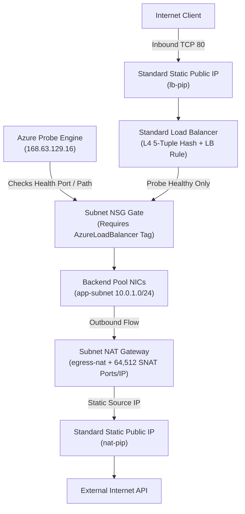
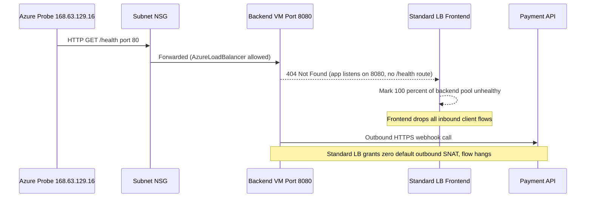

# Public IPs, Load Balancers & NAT Gateway

> **Prerequisites:** Modules 00–03 (VNets, subnets, NSGs, DNS), TCP/UDP L4 transport fundamentals, and Source NAT (SNAT) concepts.  
> **Estimated Reading Time:** 30 minutes  
> **Target Audience:** Backend Engineers, Cloud Architects, Platform / SRE Teams.

> [!TIP]
> **The Golden Rule of Azure Ingress & Egress:** Standard Load Balancers are **probe-gated** and **secure-by-default**: if health probes fail—either from a port/path mismatch or an NSG blocking Azure's probe IP `168.63.129.16` (`AzureLoadBalancer` tag)—zero traffic reaches healthy backends. Likewise, Standard Load Balancers grant **zero default outbound internet**; attach a **NAT Gateway** to your private subnet for deterministic SNAT egress.

---

## 1. Why This Matters & Architectural Mental Model

This module covers how traffic gets **in** to a set of backends (public IP + Load Balancer) and how it gets **out** to the internet in a controlled way (NAT Gateway). The Azure Load Balancer is your L4 load balancer from track 1, and its health-probe behavior is the single most common cause of "my backends show unhealthy and nothing works" — you'll break and fix exactly that. These are also the first resources in this track that bill hourly, so cleanup starts mattering for real here.

### Public IPs and SKUs
A **public IP** is a separate Azure resource you attach to something (a Load Balancer frontend, a NAT Gateway, a VM NIC). It comes in **Basic** and **Standard** SKUs and **Dynamic** or **Static** allocation. Use **Standard + Static** for anything real: Standard is zone-redundant, secure-by-default (no inbound unless an NSG allows it), and is required by Standard Load Balancer and NAT Gateway. Basic SKU is on a deprecation path — don't build on it. Standard public IPs bill a small hourly rate even when idle.

### Azure Load Balancer (L4)
The Azure Load Balancer is Azure's implementation of the **L4 (TCP/UDP) load balancer** from track 1: it distributes flows across a backend pool using a hashing algorithm, operating at the transport layer with no awareness of HTTP. It has four building blocks: a **frontend** (the IP clients hit — public or internal), a **backend pool** (the NICs/IPs receiving traffic), a **health probe** (how it decides a backend is alive), and **load-balancing rules** (which frontend port maps to which backend port for which pool/probe). For HTTP-aware features (path routing, TLS termination, WAF) you need Application Gateway (module 06), not this.

### Health Probes Decide Everything
A load-balancing rule only sends traffic to backends the **health probe** considers healthy. A probe defines a protocol (TCP/HTTP/HTTPS), a port, an interval, and (for HTTP) a request path expecting a 200 response. If the probe targets a port nothing is listening on, or an HTTP path that returns non-200, or if an NSG blocks the probe's source, **every backend shows unhealthy and the LB sends no traffic** — even though the backends are fine. Probes originate from Azure's infrastructure IP `168.63.129.16`, so your NSG must allow the `AzureLoadBalancer` service tag inbound (the default rule does this).

### Internal vs Public Load Balancers
A Load Balancer frontend can be a public IP (internet-facing) or a private IP inside a subnet (**internal load balancer**, ILB). An ILB spreads internal traffic — e.g. an app tier balancing across a data tier — without exposing anything publicly. Same probe/rule model, different frontend.

### NAT Gateway for Outbound
By default VMs get outbound internet via implicit SNAT, but that default is unpredictable and being retired for new deployments. A **NAT Gateway** is the recommended, explicit way to give a subnet outbound internet: you attach it to the subnet, give it a Standard public IP, and all outbound flows from that subnet source-NAT through it with a large, stable pool of SNAT ports. It's outbound-only (it never allows unsolicited inbound) and bills hourly plus per GB processed. This is the "controlled source NAT for egress" idea from track 1.



---

## 2. Taxonomic Comparison: SKUs, Load Balancers & Egress Models

### Public IP SKU Comparison

| Attribute | Basic SKU (Deprecated) | Standard SKU (Recommended) |
|---|---|---|
| **Allocation Method** | Dynamic or Static | **Static only** (effectively immutable) |
| **Security Posture** | Open by default (no NSG required) | **Secure by default** (explicit NSG allow required) |
| **Zone Redundancy** | Non-zonal | Zone-redundant across Availability Zones |
| **Compatible LB / NAT** | Basic Load Balancer only | Standard Load Balancer & NAT Gateway |
| **Billing** | Free when dynamically unattached / retiring | Small hourly charge even when idle |

### Ingress & Outbound Egress Architecture Comparison

| Azure Resource | OSI Layer | Traffic Direction | Key Capabilities | Billing Model |
|---|---|---|---|---|
| **Public Standard LB** | L4 (TCP/UDP) | Inbound (plus explicit Outbound Rules) | Ultra-low latency 5-tuple distribution, probe-gated pools | Hourly per rule + data processed |
| **Internal Standard LB** | L4 (TCP/UDP) | Private East-West VNet traffic | Private frontend IP inside subnet; spreads app-to-db flows | Hourly per rule + data processed |
| **Application Gateway** *(module 06)* | L7 (HTTP/HTTPS) | Inbound | TLS termination, path/host routing, WAF | Hourly + capacity units |
| **NAT Gateway** | L3/L4 SNAT | **Outbound-only** (no unsolicited inbound) | Dedicated 64,512 SNAT ports per IP, attaches to subnet | Hourly + per-GB processed |

---

## 3. Command Reference & Flag Breakdowns

| Command | What it does | Example |
|---|---|---|
| `az network public-ip create` | Creates a public IP | `az network public-ip create -g lb-lab-rg -n lb-pip --sku Standard --allocation-method Static` |
| `az network lb create` | Creates a Load Balancer with a frontend + backend pool | `az network lb create -g lb-lab-rg -n web-lb --sku Standard --public-ip-address lb-pip --frontend-ip-name fe --backend-pool-name bepool` |
| `az network lb probe create` | Creates a health probe | `az network lb probe create -g lb-lab-rg --lb-name web-lb -n http-probe --protocol Http --port 80 --path /` |
| `az network lb rule create` | Creates a load-balancing rule | `az network lb rule create -g lb-lab-rg --lb-name web-lb -n http-rule --protocol Tcp --frontend-port 80 --backend-port 80 --frontend-ip-name fe --backend-pool-name bepool --probe-name http-probe` |
| `az network lb show` | Shows LB config | `az network lb show -g lb-lab-rg -n web-lb` |
| `az network nat gateway create` | Creates a NAT Gateway | `az network nat gateway create -g lb-lab-rg -n egress-nat --public-ip-addresses nat-pip --idle-timeout 10` |
| `az network vnet subnet update` | Attaches a NAT Gateway to a subnet | `az network vnet subnet update -g lb-lab-rg --vnet-name lab-vnet -n app-subnet --nat-gateway egress-nat` |

Flag breakdown — `az network public-ip create -g lb-lab-rg -n lb-pip --sku Standard --allocation-method Static`:
- `--sku`: `Standard` (recommended) or `Basic` (deprecated).
- `--allocation-method`: `Static` (fixed IP) or `Dynamic`. Standard SKU is effectively static.

Flag breakdown — `az network lb rule create ... -n http-rule --protocol Tcp --frontend-port 80 --backend-port 80 --frontend-ip-name fe --backend-pool-name bepool --probe-name http-probe`:
- `--protocol`: transport protocol (`Tcp`/`Udp`).
- `--frontend-port`: the port clients connect to on the frontend IP.
- `--backend-port`: the port traffic is delivered to on backends.
- `--frontend-ip-name`: which frontend config this rule uses.
- `--backend-pool-name`: which backend pool receives the traffic.
- `--probe-name`: the health probe that gates this rule — no healthy probe, no traffic.

Flag breakdown — `az network lb probe create ... -n http-probe --protocol Http --port 80 --path /`:
- `--protocol`: `Tcp`, `Http`, or `Https`.
- `--port`: the port the probe connects to on backends.
- `--path`: for HTTP/HTTPS, the URL path that must return 200 (invalid for TCP probes — a common misconfiguration).

Flag breakdown — `az network nat gateway create ... -n egress-nat --public-ip-addresses nat-pip --idle-timeout 10`:
- `--public-ip-addresses`: the Standard public IP(s) the NAT Gateway SNATs through.
- `--idle-timeout`: minutes before an idle outbound flow is dropped (4–120).

---

## 4. Production War Story Post-Mortem: Probe Blackout & Standard LB Zero-Egress Outage

- **Severity:** SEV-1
- **Detection Time:** 2 minutes (external availability alert)
- **Resolution Time:** 29 minutes
- **Impact:** After migrating an API cluster from Basic Load Balancer to Standard Load Balancer, all inbound public requests timed out AND backend VMs simultaneously lost outbound access to payment webhook endpoints.

### What Happened



### Root Cause Analysis
1. **Probe Port & Path Mismatch:** The app listened on port `8080` and returned `200` on `/`, whereas the migrated LB probe checked HTTP `/health` on port `80`.
2. **Standard LB Secure-by-Default Egress:** Unlike Basic LB, Standard LB provides **no implicit default outbound SNAT** for backend VMs lacking an explicit outbound rule, instance-level public IP, or NAT Gateway.

### The Fix & Architectural Hardening
1. **Aligned Health Probe & LB Rule:** Updated probe port/path to `8080` and `/` (`az network lb probe update`) and rule backend port to `8080`, restoring inbound routing within two probe intervals.
2. **Attached Subnet NAT Gateway:** Provisioned `egress-nat` with a Standard Static IP (`nat-pip`) and attached it to `app-subnet`, restoring deterministic outbound webhook delivery.

---

## 5. Multi-Language Production Implementation: Load Balancer Probe & NAT Readiness Validator

Production CI pipelines validate Standard LB invariants before deployment: matching SKUs across Frontend Public IP and LB, valid HTTP probe paths (forbidden on `Tcp` probes), rule-to-probe bindings, and subnet NAT Gateway presence so private backends never hit a silent zero-egress state.

````carousel
```go
package main

import (
	"fmt"
	"strings"
)

type ProbeSpec struct {
	Name     string
	Protocol string // "Tcp" | "Http" | "Https"
	Port     int
	Path     string
}

type RuleSpec struct {
	Name         string
	FrontendPort int
	BackendPort  int
	ProbeName    string
}

type LBTopology struct {
	Name              string
	SKU               string
	PublicIPSKU       string
	BackendAppPort    int
	HasNatGateway     bool
	NSGAllowsLBTag    bool
	Probes            []ProbeSpec
	Rules             []RuleSpec
}

// ValidateStandardLB catches probe mismatches, TCP-path errors, SKU drift, and missing NAT egress.
func ValidateStandardLB(lb LBTopology) []string {
	var errs []string
	if lb.SKU != "Standard" || lb.PublicIPSKU != "Standard" {
		errs = append(errs, fmt.Sprintf("SKU_MISMATCH: LB=%s PublicIP=%s (both must be Standard)", lb.SKU, lb.PublicIPSKU))
	}
	if !lb.NSGAllowsLBTag {
		errs = append(errs, "NSG_BLOCKS_PROBE: Subnet NSG must permit AzureLoadBalancer (168.63.129.16)")
	}
	if !lb.HasNatGateway {
		errs = append(errs, "NO_DETERMINISTIC_EGRESS: Standard LB backends require NAT Gateway on subnet")
	}

	probeMap := make(map[string]ProbeSpec)
	for _, p := range lb.Probes {
		if strings.EqualFold(p.Protocol, "Tcp") && p.Path != "" {
			errs = append(errs, fmt.Sprintf("INVALID_PROBE %q: --path is invalid for Tcp probes", p.Name))
		}
		if (strings.EqualFold(p.Protocol, "Http") || strings.EqualFold(p.Protocol, "Https")) && !strings.HasPrefix(p.Path, "/") {
			errs = append(errs, fmt.Sprintf("INVALID_PROBE %q: HTTP probe requires path starting with '/'", p.Name))
		}
		if p.Port != lb.BackendAppPort {
			errs = append(errs, fmt.Sprintf("PROBE_PORT_MISMATCH %q: probe port %d != app listener %d", p.Name, p.Port, lb.BackendAppPort))
		}
		probeMap[p.Name] = p
	}

	for _, r := range lb.Rules {
		p, ok := probeMap[r.ProbeName]
		if !ok {
			errs = append(errs, fmt.Sprintf("RULE_MISSING_PROBE: rule %q references unknown probe %q", r.Name, r.ProbeName))
		} else if r.BackendPort != p.Port {
			errs = append(errs, fmt.Sprintf("RULE_PROBE_DRIFT: rule %q backend=%d != probe=%d", r.Name, r.BackendPort, p.Port))
		}
	}
	return errs
}

func main() {
	issues := ValidateStandardLB(LBTopology{
		Name: "web-lb", SKU: "Standard", PublicIPSKU: "Standard",
		BackendAppPort: 8080, HasNatGateway: false, NSGAllowsLBTag: true,
		Probes: []ProbeSpec{{Name: "http-probe", Protocol: "Http", Port: 80, Path: "/"}},
		Rules:  []RuleSpec{{Name: "http-rule", FrontendPort: 80, BackendPort: 80, ProbeName: "http-probe"}},
	})
	for _, e := range issues {
		fmt.Println(e)
	}
}
```
<!-- slide -->
```typescript
interface HealthProbe {
  name: string;
  protocol: "Tcp" | "Http" | "Https";
  port: number;
  path?: string;
}

interface LbRule {
  name: string;
  frontendPort: number;
  backendPort: number;
  probeName: string;
}

interface StandardLbConfig {
  lbSku: "Basic" | "Standard";
  publicIpSku: "Basic" | "Standard";
  expectedAppPort: number;
  subnetHasNatGateway: boolean;
  nsgAllowsAzureLoadBalancerTag: boolean;
  probes: HealthProbe[];
  rules: LbRule[];
}

export function validateLoadBalancerConfig(cfg: StandardLbConfig): string[] {
  const errors: string[] = [];

  if (cfg.lbSku !== "Standard" || cfg.publicIpSku !== "Standard") {
    errors.push(`Standardize SKUs: LB=${cfg.lbSku}, PublicIP=${cfg.publicIpSku}`);
  }
  if (!cfg.nsgAllowsAzureLoadBalancerTag) {
    errors.push("NSG blocks AzureLoadBalancer (168.63.129.16); all backends will appear unhealthy.");
  }
  if (!cfg.subnetHasNatGateway) {
    errors.push("Attach a NAT Gateway to backend subnet; Standard LB grants no default SNAT egress.");
  }

  const probesByName = new Map<string, HealthProbe>();
  for (const probe of cfg.probes) {
    probesByName.set(probe.name, probe);
    if (probe.protocol === "Tcp" && probe.path) {
      errors.push(`Probe ${probe.name}: TCP probes cannot specify a request path (${probe.path}).`);
    }
    if ((probe.protocol === "Http" || probe.protocol === "Https") && !probe.path?.startsWith("/")) {
      errors.push(`Probe ${probe.name}: HTTP/S probes require a valid request path.`);
    }
    if (probe.port !== cfg.expectedAppPort) {
      errors.push(`Probe ${probe.name}: port ${probe.port} mismatches backend listener ${cfg.expectedAppPort}.`);
    }
  }

  for (const rule of cfg.rules) {
    const probe = probesByName.get(rule.probeName);
    if (!probe) {
      errors.push(`Rule ${rule.name} points to missing probe ${rule.probeName}.`);
    } else if (rule.backendPort !== probe.port) {
      errors.push(`Rule ${rule.name}: backendPort ${rule.backendPort} != probe port ${probe.port}.`);
    }
  }
  return errors;
}
```
<!-- slide -->
```python
from dataclasses import dataclass


@dataclass
class ProbeConfig:
    name: str
    protocol: str  # Tcp | Http | Https
    port: int
    path: str | None = None


@dataclass
class RuleConfig:
    name: str
    frontend_port: int
    backend_port: int
    probe_name: str


def audit_standard_lb_setup(
    lb_sku: str,
    pip_sku: str,
    app_port: int,
    has_nat_gateway: bool,
    nsg_allows_lb_tag: bool,
    probes: list[ProbeConfig],
    rules: list[RuleConfig],
) -> list[str]:
    issues: list[str] = []

    if lb_sku != "Standard" or pip_sku != "Standard":
        issues.append(f"SKU_MISMATCH: LB={lb_sku}, PublicIP={pip_sku} must both be Standard")
    if not nsg_allows_lb_tag:
        issues.append("PROBE_BLOCKED: NSG denies AzureLoadBalancer (168.63.129.16)")
    if not has_nat_gateway:
        issues.append("EGRESS_GAP: Standard LB backends need NAT Gateway for outbound SNAT")

    probe_map = {p.name: p for p in probes}
    for p in probes:
        if p.protocol.lower() == "tcp" and p.path:
            issues.append(f"INVALID_TCP_PROBE: {p.name} cannot use --path {p.path}")
        if p.protocol.lower() in {"http", "https"} and not (p.path or "").startswith("/"):
            issues.append(f"INVALID_HTTP_PROBE: {p.name} missing HTTP path")
        if p.port != app_port:
            issues.append(f"PORT_MISMATCH: probe {p.name} checks {p.port}, app listens on {app_port}")

    for r in rules:
        probe = probe_map.get(r.probe_name)
        if not probe:
            issues.append(f"MISSING_PROBE: rule {r.name} references {r.probe_name}")
        elif r.backend_port != probe.port:
            issues.append(f"RULE_DRIFT: rule {r.name} backend {r.backend_port} != probe {probe.port}")

    return issues


if __name__ == "__main__":
    print(
        audit_standard_lb_setup(
            lb_sku="Standard",
            pip_sku="Standard",
            app_port=8080,
            has_nat_gateway=False,
            nsg_allows_lb_tag=True,
            probes=[ProbeConfig("http-probe", "Http", 80, "/")],
            rules=[RuleConfig("http-rule", 80, 80, "http-probe")],
        )
    )
```
<!-- slide -->
```csharp
using System;
using System.Collections.Generic;
using System.Linq;

public sealed record ProbeSpec(string Name, string Protocol, int Port, string? Path);
public sealed record RuleSpec(string Name, int FrontendPort, int BackendPort, string ProbeName);

public static class LoadBalancerValidator
{
    public static IReadOnlyList<string> Validate(
        string lbSku,
        string pipSku,
        int appListenPort,
        bool subnetHasNatGateway,
        bool nsgAllowsLbTag,
        IReadOnlyList<ProbeSpec> probes,
        IReadOnlyList<RuleSpec> rules)
    {
        var issues = new List<string>();
        if (lbSku != "Standard" || pipSku != "Standard")
            issues.Add($"SKU_ERROR: LB ({lbSku}) and PublicIP ({pipSku}) must both be Standard.");
        if (!nsgAllowsLbTag)
            issues.Add("NSG_ERROR: NSG must allow AzureLoadBalancer (168.63.129.16).");
        if (!subnetHasNatGateway)
            issues.Add("NAT_GAP: Attach NAT Gateway to backend subnet for deterministic SNAT.");

        var byName = probes.ToDictionary(p => p.Name);
        foreach (var p in probes)
        {
            if (p.Protocol.Equals("Tcp", StringComparison.OrdinalIgnoreCase) && !string.IsNullOrEmpty(p.Path))
                issues.Add($"PROBE_ERROR: {p.Name} uses Tcp so Path must be empty.");
            if ((p.Protocol.Equals("Http", StringComparison.OrdinalIgnoreCase) ||
                 p.Protocol.Equals("Https", StringComparison.OrdinalIgnoreCase)) &&
                string.IsNullOrWhiteSpace(p.Path))
                issues.Add($"PROBE_ERROR: {p.Name} HTTP/S probe requires Path.");
            if (p.Port != appListenPort)
                issues.Add($"PROBE_MISMATCH: {p.Name} checks port {p.Port}, app listens on {appListenPort}.");
        }

        foreach (var r in rules)
        {
            if (!byName.TryGetValue(r.ProbeName, out var p))
                issues.Add($"RULE_ERROR: {r.Name} references missing probe {r.ProbeName}.");
            else if (r.BackendPort != p.Port)
                issues.Add($"RULE_MISMATCH: {r.Name} backendPort {r.BackendPort} != probe port {p.Port}.");
        }
        return issues;
    }
}
```
````

---

## 6. Practical Hands-On Verification CLI Workflows

Set up a group and a VNet:
```bash
az group create --name lb-lab-rg --location eastus
az network vnet create -g lb-lab-rg -n lab-vnet \
  --address-prefixes 10.0.0.0/16 \
  --subnet-name app-subnet --subnet-prefixes 10.0.1.0/24
```

### Exercise 1–5: Standard Public IP, Load Balancer, Health Probe, Rule & Backends
1. **Create a Standard static public IP.**
   ```bash
   az network public-ip create -g lb-lab-rg -n lb-pip \
     --sku Standard --allocation-method Static
   az network public-ip show -g lb-lab-rg -n lb-pip --query ipAddress
   ```
   **Expected Output:**
   ```text
   "20.85.140.12"
   ```
   > Verify: `az network public-ip show -g lb-lab-rg -n lb-pip --query ipAddress` returns an assigned address. (This IP now bills hourly.)

2. **Create a Standard Load Balancer with a frontend and backend pool.**
   ```bash
   az network lb create -g lb-lab-rg -n web-lb --sku Standard \
     --public-ip-address lb-pip \
     --frontend-ip-name fe --backend-pool-name bepool
   az network lb show -g lb-lab-rg -n web-lb -o table
   ```
   > Verify: `az network lb show -g lb-lab-rg -n web-lb -o table` shows the LB; it has a frontend and an (empty) backend pool.

3. **Add an HTTP health probe.**
   ```bash
   az network lb probe create -g lb-lab-rg --lb-name web-lb \
     -n http-probe --protocol Http --port 80 --path /
   ```

4. **Add a load-balancing rule.**
   ```bash
   az network lb rule create -g lb-lab-rg --lb-name web-lb -n http-rule \
     --protocol Tcp --frontend-port 80 --backend-port 80 \
     --frontend-ip-name fe --backend-pool-name bepool --probe-name http-probe
   az network lb rule list -g lb-lab-rg --lb-name web-lb -o table
   ```
   > Verify: `az network lb rule list -g lb-lab-rg --lb-name web-lb -o table` shows `http-rule` referencing `http-probe`.

5. **Add backends.** In a full lab you'd create two small VMs running a web server on port 80 and add their NICs to `bepool` (via `az network nic ip-config address-pool add`). If you want the full effect, create two VMs now; otherwise reason through the probe behavior in the next exercises. Backends are where the real cost is, so keep them tiny (e.g. `Standard_B1s`) and short-lived.

### Exercise 6–9: Diagnose Probe Mismatch, Attach NAT Gateway, Outbound Egress Fix & Cleanup
6. **Diagnose and fix: backends show unhealthy (probe misconfiguration).** This is the flagship failure. Suppose your web server actually listens on port **8080**, not 80, but your probe targets port 80. The probe fails, all backends show unhealthy, and the LB delivers no traffic even though the app is running. **Diagnose:** the LB frontend IP times out; the backend pool health shows all-down; the app responds fine if you hit a backend's private IP:8080 directly. The mismatch is probe port vs. listening port. **Fix:** point the probe (and rule backend port) at the real port:
   ```bash
   az network lb probe update -g lb-lab-rg --lb-name web-lb \
     -n http-probe --port 8080
   az network lb rule update -g lb-lab-rg --lb-name web-lb \
     -n http-rule --backend-port 8080
   ```
   > Verify: after the probe interval, backend health flips to healthy and the frontend IP starts serving. **Lesson: an LB only sends traffic to probe-healthy backends; a probe pointed at the wrong port fails silently and looks like a total outage.** (A second common variant: a TCP probe is fine, but an *HTTP* probe with `--path /health` returns 404 because the app has no `/health` route — same symptom, fix the path or the app.)

7. **Create a NAT Gateway for controlled egress.**
   ```bash
   az network public-ip create -g lb-lab-rg -n nat-pip \
     --sku Standard --allocation-method Static
   az network nat gateway create -g lb-lab-rg -n egress-nat \
     --public-ip-addresses nat-pip --idle-timeout 10
   az network vnet subnet update -g lb-lab-rg --vnet-name lab-vnet \
     -n app-subnet --nat-gateway egress-nat
   az network vnet subnet show -g lb-lab-rg --vnet-name lab-vnet \
     -n app-subnet --query natGateway
   ```
   **Expected Output:**
   ```json
   {
     "id": "/subscriptions/.../resourceGroups/lb-lab-rg/providers/Microsoft.Network/natGateways/egress-nat",
     "resourceGroup": "lb-lab-rg"
   }
   ```
   > Verify: `az network vnet subnet show ... -n app-subnet --query natGateway` references `egress-nat`. Now all outbound traffic from `app-subnet` SNATs through `nat-pip` — from a VM in the subnet, `curl ifconfig.me` would return `nat-pip`'s address.

8. **Diagnose and fix: no outbound after removing default outbound.** Standard Load Balancer does not provide default outbound SNAT to its backends the way Basic did. If a VM in a Standard-LB backend pool has no NAT Gateway, no instance-level public IP, and no outbound rule, it may have **no internet egress at all** (secure-by-default). Symptom: `curl` from the VM hangs. **Fix:** attach a NAT Gateway to the subnet (as in exercise 7) — the recommended modern pattern — rather than relying on implicit SNAT.

9. **Cleanup (important — these bill hourly).** The public IPs, Load Balancer, NAT Gateway, and any VMs all cost money. Delete the whole group:
   ```bash
   az group delete --name lb-lab-rg --yes --no-wait
   ```
   > Verify: after a few minutes, `az group show -n lb-lab-rg` returns not-found. Don't leave this lab running overnight.

### Independent Challenge
Combine this module with **module 02 (NSGs)**. Stand up a Standard Load Balancer with a public frontend and a backend pool of two tiny VMs serving a page on port 80. Put an NSG on the subnet. First, deliberately misconfigure it so the health probe is blocked (remove/deny the `AzureLoadBalancer` inbound allowance) and observe all backends going unhealthy; then fix the NSG so probes and client traffic both flow, and confirm the frontend IP serves the page. Articulate the difference between "the probe can't reach the backend" and "the probe reaches a backend that returns the wrong status." Tear the whole resource group down the moment you're done — every piece here bills hourly.

<details><summary>Stuck? One hint</summary>

Health probes come from the Azure infrastructure address `168.63.129.16`, covered by the `AzureLoadBalancer` service tag. If your NSG's custom rules override the default `AllowAzureLoadBalancerInBound`, the probe can't reach the backend and everything shows unhealthy — distinct from a probe that *does* reach the backend but gets a non-200/closed-port response. Check the NSG with `az network watcher test-ip-flow` using `168.63.129.16` as the remote source.

</details>

---

## 7. Common Mistakes & Troubleshooting

- **Probe port/path mismatch.** The number-one LB failure: probe points at a port nothing listens on, or an HTTP path that isn't 200. All backends go unhealthy and it looks like a full outage.
- **NSG blocking the probe.** Overriding `AllowAzureLoadBalancerInBound` (or denying `168.63.129.16`) kills health checks. Backends fine, probe blocked.
- **Assuming Standard LB gives outbound by default.** It doesn't. Add a NAT Gateway (or outbound rule / instance public IP) for egress.
- **Mixing Basic and Standard SKUs.** A Standard LB needs a Standard public IP; Basic and Standard don't interoperate cleanly. Standardize on Standard.
- **Expecting L7 features from the LB.** No TLS termination, no path routing, no host-based routing — that's Application Gateway (module 06).
- **Cost pitfall:** Standard public IPs, the Load Balancer, and the NAT Gateway all bill hourly, and VMs bill for compute + disk. This is the first module where forgetting `az group delete` genuinely costs money. Delete promptly.

---

## 8. Operational Validation Checkpoints

<details><summary><strong>Operational Checkpoint 1: Direct VM Port 80 Works, Load Balancer Frontend Times Out</strong></summary>

**Scenario:** Two VMs behind a Standard Load Balancer respond `200 OK` when queried directly via private IP on port `80`. However, requests to the LB's Standard Public IP (`lb-pip`) time out, and metrics show 0% Data Path Availability. Your NSG has a single custom inbound rule at priority `100` allowing `Internet -> 80`, and a custom rule at priority `200` denying `* -> *`. What broke the Load Balancer?

**Answer:** Priority `200` (`Deny * -> *`) shadowed Azure's default `AllowAzureLoadBalancerInBound` rule (`65001`), blocking health probes originating from `168.63.129.16`. With probes blocked, the LB marks all backends unhealthy and forwards zero traffic. Add an explicit inbound `Allow` rule for source service tag `AzureLoadBalancer` at priority `< 200` (e.g. `150`).

</details>

<details><summary><strong>Operational Checkpoint 2: Migrating Basic LB to Standard LB Causes Outbound Webhook Timeouts</strong></summary>

**Scenario:** After migrating a payment worker fleet from Basic Load Balancer to Standard Load Balancer (without modifying the app or NSGs), inbound health checks pass, yet outbound HTTPS calls to external APIs hang. Why did this start failing only after moving to Standard SKU?

**Answer:** Basic Load Balancer provided implicit default outbound SNAT access, whereas Standard Load Balancer is **secure-by-default** with zero implicit outbound connectivity unless explicitly configured. Attach a **NAT Gateway** to the backend subnet (recommended) or configure explicit LB outbound rules.

</details>

<details><summary><strong>Operational Checkpoint 3: Choosing Between Azure Load Balancer and Application Gateway</strong></summary>

**Scenario:** Your backend team asks to terminate TLS certificates at the load balancer, route `/api/*` to Pool A and `/static/*` to Pool B, and apply OWASP ModSecurity WAF rules. Should you add rules to your Standard Azure Load Balancer or swap in a different resource?

**Answer:** Swap in **Application Gateway** (module 06). Azure Load Balancer operates strictly at Layer 4 (TCP/UDP) and cannot inspect HTTP paths, headers, hostnames, terminate TLS, or run WAF rules—those are Layer 7 capabilities.

</details>

---

## 9. Checkpoint Quiz

Write down your answer to each question before expanding it — checking without attempting first is the single easiest way to fool yourself into thinking you've learned this.

1. Your Load Balancer's frontend IP times out and all backends show unhealthy, but hitting a backend's private IP on the app port works fine. Name two distinct causes and how you'd tell them apart.
2. Which OSI layer does Azure Load Balancer operate at, and name two things it therefore *cannot* do that Application Gateway can.
3. What are the four building blocks of an Azure Load Balancer?
4. Why might a VM behind a Standard Load Balancer have no outbound internet access, and what's the recommended fix?
5. From what source IP do health probes originate, and which service tag / default NSG rule must permit them?
6. What does a NAT Gateway do, is it inbound or outbound, and how does it bill?
7. Why should you use Standard + Static public IPs rather than Basic + Dynamic?

<details><summary>Show answers</summary>

1. (a) Probe misconfiguration — probe port/path doesn't match what the app serves (fix the probe). (b) NSG blocking the probe source (`168.63.129.16` / `AzureLoadBalancer` tag). Tell them apart with `az network watcher test-ip-flow` from the probe source, and by checking whether the probe port matches the listening port.
2. Layer 4 (transport). It can't terminate TLS, do HTTP path/host-based routing, or apply a WAF — those are L7 (App Gateway).
3. Frontend IP configuration, backend pool, health probe, and load-balancing rule(s).
4. Standard LB provides no default outbound SNAT (secure by default). Add a NAT Gateway to the subnet (recommended), or an outbound rule / instance public IP.
5. `168.63.129.16`, permitted by the `AzureLoadBalancer` service tag via the default `AllowAzureLoadBalancerInBound` rule.
6. It provides controlled, scalable outbound (SNAT) internet access for a subnet; it is outbound-only (no unsolicited inbound); it bills hourly plus per-GB processed.
7. Standard is zone-redundant, secure-by-default, static, and required by Standard LB and NAT Gateway; Basic is deprecated and Dynamic IPs can change.

</details>

---

## Sources & Further Reading
- [Microsoft Learn: What is Azure Load Balancer?](https://learn.microsoft.com/azure/load-balancer/load-balancer-overview)
- [Microsoft Learn: Azure Load Balancer health probes](https://learn.microsoft.com/azure/load-balancer/load-balancer-custom-probe-overview)
- [Microsoft Learn: What is Azure NAT Gateway?](https://learn.microsoft.com/azure/nat-gateway/nat-overview)
- [Microsoft Learn: Public IP addresses](https://learn.microsoft.com/azure/virtual-network/ip-services/public-ip-addresses)

## Next
[05 — VNet peering & Private Endpoints](../05-vnet-peering-and-private-endpoints/README.md): connect VNets over Azure's backbone and reach PaaS services on private IPs.
