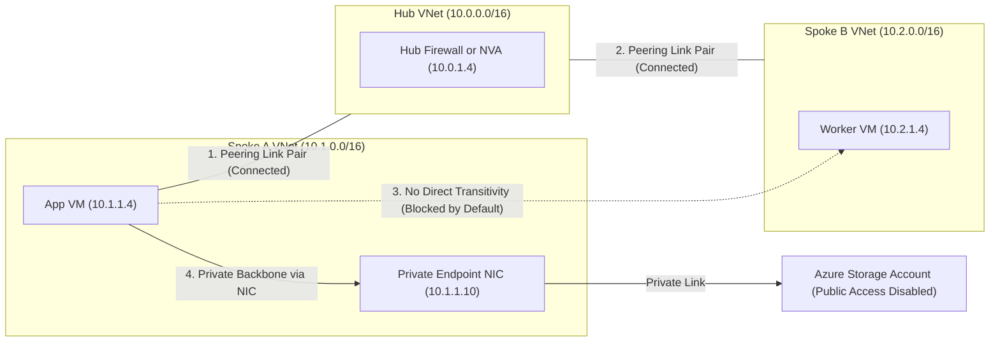
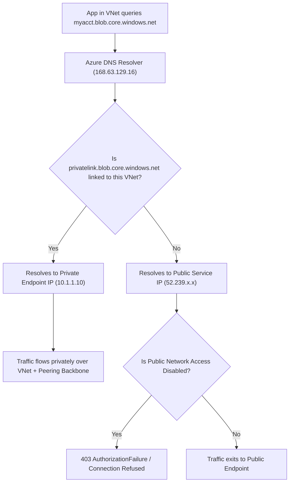
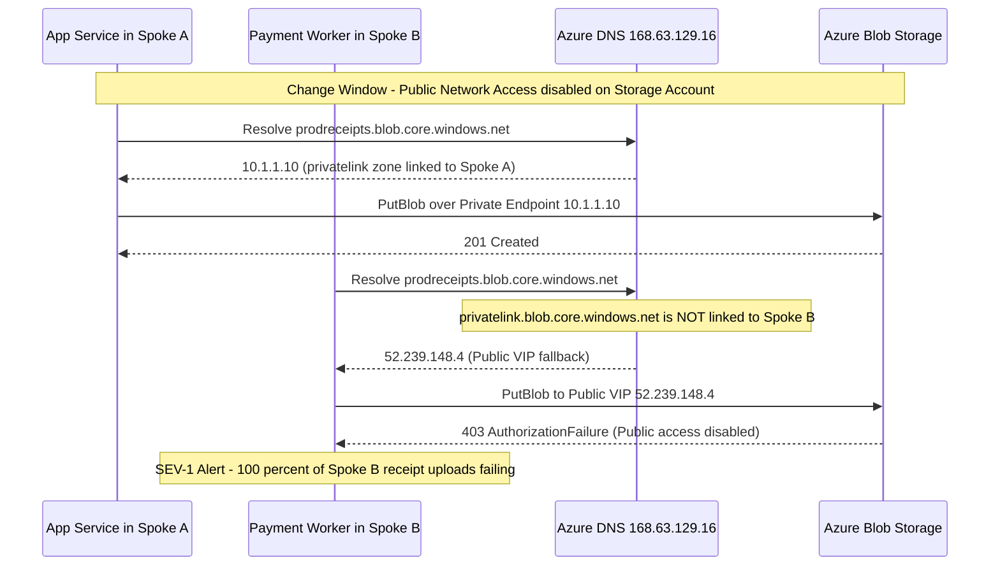

# Module 05: VNet Peering & Private Endpoints

> **Prerequisites:** Modules 01–04 (VNets/subnets, NSGs, Private DNS, Load Balancing & NAT Gateway), Azure CLI (`az`), and an active Azure subscription.  
> **Estimated Reading Time:** 30 minutes  
> **Target Audience:** Backend Engineers, Cloud Infrastructure Engineers, Platform Architects.

> [!TIP]
> **The Golden Rule of Peering and Private Link:** VNet peering is bidirectional and strictly **non-transitive**—you must create matching links on both VNets with non-overlapping CIDRs and never assume `Spoke A -> Hub -> Spoke B` works automatically. Private Endpoints pull PaaS services onto a private NIC in your subnet, but **Private DNS (`privatelink.*`) is the switch that activates them**; without a linked zone and A record, clients silently resolve and hit the public endpoint.

---

## 1. Architectural Mental Model: Non-Transitive Peering & Split-Horizon Private DNS

Real Azure networks are never a single VNet. **VNet peering** connects Virtual Networks over Azure's private backbone (no public internet, no VPN gateway required for same-region peering) so resources communicate by private IP at full backbone bandwidth and low latency. It is the foundation of the hub-and-spoke topology you will assemble in Module 07 and the Capstone.

**Private Endpoints** complement peering by pulling Azure PaaS services (Storage, Azure SQL, Key Vault) off the public internet onto a dedicated network interface (NIC) with a private IP inside your subnet—and they depend directly on the Private DNS mechanics from Module 03.



### Core Mechanics That Catch Engineers Off Guard
1. **Peering Requires Two Matching Links:** Peering is created as **two separate link resources**—one on VNet A pointing to VNet B, and one on VNet B pointing back to VNet A. Until both links exist and match, the state stays `Initiated` and zero packets flow.
2. **Non-Overlapping Address Spaces Are Hard Enforced:** Both VNets must have strictly disjoint address prefixes (e.g., `10.0.0.0/16`, `10.1.0.0/16`, `10.2.0.0/16`). Azure rejects peering between overlapping CIDRs—there is no override flag.
3. **Peering Is NOT Transitive:** If `spokeA-vnet` peers with `hub-vnet` and `spokeB-vnet` peers with `hub-vnet`, **Spoke A cannot reach Spoke B through the hub by default.** To allow spoke-to-spoke connectivity you must either peer them directly or route traffic through a hub appliance (Azure Firewall or NVA) using User-Defined Routes (UDRs) and `--allow-forwarded-traffic`.
4. **Private Endpoints Depend on `privatelink.*` Private DNS:** Your application continues connecting to the service's standard hostname (e.g., `myacct.blob.core.windows.net`). Azure's public DNS returns a CNAME chain pointing to `myacct.privatelink.blob.core.windows.net`. Only when a Private DNS Zone named exactly `privatelink.blob.core.windows.net` is **linked to the querying VNet** and holds the endpoint's A record does DNS resolve to the `10.1.1.x` private IP instead of the public IP.



---

## 2. Taxonomic Comparison & Systematic Command Reference

### Service Endpoints vs. Private Endpoints

| Dimension | Service Endpoints | Private Endpoints (Private Link) |
| :--- | :--- | :--- |
| **IP Addressing** | Service keeps its **public IP** | Service gets a **private IP (NIC)** inside your subnet |
| **Traffic Path** | Optimized route over Azure backbone from a specific subnet | Private VNet path directly to NIC mapped to one resource instance |
| **Public Access Disablement** | Must keep public endpoint reachable via subnet ACL | Public network access can be **disabled completely** |
| **On-Premises / Peered Access** | Not reachable from on-prem VPN/ExpressRoute | Reachable across peered VNets, VPN, and ExpressRoute |
| **DNS Dependency** | Uses public DNS resolution | Requires **`privatelink.*` Private DNS Zone** linked to every consuming VNet |
| **Billing** | Free | Small hourly charge per endpoint + per-GB processed |
| **Production Preference** | Legacy / minimal isolation | **Recommended production standard** |

### VNet Peering Settings Matrix

| CLI Flag | ARM Property | Default | Purpose | When Required |
| :--- | :--- | :--- | :--- | :--- |
| `--allow-vnet-access` | `allowVirtualNetworkAccess` | `true` (on CLI when passed) | Permits direct traffic between the two peered VNets | Always required for peering communication |
| `--allow-forwarded-traffic` | `allowForwardedTraffic` | `false` | Accepts traffic whose source IP did not originate inside the peer VNet | Required on hub-spoke links when hub Firewall/NVA routes spoke-to-spoke or ingress traffic |
| `--allow-gateway-transit` | `allowGatewayTransit` | `false` | Lets the peered VNet use this VNet's VPN/ExpressRoute gateway | Set on the **hub** side of peering |
| `--use-remote-gateways` | `useRemoteGateways` | `false` | Uses the peered hub's VPN/ExpressRoute gateway for on-prem routing | Set on the **spoke** side (requires hub gateway to exist first) |

### Command Reference

| Command | What it does | Example |
|---|---|---|
| `az network vnet peering create` | Creates one side of a peering | `az network vnet peering create -g pl-lab-rg -n hub-to-spokeA --vnet-name hub-vnet --remote-vnet spokeA-vnet --allow-vnet-access` |
| `az network vnet peering list` | Lists peerings on a VNet | `az network vnet peering list -g pl-lab-rg --vnet-name hub-vnet -o table` |
| `az network vnet peering show` | Shows a peering (incl. state) | `az network vnet peering show -g pl-lab-rg -n hub-to-spokeA --vnet-name hub-vnet` |
| `az network private-endpoint create` | Creates a private endpoint to a PaaS resource | `az network private-endpoint create -g pl-lab-rg -n stg-pe --vnet-name spokeA-vnet --subnet app-subnet --private-connection-resource-id <storage-id> --group-id blob --connection-name stg-conn` |
| `az network private-endpoint dns-zone-group create` | Wires the endpoint to a private DNS zone | `az network private-endpoint dns-zone-group create -g pl-lab-rg --endpoint-name stg-pe -n default --private-dns-zone privatelink.blob.core.windows.net --zone-name blob` |
| `az network private-dns zone create` | Creates the privatelink zone | `az network private-dns zone create -g pl-lab-rg -n privatelink.blob.core.windows.net` |

**Flag breakdown** — `az network vnet peering create -g pl-lab-rg -n hub-to-spokeA --vnet-name hub-vnet --remote-vnet spokeA-vnet --allow-vnet-access`:
- `-n` (`--name`): a name for this side of the peering.
- `--vnet-name`: the local VNet this link is created on.
- `--remote-vnet`: the other VNet (name in same group, or full resource ID across groups/subscriptions).
- `--allow-vnet-access`: permit traffic between the two VNets. (Add `--allow-forwarded-traffic` when the hub must forward spoke-to-spoke traffic.)

**Flag breakdown** — `az network private-endpoint create ... --private-connection-resource-id <storage-id> --group-id blob --connection-name stg-conn`:
- `--vnet-name` / `--subnet`: where the endpoint's NIC/private IP lands.
- `--private-connection-resource-id`: the full resource ID of the PaaS resource you're connecting to.
- `--group-id` (sub-resource): which part of the service (e.g. `blob`, `file`, `sqlServer`) — determines the privatelink zone name you need.
- `--connection-name`: a name for the connection.

---

## 3. Production War Story Post-Mortem: The Unlinked DNS Zone Outage



### The Incident
During a security compliance rollout, a fintech team deployed a Private Endpoint in `spokeA-vnet` (`10.1.1.10`) for their production receipt Storage Account (`prodreceipts`), verified uploads worked from `spokeA-vnet`, and immediately toggled `Public network access: Disabled`. Within four minutes, asynchronous payment settlement workers running in `spokeB-vnet` (connected via the hub) began failing 100% of blob writes with `403 This request is not authorized to perform this operation`.

### Post-Mortem Telemetry
* **Severity:** SEV-1 (Complete outage of cross-spoke payment receipt persistence)
* **Mean Time to Detect (MTTD):** 4 minutes (dead-letter queue depth spike alert)
* **Mean Time to Resolution (MTTR):** 28 minutes
* **Blast Radius:** 100% of batch settlement writes originating from `spokeB-vnet`

### Root Cause Analysis
1. **Asymmetric Private DNS Linking:** The Terraform module created `privatelink.blob.core.windows.net` and attached a `private-dns-zone-group` so the A record existed, but only created a Virtual Network Link (`az network private-dns link vnet create`) to `spokeA-vnet` where the endpoint lived.
2. **Silent Fallback to Public DNS:** Because `spokeB-vnet` had no link to the Private DNS Zone, Azure DNS (`168.63.129.16`) resolved `prodreceipts.blob.core.windows.net` to the storage account's public IP (`52.239.148.4`), which rejected the request with HTTP 403 once public access was disabled.

### The Fix & Architectural Hardening
1. **Immediate Mitigation:** Linked `privatelink.blob.core.windows.net` to `spokeB-vnet` and `hub-vnet`:
   `az network private-dns link vnet create -g prod-net-rg -z privatelink.blob.core.windows.net -n link-spokeB --virtual-network spokeB-vnet --registration-enabled false`
2. **Architectural Hardening:** Centralized all `privatelink.*` zones in the Hub subscription, enforced Azure Policy (`DeployIfNotExists`) to auto-link all spoke VNets to hub Private DNS Zones, and added a pre-cutover DNS assertion verifying private RFC1918 resolution from **every** consuming VNet before disabling PaaS public access.

---

## 4. Multi-Language Production Implementation: Peering & Private Endpoint Validator

In platform engineering and CI/CD pre-flight pipelines, never assume peering is healthy or a Private Endpoint is actually routing privately. The implementations below audit VNet CIDR disjointness, verify bidirectional `Connected` peering states, and validate private-IP DNS resolution for PaaS endpoints:

````carousel
```go
package main

import (
	"context"
	"fmt"
	"net"
	"net/netip"
	"os"
	"time"

	"github.com/Azure/azure-sdk-for-go/sdk/azidentity"
	"github.com/Azure/azure-sdk-for-go/sdk/resourcemanager/network/armnetwork/v5"
)

func checkCIDROverlap(cidrA, cidrB string) (bool, error) {
	p1, err := netip.ParsePrefix(cidrA)
	if err != nil {
		return false, err
	}
	p2, err := netip.ParsePrefix(cidrB)
	if err != nil {
		return false, err
	}
	return p1.Overlaps(p2), nil
}

func auditPeeringAndDNS(ctx context.Context, subID, rg, vnetName, fqdn string) error {
	cred, err := azidentity.NewDefaultAzureCredential(nil)
	if err != nil {
		return fmt.Errorf("auth failure: %w", err)
	}
	client, err := armnetwork.NewVirtualNetworkPeeringsClient(subID, cred, nil)
	if err != nil {
		return fmt.Errorf("client init failed: %w", err)
	}

	pager := client.NewListPager(rg, vnetName, nil)
	for pager.More() {
		page, err := pager.NextPage(ctx)
		if err != nil {
			return fmt.Errorf("peering list failed: %w", err)
		}
		for _, p := range page.Value {
			state := *p.Properties.PeeringState
			fwd := p.Properties.AllowForwardedTraffic != nil && *p.Properties.AllowForwardedTraffic
			fmt.Printf("Peering=%s State=%s ForwardedTraffic=%v\n", *p.Name, state, fwd)
			if state != armnetwork.VirtualNetworkPeeringStateConnected {
				return fmt.Errorf("peering %s is %s (expected Connected)", *p.Name, state)
			}
		}
	}

	ips, err := net.DefaultResolver.LookupIP(ctx, "ip4", fqdn)
	if err != nil {
		return fmt.Errorf("DNS lookup failed for %s: %w", fqdn, err)
	}
	for _, ip := range ips {
		if !ip.IsPrivate() {
			return fmt.Errorf("%s resolved to PUBLIC IP %s (missing privatelink DNS link)", fqdn, ip)
		}
		fmt.Printf("Verified Private Endpoint DNS: %s -> %s\n", fqdn, ip)
	}
	return nil
}

func main() {
	overlap, _ := checkCIDROverlap("10.0.0.0/16", "10.1.0.0/16")
	fmt.Printf("Hub vs SpokeA overlap: %v\n", overlap)

	ctx, cancel := context.WithTimeout(context.Background(), 15*time.Second)
	defer cancel()
	if err := auditPeeringAndDNS(ctx, os.Getenv("AZURE_SUBSCRIPTION_ID"), "pl-lab-rg", "hub-vnet", "myacct.blob.core.windows.net"); err != nil {
		fmt.Fprintf(os.Stderr, "AUDIT FAILED: %v\n", err)
		os.Exit(1)
	}
}
```
<!-- slide -->
```typescript
import { NetworkManagementClient } from "@azure/arm-network";
import { DefaultAzureCredential } from "@azure/identity";
import { lookup } from "dns/promises";
import { isIPv4 } from "net";

function isPrivateIPv4(ip: string): boolean {
  if (!isIPv4(ip)) return false;
  const [a, b] = ip.split(".").map(Number);
  return a === 10 || (a === 172 && b >= 16 && b <= 31) || (a === 192 && b === 168);
}

async function auditPeeringAndPrivateEndpoint(
  subscriptionId: string,
  resourceGroup: string,
  vnetName: string,
  paasHostname: string
): Promise<void> {
  const client = new NetworkManagementClient(new DefaultAzureCredential(), subscriptionId);

  for await (const peering of client.virtualNetworkPeerings.list(resourceGroup, vnetName)) {
    const state = peering.peeringState ?? "Unknown";
    const fwd = Boolean(peering.allowForwardedTraffic);
    console.log(`Peering=${peering.name} State=${state} AllowForwardedTraffic=${fwd}`);

    if (state !== "Connected") {
      throw new Error(`Peering ${peering.name} is stuck in ${state}; verify reciprocal link`);
    }
  }

  const { address } = await lookup(paasHostname, { family: 4 });
  if (!isPrivateIPv4(address)) {
    throw new Error(
      `${paasHostname} resolved to public IP ${address}; verify privatelink DNS zone link`
    );
  }
  console.log(`Verified Private DNS resolution: ${paasHostname} -> ${address}`);
}

const subId = process.env.AZURE_SUBSCRIPTION_ID ?? "";
auditPeeringAndPrivateEndpoint(subId, "pl-lab-rg", "spokeA-vnet", "myacct.blob.core.windows.net")
  .catch((err) => {
    console.error("AUDIT FAILED:", err.message);
    process.exit(1);
  });
```
<!-- slide -->
```python
import ipaddress
import os
import socket
import sys
from azure.identity import DefaultAzureCredential
from azure.mgmt.network import NetworkManagementClient


def check_cidrs_disjoint(cidr_a: str, cidr_b: str) -> bool:
    net_a = ipaddress.ip_network(cidr_a)
    net_b = ipaddress.ip_network(cidr_b)
    return not net_a.overlaps(net_b)


def audit_peering_and_dns(subscription_id: str, rg: str, vnet_name: str, paas_fqdn: str) -> None:
    client = NetworkManagementClient(DefaultAzureCredential(), subscription_id)

    for peering in client.virtual_network_peerings.list(rg, vnet_name):
        state = peering.peering_state
        fwd = bool(peering.allow_forwarded_traffic)
        print(f"Peering={peering.name} State={state} AllowForwardedTraffic={fwd}")
        if state != "Connected":
            raise RuntimeError(f"Peering '{peering.name}' is {state}; expected Connected")

    resolved_ip = ipaddress.ip_address(socket.gethostbyname(paas_fqdn))
    if not resolved_ip.is_private:
        raise RuntimeError(
            f"{paas_fqdn} resolved to public IP {resolved_ip}; missing linked privatelink zone"
        )
    print(f"Verified Private Endpoint DNS: {paas_fqdn} -> {resolved_ip}")


if __name__ == "__main__":
    assert check_cidrs_disjoint("10.0.0.0/16", "10.1.0.0/16"), "CIDRs overlap!"
    try:
        audit_peering_and_dns(
            os.environ["AZURE_SUBSCRIPTION_ID"],
            "pl-lab-rg",
            "spokeA-vnet",
            "myacct.blob.core.windows.net",
        )
    except Exception as exc:
        print(f"AUDIT FAILED: {exc}", file=sys.stderr)
        sys.exit(1)
```
<!-- slide -->
```csharp
using System;
using System.Linq;
using System.Net;
using System.Net.Sockets;
using System.Threading.Tasks;
using Azure.Identity;
using Azure.ResourceManager;
using Azure.ResourceManager.Network;

public static class PeeringAndPrivateLinkAuditor
{
    private static bool IsPrivateIPv4(IPAddress ip)
    {
        if (ip.AddressFamily != AddressFamily.InterNetwork) return false;
        byte[] b = ip.GetAddressBytes();
        return b[0] == 10 || (b[0] == 172 && b[1] >= 16 && b[1] <= 31) || (b[0] == 192 && b[1] == 168);
    }

    public static async Task Main()
    {
        string subId = Environment.GetEnvironmentVariable("AZURE_SUBSCRIPTION_ID")
            ?? throw new InvalidOperationException("AZURE_SUBSCRIPTION_ID missing");

        var arm = new ArmClient(new DefaultAzureCredential());
        var vnetResourceId = VirtualNetworkResource.CreateResourceIdentifier(subId, "pl-lab-rg", "spokeA-vnet");
        VirtualNetworkResource vnet = await arm.GetVirtualNetworkResource(vnetResourceId).GetAsync();

        await foreach (VirtualNetworkPeeringResource peering in vnet.GetVirtualNetworkPeerings().GetAllAsync())
        {
            var data = peering.Data;
            Console.WriteLine($"Peering={data.Name} State={data.PeeringState} Forwarded={data.AllowForwardedTraffic}");
            if (data.PeeringState?.ToString() != "Connected")
            {
                throw new Exception($"Peering {data.Name} is {data.PeeringState} instead of Connected");
            }
        }

        IPAddress[] addresses = await Dns.GetHostAddressesAsync("myacct.blob.core.windows.net");
        IPAddress? ipv4 = addresses.FirstOrDefault(a => a.AddressFamily == AddressFamily.InterNetwork);
        if (ipv4 is null || !IsPrivateIPv4(ipv4))
        {
            throw new Exception($"Hostname resolved to public IP ({ipv4}); privatelink DNS link missing");
        }
        Console.WriteLine($"Verified Private Endpoint DNS -> {ipv4}");
    }
}
```
````

---

## 5. Practical Hands-On Verification CLI Workflows

Set up a group and three VNets with non-overlapping address spaces:
```bash
az group create --name pl-lab-rg --location eastus
az network vnet create -g pl-lab-rg -n hub-vnet --address-prefixes 10.0.0.0/16 \
  --subnet-name hub-subnet --subnet-prefixes 10.0.1.0/24
az network vnet create -g pl-lab-rg -n spokeA-vnet --address-prefixes 10.1.0.0/16 \
  --subnet-name app-subnet --subnet-prefixes 10.1.1.0/24
az network vnet create -g pl-lab-rg -n spokeB-vnet --address-prefixes 10.2.0.0/16 \
  --subnet-name app-subnet --subnet-prefixes 10.2.1.0/24
```

### Workflow 1: Peer Hub ↔ Spoke A (Both Sides) & Verify `Connected` State
```bash
az network vnet peering create -g pl-lab-rg -n hub-to-spokeA \
  --vnet-name hub-vnet --remote-vnet spokeA-vnet --allow-vnet-access
az network vnet peering create -g pl-lab-rg -n spokeA-to-hub \
  --vnet-name spokeA-vnet --remote-vnet hub-vnet --allow-vnet-access

az network vnet peering show -g pl-lab-rg -n hub-to-spokeA \
  --vnet-name hub-vnet --query peeringState -o tsv
```
**Expected Output:**
```text
Connected
```
*(Creating only one side leaves `peeringState` stuck at `Initiated`.)*

### Workflow 2: Peer Hub ↔ Spoke B (Both Sides)
```bash
az network vnet peering create -g pl-lab-rg -n hub-to-spokeB \
  --vnet-name hub-vnet --remote-vnet spokeB-vnet --allow-vnet-access
az network vnet peering create -g pl-lab-rg -n spokeB-to-hub \
  --vnet-name spokeB-vnet --remote-vnet hub-vnet --allow-vnet-access
```

### Workflow 3: Diagnose Peering Stuck at `Initiated`
If you created only one side of a peering (or the second side names the wrong remote VNet), the state stays `Initiated` and traffic doesn't flow. **Fix:** create the matching link on the other VNet with the correct `--remote-vnet`. Both links must exist and reference each other for `Connected`.
```bash
az network vnet peering list -g pl-lab-rg --vnet-name hub-vnet \
  --query "[].{Name:name, State:peeringState}" -o table
```
**Expected Output:**
```text
Name           State
-------------  ---------
hub-to-spokeA  Connected
hub-to-spokeB  Connected
```

### Workflow 4: Prove Non-Transitivity
`spokeA-vnet` is peered to `hub-vnet`, and `spokeB-vnet` is peered to `hub-vnet`, but `spokeA-vnet` and `spokeB-vnet` are **not** peered to each other. A VM in Spoke A therefore **cannot** reach a VM in Spoke B—peering is not transitive. Confirm there is no direct Spoke A ↔ Spoke B peering:
```bash
az network vnet peering list -g pl-lab-rg --vnet-name spokeA-vnet -o table
```
**Expected Output:**
```text
Name           AllowForwardedTraffic    AllowGatewayTransit    AllowVirtualNetworkAccess    PeeringState    PeeringSyncLevel
-------------  -----------------------  ---------------------  ---------------------------  --------------  ------------------
spokeA-to-hub  False                    False                  True                         Connected       FullyInSync
```
*(You see only `spokeA-to-hub`. In Module 07 you'll route spoke-to-spoke through the hub firewall instead of peering them directly.)*

### Workflow 5: Diagnose and Fix Overlapping Address Space Blocking Peering
Try to create a fourth VNet that overlaps the hub (`10.0.0.0/16`) and peer it:
```bash
az network vnet create -g pl-lab-rg -n bad-vnet \
  --address-prefixes 10.0.0.0/16 --subnet-name s1 \
  --subnet-prefixes 10.0.5.0/24
az network vnet peering create -g pl-lab-rg -n hub-to-bad \
  --vnet-name hub-vnet --remote-vnet bad-vnet --allow-vnet-access
```
**Expected Output:**
```text
(VirtualNetworksHaveOverlappingAddressSpaces) Virtual network /subscriptions/.../hub-vnet cannot be peered with /subscriptions/.../bad-vnet because they have overlapping address spaces.
```
**Fix:** Overlapping VNets cannot be peered—the only remedy is to re-address one of them. Delete `bad-vnet`:
```bash
az network vnet delete -g pl-lab-rg -n bad-vnet
```

### Workflow 6: Create a Storage Account & Private Endpoint
*(Storage bills minimally; delete with the group.)*
```bash
STG=stg$RANDOM$RANDOM
az storage account create -g pl-lab-rg -n "$STG" --sku Standard_LRS
STGID=$(az storage account show -g pl-lab-rg -n "$STG" --query id -o tsv)

az network private-endpoint create -g pl-lab-rg -n stg-pe \
  --vnet-name spokeA-vnet --subnet app-subnet \
  --private-connection-resource-id "$STGID" --group-id blob \
  --connection-name stg-conn

az network private-endpoint show -g pl-lab-rg -n stg-pe --query 'customDnsConfigs'
```
**Expected Output:**
```json
[
  {
    "fqdn": "stg12345678.blob.core.windows.net",
    "ipAddresses": [
      "10.1.1.4"
    ]
  }
]
```

### Workflow 7: Diagnose and Fix Private Endpoint Resolving to Public IP
Right now there is no Private DNS zone, so `<acct>.blob.core.windows.net` still resolves to the **public** IP—the private endpoint exists but nothing uses it. **Fix:** create the `privatelink` zone, link it to the VNet, and attach a DNS zone group so Azure creates the A record automatically:
```bash
az network private-dns zone create -g pl-lab-rg \
  -n privatelink.blob.core.windows.net
az network private-dns link vnet create -g pl-lab-rg \
  -z privatelink.blob.core.windows.net -n link-spokeA \
  --virtual-network spokeA-vnet --registration-enabled false
az network private-endpoint dns-zone-group create -g pl-lab-rg \
  --endpoint-name stg-pe -n default \
  --private-dns-zone privatelink.blob.core.windows.net --zone-name blob

az network private-dns record-set a list -g pl-lab-rg \
  -z privatelink.blob.core.windows.net -o table
```
**Expected Output:**
```text
Name         ResourceGroup    Ttl    IPv4Address
-----------  ---------------  -----  -------------
stg12345678  pl-lab-rg        10     10.1.1.4
```
*(From a VM in Spoke A, `nslookup <acct>.blob.core.windows.net` now returns `10.1.1.4` instead of a public IP. **Lesson:** a private endpoint without its `privatelink` DNS zone linked to the VNet is invisible—the name keeps resolving to the public endpoint.)*

### Workflow 8: Cleanup
Peerings are free, but the storage account and private endpoint carry small charges. Delete the resource group:
```bash
az group delete --name pl-lab-rg --yes --no-wait
```

---

### Independent Challenge
Combine this module with **Module 03 (Private DNS)**. Build two VNets with non-overlapping address spaces, peer them both directions, create a private endpoint to a new Key Vault (or Storage account) in one VNet, and wire up the correct `privatelink.*` private DNS zone linked so that a resource in the *peered* VNet — not just the endpoint's own VNet — resolves the service to its private IP. Confirm you understand which VNets must be linked to the privatelink zone for cross-VNet private resolution to work. Delete the resource group afterward — the endpoint and PaaS resource bill while they exist.

<details><summary>Stuck? One hint</summary>

For a peered VNet to resolve the private endpoint privately, the `privatelink.*` zone must be linked to **that** VNet too (or the two VNets must share a resolver that sees the zone). Peering routes the *traffic*; the private DNS link is what makes the *name* resolve to the private IP. Both are required — test resolution from the peered VNet specifically, not just from the VNet holding the endpoint.

</details>

---

## 6. Common Mistakes & Troubleshooting
- **Only creating one side of a peering.** State stays `Initiated`; you need both links, each pointing at the other, for `Connected`.
- **Overlapping address spaces.** Peering simply won't establish; re-address one VNet — there's no override.
- **Expecting transitivity.** spoke-A → hub → spoke-B does not work by default. Peer directly or route through a hub device (Module 07).
- **Private endpoint without private DNS.** The endpoint exists but the service name still resolves to the public IP, so nothing uses the private path. You need the `privatelink.*` zone, linked to the VNet, with the A record.
- **Forgetting `allow-forwarded-traffic` for hub routing.** Spoke-to-spoke via a hub NVA/firewall needs forwarded traffic allowed on the peerings plus route tables (Module 07).
- **Cost note:** peerings themselves are free (you pay a small per-GB data transfer for traffic across them), but private endpoints bill a small hourly rate plus per-GB, and the PaaS resources bill on their own. Delete the group when done.

---

## 7. Operational Validation Checkpoints

### Production Troubleshooting Scenarios

<details>
<summary><strong>Scenario 1: Cross-Resource-Group Peering Stuck in Initiated</strong></summary>

**Scenario:** An engineer runs `az network vnet peering create` in `net-hub-rg` using `--remote-vnet spokeA-vnet` where `spokeA-vnet` lives in a different resource group (`app-spoke-rg`), then creates the reverse link in `app-spoke-rg`. The CLI either fails to find `spokeA-vnet` or a stale link remains `Initiated`.

**Why & Fix:** When VNets sit in different resource groups or subscriptions, short names fail or resolve ambiguously. Pass the **full ARM resource ID** to `--remote-vnet` on both sides (`/subscriptions/<sub-id>/resourceGroups/<rg>/providers/Microsoft.Network/virtualNetworks/<vnet-name>`) and ensure the user/service principal holds `Network Contributor` permissions on both VNets.

</details>

<details>
<summary><strong>Scenario 2: Private Endpoint Works from Same Subnet, Fails from Peered Spoke</strong></summary>

**Scenario:** You attach a Private Endpoint for Azure SQL (`privatelink.database.windows.net`) inside `spokeA-vnet` and disable public access on the SQL Server. Queries from `spokeA-vnet` pass, while microservices in `spokeB-vnet` (peered with `spokeA-vnet`) time out or fail with public IP firewall rejection errors.

**Why & Fix:** Peering carries L3 IP packets, **not** Private DNS Zone visibility. `spokeB-vnet` is not linked to `privatelink.database.windows.net`, so it resolves the SQL FQDN to the public IP. Link `privatelink.database.windows.net` to `spokeB-vnet` (`az network private-dns link vnet create`) or deploy an Azure Private DNS Resolver in the hub.

</details>

<details>
<summary><strong>Scenario 3: Cannot Enable Use-Remote-Gateways on Spoke Peering</strong></summary>

**Scenario:** You try to enable `--use-remote-gateways` on `spokeA-to-hub` during initial hub provisioning before deploying the VPN/ExpressRoute Virtual Network Gateway in `hub-vnet`, and Azure rejects the peering update.

**Why & Fix:** Azure blocks `--use-remote-gateways` unless the remote hub VNet **already has** a provisioned Virtual Network Gateway (and `--allow-gateway-transit` enabled on the hub-to-spoke peering). Provision the gateway in `GatewaySubnet` first, enable `--allow-gateway-transit` on the hub side, and then enable `--use-remote-gateways` on the spoke side.

</details>

### Core Concept Checkpoint Quiz
Write down your answer to each question before expanding it — checking without attempting first is the single easiest way to fool yourself into thinking you've learned this.

1. spoke-A and spoke-B are each peered to a hub. Can a VM in spoke-A reach a VM in spoke-B by default? Explain, and give two ways to make it work.
2. A peering shows `Initiated`, not `Connected`. What's the cause and fix?
3. Why can't you peer two VNets that both use `10.0.0.0/16`?
4. What does a Private Endpoint give a PaaS service, and how does that differ from a service endpoint?
5. You created a private endpoint to a storage account but connections still go to the public IP. What's missing, precisely?
6. What exactly must the private DNS zone for a blob private endpoint be named, and what has to be linked to it?
7. Which peering setting must be enabled for a hub to forward spoke-to-spoke traffic through a firewall?

<details><summary>Show answers</summary>

1. No — peering is not transitive. Make it work by (a) peering spoke-A and spoke-B directly, or (b) routing spoke-to-spoke through a hub device (Firewall/NVA) using route tables plus `allow-forwarded-traffic`.
2. Only one side of the peering exists (or the second side references the wrong remote VNet). Create the matching link on the other VNet pointing back; both are needed for `Connected`.
3. Overlapping address spaces can't be routed between — Azure can't decide which VNet owns `10.0.0.0/16`. Re-address one.
4. A Private Endpoint gives the service a private IP (a NIC) inside your subnet, removing it from public exposure. A service endpoint keeps the service's public IP but routes to it over the backbone from a specific subnet — weaker isolation; private endpoints are preferred.
5. The privatelink private DNS zone, linked to the VNet, with the A record for the endpoint (a private DNS zone group). Without it the public hostname still resolves to the public IP.
6. `privatelink.blob.core.windows.net`, and the VNet(s) that need to resolve it must be linked to that zone (plus the endpoint's A record present).
7. `--allow-forwarded-traffic` on the relevant peering(s), alongside route tables directing spoke traffic to the hub device.

</details>

---

## Next Step
[06 — Application Gateway & WAF](../06-application-gateway-and-waf/README.md): move up to L7 load balancing with path-based routing, TLS termination, and a Web Application Firewall.
