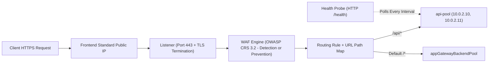
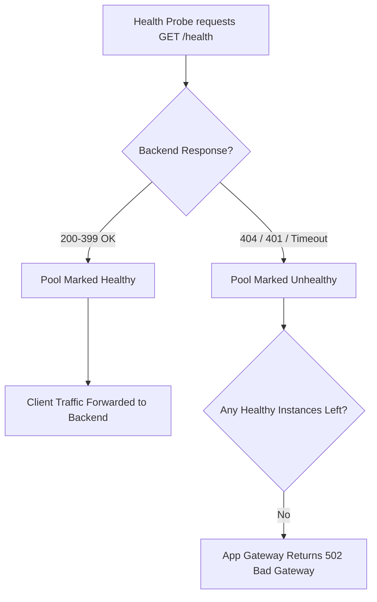
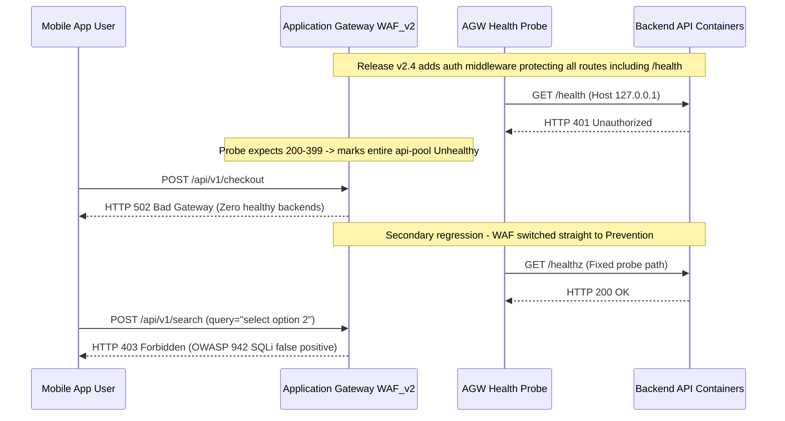

# Module 06: Application Gateway & WAF

> **Prerequisites:** Modules 01–05 (VNets/subnets, NSGs, DNS, Azure Load Balancer L4 vs L7 concepts), Azure CLI (`az`), and HTTP/TLS fundamentals.  
> **Estimated Reading Time:** 30 minutes  
> **Target Audience:** Backend Engineers, Cloud Infrastructure Engineers, Platform Architects.

> [!TIP]
> **The Golden Rule of Application Gateway:** Application Gateway is a stateful Layer-7 reverse proxy that must terminate TLS to inspect URLs, host headers, and OWASP payloads—and if **every backend fails its health probe**, the gateway immediately serves `502 Bad Gateway` even when your app responds `200` directly. Because v2 SKUs bill hourly plus capacity units even while completely idle, always treat `az group delete` as non-negotiable after labs.

---

## 1. Architectural Mental Model: The Layer-7 Reverse Proxy & Probe Pipeline

Application Gateway is Azure's **L7 (HTTP/HTTPS) load balancer**—the component you reach for when you need URL path-based routing, host-based routing, TLS termination, or a Web Application Firewall (WAF), none of which the L4 Azure Load Balancer (Module 04) can perform. It is also one of the two resources in this track that **bill hourly even when idle** (Azure Firewall is the other), so cost discipline is mandatory.



### How the Pieces Wire Together (and Why 502 Happens)
App Gateway chains together six explicit objects, and deployment errors always reference them by name:
1. **Frontend IP:** Public (`Standard` SKU required for v2) and/or private IP accepting connections.
2. **Listener:** Binds Frontend IP + port + protocol (and optional hostname + TLS certificate).
3. **WAF Policy / Config (`WAF_v2` only):** Evaluates decrypted HTTP requests against OWASP Core Rule Set in **Detection** (log only) or **Prevention** (block malicious requests) mode.
4. **Routing Rules & URL Path Map:** Connects a Listener to a Backend Pool via HTTP Settings (routing `/api/*` differently from `/`).
5. **HTTP Settings:** Controls backend protocol, port, connection draining, request timeout, and custom health probe binding.
6. **Health Probe & Backend Pools:** Continuously polls backends; if a probe targets `/health` and backends return `404`, **100% of the pool turns Unhealthy and clients get `502 Bad Gateway`**.



### Dedicated Subnet, SKU Choice, and Edge TLS Termination
* **Dedicated Subnet:** App Gateway v2 must live in its **own exclusive subnet** (no VMs, containers, or Private Endpoints allowed alongside it), which is why Module 01 pre-created `appgw-subnet`.
* **Standard_v2 vs. WAF_v2:** Both run on the v2 autoscaling engine and bill a fixed hourly gateway charge **plus** capacity-unit charges—meaning even an idle gateway accrues cost every hour. Choose `WAF_v2` when you need OWASP inspection; otherwise `Standard_v2`.
* **TLS Termination:** Terminating TLS at the listener decrypts traffic once at the edge so path-based routing and the WAF can inspect HTTP headers and bodies, before forwarding over HTTP or re-encrypted HTTPS (end-to-end TLS) to backends.

---

## 2. Taxonomic Comparison & Systematic Command Reference

### L4 Load Balancer vs. L7 Application Gateway vs. NSG

| Capability / Attribute | Azure Load Balancer (Module 04) | Application Gateway (`WAF_v2`) | Network Security Group (NSG) |
| :--- | :--- | :--- | :--- |
| **OSI Layer** | Layer 4 (TCP / UDP) | Layer 7 (HTTP / HTTPS / WebSocket / gRPC) | Layer 3 / Layer 4 (IP / Port / Protocol) |
| **Routing Logic** | 5-tuple hash (IP + Port) | URL path (`/api/*`), Host header, HTTP headers, cookies | Allow / Deny stateless/stateful packet rules |
| **TLS Termination** | No (pass-through only) | Yes (edge offload or end-to-end TLS) | No |
| **OWASP WAF Inspection** | No | Yes (SQLi, XSS, path traversal inspection) | No (zero HTTP awareness) |
| **Subnet Requirement** | No dedicated subnet required | **Exclusive dedicated subnet required** | Attached to existing subnets or NICs |
| **Idle Cost** | Free (Basic) / low rule cost (Standard) | **High fixed hourly + capacity-unit billing when idle** | Free |

### SKU & WAF Mode Comparison

| Option | Behavior | When to Use |
| :--- | :--- | :--- |
| **`Standard_v2`** | L7 routing, autoscaling, TLS termination without WAF | Internal L7 proxies or apps protected upstream |
| **`WAF_v2`** | Adds managed OWASP Core Rule Set inspection engine | Public-facing web apps and APIs needing L7 attack filtering |
| **`Detection` Mode** | Evaluates OWASP rules and logs matches without blocking | **Always enable first** in new deployments to find false positives |
| **`Prevention` Mode** | Actively drops and blocks requests (`403 Forbidden`) exceeding anomaly threshold | Enable after tuning exclusions from Detection logs |

### Command Reference

| Command | What it does | Example |
|---|---|---|
| `az network application-gateway create` | Creates an App Gateway (frontend, listener, pool, rule) | `az network application-gateway create -g agw-lab-rg -n web-agw --sku WAF_v2 --capacity 2 --vnet-name lab-vnet --subnet appgw-subnet --public-ip-address agw-pip --frontend-port 80 --http-settings-port 80 --http-settings-protocol Http --priority 100` |
| `az network application-gateway address-pool create` | Adds a backend pool | `az network application-gateway address-pool create -g agw-lab-rg --gateway-name web-agw -n api-pool --servers 10.0.2.10 10.0.2.11` |
| `az network application-gateway url-path-map create` | Creates a path-based routing map | `az network application-gateway url-path-map create -g agw-lab-rg --gateway-name web-agw -n pathmap --paths /api/* --address-pool api-pool --default-address-pool appGatewayBackendPool --http-settings appGatewayBackendHttpSettings --default-http-settings appGatewayBackendHttpSettings` |
| `az network application-gateway probe create` | Adds a custom health probe | `az network application-gateway probe create -g agw-lab-rg --gateway-name web-agw -n api-probe --protocol Http --path /health --host 127.0.0.1` |
| `az network application-gateway waf-config set` | Configures the WAF mode/ruleset | `az network application-gateway waf-config set -g agw-lab-rg --gateway-name web-agw --enabled true --firewall-mode Prevention --rule-set-type OWASP --rule-set-version 3.2` |
| `az network application-gateway show` | Shows gateway config | `az network application-gateway show -g agw-lab-rg -n web-agw` |
| `az network application-gateway show-backend-health` | Shows backend health status | `az network application-gateway show-backend-health -g agw-lab-rg -n web-agw` |

**Flag breakdown** — `az network application-gateway create ... --sku WAF_v2 --capacity 2 --vnet-name lab-vnet --subnet appgw-subnet --public-ip-address agw-pip --frontend-port 80 --http-settings-port 80 --http-settings-protocol Http --priority 100`:
- `--sku`: `Standard_v2` or `WAF_v2` (WAF_v2 adds the firewall; both bill hourly + capacity units).
- `--capacity`: number of instances / capacity units (min for v2 autoscale).
- `--vnet-name` / `--subnet`: the **dedicated** subnet the gateway lives in.
- `--public-ip-address`: the frontend public IP (must be Standard SKU for v2).
- `--frontend-port`: the port the listener accepts on (e.g. 80/443).
- `--http-settings-port` / `--http-settings-protocol`: how the gateway talks to the backend.
- `--priority`: routing-rule priority (required for v2; unique per gateway).

**Flag breakdown** — `az network application-gateway waf-config set ... --enabled true --firewall-mode Prevention --rule-set-type OWASP --rule-set-version 3.2`:
- `--enabled`: turns the WAF on/off.
- `--firewall-mode`: `Detection` (log only) or `Prevention` (block).
- `--rule-set-type` / `--rule-set-version`: managed rule set (OWASP) and its version.

---

## 3. Production War Story Post-Mortem: The Probe 404 & Blind Prevention Outage



### The Incident
During a Friday deployment, an e-commerce platform refactored its API authentication middleware and simultaneously upgraded its Application Gateway from `Standard_v2` to `WAF_v2` directly in `Prevention` mode. Moments after cutover, the public API returned `502 Bad Gateway` for every caller even though direct curl checks from inside the VNet returned `200 OK`. After restoring backend health, legitimate user search requests containing words like `"select"` and `"union"` began failing with `403 Forbidden`.

### Post-Mortem Telemetry
* **Severity:** SEV-1 (Complete public API outage followed by partial checkout degradation)
* **Mean Time to Detect (MTTD):** 2 minutes (synthetic uptime probe alert)
* **Mean Time to Resolution (MTTR):** 38 minutes
* **Impact:** 100% API downtime for 18 minutes; ~12% search/checkout failure rate for 20 minutes

### Root Cause Analysis
1. **Health Probe Unauthenticated Status Mismatch:** The new auth filter protected `/health` and returned `401 Unauthorized`. Application Gateway's default probe matcher accepts only `200–399`, causing `show-backend-health` to mark every instance `Unhealthy` and serve `502`.
2. **Skipping WAF `Detection` Mode:** Enabling OWASP CRS 3.2 straight in `Prevention` mode without a Detection log soak period immediately blocked benign JSON form payloads triggering SQLi heuristic rules.

### The Fix & Architectural Hardening
1. **Unauthenticated Lightweight Health Endpoint:** Exposed `/healthz` anonymously returning `200 OK`, updated `az network application-gateway probe update` to point at `/healthz`, and added custom probe matchers (`--match-status-codes 200-399`).
2. **Mandatory WAF Soak Process:** Rolled WAF back to `--firewall-mode Detection`, exported `AzureDiagnostics` WAF logs for 7 days to add targeted per-field exclusions, and promoted back to `Prevention`.

---

## 4. Multi-Language Production Implementation: Backend Health & WAF Audit Tool

Before declaring any Application Gateway deployment healthy in CI/CD, query `backendHealth` directly from the ARM API (waiting for long-running health evaluation) and audit WAF configuration to prevent blind `Prevention` rollouts or silent `502` outages:

````carousel
```go
package main

import (
	"context"
	"fmt"
	"os"
	"time"

	"github.com/Azure/azure-sdk-for-go/sdk/azidentity"
	"github.com/Azure/azure-sdk-for-go/sdk/resourcemanager/network/armnetwork/v5"
)

func auditAppGateway(ctx context.Context, subID, rg, gwName string) error {
	cred, err := azidentity.NewDefaultAzureCredential(nil)
	if err != nil {
		return err
	}
	client, err := armnetwork.NewApplicationGatewaysClient(subID, cred, nil)
	if err != nil {
		return err
	}

	gwResp, err := client.Get(ctx, rg, gwName, nil)
	if err != nil {
		return fmt.Errorf("failed fetching gateway: %w", err)
	}
	if gwResp.Properties.WebApplicationFirewallConfiguration != nil {
		waf := gwResp.Properties.WebApplicationFirewallConfiguration
		fmt.Printf("WAF Enabled=%v Mode=%v RuleSet=%s %s\n",
			*waf.Enabled, *waf.FirewallMode, *waf.RuleSetType, *waf.RuleSetVersion)
	}

	poller, err := client.BeginBackendHealth(ctx, rg, gwName, nil)
	if err != nil {
		return fmt.Errorf("begin backend health failed: %w", err)
	}
	healthResp, err := poller.PollUntilDone(ctx, nil)
	if err != nil {
		return fmt.Errorf("polling backend health failed: %w", err)
	}

	for _, pool := range healthResp.BackendAddressPools {
		for _, setting := range pool.BackendHTTPSettingsCollection {
			healthyCount := 0
			for _, server := range setting.Servers {
				status := *server.Health
				fmt.Printf("Server=%s Status=%s\n", *server.Address, status)
				if status == armnetwork.ApplicationGatewayBackendHealthServerHealthUp {
					healthyCount++
				}
			}
			if healthyCount == 0 && len(setting.Servers) > 0 {
				return fmt.Errorf("0 healthy backends for pool %s (clients will get 502)", *pool.BackendAddressPool.ID)
			}
		}
	}
	return nil
}

func main() {
	ctx, cancel := context.WithTimeout(context.Background(), 60*time.Second)
	defer cancel()
	if err := auditAppGateway(ctx, os.Getenv("AZURE_SUBSCRIPTION_ID"), "agw-lab-rg", "web-agw"); err != nil {
		fmt.Fprintf(os.Stderr, "APPGW AUDIT FAILED: %v\n", err)
		os.Exit(1)
	}
}
```
<!-- slide -->
```typescript
import { NetworkManagementClient } from "@azure/arm-network";
import { DefaultAzureCredential } from "@azure/identity";

async function auditApplicationGateway(
  subscriptionId: string,
  resourceGroup: string,
  gatewayName: string
): Promise<void> {
  const client = new NetworkManagementClient(new DefaultAzureCredential(), subscriptionId);

  const gw = await client.applicationGateways.get(resourceGroup, gatewayName);
  const waf = gw.webApplicationFirewallConfiguration;
  if (waf?.enabled) {
    console.log(
      `WAF Mode=${waf.firewallMode} RuleSet=${waf.ruleSetType} v${waf.ruleSetVersion}`
    );
  }

  const health = await client.applicationGateways.beginBackendHealthAndWait(
    resourceGroup,
    gatewayName
  );

  for (const pool of health.backendAddressPools ?? []) {
    for (const httpSetting of pool.backendHttpSettingsCollection ?? []) {
      const servers = httpSetting.servers ?? [];
      const upCount = servers.filter((s) => s.health === "Up").length;
      for (const s of servers) {
        console.log(`Backend=${s.address} Health=${s.health} Log=${s.healthProbeLog ?? "ok"}`);
      }
      if (servers.length > 0 && upCount === 0) {
        throw new Error(
          `Zero healthy servers in pool ${pool.backendAddressPool?.id}; frontend will return 502`
        );
      }
    }
  }
}

auditApplicationGateway(process.env.AZURE_SUBSCRIPTION_ID ?? "", "agw-lab-rg", "web-agw")
  .catch((err) => {
    console.error("APPGW AUDIT FAILED:", err.message);
    process.exit(1);
  });
```
<!-- slide -->
```python
import os
import sys
from azure.identity import DefaultAzureCredential
from azure.mgmt.network import NetworkManagementClient


def audit_application_gateway(subscription_id: str, rg: str, gw_name: str) -> None:
    client = NetworkManagementClient(DefaultAzureCredential(), subscription_id)

    gw = client.application_gateways.get(rg, gw_name)
    waf = gw.web_application_firewall_configuration
    if waf and waf.enabled:
        print(f"WAF Mode={waf.firewall_mode} RuleSet={waf.rule_set_type} {waf.rule_set_version}")

    health_poller = client.application_gateways.begin_backend_health(rg, gw_name)
    health = health_poller.result()

    for pool in health.backend_address_pools or []:
        for setting in pool.backend_http_settings_collection or []:
            servers = setting.servers or []
            healthy = [s for s in servers if s.health == "Up"]
            for srv in servers:
                print(f"Backend={srv.address} Health={srv.health} ProbeLog={srv.health_probe_log}")
            if servers and not healthy:
                raise RuntimeError(
                    "All backends unhealthy; App Gateway will return 502 Bad Gateway"
                )


if __name__ == "__main__":
    try:
        audit_application_gateway(os.environ["AZURE_SUBSCRIPTION_ID"], "agw-lab-rg", "web-agw")
    except Exception as exc:
        print(f"APPGW AUDIT FAILED: {exc}", file=sys.stderr)
        sys.exit(1)
```
<!-- slide -->
```csharp
using System;
using System.Linq;
using System.Threading.Tasks;
using Azure;
using Azure.Identity;
using Azure.ResourceManager;
using Azure.ResourceManager.Network;
using Azure.ResourceManager.Network.Models;

public static class AppGatewayHealthAuditor
{
    public static async Task Main()
    {
        string subId = Environment.GetEnvironmentVariable("AZURE_SUBSCRIPTION_ID")
            ?? throw new InvalidOperationException("AZURE_SUBSCRIPTION_ID missing");

        var arm = new ArmClient(new DefaultAzureCredential());
        var gwId = ApplicationGatewayResource.CreateResourceIdentifier(subId, "agw-lab-rg", "web-agw");
        ApplicationGatewayResource gw = await arm.GetApplicationGatewayResource(gwId).GetAsync();

        var waf = gw.Data.WebApplicationFirewallConfiguration;
        if (waf?.Enabled == true)
        {
            Console.WriteLine($"WAF Mode={waf.FirewallMode} RuleSet={waf.RuleSetType} {waf.RuleSetVersion}");
        }

        ArmOperation<ApplicationGatewayBackendHealth> op = await gw.BackendHealthAsync(WaitUntil.Completed);
        foreach (var pool in op.Value.BackendAddressPools)
        {
            foreach (var setting in pool.BackendHttpSettingsCollection)
            {
                int upCount = setting.Servers.Count(s => s.Health?.ToString() == "Up");
                foreach (var srv in setting.Servers)
                {
                    Console.WriteLine($"Backend={srv.Address} Health={srv.Health}");
                }
                if (setting.Servers.Count > 0 && upCount == 0)
                {
                    throw new Exception("All backend instances unhealthy; frontend returns 502");
                }
            }
        }
    }
}
```
````

---

## 5. Practical Hands-On Verification CLI Workflows

> [!WARNING]
> **Cost warning:** App Gateway v2 bills hourly + capacity units from the moment it's created. Do these exercises in one sitting and delete the group immediately after. Provisioning a gateway takes several minutes.

Set up the group, VNet, dedicated gateway subnet, backend subnet, and Standard frontend public IP:
```bash
az group create --name agw-lab-rg --location eastus
az network vnet create -g agw-lab-rg -n lab-vnet --address-prefixes 10.0.0.0/16 \
  --subnet-name appgw-subnet --subnet-prefixes 10.0.1.0/24
az network vnet subnet create -g agw-lab-rg --vnet-name lab-vnet \
  -n backend-subnet --address-prefixes 10.0.2.0/24
az network public-ip create -g agw-lab-rg -n agw-pip \
  --sku Standard --allocation-method Static
```

### Workflow 1: Create the Application Gateway (`WAF_v2`)
```bash
az network application-gateway create -g agw-lab-rg -n web-agw \
  --sku WAF_v2 --capacity 2 --vnet-name lab-vnet --subnet appgw-subnet \
  --public-ip-address agw-pip --frontend-port 80 \
  --http-settings-port 80 --http-settings-protocol Http --priority 100

az network application-gateway show -g agw-lab-rg -n web-agw \
  --query operationalState -o tsv
```
*(This takes several minutes.)*

**Expected Output:**
```text
Running
```

### Workflow 2: Check Default Backend Health
With no real backends yet, inspect the default pool:
```bash
az network application-gateway show-backend-health -g agw-lab-rg -n web-agw
```
**Expected Output:**
```json
{
  "backendAddressPools": [
    {
      "backendAddressPool": {
        "id": "/subscriptions/.../backendAddressPools/appGatewayBackendPool"
      },
      "backendHttpSettingsCollection": [
        {
          "servers": []
        }
      ]
    }
  ]
}
```

### Workflow 3: Add a Backend Pool
Point it at two IPs in `backend-subnet` (in a full lab these would be web servers or `az container create` instances serving HTTP):
```bash
az network application-gateway address-pool create -g agw-lab-rg \
  --gateway-name web-agw -n api-pool --servers 10.0.2.10 10.0.2.11
```

### Workflow 4: Add a Custom Health Probe
```bash
az network application-gateway probe create -g agw-lab-rg \
  --gateway-name web-agw -n api-probe --protocol Http --path /health \
  --host 127.0.0.1
```
*(Note the probe path `/health`—the backend must actually serve `200` on that path or it will be marked unhealthy in Workflow 7.)*

### Workflow 5: Add Path-Based Routing
Send `/api/*` to `api-pool`, and everything else to the default pool:
```bash
az network application-gateway url-path-map create -g agw-lab-rg \
  --gateway-name web-agw -n pathmap --paths "/api/*" \
  --address-pool api-pool \
  --default-address-pool appGatewayBackendPool \
  --http-settings appGatewayBackendHttpSettings \
  --default-http-settings appGatewayBackendHttpSettings

az network application-gateway url-path-map list -g agw-lab-rg \
  --gateway-name web-agw -o table
```
**Expected Output:**
```text
Name     ProvisioningState    ResourceGroup
-------  -------------------  ---------------
pathmap  Succeeded            agw-lab-rg
```

### Workflow 6: Enable WAF in `Detection` Mode First, Then `Prevention`
`Detection` logs would-be blocks without breaking anything—the right way to find false positives before enforcing:
```bash
az network application-gateway waf-config set -g agw-lab-rg \
  --gateway-name web-agw --enabled true --firewall-mode Detection \
  --rule-set-type OWASP --rule-set-version 3.2

az network application-gateway waf-config set -g agw-lab-rg \
  --gateway-name web-agw --enabled true --firewall-mode Prevention \
  --rule-set-type OWASP --rule-set-version 3.2
```

### Workflow 7: Diagnose and Fix All Backends Unhealthy (Probe Path Returns 404 → 502)
This is App Gateway's signature failure. Your probe checks `/health`, but the backend app only serves `/`. The probe gets a 404, marks every backend unhealthy, and clients get **502 Bad Gateway** from the frontend even though the app is up.
```bash
# 1. Diagnose
az network application-gateway show-backend-health -g agw-lab-rg -n web-agw
```
**Expected Output:**
```text
Status: Unhealthy (Server returned status code 404 for probe path /health)
```
```bash
# 2. Fix: point probe at a path the backend actually serves (or add /health to the app)
az network application-gateway probe update -g agw-lab-rg \
  --gateway-name web-agw -n api-probe --path /
```
*(After one probe interval, `show-backend-health` flips to `Healthy` and the frontend stops returning 502. **Lesson:** App Gateway returns 502 when no backend is probe-healthy; a probe path the backend doesn't serve is the usual cause—distinct from the backend being down.)*

### Workflow 8: Cleanup — Do Not Skip
The gateway bills hourly + capacity units. Delete the entire group now:
```bash
az group delete --name agw-lab-rg --yes --no-wait
az group show -n agw-lab-rg
```
*(Verify `az group show -n agw-lab-rg` eventually returns not-found, and double-check in the portal's Cost Management that no App Gateway lingers.)*

---

### Independent Challenge
Combine this module with **Module 04 (Load Balancer)** and articulate the division of labor. Deploy a small HTTP backend (two `az container create` instances or two tiny VMs serving different content on `/` and `/api`), front them with an Application Gateway doing **path-based routing** (`/api/*` to one pool, everything else to another) with a health probe that matches what the backends actually serve, and enable the WAF in Detection mode. Then explain, in writing, exactly which parts of this design an L4 Azure Load Balancer could *not* do and why you needed L7. Delete the resource group the moment you finish — the gateway is billing the entire time it exists.

<details><summary>Stuck? One hint</summary>

Path-based routing (`/api/*` vs `/`) requires reading the URL, which lives at Layer 7 — an L4 Load Balancer sees only IP and port and can't distinguish paths, so it physically cannot route by URL, terminate TLS to inspect content, or run a WAF. Make sure your probe path returns 200 from the backends, or every pool shows unhealthy and you get 502s regardless of the routing config.

</details>

---

## 6. Common Mistakes & Troubleshooting
- **Probe path mismatch → 502.** The most common App Gateway failure: the probe hits a path the backend doesn't serve (or wrong host/port), all backends go unhealthy, and clients get 502. Check `show-backend-health` first.
- **Not giving App Gateway its own subnet.** It requires a dedicated subnet; sharing one with other resources fails or is unsupported.
- **Using a Basic public IP.** v2 gateways require a Standard SKU public IP.
- **Turning on WAF Prevention blind.** Go through Detection mode first to catch false positives; enforcing straight away can block legitimate traffic.
- **Confusing NSG and WAF.** An NSG filters L3/L4 (IP/port) and can't see HTTP; the WAF filters L7 request content. You often want both.
- **Cost pitfall (the big one):** Standard_v2 and WAF_v2 bill a fixed hourly charge plus capacity units **whether or not any traffic flows**. An idle gateway left over a weekend is real money. Provisioning also takes minutes, so people leave them up "to save time" — don't. Delete the group as soon as the exercise is done.

---

## 7. Operational Validation Checkpoints

### Production Troubleshooting Scenarios

<details>
<summary><strong>Scenario 1: Frontend Returns 502 Bad Gateway While Direct Backend Requests Return 200</strong></summary>

**Scenario:** You deploy an internal API behind Application Gateway (`WAF_v2`). Curled directly from a jumpbox VM inside the VNet, `http://10.0.2.10:8080/` returns `200 OK`, yet hitting the App Gateway frontend returns `502 Bad Gateway`.

**Diagnosis & Fix:** Run `az network application-gateway show-backend-health`. Almost always, every server reports `Unhealthy` because either: (a) the custom probe targets `/health` while the backend serves `/`, (b) the backend expects a specific `Host` header that `--host 127.0.0.1` violates (use `--host-name-from-http-settings true` or the backend's virtual host), or (c) an NSG on `backend-subnet` blocks probe traffic from `appgw-subnet` (`10.0.1.0/24`) or the `GatewayManager` service tag.

</details>

<details>
<summary><strong>Scenario 2: Legitimate JSON Checkout Payloads Blocked with HTTP 403</strong></summary>

**Scenario:** Immediately after switching WAF from disabled to `Prevention` mode with OWASP 3.2, customer profile updates containing JSON fields like `notes: "User selected 1=1 option"` receive `403 Forbidden`.

**Diagnosis & Fix:** Never flip straight to `Prevention` mode on live traffic. Switch to `--firewall-mode Detection`, query `AzureDiagnostics | where Category == "ApplicationGatewayFirewallLog"` to identify the exact Rule ID (e.g., OWASP 942 SQL Injection) and request attribute, configure a scoped **WAF Exclusion** for that JSON key, and re-enable `Prevention`.

</details>

<details>
<summary><strong>Scenario 3: Application Gateway Deployment Fails with SubnetInUse Error</strong></summary>

**Scenario:** Provisioning a new `Standard_v2` Application Gateway fails with `SubnetInUse` or `ApplicationGatewaySubnetCannotContainOtherResources` when targeting `10.0.1.0/24`.

**Diagnosis & Fix:** A v2 Application Gateway requires a completely dedicated subnet (minimum `/26` or `/24` for autoscaling) and a `Standard` SKU static public IP. Remove any existing VMs, private endpoints, or NICs from `appgw-subnet`, or allocate a dedicated unused subnet solely for Application Gateway.

</details>

### Core Concept Checkpoint Quiz
Write down your answer to each question before expanding it — checking without attempting first is the single easiest way to fool yourself into thinking you've learned this.

1. Give three things Application Gateway can do that the L4 Azure Load Balancer cannot, and say why (what layer).
2. Your App Gateway frontend returns 502 Bad Gateway but the backend app is running fine when hit directly. What's the most likely cause and how do you confirm?
3. What is the difference between WAF Detection and Prevention mode, and which should you enable first?
4. Why must Application Gateway have its own dedicated subnet?
5. What does "TLS termination at the gateway" enable that end-to-end pass-through TLS to the backend would not?
6. Which tier gives you the Web Application Firewall, and what's the cost implication of running it idle?
7. How does the WAF differ from an NSG in what it inspects?

<details><summary>Show answers</summary>

1. Path/URL-based routing, host header-based routing, TLS termination, and a WAF — all require reading Layer-7 (HTTP) content, which the L4 LB (transport layer) can't see.
2. No backend is probe-healthy — usually the probe targets a path/port/host the backend doesn't serve, so it's marked unhealthy and the gateway has nowhere to send traffic. Confirm with `az network application-gateway show-backend-health`.
3. Detection logs rule matches but blocks nothing; Prevention actively blocks. Enable Detection first to find false positives, then switch to Prevention.
4. It needs an exclusive subnet for its own instances/infrastructure; sharing the subnet with other resources isn't supported.
5. Terminating TLS lets the gateway decrypt and inspect the request, which is required for path-based routing and the WAF to work; pure pass-through would hide the content from the gateway.
6. The WAF_v2 tier. It bills a fixed hourly charge plus capacity units even when idle — leaving it running costs money regardless of traffic.
7. The WAF inspects L7 HTTP request content against OWASP rules (SQLi, XSS, etc.); an NSG filters L3/L4 on IP/port/protocol and has no HTTP awareness.

</details>

---

## Next Step
[07 — Azure Firewall & hub-spoke](../07-azure-firewall-and-hub-spoke/README.md): centralize egress control with route tables and assemble the full hub-and-spoke topology.
