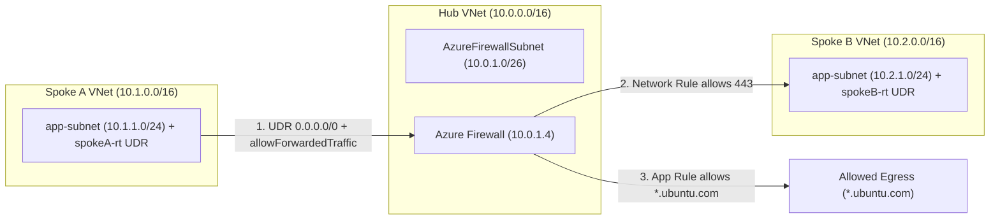
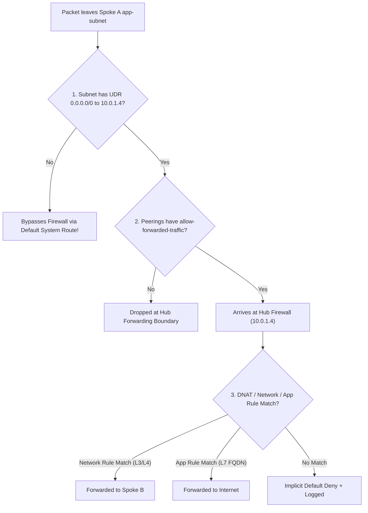
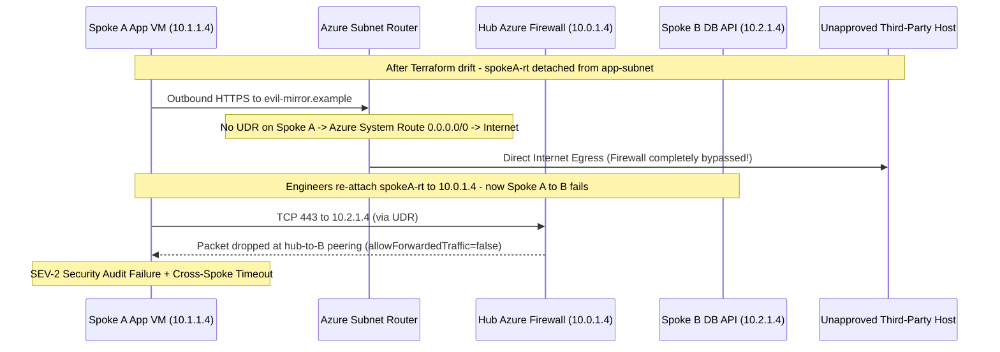

# Module 07: Azure Firewall & Hub-Spoke

> **Prerequisites:** Modules 01–06 (VNets/subnets, NSGs, Private DNS, NAT Gateway, non-transitive VNet peering, L7 routing), and Azure CLI (`az`).  
> **Estimated Reading Time:** 35 minutes  
> **Target Audience:** Backend Engineers, Cloud Infrastructure Engineers, Platform Architects.

> [!TIP]
> **The Golden Rule of Hub-and-Spoke Routing:** Azure Firewall only filters traffic that **actually reaches its private IP**—deploying a firewall with flawless rules does nothing unless User-Defined Routes (`0.0.0.0/0 -> VirtualAppliance`) override Azure's default system routes on spoke subnets. For spoke-to-spoke traffic to traverse the hub, **all three layers must align**: UDRs targeting the firewall IP, `--allow-forwarded-traffic` on every peering link, and a matching Firewall Network Rule.

---

## 1. Architectural Mental Model: Centralized Hub-and-Spoke Inspection

This module ties the entire track together into the topology real Azure enterprises run in production: **hub-and-spoke**, with a central **Azure Firewall** governing egress and inter-spoke flows. It is where peering (Module 05), route tables (UDRs), and firewall policy converge—and where you finally enable spoke-to-spoke communication safely despite peering's non-transitivity. Azure Firewall is also the second resource in this track that **bills hourly even when idle**, and it is the most expensive resource in the curriculum, so cost discipline is critical.



### The Three-Gate Packet Journey
When a VM in `spokeA-vnet` (`10.1.1.4`) calls `spokeB-vnet` (`10.2.1.4`) or an external HTTPS endpoint, Azure enforces three sequential gates. Missing **any one** silently drops packets or lets traffic bypass inspection completely:



### Core Architecture Rules
1. **Mandatory Subnet Name & Size:** Azure Firewall must reside in an exact, case-sensitive subnet named `AzureFirewallSubnet` (recommended `/26` or larger so Azure can autoscale internal firewall instances).
2. **Route Tables (UDRs) Put the Firewall in the Path:** Azure's built-in system routes send internet traffic straight out and VNet traffic across direct peerings—**bypassing the firewall**. Attaching a route table (`0.0.0.0/0` with next hop type `VirtualAppliance` and next hop IP = firewall private IP) to every spoke workload subnet forces traffic through the hub.
3. **Rule Evaluation Hierarchy:** Azure Firewall evaluates **NAT rules** (DNAT inbound) first, then **Network rules** (L3/L4 by IP, port, protocol), then **Application rules** (L7 by destination FQDN)—and applies an **implicit default Deny** if nothing matches.

---

## 2. Taxonomic Comparison & Systematic Command Reference

### NSG vs. Azure Firewall vs. NAT Gateway

| Dimension | Network Security Group (NSG) | Azure Firewall | Azure NAT Gateway |
| :--- | :--- | :--- | :--- |
| **Deployment Model** | Distributed (attached to subnets/NICs) | Centralized appliance in `AzureFirewallSubnet` | Subnet-attached managed SNAT appliance |
| **OSI Inspection Layer** | L3 / L4 (IP, port, protocol) | L3 / L4 Network + L7 FQDN Application + DNAT | L3 / L4 Outbound SNAT only |
| **FQDN Egress Filtering** | **No** (IP/service tags only) | **Yes** (e.g., allow `*.ubuntu.com`) | **No** (no filtering) |
| **Stable Outbound Public IP** | Dynamic unless paired with PIP/NAT | Yes (Firewall's public IP(s)) | **Yes** (dedicated predictable static egress IP) |
| **Centralized Logging** | Per-NSG Flow Logs | Unified single-pane firewall logs & threat intel | Metrics only |
| **Cost** | **Free** | **Substantial fixed hourly rate + per-GB processed** | Low hourly + per-GB processed |
| **When to Use** | Subnet micro-segmentation (always pair with Firewall) | Controlled FQDN egress, inter-spoke inspection, audit logging | High-scale predictable outbound SNAT without L7 inspection |

### Route Table (`--next-hop-type`) Reference

| Next Hop Type | Traffic Destination | Required Extra Parameter | Common Use Case |
| :--- | :--- | :--- | :--- |
| **`VirtualAppliance`** | IP of an NVA or Azure Firewall | `--next-hop-ip-address` (e.g. `10.0.1.4`) | Force `0.0.0.0/0` or inter-spoke traffic through Hub Firewall |
| **`VnetLocal`** | Local VNet address space | None | Override broader UDRs for intra-VNet hops |
| **`Internet`** | Azure default internet edge | None | Required on `ApplicationGatewaySubnet` if `0.0.0.0/0` is overridden elsewhere |
| **`VirtualNetworkGateway`** | VPN or ExpressRoute Gateway | None | Force traffic toward on-premises gateways |
| **`None`** | Blackhole (drops packets) | None | Explicitly block traffic to a prefix via routing |

### Command Reference

| Command | What it does | Example |
|---|---|---|
| `az network firewall create` | Creates an Azure Firewall | `az network firewall create -g hub-lab-rg -n hub-fw --vnet-name hub-vnet` |
| `az network firewall ip-config create` | Assigns the firewall a public IP + subnet | `az network firewall ip-config create -g hub-lab-rg -f hub-fw -n fw-ipconfig --public-ip-address fw-pip --vnet-name hub-vnet` |
| `az network firewall network-rule create` | Adds an L3/L4 network rule | `az network firewall network-rule create -g hub-lab-rg -f hub-fw --collection-name net-coll --name allow-spoke --protocols TCP --source-addresses 10.1.0.0/16 --destination-addresses 10.2.0.0/16 --destination-ports 443 --action Allow --priority 100` |
| `az network firewall application-rule create` | Adds an L7 FQDN rule | `az network firewall application-rule create -g hub-lab-rg -f hub-fw --collection-name app-coll --name allow-ubuntu --protocols Http=80 Https=443 --source-addresses 10.1.0.0/16 --target-fqdns *.ubuntu.com --action Allow --priority 200` |
| `az network route-table create` | Creates a route table (UDR) | `az network route-table create -g hub-lab-rg -n spokeA-rt` |
| `az network route-table route create` | Adds a route | `az network route-table route create -g hub-lab-rg --route-table-name spokeA-rt -n to-fw --address-prefix 0.0.0.0/0 --next-hop-type VirtualAppliance --next-hop-ip-address 10.0.1.4` |
| `az network vnet subnet update` | Attaches a route table to a subnet | `az network vnet subnet update -g hub-lab-rg --vnet-name spokeA-vnet -n app-subnet --route-table spokeA-rt` |

**Flag breakdown** — `az network firewall network-rule create ... --collection-name net-coll --name allow-spoke --protocols TCP --source-addresses 10.1.0.0/16 --destination-addresses 10.2.0.0/16 --destination-ports 443 --action Allow --priority 100`:
- `--collection-name`: rule collection to add to (created on first rule); `--priority` and `--action` apply at the collection level.
- `--protocols`: `TCP`/`UDP`/`ICMP`/`Any`.
- `--source-addresses` / `--destination-addresses`: CIDR(s) for each end.
- `--destination-ports`: allowed destination port(s).
- `--action`: `Allow` or `Deny` for the collection.
- `--priority`: collection priority (100–65000; lower first).

**Flag breakdown** — `az network route-table route create ... -n to-fw --address-prefix 0.0.0.0/0 --next-hop-type VirtualAppliance --next-hop-ip-address 10.0.1.4`:
- `--address-prefix`: which destination range this route matches (`0.0.0.0/0` = all traffic / default route).
- `--next-hop-type`: `VirtualAppliance` (send to an IP like a firewall), `Internet`, `VnetLocal`, `VirtualNetworkGateway`, or `None`.
- `--next-hop-ip-address`: the firewall's private IP (required when next hop is `VirtualAppliance`).

---

## 3. Production War Story Post-Mortem: The Unrouted Firewall Bypass & Inter-Spoke Drop



### The Incident
During an enterprise compliance audit, security engineers ran an egress verification probe from `spokeA-vnet` expecting Azure Firewall to block connections to unapproved domains. Surprisingly, `curl https://evil-mirror.example` succeeded—and zero entries appeared in `AZFWApplicationRule` logs! When an on-call engineer hastily re-attached a route table (`spokeA-rt`) to restore egress inspection, inter-spoke API calls from Spoke A (`10.1.1.4`) to Spoke B (`10.2.1.4`) immediately began timing out.

### Post-Mortem Telemetry
* **Severity:** SEV-2 (Security egress control bypass followed by 22-minute inter-spoke outage)
* **Mean Time to Detect (MTTD):** Discovered during scheduled compliance scan (zero automated UDR drift alert)
* **Mean Time to Resolution (MTTR):** 22 minutes once diagnosed
* **Impact:** Unfiltered outbound egress window on Spoke A + 22-minute spoke-to-spoke API timeout

### Root Cause Analysis
1. **Unattached Route Table Bypassed Firewall:** During an earlier subnet NSG migration, a CLI command recreated the subnet association without `--route-table spokeA-rt`. Without the `0.0.0.0/0 -> VirtualAppliance (10.0.1.4)` UDR, Azure's default system route routed Spoke A directly to the Internet, rendering every firewall rule inert.
2. **Missing `--allow-forwarded-traffic` on Peerings:** Once `spokeA-rt` sent `10.2.0.0/16` traffic to `10.0.1.4`, Azure Firewall forwarded it toward Spoke B—but `hub-to-B` peering had `AllowForwardedTraffic = false`, causing Azure's peering fabric to drop forwarded packets whose source IP (`10.1.1.4`) did not originate inside `hub-vnet`.

### The Fix & Architectural Hardening
1. **Re-Attached UDR & Enabled Forwarded Traffic:** Attached `spokeA-rt` and `spokeB-rt` to both workload subnets and updated all four peering links (`hub-to-A`, `A-to-hub`, `hub-to-B`, `B-to-hub`) with `--allow-forwarded-traffic`.
2. **Continuous Effective-Route Validation:** Added an automated drift audit checking `az network nic show-effective-route-table` for `0.0.0.0/0 -> VirtualAppliance 10.0.1.4` and verifying **both** positive allowed FQDN egress and negative blocked FQDN denials after every network change.

---

## 4. Multi-Language Production Implementation: Hub-Spoke UDR & Peering Drift Auditor

In enterprise landing zones, a single missing UDR or `allowForwardedTraffic=false` flag breaks the security perimeter silently. These production auditors inspect the hub Azure Firewall private IP, verify `AllowForwardedTraffic` across all hub-spoke peerings, and confirm every spoke workload subnet attaches a Route Table pointing `0.0.0.0/0` to `VirtualAppliance`:

````carousel
```go
package main

import (
	"context"
	"fmt"
	"os"
	"strings"
	"time"

	"github.com/Azure/azure-sdk-for-go/sdk/azidentity"
	"github.com/Azure/azure-sdk-for-go/sdk/resourcemanager/network/armnetwork/v5"
)

func auditHubSpokeTopology(ctx context.Context, subID, rg, hubVNet, fwName string, spokeVNets []string) error {
	cred, err := azidentity.NewDefaultAzureCredential(nil)
	if err != nil {
		return err
	}

	fwClient, err := armnetwork.NewAzureFirewallsClient(subID, cred, nil)
	if err != nil {
		return err
	}
	fw, err := fwClient.Get(ctx, rg, fwName, nil)
	if err != nil {
		return fmt.Errorf("firewall fetch failed: %w", err)
	}
	fwIP := *fw.Properties.IPConfigurations[0].Properties.PrivateIPAddress
	fmt.Printf("Hub Firewall Private IP: %s\n", fwIP)

	peerClient, _ := armnetwork.NewVirtualNetworkPeeringsClient(subID, cred, nil)
	pager := peerClient.NewListPager(rg, hubVNet, nil)
	for pager.More() {
		page, err := pager.NextPage(ctx)
		if err != nil {
			return err
		}
		for _, p := range page.Value {
			if p.Properties.AllowForwardedTraffic == nil || !*p.Properties.AllowForwardedTraffic {
				return fmt.Errorf("hub peering %s missing AllowForwardedTraffic=true", *p.Name)
			}
		}
	}

	subnetClient, _ := armnetwork.NewSubnetsClient(subID, cred, nil)
	rtClient, _ := armnetwork.NewRouteTablesClient(subID, cred, nil)
	for _, spoke := range spokeVNets {
		sub, err := subnetClient.Get(ctx, rg, spoke, "app-subnet", nil)
		if err != nil {
			return err
		}
		if sub.Properties.RouteTable == nil || sub.Properties.RouteTable.ID == nil {
			return fmt.Errorf("spoke %s/app-subnet has NO Route Table (firewall bypassed!)", spoke)
		}
		parts := strings.Split(*sub.Properties.RouteTable.ID, "/")
		rtName := parts[len(parts)-1]
		rt, err := rtClient.Get(ctx, rg, rtName, nil)
		if err != nil {
			return err
		}
		matched := false
		for _, r := range rt.Properties.Routes {
			if *r.Properties.AddressPrefix == "0.0.0.0/0" &&
				*r.Properties.NextHopType == armnetwork.RouteNextHopTypeVirtualAppliance &&
				r.Properties.NextHopIPAddress != nil && *r.Properties.NextHopIPAddress == fwIP {
				matched = true
			}
		}
		if !matched {
			return fmt.Errorf("route table %s lacks 0.0.0.0/0 -> VirtualAppliance (%s)", rtName, fwIP)
		}
		fmt.Printf("Verified Spoke %s/app-subnet -> UDR %s -> %s\n", spoke, rtName, fwIP)
	}
	return nil
}

func main() {
	ctx, cancel := context.WithTimeout(context.Background(), 30*time.Second)
	defer cancel()
	if err := auditHubSpokeTopology(ctx, os.Getenv("AZURE_SUBSCRIPTION_ID"), "hub-lab-rg", "hub-vnet", "hub-fw", []string{"spokeA-vnet", "spokeB-vnet"}); err != nil {
		fmt.Fprintf(os.Stderr, "HUB-SPOKE AUDIT FAILED: %v\n", err)
		os.Exit(1)
	}
}
```
<!-- slide -->
```typescript
import { NetworkManagementClient } from "@azure/arm-network";
import { DefaultAzureCredential } from "@azure/identity";

async function auditHubSpokeRouting(
  subscriptionId: string,
  rg: string,
  hubVNet: string,
  firewallName: string,
  spokeVNets: string[]
): Promise<void> {
  const client = new NetworkManagementClient(new DefaultAzureCredential(), subscriptionId);

  const fw = await client.azureFirewalls.get(rg, firewallName);
  const fwIp = fw.ipConfigurations?.[0]?.privateIPAddress;
  if (!fwIp) throw new Error(`Firewall ${firewallName} has no private IP`);
  console.log(`Hub Firewall Private IP: ${fwIp}`);

  for await (const peering of client.virtualNetworkPeerings.list(rg, hubVNet)) {
    if (peering.peeringState !== "Connected" || !peering.allowForwardedTraffic) {
      throw new Error(
        `Peering ${peering.name} invalid: state=${peering.peeringState}, allowForwarded=${peering.allowForwardedTraffic}`
      );
    }
  }

  for (const spoke of spokeVNets) {
    const subnet = await client.subnets.get(rg, spoke, "app-subnet");
    const rtId = subnet.routeTable?.id;
    if (!rtId) {
      throw new Error(`Spoke ${spoke}/app-subnet has no UDR; traffic bypasses firewall`);
    }
    const rtName = rtId.split("/").pop() ?? "";
    const rt = await client.routeTables.get(rg, rtName);

    const hasDefaultRoute = (rt.routes ?? []).some(
      (r) =>
        r.addressPrefix === "0.0.0.0/0" &&
        r.nextHopType === "VirtualAppliance" &&
        r.nextHopIpAddress === fwIp
    );
    if (!hasDefaultRoute) {
      throw new Error(`Route table ${rtName} missing 0.0.0.0/0 -> ${fwIp}`);
    }
    console.log(`Verified ${spoke}/app-subnet -> UDR ${rtName} -> ${fwIp}`);
  }
}

auditHubSpokeRouting(
  process.env.AZURE_SUBSCRIPTION_ID ?? "",
  "hub-lab-rg",
  "hub-vnet",
  "hub-fw",
  ["spokeA-vnet", "spokeB-vnet"]
).catch((err) => {
  console.error("HUB-SPOKE AUDIT FAILED:", err.message);
  process.exit(1);
});
```
<!-- slide -->
```python
import os
import sys
from azure.identity import DefaultAzureCredential
from azure.mgmt.network import NetworkManagementClient


def audit_hub_spoke_routing(
    subscription_id: str, rg: str, hub_vnet: str, fw_name: str, spoke_vnets: list[str]
) -> None:
    client = NetworkManagementClient(DefaultAzureCredential(), subscription_id)

    fw = client.azure_firewalls.get(rg, fw_name)
    fw_ip = fw.ip_configurations[0].private_ip_address
    print(f"Hub Firewall Private IP: {fw_ip}")

    for peering in client.virtual_network_peerings.list(rg, hub_vnet):
        if peering.peering_state != "Connected" or not peering.allow_forwarded_traffic:
            raise RuntimeError(
                f"Peering {peering.name} invalid: state={peering.peering_state}, "
                f"allow_forwarded={peering.allow_forwarded_traffic}"
            )

    for spoke in spoke_vnets:
        subnet = client.subnets.get(rg, spoke, "app-subnet")
        if not subnet.route_table or not subnet.route_table.id:
            raise RuntimeError(f"{spoke}/app-subnet has NO Route Table (firewall bypassed)")

        rt_name = subnet.route_table.id.split("/")[-1]
        rt = client.route_tables.get(rg, rt_name)
        valid_udr = any(
            r.address_prefix == "0.0.0.0/0"
            and r.next_hop_type == "VirtualAppliance"
            and r.next_hop_ip_address == fw_ip
            for r in (rt.routes or [])
        )
        if not valid_udr:
            raise RuntimeError(f"Route table {rt_name} lacks 0.0.0.0/0 -> {fw_ip}")
        print(f"Verified {spoke}/app-subnet -> UDR {rt_name} -> {fw_ip}")


if __name__ == "__main__":
    try:
        audit_hub_spoke_routing(
            os.environ["AZURE_SUBSCRIPTION_ID"],
            "hub-lab-rg",
            "hub-vnet",
            "hub-fw",
            ["spokeA-vnet", "spokeB-vnet"],
        )
    except Exception as exc:
        print(f"HUB-SPOKE AUDIT FAILED: {exc}", file=sys.stderr)
        sys.exit(1)
```
<!-- slide -->
```csharp
using System;
using System.Linq;
using System.Threading.Tasks;
using Azure.Identity;
using Azure.ResourceManager;
using Azure.ResourceManager.Network;

public static class HubSpokeDriftAuditor
{
    public static async Task Main()
    {
        string subId = Environment.GetEnvironmentVariable("AZURE_SUBSCRIPTION_ID")
            ?? throw new InvalidOperationException("AZURE_SUBSCRIPTION_ID missing");

        var arm = new ArmClient(new DefaultAzureCredential());
        var fwId = AzureFirewallResource.CreateResourceIdentifier(subId, "hub-lab-rg", "hub-fw");
        AzureFirewallResource fw = await arm.GetAzureFirewallResource(fwId).GetAsync();
        string fwIp = fw.Data.IPConfigurations[0].PrivateIPAddress
            ?? throw new Exception("Firewall private IP missing");
        Console.WriteLine($"Hub Firewall Private IP: {fwIp}");

        var hubId = VirtualNetworkResource.CreateResourceIdentifier(subId, "hub-lab-rg", "hub-vnet");
        VirtualNetworkResource hub = await arm.GetVirtualNetworkResource(hubId).GetAsync();
        await foreach (var peering in hub.GetVirtualNetworkPeerings().GetAllAsync())
        {
            if (peering.Data.PeeringState?.ToString() != "Connected" || peering.Data.AllowForwardedTraffic != true)
            {
                throw new Exception($"Peering {peering.Data.Name} missing Connected or AllowForwardedTraffic");
            }
        }

        foreach (string spoke in new[] { "spokeA-vnet", "spokeB-vnet" })
        {
            var subResId = SubnetResource.CreateResourceIdentifier(subId, "hub-lab-rg", spoke, "app-subnet");
            SubnetResource subnet = await arm.GetSubnetResource(subResId).GetAsync();
            if (subnet.Data.RouteTable?.Id is null)
            {
                throw new Exception($"{spoke}/app-subnet has no Route Table attached");
            }

            RouteTableResource rt = await arm.GetRouteTableResource(subnet.Data.RouteTable.Id).GetAsync();
            bool hasDefault = rt.Data.Routes.Any(r =>
                r.AddressPrefix == "0.0.0.0/0" &&
                r.NextHopType?.ToString() == "VirtualAppliance" &&
                r.NextHopIPAddress == fwIp);

            if (!hasDefault)
            {
                throw new Exception($"Route table {rt.Data.Name} missing 0.0.0.0/0 -> {fwIp}");
            }
            Console.WriteLine($"Verified {spoke}/app-subnet -> UDR {rt.Data.Name} -> {fwIp}");
        }
    }
}
```
````

---

## 5. Practical Hands-On Verification CLI Workflows

> [!WARNING]
> **Cost warning:** Azure Firewall bills a substantial hourly rate plus per-GB the entire time it exists — this is the most expensive resource in the track. Do this module in one sitting and delete the group immediately after.

Build the hub and two spokes (non-overlapping ranges), with the firewall's mandatory subnet (`AzureFirewallSubnet`, `/26`):
```bash
az group create --name hub-lab-rg --location eastus
az network vnet create -g hub-lab-rg -n hub-vnet --address-prefixes 10.0.0.0/16 \
  --subnet-name AzureFirewallSubnet --subnet-prefixes 10.0.1.0/26
az network vnet create -g hub-lab-rg -n spokeA-vnet --address-prefixes 10.1.0.0/16 \
  --subnet-name app-subnet --subnet-prefixes 10.1.1.0/24
az network vnet create -g hub-lab-rg -n spokeB-vnet --address-prefixes 10.2.0.0/16 \
  --subnet-name app-subnet --subnet-prefixes 10.2.1.0/24
```

### Workflow 1: Peer Both Spokes to the Hub with Forwarding Allowed
```bash
az network vnet peering create -g hub-lab-rg -n hub-to-A \
  --vnet-name hub-vnet --remote-vnet spokeA-vnet \
  --allow-vnet-access --allow-forwarded-traffic
az network vnet peering create -g hub-lab-rg -n A-to-hub \
  --vnet-name spokeA-vnet --remote-vnet hub-vnet \
  --allow-vnet-access --allow-forwarded-traffic
az network vnet peering create -g hub-lab-rg -n hub-to-B \
  --vnet-name hub-vnet --remote-vnet spokeB-vnet \
  --allow-vnet-access --allow-forwarded-traffic
az network vnet peering create -g hub-lab-rg -n B-to-hub \
  --vnet-name spokeB-vnet --remote-vnet hub-vnet \
  --allow-vnet-access --allow-forwarded-traffic

az network vnet peering list -g hub-lab-rg --vnet-name hub-vnet \
  --query "[].{Name:name, State:peeringState, Forwarded:allowForwardedTraffic}" -o table
```
**Expected Output:**
```text
Name      State      Forwarded
--------  ---------  -----------
hub-to-A  Connected  True
hub-to-B  Connected  True
```

### Workflow 2: Create the Azure Firewall & Capture Its Private IP
*(Provisioning takes several minutes.)*
```bash
az network public-ip create -g hub-lab-rg -n fw-pip \
  --sku Standard --allocation-method Static
az network firewall create -g hub-lab-rg -n hub-fw --vnet-name hub-vnet
az network firewall ip-config create -g hub-lab-rg -f hub-fw \
  -n fw-ipconfig --public-ip-address fw-pip --vnet-name hub-vnet

az network firewall show -g hub-lab-rg -n hub-fw \
  --query "ipConfigurations[0].privateIPAddress" -o tsv
```
**Expected Output:**
```text
10.0.1.4
```
*(You will route spoke traffic to this private IP.)*

### Workflow 3: Create Route Tables Sending Each Spoke Through the Firewall
Assume the firewall private IP is `10.0.1.4`:
```bash
az network route-table create -g hub-lab-rg -n spokeA-rt
az network route-table route create -g hub-lab-rg \
  --route-table-name spokeA-rt -n to-fw --address-prefix 0.0.0.0/0 \
  --next-hop-type VirtualAppliance --next-hop-ip-address 10.0.1.4
az network vnet subnet update -g hub-lab-rg --vnet-name spokeA-vnet \
  -n app-subnet --route-table spokeA-rt

az network route-table create -g hub-lab-rg -n spokeB-rt
az network route-table route create -g hub-lab-rg \
  --route-table-name spokeB-rt -n to-fw --address-prefix 0.0.0.0/0 \
  --next-hop-type VirtualAppliance --next-hop-ip-address 10.0.1.4
az network vnet subnet update -g hub-lab-rg --vnet-name spokeB-vnet \
  -n app-subnet --route-table spokeB-rt

az network vnet subnet show -g hub-lab-rg --vnet-name spokeA-vnet \
  -n app-subnet --query routeTable.id -o tsv
```
**Expected Output:**
```text
/subscriptions/.../resourceGroups/hub-lab-rg/providers/Microsoft.Network/routeTables/spokeA-rt
```

### Workflow 4: Add a Firewall Network Rule Allowing Spoke A ↔ Spoke B
```bash
az network firewall network-rule create -g hub-lab-rg -f hub-fw \
  --collection-name spoke-coll --name allow-A-to-B --protocols TCP \
  --source-addresses 10.1.0.0/16 --destination-addresses 10.2.0.0/16 \
  --destination-ports 443 --action Allow --priority 100
```
*(Now Spoke A → Spoke B on TCP 443 is routed to the firewall via the UDR and permitted by this rule—spoke-to-spoke works despite non-transitive peering.)*

### Workflow 5: Add an Application Rule for Controlled Egress
Allow spokes to reach only Ubuntu package mirrors over HTTP/HTTPS, and nothing else:
```bash
az network firewall application-rule create -g hub-lab-rg -f hub-fw \
  --collection-name egress-coll --name allow-ubuntu \
  --protocols Http=80 Https=443 --source-addresses 10.1.0.0/16 10.2.0.0/16 \
  --target-fqdns "*.ubuntu.com" --action Allow --priority 200
```
*(This is FQDN-based egress filtering—something an NSG cannot do.)*

### Workflow 6: Diagnose and Fix Firewall Deployed but Bypassed (Missing UDR)
Remove the route table from Spoke A to simulate the classic mistake:
```bash
az network vnet subnet update -g hub-lab-rg --vnet-name spokeA-vnet \
  -n app-subnet --remove routeTable
```
Now Spoke A's default route is the system route (straight to internet / direct peering), so **traffic never reaches the firewall**—the firewall rules appear to do nothing and spoke-to-spoke stops flowing through it.
* **Diagnose:** The firewall config is correct, but `az network vnet subnet show` returns `null` for `routeTable`—routing, not the rules, is the problem.
* **Fix:** Re-attach the route table:
```bash
az network vnet subnet update -g hub-lab-rg --vnet-name spokeA-vnet \
  -n app-subnet --route-table spokeA-rt

az network vnet subnet show -g hub-lab-rg --vnet-name spokeA-vnet \
  -n app-subnet --query routeTable.id -o tsv
```
**Expected Output:**
```text
/subscriptions/.../resourceGroups/hub-lab-rg/providers/Microsoft.Network/routeTables/spokeA-rt
```
*(**Lesson:** a firewall only filters traffic that's routed to it. Without a UDR `0.0.0.0/0 -> firewall private IP` on the subnet, the firewall is bypassed entirely.)*

### Workflow 7: Diagnose and Fix Spoke-to-Spoke Blocked Despite the Route
Suppose the UDR is in place, yet Spoke A still cannot reach Spoke B. Two remaining culprits exist: the peering isn't allowing forwarded traffic, or the firewall lacks a rule permitting the flow. Inspect both in order:
```bash
az network vnet peering list -g hub-lab-rg --vnet-name hub-vnet \
  --query "[].{Name:name, AllowForwarded:allowForwardedTraffic}" -o table
az network firewall network-rule list -g hub-lab-rg -f hub-fw \
  --collection-name spoke-coll -o table
```
**Expected Output:**
```text
Name      AllowForwarded
--------  --------------
hub-to-A  True
hub-to-B  True

Name          Action    Priority    SourceAddresses    DestinationAddresses    DestinationPorts
------------  --------  ----------  -----------------  ----------------------  ------------------
allow-A-to-B  Allow     100         10.1.0.0/16        10.2.0.0/16             443
```
*(Reason through which layer drops the packet: routing gets it to the firewall; the firewall rule decides allow/deny; the peering's forwarded-traffic flag decides whether the hub may relay it. All three must line up.)*

### Workflow 8: Cleanup — Do This Now
Azure Firewall is the priciest resource in the track. Delete the group immediately:
```bash
az group delete --name hub-lab-rg --yes --no-wait
az group show -n hub-lab-rg
```
*(Verify `az group show -n hub-lab-rg` eventually returns not-found, and check Cost Management to confirm no Firewall or public IP lingers.)*

---

### Independent Challenge
Combine this module with **Module 04 (NAT Gateway / outbound) and Module 03 (private DNS)** conceptually. Build a hub with an Azure Firewall and one spoke, route the spoke's egress through the firewall, and configure an **application rule** that allows the spoke to reach exactly one FQDN (say `*.microsoft.com`) and denies all other web egress. Then reason about how this centralized, FQDN-based egress control differs from a NAT Gateway's role (Module 04): one controls *what* you can reach by name, the other controls *which IP* your outbound traffic appears from. Confirm you can explain when you'd use each. Tear the resource group down the instant you're done — the firewall bills every hour it exists.

<details><summary>Stuck? One hint</summary>

The firewall only sees traffic a UDR sends it (`0.0.0.0/0 → firewall private IP` on the spoke subnet). Once traffic arrives, an *application* rule filters by destination FQDN, while a *network* rule filters by IP/port — for "only *.microsoft.com" you want an application rule with `--target-fqdns`. A NAT Gateway, by contrast, doesn't filter destinations at all; it just SNATs your outbound to a stable public IP. Different jobs: FQDN allow-listing vs. source NAT.

</details>

---

## 6. Common Mistakes & Troubleshooting
- **Firewall deployed but bypassed.** No UDR means traffic never routes to the firewall — the rules look inert. Attach a route table with `0.0.0.0/0 → fw private IP` to each subnet whose traffic must be inspected.
- **Spoke-to-spoke silently fails.** Needs all three: peering with forwarded traffic, a UDR to the firewall, and a firewall network rule allowing it.
- **Wrong firewall subnet name.** Must be exactly `AzureFirewallSubnet`, recommended `/26`.
- **Using Firewall where an NSG suffices.** NSGs are free and handle basic subnet allow/deny; the Firewall is for FQDN egress, centralized logging, and inter-spoke control. Don't pay for what an NSG does.
- **Cost pitfall (the biggest in the track):** Azure Firewall bills a large fixed hourly rate plus per-GB regardless of traffic, and it's easy to forget because it has no obvious "on" indicator. An idle Firewall left over a weekend can be the most expensive mistake in this curriculum. Delete the group the moment you finish, and confirm in Cost Management.

---

## 7. Operational Validation Checkpoints & Cumulative Review

### Production Troubleshooting Scenarios

<details>
<summary><strong>Scenario 1: Application Rule Blocks Nothing — Unapproved Sites Load Fine</strong></summary>

**Scenario:** A platform engineer deploys `hub-fw`, sets up an Application Rule allowing only `*.ubuntu.com`, and tests `curl https://example.com` from a VM in `spokeA-vnet`. Instead of seeing a firewall deny message, `example.com` returns `200 OK`.

**Diagnosis & Fix:** Run `az network nic show-effective-route-table` on the Spoke A VM's NIC. You will see `0.0.0.0/0` still resolves to `NextHopType: Internet` instead of `VirtualAppliance (10.0.1.4)` because `spokeA-rt` wasn't created or attached to `app-subnet`. Attach `spokeA-rt` to `app-subnet` to force all egress through the firewall.

</details>

<details>
<summary><strong>Scenario 2: Spoke-to-Spoke Succeeds One Way, Times Out Return Path</strong></summary>

**Scenario:** `spokeA-rt` routes `0.0.0.0/0 -> 10.0.1.4`, and `hub-fw` has a Network Rule allowing `10.1.0.0/16 -> 10.2.0.0/16:443`. When a VM in Spoke A connects to `10.2.1.4:443`, firewall logs show `Allow`, yet TCP handshakes time out. `spokeB-vnet`'s `app-subnet` has no UDR attached.

**Diagnosis & Fix:** **Asymmetric routing!** Forward packets travel `Spoke A -> Firewall -> Spoke B`, while Spoke B's reply packets follow Azure's direct VNet peering route `Spoke B -> Spoke A` (bypassing the stateful firewall or hitting a missing `allow-forwarded-traffic` boundary). Stateful inspection drops asymmetric flows. Attach `spokeB-rt` (`0.0.0.0/0 -> 10.0.1.4`) to `spokeB-vnet/app-subnet` and ensure `--allow-forwarded-traffic` is set on all four peering links.

</details>

<details>
<summary><strong>Scenario 3: Routing Loop When UDR Is Applied to AzureFirewallSubnet</strong></summary>

**Scenario:** An engineer tries to save time by associating `spokeA-rt` (`0.0.0.0/0 -> 10.0.1.4`) to **all** subnets across both the spokes and the hub, including `AzureFirewallSubnet`—causing total outbound failure or ARM validation rejection.

**Diagnosis & Fix:** `AzureFirewallSubnet` must **never** carry a `0.0.0.0/0 -> VirtualAppliance (itself)` route! Doing so forces the firewall's own outbound traffic right back into itself in a routing loop (and blocks Azure platform control-plane traffic). Keep `AzureFirewallSubnet`'s default `0.0.0.0/0 -> Internet` route (or explicit next-hop `Internet` if using ExpressRoute forced tunneling with management NICs).

</details>

### Core Concept Checkpoint Quiz
Write down your answer to each question before expanding it — checking without attempting first is the single easiest way to fool yourself into thinking you've learned this.

1. You deployed an Azure Firewall with correct rules, but your spoke traffic goes straight to the internet and never hits the firewall. What's missing?
2. What are the three rule types Azure Firewall supports, and which one filters by destination FQDN?
3. Name the three things that must all be in place for spoke-A to reach spoke-B through the hub firewall.
4. What must the firewall's subnet be named, and what's the recommended size?
5. Give two ways Azure Firewall differs from an NSG.
6. In a route table, what `--next-hop-type` and `--next-hop-ip-address` do you use to send `0.0.0.0/0` through the firewall?
7. Why is "use an NSG instead of the Firewall where possible" good advice?

<details><summary>Show answers</summary>

1. A route table (UDR) on the spoke subnet with `0.0.0.0/0 → firewall private IP` (next hop `VirtualAppliance`). The firewall only filters traffic that's routed to it.
2. Network rules (L3/L4 by IP/port/protocol), application rules (L7 by FQDN), and NAT rules (DNAT). Application rules filter by FQDN.
3. (1) Both spoke↔hub peerings with `--allow-forwarded-traffic`, (2) a UDR on each spoke routing the other spoke (or `0.0.0.0/0`) to the firewall IP, and (3) a firewall network rule allowing the flow.
4. `AzureFirewallSubnet` (exact, case-sensitive), recommended `/26` or larger.
5. Any two: NSG is distributed/free/L3-L4 on IP-port with no FQDN filtering; Firewall is a centralized appliance, billed hourly + per-GB, adds L7 FQDN application rules, threat intel, and centralized logging.
6. `--next-hop-type VirtualAppliance` and `--next-hop-ip-address <firewall private IP>`.
7. NSGs are free and handle basic subnet/NIC allow-deny; the Firewall bills a large hourly rate, so reserving it for what only it can do (FQDN egress, centralized logging, inter-spoke control) avoids unnecessary cost.

</details>

### Cumulative Review (Modules 04–07)
Closed-book. Answer all of these in writing before opening the solutions — they mix modules 04 through 07 on purpose.

1. A public-facing web app needs URL path-based routing, TLS termination, and a WAF; a separate internal service just needs raw TCP flow distribution across three backends. Which Azure resource for each, and why?
2. Your Standard Load Balancer's backends all show unhealthy and your App Gateway returns 502. Name the single root-cause *category* both failures most commonly share, and the diagnostic command for each.
3. You built a hub-spoke with a firewall, correct peerings (forwarded traffic on), and correct firewall rules, but spoke traffic still goes straight to the internet, ignoring the firewall. What's missing and how do you fix it?
4. Explain why spoke-A can't reach spoke-B "through the hub" just because both are peered to the hub, and list the three things needed to make it work.
5. A VM in a spoke has no outbound internet at all (not even to allowed FQDNs). Give two independent possible causes — one from module 04, one from module 07 — and how you'd distinguish them.
6. Contrast an NSG and Azure Firewall on: layer/granularity, centralized vs. distributed, FQDN filtering, and cost.
7. You need outbound traffic from a subnet to always appear from one stable public IP, and separately you need to allow-list which FQDNs that subnet can reach. Which resource does each job?
8. Which two resources in modules 04–07 bill hourly even when completely idle, and what's your standing habit to avoid surprise charges?

<details><summary>Show answers</summary>

1. Public web app → Application Gateway (WAF_v2) — L7, so it can do path routing, TLS termination, and WAF. Internal TCP service → Azure Load Balancer (L4, internal/ILB) — cheaper, sufficient for raw flow distribution.
2. Category: **health-probe / backend-health misconfiguration** (probe port/path/host doesn't match what the backend serves, or an NSG blocks the probe). LB: `az network watcher test-ip-flow` and probe/port check; App Gateway: `az network application-gateway show-backend-health`.
3. A route table (UDR) on the spoke subnet with `0.0.0.0/0 → firewall private IP` (next hop `VirtualAppliance`). Without it, system routes bypass the firewall. Attach the UDR with `az network vnet subnet update ... --route-table`.
4. Peering isn't transitive — it only connects directly-peered VNets. Needed: (1) both spoke↔hub peerings with `--allow-forwarded-traffic`, (2) a UDR on each spoke routing the other spoke (or `0.0.0.0/0`) to the firewall IP, and (3) a firewall network rule allowing spoke-A ↔ spoke-B.
5. (a) Module 04: no NAT Gateway / outbound path on a Standard-LB subnet, so no SNAT for egress. (b) Module 07: egress is routed to the firewall but no application/network rule allows it (default deny). Distinguish by checking whether a UDR points to the firewall (if yes, it's a firewall rule problem; if no NAT/route at all, it's outbound-path/SNAT).
6. NSG: L3/L4 on IP/port, distributed on subnets/NICs, no FQDN filtering, free. Azure Firewall: L3/L4 + L7 FQDN application rules, centralized appliance in the hub, FQDN filtering yes, bills hourly + per-GB.
7. Stable outbound source IP → NAT Gateway (module 04). FQDN allow-listing → Azure Firewall application rules (module 07).
8. Application Gateway (v2) and Azure Firewall. Standing habit: delete the resource group with `az group delete` the moment the exercise ends, and verify in Cost Management that nothing lingers.

</details>

---

## Next Step
[08 — Capstone project](../08-capstone-project/README.md): assemble a full hub-and-spoke design end to end, verify traffic flows and is blocked where it should be, then tear it all down.
