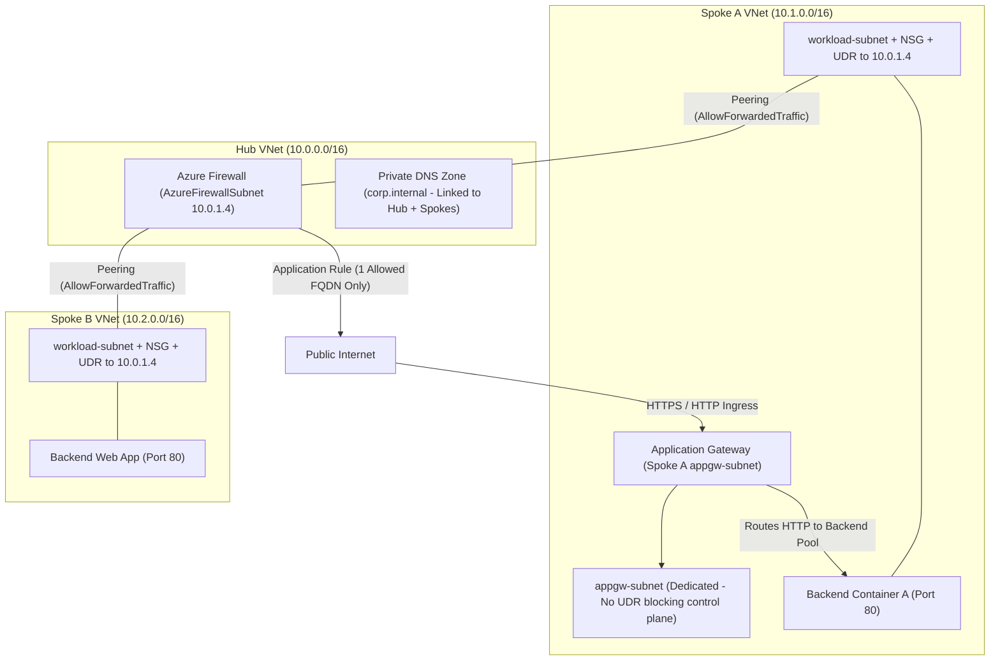
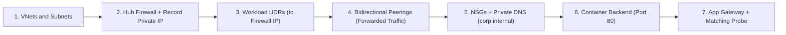
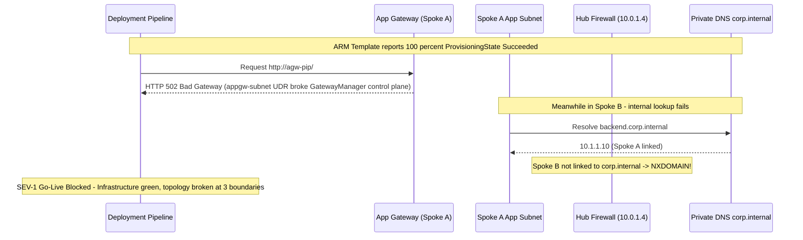

# Module 08: Capstone Project

> **Prerequisites:** Completion of Modules 01–07 (`01-vnets-and-subnets` through `07-azure-firewall-and-hub-spoke`) and Azure CLI (`az`).  
> **Estimated Reading Time:** 20 minutes reading + 60–90 minutes focused build, verification, and teardown  
> **Target Audience:** Backend Engineers, Cloud Infrastructure Engineers, Platform Architects.

> [!TIP]
> **The Golden Rule of the Capstone Architecture:** Build from the core outward—VNets and Subnets first, then Hub Firewall (capture its private IP), then UDRs and Peerings, then Private DNS, then container backends, and Application Gateway last. Never trust silent provisioning alone: verify **both** positive traffic paths and intentional negative denials at every layer (L7 probe/WAF, L4 NSG, L3/L7 Firewall, Private DNS), then delete the single resource group immediately.

> [!WARNING]
> **Cost warning (read before you start):** This project runs an Azure Firewall **and** an Application Gateway simultaneously — the two most expensive resources in the track, both billing hourly whether idle or not, plus public IPs and container instances. Do the whole project in one focused sitting, and run `az group delete` the moment you finish. Budget a few dollars if you leave it up for an hour or two; budget real money if you forget it overnight.

---

## 1. Architectural Mental Model: The Complete Hub-and-Spoke Landing Zone

Every module so far taught one piece in isolation. Real Azure networks are the *combination* — a hub-and-spoke landing zone where VNets, peering, NSGs, private DNS, a firewall, and an L7 gateway all have to cooperate, and where a single missing route or unlinked zone breaks the whole thing. This capstone makes you assemble those pieces from memory, prove traffic flows exactly where it should and nowhere it shouldn't, and then tear it all down cleanly. If you can build and verify this end to end, you can operate the networking layer any Azure workload sits on — including the Container Apps track that comes next.

### Target Topology
Put **everything in a single resource group** (e.g. `capstone-rg`) so one `az group delete` removes it all:



### Build Dependency Order
Provisioning in the wrong order causes circular errors (creating UDRs before knowing the Firewall's private IP) or slow troubleshooting loops:



*(Keep `appgw-subnet` separate from workload UDRs so a `0.0.0.0/0 -> VirtualAppliance` default route does not break Application Gateway v2's management plane!)*

---

## 2. Taxonomic Comparison: Layer Responsibility & Build Requirements

### End-to-End Capstone Layer Responsibility Matrix

| Component | Layer | Role in Capstone | Critical Config Requirement | Signature Failure If Misconfigured |
| :--- | :--- | :--- | :--- | :--- |
| **VNets & Subnets** | L3 | Address segmentation | Non-overlapping `/16`s + dedicated `AzureFirewallSubnet` (>= `/26`) & `appgw-subnet` | Peering rejected or Firewall/AGW creation fails |
| **VNet Peering** | L3 | Hub-to-spoke backbone | Hub ↔ Spoke A & Hub ↔ Spoke B `Connected` + `--allow-forwarded-traffic`; **no** A ↔ B peering | Spoke-to-spoke packets drop at Hub boundary |
| **NSG** | L3/L4 | Subnet micro-segmentation | Attached to each spoke workload subnet with least-privilege port rules | Disallowed port succeeds OR allowed health probe blocked |
| **Private DNS** | L7 DNS | Internal name resolution | `corp.internal` linked to **Hub + Spoke A + Spoke B** + A record | `nslookup` returns `NXDOMAIN` from one or more spokes |
| **Route Table (UDR)** | L3 | Traffic steering | Attached to **workload subnets** sending `0.0.0.0/0` + cross-spoke CIDR to Firewall private IP | Traffic bypasses Firewall completely (rules appear dead) |
| **Azure Firewall** | L3–L7 | Egress + inter-spoke control | Network rule (Spoke A ↔ Spoke B) + Application rule (1 allowed FQDN only) | Cross-spoke denied or unauthorized egress succeeds |
| **Application Gateway** | L7 | Public HTTP ingress & WAF | Dedicated subnet, Standard PIP, probe matching backend path/port, WAF `Detection` | Frontend returns `502 Bad Gateway` |

### What to Build (Drawing on Modules 01–07)

1. A **hub VNet** (`10.0.0.0/16`) containing an `AzureFirewallSubnet` and an **Azure Firewall** with a public IP (Module 07).
2. **Two spoke VNets** (`10.1.0.0/16`, `10.2.0.0/16`), each **peered to the hub** with forwarded traffic allowed — not peered to each other (Module 05).
3. An **NSG on each spoke's workload subnet** with least-privilege rules (Module 02).
4. A **private DNS zone** (e.g. `corp.internal`) **linked to the hub and both spokes**, so an internal name resolves across the topology (Module 03).
5. **Route tables (UDRs)** on the spoke workload subnets sending `0.0.0.0/0` (and the other spoke's range) to the **firewall's private IP**, so egress and spoke-to-spoke traffic pass through the firewall (Module 07).
6. **Firewall rules**: a network rule allowing spoke-A ↔ spoke-B on your app port, and an application rule allowing egress to one FQDN only (Module 07).
7. A **simple web backend** in a spoke — deploy it with `az container create` (reuse a small image from your Docker/Azure track, e.g. a tiny nginx or hello-world HTTP container serving on port 80).
8. An **Application Gateway** (Standard_v2 or WAF_v2) in front of that backend, with a health probe that matches what the backend actually serves and, if you use WAF_v2, the WAF enabled in Detection mode (Module 06).

### Behavior to Verify (The Real Point — Not Just Building It)

* Traffic to the App Gateway's public frontend reaches the backend and returns a page (probe healthy, routing correct).
* spoke-A can reach spoke-B on the allowed port **through the firewall**, and the firewall logs/rules show the flow taking that path (not direct peering).
* Egress from a spoke to the **one allowed FQDN** succeeds and egress to a **different** FQDN is **blocked** by the firewall application rule.
* The internal private-DNS name resolves to a private IP from a spoke.
* An NSG rule blocks something it's supposed to (e.g. a port you didn't allow), proving the NSG is actually in the path.

Finally, **tear everything down** and confirm nothing is left.

---

## 3. Production War Story Post-Mortem: "Provisioning Succeeded" vs. Broken End-to-End Wiring



### The Incident
A team built an automated Azure hub-and-spoke landing zone in Terraform. Every resource reported `ProvisioningState: Succeeded`, yet the post-deploy smoke test failed across three boundaries simultaneously: Application Gateway returned `502 Bad Gateway` and hung on updates, Spoke B could not resolve `backend.corp.internal`, and outbound connections to unapproved public endpoints escaped unblocked from Spoke B.

### Post-Mortem Telemetry
* **Severity:** SEV-1 (Failed production cutover during launch window)
* **Mean Time to Detect (MTTD):** 5 minutes (automated smoke test caught failures pre-cutover)
* **Mean Time to Resolution (MTTR):** 45 minutes
* **Impact:** Delayed production launch; zero customer data loss due to pre-cutover verification gates

### Root Cause Analysis
1. **UDR Applied Too Broadly (`appgw-subnet`):** The module iterated over *all* subnets in `spokeA-vnet` and attached the `0.0.0.0/0 -> 10.0.1.4` route table to `appgw-subnet`, breaking Application Gateway v2's required direct `GatewayManager` control-plane connectivity.
2. **Incomplete DNS VNet Links:** `corp.internal` was linked to `hub-vnet` and `spokeA-vnet`, omitting `spokeB-vnet`.
3. **Missing Spoke B Route Table:** `spokeB-rt` existed in the resource group, yet was never associated with Spoke B's workload subnet.

### The Fix & Architectural Hardening
1. Scoped UDR attachments exclusively to workload subnets (`workload-subnet`), leaving `appgw-subnet` and `AzureFirewallSubnet` untouched.
2. Automated programmatic acceptance assertions (shown below) running against ARM state and live data-plane probes before signing off any landing zone deployment.

---

## 4. Multi-Language Production Implementation: Capstone Acceptance & Compliance Verifier

Remember: there is intentionally no copy-paste build script here—building the infrastructure from Modules 01–07 is the capstone exercise. However, in real platform engineering, you validate your deployed topology programmatically. These four compliance auditors inspect `capstone-rg` to confirm your build satisfies the structural acceptance criteria:

````carousel
```go
package main

import (
	"context"
	"fmt"
	"net/netip"
	"os"
	"time"

	"github.com/Azure/azure-sdk-for-go/sdk/azidentity"
	"github.com/Azure/azure-sdk-for-go/sdk/resourcemanager/network/armnetwork/v5"
)

func verifyCapstoneRG(ctx context.Context, subID, rg string) error {
	cred, err := azidentity.NewDefaultAzureCredential(nil)
	if err != nil {
		return err
	}

	vnetClient, _ := armnetwork.NewVirtualNetworksClient(subID, cred, nil)
	pager := vnetClient.NewListPager(rg, nil)
	var prefixes []netip.Prefix
	vnetCount := 0

	for pager.More() {
		page, err := pager.NextPage(ctx)
		if err != nil {
			return err
		}
		for _, v := range page.Value {
			vnetCount++
			for _, cidr := range v.Properties.AddressSpace.AddressPrefixes {
				p, err := netip.ParsePrefix(*cidr)
				if err != nil {
					return err
				}
				for _, prev := range prefixes {
					if p.Overlaps(prev) {
						return fmt.Errorf("overlapping VNet CIDR detected: %s vs %s", p, prev)
					}
				}
				prefixes = append(prefixes, p)
			}
			for _, peer := range v.Properties.VirtualNetworkPeerings {
				if *peer.Properties.PeeringState != armnetwork.VirtualNetworkPeeringStateConnected {
					return fmt.Errorf("vnet %s peering %s not Connected", *v.Name, *peer.Name)
				}
				if peer.Properties.AllowForwardedTraffic == nil || !*peer.Properties.AllowForwardedTraffic {
					return fmt.Errorf("vnet %s peering %s missing AllowForwardedTraffic", *v.Name, *peer.Name)
				}
			}
			fmt.Printf("VNet Verified: %s (%d peerings)\n", *v.Name, len(v.Properties.VirtualNetworkPeerings))
		}
	}
	if vnetCount < 3 {
		return fmt.Errorf("expected at least 3 VNets (1 hub + 2 spokes), found %d", vnetCount)
	}

	fwClient, _ := armnetwork.NewAzureFirewallsClient(subID, cred, nil)
	fwPager := fwClient.NewListPager(rg, nil)
	fwFound := false
	for fwPager.More() {
		p, err := fwPager.NextPage(ctx)
		if err != nil {
			return err
		}
		for _, fw := range p.Value {
			fwFound = true
			fmt.Printf("Firewall Verified: %s PrivateIP=%s\n", *fw.Name, *fw.Properties.IPConfigurations[0].Properties.PrivateIPAddress)
		}
	}
	if !fwFound {
		return fmt.Errorf("no Azure Firewall found in %s", rg)
	}
	return nil
}

func main() {
	ctx, cancel := context.WithTimeout(context.Background(), 30*time.Second)
	defer cancel()
	if err := verifyCapstoneRG(ctx, os.Getenv("AZURE_SUBSCRIPTION_ID"), "capstone-rg"); err != nil {
		fmt.Fprintf(os.Stderr, "CAPSTONE AUDIT FAILED: %v\n", err)
		os.Exit(1)
	}
	fmt.Println("All structural capstone checks passed!")
}
```
<!-- slide -->
```typescript
import { NetworkManagementClient } from "@azure/arm-network";
import { DefaultAzureCredential } from "@azure/identity";

async function verifyCapstoneTopology(subscriptionId: string, rg = "capstone-rg"): Promise<void> {
  const client = new NetworkManagementClient(new DefaultAzureCredential(), subscriptionId);

  const vnets = [];
  for await (const v of client.virtualNetworks.list(rg)) {
    vnets.push(v);
  }
  if (vnets.length < 3) {
    throw new Error(`Expected 3 VNets (hub + 2 spokes) in ${rg}, found ${vnets.length}`);
  }

  for (const vnet of vnets) {
    const peerings = vnet.virtualNetworkPeerings ?? [];
    for (const p of peerings) {
      if (p.peeringState !== "Connected" || !p.allowForwardedTraffic) {
        throw new Error(
          `Peering ${p.name} on ${vnet.name} invalid: state=${p.peeringState}, forwarded=${p.allowForwardedTraffic}`
        );
      }
    }
    console.log(`VNet OK: ${vnet.name} (${vnet.addressSpace?.addressPrefixes?.join(", ")})`);
  }

  let gwCount = 0;
  for await (const gw of client.applicationGateways.list(rg)) {
    gwCount++;
    if (gw.operationalState !== "Running") {
      throw new Error(`Application Gateway ${gw.name} state is ${gw.operationalState}`);
    }
    const health = await client.applicationGateways.beginBackendHealthAndWait(rg, gw.name!);
    const healthyBackends = (health.backendAddressPools ?? [])
      .flatMap((p) => p.backendHttpSettingsCollection ?? [])
      .flatMap((s) => s.servers ?? [])
      .filter((srv) => srv.health === "Up");

    if (healthyBackends.length === 0) {
      throw new Error(`App Gateway ${gw.name} has zero healthy backend instances`);
    }
    console.log(`App Gateway OK: ${gw.name} (${healthyBackends.length} healthy backend(s))`);
  }
  if (gwCount === 0) throw new Error(`No Application Gateway found in ${rg}`);
}

verifyCapstoneTopology(process.env.AZURE_SUBSCRIPTION_ID ?? "")
  .then(() => console.log("Capstone structural and AppGW health verification passed!"))
  .catch((err) => {
    console.error("CAPSTONE AUDIT FAILED:", err.message);
    process.exit(1);
  });
```
<!-- slide -->
```python
import ipaddress
import os
import sys
from azure.identity import DefaultAzureCredential
from azure.mgmt.network import NetworkManagementClient


def verify_capstone_topology(subscription_id: str, rg: str = "capstone-rg") -> None:
    client = NetworkManagementClient(DefaultAzureCredential(), subscription_id)

    vnets = list(client.virtual_networks.list(rg))
    if len(vnets) < 3:
        raise RuntimeError(f"Expected 3 VNets (hub + 2 spokes) in {rg}, found {len(vnets)}")

    seen_nets = []
    for vnet in vnets:
        for cidr in vnet.address_space.address_prefixes:
            net = ipaddress.ip_network(cidr)
            for prev in seen_nets:
                if net.overlaps(prev):
                    raise RuntimeError(f"Overlapping VNet prefixes: {net} and {prev}")
            seen_nets.append(net)

        for peering in vnet.virtual_network_peerings or []:
            if peering.peering_state != "Connected" or not peering.allow_forwarded_traffic:
                raise RuntimeError(
                    f"VNet {vnet.name} peering {peering.name} invalid: "
                    f"state={peering.peering_state}, forwarded={peering.allow_forwarded_traffic}"
                )
        print(f"VNet OK: {vnet.name} ({vnet.address_space.address_prefixes})")

    firewalls = list(client.azure_firewalls.list(rg))
    if not firewalls:
        raise RuntimeError(f"No Azure Firewall deployed in {rg}")
    fw_ip = firewalls[0].ip_configurations[0].private_ip_address
    print(f"Firewall OK: {firewalls[0].name} ({fw_ip})")

    agws = list(client.application_gateways.list(rg))
    if not agws:
        raise RuntimeError(f"No Application Gateway deployed in {rg}")
    print(f"App Gateway OK: {agws[0].name} (state={agws[0].operational_state})")


if __name__ == "__main__":
    try:
        verify_capstone_topology(os.environ["AZURE_SUBSCRIPTION_ID"])
        print("Capstone ARM topology checks passed!")
    except Exception as exc:
        print(f"CAPSTONE AUDIT FAILED: {exc}", file=sys.stderr)
        sys.exit(1)
```
<!-- slide -->
```csharp
using System;
using System.Collections.Generic;
using System.Linq;
using System.Threading.Tasks;
using Azure;
using Azure.Identity;
using Azure.ResourceManager;
using Azure.ResourceManager.Network;

public static class CapstoneComplianceVerifier
{
    public static async Task Main()
    {
        string subId = Environment.GetEnvironmentVariable("AZURE_SUBSCRIPTION_ID")
            ?? throw new InvalidOperationException("AZURE_SUBSCRIPTION_ID missing");

        var arm = new ArmClient(new DefaultAzureCredential());
        var rgRes = arm.GetDefaultSubscription().GetResourceGroup("capstone-rg").Value;

        var vnets = new List<VirtualNetworkResource>();
        await foreach (var v in rgRes.GetVirtualNetworks().GetAllAsync())
        {
            vnets.Add(v);
            foreach (var p in v.Data.VirtualNetworkPeerings)
            {
                if (p.PeeringState?.ToString() != "Connected" || p.AllowForwardedTraffic != true)
                {
                    throw new Exception($"Peering {p.Name} on {v.Data.Name} is incomplete");
                }
            }
            Console.WriteLine($"VNet Verified: {v.Data.Name}");
        }
        if (vnets.Count < 3) throw new Exception("Expected at least 3 VNets (hub + 2 spokes)");

        await foreach (var agw in rgRes.GetApplicationGateways().GetAllAsync())
        {
            var op = await agw.BackendHealthAsync(WaitUntil.Completed);
            bool anyHealthy = op.Value.BackendAddressPools
                .SelectMany(p => p.BackendHttpSettingsCollection)
                .SelectMany(s => s.Servers)
                .Any(srv => srv.Health?.ToString() == "Up");

            if (!anyHealthy) throw new Exception($"App Gateway {agw.Data.Name} has no healthy backends");
            Console.WriteLine($"App Gateway Verified: {agw.Data.Name} (Healthy)");
        }
    }
}
```
````

---

## 5. Practical Hands-On Verification CLI Workflows & Acceptance Criteria

There is no full build solution here on purpose. Every command you need appeared in Modules 01–07; rebuilding the wiring from those references is the exercise. Once you build your topology in `capstone-rg`, execute these **five verification workflows** (and teardown verification) to prove both positive paths and intentional denials.

### Workflow 1: Verify App Gateway Ingress & Backend Probe Health
```bash
AGW_IP=$(az network public-ip show -g capstone-rg -n agw-pip --query ipAddress -o tsv)
az network application-gateway show-backend-health -g capstone-rg -n web-agw \
  --query "backendAddressPools[].backendHttpSettingsCollection[].servers[].{IP:address, Health:health}" -o table
curl -i "http://${AGW_IP}/"
```
**Expected Output:**
```text
IP         Health
---------  --------
10.1.1.10  Up

HTTP/1.1 200 OK
```

### Workflow 2: Verify Spoke-to-Spoke Routing via Firewall (Not Direct Peering)
Confirm zero direct peering exists between spokes, verify effective routes on Spoke A point `0.0.0.0/0` (and Spoke B's CIDR) to the Firewall's private IP (`10.0.1.4`), and verify allowed app-port connectivity:
```bash
az network vnet peering list -g capstone-rg --vnet-name spokeA-vnet -o table
az network nic show-effective-route-table -g capstone-rg -n spokeA-vm-nic -o table
# From inside Spoke A workload/container -> Spoke B backend port:
curl -s -o /dev/null -w "%{http_code}\n" http://10.2.1.10:80/
```
**Expected Output:**
```text
Source    State    Address Prefix    Next Hop Type     Next Hop IP
--------  -------  ----------------  ----------------  -------------
User      Active   0.0.0.0/0         VirtualAppliance  10.0.1.4

200
```
*(Only `spokeA-to-hub` appears in `peering list`—confirming traffic traverses the hub firewall.)*

### Workflow 3: Verify Positive & Negative FQDN Egress Enforcement
From inside a Spoke workload, test **both** your single allowed FQDN and a disallowed FQDN:
```bash
# 1. Allowed FQDN (e.g. *.ubuntu.com or *.microsoft.com)
curl -I -s --max-time 5 https://archive.ubuntu.com | head -n 1

# 2. Disallowed FQDN (must fail / be denied by Firewall Application Rule!)
curl -I -s --max-time 5 https://example.com || echo "Blocked as expected"
```
**Expected Output:**
```text
HTTP/2 200
Action: Deny. Reason: Rule Collection ... (or connection reset / timeout -> Blocked as expected)
```

### Workflow 4: Verify Cross-Spoke Private DNS & Least-Privilege NSG Blocking
```bash
# From Spoke A, resolve internal host in Spoke B via corp.internal:
nslookup backend.corp.internal

# Verify NSG blocks an unpermitted port (e.g. port 2222):
nc -zv -w 3 10.2.1.10 2222 || echo "Blocked by NSG as expected"
```
**Expected Output:**
```text
Name:    backend.corp.internal
Address: 10.2.1.10

nc: connect to 10.2.1.10 port 2222 (tcp) timed out: Operation now in progress
Blocked by NSG as expected
```

### Workflow 5: Full Resource Group Teardown & Billing Confirmation
```bash
az group delete --name capstone-rg --yes --no-wait
# Poll until deleted:
az group show -n capstone-rg
```
**Expected Output:**
```text
(ResourceGroupNotFound) Resource group 'capstone-rg' could not be found.
```

---

### Acceptance Criteria Checklist

**Build:**
- [ ] Single resource group holds every resource.
- [ ] Hub VNet `10.0.0.0/16` with an `AzureFirewallSubnet` (exact name, ≥ /26).
- [ ] Azure Firewall deployed with a public IP; its private IP recorded.
- [ ] Two spoke VNets with non-overlapping ranges, each peered to the hub **both directions** (`Connected`) with `--allow-forwarded-traffic`.
- [ ] Spokes are **not** peered to each other.
- [ ] An NSG attached to each spoke workload subnet with least-privilege rules.
- [ ] A private DNS zone linked to the hub and both spokes (one internal A record present).
- [ ] A route table on each spoke workload subnet routing `0.0.0.0/0` (and the other spoke's CIDR) to the firewall's private IP.
- [ ] A firewall network rule allowing spoke-A ↔ spoke-B on the app port.
- [ ] A firewall application rule allowing exactly one egress FQDN.
- [ ] A web backend running via `az container create`.
- [ ] An Application Gateway in front of the backend with a probe that matches the served path/port (backend health = Healthy).

**Verify:**
- [ ] App Gateway public frontend returns the backend page.
- [ ] spoke-A → spoke-B on the allowed port works and is routed via the firewall.
- [ ] Egress to the allowed FQDN succeeds; egress to a disallowed FQDN is blocked.
- [ ] The private-DNS internal name resolves to a private IP from a spoke.
- [ ] A deliberately-not-allowed port is blocked by an NSG (proving it's in the path).

**Tear down:**
- [ ] `az group delete --name capstone-rg --yes` run.
- [ ] `az group show -n capstone-rg` returns not-found.
- [ ] Cost Management confirms no Firewall, App Gateway, or public IP lingers.

### Hints (Not a Solution)

- **Order of build matters.** Create VNets/subnets first, then the firewall (record its private IP), then route tables that reference that IP, then peerings, then DNS, then the backend, then the App Gateway last. The firewall and App Gateway each take several minutes to provision — start them early.
- **Backend health first.** If the App Gateway returns 502, check `az network application-gateway show-backend-health` before anything else — it's almost always a probe path/port mismatch (Module 06), not the routing.
- **"Firewall does nothing" = routing.** If firewall rules seem to have no effect, the subnet is missing its UDR to the firewall's private IP (Module 07). The firewall only filters traffic that's routed to it.
- **Spoke-to-spoke needs three things** aligned: forwarded-traffic on the peerings, a UDR to the firewall, and a firewall network rule (Module 05 + 07).
- **DNS resolves but won't connect?** Resolution (private DNS link) and reachability (NSG/firewall rules) are independent layers (Module 03). Test each separately.
- **Verify egress blocking positively.** Don't just confirm the allowed FQDN works — actively try a disallowed one and confirm it's blocked, or you haven't proven the firewall is enforcing anything.
- **Use `az container create` for the backend** with a tiny HTTP image so the compute cost is negligible and startup is fast; the expensive resources are the Firewall and App Gateway, so those are the ones to delete first if you need to pause.

---

## 6. Common Mistakes & Troubleshooting
- **Attaching the firewall UDR to `appgw-subnet`:** `ApplicationGateway` v2 requires direct `GatewayManager` control-plane connectivity to `Internet`. Only attach `0.0.0.0/0 -> Firewall IP` to workload subnets (`workload-subnet`), or add an explicit `GatewayManager` service-tag route with next hop `Internet`.
- **Testing only the allowed FQDN:** If you never test a disallowed URL, you cannot prove the UDR is even sending traffic through the firewall.
- **Forgetting to link `corp.internal` to BOTH spokes (plus hub):** Missing a VNet link causes `NXDOMAIN` in the unlinked VNet even when the A record exists.
- **Leaving `capstone-rg` alive overnight:** Firewall and Application Gateway bill hourly even with zero traffic. Delete `capstone-rg` immediately after passing the checklist.

---

## 7. Operational Validation Checkpoints

<details>
<summary><strong>Scenario 1: App Gateway Health Probe Fails After Adding Spoke A Route Table</strong></summary>

**Scenario:** After attaching `spokeA-rt` (`0.0.0.0/0 -> 10.0.1.4`) to `appgw-subnet` as well as `workload-subnet`, Application Gateway provisioning stalls or external management health fails.

**Root Cause & Fix:** Application Gateway v2 control-plane traffic from `GatewayManager` requires symmetric Internet return routing directly from `appgw-subnet`. Never route `0.0.0.0/0` away from `Internet` on `appgw-subnet` without preserving `GatewayManager -> Internet`. Detach `spokeA-rt` from `appgw-subnet` and keep it strictly on `workload-subnet`.

</details>

<details>
<summary><strong>Scenario 2: Internal Hostname Resolves via Private DNS, Yet Connection Times Out Across Spokes</strong></summary>

**Scenario:** From a container in Spoke A, `nslookup api.corp.internal` returns `10.2.1.10`, yet `curl http://api.corp.internal/` hangs indefinitely.

**Root Cause & Fix:** DNS resolution (Private DNS Zone link) is working, so isolate the L3/L4 path across three checks: (1) confirm **both** `hub-to-spokeA/B` and `spokeA/B-to-hub` peerings show `Connected` and `AllowForwardedTraffic = True`; (2) confirm **both** spoke workload subnets attach UDRs pointing to `10.0.1.4` (preventing asymmetric return routing); and (3) check that **both** the Hub Firewall Network Rule and Spoke B's workload NSG permit TCP port `80`.

</details>

<details>
<summary><strong>Scenario 3: Disallowed FQDN Returns 200 OK Instead of Being Blocked</strong></summary>

**Scenario:** You configured an Application Rule allowing only `*.ubuntu.com`, and `curl https://archive.ubuntu.com` succeeds—but when testing `curl https://example.com`, it **also** succeeds.

**Root Cause & Fix:** Because `example.com` succeeded, egress traffic is bypassing the firewall completely. Check `az network vnet subnet show --query routeTable` on the source subnet and verify a Route Table with `0.0.0.0/0 -> VirtualAppliance (10.0.1.4)` is actively attached—and verify no higher-priority Network Rule (which evaluates *before* Application Rules!) permits outbound port 443 to `*`.

</details>

---

## Next Step

There is no "next module" — this is the end of the Azure Networking track.

**Before you move on:** a few days from now, sit down with a blank page and redraw this entire hub-and-spoke topology from memory — every VNet, subnet, peering, route table, and where the firewall and App Gateway sit — without looking back at this file. If any piece is fuzzy, reread that module before starting the next track; the Container Apps material assumes this networking is second nature. And one more time: run `az group delete` and then actually confirm it removed everything — Application Gateway and Azure Firewall are the two resources people forget, and they're the two that cost the most.

The next track is **[06-azure-container-apps](../../06-azure-container-apps/README.md)**, which builds directly on the VNet integration, ingress, and DNS concepts you just learned.
