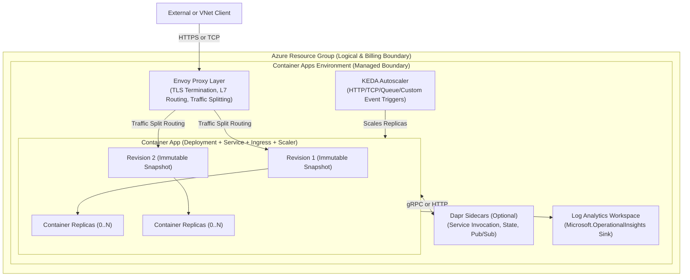
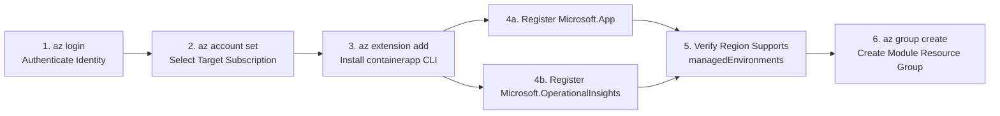
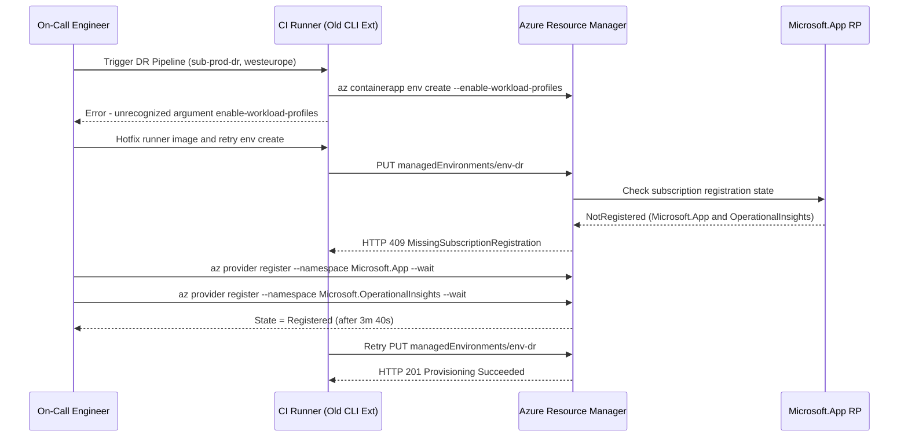

# Container Apps Concepts & Prerequisites

> **Prerequisites:** Working knowledge of containers (Docker), foundational Kubernetes orchestration concepts (Deployments, Services, Ingress, HPA from Track 03), and an active Azure subscription with Owner or Contributor permissions.  
> **Estimated Reading Time:** 30 minutes  
> **Target Audience:** Backend Engineers, Platform Engineers, Cloud Architects, Site Reliability Engineers.

> [!TIP]
> **The Golden Rule of Azure Container Apps:** Azure Container Apps gives you the 80% of Kubernetes that ships application value—KEDA autoscaling, Envoy L7 ingress, revision rollouts, and optional Dapr sidecars—while hiding the 20% that causes operational toil (nodes, etcd, CNI upgrades, and kube-apiserver). Before deploying a single container, ensure your Azure CLI `containerapp` extension is current and both `Microsoft.App` and `Microsoft.OperationalInsights` providers are `Registered` in your target region.

---

## 1. Why This Matters & Architectural Mental Model

You already know how to run containers by hand (Docker) and how to orchestrate them yourself on a Kubernetes cluster (Track 03, on a local `kind` cluster). Azure Container Apps (ACA) sits one abstraction layer higher: it runs your containers on a managed **Kubernetes + KEDA + Envoy + Dapr** foundation that you never see or operate.

Before deploying anything, you need two things:
1. A sharp mental model of what ACA removes from your plate (cluster upgrades, node patching, ingress controller installation) versus what it takes away from your control (`kubectl`, DaemonSets, custom CNI plugins).
2. The CLI extension, subscription resource providers, and region verification checks that every subsequent module assumes.

### How Azure Container Apps Works Under the Hood



### Preflight Provisioning Dependency Chain

Every `az containerapp` deployment relies on a strict prerequisite order. Skipping any upstream step surfaces misleading authorization or "command not recognized" errors downstream:



### The Resource Hierarchy (Outside-In)

1. **Resource Group:** Standard Azure logical container for lifecycle management, RBAC, and cleanup (`rg-aca-mNN`). Deleting the resource group deletes every underlying ACA resource and billing source inside it.
2. **Container Apps Environment:** The secure network, ingress, and logging boundary holding one or more Container Apps. Conceptually, it behaves like a Kubernetes **Namespace** bundled with a shared **Envoy** ingress proxy and a shared **Log Analytics** workspace—minus cluster management.
3. **Container App:** Your deployable microservice or background worker—roughly a Kubernetes **Deployment + Service + Ingress + HPA/ScaledObject** collapsed into a single Azure resource.
4. **Revisions:** Immutable snapshots of a Container App's template and configuration, analogous to specific **ReplicaSet** rollouts of a Kubernetes Deployment.

---

## 2. Taxonomic Comparison: Choosing the Right Azure Container Runtime

### ACI vs. Azure Container Apps (ACA) vs. AKS

From your Docker track you met **Azure Container Instances (ACI)**: the simplest way to run a single container (or small container group) billed per second with zero orchestration. You haven't reached the **AKS** track yet (Track 07), where you own node pools, upgrades, control-plane networking, Helm charts, and raw Kubernetes YAML. ACA fills the operational gap directly between them:

| Capability / Dimension | Azure Container Instances (ACI) | Azure Container Apps (ACA) | Azure Kubernetes Service (AKS) |
| :--- | :--- | :--- | :--- |
| **Control Plane Access** | None (single container group API) | None (managed K8s hidden; no `kubectl`) | Full Kubernetes API (`kubectl`, CRDs, webhooks) |
| **Built-in Autoscaling** | None (manual start/stop) | Built-in **KEDA** (HTTP, TCP, Queue, Cron, scale-to-zero) | Manual HPA / self-installed KEDA or Cluster Autoscaler |
| **Revisions & Traffic Splitting** | None (no rolling updates) | Immutable revisions + Envoy weighted splitting | Rolling Deployment updates; canary requires Ingress/Gateway API |
| **Managed HTTPS Ingress** | Single IP/port exposure; no L7 proxy | Built-in **Envoy** L7 proxy with managed TLS certs | Requires installing NGINX, Traefik, or Application Gateway |
| **Microservice Sidecars** | Manual multi-container group | Native **Dapr** integration (state, pub/sub, invocation) | Self-installed Dapr or service mesh (Istio/Linkerd) |
| **Low-Level Kernel / Pod Control** | Minimal | Restricted (no DaemonSets, arbitrary `securityContext`, or custom CNI) | Complete (hostNetwork, privileged pods, custom CNI, OS tuning) |
| **Pricing Shape** | Per-vCPU/GiB second while running | Per-second serverless Consumption (scale-to-zero) or Dedicated profiles | Always-on worker node VM billing (plus optional control plane SLA) |
| **Rule of Thumb** | One-off batch task or sidecar-less isolated job | Production APIs, microservices, and event-driven workers without cluster ops | Platform teams needing raw Kubernetes primitives or custom operators |

### Kubernetes-to-ACA Mental Translation

Because you have practiced Kubernetes primitives in Track 03, use this direct translation when designing ACA architectures:

| Kubernetes Primitive (Track 03) | Azure Container Apps Equivalent | Operational Difference |
| :--- | :--- | :--- |
| **Cluster + Node Pools** | Managed by Azure (Invisible) | Zero node OS patching, etcd backups, or K8s version upgrades |
| **Namespace + Ingress Controller** | **Container Apps Environment** | Shared VNet, shared Envoy ingress layer, shared Log Analytics sink |
| **Deployment + Service + Ingress** | **Container App** | Unified declarative resource with built-in HTTP/TCP routing |
| **ReplicaSet Rollout** | **Revision** | Immutable snapshot created automatically on template changes |
| **HPA / KEDA `ScaledObject`** | **Container App Scale Rule** | Native KEDA execution supporting scale-to-zero (`--min-replicas 0`) |

---

## 3. Systematic Reference: CLI Commands & Flag Breakdowns

The `containerapp` commands live in an **Azure CLI extension**, not the core CLI, so you install it once with `az extension add`. Azure also gates resource types behind **resource providers** that must be registered per subscription: `Microsoft.App` (Container Apps) and `Microsoft.OperationalInsights` (Log Analytics, since Environments stream logs there).

### Command Reference

| Command | What it does | Example |
| :--- | :--- | :--- |
| `az login` | Authenticate the CLI to Azure | `az login` |
| `az account set` | Select the active subscription | `az account set --subscription "My Sub"` |
| `az account show` | Show the current subscription/tenant | `az account show --output table` |
| `az extension add` | Install the Container Apps CLI extension | `az extension add --name containerapp --upgrade` |
| `az extension list` | List installed CLI extensions | `az extension list --output table` |
| `az provider register` | Register a resource provider on the subscription | `az provider register --namespace Microsoft.App --wait` |
| `az provider show` | Check a provider's registration state | `az provider show --namespace Microsoft.App --query registrationState -o tsv` |
| `az group create` | Create a resource group | `az group create --name rg-aca-learn --location eastus` |
| `az containerapp --help` | Confirm the extension loaded | `az containerapp --help` |

### Flag-by-Flag Breakdowns

#### `az account set --subscription "My Sub"`
- `--subscription` — name or GUID of the subscription to make active; all subsequent CLI commands target this billing and RBAC boundary.

#### `az extension add --name containerapp --upgrade`
- `--name containerapp` — specifies the Azure CLI extension providing `az containerapp ...` subcommands.
- `--upgrade` — if already installed, updates it to the latest version instead of failing or leaving stale flags behind. ACA evolves rapidly; keeping the extension current avoids missing parameters.

#### `az provider register --namespace Microsoft.App --wait`
- `--namespace Microsoft.App` — the resource provider namespace being registered on the active subscription (`Microsoft.OperationalInsights` must also be registered for Environment logging).
- `--wait` — blocks until registration transitions from `Registering` to `Registered` (typically 1–3 minutes) instead of returning asynchronously.

#### `az provider show --namespace Microsoft.App --query registrationState -o tsv`
- `--namespace Microsoft.App` — target provider to inspect.
- `--query registrationState` — JMESPath filter extracting only the registration status field.
- `-o tsv` — outputs unquoted raw text (`Registered`, `Registering`, or `NotRegistered`), ideal for CI/CD shell assertions.

#### `az group create --name rg-aca-learn --location eastus`
- `--name` — resource group name (`rg-aca-mNN` convention makes module cleanup safe and unambiguous).
- `--location` — Azure region supporting `managedEnvironments`. Keep consistent across resources within a module to prevent cross-region latency and failures.

---

## 4. Production War Story Post-Mortem: Failover Blocked by Unregistered Providers & Stale Extension

| Incident Metadata | Details |
| :--- | :--- |
| **Severity** | **SEV-2** (Disaster Recovery Failover Delayed by 47 Minutes) |
| **Detection / Resolution Time** | Detected at `14:05 UTC` during planned primary region degradation; resolved at `14:52 UTC` |
| **Impact** | Secondary `westeurope` DR checkout API failed automated deployment across 3 deployment pipelines; elevated error rates persisted in primary region for 47 minutes |

### What Happened

During a partial regional outage in `eastus`, an on-call platform engineer triggered the automated DR pipeline to provision a standby Container Apps Environment in a dedicated, newly created DR Azure subscription (`sub-prod-dr`) in `westeurope`. Although the CI runner authenticated cleanly with a Service Principal, the Terraform/CLI bootstrap failed immediately on `az containerapp env create` with `MissingSubscriptionRegistration` and unrecognized CLI argument errors.



### Root Cause Analysis

1. **Lazy Provider Registration Assumption:** The production subscription had `Microsoft.App` and `Microsoft.OperationalInsights` registered months earlier manually, so nobody codified provider registration in subscription vending. The fresh `sub-prod-dr` subscription had never deployed ACA or Log Analytics.
2. **Unpinned CLI Extension in Ephemeral Runner:** The self-hosted CI container cached a 9-month-old `containerapp` extension version without `--upgrade`, rejecting newer `--enable-workload-profiles` syntax.
3. **Zero Region Preflight Validation:** One team initially tried failing over to a secondary region that lacked `managedEnvironments` capacity in that subscription without querying `resourceTypes` first.

### The Fix & Architectural Hardening

1. **Automated Subscription Vending Preflight:** Added a mandatory preflight check in CI/CD and subscription bootstrap that registers `Microsoft.App` and `Microsoft.OperationalInsights`, polls until `registrationState == 'Registered'`, and asserts the target region appears in `resourceTypes[?resourceType=='managedEnvironments'].locations[]`.
2. **Pinned & Self-Healing Runner Tooling:** Updated the deployment runner image to execute `az extension add --name containerapp --upgrade --only-show-errors` (pinned in production images and verified via `az extension list`).
3. **Regular Game-Day DR Drills:** Quarterly non-destructive validation tests provider states and region support across all DR subscriptions before an outage occurs.

---

## 5. Multi-Language Production Implementation: ACA Subscription & Region Preflight Verifier

Before running any infrastructure deployment, production platform tooling should programmatically verify that both `Microsoft.App` and `Microsoft.OperationalInsights` are `Registered` and confirm that the target Azure region actually supports `managedEnvironments`.

````carousel
```go
// Go: Preflight verifier using Azure SDK for Go (armresources + azidentity)
package main

import (
	"context"
	"fmt"
	"log"
	"os"
	"strings"
	"time"

	"github.com/Azure/azure-sdk-for-go/sdk/azidentity"
	"github.com/Azure/azure-sdk-for-go/sdk/resourcemanager/resources/armresources"
)

func verifyACAPreflight(ctx context.Context, subscriptionID, targetRegion string) error {
	cred, err := azidentity.NewDefaultAzureCredential(nil)
	if err != nil {
		return fmt.Errorf("azure auth failed: %w", err)
	}

	client, err := armresources.NewProvidersClient(subscriptionID, cred, nil)
	if err != nil {
		return fmt.Errorf("providers client init failed: %w", err)
	}

	requiredProviders := []string{"Microsoft.App", "Microsoft.OperationalInsights"}
	for _, ns := range requiredProviders {
		resp, err := client.Get(ctx, ns, nil)
		if err != nil {
			return fmt.Errorf("failed inspecting provider %s: %w", ns, err)
		}
		state := ""
		if resp.RegistrationState != nil {
			state = *resp.RegistrationState
		}
		if state != "Registered" {
			return fmt.Errorf("provider %s is in state %q (expected Registered)", ns, state)
		}
		fmt.Printf("[OK] Provider %s -> %s\n", ns, state)

		if ns == "Microsoft.App" && !supportsManagedEnvLocation(resp.ResourceTypes, targetRegion) {
			return fmt.Errorf("region %q does not support Microsoft.App/managedEnvironments", targetRegion)
		}
	}
	fmt.Printf("[OK] Region %q supports managedEnvironments\n", targetRegion)
	return nil
}

func supportsManagedEnvLocation(types []*armresources.ProviderResourceType, region string) bool {
	normalized := strings.ReplaceAll(strings.ToLower(region), " ", "")
	for _, rt := range types {
		if rt.ResourceType != nil && *rt.ResourceType == "managedEnvironments" {
			for _, loc := range rt.Locations {
				if loc != nil && strings.ReplaceAll(strings.ToLower(*loc), " ", "") == normalized {
					return true
				}
			}
		}
	}
	return false
}

func main() {
	ctx, cancel := context.WithTimeout(context.Background(), 20*time.Second)
	defer cancel()

	subID := os.Getenv("AZURE_SUBSCRIPTION_ID")
	region := os.Getenv("ACA_TARGET_REGION")
	if region == "" {
		region = "eastus"
	}
	if err := verifyACAPreflight(ctx, subID, region); err != nil {
		log.Fatalf("ACA preflight failed: %v", err)
	}
}
```
<!-- slide -->
```typescript
// TypeScript: Preflight verifier using @azure/identity and @azure/arm-resources
import { DefaultAzureCredential } from "@azure/identity";
import { ResourceManagementClient } from "@azure/arm-resources";

async function verifyAcaPreflight(subscriptionId: string, targetRegion: string): Promise<void> {
  const credential = new DefaultAzureCredential();
  const client = new ResourceManagementClient(credential, subscriptionId);
  const requiredProviders = ["Microsoft.App", "Microsoft.OperationalInsights"];

  for (const namespace of requiredProviders) {
    const provider = await client.providers.get(namespace);
    const state = provider.registrationState ?? "Unknown";

    if (state !== "Registered") {
      throw new Error(`Provider ${namespace} is ${state}; run 'az provider register --namespace ${namespace} --wait'`);
    }
    console.log(`[OK] Provider ${namespace} -> ${state}`);

    if (namespace === "Microsoft.App") {
      const managedEnvType = provider.resourceTypes?.find(
        (rt) => rt.resourceType === "managedEnvironments"
      );
      const normalizedTarget = targetRegion.toLowerCase().replace(/\s+/g, "");
      const supported = (managedEnvType?.locations ?? []).some(
        (loc) => loc.toLowerCase().replace(/\s+/g, "") === normalizedTarget
      );
      if (!supported) {
        throw new Error(`Region '${targetRegion}' does not support Microsoft.App/managedEnvironments`);
      }
      console.log(`[OK] Region '${targetRegion}' supports managedEnvironments`);
    }
  }
}

const subId = process.env.AZURE_SUBSCRIPTION_ID ?? "";
const region = process.env.ACA_TARGET_REGION ?? "eastus";
verifyAcaPreflight(subId, region).catch((err) => {
  console.error("ACA preflight check failed:", err.message);
  process.exit(1);
});
```
<!-- slide -->
```python
# Python: Preflight verifier using azure-identity and azure-mgmt-resource
import os
import sys
from azure.identity import DefaultAzureCredential
from azure.mgmt.resource import ResourceManagementClient


def normalize_region(name: str) -> str:
    return name.lower().replace(" ", "")


def verify_aca_preflight(subscription_id: str, target_region: str) -> None:
    if not subscription_id:
        raise ValueError("AZURE_SUBSCRIPTION_ID environment variable is required")

    credential = DefaultAzureCredential()
    client = ResourceManagementClient(credential, subscription_id)

    for namespace in ("Microsoft.App", "Microsoft.OperationalInsights"):
        provider = client.providers.get(namespace)
        state = provider.registration_state or "Unknown"
        if state != "Registered":
            raise RuntimeError(f"Provider {namespace} is '{state}', expected 'Registered'")
        print(f"[OK] Provider {namespace} -> {state}")

        if namespace == "Microsoft.App":
            managed_env = next(
                (rt for rt in (provider.resource_types or []) if rt.resource_type == "managedEnvironments"),
                None,
            )
            locations = {normalize_region(loc) for loc in (managed_env.locations or [])} if managed_env else set()
            if normalize_region(target_region) not in locations:
                raise RuntimeError(f"Region '{target_region}' does not support managedEnvironments")
            print(f"[OK] Region '{target_region}' supports managedEnvironments")


if __name__ == "__main__":
    sub_id = os.getenv("AZURE_SUBSCRIPTION_ID", "")
    region = os.getenv("ACA_TARGET_REGION", "eastus")
    try:
        verify_aca_preflight(sub_id, region)
    except Exception as exc:
        print(f"ACA preflight failed: {exc}", file=sys.stderr)
        sys.exit(1)
```
<!-- slide -->
```csharp
// C#: Preflight verifier using Azure.Identity and Azure.ResourceManager
using System;
using System.Linq;
using System.Threading.Tasks;
using Azure.Identity;
using Azure.ResourceManager;

public static class AcaPreflightVerifier
{
    public static async Task Main()
    {
        string targetRegion = Environment.GetEnvironmentVariable("ACA_TARGET_REGION") ?? "eastus";
        var armClient = new ArmClient(new DefaultAzureCredential());
        var subscription = await armClient.GetDefaultSubscriptionAsync();

        string[] requiredNamespaces = { "Microsoft.App", "Microsoft.OperationalInsights" };

        foreach (string ns in requiredNamespaces)
        {
            var provider = (await subscription.GetResourceProviderAsync(ns)).Value;
            string state = provider.Data.RegistrationState ?? "Unknown";

            if (!string.Equals(state, "Registered", StringComparison.OrdinalIgnoreCase))
            {
                throw new InvalidOperationException($"Provider {ns} is '{state}'; register before deploying ACA.");
            }
            Console.WriteLine($"[OK] Provider {ns} -> {state}");

            if (ns == "Microsoft.App")
            {
                var managedEnvType = provider.Data.ResourceTypes
                    .FirstOrDefault(rt => rt.ResourceType == "managedEnvironments");

                string normalized = targetRegion.Replace(" ", "").ToLowerInvariant();
                bool supported = managedEnvType?.Locations
                    .Any(loc => loc.DisplayName.Replace(" ", "").ToLowerInvariant() == normalized
                             || loc.Name.Replace(" ", "").ToLowerInvariant() == normalized) ?? false;

                if (!supported)
                {
                    throw new NotSupportedException($"Region '{targetRegion}' does not support managedEnvironments.");
                }
                Console.WriteLine($"[OK] Region '{targetRegion}' supports managedEnvironments");
            }
        }
    }
}
```
````

---

## 6. Practical Hands-On Verification CLI Workflows

Set a region once and reuse it. These commands are for PowerShell; adjust variable syntax (`VAR=...` instead of `$VAR=...`) if you use Bash.

### Guided Lab Exercises

1. **Log in and confirm your subscription.**
   ```powershell
   az login
   az account show --output table
   ```
   **Expected Output:**
   ```text
   Name                 CloudName    SubscriptionId                        State    IsDefault
   -------------------  -----------  ------------------------------------  -------  -----------
   Pay-As-You-Go-Learn  AzureCloud   11111111-2222-3333-4444-555555555555  Enabled  True
   ```
   Verify the `Name` column shows the subscription you intend to spend money in. If not, list them with `az account list --output table` and switch with `az account set --subscription "<name-or-id>"`.

2. **Install (or upgrade) the Container Apps extension.**
   ```powershell
   az extension add --name containerapp --upgrade
   az extension list --query "[?name=='containerapp'].version" -o tsv
   ```
   **Expected Output:**
   ```text
   1.1.0b1
   ```
   Verify a version number prints (exact version varies). Then run `az containerapp --help` and confirm you see subcommands like `create`, `update`, `revision`, and `ingress`.

3. **Register the required resource providers.**
   ```powershell
   az provider register --namespace Microsoft.App --wait
   az provider register --namespace Microsoft.OperationalInsights --wait
   ```
   Both `--wait` calls block until registration completes on the subscription.

4. **Verify provider registration state.**
   ```powershell
   az provider show --namespace Microsoft.App --query registrationState -o tsv
   az provider show --namespace Microsoft.OperationalInsights --query registrationState -o tsv
   ```
   **Expected Output:**
   ```text
   Registered
   Registered
   ```
   Both must print `Registered`. Anything else means the previous step didn't finish—re-run it.

5. **Create a resource group for this module.**
   ```powershell
   az group create --name rg-aca-m00 --location eastus
   az group show --name rg-aca-m00 --query properties.provisioningState -o tsv
   ```
   **Expected Output:**
   ```text
   Succeeded
   ```
   A resource group itself is free.

6. **List regions that support Container Apps.**
   ```powershell
   az provider show --namespace Microsoft.App `
     --query "resourceTypes[?resourceType=='managedEnvironments'].locations[]" -o table
   ```
   **Expected Output:**
   ```text
   Result
   ------------------
   East US
   East US 2
   West Europe
   ...
   ```
   Confirm your chosen region appears. If it doesn't, pick one that does and use it consistently for the rest of the track.

7. **Contrast with ACI (reading, not deploying).** Run `az container --help` and skim it. Notice there is no `revision`, no `ingress` with traffic splitting, and no scale-rule subcommand—that absence is exactly the gap Container Apps fills. Write one sentence in your notes describing when you'd still choose ACI.

8. **Diagnose and fix: "extension not found."** Simulate the most common first-day failure. Remove the extension, then try to use it:
   ```powershell
   az extension remove --name containerapp
   az containerapp list --output table
   ```
   **Expected Output (Broken State):**
   ```text
   ERROR: 'containerapp' is misspelled or not recognized by the system.
   ```
   Observe the error (`'containerapp' is misspelled or not recognized`, or a prompt to install the extension). **Fix it** by reinstalling:
   ```powershell
   az extension add --name containerapp --upgrade
   az containerapp list --output table
   ```
   An empty result `[]` (or blank table) is success—it means the command works, you just have no apps yet.

9. **Cleanup.** This module created only a resource group, which is free, but delete it to keep your subscription tidy and to practice the habit:
   ```powershell
   az group delete --name rg-aca-m00 --yes --no-wait
   ```

### Independent Challenge

Starting from a machine where you have never run Azure CLI, get fully ready to deploy Container Apps in a *different* region from the one you used above (say `westeurope`): authenticate, select the correct subscription, ensure the `containerapp` extension is present and current, confirm both required resource providers are `Registered`, verify that `westeurope` supports the `managedEnvironments` resource type, and create a fresh resource group there. Produce a single short checklist of the exact commands you ran and the one-line evidence each gave you that it succeeded. This combines only this module's material (there is no earlier module yet). Delete the resource group afterward.

<details><summary>Stuck? One hint</summary>

The verification for "does this region support Container Apps" is the same `az provider show ... --query "resourceTypes[?resourceType=='managedEnvironments'].locations[]"` query from exercise 6—just check whether your target region string appears in its output before you bother creating the group.

</details>

---

## 7. Common Mistakes & Troubleshooting

- **Forgetting the extension.** `az containerapp` commands silently don't exist until you `az extension add --name containerapp`. The error looks like a typo; it isn't.
- **Skipping provider registration.** If `Microsoft.App` isn't `Registered`, environment creation later fails with a provider/authorization error that doesn't obviously say "register the provider." Do it once up front.
- **Wrong subscription selected.** `az login` picks a default subscription that may not be the one you want billed. Always `az account show` before creating resources.
- **Assuming every region works.** Container Apps isn't in every Azure region. Verify with the `locations` query rather than guessing, or environment creation fails.
- **Cost pitfall (habit-forming).** Nothing here is billable except (later) Environments and Log Analytics, but get in the habit *now* of naming each module's resource group `rg-aca-mNN` and deleting it at the end. The single biggest ACA cost mistake is a leftover Environment plus Log Analytics workspace from an early experiment.

---

## 8. Operational Validation Checkpoints

Test your architectural judgment against these production scenarios before moving to the comprehensive quiz.

<details><summary><strong>Checkpoint 1: Choosing Between ACI, ACA, and AKS for a New Payment Webhook Service</strong></summary>

**Scenario:** Your team needs to deploy a containerized webhook API that receives sporadic bursts of HTTP POST requests during business hours, requires HTTPS on a custom endpoint, needs canary traffic splitting between v1 and v2, and sleeps at zero cost overnight. Nobody on the 4-person backend team has time to patch Linux nodes or manage Ingress controllers. Which platform fits best, and why do the other two fail the constraints?

**Validation:** **Azure Container Apps (ACA)** fits cleanly. **ACI** lacks built-in KEDA HTTP autoscaling (including scale-to-zero), Envoy L7 HTTPS ingress, and revision traffic splitting. **AKS** provides those features only after you operate node pools, upgrades, ingress controllers, and KEDA yourself—violating the zero-cluster-ops constraint.

</details>

<details><summary><strong>Checkpoint 2: Diagnosing Why `az containerapp create` Fails on a Brand-New Sandbox Subscription</strong></summary>

**Scenario:** A new developer joins the team, logs into a brand-new sandbox subscription, creates resource group `rg-sandbox` in `eastus`, and runs `az containerapp env create`. The CLI command works locally, so the `containerapp` extension is installed—yet Azure rejects the API call with `MissingSubscriptionRegistration`. What two provider registrations are missing, and why is the second one required?

**Validation:** Both `Microsoft.App` (the Container Apps resource provider) and `Microsoft.OperationalInsights` (Log Analytics) must be registered. The second is required because every Container Apps Environment binds to a Log Analytics workspace (auto-created or existing) to ship container console and system logs.

</details>

<details><summary><strong>Checkpoint 3: Preventing CI/CD Drift on the `containerapp` Extension</strong></summary>

**Scenario:** A build agent script runs `az extension add --name containerapp` without `--upgrade`. Six months later, a pipeline update adds a flag introduced in a newer ACA API release, and the pipeline breaks with an unrecognized argument error even though the command worked on the engineer's laptop. What caused this, and what exact command keeps the runner deterministic or current?

**Validation:** Without `--upgrade`, `az extension add` becomes a no-op if an older version of `containerapp` is already cached on the runner. Running `az extension add --name containerapp --upgrade` (or pinning an explicit tested `--version` in the runner Dockerfile) ensures the CLI exposes current ACA flags.

</details>

---

## 9. Checkpoint Quiz

Write down your answer to each question before expanding it—checking without attempting first is the single easiest way to fool yourself into thinking you've learned this.

1. Name the four open-source technologies that back a Container Apps Environment, and what each one does for you.
2. Give two capabilities Container Apps has that ACI does not.
3. Give two things AKS lets you do that Container Apps does not.
4. Which two resource providers must be registered before you can create a Container Apps Environment, and why the second one?
5. What does `--upgrade` add to `az extension add --name containerapp`, and why does it matter for ACA specifically?
6. In the resource hierarchy, what plays the role of a Kubernetes namespace plus shared ingress, and what plays the role of a Deployment rollout?
7. You run `az containerapp list` and get "command not recognized." What are the two most likely causes, in order?

<details><summary>Show answers</summary>

1. **Kubernetes** (the managed cluster running your containers, which you don't operate), **KEDA** (event-driven autoscaling including scale-to-zero), **Envoy** (HTTPS ingress, load balancing, traffic splitting between revisions), and **Dapr** (optional service invocation, state, pub/sub between apps).
2. Any two of: built-in autoscaling (including scale-to-zero), revisions with traffic splitting, load-balanced HTTPS ingress, rolling/blue-green updates.
3. Any two of: manage node pools/OS, use `kubectl` and arbitrary Kubernetes objects (DaemonSets, custom operators, CRDs), full pod securityContext and CNI control, install cluster-wide software, fine-grained control-plane networking.
4. `Microsoft.App` (the Container Apps provider itself) and `Microsoft.OperationalInsights`—the latter because an Environment is wired to a Log Analytics workspace for logging.
5. It upgrades the extension to the latest version if already installed instead of erroring/keeping an old one. ACA's CLI and features change frequently, so an outdated extension can miss flags and behaviors.
6. The **Environment** is the namespace-plus-shared-ingress boundary; a **Revision** is the Deployment-rollout equivalent (an immutable version of the app).
7. First: the `containerapp` extension isn't installed (add it). Second (less likely): you're not logged in / no subscription selected, or an old CLI—check `az account show` and `az version`.

</details>

---

## 10. Sources & Further Reading

- [Azure Container Apps Overview (Microsoft Learn)](https://learn.microsoft.com/en-us/azure/container-apps/overview)
- [Comparing Container Apps with Other Azure Container Options (Microsoft Learn)](https://learn.microsoft.com/en-us/azure/container-apps/compare-options)
- [Quickstart: Deploy Your First Container App using Azure CLI (Microsoft Learn)](https://learn.microsoft.com/en-us/azure/container-apps/get-started?tabs=bash)
- [Azure Resource Providers and Types (Microsoft Learn)](https://learn.microsoft.com/en-us/azure/azure-resource-manager/management/resource-providers-and-types)

---

## Next

[01-container-apps-environment-deep-dive](../01-container-apps-environment-deep-dive/README.md)
— dissect the Environment: the shared Log Analytics workspace, the shared virtual network, and how billing and scaling attach to it versus to individual apps.
