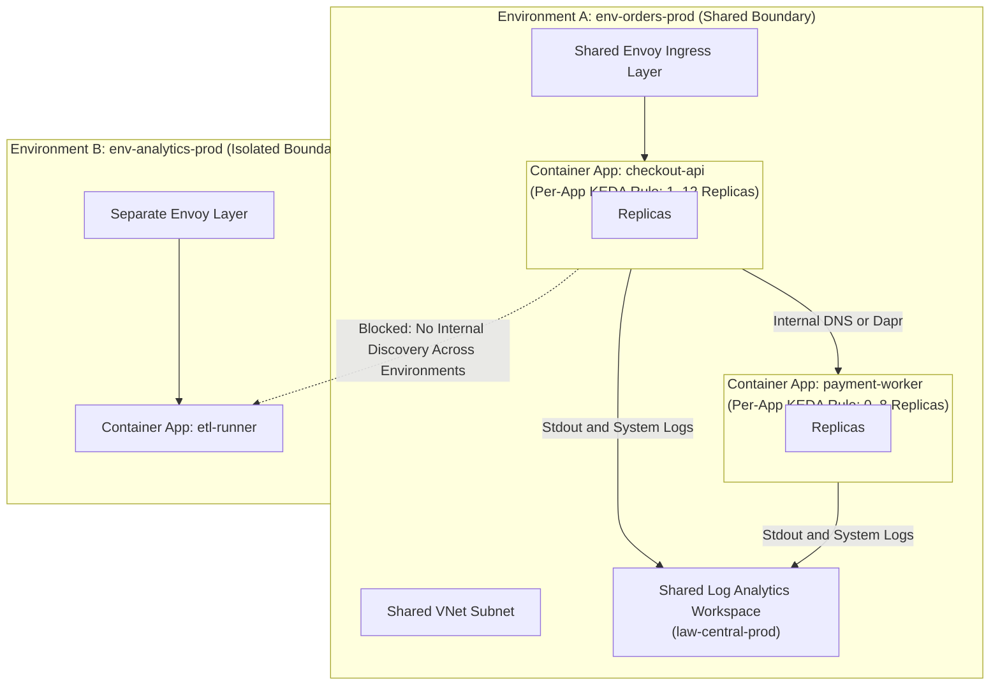
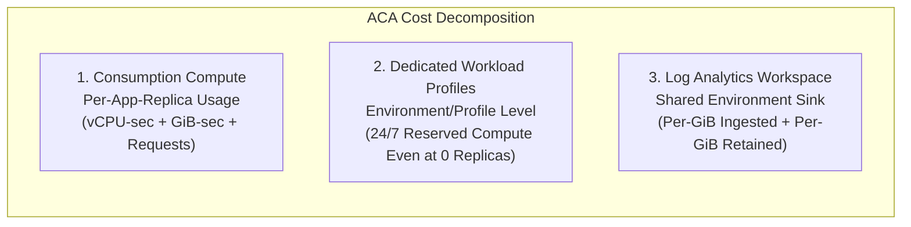
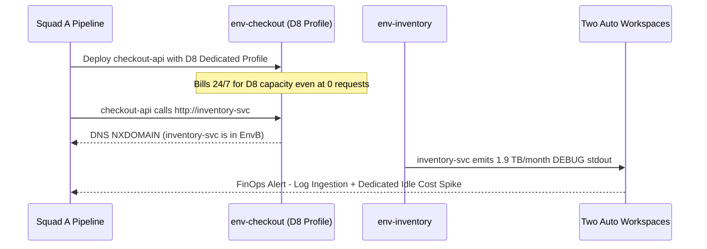

# Container Apps Environment Deep Dive

> **Prerequisites:** Completion of [Module 00: Container Apps Concepts & Prerequisites](../00-container-apps-concepts-and-prerequisites/README.md) (`containerapp` CLI extension installed; `Microsoft.App` and `Microsoft.OperationalInsights` registered).  
> **Estimated Reading Time:** 35 minutes  
> **Target Audience:** Backend Engineers, Platform Engineers, FinOps/Cloud Architects, Site Reliability Engineers.

> [!TIP]
> **The Golden Rule of Container Apps Environments:** The Environment is the immutable boundary for networking, internal discovery, Envoy ingress, and log routing—whereas scaling belongs strictly to individual apps. Choose your region, VNet topology, internal/external exposure, and Log Analytics workspace deliberately before running `az containerapp env create`, because none of them are hot-swappable without rebuilding the Environment.

---

## 1. Why This Matters & Architectural Mental Model

Every Container App you ever deploy lives inside an **Environment** (`Microsoft.App/managedEnvironments`), and most of the decisions that dictate cost, networking, and blast radius are locked in at the Environment layer—not the app layer. Get the Environment wrong (wrong plan, wrong region, unlinked VNet, or an untracked Log Analytics workspace) and every app inside inherits the problem.

### The Environment as an Isolation & Sharing Boundary

Apps inside the **same** Environment share three foundational pieces of infrastructure:
1. A **Virtual Network** (Azure-managed or custom VNet integrated).
2. A **Log Analytics Workspace** (destination for container `stdout`/`stderr` console logs and ACA system events).
3. The **Envoy Ingress Layer** (routing external/internal HTTP and TCP traffic).

Because they share that network and Envoy plane, apps in the same Environment can call one another by internal app name (`http://orders-api`) or through **Dapr** sidecar invocation. Conversely, apps in **different Environments** sit behind completely separate cluster boundaries—internal service discovery and Dapr invocation never cross Environments.



### Decomposing Where Scaling and Billing Attach

A frequent misconception is saying "our Environment scaled up during Black Friday." **Environments do not scale**—individual Container Apps scale independently using their own KEDA rules and min/max replica limits. Billing splits cleanly across three orthogonal surfaces:



### Key Architectural Pillars

- **The Shared Log Analytics Workspace:** An Environment sends **system logs** and **console (`stdout`/`stderr`) logs** to a logging destination—most commonly Azure **Log Analytics** (the exact same workspace type you wire to AKS in Track 07). If you omit workspace parameters, `az containerapp env create` silently auto-creates one. **Log Analytics bills per GiB ingested and per GiB retained.** A chatty app at high scale can drive substantial monthly bills, and if you delete only the Environment later, the orphaned workspace survives and keeps charging for retained logs. (Module 07 covers querying those logs; here you master the wiring and cost control.)
- **Consumption vs. Workload-Profile (Dedicated) Plans:**
  - **Consumption** is pure serverless: apps scale to zero, and you pay only for actual vCPU-seconds, GiB-seconds, and HTTP requests consumed. An idle Consumption Environment costs nearly nothing.
  - **Workload-Profiles** (`--enable-workload-profiles`) unlock **Dedicated** compute profiles (larger memory/vCPU SKUs like D-series/E-series and GPU options) alongside a default **Consumption** profile so you can mix workloads. Dedicated profiles **bill for reserved underlying instances whether or not any container replicas are running**—identical to always-on AKS node pools in Track 07.
- **Internal vs. External Environments (Networking Preview):** At Environment creation, you decide whether the load balancer exposes a public static IP (**external**) or a private VNet IP (**internal**). An internal Environment forces even apps configured with `--ingress external` to remain reachable only inside the VNet. Because changing network integration or internal-only mode later generally requires recreating the Environment, treat it as an upfront design invariant (covered deeply in Module 04).

---

## 2. Taxonomic Comparison: Environment Plans, Cost Ownership & Mutability

### Consumption-Only vs. Workload-Profiles Environments

| Dimension | Consumption-Only Environment | Workload-Profiles Environment (`--enable-workload-profiles`) |
| :--- | :--- | :--- |
| **Compute Profiles Included** | Consumption only | Consumption profile + 0 or more Dedicated profiles (`D4`, `E4`, GPU, etc.) |
| **Idle Compute Cost** | **\$0** when all apps scale to `--min-replicas 0` | Consumption apps: \$0 idle; **Dedicated profiles bill 24/7** even with 0 apps |
| **Hardware Sizing Ceiling** | Standard serverless vCPU/memory pairings (up to 4 vCPU / 8 GiB per replica) | Large dedicated VM SKUs (up to 32+ vCPU / 128+ GiB, memory-optimized, GPU) |
| **Minimum Custom Subnet Size** | `/23` (512 IPs) | `/27` (32 IPs) |
| **UDR / Firewall Egress Support** | Limited compared to workload profiles | Full UDR (`0.0.0.0/0` to NVA/Firewall) support |
| **Recommended Default** | Bursty APIs, webhooks, background workers, learning labs | Workloads needing GPUs, large RAM, strict noisy-neighbor isolation, or enterprise UDR egress |

### What Attaches Where & Mutability Rules

| Resource Property | Scope (Environment vs. App) | Mutable After Creation? | Operational Impact |
| :--- | :--- | :--- | :--- |
| **Azure Region (`--location`)** | Environment | **No** (recreate Environment) | Cross-region deployment fails or forces complete tear-down/redeploy |
| **Custom VNet & `--internal-only`** | Environment | **No** (recreate Environment) | Public vs. private static IP cannot be flipped in place |
| **Log Analytics Workspace** | Environment (shared by all apps) | Reconfigurable via update/ARM | Auto-created workspaces outlive Environment deletion unless RG is deleted |
| **Workload Profiles** | Environment (apps pin to a profile) | Yes (add/scale/remove Dedicated profiles) | Leaving an unused Dedicated profile incurs continuous VM reservation charges |
| **Scale Rules & Min/Max Replicas** | **Per Container App** | Yes (creates new revision or updates template) | Two apps in one Environment scale completely independently |

---

## 3. Systematic Reference: CLI Commands & Flag Breakdowns

### Command Reference

| Command | What it does | Example |
| :--- | :--- | :--- |
| `az containerapp env create` | Create an Environment | `az containerapp env create --name env-learn --resource-group rg-aca-m01 --location eastus` |
| `az containerapp env show` | Show an Environment's config | `az containerapp env show --name env-learn --resource-group rg-aca-m01 -o jsonc` |
| `az containerapp env list` | List Environments | `az containerapp env list --resource-group rg-aca-m01 -o table` |
| `az containerapp env delete` | Delete an Environment | `az containerapp env delete --name env-learn --resource-group rg-aca-m01 --yes` |
| `az monitor log-analytics workspace create` | Create a Log Analytics workspace | `az monitor log-analytics workspace create --resource-group rg-aca-m01 --workspace-name law-learn` |
| `az monitor log-analytics workspace get-shared-keys` | Get a workspace's shared key | `az monitor log-analytics workspace get-shared-keys --resource-group rg-aca-m01 --workspace-name law-learn --query primarySharedKey -o tsv` |
| `az containerapp env workload-profile list-supported` | List workload profile types in a region | `az containerapp env workload-profile list-supported --location eastus -o table` |

### Flag-by-Flag Breakdowns

#### `az containerapp env create --name env-learn --resource-group rg-aca-m01 --location eastus`
- `--name` — the Environment name (unique within the resource group).
- `--resource-group` — target resource group where the Environment lives.
- `--location` — Azure region supporting Container Apps. If you omit `--logs-workspace-id` and `--logs-workspace-key`, the CLI automatically creates a brand-new Log Analytics workspace (a billable resource).

#### `az containerapp env create --name env-law --resource-group rg-aca-m01 --location eastus --logs-workspace-id <customerId> --logs-workspace-key <sharedKey>`
- `--logs-workspace-id` — the **customer ID** (GUID) of an existing Log Analytics workspace.
- `--logs-workspace-key` — that workspace's shared key. Supplying both forces the Environment to reuse your centrally governed workspace instead of creating an untracked auto-generated workspace.

#### `az monitor log-analytics workspace get-shared-keys --resource-group rg-aca-m01 --workspace-name law-learn --query primarySharedKey -o tsv`
- `--workspace-name` — the Log Analytics workspace whose keys you want to retrieve.
- `--query primarySharedKey` — JMESPath query selecting only the primary shared key string.
- `-o tsv` — raw unquoted text output suitable for assigning to a shell variable and passing straight into `az containerapp env create`.

#### `az containerapp env create --name env-wp --resource-group rg-aca-m01 --location eastus --enable-workload-profiles`
- `--enable-workload-profiles` — creates a workload-profiles Environment (capable of hosting Dedicated compute profiles) rather than a Consumption-only Environment. Note that it initially contains only a `Consumption` profile; idle billing starts only when you add a Dedicated profile.

---

## 4. Production War Story Post-Mortem: Log Analytics Bill Shock & Cross-Environment Isolation Failure

| Incident Metadata | Details |
| :--- | :--- |
| **Severity** | **SEV-1** (Service Discovery Outage + Unbudgeted \$18,400/mo Run-Rate Spike) |
| **Detection / Resolution Time** | Outage detected immediately at `09:12 UTC` during cutover; FinOps billing alert triggered 48 hours later; resolved via Environment consolidation |
| **Impact** | `checkout-api` failed 100% of calls to `http://inventory-svc` across 2 separately provisioned Environments, while redundant Dedicated `D8` profiles and verbose `DEBUG` logging generated \$610/day in unbudgeted Azure spend |

### What Happened

Two microservice squads deployed independently into the same Azure resource group: Squad A ran `az containerapp env create --name env-checkout --enable-workload-profiles` (adding a `D8` Dedicated profile "to avoid cold starts" even though their staging workload had zero traffic) and let the CLI auto-create a workspace. Squad B created `env-inventory` in the same resource group, also auto-creating a second workspace, and set `LOG_LEVEL=DEBUG` on a noisy JSON parser printing full payloads to `stdout`. When `checkout-api` tried calling `http://inventory-svc` internally, every request failed DNS resolution.



### Root Cause Analysis

1. **Mistaking Resource Group Sharing for Environment Sharing:** Both teams placed their Environments in `rg-prod-app`, assuming apps in the same resource group share internal discovery. Internal DNS and Dapr discovery are strictly scoped to a single **Environment**, not a resource group.
2. **Untracked Auto-Created Workspaces + Verbose Logging:** Omitting `--logs-workspace-id` spawned separate workspaces with default retention and zero daily ingestion caps, ingesting ~1.9 TB/month of unbuffered `DEBUG` payloads.
3. **Idle Dedicated Profile Waste:** Adding a Dedicated `D8` profile for a low-traffic service locked in fixed 24/7 compute charges instead of keeping workloads on the `Consumption` profile inside the workload-profiles Environment.

### The Fix & Architectural Hardening

1. **Consolidated Shared Environment:** Merged `checkout-api` and `inventory-svc` into one Environment (`env-core-prod`), restoring internal `http://inventory-svc` DNS resolution immediately.
2. **Centralized Governed Workspace:** Created a single shared Log Analytics workspace (`law-core-prod`) with a configured daily ingestion cap and 30-day retention, explicitly wired via `--logs-workspace-id` and `--logs-workspace-key`, and switched production containers to `LOG_LEVEL=INFO`.
3. **Right-Sized Workload Profiles:** Removed the unused `D8` Dedicated profile and pinned staging/low-throughput services back to the `Consumption` profile, eliminating idle VM charges while preserving `--enable-workload-profiles` flexibility for future heavy workloads.

---

## 5. Multi-Language Production Implementation: ACA Environment Governance & Cost Auditor

Platform engineering teams routinely scan Environments across subscriptions to catch three governance risks before billing explodes: missing/unrecognized Log Analytics configuration, active Dedicated workload profiles charging 24/7 idle compute, and unintended external vs. internal VNet exposure.

````carousel
```go
// Go: Environment governance auditor using armappcontainers
package main

import (
	"context"
	"fmt"
	"log"
	"os"
	"time"

	"github.com/Azure/azure-sdk-for-go/sdk/azidentity"
	"github.com/Azure/azure-sdk-for-go/sdk/resourcemanager/appcontainers/armappcontainers/v3"
)

func auditEnvironment(ctx context.Context, subID, rgName, envName string) error {
	cred, err := azidentity.NewDefaultAzureCredential(nil)
	if err != nil {
		return fmt.Errorf("credential init failed: %w", err)
	}

	client, err := armappcontainers.NewManagedEnvironmentsClient(subID, cred, nil)
	if err != nil {
		return fmt.Errorf("client init failed: %w", err)
	}

	resp, err := client.Get(ctx, rgName, envName, nil)
	if err != nil {
		return fmt.Errorf("failed fetching environment %s: %w", envName, err)
	}

	props := resp.Properties
	if props == nil {
		return fmt.Errorf("environment %s returned empty properties", envName)
	}

	state := derefStr(props.ProvisioningState)
	fmt.Printf("Environment: %s | Region: %s | State: %s\n", envName, derefStr(resp.Location), state)

	if props.AppLogsConfiguration != nil && props.AppLogsConfiguration.LogAnalyticsConfiguration != nil {
		custID := derefStr(props.AppLogsConfiguration.LogAnalyticsConfiguration.CustomerID)
		fmt.Printf("[LOG] Destination: %s | Workspace CustomerID: %s\n",
			derefStr(props.AppLogsConfiguration.Destination), custID)
	} else {
		fmt.Println("[WARN] No Log Analytics configuration detected")
	}

	internalOnly := props.VnetConfiguration != nil && props.VnetConfiguration.Internal != nil && *props.VnetConfiguration.Internal
	fmt.Printf("[NET] Internal-Only VNet Mode: %t | Static IP: %s\n", internalOnly, derefStr(props.StaticIP))

	for _, wp := range props.WorkloadProfiles {
		name := derefStr(wp.Name)
		ptype := derefStr(wp.WorkloadProfileType)
		if ptype != "Consumption" {
			fmt.Printf("[COST ALERT] Dedicated profile %q (%s) incurs 24/7 reserved compute billing\n", name, ptype)
		} else {
			fmt.Printf("[COST OK] Profile %q (%s) scales to zero\n", name, ptype)
		}
	}
	return nil
}

func derefStr[T ~string](p *T) string {
	if p == nil {
		return ""
	}
	return string(*p)
}

func main() {
	ctx, cancel := context.WithTimeout(context.Background(), 20*time.Second)
	defer cancel()

	if err := auditEnvironment(
		ctx,
		os.Getenv("AZURE_SUBSCRIPTION_ID"),
		os.Getenv("ACA_RESOURCE_GROUP"),
		os.Getenv("ACA_ENV_NAME"),
	); err != nil {
		log.Fatalf("audit failed: %v", err)
	}
}
```
<!-- slide -->
```typescript
// TypeScript: Environment governance auditor using @azure/arm-appcontainers
import { DefaultAzureCredential } from "@azure/identity";
import { ContainerAppsAPIClient } from "@azure/arm-appcontainers";

async function auditEnvironment(
  subscriptionId: string,
  resourceGroup: string,
  envName: string
): Promise<void> {
  const client = new ContainerAppsAPIClient(new DefaultAzureCredential(), subscriptionId);
  const env = await client.managedEnvironments.get(resourceGroup, envName);

  console.log(`Environment: ${env.name} | Region: ${env.location} | State: ${env.provisioningState}`);

  const laConfig = env.appLogsConfiguration?.logAnalyticsConfiguration;
  if (laConfig?.customerId) {
    console.log(
      `[LOG] Destination: ${env.appLogsConfiguration?.destination} | CustomerID: ${laConfig.customerId}`
    );
  } else {
    console.warn("[WARN] Missing Log Analytics workspace binding");
  }

  const internalOnly = env.vnetConfiguration?.internal ?? false;
  console.log(`[NET] Internal-Only: ${internalOnly} | StaticIP: ${env.staticIp ?? "n/a"}`);

  for (const profile of env.workloadProfiles ?? []) {
    if (profile.workloadProfileType !== "Consumption") {
      console.warn(
        `[COST ALERT] Dedicated profile '${profile.name}' (${profile.workloadProfileType}) bills continuously regardless of replica count`
      );
    } else {
      console.log(`[COST OK] Profile '${profile.name}' uses serverless Consumption billing`);
    }
  }
}

auditEnvironment(
  process.env.AZURE_SUBSCRIPTION_ID ?? "",
  process.env.ACA_RESOURCE_GROUP ?? "rg-aca-m01",
  process.env.ACA_ENV_NAME ?? "env-m01"
).catch((err) => {
  console.error("Environment audit error:", err.message);
  process.exit(1);
});
```
<!-- slide -->
```python
# Python: Environment governance auditor using azure-mgmt-appcontainers
import os
import sys
from azure.identity import DefaultAzureCredential
from azure.mgmt.appcontainers import ContainerAppsAPIClient


def audit_environment(subscription_id: str, resource_group: str, env_name: str) -> None:
    client = ContainerAppsAPIClient(DefaultAzureCredential(), subscription_id)
    env = client.managed_environments.get(resource_group, env_name)

    print(f"Environment: {env.name} | Region: {env.location} | State: {env.provisioning_state}")

    logs_cfg = env.app_logs_configuration
    if logs_cfg and logs_cfg.log_analytics_configuration:
        print(
            f"[LOG] Destination: {logs_cfg.destination} | "
            f"CustomerID: {logs_cfg.log_analytics_configuration.customer_id}"
        )
    else:
        print("[WARN] No Log Analytics workspace configured")

    internal_only = bool(env.vnet_configuration and env.vnet_configuration.internal)
    print(f"[NET] Internal-Only: {internal_only} | StaticIP: {env.static_ip}")

    for profile in env.workload_profiles or []:
        if profile.workload_profile_type != "Consumption":
            print(
                f"[COST ALERT] Dedicated profile '{profile.name}' ({profile.workload_profile_type}) "
                f"incurs 24/7 reserved capacity charges (min={profile.minimum_count}, max={profile.maximum_count})"
            )
        else:
            print(f"[COST OK] Profile '{profile.name}' (Consumption)")


if __name__ == "__main__":
    try:
        audit_environment(
            os.environ["AZURE_SUBSCRIPTION_ID"],
            os.getenv("ACA_RESOURCE_GROUP", "rg-aca-m01"),
            os.getenv("ACA_ENV_NAME", "env-m01"),
        )
    except Exception as exc:
        print(f"Audit failed: {exc}", file=sys.stderr)
        sys.exit(1)
```
<!-- slide -->
```csharp
// C#: Environment governance auditor using Azure.ResourceManager.AppContainers
using System;
using System.Threading.Tasks;
using Azure.Identity;
using Azure.ResourceManager;
using Azure.ResourceManager.AppContainers;

public static class EnvironmentAuditor
{
    public static async Task Main()
    {
        string rgName = Environment.GetEnvironmentVariable("ACA_RESOURCE_GROUP") ?? "rg-aca-m01";
        string envName = Environment.GetEnvironmentVariable("ACA_ENV_NAME") ?? "env-m01";

        var armClient = new ArmClient(new DefaultAzureCredential());
        var subscription = await armClient.GetDefaultSubscriptionAsync();
        var rg = (await subscription.GetResourceGroupAsync(rgName)).Value;
        var env = (await rg.GetContainerAppManagedEnvironmentAsync(envName)).Value;
        var data = env.Data;

        Console.WriteLine($"Environment: {data.Name} | Region: {data.Location} | State: {data.ProvisioningState}");

        string? customerId = data.AppLogsConfiguration?.LogAnalyticsConfiguration?.CustomerId;
        Console.WriteLine(customerId is not null
            ? $"[LOG] Destination: {data.AppLogsConfiguration?.Destination} | CustomerID: {customerId}"
            : "[WARN] No Log Analytics customer ID attached");

        bool internalOnly = data.VnetConfiguration?.IsInternal ?? false;
        Console.WriteLine($"[NET] Internal-Only: {internalOnly} | StaticIP: {data.StaticIP}");

        foreach (var profile in data.WorkloadProfiles)
        {
            if (!string.Equals(profile.WorkloadProfileType, "Consumption", StringComparison.OrdinalIgnoreCase))
            {
                Console.WriteLine($"[COST ALERT] Dedicated profile '{profile.Name}' ({profile.WorkloadProfileType}) bills 24/7");
            }
            else
            {
                Console.WriteLine($"[COST OK] Profile '{profile.Name}' (Consumption)");
            }
        }
    }
}
```
````

---

## 6. Practical Hands-On Verification CLI Workflows

### Guided Lab Exercises

1. **Create a resource group for this module.**
   ```powershell
   az group create --name rg-aca-m01 --location eastus
   ```

2. **Create a Consumption Environment (auto workspace).**
   ```powershell
   az containerapp env create `
     --name env-m01 --resource-group rg-aca-m01 --location eastus
   ```
   This takes a few minutes. When it returns, note that a Log Analytics workspace was created for you (you'll find it in the resource group).

3. **Inspect the Environment.**
   ```powershell
   az containerapp env show --name env-m01 --resource-group rg-aca-m01 -o jsonc
   ```
   **Expected Output (Key Fields):**
   ```jsonc
   {
     "name": "env-m01",
     "location": "East US",
     "properties": {
       "provisioningState": "Succeeded",
       "appLogsConfiguration": {
         "destination": "log-analytics",
         "logAnalyticsConfiguration": {
           "customerId": "aaaaaaaa-bbbb-cccc-dddd-eeeeeeeeeeee"
         }
       },
       "vnetConfiguration": null
     }
   }
   ```
   Verify: `properties.provisioningState` is `Succeeded`, and inspect `properties.appLogsConfiguration` (the logging wiring) and `properties.vnetConfiguration` (empty/default here—Azure-managed network).

4. **Find the auto-created workspace and see the cost surface.**
   ```powershell
   az monitor log-analytics workspace list --resource-group rg-aca-m01 -o table
   ```
   Confirm a workspace exists (`workspace-rgacam01...`). This is the billable line item behind your Environment. Note its name.

5. **Create your own workspace and a second Environment that reuses it.**
   ```powershell
   az monitor log-analytics workspace create `
     --resource-group rg-aca-m01 --workspace-name law-m01
   $wsId  = az monitor log-analytics workspace show `
     --resource-group rg-aca-m01 --workspace-name law-m01 --query customerId -o tsv
   $wsKey = az monitor log-analytics workspace get-shared-keys `
     --resource-group rg-aca-m01 --workspace-name law-m01 --query primarySharedKey -o tsv
   az containerapp env create `
     --name env-m01-law --resource-group rg-aca-m01 --location eastus `
     --logs-workspace-id $wsId --logs-workspace-key $wsKey
   ```
   Verify with `az containerapp env show --name env-m01-law --resource-group rg-aca-m01 --query properties.appLogsConfiguration -o jsonc` that it points at *your* workspace's customer ID (`$wsId`).

6. **List which workload profiles your region supports.**
   ```powershell
   az containerapp env workload-profile list-supported --location eastus -o table
   ```
   **Expected Output (Truncated):**
   ```text
   Name    Cores    MemoryGiB    DisplayName
   ------  -------  -----------  -------------------------------
   D4      4        16           General Purpose - D4
   D8      8        32           General Purpose - D8
   E4      4        32           Memory Optimized - E4
   ```
   Read the output: `Consumption` plus various Dedicated sizes (D-series, E-series, possibly GPU). This is what you *could* reserve—and pay for even when idle.

7. **Create a workload-profiles Environment (then note the cost model).**
   ```powershell
   az containerapp env create `
     --name env-m01-wp --resource-group rg-aca-m01 --location eastus `
     --enable-workload-profiles
   ```
   A brand-new workload-profiles environment starts with only a `Consumption` profile, so it's still cheap until you add a Dedicated profile. Confirm with:
   ```powershell
   az containerapp env show --name env-m01-wp --resource-group rg-aca-m01 --query properties.workloadProfiles -o jsonc
   ```
   **Expected Output:**
   ```jsonc
   [
     {
       "name": "Consumption",
       "workloadProfileType": "Consumption"
     }
   ]
   ```

8. **Diagnose and fix: Environment stuck / failed to create.** Try to create an Environment in a region that doesn't support ACA:
   ```powershell
   az containerapp env create `
     --name env-bad --resource-group rg-aca-m01 --location brazilsoutheast
   ```
   (Use any region your Module 00 exercise-6-style check shows as unsupported.) Observe the failure (`Location 'brazilsoutheast' is not valid` or unsupported resource location error). **Fix it** by recreating in a supported region (`--location eastus`). Lesson: Environment region is fixed at creation—there's no "move region"; you recreate.

9. **Compare boundaries.** You now have multiple Environments in one resource group. Confirm they're isolated:
   ```powershell
   az containerapp env list --resource-group rg-aca-m01 -o table
   ```
   In your notes, write one sentence explaining why an app in `env-m01` cannot use internal name-based discovery to reach an app in `env-m01-wp`.

10. **Cleanup.** Environments and their Log Analytics workspaces are billable (the workspace especially). Delete everything:
    ```powershell
    az group delete --name rg-aca-m01 --yes --no-wait
    ```
    Deleting the resource group removes all Environments and both workspaces cleanly.

### Independent Challenge

Design and build a single Environment that (a) uses a Log Analytics workspace **you** created and named (not an auto-generated one), so you control its retention/cost, and (b) is created in a region you first verified supports Container Apps using the technique from **Module 00** (the `locations` query). Then produce evidence that the Environment's logging is wired to *your* workspace by showing the customer ID matches. Combining Module 00 (provider/region verification) with this module's workspace-reuse pattern. Delete the resource group when done—remember the workspace bills for retained data even after the Environment is gone if it outlives the group.

<details><summary>Stuck? One hint</summary>

The link between them is the workspace's **customer ID** (a GUID). Get it from `az monitor log-analytics workspace show ... --query customerId -o tsv`, feed it to `--logs-workspace-id`, and later read it back from the Environment's `properties.appLogsConfiguration.logAnalyticsConfiguration.customerId` to prove they match.

</details>

---

## 7. Common Mistakes & Troubleshooting

- **Forgetting the auto-created workspace.** If you don't pass a workspace, `env create` makes one silently. When you later delete "just the Environment" the workspace can linger and keep billing for retained logs. Deleting the whole resource group is the safe move.
- **Cost pitfall: workload profiles left with a Dedicated profile.** A workload-profiles environment is cheap only while it has just the Consumption profile. The moment you add a Dedicated profile you're paying for reserved instances 24/7—the same idle-node billing you'll see with AKS node pools in Track 07, one layer down the stack.
- **Expecting to change region or network later.** Region and VNet integration are set at creation and effectively immutable. Plan them; don't expect to edit them.
- **Cross-Environment service discovery.** Internal name-based calls and Dapr invocation only work *within* one Environment. Two apps that need to talk internally must share an Environment.
- **Log volume surprises.** High-scale apps writing verbose stdout can push real Log Analytics ingestion cost. Keep app logging sane and watch the workspace's usage in Cost Management.

---

## 8. Operational Validation Checkpoints

<details><summary><strong>Checkpoint 1: Auditing an Unexpected Monthly Bill After Deleting Test Environments</strong></summary>

**Scenario:** Last month a developer created three temporary ACA Environments in a shared `rg-dev-shared` resource group without specifying `--logs-workspace-id`. Two weeks later they ran `az containerapp env delete` on all three Environments, yet the team's Azure Cost Management bill still shows daily charges under Log Analytics. Why is billing continuing, and what command prevents this leak?

**Validation:** Omitting `--logs-workspace-id` caused each `env create` to auto-generate a separate Log Analytics workspace inside `rg-dev-shared`. Deleting an Environment via `az containerapp env delete` does **not** delete its linked Log Analytics workspace, which continues billing for retained data. Delete the orphaned workspaces explicitly (or isolate labs into dedicated `rg-aca-mNN` resource groups and delete the entire group).

</details>

<details><summary><strong>Checkpoint 2: Workload-Profiles Environment Cost Trap</strong></summary>

**Scenario:** An architect creates an Environment with `--enable-workload-profiles` so the team can optionally run GPU jobs next quarter, and deploys two low-traffic APIs onto the default `Consumption` profile. A teammate argues that simply passing `--enable-workload-profiles` immediately charges fixed 24/7 VM rates. Are they right? What changes that answer?

**Validation:** They are **wrong** right now: a newly created workload-profiles Environment starts with only the `Consumption` profile, which still scales to zero and bills purely per replica usage. They become **right** the moment you add a **Dedicated** profile (e.g., `D4`, `E4`, or GPU), because Dedicated profiles reserve VM compute 24/7 regardless of replica count.

</details>

<details><summary><strong>Checkpoint 3: Isolating vs. Consolidating Microservices Across Environments</strong></summary>

**Scenario:** Service `orders-api` is in `env-team-a`, and service `payments-api` is in `env-team-b` (same resource group, same Azure region). Developers configure `orders-api` to call `http://payments-api` internally and enable Dapr service invocation. Traffic fails consistently. Why, and what is the required architectural change?

**Validation:** Internal name-based discovery, shared VNet/Envoy routing, and Dapr invocation are strictly bounded to a **single Environment**. Placing apps in the same resource group or region does not bridge Environments. Both services must be deployed into the **same** Environment (or exposed and routed externally/via private VNet endpoints if separate Environments are legally mandated for compliance isolation).

</details>

---

## 9. Checkpoint Quiz

Write down your answer to each question before expanding it—checking without attempting first is the single easiest way to fool yourself into thinking you've learned this.

1. Name the three things all apps in one Environment share.
2. Which is billable independently of whether your apps are running: the Consumption compute, the Dedicated workload profile, or the Log Analytics workspace? (More than one may apply.)
3. Does an Environment "scale"? If not, what does?
4. What Kubernetes object is an Environment most like, and what does it bundle on top of that object?
5. Why might you pass `--logs-workspace-id`/`--logs-workspace-key` instead of letting `env create` auto-create a workspace?
6. Two apps in different Environments—can they reach each other by internal name or Dapr invocation? Why or why not?
7. You need a GPU-backed profile. Which Environment plan type do you need, and what's the cost consequence?

<details><summary>Show answers</summary>

1. A virtual network, a Log Analytics workspace (logging), and the Envoy ingress layer.
2. The **Dedicated workload profile** (reserved compute bills regardless) and the **Log Analytics workspace** (bills for ingested/retained data regardless of whether apps are actively serving). Consumption compute bills only while replicas run.
3. No. Individual container apps scale (each with its own KEDA scale rules and min/max replicas); the Environment is just the host boundary.
4. A Kubernetes **namespace**, plus a bundled shared ingress controller (Envoy) and shared logging pipeline—without you operating the cluster.
5. To reuse/consolidate logs into a workspace you control (retention, cost, shared with other resources) rather than accumulating auto-created workspaces.
6. No. Internal service discovery and Dapr invocation are scoped to a single Environment; different Environments are isolated boundaries.
7. A **workload-profiles** environment with a Dedicated (GPU) profile. It reserves billable compute continuously, whether or not the app is serving requests.

</details>

---

## 10. Sources & Further Reading

- [Environments in Azure Container Apps (Microsoft Learn)](https://learn.microsoft.com/en-us/azure/container-apps/environment)
- [Workload Profiles in Azure Container Apps (Microsoft Learn)](https://learn.microsoft.com/en-us/azure/container-apps/workload-profiles-overview)
- [Logging Options in Azure Container Apps (Microsoft Learn)](https://learn.microsoft.com/en-us/azure/container-apps/logging)
- [Azure Container Apps Billing & Pricing Structure (Microsoft Learn)](https://learn.microsoft.com/en-us/azure/container-apps/billing)

---

## Next

[02-deploying-your-first-container-app](../02-deploying-your-first-container-app/README.md)
— put an actual app in an Environment: create it from an image, expose ingress, update it, and inspect what got deployed.
