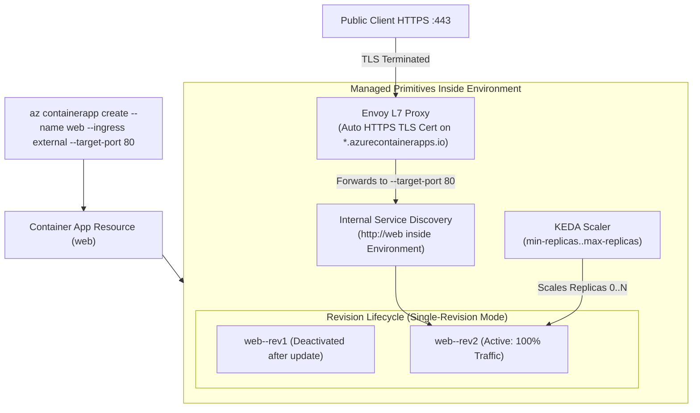
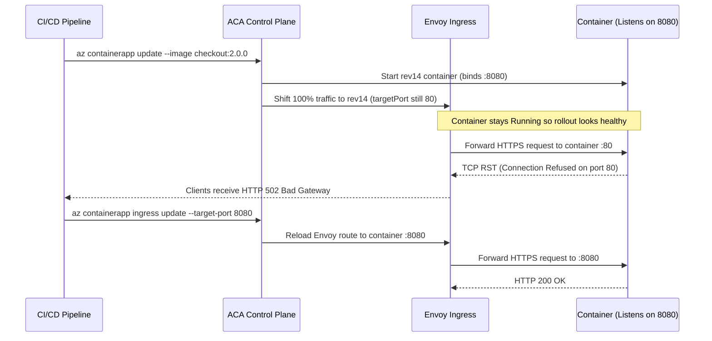

# Deploying Your First Container App

> **Prerequisites:** Completion of [Module 01: Container Apps Environment Deep Dive](../01-container-apps-environment-deep-dive/README.md) (existing Resource Group and Container Apps Environment).  
> **Estimated Reading Time:** 35 minutes  
> **Target Audience:** Backend Engineers, Platform Engineers, DevOps Engineers, Site Reliability Engineers.

> [!TIP]
> **The Golden Rule of Container App Deployments:** Every change to your container template (image tag, CPU/memory, environment variables, or scale config) produces a brand-new immutable **Revision**—never an in-place pod edit. Always align `--target-port` with the exact socket port your container binds, pick a valid 1:2 vCPU-to-GiB Consumption pairing, and treat `--min-replicas 0` as your idle cost switch unless cold-start latency violates your SLO.

---

## 1. Why This Matters & Architectural Mental Model

Now you put a real workload into an Environment. This is where ACA pays off: what took a `Deployment`, a `Service`, an `Ingress`, and an `HPA` on a Kubernetes cluster (the YAML you wrote by hand in Track 03) collapses into a single `az containerapp create`. Understanding exactly what that one command provisions—and how to update, inspect, and roll it back—is the foundation for scaling, networking, and revisions in every later module.

### One Command, Four Kubernetes Primitives

A **Container App** (`Microsoft.App/containerApps`) is a single Azure resource that internally reconciles:
- A **Deployment** (your running container replicas)
- A **Service** (stable internal DNS and load balancing)
- Optionally an **Ingress** (Envoy TLS termination and L7 HTTP/TCP forwarding)
- An **HPA-like Scaler** (KEDA event-driven autoscaler)

Because you know Kubernetes, the mental translation is direct—you're just not authoring raw YAML or managing a cluster context.



### Key Deployment Mechanics

- **Ingress: `external`, `internal`, or `none`:**
  - **External** puts the app behind the Environment's public endpoint (`*.<region>.azurecontainerapps.io` FQDN) with managed HTTPS.
  - **Internal** exposes it only inside the Environment's VNet (other apps in the Environment can reach it; the internet cannot).
  - **No ingress** (omitting `--ingress` and `--target-port`) blocks all inbound network traffic—ideal for background queue consumers and cron workers.
  - When ingress is enabled, Envoy terminates TLS and forwards plaintext HTTP/TCP to `--target-port` (the exact port your process binds inside the container).
- **Container Configuration (Image, CPU, Memory, Env):** You supply an image from MCR, Docker Hub, or Azure Container Registry (ACR), environment variables (`--env-vars`), and valid CPU/memory pairs. On the Consumption plan, CPU and memory drive per-second billing directly—right-size rather than over-allocating.
- **Every Template Change Creates a Revision:** You don't edit a running container in place like `kubectl edit`. Updating the image, env vars, or CPU/memory creates an immutable **Revision**. In the default **single-revision mode**, ACA runs a rolling update and shifts 100% of traffic to the newest active revision once ready. (Module 05 covers multi-revision mode and weighted canary splits.) To roll back, you point traffic back to or reactivate an earlier revision rather than trying to undo edits in place.

---

## 2. Taxonomic Comparison: Ingress Modes & Valid Resource Allocations

### Ingress Exposure Modes

| Mode | CLI Flag | Endpoint Visibility | Automatic HTTPS | Typical Workload |
| :--- | :--- | :--- | :--- | :--- |
| **External** | `--ingress external --target-port <port>` | Environment endpoint (public unless Environment is `--internal-only`) | Yes (Envoy managed cert) | Public REST/GraphQL APIs, BFFs, web apps |
| **Internal** | `--ingress internal --target-port <port>` | Environment VNet / sibling apps only | Yes (VNet TLS / HTTP) | Internal microservices, gRPC backends |
| **None** | *(omit `--ingress` and `--target-port`)* | No inbound ports exposed | N/A | Storage Queue / Service Bus workers, cron jobs |

### Valid Consumption Plan CPU & Memory Combinations

Azure Container Apps enforces a strict **1:2 vCPU-to-GiB memory ratio** for serverless Consumption allocations (arbitrary pairings like `0.25 vCPU / 4.0Gi` are rejected by ARM validation). In multi-container replicas, the *sum* across all containers must equal one of these rows:

| vCPUs (Cores) | Memory (RAM) | Environment Tier Support | Typical Use Case |
| :--- | :--- | :--- | :--- |
| `0.25` | `0.5Gi` | Consumption-only & Workload Profiles | Lightweight Go/Rust microservices, webhooks |
| `0.5` | `1.0Gi` | Consumption-only & Workload Profiles | Standard Node/Python/ASP.NET Core APIs |
| `0.75` | `1.5Gi` | Consumption-only & Workload Profiles | Medium API services with in-memory caching |
| `1.0` | `2.0Gi` | Consumption-only & Workload Profiles | CPU-moderate workers, JVM/Spring Boot |
| `1.5` | `3.0Gi` | Consumption-only & Workload Profiles | Heavy batch processors, media transformers |
| `2.0` | `4.0Gi` | Consumption-only ceiling & Workload Profiles | Max serverless replica in legacy Consumption-only env |
| `2.5` – `4.0` | `5.0Gi` – `8.0Gi` | Workload Profiles Environment (`Consumption` profile) | High-throughput serverless containers (up to `4.0 vCPU / 8.0Gi`) |

---

## 3. Systematic Reference: CLI Commands & Flag Breakdowns

### Command Reference

| Command | What it does | Example |
| :--- | :--- | :--- |
| `az containerapp create` | Deploy a new container app | `az containerapp create --name web --resource-group rg-aca-m02 --environment env-m02 --image mcr.microsoft.com/k8se/quickstart:latest --target-port 80 --ingress external` |
| `az containerapp update` | Change an app (new image, env, resources, scale) | `az containerapp update --name web --resource-group rg-aca-m02 --image mcr.microsoft.com/k8se/quickstart:latest --cpu 0.5 --memory 1.0Gi` |
| `az containerapp show` | Show an app's full config | `az containerapp show --name web --resource-group rg-aca-m02 -o jsonc` |
| `az containerapp list` | List apps in a resource group | `az containerapp list --resource-group rg-aca-m02 -o table` |
| `az containerapp logs show` | Stream/print an app's logs | `az containerapp logs show --name web --resource-group rg-aca-m02 --follow` |
| `az containerapp ingress show` | Show ingress config incl. FQDN | `az containerapp ingress show --name web --resource-group rg-aca-m02 -o jsonc` |
| `az containerapp revision list` | List an app's revisions | `az containerapp revision list --name web --resource-group rg-aca-m02 -o table` |
| `az containerapp delete` | Delete an app | `az containerapp delete --name web --resource-group rg-aca-m02 --yes` |

### Flag-by-Flag Breakdowns

#### `az containerapp create --name web --resource-group rg-aca-m02 --environment env-m02 --image mcr.microsoft.com/k8se/quickstart:latest --target-port 80 --ingress external`
- `--name` — the Container App's name (also becomes its internal service discovery hostname and FQDN prefix).
- `--resource-group` — resource group containing the app.
- `--environment` — existing Container Apps Environment hosting this app.
- `--image` — container image reference (`registry/repo:tag`).
- `--target-port` — TCP port your container process binds inside the container; Envoy forwards traffic to it.
- `--ingress external` — expose publicly with an automatic HTTPS FQDN. Use `internal` for VNet-only, or omit `--ingress`/`--target-port` for no ingress.

#### `az containerapp update --name web --resource-group rg-aca-m02 --image ... --cpu 0.5 --memory 1.0Gi`
- `--image` — updated container image; creates a new immutable revision.
- `--cpu 0.5` — vCPU allocation for the container (must pair with an allowed memory value).
- `--memory 1.0Gi` — memory allocation; `0.5` vCPU pairs with `1.0Gi`. Invalid CPU/memory combinations are rejected by Azure validation.

#### `az containerapp create ... --min-replicas 0 --max-replicas 3 --env-vars COLOR=blue APP_ENV=demo`
- `--min-replicas 0` — enables scale-to-zero (zero running replicas and zero compute charges when idle).
- `--max-replicas 3` — upper ceiling for replica scaling.
- `--env-vars` — space-separated `KEY=value` pairs injected as environment variables into the container template.

---

## 4. Production War Story Post-Mortem: Silent 502 Outage After `--target-port` Drift

| Incident Metadata | Details |
| :--- | :--- |
| **Severity** | **SEV-2** (100% HTTP 502 Outage on Public Checkout Endpoint) |
| **Detection / Resolution Time** | Detected at `16:22 UTC` via synthetic monitor; resolved at `16:36 UTC` (14 minutes) |
| **Impact** | All public requests to `checkout-api` returned `502 Bad Gateway` for 14 minutes following a routine framework migration |

### What Happened

An engineering team refactored `checkout-api` from an NGINX-fronted container (listening on port `80`) to a standalone minimal Go HTTP service listening on unprivileged port `8080`. The CI pipeline ran `az containerapp update --name checkout-api --image myacr.azurecr.io/checkout:2.0.0`, which created a brand-new revision `checkout-api--rev14`. Because the container didn't crash (no exit code 1) and the team hadn't configured an HTTP readiness probe overriding Envoy's target port assumption, Envoy promoted `rev14` to 100% traffic in single-revision mode and began forwarding requests to port `80`, where nothing was listening.



### Root Cause Analysis

1. **Ingress Config Separate from Container Template:** `az containerapp update --image ...` does not inspect `EXPOSE` metadata in the container image; `--target-port` remained pinned at `80` inside `properties.configuration.ingress`.
2. **Single-Revision Cutover Without HTTP Readiness Probe:** Without an explicit HTTP `/readyz` probe matching port `8080`, ACA assumed the running process was healthy and shifted 100% traffic immediately.

### The Fix & Architectural Hardening

1. **Immediate Mitigation:** Executed `az containerapp ingress update --name checkout-api --resource-group rg-prod --target-port 8080` to realign Envoy forwarding with the container socket.
2. **Standardized Container Port Contract:** Standardized all services to read `PORT` from environment variables (`8080` default) and declare explicit readiness probes + declarative IaC (Bicep/Terraform) where `targetPort` sits right next to `PORT`.
3. **Canary / Multi-Revision Guardrail:** Adopted multi-revision traffic splitting (Module 05) for production deploys so new revisions receive synthetic smoke tests on their revision FQDN before receiving production traffic.

---

## 5. Multi-Language Production Implementation: ACA Container Runtime Contract

To deploy cleanly on Azure Container Apps without 502 errors during rolling revision updates, every container should: (1) bind dynamically to `PORT` matching `--target-port`, (2) expose fast `/healthz` and `/readyz` probe endpoints, (3) log ACA-injected revision context (`CONTAINER_APP_REVISION`, `CONTAINER_APP_REPLICA_NAME`), and (4) drain in-flight HTTP requests gracefully when receiving `SIGTERM` during scale-down or revision replacement.

````carousel
```go
// Go: Production ACA workload with graceful SIGTERM drain and revision logging
package main

import (
	"context"
	"encoding/json"
	"errors"
	"log"
	"net/http"
	"os"
	"os/signal"
	"sync/atomic"
	"syscall"
	"time"
)

func main() {
	port := os.Getenv("PORT")
	if port == "" {
		port = "8080"
	}
	revision := os.Getenv("CONTAINER_APP_REVISION")
	replica := os.Getenv("CONTAINER_APP_REPLICA_NAME")

	var ready atomic.Bool
	ready.Store(true)

	mux := http.NewServeMux()
	mux.HandleFunc("/healthz", func(w http.ResponseWriter, r *http.Request) {
		w.WriteHeader(http.StatusOK)
		_, _ = w.Write([]byte("ok"))
	})
	mux.HandleFunc("/readyz", func(w http.ResponseWriter, r *http.Request) {
		if !ready.Load() {
			http.Error(w, "draining", http.StatusServiceUnavailable)
			return
		}
		w.WriteHeader(http.StatusOK)
		_, _ = w.Write([]byte("ready"))
	})
	mux.HandleFunc("/", func(w http.ResponseWriter, r *http.Request) {
		w.Header().Set("Content-Type", "application/json")
		_ = json.NewEncoder(w).Encode(map[string]string{
			"status":   "serving",
			"revision": revision,
			"replica":  replica,
		})
	})

	srv := &http.Server{
		Addr:              ":" + port,
		Handler:           mux,
		ReadHeaderTimeout: 5 * time.Second,
	}

	go func() {
		log.Printf("listening on :%s (revision=%s replica=%s)", port, revision, replica)
		if err := srv.ListenAndServe(); err != nil && !errors.Is(err, http.ErrServerClosed) {
			log.Fatalf("http server failure: %v", err)
		}
	}()

	// ACA sends SIGTERM before terminating old revision replicas (up to terminationGracePeriodSeconds)
	stop := make(chan os.Signal, 1)
	signal.Notify(stop, syscall.SIGTERM, syscall.SIGINT)
	<-stop

	log.Println("SIGTERM received: failing readiness probe and draining connections")
	ready.Store(false)

	ctx, cancel := context.WithTimeout(context.Background(), 20*time.Second)
	defer cancel()
	if err := srv.Shutdown(ctx); err != nil {
		log.Fatalf("graceful shutdown error: %v", err)
	}
	log.Println("server drained cleanly")
}
```
<!-- slide -->
```typescript
// TypeScript (Node.js): Production ACA workload with probes and SIGTERM drain
import http, { IncomingMessage, ServerResponse } from "node:http";

const port = Number(process.env.PORT ?? "8080");
const revision = process.env.CONTAINER_APP_REVISION ?? "local";
const replica = process.env.CONTAINER_APP_REPLICA_NAME ?? "local-0";

let isReady = true;

const server = http.createServer((req: IncomingMessage, res: ServerResponse) => {
  if (req.url === "/healthz") {
    res.writeHead(200, { "Content-Type": "text/plain" });
    res.end("ok");
    return;
  }

  if (req.url === "/readyz") {
    res.writeHead(isReady ? 200 : 503, { "Content-Type": "text/plain" });
    res.end(isReady ? "ready" : "draining");
    return;
  }

  res.writeHead(200, { "Content-Type": "application/json" });
  res.end(JSON.stringify({ status: "serving", revision, replica }));
});

server.listen(port, "0.0.0.0", () => {
  console.log(`ACA container listening on :${port} (revision=${revision}, replica=${replica})`);
});

function handleShutdown(signal: string): void {
  console.log(`${signal} received: marking replica unready and draining Envoy connections`);
  isReady = false;

  const forceExit = setTimeout(() => {
    console.error("Drain timeout reached; forcing exit");
    process.exit(1);
  }, 20_000);
  forceExit.unref();

  server.close(() => {
    clearTimeout(forceExit);
    console.log("HTTP server closed cleanly");
    process.exit(0);
  });
}

process.on("SIGTERM", () => handleShutdown("SIGTERM"));
process.on("SIGINT", () => handleShutdown("SIGINT"));
```
<!-- slide -->
```python
# Python (Standard Library): Production ACA HTTP server with readiness & SIGTERM drain
import json
import os
import signal
import sys
import threading
from http.server import BaseHTTPRequestHandler, ThreadingHTTPServer

PORT = int(os.getenv("PORT", "8080"))
REVISION = os.getenv("CONTAINER_APP_REVISION", "local")
REPLICA = os.getenv("CONTAINER_APP_REPLICA_NAME", "local-0")
READY_EVENT = threading.Event()
READY_EVENT.set()


class AcaHandler(BaseHTTPRequestHandler):
    def do_GET(self) -> None:
        if self.path == "/healthz":
            self._send(200, b"ok", "text/plain")
        elif self.path == "/readyz":
            if READY_EVENT.is_set():
                self._send(200, b"ready", "text/plain")
            else:
                self._send(503, b"draining", "text/plain")
        else:
            payload = json.dumps({"status": "serving", "revision": REVISION, "replica": REPLICA}).encode()
            self._send(200, payload, "application/json")

    def _send(self, code: int, body: bytes, content_type: str) -> None:
        self.send_response(code)
        self.send_header("Content-Type", content_type)
        self.send_header("Content-Length", str(len(body)))
        self.end_headers()
        self.wfile.write(body)


def main() -> None:
    server = ThreadingHTTPServer(("0.0.0.0", PORT), AcaHandler)

    def shutdown_handler(signum: int, _frame: object) -> None:
        print(f"Signal {signum} received: draining replica {REPLICA}", flush=True)
        READY_EVENT.clear()
        threading.Thread(target=server.shutdown, daemon=True).start()

    signal.signal(signal.SIGTERM, shutdown_handler)
    signal.signal(signal.SIGINT, shutdown_handler)

    print(f"Listening on :{PORT} (revision={REVISION}, replica={REPLICA})", flush=True)
    try:
        server.serve_forever()
    finally:
        server.server_close()
        sys.exit(0)


if __name__ == "__main__":
    main()
```
<!-- slide -->
```csharp
// C# (ASP.NET Core Minimal API): Production ACA runtime contract with probes
using System;
using System.Threading;
using Microsoft.AspNetCore.Builder;
using Microsoft.AspNetCore.Hosting;
using Microsoft.AspNetCore.Http;
using Microsoft.Extensions.Hosting;

var builder = WebApplication.CreateBuilder(args);
string port = Environment.GetEnvironmentVariable("PORT") ?? "8080";
builder.WebHost.UseUrls($"http://0.0.0.0:{port}");

var app = builder.Build();
var isDraining = 0;

string revision = Environment.GetEnvironmentVariable("CONTAINER_APP_REVISION") ?? "local";
string replica = Environment.GetEnvironmentVariable("CONTAINER_APP_REPLICA_NAME") ?? "local-0";

app.Lifetime.ApplicationStopping.Register(() =>
{
    Interlocked.Exchange(ref isDraining, 1);
    app.Logger.LogInformation("SIGTERM received: failing /readyz and draining Envoy traffic on {Replica}", replica);
});

app.MapGet("/healthz", () => Results.Ok("ok"));

app.MapGet("/readyz", () =>
    Volatile.Read(ref isDraining) == 1
        ? Results.StatusCode(StatusCodes.Status503ServiceUnavailable)
        : Results.Ok("ready"));

app.MapGet("/", () => Results.Ok(new
{
    status = "serving",
    revision,
    replica
}));

app.Logger.LogInformation("Listening on :{Port} (revision={Revision}, replica={Replica})", port, revision, replica);
app.Run();
```
````

---

## 6. Practical Hands-On Verification CLI Workflows

### Guided Lab Exercises

1. **Set up group and Environment.**
   ```powershell
   az group create --name rg-aca-m02 --location eastus
   az containerapp env create --name env-m02 --resource-group rg-aca-m02 --location eastus
   ```

2. **Deploy the quickstart app with external ingress.**
   ```powershell
   az containerapp create `
     --name web --resource-group rg-aca-m02 --environment env-m02 `
     --image mcr.microsoft.com/k8se/quickstart:latest `
     --target-port 80 --ingress external `
     --min-replicas 0 --max-replicas 2
   ```
   When it finishes, the command prints the app's FQDN. If you missed it:
   ```powershell
   az containerapp show --name web --resource-group rg-aca-m02 --query properties.configuration.ingress.fqdn -o tsv
   ```
   **Expected Output:**
   ```text
   web.<env-suffix>.eastus.azurecontainerapps.io
   ```

3. **Hit the app.** Open `https://<fqdn>` in a browser, or:
   ```powershell
   $fqdn = az containerapp show --name web --resource-group rg-aca-m02 --query properties.configuration.ingress.fqdn -o tsv
   curl "https://$fqdn"
   ```
   Verify you get an HTTP 200 and the quickstart welcome page. Note the FQDN ends in `.azurecontainerapps.io` and HTTPS "just works" (Envoy handled the TLS cert).

4. **Inspect what got created.**
   ```powershell
   az containerapp show --name web --resource-group rg-aca-m02 -o jsonc
   ```
   Find `properties.template.containers[0]` (image, resources), `properties.configuration.ingress` (external, targetPort 80, fqdn), and `properties.template.scale` (min/max replicas). This single resource is your Deployment + Service + Ingress + scaler.

5. **View logs.**
   ```powershell
   az containerapp logs show --name web --resource-group rg-aca-m02 --tail 30
   ```
   Confirm you see the container's stdout. Add `--follow` to stream live.

6. **Update the app — watch a new revision appear.**
   ```powershell
   az containerapp update `
     --name web --resource-group rg-aca-m02 `
     --cpu 0.5 --memory 1.0Gi --set-env-vars COLOR=blue
   az containerapp revision list --name web --resource-group rg-aca-m02 -o table
   ```
   **Expected Output:**
   ```text
   Name            Active    TrafficWeight    ProvisioningState
   --------------  --------  ---------------  -------------------
   web--0000001    False     0                Provisioned
   web--0000002    True      100              Provisioned
   ```
   Verify there are now two revisions and the newest is `Active` with 100% of traffic (default single-revision mode). Confirm the app still responds.

7. **Roll back by reactivating.** Get the two revision names from the list, then (in single-revision mode) inspect history or update again to supersede:
   ```powershell
   az containerapp revision list --name web --resource-group rg-aca-m02 --query "[].name" -o tsv
   ```
   Note both names—Module 05 will have you split and shift traffic between them deliberately. For now, verify you *can* see history to roll back to.

8. **Scale-to-zero check.** Because `--min-replicas 0`, an idle app releases its replicas. Confirm the current replica count:
   ```powershell
   az containerapp replica list --name web --resource-group rg-aca-m02 -o table
   ```
   After a period of no traffic, this becomes empty—that's scale-to-zero, and it's why an idle Consumption app costs almost nothing.

9. **Diagnose and fix: ingress misconfigured as internal.** Deploy a second app you *intend* to be public but mistakenly set internal:
   ```powershell
   az containerapp create `
     --name web2 --resource-group rg-aca-m02 --environment env-m02 `
     --image mcr.microsoft.com/k8se/quickstart:latest `
     --target-port 80 --ingress internal
   $f2 = az containerapp show --name web2 --resource-group rg-aca-m02 --query properties.configuration.ingress.fqdn -o tsv
   curl "https://$f2"
   ```
   From your machine (outside the VNet) the request fails/hangs—the FQDN resolves to an internal address (`web2.internal.<env-suffix>.eastus.azurecontainerapps.io`). **Fix it** by switching ingress to external:
   ```powershell
   az containerapp ingress enable --name web2 --resource-group rg-aca-m02 --type external --target-port 80 --transport auto
   curl "https://$f2"
   ```
   Now it responds with HTTP 200. Lesson: `external` vs `internal` is a common "why can't I reach it?" root cause (Module 04 explores it fully).

10. **Diagnose and fix: bad CPU/memory combo.** Try an invalid pairing:
    ```powershell
    az containerapp update --name web --resource-group rg-aca-m02 --cpu 0.25 --memory 4.0Gi
    ```
    **Expected Output (Broken State):**
    ```text
    ERROR: (ContainerAppInvalidResourceAllocation) The total requested CPU and memory resources for this container app (CPU: 0.25, Memory: 4.0Gi) is invalid.
    ```
    Observe the rejection (unsupported CPU/memory combination). **Fix it** with a valid pairing, e.g. `--cpu 0.5 --memory 1.0Gi` or `--cpu 1.0 --memory 2.0Gi`.

11. **Cleanup.**
    ```powershell
    az group delete --name rg-aca-m02 --yes --no-wait
    ```

### Independent Challenge

Deploy a single externally-reachable container app (any public image that serves HTTP, e.g. `mcr.microsoft.com/k8se/quickstart:latest`) into a fresh Environment, then change one environment variable and confirm—using only `az containerapp revision list` and a request to the FQDN—that a **new revision** was created and is now serving. Combine this module with **Module 01**: your Environment must reuse a Log Analytics workspace *you* created (not an auto one). Report the two revision names and which is active. Delete the resource group afterward.

<details><summary>Stuck? One hint</summary>

An env-var change is a template change, so it forces a new revision. Capture `revision list --query "[].name"` before and after the `update --set-env-vars` and diff the two lists; the new name is your new revision, and `--query "[?properties.active].name"` tells you which is live.

</details>

---

## 7. Common Mistakes & Troubleshooting

- **Forgetting `--target-port` with ingress.** If you enable ingress but the target port doesn't match what your container listens on, requests fail with 502/timeout even though the app is "running." Match the port your image actually binds.
- **Expecting in-place edits.** There's no live edit—every template change is a new revision. To "undo," activate/route to a prior revision (Module 05), don't try to reverse the edit.
- **Invalid CPU/memory combos.** ACA only allows specific pairings. Guessing arbitrary values (`0.25` vCPU / `4.0Gi`) fails; consult allowed combos.
- **Assuming external ingress is the default.** If you omit `--ingress`, the app has *no* ingress and won't be reachable at all—not the same as internal. Be explicit.
- **Cost pitfall: min-replicas > 0 without needing it.** Setting `--min-replicas 1` (or more) keeps replicas warm and billing even when idle, defeating scale-to-zero. Use `0` unless you specifically need to avoid cold starts.

---

## 8. Operational Validation Checkpoints

<details><summary><strong>Checkpoint 1: Resolving a "Running Container Returns HTTP 502" Outage</strong></summary>

**Scenario:** You deploy a FastAPI container that listens on `0.0.0.0:8000` using `az containerapp create --ingress external --target-port 80`. `az containerapp replica list` shows the replica is `Running`, and `az containerapp logs show` shows `Uvicorn running on http://0.0.0.0:8000`, yet `curl https://<fqdn>` returns `502 Bad Gateway`. What is the exact mismatch, and what single command fixes it?

**Validation:** Envoy is forwarding external HTTPS traffic to container port `80`, while Uvicorn is bound to port `8000`. Fix the ingress target port without touching the container code via:
`az containerapp ingress update --name <app> --resource-group <rg> --target-port 8000` (or `az containerapp ingress enable ... --target-port 8000`).

</details>

<details><summary><strong>Checkpoint 2: Predicting Revision Behavior on Env-Var vs. Ingress Changes</strong></summary>

**Scenario:** An app runs in default single-revision mode on `web--0000001`. You first run `az containerapp update --name web --set-env-vars FEATURE_FLAG=true`, and next you run `az containerapp ingress access-restriction set ...`. Which command creates a new immutable revision (`web--0000002`), and why?

**Validation:** Only `az containerapp update --set-env-vars FEATURE_FLAG=true` creates a new revision (`web--0000002`), because environment variables are **revision-scoped** template changes. Ingress configuration (`properties.configuration.ingress`), secrets metadata, and traffic weights are **application-scoped** changes—they update Envoy routing without spawning a new revision.

</details>

<details><summary><strong>Checkpoint 3: Right-Sizing an Idle Worker vs. Latency-Sensitive API</strong></summary>

**Scenario:** You have two services on the Consumption plan: (A) a nightly PDF invoice generator consuming `1.0 vCPU`, and (B) a real-time payment checkout API requiring sub-200ms P99 latency on every request. Which `--min-replicas` and memory setting should each get?

**Validation:**
- Service A (nightly generator): `--cpu 1.0 --memory 2.0Gi --min-replicas 0` (scales to zero when idle so overnight cost is \$0; cold start doesn't hurt async batch jobs).
- Service B (real-time checkout): pair `1.0 vCPU` with `2.0Gi` (or `0.5 vCPU` with `1.0Gi`) and set `--min-replicas 1` (or higher) to keep warm replicas running and eliminate cold-start latency spikes, accepting 24/7 warm compute billing.

</details>

---

## 9. Checkpoint Quiz

Write down your answer to each question before expanding it—checking without attempting first is the single easiest way to fool yourself into thinking you've learned this.

1. A single `az containerapp create` stands in for which four Kubernetes objects?
2. What are the three ingress modes, and when would you pick each?
3. What happens to revisions when you change an env var, and (in default mode) where does traffic go?
4. Why does `--cpu 0.25 --memory 4.0Gi` fail?
5. Your externally-intended app isn't reachable from your laptop but its FQDN exists. What's the first ingress setting to check?
6. What does `--min-replicas 0` buy you, and what's the downside?
7. How do you find an app's public FQDN after deployment?

<details><summary>Show answers</summary>

1. A Deployment (replicas), a Service (internal load balancing), an Ingress (Envoy exposure), and an HPA-equivalent scaler (KEDA).
2. **External** (public HTTPS FQDN—for internet-facing services), **internal** (VNet-only—for backend/service-to-service), and **none** (no inbound—for workers/queue consumers).
3. A new immutable revision is created; in default single-revision mode 100% of traffic shifts to the newest active revision (a rolling update).
4. It's an unsupported CPU/memory combination—ACA only allows specific pairings (e.g. `0.5` vCPU with `1.0Gi`, `1.0` vCPU with `2.0Gi`).
5. Whether ingress is `internal` vs `external`—an internal FQDN resolves to a private address unreachable from outside. Switch with `az containerapp ingress enable --type external`.
6. Scale-to-zero: no replicas and near-zero compute cost when idle. Downside: cold-start latency on the first request after idling.
7. `az containerapp show ... --query properties.configuration.ingress.fqdn -o tsv` (or read it from the create command's output / `ingress show`).

</details>

---

## 10. Sources & Further Reading

- [Deploy Your First Container App (Microsoft Learn)](https://learn.microsoft.com/en-us/azure/container-apps/get-started?tabs=bash)
- [Containers & Valid CPU/Memory Allocations in Azure Container Apps (Microsoft Learn)](https://learn.microsoft.com/en-us/azure/container-apps/containers)
- [Revisions & Application Lifecycle in Azure Container Apps (Microsoft Learn)](https://learn.microsoft.com/en-us/azure/container-apps/revisions)
- [Ingress Configuration in Azure Container Apps (Microsoft Learn)](https://learn.microsoft.com/en-us/azure/container-apps/ingress-overview)

---

## Next

[03-scaling-with-keda](../03-scaling-with-keda/README.md)
— make the app scale on demand: scale-to-zero, HTTP and custom KEDA rules, and diagnosing a rule that never fires.
