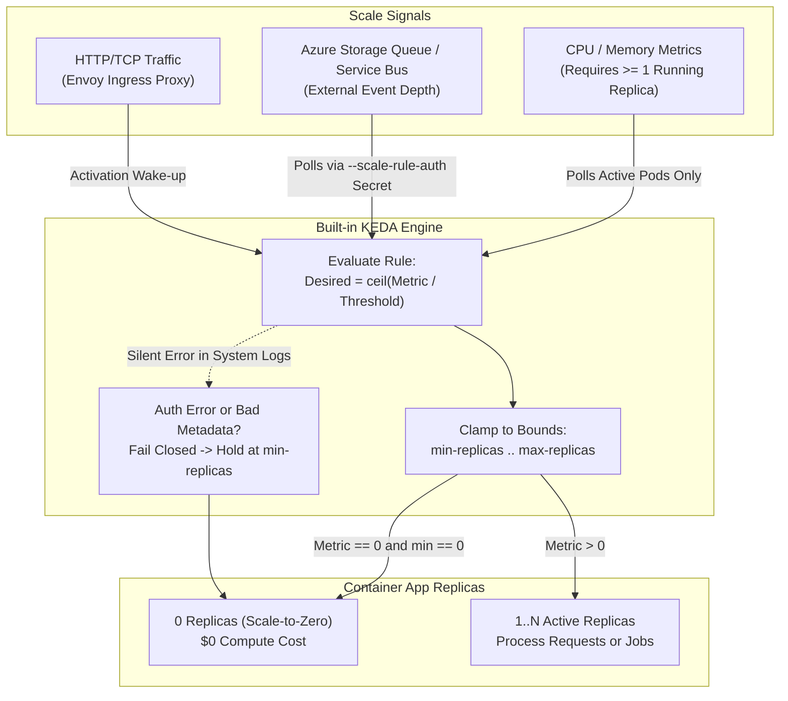
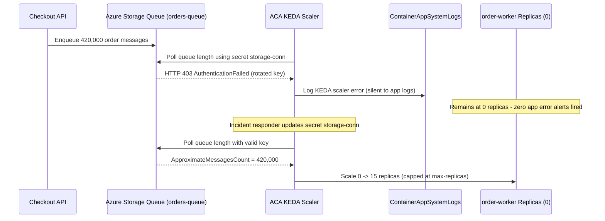

# Scaling with KEDA

> **Prerequisites:** Completion of [Module 02: Deploying Your First Container App](../02-deploying-your-first-container-app/README.md) (deploying, updating, and inspecting revisions/replicas).  
> **Estimated Reading Time:** 40 minutes  
> **Target Audience:** Backend Engineers, Distributed Systems Engineers, Platform Engineers, Site Reliability Engineers.

> [!TIP]
> **The Golden Rule of KEDA Scaling in ACA:** KEDA fails **closed and silent**—if trigger metadata has a typo or the `--scale-rule-auth` secret reference is broken, your app will not crash or alert loudly; it simply freezes at `--min-replicas`. Always verify scale-rule metadata against real resource names, remember that CPU/memory rules cannot scale to zero, and size `--min-replicas` vs `--max-replicas` as your dual cost-floor and blast-radius ceiling.

---

## 1. Why This Matters & Architectural Mental Model

Autoscaling is the single biggest reason to choose Container Apps over ACI and one of the biggest reasons to choose it over a Kubernetes cluster you manage yourself. ACA's scaler is **KEDA** (Kubernetes Event-driven Autoscaling)—the same CNCF project you could install on any Kubernetes cluster yourself, including Track 03's local one—but built in and pre-wired. Getting scale rules right is what makes an app cheap when idle and responsive under load; getting them wrong means either a bill for replicas you don't need or an app that silently never scales up during an outage.

### KEDA Control Loop & Scale-to-Zero Activation

On a self-managed Kubernetes cluster, event-driven autoscaling means installing KEDA operators and writing `ScaledObject` YAML. In ACA, KEDA is already running and configured directly through your app's **scale rules**. Each rule defines a **type** (`http`, `tcp`, or a KEDA custom scaler like `azure-queue`, `azure-servicebus`, `cpu`, `memory`, `cron`) and **metadata** specific to that trigger.



### Core Scaling Mechanics

- **Min Replicas, Max Replicas, and Scale-to-Zero:** Two integers bound everything: `--min-replicas` and `--max-replicas`.
  - `--min-replicas 0` enables **scale-to-zero**: when no matching events or requests arrive over the cooldown window, KEDA removes all replicas and compute cost drops to \$0. The first request afterward triggers a **cold start** while a container spins up.
  - `--min-replicas >= 1` keeps warm replicas running 24/7 (zero cold start, continuous billing).
  - `--max-replicas` caps your blast radius (and cloud bill) during traffic spikes or infinite retry storms.
- **The HTTP Scale Rule (`http`):** Targets `concurrentRequests` per replica—far better suited to bursty APIs than lagging CPU metrics. Setting `concurrentRequests=50` under 200 concurrent requests drives KEDA toward `ceil(200 / 50) = 4` replicas (up to `--max-replicas`). Crucially, **HTTP and TCP rules can scale from 0 -> 1** because Envoy buffers the waking request at the ingress proxy. A purely CPU/memory rule **cannot scale to zero**, because zero replicas emit zero CPU/memory telemetry.
- **Custom (Event-Driven) Scale Rules:** An `azure-queue` or `azure-servicebus` rule lets a worker with **no ingress** sleep at 0 replicas and wake purely from queue depth (`queueLength` = target messages per replica). Because KEDA runs outside your container, it needs `--scale-rule-auth` mapping the scaler's auth parameter (`connection`) to an app secret containing the connection string.
- **Why a Rule "Never Fires" (Silent Failure Mode):** Because KEDA fails closed (holding at `min-replicas` instead of crashing the app), a rule looks configured yet never triggers when: (1) trigger metadata is misspelled (`queueName=jobsss` vs `jobs`), (2) the auth secret reference is broken or stale, (3) the metric genuinely never crosses `queueLength`/`concurrentRequests`, or (4) `--min-replicas` equals `--max-replicas`. Diagnose by inspecting rule config and `ContainerAppSystemLogs`, not by waiting for an app crash.

---

## 2. Taxonomic Comparison: KEDA Scale Rule Types

| Scale Rule Type | CLI Type Flag | Core Metadata Key | Scales to Zero? | Auth Secret Required? | Best Workload Fit |
| :--- | :--- | :--- | :--- | :--- | :--- |
| **HTTP Concurrency** | `--scale-rule-type http` | `concurrentRequests` | **Yes** (via Envoy activator) | No | REST/GraphQL APIs, webhooks, web frontends |
| **TCP Concurrency** | `--scale-rule-type tcp` | `concurrentConnections` | **Yes** (via Envoy activator) | No | Custom TCP protocols, gRPC streams, game servers |
| **Azure Storage Queue** | `--scale-rule-type azure-queue` | `queueName`, `queueLength` | **Yes** | Yes (`connection=<secret>`) or Managed Identity | Asynchronous background workers, batch jobs |
| **Azure Service Bus** | `--scale-rule-type azure-servicebus` | `queueName` / `topicName`, `messageCount` | **Yes** | Yes (`connection=<secret>`) or Managed Identity | Enterprise order pipelines, DLQ processors |
| **CPU / Memory** | `cpu` / `memory` | `type: Utilization`, `value: "70"` | **No** (holds `min >= 1`) | No | Compute-bound services already pinned warm (`min >= 1`) |
| **Cron Schedule** | `cron` | `timezone`, `start`, `end`, `desiredReplicas` | **Yes** (outside window) | No | Predictable business-hours pre-warming |

---

## 3. Systematic Reference: CLI Commands & Flag Breakdowns

### Command Reference

| Command | What it does | Example |
| :--- | :--- | :--- |
| `az containerapp update` (scale flags) | Set min/max replicas | `az containerapp update --name web --resource-group rg-aca-m03 --min-replicas 0 --max-replicas 10` |
| `az containerapp create` (http rule) | Create app with an HTTP scale rule | see below |
| `az containerapp update` (add scale rule) | Add/replace a scale rule | see below |
| `az containerapp revision list` | Confirm which revision is active | `az containerapp revision list --name web --resource-group rg-aca-m03 -o table` |
| `az containerapp replica list` | See current replica count | `az containerapp replica list --name web --resource-group rg-aca-m03 -o table` |
| `az containerapp revision show` | Inspect a revision's scale config | `az containerapp revision show --name web --resource-group rg-aca-m03 --revision <rev> -o jsonc` |

### Flag-by-Flag Breakdowns

#### `az containerapp create --name web --resource-group rg-aca-m03 --environment env-m03 --image ... --target-port 80 --ingress external --min-replicas 0 --max-replicas 10 --scale-rule-name http-rule --scale-rule-type http --scale-rule-http-concurrency 50`
- `--min-replicas 0` / `--max-replicas 10` — scale bounds (`0` enables scale-to-zero; `10` caps maximum replicas).
- `--scale-rule-name http-rule` — unique identifier for this scale rule on the revision.
- `--scale-rule-type http` — KEDA scaler type (`http`, `tcp`, or custom KEDA scaler name).
- `--scale-rule-http-concurrency 50` — target concurrent requests per replica; the HTTP rule's core scaling threshold.

#### `az containerapp update --name worker --resource-group rg-aca-m03 --min-replicas 0 --max-replicas 20 --scale-rule-name queue-rule --scale-rule-type azure-queue --scale-rule-metadata queueName=jobs queueLength=5 --scale-rule-auth connection=queue-conn`
- `--scale-rule-type azure-queue` — selects the built-in KEDA `azure-queue` external scaler.
- `--scale-rule-metadata queueName=jobs queueLength=5` — space-separated `key=value` metadata configuring which queue to poll (`jobs`) and messages-per-replica target (`5` queued messages -> `1` replica).
- `--scale-rule-auth connection=queue-conn` — maps the scaler's `connection` authentication parameter to a Container App **secret** named `queue-conn` holding the Storage connection string. If the secret name is misspelled or rotated without updating the app secret, KEDA cannot authenticate to read queue depth and silently stays at `--min-replicas`.

---

## 4. Production War Story Post-Mortem: Flash-Sale Order Backlog Stuck Silently at 0 Replicas

| Incident Metadata | Details |
| :--- | :--- |
| **Severity** | **SEV-1** (3.2-Hour Order Fulfillment Delay; 420,000 Queued Messages Unprocessed) |
| **Detection / Resolution Time** | Detected at `11:45 UTC` after customer support escalation; root cause fixed at `12:08 UTC`; backlog drained at `13:10 UTC` |
| **Impact** | Confirmation emails and warehouse dispatch events stalled for over 3 hours during peak sale traffic |

### What Happened

An order-fulfillment worker (`order-worker`) ran in ACA with `--ingress none`, `--min-replicas 0`, `--max-replicas 15`, and an `azure-queue` scale rule pointing at `orders-queue` with `--scale-rule-auth connection=storage-conn`. Two weeks prior, InfoSec rotated the Storage Account access key, invalidating the connection string stored inside the app secret `storage-conn`. Because traffic had been quiet overnight, `order-worker` stayed at `0` replicas—so **zero application logs** were emitted. When flash-sale traffic pushed 420,000 messages onto the queue, KEDA's polling loop received `HTTP 403 AuthenticationFailed` from Azure Storage, logged the error to `ContainerAppSystemLogs`, and failed closed at `0` replicas. During recovery, an overly conservative `--max-replicas 2` left from a hotfix test throttled backlog drain until lifted.



### Root Cause Analysis

1. **Secret Rotation Without App Secret Sync:** Using raw connection-string secrets (`--secrets "storage-conn=..."`) created manual key drift after InfoSec rotated Storage keys.
2. **Monitoring Blind Spot (`Console` vs. `System` Logs):** Alerting only monitored `ContainerAppConsoleLogs_CL` (container stdout). When replicas are `0`, stdout is empty; KEDA scaling failures appear strictly in `ContainerAppSystemLogs_CL`.
3. **Lack of Queue-Age / Dead-Letter Alerting:** No Azure Monitor alert fired when queue message age crossed 5 minutes while active replica count remained `0`.

### The Fix & Architectural Hardening

1. **Immediate Fix:** Updated `storage-conn` secret on `order-worker` with the rotated connection string (and raised `--max-replicas` to `20` temporarily to drain the 420k message backlog).
2. **Eliminated Static Connection Secrets:** Migrated KEDA queue auth to **Managed Identity** (`--scale-rule-identity`) with `Storage Queue Data Contributor` / `Reader` RBAC, removing rotatable key secrets from scale rules completely.
3. **System Log & Queue-Depth Alerts:** Added Log Analytics alerts on `ContainerAppSystemLogs_CL` containing KEDA error events and an Azure Monitor alert when `QueueMessageCount > 100` for 5 minutes while `Replicas == 0`.

---

## 5. Multi-Language Production Implementation: KEDA Queue Worker with Graceful Drain

When KEDA scales your worker **up** from 0 -> N on queue depth, it also scales **down** from N -> 0 once the queue empties by sending `SIGTERM` to excess replicas. Production workers must bound per-replica concurrency (matching `queueLength`) and handle `SIGTERM` cleanly so in-flight queue messages either complete within the grace period or don't get deleted and lost mid-flight.

````carousel
```go
// Go: KEDA-friendly Azure Storage Queue worker with bounded concurrency & SIGTERM drain
package main

import (
	"context"
	"errors"
	"log"
	"os"
	"os/signal"
	"sync"
	"syscall"
	"time"

	"github.com/Azure/azure-sdk-for-go/sdk/storage/azqueue"
)

func main() {
	connStr := os.Getenv("QUEUE_CONNECTION_STRING")
	queueName := os.Getenv("QUEUE_NAME")
	if connStr == "" || queueName == "" {
		log.Fatal("QUEUE_CONNECTION_STRING and QUEUE_NAME must be set")
	}

	serviceClient, err := azqueue.NewServiceClientFromConnectionString(connStr, nil)
	if err != nil {
		log.Fatalf("queue client init failed: %v", err)
	}
	queueClient := serviceClient.NewQueueClient(queueName)

	ctx, stop := signal.NotifyContext(context.Background(), syscall.SIGTERM, syscall.SIGINT)
	defer stop()

	const maxWorkers = 5 // Align per-replica concurrency with KEDA queueLength metadata
	sem := make(chan struct{}, maxWorkers)
	var wg sync.WaitGroup

	log.Printf("KEDA worker started on queue=%s (concurrency=%d)", queueName, maxWorkers)

	for {
		if ctx.Err() != nil {
			break
		}

		visibility := int32(60)
		maxMsgs := int32(maxWorkers)
		resp, err := queueClient.DequeueMessages(ctx, &azqueue.DequeueMessagesOptions{
			NumberOfMessages:  &maxMsgs,
			VisibilityTimeout: &visibility,
		})
		if err != nil {
			if errors.Is(err, context.Canceled) {
				break
			}
			log.Printf("dequeue error: %v", err)
			time.Sleep(2 * time.Second)
			continue
		}

		if len(resp.Messages) == 0 {
			select {
			case <-ctx.Done():
			case <-time.After(1 * time.Second):
			}
			continue
		}

		for _, msg := range resp.Messages {
			if msg.MessageID == nil || msg.PopReceipt == nil {
				continue
			}
			sem <- struct{}{}
			wg.Add(1)
			go func(id, receipt, body string) {
				defer wg.Done()
				defer func() { <-sem }()

				// Use detached short timeout so in-flight message finishes cleanly on SIGTERM
				procCtx, cancel := context.WithTimeout(context.Background(), 20*time.Second)
				defer cancel()

				log.Printf("processing message id=%s body=%s", id, body)
				if _, delErr := queueClient.DeleteMessage(procCtx, id, receipt, nil); delErr != nil {
					log.Printf("delete failed id=%s (will retry after visibility timeout): %v", id, delErr)
				}
			}(*msg.MessageID, *msg.PopReceipt, derefStr(msg.MessageText))
		}
	}

	log.Println("SIGTERM received: draining in-flight queue jobs before replica shutdown")
	wg.Wait()
	log.Println("all in-flight messages drained cleanly")
}

func derefStr(p *string) string {
	if p == nil {
		return ""
	}
	return *p
}
```
<!-- slide -->
```typescript
// TypeScript: KEDA Azure Storage Queue worker with bounded batch processing & graceful drain
import { QueueClient } from "@azure/storage-queue";

const connStr = process.env.QUEUE_CONNECTION_STRING ?? "";
const queueName = process.env.QUEUE_NAME ?? "jobs";
const CONCURRENCY = 5;

if (!connStr) {
  throw new Error("QUEUE_CONNECTION_STRING is required");
}

const queueClient = new QueueClient(connStr, queueName);
let shuttingDown = false;
let inFlightCount = 0;

process.on("SIGTERM", () => {
  console.log("SIGTERM received: stopping new dequeues and waiting for in-flight jobs");
  shuttingDown = true;
});

async function processBatch(): Promise<void> {
  const { receivedMessageItems } = await queueClient.receiveMessages({
    numberOfMessages: CONCURRENCY,
    visibilityTimeout: 60,
  });

  if (receivedMessageItems.length === 0) {
    await new Promise((r) => setTimeout(r, 1000));
    return;
  }

  await Promise.all(
    receivedMessageItems.map(async (msg) => {
      inFlightCount++;
      try {
        console.log(`Processed job id=${msg.messageId} payload=${msg.messageText}`);
        await queueClient.deleteMessage(msg.messageId, msg.popReceipt);
      } finally {
        inFlightCount--;
      }
    })
  );
}

async function run(): Promise<void> {
  console.log(`KEDA worker polling queue=${queueName} (maxBatch=${CONCURRENCY})`);
  while (!shuttingDown) {
    try {
      await processBatch();
    } catch (err) {
      console.error("Worker poll failure:", (err as Error).message);
      await new Promise((r) => setTimeout(r, 2000));
    }
  }
  while (inFlightCount > 0) {
    await new Promise((r) => setTimeout(r, 200));
  }
  console.log("Graceful drain complete");
}

void run();
```
<!-- slide -->
```python
# Python: KEDA Storage Queue worker using azure-storage-queue with SIGTERM drain
import os
import signal
import sys
import time
from concurrent.futures import ThreadPoolExecutor
from azure.storage.queue import QueueClient

CONN_STR = os.environ["QUEUE_CONNECTION_STRING"]
QUEUE_NAME = os.getenv("QUEUE_NAME", "jobs")
MAX_CONCURRENCY = 5

stop_requested = False


def handle_sigterm(_signum: int, _frame: object) -> None:
    global stop_requested
    print("SIGTERM received from KEDA scale-down: draining active jobs", flush=True)
    stop_requested = True


def process_message(client: QueueClient, msg: object) -> None:
    print(f"Processing message id={msg.id} content={msg.content}", flush=True)
    # Delete only after idempotent processing completes
    client.delete_message(msg.id, msg.pop_receipt)


def main() -> None:
    signal.signal(signal.SIGTERM, handle_sigterm)
    signal.signal(signal.SIGINT, handle_sigterm)

    client = QueueClient.from_connection_string(CONN_STR, QUEUE_NAME)
    print(f"Worker polling queue={QUEUE_NAME} (concurrency={MAX_CONCURRENCY})", flush=True)

    with ThreadPoolExecutor(max_workers=MAX_CONCURRENCY) as pool:
        while not stop_requested:
            messages = list(client.receive_messages(messages_per_page=MAX_CONCURRENCY, visibility_timeout=60))
            if not messages:
                time.sleep(1.0)
                continue
            futures = [pool.submit(process_message, client, m) for m in messages]
            for fut in futures:
                fut.result()

    print("Replica drained safely", flush=True)
    sys.exit(0)


if __name__ == "__main__":
    main()
```
<!-- slide -->
```csharp
// C#: KEDA Storage Queue worker using Azure.Storage.Queues & CancellationToken drain
using System;
using System.Linq;
using System.Threading;
using System.Threading.Tasks;
using Azure.Storage.Queues;

public static class KedaQueueWorker
{
    public static async Task Main()
    {
        string connStr = Environment.GetEnvironmentVariable("QUEUE_CONNECTION_STRING")
            ?? throw new InvalidOperationException("QUEUE_CONNECTION_STRING not set");
        string queueName = Environment.GetEnvironmentVariable("QUEUE_NAME") ?? "jobs";
        const int maxMessages = 5;

        var queueClient = new QueueClient(connStr, queueName);
        using var cts = new CancellationTokenSource();

        Console.CancelKeyPress += (_, e) => { e.Cancel = true; cts.Cancel(); };
        AppDomain.CurrentDomain.ProcessExit += (_, _) => cts.Cancel();

        Console.WriteLine($"KEDA worker started for queue '{queueName}' (batch={maxMessages})");

        while (!cts.IsCancellationRequested)
        {
            try
            {
                var response = await queueClient.ReceiveMessagesAsync(
                    maxMessages: maxMessages,
                    visibilityTimeout: TimeSpan.FromSeconds(60),
                    cancellationToken: cts.Token);

                if (response.Value.Length == 0)
                {
                    await Task.Delay(TimeSpan.FromSeconds(1), cts.Token);
                    continue;
                }

                await Task.WhenAll(response.Value.Select(async msg =>
                {
                    Console.WriteLine($"Processed job id={msg.MessageId} text={msg.MessageText}");
                    await queueClient.DeleteMessageAsync(msg.MessageId, msg.PopReceipt, CancellationToken.None);
                }));
            }
            catch (OperationCanceledException) when (cts.IsCancellationRequested)
            {
                break;
            }
        }

        Console.WriteLine("Graceful drain complete; exiting cleanly.");
    }
}
```
````

---

## 6. Practical Hands-On Verification CLI Workflows

### Guided Lab Exercises

1. **Set up group, Environment, and an HTTP app.**
   ```powershell
   az group create --name rg-aca-m03 --location eastus
   az containerapp env create --name env-m03 --resource-group rg-aca-m03 --location eastus
   az containerapp create `
     --name web --resource-group rg-aca-m03 --environment env-m03 `
     --image mcr.microsoft.com/k8se/quickstart:latest `
     --target-port 80 --ingress external `
     --min-replicas 0 --max-replicas 10 `
     --scale-rule-name http-rule --scale-rule-type http `
     --scale-rule-http-concurrency 20
   ```

2. **Inspect the scale config.**
   ```powershell
   az containerapp show --name web --resource-group rg-aca-m03 --query properties.template.scale -o jsonc
   ```
   **Expected Output:**
   ```jsonc
   {
     "maxReplicas": 10,
     "minReplicas": 0,
     "rules": [
       {
         "http": {
           "metadata": {
             "concurrentRequests": "20"
           }
         },
         "name": "http-rule"
       }
     ]
   }
   ```
   Verify `minReplicas: 0`, `maxReplicas: 10`, and an `http` rule with `concurrentRequests: "20"`.

3. **Observe scale-to-zero.** With no traffic, wait a few minutes then:
   ```powershell
   az containerapp replica list --name web --resource-group rg-aca-m03 -o table
   ```
   Expect zero (or an emptying) replica list. First request afterward will cold-start.

4. **Generate load and watch it scale up.** In one terminal, hammer the FQDN; in another, watch replicas.
   ```powershell
   $fqdn = az containerapp show --name web --resource-group rg-aca-m03 --query properties.configuration.ingress.fqdn -o tsv
   1..2000 | ForEach-Object -Parallel { curl -s "https://$using:fqdn" > $null } -ThrottleLimit 100
   ```
   Meanwhile:
   ```powershell
   az containerapp replica list --name web --resource-group rg-aca-m03 -o table
   ```
   **Expected Output (Under Load):**
   ```text
   Name                        CreatedTime           RunningState
   --------------------------  --------------------  --------------
   web--0000001-6f9b8c7d4-abc  2026-11-11T10:15:02Z  Running
   web--0000001-6f9b8c7d4-def  2026-11-11T10:15:18Z  Running
   web--0000001-6f9b8c7d4-ghi  2026-11-11T10:15:19Z  Running
   ```
   Verify replica count climbs above 1 (toward max as concurrency exceeds 20 per replica). When load stops, it drifts back toward zero.

5. **Tighten the concurrency to force more replicas.**
   ```powershell
   az containerapp update --name web --resource-group rg-aca-m03 `
     --scale-rule-name http-rule --scale-rule-type http --scale-rule-http-concurrency 5
   ```
   Re-run the load test. Lower concurrency-per-replica -> more replicas for the same load. Confirm the replica count is higher than in exercise 4.

6. **Cap cost with max-replicas.**
   ```powershell
   az containerapp update --name web --resource-group rg-aca-m03 --max-replicas 3
   ```
   Repeat the load test and confirm replicas never exceed 3 no matter how hard you push. This is your spike-cost ceiling.

7. **Build a queue-driven worker (no ingress).** Create a storage account and queue, wire a secret and an `azure-queue` scale rule.
   ```powershell
   az storage account create --name stacam03$((Get-Random -Max 9999)) --resource-group rg-aca-m03 --location eastus --sku Standard_LRS
   # capture the account name you used:
   $sa = az storage account list --resource-group rg-aca-m03 --query "[0].name" -o tsv
   $conn = az storage account show-connection-string --name $sa --resource-group rg-aca-m03 --query connectionString -o tsv
   az storage queue create --name jobs --connection-string $conn
   az containerapp create `
     --name worker --resource-group rg-aca-m03 --environment env-m03 `
     --image mcr.microsoft.com/k8se/quickstart:latest `
     --min-replicas 0 --max-replicas 10 `
     --secrets "queue-conn=$conn" `
     --scale-rule-name queue-rule --scale-rule-type azure-queue `
     --scale-rule-metadata "queueName=jobs" "queueLength=5" `
     --scale-rule-auth "connection=queue-conn"
   ```
   (This worker has no ingress on purpose.) Confirm it sits at zero replicas.

8. **Trigger the queue scaler.** Push messages and watch it wake:
   ```powershell
   1..50 | ForEach-Object { az storage message put --queue-name jobs --content "job-$_" --connection-string $conn }
   az containerapp replica list --name worker --resource-group rg-aca-m03 -o table
   ```
   With `queueLength=5` and 50 messages, KEDA drives toward ~10 replicas (capped at max). Verify replicas appear even though there's no ingress.

9. **Diagnose and fix: scale rule never triggers (wrong metadata).** Break the queue rule with a misspelled queue name:
   ```powershell
   az containerapp update --name worker --resource-group rg-aca-m03 `
     --scale-rule-name queue-rule --scale-rule-type azure-queue `
     --scale-rule-metadata "queueName=jobsss" "queueLength=5" `
     --scale-rule-auth "connection=queue-conn"
   1..50 | ForEach-Object { az storage message put --queue-name jobs --content "job-$_" --connection-string $conn }
   az containerapp replica list --name worker --resource-group rg-aca-m03 -o table
   ```
   Despite 50 real messages, replicas stay at zero—KEDA is watching a queue that doesn't exist. **Diagnose** by comparing the rule's `queueName` to the actual queue (`az storage queue list --connection-string $conn -o table`). **Fix** by setting `queueName=jobs` back correctly, then re-verify replicas climb. Lesson: KEDA fails closed and silent—check metadata against reality.

10. **Diagnose and fix: broken auth secret ref.** Point the rule's auth at a non-existent secret:
    ```powershell
    az containerapp update --name worker --resource-group rg-aca-m03 `
      --scale-rule-name queue-rule --scale-rule-type azure-queue `
      --scale-rule-metadata "queueName=jobs" "queueLength=5" `
      --scale-rule-auth "connection=wrong-secret-name"
    ```
    The scaler can't authenticate to read queue depth, so it never scales. **Fix** by mapping `connection=queue-conn` (the real secret). Verify with a fresh batch of messages that replicas now appear.

11. **Cleanup.**
    ```powershell
    az group delete --name rg-aca-m03 --yes --no-wait
    ```

### Independent Challenge

Build a single Container App that is a pure background worker (no ingress, scale-to-zero) driven by an Azure Storage queue, such that pushing N messages reliably produces roughly N/10 replicas up to a max of 5. Then, without deleting anything, deliberately make it *fail to scale* in a way caused by the **scale rule metadata** (not auth), prove it's stuck at zero despite a full queue, and fix it. This combines this module's KEDA rules with **Module 02**'s create/update-and-inspect workflow. Remember to delete the resource group (the storage account and its transactions are billable) when done.

<details><summary>Stuck? One hint</summary>

`queueLength` is "messages per replica," so N/10 replicas means `queueLength=10`. The easiest metadata-only breakage that isn't auth is a `queueName` that doesn't match the real queue—KEDA reports no depth and holds at min. Compare `--scale-rule-metadata queueName=...` against `az storage queue list`.

</details>

---

## 7. Common Mistakes & Troubleshooting

- **CPU/memory-only rules can't scale to zero.** There's no metric at zero replicas, so a CPU/memory scaler holds min at >=1. For scale-to-zero you need an `http`/`tcp` or event-driven trigger.
- **Silent KEDA failures.** A wrong metadata key, wrong resource name, or broken auth secret makes the rule a no-op—no error, just stuck at min. Diagnose by inspecting the rule config and the system logs, not by waiting.
- **`min == max`.** If min and max replicas are equal there's no room to scale; the rule is inert by definition.
- **Concurrency set too high.** An HTTP rule with `concurrentRequests` far above real traffic never adds replicas. Set it to realistic per-replica capacity.
- **Cost pitfall: min-replicas >= 1 "to avoid cold starts."** Warm replicas bill 24/7. Only pay for warmth you actually need; otherwise keep min at 0 and accept cold starts, or use a small max to cap spikes.

---

## 8. Operational Validation Checkpoints

<details><summary><strong>Checkpoint 1: Choosing Between HTTP Concurrency and CPU Rules for Cost & Latency</strong></summary>

**Scenario:** A developer sets up a webhook API with `--min-replicas 0 --max-replicas 8` and adds ONLY a CPU utilization scale rule at `70%`. Why will this app never reach 0 replicas (or why will scaling fail to behave as expected), and what rule type fixes it?

**Validation:** CPU and memory scalers require running containers to emit utilization metrics; at `0` replicas there is zero CPU telemetry, so ACA either rejects scale-to-zero or holds minimum at `>= 1`. Replace or pair with an `http` scale rule (`--scale-rule-type http --scale-rule-http-concurrency <N>`), because Envoy buffers waking HTTP requests and signals KEDA to scale from `0 -> 1`.

</details>

<details><summary><strong>Checkpoint 2: Isolating Metadata Failures vs. Auth Failures on a Silent Worker</strong></summary>

**Scenario:** An `azure-queue` worker with `--min-replicas 0 --max-replicas 10` sits at `0` replicas despite 1,000 messages in Azure Storage Queue `invoices`. How do you systematically distinguish between a broken `--scale-rule-auth` reference and a misspelled `queueName` metadata field?

**Validation:**
1. Run `az containerapp show --name <app> -g <rg> --query properties.template.scale.rules -o jsonc` to inspect `metadata.queueName` and `auth[].secretRef`.
2. Compare `auth[].secretRef` against `az containerapp secret list --name <app> -g <rg> -o table` (verifying the secret exists and holds the current key) vs. comparing `metadata.queueName` against `az storage queue list`.
3. Query `ContainerAppSystemLogs_CL` in Log Analytics for KEDA `AuthenticationFailed` vs `QueueNotFound` messages.

</details>

<details><summary><strong>Checkpoint 3: Calculating Exact Replica Count & Spike Blast-Radius Cap</strong></summary>

**Scenario:** You configure an order processor with `--min-replicas 1 --max-replicas 6`, `--scale-rule-type azure-queue`, `queueLength=25`. During a sudden burst, 500 messages arrive simultaneously. How many replicas will KEDA request, how many actually launch, and why?

**Validation:** KEDA computes `ceil(500 / 25) = 20` desired replicas, then clamps to `--max-replicas 6`. Therefore **6 replicas** launch—protecting downstream databases from connection-pool exhaustion and capping spike cost.

</details>

---

## 9. Checkpoint Quiz

Write down your answer to each question before expanding it—checking without attempting first is the single easiest way to fool yourself into thinking you've learned this.

1. Which autoscaler powers ACA, and how does using it here differ from using it on a Kubernetes cluster you run yourself?
2. What does `--scale-rule-http-concurrency 50` actually target?
3. Why can't a CPU-only scale rule scale an app to zero?
4. A queue worker with a full queue stays at zero replicas. Name two distinct root causes and how you'd tell them apart.
5. What's the cost/latency trade-off between `--min-replicas 0` and `--min-replicas 1`?
6. In `--scale-rule-auth "connection=queue-conn"`, what is `queue-conn`?
7. You set `queueLength=5` and push 50 messages with max-replicas 10. Roughly how many replicas do you expect, and why not more?

<details><summary>Show answers</summary>

1. **KEDA.** On a Kubernetes cluster you run yourself you install KEDA and write `ScaledObject` YAML; on ACA it's built in and configured via the app's scale rules—same engine, no installation or cluster.
2. Target concurrent requests **per replica**; KEDA adds replicas when actual concurrency exceeds it (200 concurrent / 50 ≈ 4 replicas, up to max).
3. At zero replicas there's no container producing CPU/memory metrics, so there's no signal to scale *up from* zero. Only external/request triggers (`http`/`tcp`/queue) provide a signal at zero.
4. Any two of: wrong trigger metadata (e.g. misspelled `queueName`); broken auth secret ref so KEDA can't read depth; `queueLength` threshold never crossed; `min==max`. Tell apart by checking the rule's metadata/auth against the real resources and reading system logs.
5. Min 0 = no compute cost when idle but cold-start latency on first request; min 1 = no cold start but continuous billing for the warm replica.
6. The name of a **secret** on the app holding the storage connection string; the scaler's `connection` auth parameter is mapped to it.
7. About **10** replicas (50 messages ÷ 5 per replica), but capped at `max-replicas 10`—the cap prevents more even if the math suggested it.

</details>

---

## 10. Cumulative Review

Closed book. Cover the answers and write each out before checking. These mix concepts from **Modules 00–03**.

1. You need service-to-service internal calls between two apps *and* independent autoscaling for each. Which resource must the two apps share, and which resource is configured per-app?
2. Compare ACI and Container Apps for a queue-consuming worker that should cost nothing when the queue is empty: which fits, and which two ACA features make it work?
3. An Environment was auto-created with a workspace; you delete the Environment but a bill continues. What's the likely culprit and the fix?
4. Walk the full path of a change: you run `az containerapp update --set-env-vars X=1`. What object is created, what happens to traffic in default mode, and how does this relate to a Kubernetes Deployment rollout?
5. Which two `az containerapp create` flags together determine both the cost floor (idle) and the cost ceiling (spike) of a Consumption app, and what values give the cheapest idle behavior?
6. A web app with an HTTP scale rule and `--min-replicas 0` shows a first slow request after quiet periods. Explain the mechanism and one way to eliminate it (and its cost).
7. Name the two resource providers from Module 00 and tie each to something you used in Modules 01–03.
8. You created a workload-profiles Environment "to be safe." A colleague says it's costing money even with no traffic. Under what condition are they right, and under what condition are they wrong?
9. Diagnose: a worker's `azure-queue` rule is present, the queue has 100 messages, but replicas stay at zero and there's no error. List the three things you'd check, in order.
10. Translate to Kubernetes terms: Environment, Container App, Revision, scale rule.

<details><summary>Show answers</summary>

1. They must share an **Environment** (internal discovery/Dapr is Environment-scoped); **scale rules and min/max replicas** are per-app.
2. Container Apps fits (ACI has no autoscaling/scale-to-zero). The two features: **scale-to-zero** (`min-replicas 0`) and a **KEDA `azure-queue` scale rule** to wake on queue depth.
3. The **Log Analytics workspace** (and/or a leftover resource) outlived the Environment and still bills for retained data. Fix: delete the whole resource group, or delete the workspace explicitly.
4. A new **revision** (immutable snapshot). In default single-revision mode 100% of traffic shifts to the new active revision—a rolling update, exactly like a new Deployment rollout replacing the old ReplicaSet.
5. `--min-replicas` (cost floor: 0 = near-zero idle) and `--max-replicas` (cost ceiling: caps replicas during spikes). Cheapest idle: `--min-replicas 0`.
6. Scale-to-zero removed all replicas; the first request cold-starts a new one. Eliminate with `--min-replicas 1`—at the cost of a warm replica billing 24/7.
7. `Microsoft.App` (the Container Apps provider—used to create Environments and apps) and `Microsoft.OperationalInsights` (Log Analytics—the workspace behind the Environment's logs).
8. Right if a **Dedicated workload profile** has been added (reserved compute bills continuously). Wrong if it still has only the **Consumption** profile (then it behaves like a normal Consumption environment and idles cheap).
9. (1) The rule's **metadata** (`queueName` matches the real queue? `queueLength` sane?); (2) the **auth secret ref** (does `connection=` point to a real secret with a valid connection string?); (3) **min/max replicas** (is `min==max`, leaving no room?). Also check system logs.
10. Environment ≈ namespace + shared ingress/logging; Container App ≈ Deployment + Service + Ingress + HPA; Revision ≈ a specific Deployment rollout/ReplicaSet; scale rule ≈ a KEDA `ScaledObject` / generalized HPA.

</details>

---

## 11. Sources & Further Reading

- [Set Scaling Rules in Azure Container Apps (Microsoft Learn)](https://learn.microsoft.com/en-us/azure/container-apps/scale-app)
- [KEDA Azure Storage Queue Scaler Documentation](https://keda.sh/docs/latest/scalers/azure-storage-queue/)
- [Use Managed Identity for Scale Rule Authentication in ACA (Microsoft Learn)](https://learn.microsoft.com/en-us/azure/container-apps/scale-app#authentication)

---

## Next

[04-networking-ingress-and-vnet-integration](../04-networking-ingress-and-vnet-integration/README.md)
— the networking module: internal vs external ingress, custom VNet/subnet integration, private environments, and DNS. This is where the Azure networking track pays off.
