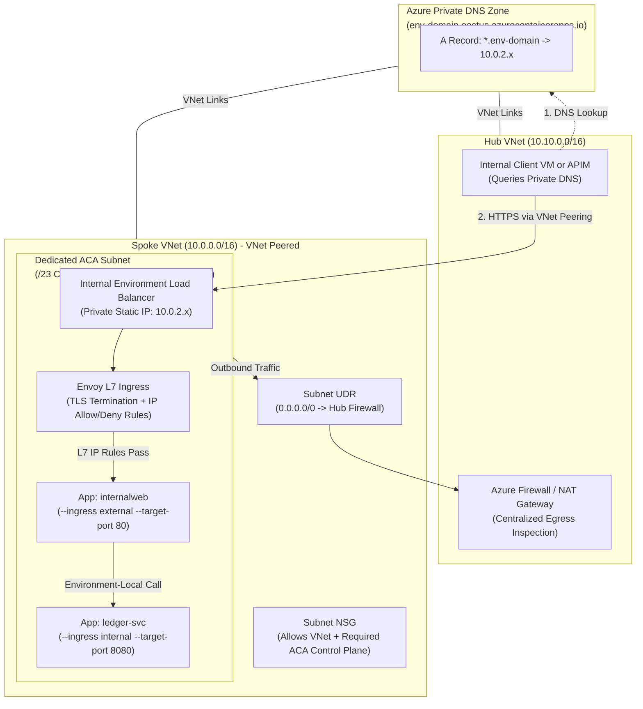
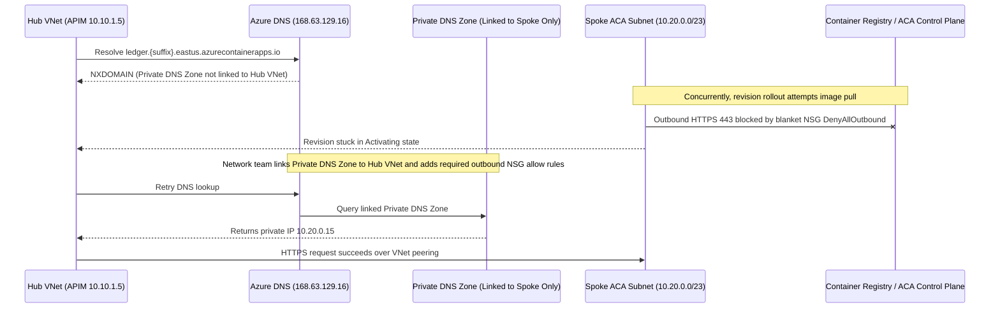

# Networking, Ingress & VNet Integration

> **Prerequisites:** Completion of [Module 03: Scaling with KEDA](../03-scaling-with-keda/README.md) and foundational Azure networking knowledge from Track 02 (VNets, Subnets/CIDR, NSGs, Private DNS Zones, UDRs, and Hub-Spoke peering).  
> **Estimated Reading Time:** 45 minutes  
> **Target Audience:** Backend Engineers, Cloud Network Engineers, Platform Architects, Site Reliability Engineers.

> [!TIP]
> **The Golden Rule of ACA Networking:** Public reachability requires **both** layers to align: the **Environment** must expose a public load balancer (`--internal-only false`), and the **App** must enable `--ingress external`. Setting `--ingress external` inside an `--internal-only true` Environment only exposes the app to your VNet—never the internet—and because custom VNet integration and `--internal-only` are immutable after creation, always size your dedicated subnet (`/23` Consumption or `/27` Workload Profiles) and Private DNS links before deploying.

---

## 1. Why This Matters & Architectural Mental Model

This is where the Azure networking track pays off directly. A Container Apps Environment lives on a virtual network, and every decision about how traffic reaches your apps—public or private, which subnet, which DNS resolves the name—uses the exact VNet, subnet, NSG, Private DNS, and load-balancer concepts from Track 02. Get this right and your apps integrate cleanly into a hub-spoke network; get it wrong and you're stuck with an Environment you can't re-network without recreating.

### Two Independent Layers: Environment Networking vs. App Ingress

Confusing these two layers is the #1 source of "why can't I reach my container app?":
1. **Environment Networking (L4 / VNet Boundary):** Determines whether the Environment's load balancer holds a **public static IP** or a **private IP inside your VNet** (`--internal-only true`).
2. **App Ingress (L7 / Envoy Boundary):** Configured per app (`external`, `internal`, or `none` from Module 02). Crucially, `"external"` means **"external to the Environment's boundary"**—if the Environment itself is internal-only, an app with `--ingress external` is still reachable **only** from inside the VNet (and peered/zone-linked networks).

### Hub-Spoke Custom VNet, Private DNS & Egress Control Topology



### Core Networking Pillars

- **Custom VNet Integration & The Dedicated Subnet:** By default Azure places Environments in an Azure-managed VNet. For production workloads, supply your own VNet and dedicated subnet at creation via `--infrastructure-subnet-resource-id`. That subnet is **dedicated (delegated) exclusively to Container Apps**—no VMs or other NICs can share it. Minimum subnet sizes (verify current Azure docs before sizing):
  - **Consumption-only environments:** at least a **`/23`** CIDR (512 addresses).
  - **Workload-profiles environments:** at least a **`/27`** CIDR (32 addresses).
- **Internal Environments & Private DNS:** An `--internal-only true` Environment (requires a custom VNet) receives zero public IP—its static IP sits inside your delegated subnet (`10.x.x.x`). Because the app's default FQDN (`<app>.<env-suffix>.<region>.azurecontainerapps.io`) uses a public DNS suffix, internal clients must resolve that domain to the private static IP via an **Azure Private DNS Zone** named after the Environment's default domain and **linked to every VNet** (including peered hub/spoke VNets) that needs to call those apps.
- **NSGs, Egress, and UDRs:** An ACA subnet is "just another workload subnet" in your network architecture. **NSGs** filter inbound/outbound flows (never blanket-deny outbound internet/control-plane traffic—ACA requires outbound connectivity to Azure management endpoints, ACR/MCR image registries, and Log Analytics). In workload-profiles Environments, attach a **User-Defined Route (UDR)** routing `0.0.0.0/0` through an Azure Firewall or NAT Gateway in a hub VNet for deterministic egress IPs and inspection.
- **Ports, Transport, TLS & L7 Restrictions:** Envoy terminates TLS on port `443` with managed certs on default FQDNs (or custom domains + certificates you bind) and forwards over `--transport` (`http`, `http2`, `tcp`, or `auto`) to your `--target-port`. You can apply L7 **IP allow/deny rules** directly on Envoy (`az containerapp ingress access-restriction set`) as an application-layer complement to L4 subnet NSGs.

---

## 2. Taxonomic Comparison: Reachability Matrix & Security Layers

### The 2×3 Reachability Matrix (Environment Mode × App Ingress)

| Environment Network Mode | App `--ingress external` | App `--ingress internal` | App Ingress `none` |
| :--- | :--- | :--- | :--- |
| **Public Environment** (`--internal-only false`, Public Static IP) | Reachable from **Public Internet** + VNet via Envoy HTTPS FQDN | Reachable **only within the Environment** (sibling apps) | **No inbound** network endpoints |
| **Internal Environment** (`--internal-only true`, Private `10.x` IP) | Reachable **only from VNet & peered/zone-linked VNets** (never Internet) | Reachable **only within the Environment** (sibling apps) | **No inbound** network endpoints |

### Custom Subnet Sizing & Architecture Comparison

| Environment Architecture | Minimum Subnet CIDR | Shared With Other Azure Services? | Static IP Type | Egress UDR Support |
| :--- | :--- | :--- | :--- | :--- |
| **Managed VNet (Default)** | Managed by Azure | N/A | Public static IP | No custom UDR control |
| **Custom VNet — Consumption-Only** | **`/23`** (512 IPs) | **No** (dedicated subnet) | Public or Private (`--internal-only`) | NAT Gateway / limited UDR |
| **Custom VNet — Workload Profiles** | **`/27`** (32 IPs) | **No** (dedicated subnet) | Public or Private (`--internal-only`) | Full UDR (`0.0.0.0/0` to Firewall/NVA) |

### L4 Network Controls vs. L7 Ingress Controls

| Control Mechanism | OSI Layer | Enforced By | Scope | Primary Use Case |
| :--- | :--- | :--- | :--- | :--- |
| **Subnet NSG** | Layer 3 / 4 (IP/Port) | Azure Virtual Network SDN | Entire ACA Environment subnet | Control-plane isolation, VNet-to-VNet port rules |
| **User-Defined Route (UDR)** | Layer 3 (Routing) | Subnet route table | Entire ACA Environment subnet | Force outbound egress through Azure Firewall / NVA |
| **`ingress access-restriction`** | Layer 7 (HTTP/Envoy) | Envoy proxy per Container App | Individual Container App | Allow-list specific corporate/webhook source CIDRs |

---

## 3. Systematic Reference: CLI Commands & Flag Breakdowns

### Command Reference

| Command | What it does | Example |
| :--- | :--- | :--- |
| `az network vnet create` | Create a VNet + subnet for the Environment | `az network vnet create --name vnet-aca --resource-group rg-aca-m04 --address-prefix 10.0.0.0/16 --subnet-name aca-infra --subnet-prefix 10.0.0.0/23` |
| `az containerapp env create` (VNet) | Create an Environment on your subnet | see below |
| `az containerapp env create` (internal) | Create a private, internal-only Environment | see below |
| `az containerapp ingress enable` | Turn on/set ingress for an app | `az containerapp ingress enable --name web --resource-group rg-aca-m04 --type external --target-port 80 --transport auto` |
| `az containerapp ingress show` | Show ingress config + FQDN | `az containerapp ingress show --name web --resource-group rg-aca-m04 -o jsonc` |
| `az containerapp ingress access-restriction set` | Add an IP allow/deny rule | `az containerapp ingress access-restriction set --name web --resource-group rg-aca-m04 --rule-name office --ip-address 203.0.113.10/32 --action Allow` |
| `az containerapp env show` (static IP) | Read the Environment's static/load-balancer IP | `az containerapp env show --name env-m04 --resource-group rg-aca-m04 --query properties.staticIp -o tsv` |

### Flag-by-Flag Breakdowns

#### `az network vnet create --name vnet-aca --resource-group rg-aca-m04 --address-prefix 10.0.0.0/16 --subnet-name aca-infra --subnet-prefix 10.0.0.0/23`
- `--address-prefix 10.0.0.0/16` — the VNet's IPv4 CIDR address space (Track 02 concept).
- `--subnet-name aca-infra` / `--subnet-prefix 10.0.0.0/23` — dedicated subnet for the Environment, **/23 minimum** for a Consumption-only Environment (or `/27` for a Workload Profiles Environment). This subnet becomes dedicated to ACA.

#### `az containerapp env create --name env-m04 --resource-group rg-aca-m04 --location eastus --infrastructure-subnet-resource-id <subnetId>`
- `--infrastructure-subnet-resource-id` — full Azure Resource ID of your dedicated subnet; binds the Environment to *your* VNet instead of an Azure-managed one. Retrieve via `az network vnet subnet show ... --query id -o tsv`.

#### `az containerapp env create --name env-m04i --resource-group rg-aca-m04 --location eastus --infrastructure-subnet-resource-id <subnetId> --internal-only true`
- `--internal-only true` — gives the Environment's load balancer a **private** static IP only (no public IP). Requires `--infrastructure-subnet-resource-id`. Apps with `--ingress external` inside this Environment are reachable only from within the VNet (and peered/zone-linked VNets).

#### `az containerapp ingress enable --name web --resource-group rg-aca-m04 --type external --target-port 80 --transport auto`
- `--type external` — expose via the Environment endpoint (public if the Environment is public, private if internal).
- `--target-port 80` — TCP port your container listens on.
- `--transport auto` — negotiate HTTP/1.1 or HTTP/2 automatically (use `tcp` for raw non-HTTP protocols).

#### `az containerapp ingress access-restriction set --name web --resource-group rg-aca-m04 --rule-name office --ip-address 203.0.113.10/32 --action Allow`
- `--rule-name office` — human-readable name for the rule.
- `--ip-address 203.0.113.10/32` — client CIDR block matched against incoming requests.
- `--action Allow` — `Allow` (or `Deny`); L7 IP filter enforced at Envoy, analogous to a subnet NSG rule but evaluated per app at the HTTP ingress layer.

---

## 4. Production War Story Post-Mortem: Unlinked Private DNS & NSG Control-Plane Blackhole

| Incident Metadata | Details |
| :--- | :--- |
| **Severity** | **SEV-1** (Complete Loss of Hub-to-Spoke Internal API Traffic & Stalled Rollouts) |
| **Detection / Resolution Time** | Detected at `08:30 UTC` during hub-spoke cutover; DNS restored at `09:05 UTC`; NSG fixed at `09:40 UTC` |
| **Impact** | API Management (APIM) in Hub VNet could not resolve or route to private Container Apps in Spoke VNet, and new Container App revisions hung in `Activating` state |

### What Happened

A fintech platform team deployed a private ACA Environment (`--internal-only true`) into a spoke VNet (`10.20.0.0/16`) peered to their hub VNet (`10.10.0.0/16`) hosting Azure API Management. To lock down security, the network team also applied a strict subnet NSG denying all outbound `Internet` traffic from the ACA subnet. During integration testing, two distinct failures hit simultaneously:
1. APIM in the hub VNet threw `HostNotFound` resolving `ledger.internal.<suffix>.eastus.azurecontainerapps.io`.
2. Container App revision updates hung indefinitely pulling images and reporting health because the blanket outbound NSG blocked ACA control-plane and ACR endpoints.



### Root Cause Analysis

1. **Missing Hub VNet Link on Private DNS Zone:** The Private DNS Zone created for the internal Environment was linked only to the spoke VNet. Azure DNS resolvers serving VMs/APIM in a peered hub VNet cannot see private A records unless the Private DNS Zone has an explicit **Virtual Network Link** to that hub VNet too.
2. **Blanket Outbound NSG Violating ACA Infrastructure Dependencies:** Unlike a standalone VM, ACA nodes inside your delegated subnet must establish outbound TLS connections to Microsoft control-plane services, storage/keyvault/log-analytics endpoints, and ACR registries.

### The Fix & Architectural Hardening

1. **Linked Private DNS Zone Across Peered VNets:** Created an `az network private-dns link vnet create` entry linking the Environment's Private DNS Zone to `vnet-hub` (with auto-registration disabled), making `<app>.<suffix>.eastus.azurecontainerapps.io` resolve cleanly to `10.20.0.x` across the entire hub-spoke mesh.
2. **Compliant ACA NSG Baseline + Firewall UDR:** Replaced the blanket deny rule with Microsoft's documented required ACA NSG service tags (`AzureCloud`, `AzureLoadBalancer`, `VirtualNetwork`) and routed general workload egress via UDR `0.0.0.0/0` through the hub Azure Firewall with curated FQDN allow-lists.

---

## 5. Multi-Language Production Implementation: Envoy Header Validation & VNet DNS Diagnostic Endpoint

Behind ACA's Envoy ingress proxy, TLS terminates at Envoy and traffic reaches your container over HTTP on `--target-port`. Production services should inspect `X-Forwarded-For` and `X-Forwarded-Proto` safely (for audit logging and client IP verification) while providing a VNet-aware readiness/connectivity probe that reports whether internal DNS targets resolve to private RFC-1918 addresses rather than leaking onto public IPs.

````carousel
```go
// Go: Envoy forwarded-header middleware & VNet private DNS diagnostic probe
package main

import (
	"context"
	"encoding/json"
	"log"
	"net"
	"net/http"
	"os"
	"strings"
	"time"
)

func isPrivateIP(ip net.IP) bool {
	return ip.IsPrivate() || ip.IsLoopback() || ip.IsLinkLocalUnicast()
}

func main() {
	port := os.Getenv("PORT")
	if port == "" {
		port = "8080"
	}

	mux := http.NewServeMux()
	mux.HandleFunc("/whoami", func(w http.ResponseWriter, r *http.Request) {
		// Envoy appends client IP to X-Forwarded-For and sets X-Forwarded-Proto=https
		xff := r.Header.Get("X-Forwarded-For")
		proto := r.Header.Get("X-Forwarded-Proto")
		clientIP := strings.TrimSpace(strings.Split(xff, ",")[0])
		if clientIP == "" {
			clientIP, _, _ = net.SplitHostPort(r.RemoteAddr)
		}

		w.Header().Set("Content-Type", "application/json")
		_ = json.NewEncoder(w).Encode(map[string]string{
			"client_ip":       clientIP,
			"forwarded_proto": proto,
			"remote_addr":     r.RemoteAddr,
		})
	})

	mux.HandleFunc("/diag/dns", func(w http.ResponseWriter, r *http.Request) {
		targetHost := r.URL.Query().Get("host")
		if targetHost == "" {
			http.Error(w, "missing host query param", http.StatusBadRequest)
			return
		}
		ctx, cancel := context.WithTimeout(r.Context(), 3*time.Second)
		defer cancel()

		ips, err := net.DefaultResolver.LookupIP(ctx, "ip4", targetHost)
		if err != nil {
			http.Error(w, "dns resolution failed: "+err.Error(), http.StatusBadGateway)
			return
		}
		var resolved []map[string]any
		for _, ip := range ips {
			resolved = append(resolved, map[string]any{
				"ip":         ip.String(),
				"is_private": isPrivateIP(ip),
			})
		}
		w.Header().Set("Content-Type", "application/json")
		_ = json.NewEncoder(w).Encode(map[string]any{"host": targetHost, "records": resolved})
	})

	log.Printf("VNet-aware ACA service listening on :%s", port)
	log.Fatal(http.ListenAndServe(":"+port, mux))
}
```
<!-- slide -->
```typescript
// TypeScript: Envoy proxy header inspector & Private DNS resolution probe
import http from "node:http";
import dns from "node:dns/promises";
import net from "node:net";

function isPrivateRfc1918(ip: string): boolean {
  if (!net.isIPv4(ip)) return false;
  const [a, b] = ip.split(".").map(Number);
  return a === 10 || (a === 172 && b >= 16 && b <= 31) || (a === 192 && b === 168);
}

const port = Number(process.env.PORT ?? "8080");

const server = http.createServer(async (req, res) => {
  const url = new URL(req.url ?? "/", `http://${req.headers.host ?? "localhost"}`);

  if (url.pathname === "/whoami") {
    const xff = String(req.headers["x-forwarded-for"] ?? "");
    const clientIp = xff.split(",")[0].trim() || req.socket.remoteAddress || "unknown";
    res.writeHead(200, { "Content-Type": "application/json" });
    res.end(
      JSON.stringify({
        clientIp,
        forwardedProto: req.headers["x-forwarded-proto"] ?? "none",
        envoyHost: req.headers["x-forwarded-host"] ?? req.headers.host,
      })
    );
    return;
  }

  if (url.pathname === "/diag/dns") {
    const host = url.searchParams.get("host");
    if (!host) {
      res.writeHead(400).end("Missing ?host= parameter");
      return;
    }
    try {
      const addresses = await dns.resolve4(host);
      res.writeHead(200, { "Content-Type": "application/json" });
      res.end(
        JSON.stringify({
          host,
          records: addresses.map((ip) => ({ ip, isPrivate: isPrivateRfc1918(ip) })),
        })
      );
    } catch (err) {
      res.writeHead(502, { "Content-Type": "application/json" });
      res.end(JSON.stringify({ error: (err as Error).message }));
    }
    return;
  }

  res.writeHead(200).end("ok");
});

server.listen(port, "0.0.0.0", () => {
  console.log(`Envoy/VNet diagnostic listener active on :${port}`);
});
```
<!-- slide -->
```python
# Python: Envoy X-Forwarded header parsing & Private DNS IP checker
import ipaddress
import json
import os
import socket
from http.server import BaseHTTPRequestHandler, ThreadingHTTPServer
from urllib.parse import parse_qs, urlparse

PORT = int(os.getenv("PORT", "8080"))


class VnetDiagHandler(BaseHTTPRequestHandler):
    def do_GET(self) -> None:
        parsed = urlparse(self.path)

        if parsed.path == "/whoami":
            xff = self.headers.get("X-Forwarded-For", "")
            client_ip = xff.split(",")[0].strip() if xff else self.client_address[0]
            body = json.dumps({
                "client_ip": client_ip,
                "forwarded_proto": self.headers.get("X-Forwarded-Proto", ""),
                "host": self.headers.get("Host", ""),
            }).encode()
            self._reply(200, body)
            return

        if parsed.path == "/diag/dns":
            host = parse_qs(parsed.query).get("host", [""])[0]
            if not host:
                self._reply(400, json.dumps({"error": "missing host query param"}).encode())
                return
            try:
                infos = socket.getaddrinfo(host, None, socket.AF_INET)
                ips = sorted({item[4][0] for item in infos})
                records = [{"ip": ip, "is_private": ipaddress.ip_address(ip).is_private} for ip in ips]
                self._reply(200, json.dumps({"host": host, "records": records}).encode())
            except OSError as exc:
                self._reply(502, json.dumps({"error": str(exc)}).encode())
            return

        self._reply(200, b'{"status":"ok"}')

    def _reply(self, code: int, payload: bytes) -> None:
        self.send_response(code)
        self.send_header("Content-Type", "application/json")
        self.send_header("Content-Length", str(len(payload)))
        self.end_headers()
        self.wfile.write(payload)


if __name__ == "__main__":
    print(f"VNet diagnostic server listening on :{PORT}", flush=True)
    ThreadingHTTPServer(("0.0.0.0", PORT), VnetDiagHandler).serve_forever()
```
<!-- slide -->
```csharp
// C# (ASP.NET Core): ForwardedHeaders configuration for Envoy TLS + Private DNS diagnostic endpoint
using System;
using System.Linq;
using System.Net;
using System.Net.Sockets;
using Microsoft.AspNetCore.Builder;
using Microsoft.AspNetCore.Hosting;
using Microsoft.AspNetCore.Http;
using Microsoft.AspNetCore.HttpOverrides;

var builder = WebApplication.CreateBuilder(args);
string port = Environment.GetEnvironmentVariable("PORT") ?? "8080";
builder.WebHost.UseUrls($"http://0.0.0.0:{port}");

builder.Services.Configure<ForwardedHeadersOptions>(opts =>
{
    opts.ForwardedHeaders = ForwardedHeaders.XForwardedFor | ForwardedHeaders.XForwardedProto;
    // Envoy runs on the Environment's managed proxy subnet inside ACA
    opts.KnownNetworks.Clear();
    opts.KnownProxies.Clear();
});

var app = builder.Build();
app.UseForwardedHeaders();

app.MapGet("/whoami", (HttpContext ctx) => Results.Ok(new
{
    clientIp = ctx.Connection.RemoteIpAddress?.ToString(),
    scheme = ctx.Request.Scheme,
    host = ctx.Request.Host.Value
}));

app.MapGet("/diag/dns", async (string host) =>
{
    if (string.IsNullOrWhiteSpace(host))
        return Results.BadRequest(new { error = "host query parameter required" });

    var addrs = await Dns.GetHostAddressesAsync(host);
    var records = addrs
        .Where(ip => ip.AddressFamily == AddressFamily.InterNetwork)
        .Select(ip =>
        {
            byte[] b = ip.GetAddressBytes();
            bool isPriv = b[0] == 10 || (b[0] == 172 && b[1] >= 16 && b[1] <= 31) || (b[0] == 192 && b[1] == 168);
            return new { ip = ip.ToString(), isPrivate = isPriv };
        });

    return Results.Ok(new { host, records });
});

app.Run();
```
````

---

## 6. Practical Hands-On Verification CLI Workflows

### Guided Lab Exercises

1. **Create group and a VNet with a dedicated `/23` subnet.**
   ```powershell
   az group create --name rg-aca-m04 --location eastus
   az network vnet create --name vnet-aca --resource-group rg-aca-m04 `
     --address-prefix 10.0.0.0/16 --subnet-name aca-infra --subnet-prefix 10.0.0.0/23
   $subnet = az network vnet subnet show --resource-group rg-aca-m04 --vnet-name vnet-aca --name aca-infra --query id -o tsv
   ```

2. **Create an Environment on your subnet (external/public).**
   ```powershell
   az containerapp env create --name env-m04 --resource-group rg-aca-m04 --location eastus `
     --infrastructure-subnet-resource-id $subnet
   az containerapp env show --name env-m04 --resource-group rg-aca-m04 --query properties.staticIp -o tsv
   ```
   **Expected Output:**
   ```text
   20.121.45.182
   ```
   Verify a **public** static IP prints, and confirm `properties.vnetConfiguration.infrastructureSubnetId` matches `$subnet`.

3. **Deploy a public app and confirm external reachability.**
   ```powershell
   az containerapp create --name web --resource-group rg-aca-m04 --environment env-m04 `
     --image mcr.microsoft.com/k8se/quickstart:latest --target-port 80 --ingress external
   $fqdn = az containerapp show --name web --resource-group rg-aca-m04 --query properties.configuration.ingress.fqdn -o tsv
   curl "https://$fqdn"
   ```
   HTTP 200 from your laptop = public reachability works end to end.

4. **Add an app-level IP allow rule (L7 filter).**
   ```powershell
   $myip = (curl -s https://api.ipify.org)
   az containerapp ingress access-restriction set --name web --resource-group rg-aca-m04 `
     --rule-name my-machine --ip-address "$myip/32" --action Allow
   curl "https://$fqdn"
   ```
   Verify you still get 200 (your IP is allowed). Then add an allow rule for a different IP only (`198.51.100.10/32`) and confirm your now-implicitly-denied machine receives `403 Forbidden`. Remove the restriction afterward with:
   ```powershell
   az containerapp ingress access-restriction remove --name web --resource-group rg-aca-m04 --rule-name my-machine
   ```

5. **Create an internal-only Environment.** (Second Environment in the same VNet needs its own dedicated subnet—add one.)
   ```powershell
   az network vnet subnet create --resource-group rg-aca-m04 --vnet-name vnet-aca --name aca-infra2 --address-prefix 10.0.2.0/23
   $subnet2 = az network vnet subnet show --resource-group rg-aca-m04 --vnet-name vnet-aca --name aca-infra2 --query id -o tsv
   az containerapp env create --name env-m04i --resource-group rg-aca-m04 --location eastus `
     --infrastructure-subnet-resource-id $subnet2 --internal-only true
   az containerapp env show --name env-m04i --resource-group rg-aca-m04 --query properties.staticIp -o tsv
   ```
   **Expected Output:**
   ```text
   10.0.2.15
   ```
   Verify the static IP is a **private** (`10.0.x.x`) address—no public IP.

6. **Deploy an app in the internal Environment and observe private DNS.**
   ```powershell
   az containerapp create --name internalweb --resource-group rg-aca-m04 --environment env-m04i `
     --image mcr.microsoft.com/k8se/quickstart:latest --target-port 80 --ingress external
   $ifqdn = az containerapp show --name internalweb --resource-group rg-aca-m04 --query properties.configuration.ingress.fqdn -o tsv
   nslookup $ifqdn
   ```
   From your laptop the name either won't resolve publicly or resolves to the private `10.x` IP you can't route to—that's the point. Confirm a Private DNS zone exists for the internal Environment:
   ```powershell
   az network private-dns zone list --resource-group rg-aca-m04 -o table
   ```

7. **Prove internal reachability from inside the VNet.** Spin up a tiny test VM (or use Cloud Shell attached to the VNet / a jumpbox) in `vnet-aca`, then from it run `curl https://<ifqdn>`. Verify it returns 200 from inside but not from outside. (If you skip the VM to save cost, at minimum reason through *why* it would work: the VM's Azure DNS sees the linked Private DNS zone, and the private IP is routable within the VNet.)

8. **Diagnose and fix: subnet too small.** Try to create an Environment on an undersized subnet:
   ```powershell
   az network vnet subnet create --resource-group rg-aca-m04 --vnet-name vnet-aca --name toosmall --address-prefix 10.0.4.0/27
   $small = az network vnet subnet show --resource-group rg-aca-m04 --vnet-name vnet-aca --name toosmall --query id -o tsv
   az containerapp env create --name env-small --resource-group rg-aca-m04 --location eastus --infrastructure-subnet-resource-id $small
   ```
   **Expected Output (Broken State):**
   ```text
   ERROR: (ManagedEnvironmentSubnetTooSmall) The subnet CIDR prefix length must be at least /23 for a consumption-only Container Apps Environment.
   ```
   Observe the failure (subnet too small for a Consumption-only environment, which needs `/23`). **Fix** by using a `/23`-or-larger subnet (or adding `--enable-workload-profiles`, which supports `/27`). Lesson: size the ACA subnet correctly up front—it can't be resized under a live Environment.

9. **Diagnose and fix: "external" app unreachable because the Environment is internal.** In `env-m04i`, `internalweb` has `--ingress external` yet your laptop can't reach it. Explain (in notes) that the app-level `external` is relative to an Environment whose load balancer is private. The "fix" depends on intent: if it *should* be public, it belongs in a **public** Environment (you can't flip `--internal-only` on an existing Environment—you'd recreate it). Confirm your understanding by comparing the two Environments' `staticIp` values (public vs private).

10. **Cleanup.**
    ```powershell
    az group delete --name rg-aca-m04 --yes --no-wait
    ```
    (If you created a test VM, this removes it too—VMs bill per hour, so don't leave it running.)

### Independent Challenge

Stand up a **private** Container Apps Environment integrated into a VNet you build yourself (correctly-sized dedicated subnet), deploy one app with external ingress into it, and demonstrate the private-access pattern: the app's FQDN must resolve and return 200 from a resource *inside* the VNet but be unreachable from your laptop. Combine this module with **Module 01** (reuse a Log Analytics workspace you created for the Environment). Tie it explicitly to Track 02 by identifying which Private DNS zone makes the internal resolution work and which VNet it's linked to. Tear down the resource group when finished (and stop any test VM immediately—it's the pricey part).

<details><summary>Stuck? One hint</summary>

The private resolution hinges on a **Private DNS zone** named after the Environment's default domain (`<something>.<region>.azurecontainerapps.io`) being **linked to your VNet**. List zones with `az network private-dns zone list` and check the VNet link with `az network private-dns link vnet list`; a machine only resolves the name if it's using DNS that sees that linked zone.

</details>

---

## 7. Common Mistakes & Troubleshooting

- **Confusing app "external" with Environment public.** `--ingress external` on an `--internal-only` Environment is still private. Public reachability needs both the app external *and* the Environment public.
- **Undersized or shared subnet.** The ACA subnet must be dedicated and meet the minimum size (`/23` Consumption, `/27` workload-profiles—verify current minimums). Too small or shared -> creation fails.
- **Expecting to re-network later.** VNet integration and `--internal-only` are set at creation and effectively immutable. Design the network first.
- **Blanket-denying subnet egress.** ACA needs outbound access to its control-plane dependencies. An NSG or UDR that blocks required egress makes apps fail to start or scale in confusing ways. Follow the documented required rules; route egress through a firewall deliberately, not by accident.
- **Private DNS not linked.** An internal Environment's FQDN won't resolve from a VNet that isn't linked to the Environment's Private DNS zone—the classic Track 02 private-DNS mistake.
- **Cost pitfall: leftover test VM / NAT Gateway / firewall.** The Environment itself may idle cheap, but a jumpbox VM, NAT Gateway, or Azure Firewall you attached for egress bills per hour. Delete them with the group.

---

## 8. Operational Validation Checkpoints

<details><summary><strong>Checkpoint 1: Resolving Cross-VNet DNS Failure in an Internal Environment</strong></summary>

**Scenario:** You deploy an `--internal-only true` Environment in `vnet-spoke`. Apps inside `vnet-spoke` can curl `https://api.<env-domain>.eastus.azurecontainerapps.io` and get HTTP 200. Next, you peer `vnet-hub` to `vnet-spoke`, verify routing works by IP, yet a VM inside `vnet-hub` gets `Could not resolve host` for that exact FQDN. Why, and what fixes it?

**Validation:** VNet peering alone connects L3 IP routing—it does **not** automatically share Private DNS Zone resolution across VNets. You must add a Virtual Network Link attaching the Environment's Private DNS Zone (`<env-domain>.eastus.azurecontainerapps.io`) to `vnet-hub` via `az network private-dns link vnet create`.

</details>

<details><summary><strong>Checkpoint 2: Selecting Subnet Size & Firewall UDR Compatibility</strong></summary>

**Scenario:** A platform architect allocates a `/26` subnet (`64` IPs) inside a corporate spoke VNet and wants all outbound Container App traffic forced through an Azure Firewall (`0.0.0.0/0` UDR). Which ACA Environment plan type must they choose, and why would a Consumption-only plan fail here?

**Validation:** They must use a **Workload-Profiles** Environment (`--enable-workload-profiles`). A Consumption-only Environment requires at least a **`/23`** subnet (so `/26` fails creation immediately) and has limited UDR support compared to Workload Profiles Environments, which support `/27` (so `/26` works!) and full `0.0.0.0/0` UDR egress routing.

</details>

<details><summary><strong>Checkpoint 3: Diagnosing L4 NSG vs. L7 Access-Restriction Blocks</strong></summary>

**Scenario:** A public Container App (`--ingress external` in a public Environment) suddenly rejects your CI runner's health check with `HTTP 403 Forbidden`, while requests from the corporate office IP succeed with `HTTP 200`. Is this an NSG block or an ACA ingress access-restriction rule? How do you tell without guessing?

**Validation:** Receiving an **HTTP 403** status code proves the TCP/TLS connection completed and reached **Envoy (Layer 7)**—an L4 NSG block would cause a silent TCP timeout (`Connection timed out`), never an HTTP 403 response. Inspect Envoy's L7 IP rules with `az containerapp ingress access-restriction list --name <app> -g <rg> -o table` and add the CI runner's CIDR if needed.

</details>

---

## 9. Checkpoint Quiz

Write down your answer to each question before expanding it—checking without attempting first is the single easiest way to fool yourself into thinking you've learned this.

1. What's the difference between an app's `external` ingress and an Environment being public?
2. What are the subnet requirements for a custom-VNet Consumption Environment (dedicated? minimum size?)?
3. For an internal Environment, what makes the app's default FQDN resolve to its private IP from inside the VNet—and what Track 02 concept is that?
4. Can you change an Environment from public to internal after creation? What's the practical implication?
5. Your app has `--ingress external` but you can't reach it from your laptop, and its `staticIp` is a `10.x` address. What's going on?
6. How would you force all outbound traffic from an ACA Environment through a central firewall, using Track 02 tools?
7. What layer does `ingress access-restriction` operate at, and what NSG-like thing is it analogous to?

<details><summary>Show answers</summary>

1. App `external` means the app is exposed on the Environment's endpoint; whether that endpoint is reachable from the internet depends on whether the **Environment's load balancer** is public or internal. External app + internal Environment = private.
2. A **dedicated** subnet (delegated to ACA, not shared), **`/23` minimum** for Consumption (`/27` for workload-profiles)—verify current minimums.
3. A **Private DNS zone** named after the Environment's default domain, linked to the VNet, maps the FQDN to the private IP—the same private-DNS-zone-linked-to-VNet pattern from Track 02's DNS module.
4. No—`--internal-only` (and VNet integration) is fixed at creation. To change it you recreate the Environment (and redeploy the apps).
5. The Environment is internal-only (private load balancer, `10.x` static IP), so even an "external" app is only reachable from within the VNet. From your laptop it's unreachable.
6. Put a **UDR** on the ACA subnet routing `0.0.0.0/0` to an Azure Firewall/NVA in a hub VNet (hub-spoke), and allow required egress—Track 02's egress-control pattern.
7. Layer 7 (application), enforced by Envoy on the app's ingress; analogous to an NSG rule but at the app/HTTP layer rather than the subnet/NIC layer.

</details>

---

## 10. Sources & Further Reading

- [Networking in Azure Container Apps Environment (Microsoft Learn)](https://learn.microsoft.com/en-us/azure/container-apps/networking)
- [Provide a Virtual Network to an Azure Container Apps Environment (Microsoft Learn)](https://learn.microsoft.com/en-us/azure/container-apps/custom-virtual-networks)
- [Securing a Custom VNet with NSGs and User-Defined Routes (Microsoft Learn)](https://learn.microsoft.com/en-us/azure/container-apps/firewall-integration)
- [IP Ingress Restrictions in Azure Container Apps (Microsoft Learn)](https://learn.microsoft.com/en-us/azure/container-apps/ingress-ip-restrictions)

---

## Next

[05-revisions-traffic-splitting-and-dapr](../05-revisions-traffic-splitting-and-dapr/README.md)
— run multiple revisions at once, split traffic for blue/green and canary releases, and wire Dapr service invocation between apps.
