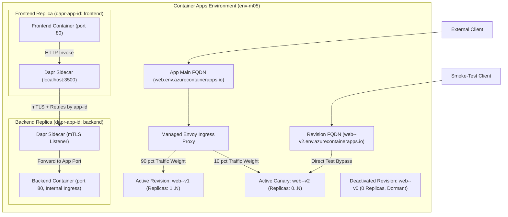
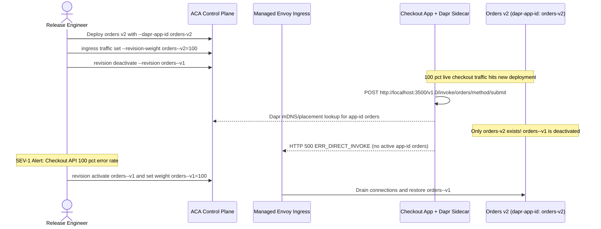

# Revisions, Traffic Splitting & Dapr

> **Prerequisites:** Azure Container Apps Environments, ingress configuration, and basic revision updates (Modules 01–03).  
> **Estimated Reading Time:** 30 minutes  
> **Target Audience:** Backend Engineers, Platform Architects, Site Reliability Engineers.

> [!TIP]
> **The Golden Rule of Safe ACA Rollouts & Dapr Meshing:** Revisions are immutable template snapshots, and traffic weights only govern the app's main FQDN in `multiple` mode—always smoke-test a canary via its dedicated revision FQDN before shifting live weights, and treat every `--dapr-app-id` as an immutable Environment-scoped service contract.

---

## Why This Matters

Revisions and traffic splitting are how you ship safely: canary a new version to 10% of users, roll back instantly by shifting weights, or run blue/green — all without the Deployment/Service surgery you'd do in raw Kubernetes yourself (as in track 03). Dapr then lets two apps call each other by name with retries and mTLS, without you wiring service discovery yourself. Together they turn a Container Apps Environment into a small service mesh you didn't have to build.

---

## 1. Architectural Mental Model: Revisions, Envoy Weighting & Dapr Sidecars

Every Azure Container Apps Environment acts as a shared network and mesh boundary. In `multiple` revision mode, the platform's managed Envoy ingress splits live main-FQDN requests across active revision snapshots by weight, while each revision simultaneously retains a direct revision FQDN for isolated smoke testing. When Dapr is enabled, a sidecar container runs alongside every app replica on `localhost:3500` to resolve targets by `app-id` over mTLS:



### Core Concepts

#### Single-Revision vs. Multiple-Revision Mode
Every app runs in one of two **revision modes**. In **single** mode (the default) only the latest revision is active and gets 100% of traffic; each update supersedes the last — a rolling update, like a plain Deployment. In **multiple** mode, several revisions can be active simultaneously and you control how traffic is divided among them. You switch modes with `az containerapp revision set-mode`. Multiple mode is the prerequisite for canary/blue-green; single mode is simpler when you don't need it. Switching to multiple mode doesn't retroactively activate old revisions — you manage which are active going forward.

#### Revisions Are Immutable Snapshots
A **revision** is an immutable version of the app's template (image + config). You've already seen that any template change mints one (module 02). In multiple mode each active revision gets its own stable **revision FQDN** (`<app>--<revision-suffix>.<env>...`) in addition to the app's main FQDN — so you can hit a specific revision directly for testing, while the main FQDN follows your traffic weights. Revisions can be **activated** and **deactivated**; a deactivated revision keeps its config but serves no traffic and consumes no replicas.

#### Traffic Splitting: Canary, Blue/Green, Rollback
In multiple mode you assign **traffic weights** across revisions with `az containerapp ingress traffic set` — e.g. 90% to the current stable, 10% to a new canary. Blue/green is just 100/0 then 0/100. Instant rollback is shifting weights back to the known-good revision — no redeploy, no image pull, because the old revision is still there. This is the same idea as a Kubernetes canary with two Deployments behind one Service and weighted routing, except Envoy and the platform do the weighting for you and it's one command.

#### Dapr in Container Apps
**Dapr** (Distributed Application Runtime) is built into ACA and enabled per-app (`--enable-dapr`, plus a stable `--dapr-app-id`). When enabled, each app gets a Dapr **sidecar**; apps call each other through it using the app-id, getting service discovery, retries, and mTLS for free. This is the same Dapr you could add to any Kubernetes cluster yourself, but you don't deploy the Dapr control plane — it's part of the Environment. Dapr **components** (state stores, pub/sub brokers, secret stores) are defined at the Environment level and scoped to specific app-ids.

#### Dapr Service Invocation Between Two Apps
The headline pattern: app A calls app B without knowing B's address. A issues a request to its **local Dapr sidecar** at `http://localhost:3500/v1.0/invoke/<B-app-id>/method/<path>`, and Dapr resolves `<B-app-id>` to app B within the Environment, forwards the call over mTLS, and retries on transient failure. B just needs Dapr enabled with that app-id and to be listening on its app port. Because discovery is by **app-id**, not FQDN or IP, this only works **within one Environment** (recall module 01: Dapr and internal discovery are Environment-scoped).

---

## 2. Taxonomic Comparison: Revision Modes & Service Discovery Options

| Dimension | Single-Revision Mode | Multiple-Revision Mode |
| :--- | :--- | :--- |
| **Active Revisions** | Strictly 1 (latest healthy revision) | Up to 100 active revisions simultaneously |
| **Traffic Routing** | Automatic 100% to latest | Explicit weights via `ingress traffic set` (must sum to 100) |
| **Direct Canary Testing** | Not applicable | Dedicated `<app>--<suffix>.<env>...` revision FQDN |
| **Rollback Speed** | Slow (requires new image/template deploy) | Instant (weight shift back to warm/existing revision) |
| **Idle Cost Risk** | Minimal (old revisions auto-deactivate) | High if old revisions remain active with `--min-replicas > 0` |
| **Best Use Case** | Dev environments, simple stateless APIs | Production canary, blue/green releases, A/B smoke tests |

| Service-to-Service Mechanism | Addressing Target | Encryption & Retries | Scope Boundary |
| :--- | :--- | :--- | :--- |
| **Dapr Service Invocation** | `http://localhost:3500/v1.0/invoke/<app-id>/method/<path>` | Built-in mTLS + configurable resiliency retries | Strictly **single ACA Environment** |
| **Direct Internal HTTP** | `https://<app>.internal.<env-domain>` | TLS via Envoy; caller implements retry logic | Same ACA Environment (or VNet peers) |
| **External FQDN Call** | `https://<app>.<env-domain>` | Public TLS; traverses external ingress | Cross-Environment / Public Internet |

---

## 3. Command Reference & Flag Breakdowns

| Command | What it does | Example |
| :--- | :--- | :--- |
| `az containerapp revision set-mode` | Set single/multiple revision mode | `az containerapp revision set-mode --name web --resource-group rg-aca-m05 --mode multiple` |
| `az containerapp revision list` | List revisions and their state | `az containerapp revision list --name web --resource-group rg-aca-m05 -o table` |
| `az containerapp revision copy` | Create a new revision from an existing one | `az containerapp revision copy --name web --resource-group rg-aca-m05 --image  --revision-suffix v2` |
| `az containerapp revision activate` / `deactivate` | Turn a revision on/off | `az containerapp revision deactivate --name web --resource-group rg-aca-m05 --revision web--v1` |
| `az containerapp ingress traffic set` | Split traffic across revisions | `az containerapp ingress traffic set --name web --resource-group rg-aca-m05 --revision-weight web--v1=90 web--v2=10` |
| `az containerapp ingress traffic show` | Show current traffic weights | `az containerapp ingress traffic show --name web --resource-group rg-aca-m05 -o table` |
| `az containerapp create` (Dapr) | Create an app with Dapr enabled | `az containerapp create ... --enable-dapr --dapr-app-id orders --dapr-app-port 80` |

### Flag-by-Flag Breakdowns

`az containerapp revision copy --name web --resource-group rg-aca-m05 --image  --revision-suffix v2`
- `--image` — the image for the new revision (change it to ship a new version).
- `--revision-suffix v2` — a human-readable suffix so the revision is named `web--v2` instead of a random hash; makes traffic commands readable.

`az containerapp ingress traffic set --name web --resource-group rg-aca-m05 --revision-weight web--v1=90 web--v2=10`
- `--revision-weight web--v1=90 web--v2=10` — assign percentages by revision name; must sum to 100. This is the canary/blue-green/rollback control. You can also use `latest=NN` to target the latest revision.

`az containerapp create --name orders --resource-group rg-aca-m05 --environment env-m05 --image ... --target-port 80 --ingress internal --enable-dapr --dapr-app-id orders --dapr-app-port 80`
- `--enable-dapr` — inject the Dapr sidecar.
- `--dapr-app-id orders` — the stable identity other apps use to invoke this one; changing it breaks callers.
- `--dapr-app-port 80` — the port Dapr forwards invoked requests to inside the container (usually your app's listening port).

---

## 4. Production War Story: The Blue/Green Cutover & Mutated Dapr App-ID Outage



### The Incident
During a Friday afternoon release of an e-commerce `orders` service, an engineer wanted a clean blue/green cutover. Instead of keeping `--dapr-app-id orders` constant across revisions, the deployment pipeline created a separate app/revision configuration using `--dapr-app-id orders-v2`, shifted 100% traffic straight to `v2` without testing the revision FQDN, and immediately deactivated `orders--v1`.

### Post-Mortem Metrics
* **Severity:** SEV-1 (Complete checkout pipeline failure)
* **Mean Time to Detect (MTTD):** 2 minutes (synthetic checkout probes returned 500s)
* **Mean Time to Resolution (MTTR):** 4 minutes (`revision activate` + `ingress traffic set` back to `v1`)
* **Impact:** 100% of `POST /checkout` requests failed for 6 minutes while upstream callers received `ERR_DIRECT_INVOKE`.

### Root Cause Analysis
1. **Contract Mutation:** Dapr callers (`checkout`) resolve targets strictly by `--dapr-app-id` (`orders`). Renaming the identity to `orders-v2` broke service discovery across the entire Environment.
2. **Skipped Canary & Premature Deactivation:** Jumping from 0% to 100% without testing the revision FQDN (`orders--v2.<env>`) and immediately deactivating `orders--v1` left zero active instances matching the expected contract.

### The Fix & Architectural Hardening
1. **Lock `--dapr-app-id` in IaC:** Treat `--dapr-app-id` as an immutable service identifier; use revisions (`--revision-suffix v2`) on the **same** container app rather than renaming the Dapr app-id.
2. **Staged Canary Protocol:** Require smoke tests against `az containerapp revision show --query properties.fqdn` first, then step traffic (`90/10` -> `50/50` -> `0/100`), keeping the previous revision active (at `min-replicas 0`) during the bake window for instant rollback.

---

## 5. Multi-Language Production Code: Hardened Dapr Service Invocation Client

When calling downstream services through the local Dapr sidecar (`http://localhost:3500/v1.0/invoke/<app-id>/method/<path>`), production backends must enforce explicit timeouts, retry only transient transport/`5xx` errors with jittered backoff, and propagate revision metadata for observability:

````carousel
### Go (`net/http`)
```go
package main

import (
	"bytes"
	"context"
	"errors"
	"fmt"
	"io"
	"net/http"
	"os"
	"time"
)

type DaprClient struct {
	httpClient *http.Client
	daprPort   string
	revision   string
}

func NewDaprClient() *DaprClient {
	port := os.Getenv("DAPR_HTTP_PORT")
	if port == "" {
		port = "3500"
	}
	rev := os.Getenv("CONTAINER_APP_REVISION")
	if rev == "" {
		rev = "local"
	}
	return &DaprClient{
		httpClient: &http.Client{Timeout: 5 * time.Second},
		daprPort:   port,
		revision:   rev,
	}
}

// InvokeBackend calls an Environment-scoped service strictly by its stable --dapr-app-id.
func (c *DaprClient) InvokeBackend(ctx context.Context, targetAppID, methodPath string, payload []byte) ([]byte, error) {
	endpoint := fmt.Sprintf("http://127.0.0.1:%s/v1.0/invoke/%s/method/%s", c.daprPort, targetAppID, methodPath)
	const maxAttempts = 3

	var lastErr error
	for attempt := 1; attempt <= maxAttempts; attempt++ {
		req, err := http.NewRequestWithContext(ctx, http.MethodPost, endpoint, bytes.NewReader(payload))
		if err != nil {
			return nil, fmt.Errorf("build dapr request: %w", err)
		}
		req.Header.Set("Content-Type", "application/json")
		req.Header.Set("X-Caller-Revision", c.revision)

		resp, err := c.httpClient.Do(req)
		if err == nil {
			body, readErr := io.ReadAll(io.LimitReader(resp.Body, 1<<20))
			resp.Body.Close()
			if resp.StatusCode >= 200 && resp.StatusCode < 300 {
				return body, nil
			}
			lastErr = fmt.Errorf("dapr invoke %s returned HTTP %d: %s", targetAppID, resp.StatusCode, string(body))
			if resp.StatusCode < 500 && resp.StatusCode != http.StatusTooManyRequests {
				return nil, lastErr // Do not retry deterministic 4xx/app-id mismatch errors
			}
		} else {
			lastErr = err
		}

		if attempt < maxAttempts {
			select {
			case <-ctx.Done():
				return nil, ctx.Err()
			case <-time.After(time.Duration(attempt*150) * time.Millisecond):
			}
		}
	}
	return nil, errors.Join(errors.New("dapr invocation exhausted retries"), lastErr)
}
```
<!-- slide -->
### TypeScript (`fetch` + `AbortSignal`)
```typescript
export interface DaprInvokeOptions {
  targetAppId: string;
  methodPath: string;
  payload: unknown;
  timeoutMs?: number;
  maxAttempts?: number;
}

export async function invokeDaprService<TResponse>(opts: DaprInvokeOptions): Promise<TResponse> {
  const daprPort = process.env.DAPR_HTTP_PORT ?? '3500';
  const callerRevision = process.env.CONTAINER_APP_REVISION ?? 'local';
  const timeoutMs = opts.timeoutMs ?? 5000;
  const maxAttempts = opts.maxAttempts ?? 3;

  // Discovery happens via local sidecar; never hardcode target FQDNs or IPs
  const url = `http://127.0.0.1:${daprPort}/v1.0/invoke/${encodeURIComponent(opts.targetAppId)}/method/${opts.methodPath}`;

  let lastError: Error | undefined;
  for (let attempt = 1; attempt <= maxAttempts; attempt++) {
    try {
      const response = await fetch(url, {
        method: 'POST',
        headers: {
          'Content-Type': 'application/json',
          'X-Caller-Revision': callerRevision,
        },
        body: JSON.stringify(opts.payload),
        signal: AbortSignal.timeout(timeoutMs),
      });

      if (response.ok) {
        return (await response.json()) as TResponse;
      }

      const bodyText = await response.text();
      lastError = new Error(`Dapr invoke to '${opts.targetAppId}' failed (${response.status}): ${bodyText}`);

      // Retry only transient 5xx / 429 responses; fail fast on 404/400
      if (response.status < 500 && response.status !== 429) {
        throw lastError;
      }
    } catch (err) {
      lastError = err instanceof Error ? err : new Error(String(err));
      if (lastError.message.includes('failed (4')) {
        throw lastError;
      }
    }

    if (attempt < maxAttempts) {
      await new Promise((resolve) => setTimeout(resolve, attempt * 150));
    }
  }

  throw lastError ?? new Error('Dapr invocation failed');
}
```
<!-- slide -->
### Python (`httpx`)
```python
import os
import time
from typing import Any, Dict
import httpx


def invoke_dapr_service(
    target_app_id: str,
    method_path: str,
    payload: Dict[str, Any],
    timeout_sec: float = 5.0,
    max_attempts: int = 3,
) -> Dict[str, Any]:
    """Invokes another ACA app via the local Dapr sidecar over mTLS."""
    dapr_port = os.getenv("DAPR_HTTP_PORT", "3500")
    revision = os.getenv("CONTAINER_APP_REVISION", "local")
    url = f"http://127.0.0.1:{dapr_port}/v1.0/invoke/{target_app_id}/method/{method_path}"
    headers = {"X-Caller-Revision": revision}

    last_error: Exception | None = None
    with httpx.Client(timeout=timeout_sec) as client:
        for attempt in range(1, max_attempts + 1):
            try:
                resp = client.post(url, json=payload, headers=headers)
                if 200 <= resp.status_code < 300:
                    return resp.json()

                last_error = RuntimeError(
                    f"Dapr invoke '{target_app_id}' HTTP {resp.status_code}: {resp.text}"
                )
                if resp.status_code < 500 and resp.status_code != 429:
                    raise last_error
            except httpx.RequestError as exc:
                last_error = exc

            if attempt < max_attempts:
                time.sleep(0.15 * attempt)

    raise RuntimeError(f"Dapr invocation exhausted retries: {last_error}")
```
<!-- slide -->
### C# (`HttpClient` / `IHttpClientFactory`)
```csharp
using System;
using System.Net;
using System.Net.Http;
using System.Net.Http.Json;
using System.Threading;
using System.Threading.Tasks;

public sealed class DaprInvocationClient
{
    private readonly HttpClient _http;
    private readonly string _daprPort;
    private readonly string _revision;

    public DaprInvocationClient(HttpClient http)
    {
        _http = http;
        _daprPort = Environment.GetEnvironmentVariable("DAPR_HTTP_PORT") ?? "3500";
        _revision = Environment.GetEnvironmentVariable("CONTAINER_APP_REVISION") ?? "local";
    }

    public async Task<TResponse?> InvokeAsync<TRequest, TResponse>(
        string targetAppId,
        string methodPath,
        TRequest payload,
        CancellationToken ct = default)
    {
        var url = $"http://127.0.0.1:{_daprPort}/v1.0/invoke/{Uri.EscapeDataString(targetAppId)}/method/{methodPath}";
        const int maxAttempts = 3;
        Exception? lastError = null;

        for (int attempt = 1; attempt <= maxAttempts; attempt++)
        {
            using var req = new HttpRequestMessage(HttpMethod.Post, url)
            {
                Content = JsonContent.Create(payload)
            };
            req.Headers.Add("X-Caller-Revision", _revision);

            try
            {
                using var resp = await _http.SendAsync(req, ct);
                if (resp.IsSuccessStatusCode)
                {
                    return await resp.Content.ReadFromJsonAsync<TResponse>(cancellationToken: ct);
                }

                var body = await resp.Content.ReadAsStringAsync(ct);
                lastError = new HttpRequestException(
                    $"Dapr invoke '{targetAppId}' failed with {(int)resp.StatusCode}: {body}",
                    null,
                    resp.StatusCode);

                if ((int)resp.StatusCode < 500 && resp.StatusCode != HttpStatusCode.TooManyRequests)
                {
                    throw lastError;
                }
            }
            catch (HttpRequestException ex) when (attempt < maxAttempts)
            {
                lastError = ex;
            }

            if (attempt < maxAttempts)
            {
                await Task.Delay(TimeSpan.FromMilliseconds(150 * attempt), ct);
            }
        }

        throw lastError ?? new InvalidOperationException("Dapr invocation failed.");
    }
}
```
````

---

## 6. Practical Hands-On Verification CLI Workflows

Run these workflows sequentially in PowerShell to drill revision splitting, instant rollback, Dapr service invocation, and failure diagnostics.

### Workflow 1: Provision Environment, Enable Multiple-Revision Mode & Mint Canary (Exercises 1–3)

1. **Set up group, Environment, and an app.**
```powershell
az group create --name rg-aca-m05 --location eastus
az containerapp env create --name env-m05 --resource-group rg-aca-m05 --location eastus
az containerapp create --name web --resource-group rg-aca-m05 --environment env-m05 `
  --image mcr.microsoft.com/k8se/quickstart:latest --target-port 80 --ingress external `
  --revision-suffix v1
```

2. **Switch to multiple-revision mode.**
```powershell
az containerapp revision set-mode --name web --resource-group rg-aca-m05 --mode multiple
az containerapp show --name web --resource-group rg-aca-m05 --query properties.configuration.activeRevisionsMode -o tsv
```
**Expected Output:**
```text
Multiple
```

3. **Create a second revision.**
```powershell
az containerapp revision copy --name web --resource-group rg-aca-m05 `
  --image mcr.microsoft.com/k8se/quickstart:latest --revision-suffix v2 --set-env-vars VERSION=2
az containerapp revision list --name web --resource-group rg-aca-m05 -o table
```
**Expected Output:**
```text
Name     Active    CreatedTime                 TrafficWeight    ProvisioningState
-------  --------  --------------------------  ---------------  -------------------
web--v1  True      2026-11-11T08:00:00+00:00   100              Provisioned
web--v2  True      2026-11-11T08:02:00+00:00   0                Provisioned
```
*(Verify both `web--v1` and `web--v2` appear and are active.)*

---

### Workflow 2: Canary Split, Revision FQDN Smoke Test, Blue/Green & Deactivation (Exercises 4–7)

4. **Canary split 90/10.**
```powershell
az containerapp ingress traffic set --name web --resource-group rg-aca-m05 `
  --revision-weight web--v1=90 web--v2=10
az containerapp ingress traffic show --name web --resource-group rg-aca-m05 -o table
```
**Expected Output:**
```text
RevisionName    Weight    LatestRevision
--------------  --------  ----------------
web--v1         90        False
web--v2         10        True
```
*(Hit the FQDN repeatedly and observe ~1 in 10 requests hitting v2 if the image surfaced the difference; otherwise trust the weights table.)*

5. **Test a specific revision directly.**
```powershell
az containerapp revision show --name web --resource-group rg-aca-m05 --revision web--v2 --query properties.fqdn -o tsv
```
**Expected Output:**
```text
web--v2.<env-unique-id>.eastus.azurecontainerapps.io
```
*(`curl` that revision FQDN to hit v2 regardless of traffic weights — useful for smoke-testing a canary before widening it.)*

6. **Promote (blue/green) then instant rollback.**
```powershell
az containerapp ingress traffic set --name web --resource-group rg-aca-m05 --revision-weight web--v2=100
# ...decide v2 is bad...
az containerapp ingress traffic set --name web --resource-group rg-aca-m05 --revision-weight web--v1=100
az containerapp ingress traffic show --name web --resource-group rg-aca-m05 -o table
```
**Expected Output:**
```text
RevisionName    Weight    LatestRevision
--------------  --------  ----------------
web--v1         100       False
```
*(Verify each switch in the traffic table. Note the rollback is instant — v1 was never removed.)*

7. **Deactivate the old revision to stop it consuming replicas.**
```powershell
az containerapp revision deactivate --name web --resource-group rg-aca-m05 --revision web--v2
az containerapp revision list --name web --resource-group rg-aca-m05 -o table
```
**Expected Output:**
```text
Name     Active    CreatedTime                 TrafficWeight    ProvisioningState
-------  --------  --------------------------  ---------------  -------------------
web--v1  True      2026-11-11T08:00:00+00:00   100              Provisioned
web--v2  False     2026-11-11T08:02:00+00:00   0                Provisioned
```
*(Verify `web--v2` shows inactive. Reactivate with `revision activate` if needed.)*

---

### Workflow 3: Dapr Service Invocation Between Internal & External Apps (Exercises 8–9)

8. **Deploy two Dapr-enabled apps.** A backend and a caller.
```powershell
az containerapp create --name backend --resource-group rg-aca-m05 --environment env-m05 `
  --image mcr.microsoft.com/k8se/quickstart:latest --target-port 80 --ingress internal `
  --enable-dapr --dapr-app-id backend --dapr-app-port 80
az containerapp create --name frontend --resource-group rg-aca-m05 --environment env-m05 `
  --image mcr.microsoft.com/k8se/quickstart:latest --target-port 80 --ingress external `
  --enable-dapr --dapr-app-id frontend --dapr-app-port 80
az containerapp show --name frontend --resource-group rg-aca-m05 --query properties.configuration.dapr -o jsonc
```
**Expected Output:**
```json
{
  "appId": "frontend",
  "appPort": 80,
  "appProtocol": "http",
  "enabled": true
}
```

9. **Exercise Dapr service invocation.** From the frontend's console (or a Dapr app that makes the call), the invocation URL is `http://localhost:3500/v1.0/invoke/backend/method/<path>`. Using `az containerapp exec` into the frontend replica:
```powershell
az containerapp exec --name frontend --resource-group rg-aca-m05 --command "/bin/sh"
# inside the container:
# wget -qO- http://localhost:3500/v1.0/invoke/backend/method/
```
*(Verify the call reaches `backend` via its app-id, not its FQDN/IP. If your image lacks a shell/wget, note the URL pattern is the deliverable.)*

---

### Workflow 4: Failure Diagnostics & Cleanup (Exercises 10–12)

10. **Diagnose and fix: revision stuck provisioning.** Ship a revision whose container can't start (bad image tag):
```powershell
az containerapp revision copy --name web --resource-group rg-aca-m05 `
  --image mcr.microsoft.com/k8se/quickstart:doesnotexist --revision-suffix bad
az containerapp revision list --name web --resource-group rg-aca-m05 -o table
```
Observe `web--bad` stuck in Provisioning/Failed and (if you routed traffic to it) errors. **Diagnose** with:
```powershell
az containerapp revision show --name web --resource-group rg-aca-m05 --revision web--bad -o jsonc
```
(Look at provisioning/health state and the logs.) **Fix** by shifting all traffic back to a healthy revision and deactivating the bad one:
```powershell
az containerapp ingress traffic set --name web --resource-group rg-aca-m05 --revision-weight web--v1=100
az containerapp revision deactivate --name web --resource-group rg-aca-m05 --revision web--bad
```

11. **Diagnose and fix: Dapr call fails with wrong app-id.** In the invocation URL, use a non-existent app-id (`http://localhost:3500/v1.0/invoke/backendd/method/`). The call fails to resolve. **Fix** by using the correct `--dapr-app-id` (`backend`). Lesson: Dapr discovery is by app-id, and it's Environment-scoped.

12. **Cleanup.**
```powershell
az group delete --name rg-aca-m05 --yes --no-wait
```

---

### Independent Challenge

Deploy an app in multiple-revision mode, ship a second revision, and run a disciplined canary: 100/0 -> 90/10 -> 50/50 -> 0/100, verifying weights at each step and testing the canary via its dedicated revision FQDN before widening. Then deploy a **second** Dapr-enabled app and demonstrate that your first app can invoke it by app-id. Combine this module with **module 03**: give the canary revision an HTTP scale rule and confirm it scales independently of the stable revision under load. Clean up the resource group when done.

<details>
<summary>Stuck? One hint</summary>

Each active revision scales on its own scale rules, so to see the canary scale independently, drive load *specifically at its revision FQDN* (from `revision show --query properties.fqdn`) rather than the app's main FQDN, and watch `replica list` — replicas are reported per revision.

</details>

---

## 7. Common Mistakes & Troubleshooting

- **Forgetting to switch to multiple mode.** `ingress traffic set` across revisions only makes sense in multiple mode; in single mode the latest revision always gets 100%.
- **Traffic weights that don't sum to 100.** The command expects percentages summing to 100; a leftover revision at some weight throws off the split.
- **Leaving dead revisions active.** Active-but-unused revisions can still hold min replicas and cost money. Deactivate old revisions you've rolled away from.
- **Changing a Dapr app-id.** Callers invoke by app-id; renaming it silently breaks them. Treat app-id as a stable contract.
- **Expecting cross-Environment Dapr.** Dapr invocation and internal discovery work only within one Environment — the same boundary rule from module 01.
- **Cost pitfall: canaries with warm min-replicas.** A canary revision with `--min-replicas 1` bills continuously alongside stable. Keep canaries at min 0 (or deactivate them) when not actively testing.

---

## 8. Checkpoint Quiz

Write down your answer to each question before expanding it — checking without attempting first is the single easiest way to fool yourself into thinking you've learned this.

1. What must you do before you can split traffic across two revisions?
2. How do you roll back a bad release instantly, and why is it instant?
3. What's the difference between the app's main FQDN and a revision FQDN?
4. In Dapr service invocation, what does app A use to address app B, and what does A actually connect to locally?
5. Why does Dapr invocation only work within a single Environment?
6. A deactivated revision — does it serve traffic? Does it consume replicas?
7. You set `--revision-weight web--v2=100` and the app starts erroring. Two likely causes and the fastest mitigation?

<details>
<summary>Show answers</summary>

1. Switch the app to **multiple**-revision mode (`revision set-mode --mode multiple`); single mode always routes 100% to the latest revision.
2. Shift traffic weights back to the known-good revision with `ingress traffic set`. Instant because the old revision is still present (immutable snapshot) — no redeploy or image pull needed.
3. The main FQDN follows your traffic weights across active revisions; a revision FQDN (`<app>--<suffix>...`) always hits that one specific revision, for direct testing.
4. A uses B's **Dapr app-id**; A connects to its **own local Dapr sidecar** (`http://localhost:3500/v1.0/invoke/<app-id>/method/...`), which resolves and forwards to B over mTLS.
5. Dapr discovery/invocation and internal service discovery are scoped to one Environment (the shared network/mesh boundary from module 01).
6. No traffic, and no replicas — it retains config but is dormant until reactivated.
7. Either v2's revision is unhealthy/stuck provisioning (bad image/config) or v2 has a bug. Fastest mitigation: shift 100% back to the healthy revision, then deactivate/investigate v2.

</details>

---

## 9. Operational Validation Checkpoints

<details>
<summary><strong>Scenario 1: The Unreachable Dapr Target Across Environments</strong></summary>

**Scenario:** Your team deploys a `payments` app into `env-pci` (for compliance isolation) with `--enable-dapr --dapr-app-id payments`. Meanwhile, `checkout` runs in `env-core` and issues `POST http://localhost:3500/v1.0/invoke/payments/method/charge`. Every call fails with `ERR_DIRECT_INVOKE` (HTTP 500), even though both apps are healthy in the same VNet.

Why is Dapr failing, and how do you fix the architecture?

**Answer:**
Dapr service invocation is strictly **Environment-scoped**. Even if two Container Apps Environments sit inside the same VNet, each Environment runs an isolated Dapr control plane and mTLS trust domain (`payments` only registers inside `env-pci`).

**The Fix:** Either host both `checkout` and `payments` inside the same Container Apps Environment (if compliance allows), or expose `payments` with `--ingress internal` inside the shared VNet and have `checkout` call `payments`'s **internal Environment FQDN** over standard HTTPS rather than Dapr app-id invocation.

</details>

<details>
<summary><strong>Scenario 2: Traffic Split Ignored After Configuration Update</strong></summary>

**Scenario:** You run `az containerapp ingress traffic set --name api --resource-group rg-prod --revision-weight api--v1=80 api--v2=20`. The CLI returns an error stating traffic splitting isn't supported or later updates reset weights to 100% on the newest revision.

What happened, and what is the exact command sequence to restore a safe canary?

**Answer:**
The app was still configured in **single-revision mode** (`activeRevisionsMode: Single`). In single mode, any template update automatically promotes the latest revision to 100% and deactivates older revisions.

**The Fix:**
1. Switch to multiple mode: `az containerapp revision set-mode --name api --resource-group rg-prod --mode multiple`.
2. Ensure both `api--v1` and `api--v2` are active (`az containerapp revision activate ...` if needed).
3. Reapply weights summing to 100: `az containerapp ingress traffic set --name api --resource-group rg-prod --revision-weight api--v1=80 api--v2=20`.

</details>

<details>
<summary><strong>Scenario 3: Surprising Monthly Bill After 12 Canary Deployments</strong></summary>

**Scenario:** Over a sprint, your CI pipeline ships 12 canary revisions (`api--build-101` through `api--build-112`) in `multiple` mode. Each template uses `--min-replicas 1`. Only `api--build-112` has `100` traffic weight, yet your Azure compute bill jumped 12x.

Why are zero-traffic revisions still costing money, and how do you eliminate the waste?

**Answer:**
In `multiple` mode, **0% traffic weight does not deactivate a revision**. Any active revision configured with `--min-replicas 1` keeps at least one warm replica running continuously in the background, billing vCPU and memory idle rates.

**The Fix:**
1. Immediately deactivate superseded revisions: `az containerapp revision deactivate --name api --resource-group rg-prod --revision api--build-101` (or automate pruning inactive revisions in CI after the bake window).
2. Keep canary revisions at `--min-replicas 0` when idle, and only retain at most 1–2 warm rollback revisions if zero-cold-start rollback is strictly required.

</details>

---

## Next

[06-secrets-managed-identity-and-config](../06-secrets-managed-identity-and-config/README.md)
— stop putting connection strings in plaintext: secrets, Key Vault references, managed identity, and the role assignments that make them work.
