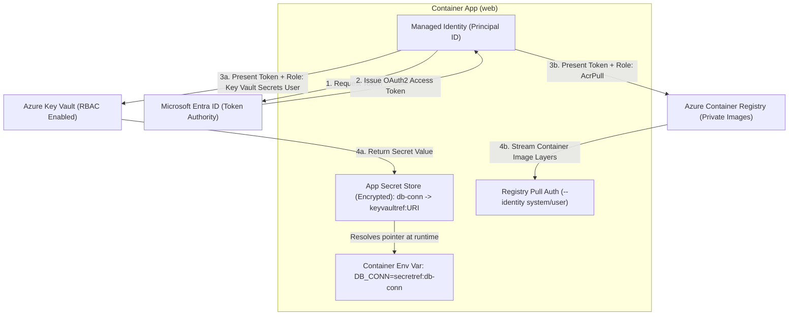
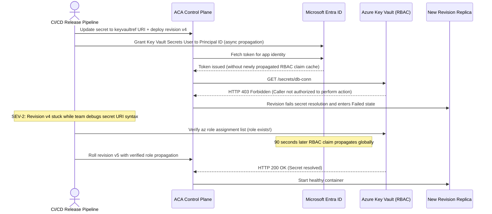

# Secrets, Managed Identity & Config

> **Prerequisites:** Container App creation, environment variables, and revision updates (Modules 01–05).  
> **Estimated Reading Time:** 30 minutes  
> **Target Audience:** Backend Engineers, Security Engineers, Cloud Platform Architects.

> [!TIP]
> **The Golden Rule of Zero-Secret Configuration:** Never bake static credentials into container images, template environment variables, or shell history—bind an Entra Managed Identity to every app, assign least-privilege RBAC roles scoped strictly to the target vault or registry, and recognize `403 Forbidden` during startup as a missing or still-propagating role assignment rather than a missing secret.

---

## Why This Matters

Real apps need connection strings, API keys, and registry credentials — and none of them belong in plaintext env vars or your shell history. Container Apps gives you app-scoped secrets, Key Vault references resolved at runtime, and managed identities so your app can authenticate to Azure services *without any secret at all*. This is also where a single typo — a bad secret reference or a missing role assignment — turns into a crash loop, so learning to diagnose it matters as much as setting it up.

---

## 1. Architectural Mental Model: Identity, RBAC & Runtime Secret Resolution

When a Container App starts a revision that pulls private images or resolves Key Vault secrets, the ACA platform uses the app's **Managed Identity** to acquire an OAuth2 token from Microsoft Entra ID. The identity *proves who the app is* (authentication), while the **RBAC role assignment** on the target resource *proves what it is allowed to read* (authorization):



### Core Concepts

#### App Secrets and Secret References
A container app can hold named **secrets** (`--secrets name=value`), stored encrypted by the platform, not visible in the plain template. You then **reference** a secret from an environment variable using the `secretref:` syntax: `--env-vars "DB_CONN=secretref:db-conn"` injects the value of the secret named `db-conn` into the `DB_CONN` env var at runtime. This is the same pattern as a Kubernetes Secret referenced by a pod's `valueFrom.secretKeyRef` — you already know the shape. Secrets are also what scale-rule auth and registry auth point at (you saw `--scale-rule-auth connection=queue-conn` in module 03).

#### Key Vault References
Better than storing the secret value in the app: store it in **Azure Key Vault** and have the app reference it. A secret's value can be a Key Vault secret URI, and ACA resolves it at runtime using the app's **managed identity**. So the app config contains only a pointer (the Key Vault secret URI) and an identity — the actual secret never sits in the container app resource. Rotating the secret in Key Vault propagates without changing the app. This is the recommended pattern for anything sensitive.

#### Managed Identity: System-Assigned vs. User-Assigned
A **managed identity** is an Azure AD (Entra) identity your app *is*, so it can call Azure services (Key Vault, Storage, ACR, Service Bus) using RBAC instead of a stored credential. **System-assigned** identity is created with the app, tied to its lifecycle, and unique to it (`--system-assigned`). **User-assigned** identity is a standalone resource you create once and attach to many apps (`--user-assigned <id>`) — better when several apps need the same permissions or you want the identity to outlive any one app. Conceptually this is like a Kubernetes ServiceAccount bound to a cloud IAM role (workload identity), but managed for you.

#### Role Assignments: The Part Everyone Forgets
Having an identity is necessary but not sufficient — the identity needs **RBAC role assignments** granting it access to the target resource. To read Key Vault secrets, the app's identity needs a role like **Key Vault Secrets User** on the vault (or an access policy, on vaults using the legacy model). To pull from ACR, it needs **AcrPull** on the registry. Miss the role assignment and the identity authenticates but is denied — the app crash-loops or fails to start with an authorization error, not a "missing secret" error. The diagnosis skill is recognizing "403/forbidden from the identity" as "missing role assignment," not "wrong secret."

#### Registry Authentication with Managed Identity
Pulling a private image is a special case of the same idea. Instead of storing registry username/password as secrets, you attach a managed identity with **AcrPull** on the Azure Container Registry and tell the app to use it for pulls (`az containerapp registry set --identity <system-or-user-id>`). No registry password is ever stored on the app. If the role assignment is missing, the very first thing that fails is the image pull — the revision never leaves provisioning.

---

## 2. Taxonomic Comparison: Secret Storage & Identity Types

| Configuration Pattern | Where Value Lives | Rotation Behavior | Failure Signature | Best For |
| :--- | :--- | :--- | :--- | :--- |
| **Plaintext Env Var** | App template JSON (visible in `show`) | Requires new revision update | Immediate misconfig | Non-sensitive flags (`PORT`, `LOG_LEVEL`) |
| **ACA App Secret (`secretref:`)** | Encrypted inside ACA resource | Requires `secret set` + new revision | Unresolved `secretref:` crash loop on typo | Scale-rule connection strings, quick dev |
| **Key Vault Reference (`keyvaultref:`)** | Azure Key Vault (URI pointer in ACA) | Automatic pickup on rotation | `403 Forbidden` if RBAC missing/lagging | Production API keys, DB passwords |
| **Direct SDK Managed Identity** | No secret exists (OAuth2 tokens) | Automatic short-lived tokens | `403 AuthorizationFailed` from target PaaS | Storage, Service Bus, Key Vault SDKs |

| Dimension | System-Assigned Managed Identity | User-Assigned Managed Identity |
| :--- | :--- | :--- |
| **Resource Lifecycle** | Created and deleted **with** the Container App | Standalone Azure resource (`Microsoft.ManagedIdentity`) |
| **Multi-App Sharing** | 1-to-1 only (cannot share across apps) | Many-to-many (shared across microservices) |
| **Pre-Provisioning RBAC** | Impossible until app exists (chicken-and-egg on initial ACR pull) | Assign `AcrPull` & `Key Vault Secrets User` **before** app creation |
| **Blast Radius on Compromise** | Isolated to one app | Shared permissions across all attached apps |

---

## 3. Command Reference & Flag Breakdowns

| Command | What it does | Example |
| :--- | :--- | :--- |
| `az containerapp secret set` | Add/update app secrets | `az containerapp secret set --name web --resource-group rg-aca-m06 --secrets "db-conn=Server=..."` |
| `az containerapp secret list` | List secret names (not values) | `az containerapp secret list --name web --resource-group rg-aca-m06 -o table` |
| `az containerapp identity assign` | Attach a managed identity | `az containerapp identity assign --name web --resource-group rg-aca-m06 --system-assigned` |
| `az containerapp identity show` | Show the app's identities | `az containerapp identity show --name web --resource-group rg-aca-m06 -o jsonc` |
| `az keyvault create` / `az keyvault secret set` | Create a vault / store a secret | `az keyvault secret set --vault-name kv-m06 --name db-conn --value "Server=..."` |
| `az role assignment create` | Grant the identity a role | `az role assignment create --assignee <principalId> --role "Key Vault Secrets User" --scope <vaultId>` |
| `az containerapp registry set` | Configure ACR pull auth | `az containerapp registry set --name web --resource-group rg-aca-m06 --server myacr.azurecr.io --identity system` |

### Flag-by-Flag Breakdowns

`az containerapp secret set --name web --resource-group rg-aca-m06 --secrets "db-conn=Server=..." "api-key=abc123"`
- `--secrets` — space-separated `name=value` pairs; stored encrypted, referenced later via `secretref:`.

`az containerapp identity assign --name web --resource-group rg-aca-m06 --system-assigned`
- `--system-assigned` — create/attach a system-assigned identity (lifecycle tied to the app). Use `--user-assigned <resourceId>` instead to attach a standalone identity.

`az role assignment create --assignee <principalId> --role "Key Vault Secrets User" --scope <vaultId>`
- `--assignee <principalId>` — the identity's principal (object) ID; for a system-assigned identity get it from `identity show --query principalId`.
- `--role "Key Vault Secrets User"` — the RBAC role granting secret-read.
- `--scope <vaultId>` — the resource the grant applies to (the Key Vault). Scope narrowly, not at subscription level.

`az containerapp update --name web --resource-group rg-aca-m06 --set-env-vars "DB_CONN=secretref:db-conn"`
- `--set-env-vars "DB_CONN=secretref:db-conn"` — inject the secret named `db-conn` into env var `DB_CONN` at runtime. A typo in the secret name (`secretref:db-con`) yields an unresolved reference and often a crash loop.

`az containerapp registry set --name web --resource-group rg-aca-m06 --server myacr.azurecr.io --identity system`
- `--server` — the ACR login server.
- `--identity system` — use the system-assigned identity to authenticate pulls (needs AcrPull on the registry). Use a user-assigned identity's resource ID for `--identity` instead if applicable.

---

## 4. Production War Story: The Chicken-and-Egg ACR Pull & RBAC Propagation Outage



### The Incident
A fintech team migrated their `billing-api` from static app secrets to Key Vault references (`keyvaultref:`) during a scheduled security hardening window. Their deployment script updated the container app's secret URI and created the `Key Vault Secrets User` role assignment in rapid succession—and immediately rolled the revision in `single` mode.

### Post-Mortem Metrics
* **Severity:** SEV-2 (Deployment stalled; 14 minutes of degraded rollout capacity)
* **Mean Time to Detect (MTTD):** 1 minute (provisioning webhook failed)
* **Mean Time to Resolution (MTTR):** 13 minutes (diagnosis of RBAC propagation delay + fresh revision rollout)
* **Impact:** Automated release pipeline aborted; engineers spent 10 minutes checking Key Vault secret names before inspecting RBAC status.

### Root Cause Analysis
1. **RBAC Propagation Lag + Sequential Execution:** Azure RBAC role assignments are eventually consistent across regional token caches and can take 60–180 seconds to take effect. Rolling a revision milliseconds after `az role assignment create` caused Key Vault to return `403 Forbidden`.
2. **Wrong Error Interpretation:** On-call treated `Failed to resolve Key Vault secret` as a malformed URI rather than reading the inner `403 Forbidden` authorization error.

### The Fix & Architectural Hardening
1. **Pre-Provision User-Assigned Identities in Terraform/Bicep:** Create the `user-assigned` managed identity and apply `AcrPull` + `Key Vault Secrets User` **before** provisioning or updating the Container App, eliminating the chicken-and-egg race on first boot.
2. **Canary Gate (`multiple` mode):** Always roll secret/identity migrations in `multiple` revision mode so a `403` during provisioning never degrades existing live replicas.

---

## 5. Multi-Language Production Code: Passwordless Key Vault & Config Validation

Even when injecting `DB_CONN` via `secretref:`, mature services often also fetch dynamic runtime secrets directly via `DefaultAzureCredential` (which automatically leverages ACA's Managed Identity endpoint without stored credentials). These implementations validate startup config and cleanly distinguish `403 Forbidden` (missing RBAC) from `404 NotFound` (typo in secret name):

````carousel
### Go (`azidentity` + `azsecrets`)
```go
package config

import (
	"context"
	"errors"
	"fmt"
	"net/http"
	"os"
	"time"

	"github.com/Azure/azure-sdk-for-go/sdk/azcore"
	"github.com/Azure/azure-sdk-for-go/sdk/azidentity"
	"github.com/Azure/azure-sdk-for-go/sdk/security/keyvault/azsecrets"
)

func LoadDatabaseConn(ctx context.Context, vaultURL, secretName string) (string, error) {
	// 1. Prefer ACA-injected secretref env var when already resolved at container start
	if injected := os.Getenv("DB_CONN"); injected != "" {
		return injected, nil
	}

	// 2. Passwordless runtime lookup via Managed Identity
	cred, err := azidentity.NewDefaultAzureCredential(nil)
	if err != nil {
		return "", fmt.Errorf("init managed identity credential: %w", err)
	}

	client, err := azsecrets.NewClient(vaultURL, cred, nil)
	if err != nil {
		return "", fmt.Errorf("init key vault client: %w", err)
	}

	reqCtx, cancel := context.WithTimeout(ctx, 5*time.Second)
	defer cancel()

	resp, err := client.GetSecret(reqCtx, secretName, "", nil)
	if err != nil {
		var respErr *azcore.ResponseError
		if errors.As(err, &respErr) {
			if respErr.StatusCode == http.StatusForbidden {
				return "", fmt.Errorf("RBAC missing or propagating (403) for secret %q: %w", secretName, err)
			}
			if respErr.StatusCode == http.StatusNotFound {
				return "", fmt.Errorf("secret %q does not exist in vault (404): %w", secretName, err)
			}
		}
		return "", fmt.Errorf("fetch key vault secret: %w", err)
	}
	if resp.Value == nil || *resp.Value == "" {
		return "", errors.New("resolved secret value is empty")
	}
	return *resp.Value, nil
}
```
<!-- slide -->
### TypeScript (`@azure/identity` + `@azure/keyvault-secrets`)
```typescript
import { DefaultAzureCredential } from '@azure/identity';
import { SecretClient } from '@azure/keyvault-secrets';
import { RestError } from '@azure/core-rest-pipeline';

export async function resolveDbConnection(vaultUrl: string, secretName: string): Promise<string> {
  // Fast path: ACA resolved the keyvaultref into DB_CONN via secretref:
  const injected = process.env.DB_CONN;
  if (injected && injected.trim().length > 0) {
    return injected;
  }

  // Fallback/direct passwordless fetch via Managed Identity
  const credential = new DefaultAzureCredential();
  const client = new SecretClient(vaultUrl, credential);

  try {
    const secret = await client.getSecret(secretName, {
      abortSignal: AbortSignal.timeout(5000),
    });
    if (!secret.value) {
      throw new Error(`Secret '${secretName}' resolved to an empty value`);
    }
    return secret.value;
  } catch (err) {
    if (err instanceof RestError) {
      if (err.statusCode === 403) {
        throw new Error(`403 Forbidden: verify 'Key Vault Secrets User' RBAC assignment for managed identity`);
      }
      if (err.statusCode === 404) {
        throw new Error(`404 NotFound: secret '${secretName}' missing from vault '${vaultUrl}'`);
      }
    }
    throw err;
  }
}
```
<!-- slide -->
### Python (`azure-identity` + `azure-keyvault-secrets`)
```python
import os
from azure.core.exceptions import HttpResponseError
from azure.identity import DefaultAzureCredential
from azure.keyvault.secrets import SecretClient


def resolve_db_connection(vault_url: str, secret_name: str) -> str:
    """Reads ACA-injected secretref env var or resolves directly via Managed Identity."""
    injected = os.getenv("DB_CONN", "").strip()
    if injected:
        return injected

    credential = DefaultAzureCredential()
    client = SecretClient(vault_url=vault_url, credential=credential)

    try:
        secret = client.get_secret(secret_name, timeout=5)
        if not secret.value:
            raise ValueError(f"Secret '{secret_name}' has an empty value")
        return secret.value
    except HttpResponseError as exc:
        if exc.status_code == 403:
            raise PermissionError(
                f"403 Forbidden accessing '{secret_name}': missing 'Key Vault Secrets User' RBAC or propagation lag"
            ) from exc
        if exc.status_code == 404:
            raise LookupError(f"404 NotFound: secret '{secret_name}' missing in {vault_url}") from exc
        raise
```
<!-- slide -->
### C# (`Azure.Identity` + `Azure.Security.KeyVault.Secrets`)
```csharp
using System;
using System.Threading;
using System.Threading.Tasks;
using Azure;
using Azure.Identity;
using Azure.Security.KeyVault.Secrets;

public static class SecretConfigLoader
{
    public static async Task<string> ResolveDbConnectionAsync(
        Uri vaultUri,
        string secretName,
        CancellationToken ct = default)
    {
        var injected = Environment.GetEnvironmentVariable("DB_CONN");
        if (!string.IsNullOrWhiteSpace(injected))
        {
            return injected;
        }

        var client = new SecretClient(vaultUri, new DefaultAzureCredential());
        using var timeoutCts = CancellationTokenSource.CreateLinkedTokenSource(ct);
        timeoutCts.CancelAfter(TimeSpan.FromSeconds(5));

        try
        {
            KeyVaultSecret secret = await client.GetSecretAsync(secretName, cancellationToken: timeoutCts.Token);
            if (string.IsNullOrEmpty(secret.Value))
            {
                throw new InvalidOperationException($"Secret '{secretName}' resolved empty.");
            }
            return secret.Value;
        }
        catch (RequestFailedException ex) when (ex.Status == 403)
        {
            throw new UnauthorizedAccessException(
                $"403 Forbidden reading '{secretName}': assign 'Key Vault Secrets User' or wait for RBAC propagation.",
                ex);
        }
        catch (RequestFailedException ex) when (ex.Status == 404)
        {
            throw new InvalidOperationException(
                $"404 NotFound: secret '{secretName}' does not exist in {vaultUri}.",
                ex);
        }
    }
}
```
````

---

## 6. Practical Hands-On Verification CLI Workflows

### Workflow 1: App Secrets, `secretref:` Injection & System-Assigned Identity (Exercises 1–3)

1. **Set up group, Environment, app.**
```powershell
az group create --name rg-aca-m06 --location eastus
az containerapp env create --name env-m06 --resource-group rg-aca-m06 --location eastus
az containerapp create --name web --resource-group rg-aca-m06 --environment env-m06 `
  --image mcr.microsoft.com/k8se/quickstart:latest --target-port 80 --ingress external
```

2. **Set a plain secret and reference it.**
```powershell
az containerapp secret set --name web --resource-group rg-aca-m06 --secrets "greeting=hello-from-secret"
az containerapp update --name web --resource-group rg-aca-m06 --set-env-vars "GREETING=secretref:greeting"
az containerapp secret list --name web --resource-group rg-aca-m06 -o table
```
**Expected Output:**
```text
Name      KeyVaultUrl    Identity
--------  -------------  ----------
greeting
```
*(Verify the secret **name** lists — never the value — and the env var references it. Confirm the app is still running after the update.)*

3. **Enable a system-assigned identity.**
```powershell
az containerapp identity assign --name web --resource-group rg-aca-m06 --system-assigned
$pid = az containerapp identity show --name web --resource-group rg-aca-m06 --query principalId -o tsv
$pid
```
**Expected Output:**
```text
a1b2c3d4-e5f6-7890-abcd-ef1234567890
```
*(Verify a principal/object ID prints.)*

---

### Workflow 2: Key Vault Provisioning, RBAC Grant & Key Vault References (Exercises 4–7)

4. **Create a Key Vault and store a secret.**
```powershell
$kv = "kvm06$((Get-Random -Max 9999))"
az keyvault create --name $kv --resource-group rg-aca-m06 --location eastus --enable-rbac-authorization true
az keyvault secret set --vault-name $kv --name db-conn --value "Server=example;Password=p@ss"
$vaultId = az keyvault show --name $kv --resource-group rg-aca-m06 --query id -o tsv
```

5. **Grant the app's identity read access to the vault.**
```powershell
az role assignment create --assignee $pid --role "Key Vault Secrets User" --scope $vaultId
az role assignment list --assignee $pid --scope $vaultId -o table
```
**Expected Output:**
```text
Principal                             RoleName                Scope
------------------------------------  ----------------------  -----------------------------------------------------
a1b2c3d4-e5f6-7890-abcd-ef1234567890  Key Vault Secrets User  /subscriptions/.../resourceGroups/rg-aca-m06/...
```
*(Expect the role to appear. Role propagation can take a minute or two.)*

6. **Reference the Key Vault secret from the app.**
```powershell
$secretUri = az keyvault secret show --vault-name $kv --name db-conn --query id -o tsv
az containerapp secret set --name web --resource-group rg-aca-m06 `
  --secrets "db-conn=keyvaultref:$secretUri,identityref:system"
az containerapp update --name web --resource-group rg-aca-m06 --set-env-vars "DB_CONN=secretref:db-conn"
```
*(Verify the app starts a new revision and stays healthy — the value came from Key Vault via the identity, never stored in the app. Syntax for the Key Vault reference secret may vary slightly by CLI version; confirm with `az containerapp secret set --help`.)*

7. **Use a user-assigned identity instead (contrast).**
```powershell
az identity create --name uami-m06 --resource-group rg-aca-m06
$uamiId = az identity show --name uami-m06 --resource-group rg-aca-m06 --query id -o tsv
$uamiPid = az identity show --name uami-m06 --resource-group rg-aca-m06 --query principalId -o tsv
az containerapp identity assign --name web --resource-group rg-aca-m06 --user-assigned $uamiId
az role assignment create --assignee $uamiPid --role "Key Vault Secrets User" --scope $vaultId
az containerapp identity show --name web --resource-group rg-aca-m06 -o jsonc
```
*(Verify both identities now show on the app. Note the user-assigned one could be attached to other apps too.)*

---

### Workflow 3: Secret & RBAC Failure Diagnosis + Cleanup (Exercises 8–10)

8. **Diagnose and fix: secret reference typo -> crash loop.** Break it deliberately:
```powershell
az containerapp update --name web --resource-group rg-aca-m06 --set-env-vars "DB_CONN=secretref:db-con"
az containerapp revision list --name web --resource-group rg-aca-m06 -o table
```
The new revision references a secret name that doesn't exist (`db-con` vs `db-conn`); the container fails to resolve it and can crash-loop or fail provisioning. **Diagnose** by listing secret names (`az containerapp secret list --name web --resource-group rg-aca-m06 -o table`) and comparing to the `secretref:` value. **Fix** by updating with the correct name `secretref:db-conn` and confirm the revision goes healthy.

9. **Diagnose and fix: missing role assignment.** Remove the role and observe the failure mode:
```powershell
az role assignment delete --assignee $pid --role "Key Vault Secrets User" --scope $vaultId
az containerapp update --name web --resource-group rg-aca-m06 --set-env-vars "TRIGGER=rev$((Get-Random))"
az containerapp logs show --name web --resource-group rg-aca-m06 --type system --tail 40
```
The identity now authenticates but is **denied** reading the Key Vault secret — a forbidden/authorization error, not a "missing secret" error. **Fix** by re-creating the role assignment (exercise 5) and rolling a fresh revision; wait for RBAC propagation. Lesson: identity present + role missing = authorization failure.

10. **Cleanup.**
```powershell
az group delete --name rg-aca-m06 --yes --no-wait
```
*(Deletes the Key Vault too. Note: soft-delete may retain the vault name for a while; that's expected and free.)*

---

### Independent Challenge

Deploy an app that reads a sensitive value from **Key Vault** using a **user-assigned** managed identity (not system-assigned), with the correct role assignment scoped to just the vault — and prove the secret value never appears in the app's plaintext config. Then deliberately introduce a **missing role assignment**, capture the exact failure signature in the logs, and fix it. Combine this module with **module 05**: do the fix as a new revision and use traffic splitting to keep the last-good revision serving while the fixed one comes up. Clean up the resource group afterward (the Key Vault is billable-ish and soft-deletes on removal).

<details>
<summary>Stuck? One hint</summary>

The tell for "missing role assignment" vs "wrong secret" is in the logs/provisioning error: a role problem reads as *forbidden/authorization/denied* from the identity against the vault, while a bad `secretref:` reads as an *unresolved/unknown secret*. Check `az role assignment list --assignee <pid> --scope <vaultId>` — an empty list is your smoking gun.

</details>

---

## 7. Common Mistakes & Troubleshooting

- **Secret name typos in `secretref:`.** The reference must exactly match a secret name (`secret list`). A typo yields an unresolved value and often a crash loop — with a confusing error that doesn't say "typo."
- **Identity without a role.** Attaching an identity does nothing on its own; it needs an RBAC role assignment on the target resource. Symptom is a *forbidden* error, not a missing-credential error.
- **RBAC propagation lag.** Role assignments can take a couple of minutes to take effect; rolling a revision immediately after granting can still fail. Wait and retry.
- **Wrong scope on the role.** Granting at subscription scope "to be safe" over-permissions the identity; scope to the specific vault/registry.
- **RBAC vs access-policy Key Vaults.** On an access-policy vault, roles won't work — you set an access policy instead. Prefer RBAC-authorization vaults (`--enable-rbac-authorization true`) for consistency.
- **Cost pitfall.** Key Vault operations and (for private setups) any networking you add are billable, and a forgotten Environment still carries its Log Analytics workspace. Delete the whole resource group.

---

## 8. Checkpoint Quiz

Write down your answer to each question before expanding it — checking without attempting first is the single easiest way to fool yourself into thinking you've learned this.

1. What's the `secretref:` syntax for and what Kubernetes construct is it like?
2. Why is a Key Vault reference better than storing the secret value directly on the app?
3. System-assigned vs user-assigned identity — give one reason to pick each.
4. You attached a managed identity and referenced a Key Vault secret, but the app crash-loops with a "forbidden" error. What's missing?
5. How do you get the principal ID needed for a role assignment on a system-assigned identity?
6. How does an app pull from a private ACR without storing a registry password?
7. You fixed a missing role assignment but the next revision still fails immediately. Most likely reason?

<details>
<summary>Show answers</summary>

1. It injects the value of a named app secret into an environment variable at runtime; like a pod referencing a Kubernetes Secret via `valueFrom.secretKeyRef`.
2. The app config holds only a pointer (the Key Vault secret URI) resolved via managed identity — the secret value never lives in the app resource, and rotating it in Key Vault propagates without editing the app.
3. System-assigned: simplest, lifecycle tied to the app, unique to it. User-assigned: reusable across multiple apps and outlives any single app; good for shared permissions.
4. A **role assignment** granting that identity access to the vault (e.g. *Key Vault Secrets User* scoped to the vault). Identity present but unauthorized = forbidden.
5. `az containerapp identity show --name <app> --resource-group <rg> --query principalId -o tsv`.
6. Attach a managed identity with **AcrPull** on the registry and configure `az containerapp registry set --identity <system|user-id>`; no password is stored.
7. RBAC **propagation lag** — the new assignment hasn't taken effect yet. Wait a minute or two and roll another revision.

</details>

---

## 9. Operational Validation Checkpoints

<details>
<summary><strong>Scenario 1: Private ACR Image Pull Stuck in Provisioning</strong></summary>

**Scenario:** You configure a new Container App to pull `myprivreg.azurecr.io/orders:1.4.2` using `az containerapp registry set --identity system`. However, the revision stays stuck in `Provisioning` and never starts any container. `az containerapp secret list` shows no errors, and the image tag definitely exists in ACR.

What is the missing configuration step, and how do you fix it without storing registry passwords?

**Answer:**
Enabling `--system-assigned` and configuring `registry set --identity system` tells ACA *which* Entra identity to present to ACR, but does not authorize it to pull images.

**The Fix:** Grant the **AcrPull** RBAC role to the app's `principalId` scoped strictly to the Azure Container Registry resource ID:
```powershell
$acrId = az acr show --name myprivreg --query id -o tsv
$pid = az containerapp identity show --name orders --resource-group rg-prod --query principalId -o tsv
az role assignment create --assignee $pid --role "AcrPull" --scope $acrId
```
Wait 60–90 seconds for RBAC propagation, then trigger a new revision.

</details>

<details>
<summary><strong>Scenario 2: Key Vault Reference Fails After Vault Security Upgrade</strong></summary>

**Scenario:** An existing Key Vault worked last month when an operations engineer added an access policy for your app's principal ID. Today, a security team switches the vault setting to `--enable-rbac-authorization true`. Immediately after a routine secret rotation, new Container App revisions fail with `403 Forbidden`.

Why did previously working Key Vault references suddenly fail?

**Answer:**
Azure Key Vault supports two mutually exclusive authorization planes: legacy **Vault Access Policies** and **Azure RBAC**. Enabling `--enable-rbac-authorization true` causes Key Vault to ignore legacy access policies entirely and evaluate Azure RBAC role assignments instead.

**The Fix:** Assign the **Key Vault Secrets User** role to the Container App's managed identity at the vault scope (`az role assignment create --assignee <principalId> --role "Key Vault Secrets User" --scope <vaultId>`).

</details>

<details>
<summary><strong>Scenario 3: Microservice Fleet Permission Explosion</strong></summary>

**Scenario:** Your platform runs 18 stateless microservices that all pull from the same shared ACR and read configuration secrets from the same Key Vault. Your deployment pipeline uses `--system-assigned` identities for every service, requiring 36 separate RBAC role assignments (which periodically hit Azure subscription role assignment limits during ephemeral PR preview deployments).

Which identity architecture solves this cleanly?

**Answer:**
Replace the 18 per-app system-assigned identities with a single shared **User-Assigned Managed Identity** (or one per tier/environment). Assign `AcrPull` and `Key Vault Secrets User` once to that user-assigned identity, and attach `--user-assigned <uamiResourceId>` to each microservice during creation. Permissions become reusable, decoupled from PR app lifecycles, and available before the first image pull begins.

</details>

---

## Next

[07-monitoring-and-log-analytics](../07-monitoring-and-log-analytics/README.md)
— see what your apps are actually doing: console vs system logs, live streaming, KQL queries, metrics, and alerts.
