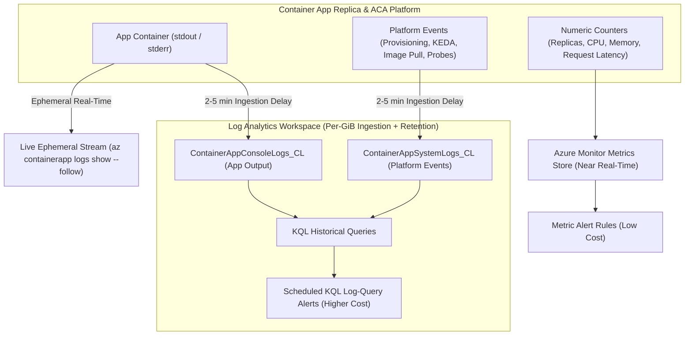
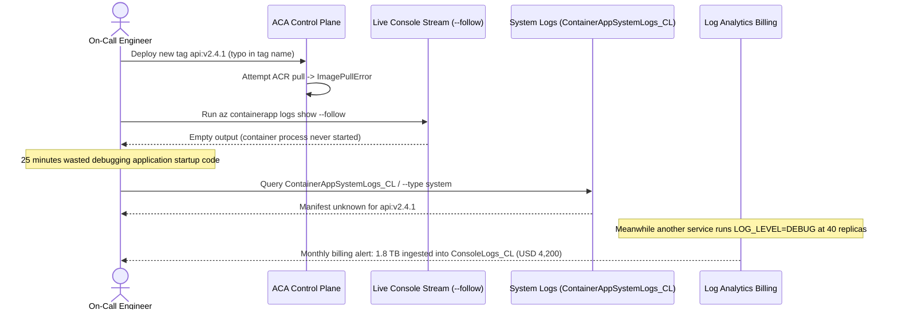

# Monitoring & Log Analytics

> **Prerequisites:** ACA Environments, autoscaling rules, and revisions (Modules 01–06).  
> **Estimated Reading Time:** 35 minutes  
> **Target Audience:** Backend Engineers, Site Reliability Engineers, Cloud Operations Teams.

> [!TIP]
> **The Golden Rule of ACA Observability:** Use **Azure Monitor Metrics** to detect *that* a system condition changed cheaply in near real time, **System Logs** (`ContainerAppSystemLogs_CL`) to diagnose *why* revisions, image pulls, or KEDA rules failed, and **Console Logs** (`ContainerAppConsoleLogs_CL`) to trace your application code—and trim noisy `DEBUG` stdout before Log Analytics GiB ingestion balloons your bill.

---

## Why This Matters

You can't operate what you can't see. When a revision won't start, a scale rule won't fire, or a Dapr call fails, the answer is in the logs and metrics — and in Container Apps those flow to the Log Analytics workspace you wired up back in module 01. Knowing which log table holds what, how to query it with KQL, and how to alert on it is the difference between guessing and diagnosing. It's also where log-volume cost either stays sane or quietly balloons.

---

## 1. Architectural Mental Model: Telemetry Pipelines & Alerting Surfaces

Azure Container Apps splits platform telemetry into fast numeric time-series **Metrics** and durable **Log Analytics** tables, alongside a direct **Live Stream** bypass for active incident triage:



### Core Concepts

#### Console Logs vs. System Logs
ACA separates two log streams. **Console logs** are your container's stdout/stderr — application output, exactly what you'd see with `docker logs` or `kubectl logs`. **System logs** are the platform's events about your app — revision provisioning, scaling decisions, image pull results, health probe outcomes. When a revision is "stuck" or a scale rule "never fires," the *system* log usually explains why, while the *console* log tells you what your code did. Both land in Log Analytics, in different tables.

#### Live Streaming vs. Querying History
For real-time debugging, `az containerapp logs show --follow` streams a replica's console logs live, like `kubectl logs -f` — great during an active incident. For anything historical or aggregated ("how many 500s in the last hour across all revisions?"), you query the **Log Analytics workspace** with **KQL** (Kusto Query Language). Streaming is immediate but ephemeral and per-replica; the workspace is durable, cross-replica, and queryable — at the cost of a short ingestion delay and per-GiB billing.

#### The Log Analytics Tables
Container Apps writes to specific tables in the workspace. The main ones: **`ContainerAppConsoleLogs_CL`** (your stdout/stderr) and **`ContainerAppSystemLogs_CL`** (platform events). You query them with KQL — filter by `ContainerAppName_s`, `RevisionName_s`, time range, and log message. This is the same Log Analytics/KQL used across Azure for container logs — the same tooling you'll point at an AKS cluster's container insights in track 07, just aimed at ACA tables here. (Table names carry the `_CL` custom-log suffix and column names carry type suffixes like `_s` for string — a Log Analytics convention.)

#### Metrics vs. Logs
Separate from logs, ACA emits **metrics** (Azure Monitor metrics): replica count, CPU/memory usage, request count, and request latency, per app and per revision. Metrics are cheap, near-real-time numeric time series — ideal for dashboards and for autoscaling insight ("did replica count actually track my load?"). Logs are richer but heavier. Rule of thumb: use **metrics** to see *that* something happened (a spike, a scale event), use **logs** to see *why*.

#### Alerts and Cost Awareness
You can attach **alert rules** to metrics (e.g. replica count pinned at max, or elevated 5xx) or to **log queries** (a scheduled KQL query that fires when it returns rows) via Azure Monitor, routing to an **action group** (email, webhook, etc.). The cost caveat lives here too: **Log Analytics bills per GiB ingested and retained**, so verbose apps at scale, long retention, and frequent log-query alerts all add cost. Sending only what you need, setting sane retention, and preferring metric alerts over high-frequency log-query alerts keeps the monitoring bill down.

---

## 2. Taxonomic Comparison: ACA Telemetry & Alerting Economics

| Telemetry Surface | Data Source | Latency | Query Engine | Primary Diagnostic Question |
| :--- | :--- | :--- | :--- | :--- |
| **`az containerapp logs show --follow`** | Live replica stdout/stderr | Real-time (seconds) | Raw stream (`--tail N`) | What is this specific replica printing right now? |
| **`ContainerAppConsoleLogs_CL`** | Historical container stdout/stderr | ~2–5 min ingestion delay | KQL (`Log Analytics`) | How many HTTP 500s occurred across revisions in 1h? |
| **`ContainerAppSystemLogs_CL`** | ACA control plane, KEDA, Dapr, Envoy | ~2–5 min ingestion delay | KQL (`Log Analytics`) | Why did a revision fail to pull, start, or scale? |
| **Azure Monitor Metrics** | Platform numeric counters | ~1 min granularity | `az monitor metrics list` | Did `Replicas`, CPU, or request latency spike? |

| Alert Type | Evaluation Source | Monthly Cost Profile | Ideal Use Case |
| :--- | :--- | :--- | :--- |
| **Metric Alert** | Pre-aggregated numeric time series | Very low (fixed small fee per rule) | `avg Replicas > 4`, `Http5xx`, memory pressure |
| **Log-Query Alert (KQL)** | Scheduled scan over ingested log tables | Higher (per-rule frequency + Log ingestion cost) | Complex payload pattern match (`Reason_s == 'CrashLoop'`) |

---

## 3. Command Reference & Flag Breakdowns

| Command | What it does | Example |
| :--- | :--- | :--- |
| `az containerapp logs show` | Stream/print a replica's console logs | `az containerapp logs show --name web --resource-group rg-aca-m07 --follow --tail 50` |
| `az containerapp logs show` (system) | Show system logs | `az containerapp logs show --name web --resource-group rg-aca-m07 --type system` |
| `az monitor log-analytics query` | Run a KQL query against the workspace | see below |
| `az monitor metrics list` | List metrics for the app resource | `az monitor metrics list --resource <appId> --metric Replicas --interval PT1M -o table` |
| `az monitor metrics alert create` | Create a metric alert | see below |
| `az containerapp env show` (workspace id) | Get the workspace customer ID | `az containerapp env show --name env-m07 --resource-group rg-aca-m07 --query properties.appLogsConfiguration.logAnalyticsConfiguration.customerId -o tsv` |

### Flag-by-Flag Breakdowns

`az containerapp logs show --name web --resource-group rg-aca-m07 --follow --tail 50`
- `--follow` — stream live (Ctrl-C to stop).
- `--tail 50` — start by showing the last 50 lines.
- (add `--type system` to view platform/system logs instead of console.)

`az monitor log-analytics query --workspace <customerId> --analytics-query "ContainerAppConsoleLogs_CL | where ContainerAppName_s == 'web' | take 20"`
- `--workspace <customerId>` — the workspace GUID (from the env-show query above).
- `--analytics-query "..."` — the KQL. `ContainerAppConsoleLogs_CL` = console table; filter by `ContainerAppName_s`; `take 20` caps rows.

`az monitor metrics alert create --name maxrep --resource-group rg-aca-m07 --scopes <appId> --condition "avg Replicas > 4" --window-size 5m --evaluation-frequency 1m --action <actionGroupId>`
- `--scopes <appId>` — the container app resource to watch.
- `--condition "avg Replicas > 4"` — fire when average replica count exceeds 4 (e.g. pinned near max).
- `--window-size 5m` / `--evaluation-frequency 1m` — evaluate the 5-minute average every minute.
- `--action <actionGroupId>` — action group to notify.

---

## 4. Production War Story: The Silent ImagePull Failure & \$4,200 Log Ingestion Spike



### The Incident
Two monitoring failures collided in the same week for a logistics SaaS team. First, an automated image deploy pushed a non-existent tag (`v2.4.1`) and stalled in provisioning; the on-call engineer spent 25 minutes watching an empty `az containerapp logs show --follow` console stream instead of checking `--type system`. Second, a separate high-throughput webhook service had `LOG_LEVEL=DEBUG` left enabled across 40 scaled-out replicas, dumping raw HTTP payloads to `stdout`.

### Post-Mortem Metrics
* **Severity:** SEV-2 (Delayed release recovery + unplanned FinOps anomaly)
* **Mean Time to Detect (MTTD):** 25 minutes (wrong log stream checked first) / 6 days (billing spike)
* **Mean Time to Resolution (MTTR):** 3 minutes once `ContainerAppSystemLogs_CL` was queried
* **Financial Impact:** ~\$4,200 in unexpected Log Analytics per-GiB ingestion over one week.

### Root Cause Analysis
1. **Wrong Stream for Pre-Start Failures:** Containers that fail during image pull, Key Vault secret resolution, or startup probe checks never write to `stdout`, leaving `ContainerAppConsoleLogs_CL` empty while the exact error sits in `ContainerAppSystemLogs_CL`.
2. **Unbounded `stdout` Verbosity:** Every line written to `stdout` flows straight into `ContainerAppConsoleLogs_CL` and incurs per-GiB ingestion fees.

### The Fix & Architectural Hardening
1. **Incident Runbook Ordering:** Always inspect `--type system` / `ContainerAppSystemLogs_CL` first for any revision failing to reach `Running`, and `ContainerAppConsoleLogs_CL` once the container is alive.
2. **Log Hygiene & Metric-First Alerts:** Enforce `INFO`/`WARN` structured JSON logs in production, set a Log Analytics workspace daily cap + 30-day retention, and alert on `Replicas` / `Http5xx` metrics rather than 1-minute scheduled KQL scans.

---

## 5. Multi-Language Production Code: Programmatic KQL Queries & Structured Log Correlation

Emit structured JSON to `stdout` (so KQL `parse_json(Log_s)` can slice by `revision`, `level`, and `trace_id`) and query `ContainerAppSystemLogs_CL` / `ContainerAppConsoleLogs_CL` programmatically via Azure Monitor Query SDKs using Managed Identity:

````carousel
### Go (`azidentity` + `azquery`)
```go
package main

import (
	"context"
	"encoding/json"
	"fmt"
	"os"
	"time"

	"github.com/Azure/azure-sdk-for-go/sdk/azidentity"
	"github.com/Azure/azure-sdk-for-go/sdk/monitor/azingest/azquery" // or github.com/Azure/azure-sdk-for-go/sdk/monitor/azquery
)

// EmitStructuredLog writes single-line JSON to stdout for KQL parse_json(Log_s).
func EmitStructuredLog(level, msg, traceID string) {
	entry := map[string]string{
		"ts":       time.Now().UTC().Format(time.RFC3339Nano),
		"level":    level,
		"revision": os.Getenv("CONTAINER_APP_REVISION"),
		"trace_id": traceID,
		"message":  msg,
	}
	_ = json.NewEncoder(os.Stdout).Encode(entry)
}

func QuerySystemErrors(ctx context.Context, workspaceCustomerID, appName string) error {
	cred, err := azidentity.NewDefaultAzureCredential(nil)
	if err != nil {
		return err
	}
	client, err := azquery.NewLogsClient(cred, nil)
	if err != nil {
		return err
	}

	kql := fmt.Sprintf(
		"ContainerAppSystemLogs_CL | where TimeGenerated > ago(1h) and ContainerAppName_s == '%s' | project TimeGenerated, Reason_s, Log_s | take 20",
		appName,
	)
	res, err := client.QueryWorkspace(ctx, workspaceCustomerID, azquery.Body{Query: &kql}, nil)
	if err != nil {
		return err
	}
	for _, table := range res.Tables {
		fmt.Printf("Returned %d system log rows\n", len(table.Rows))
	}
	return nil
}
```
<!-- slide -->
### TypeScript (`@azure/identity` + `@azure/monitor-query`)
```typescript
import { DefaultAzureCredential } from '@azure/identity';
import { LogsQueryClient, LogsQueryResultStatus } from '@azure/monitor-query';

export function logStructured(level: 'INFO' | 'WARN' | 'ERROR', message: string, traceId: string): void {
  // Single-line JSON on stdout lands in ContainerAppConsoleLogs_CL.Log_s
  console.log(
    JSON.stringify({
      ts: new Date().toISOString(),
      level,
      revision: process.env.CONTAINER_APP_REVISION ?? 'unknown',
      traceId,
      message,
    })
  );
}

export async function fetchRecentSystemLogs(workspaceCustomerId: string, appName: string): Promise<void> {
  const client = new LogsQueryClient(new DefaultAzureCredential());
  const kql = `
    ContainerAppSystemLogs_CL
    | where ContainerAppName_s == '${appName}'
    | project TimeGenerated, RevisionName_s, Reason_s, Log_s
    | order by TimeGenerated desc
    | take 20
  `;

  const result = await client.queryWorkspace(workspaceCustomerId, kql, { duration: 'PT1H' });
  if (result.status === LogsQueryResultStatus.Success) {
    for (const table of result.tables) {
      console.table(table.rows);
    }
  } else {
    console.warn('Partial query failure:', result.partialError);
  }
}
```
<!-- slide -->
### Python (`azure-identity` + `azure-monitor-query`)
```python
import json
import os
import sys
from datetime import datetime, timedelta, timezone
from azure.identity import DefaultAzureCredential
from azure.monitor.query import LogsQueryClient, LogsQueryStatus


def log_structured(level: str, message: str, trace_id: str) -> None:
    """Writes single-line JSON to stdout for clean KQL parse_json(Log_s) slicing."""
    payload = {
        "ts": datetime.now(timezone.utc).isoformat(),
        "level": level,
        "revision": os.getenv("CONTAINER_APP_REVISION", "unknown"),
        "trace_id": trace_id,
        "message": message,
    }
    print(json.dumps(payload), file=sys.stdout, flush=True)


def query_aca_system_logs(workspace_customer_id: str, app_name: str) -> None:
    client = LogsQueryClient(DefaultAzureCredential())
    kql = (
        f"ContainerAppSystemLogs_CL "
        f"| where ContainerAppName_s == '{app_name}' "
        f"| project TimeGenerated, Reason_s, Log_s "
        f"| order by TimeGenerated desc | take 20"
    )
    response = client.query_workspace(
        workspace_id=workspace_customer_id,
        query=kql,
        timespan=timedelta(hours=1),
    )
    if response.status == LogsQueryStatus.SUCCESS:
        for table in response.tables:
            for row in table.rows:
                print(row)
```
<!-- slide -->
### C# (`Azure.Identity` + `Azure.Monitor.Query`)
```csharp
using System;
using System.Text.Json;
using System.Threading;
using System.Threading.Tasks;
using Azure.Identity;
using Azure.Monitor.Query;
using Azure.Monitor.Query.Models;

public static class AcaTelemetryHelper
{
    public static void EmitStructuredLog(string level, string message, string traceId)
    {
        var payload = new
        {
            ts = DateTimeOffset.UtcNow,
            level,
            revision = Environment.GetEnvironmentVariable("CONTAINER_APP_REVISION") ?? "unknown",
            traceId,
            message
        };
        Console.WriteLine(JsonSerializer.Serialize(payload));
    }

    public static async Task QuerySystemLogsAsync(
        string workspaceCustomerId,
        string appName,
        CancellationToken ct = default)
    {
        var client = new LogsQueryClient(new DefaultAzureCredential());
        var kql = $@"
            ContainerAppSystemLogs_CL
            | where ContainerAppName_s == '{appName}'
            | project TimeGenerated, RevisionName_s, Reason_s, Log_s
            | order by TimeGenerated desc
            | take 20";

        var response = await client.QueryWorkspaceAsync(
            workspaceCustomerId,
            kql,
            new QueryTimeRange(TimeSpan.FromHours(1)),
            cancellationToken: ct);

        foreach (LogsTableRow row in response.Value.Table.Rows)
        {
            Console.WriteLine($"{row["TimeGenerated"]} | {row["Reason_s"]} | {row["Log_s"]}");
        }
    }
}
```
````

---

## 6. Practical Hands-On Verification CLI Workflows

### Workflow 1: Live Streaming vs. System Log Inspection (Exercises 1–3)

1. **Set up group, Environment (note the workspace), and an app.**
```powershell
az group create --name rg-aca-m07 --location eastus
az containerapp env create --name env-m07 --resource-group rg-aca-m07 --location eastus
az containerapp create --name web --resource-group rg-aca-m07 --environment env-m07 `
  --image mcr.microsoft.com/k8se/quickstart:latest --target-port 80 --ingress external `
  --min-replicas 0 --max-replicas 5 --scale-rule-http-concurrency 10
```

2. **Stream console logs live.**
```powershell
az containerapp logs show --name web --resource-group rg-aca-m07 --follow --tail 30
```
*(In another terminal, `curl` the FQDN a few times and watch requests appear. Ctrl-C to stop.)*

3. **View system logs.**
```powershell
az containerapp logs show --name web --resource-group rg-aca-m07 --type system --tail 40
```
**Expected Output:**
```text
{"TimeStamp":"2026-11-11T08:05:12Z","Log":"Successfully provisioned revision web--0000001","Reason":"RevisionProvisioned"}
{"TimeStamp":"2026-11-11T08:06:01Z","Log":"Replica scaled from 0 to 1","Reason":"ScaleUp"}
```
*(Verify you see platform events — revision created, scaling, etc. — distinct from your app's stdout.)*

---

### Workflow 2: Historical KQL Queries & Azure Monitor Metrics (Exercises 4–8)

4. **Get the workspace ID and run your first KQL query.**
```powershell
$ws = az containerapp env show --name env-m07 --resource-group rg-aca-m07 `
  --query properties.appLogsConfiguration.logAnalyticsConfiguration.customerId -o tsv
az monitor log-analytics query --workspace $ws `
  --analytics-query "ContainerAppConsoleLogs_CL | where ContainerAppName_s == 'web' | project TimeGenerated, Log_s | take 20" -o table
```
*(Verify rows return. There's an ingestion delay of a few minutes — if empty, generate traffic and wait.)*

5. **Query system logs for scaling events.**
```powershell
az monitor log-analytics query --workspace $ws `
  --analytics-query "ContainerAppSystemLogs_CL | where ContainerAppName_s == 'web' | project TimeGenerated, Reason_s, Log_s | order by TimeGenerated desc | take 30" -o table
```
*(Look for scaling/provisioning reasons. This table is your first stop for "why did/didn't it scale or start?")*

6. **Look at metrics.**
```powershell
$appId = az containerapp show --name web --resource-group rg-aca-m07 --query id -o tsv
az monitor metrics list --resource $appId --metric Replicas --interval PT1M -o table
```
*(Generate load via module 03's parallel curl, then re-run and confirm the Replicas metric climbs — cross-check it against what the system logs said.)*

7. **Aggregate with KQL.** Count console log lines per revision in the last hour:
```powershell
az monitor log-analytics query --workspace $ws `
  --analytics-query "ContainerAppConsoleLogs_CL | where TimeGenerated > ago(1h) | summarize count() by RevisionName_s" -o table
```
**Expected Output:**
```text
RevisionName_s    count_
----------------  ------
web--0000001      42
```
*(Verify a per-revision breakdown. This is the cross-replica, historical view streaming can't give you.)*

8. **Create a metric alert (optional action group).**
```powershell
az monitor metrics alert create --name maxrep-web --resource-group rg-aca-m07 `
  --scopes $appId --condition "avg Replicas > 4" `
  --window-size 5m --evaluation-frequency 1m
az monitor metrics alert list --resource-group rg-aca-m07 -o table
```
*(Attach an action group with `--action` if you want notifications.)*

---

### Workflow 3: Broken Revision Diagnosis, Cost Check & Cleanup (Exercises 9–11)

9. **Diagnose and fix (integrative): a revision that won't start.** Ship a broken revision and use logs to find out why:
```powershell
az containerapp update --name web --resource-group rg-aca-m07 --image mcr.microsoft.com/k8se/quickstart:nope
az containerapp revision list --name web --resource-group rg-aca-m07 -o table
az containerapp logs show --name web --resource-group rg-aca-m07 --type system --tail 40
az monitor log-analytics query --workspace $ws `
  --analytics-query "ContainerAppSystemLogs_CL | where ContainerAppName_s == 'web' | order by TimeGenerated desc | take 20" -o table
```
The **system** log/table reveals the image-pull failure (the console log won't, because the container never started). **Fix** by updating back to a valid image tag (`mcr.microsoft.com/k8se/quickstart:latest`) and confirm the revision goes healthy.

10. **Check the cost surface.** In the Portal, open the Log Analytics workspace -> Usage and estimated costs, or query ingestion volume. Note how much data your experiments produced. In notes, write one sentence on how you'd reduce it (less verbose logging, shorter retention, metric alerts over log-query alerts).

11. **Cleanup.**
```powershell
az group delete --name rg-aca-m07 --yes --no-wait
```

---

### Independent Challenge

Instrument a running app so you can answer three questions with evidence: (1) did it scale under load, (2) how many requests errored in the last 30 minutes, and (3) why did its most recent revision reach its current state. Use metrics for (1), a KQL query against the console table for (2), and the system table for (3). Combine this module with **module 03**: drive the app with a load generator and correlate the Replicas *metric* with the scaling *system-log* events on the same timeline. Note the workspace's approximate ingestion cost for the exercise, then delete the resource group.

<details>
<summary>Stuck? One hint</summary>

The correlation trick is aligning timestamps: `az monitor metrics list ... --metric Replicas --interval PT1M` gives per-minute replica counts, and a KQL query on `ContainerAppSystemLogs_CL | order by TimeGenerated desc` gives the scaling events with `TimeGenerated`. Line the two up by minute and you can see the scale decision and its effect side by side.

</details>

---

## 7. Common Mistakes & Troubleshooting

- **Looking in the wrong log stream.** A container that never started produces no console logs; the reason is in the **system** logs/table. Check system logs for start/provisioning/pull failures.
- **Expecting instant KQL results.** Log Analytics has an ingestion delay of a few minutes. An empty query right after an event usually means "wait," not "nothing happened."
- **Wrong workspace ID.** `az monitor log-analytics query` needs the workspace's **customer ID** (GUID), which you read from the Environment — not the workspace's resource name.
- **Confusing metrics and logs.** Metrics tell you *that* replicas scaled; logs tell you *why*. Reaching for logs to get a simple replica count is slower and pricier.
- **Cost pitfall: verbose logging + long retention + log-query alerts.** All three drive Log Analytics ingestion/retention cost. Trim log verbosity, set sane retention, and prefer metric alerts over frequent scheduled log queries.

---

## 8. Checkpoint Quiz

Write down your answer to each question before expanding it — checking without attempting first is the single easiest way to fool yourself into thinking you've learned this.

1. Console logs vs. system logs — what's in each, and which do you check for a revision stuck provisioning?
2. When would you use `logs show --follow` vs. a KQL query in Log Analytics?
3. Name the two main Log Analytics tables ACA writes to and what each holds.
4. What identifier does `az monitor log-analytics query --workspace` expect, and where do you get it?
5. Metrics vs. logs: which answers "did it scale?" and which answers "why did it scale?"
6. Give three things that increase your Log Analytics bill.
7. Your KQL query returns nothing right after an incident. What are the two likely explanations?

<details>
<summary>Show answers</summary>

1. Console = container stdout/stderr (your app output); system = platform events (provisioning, scaling, image pulls, probes). For a stuck/failed revision, check **system** logs — the container may never have produced console output.
2. `--follow` for live, real-time debugging of a replica during an active incident; KQL for historical, aggregated, cross-replica analysis.
3. `ContainerAppConsoleLogs_CL` (stdout/stderr) and `ContainerAppSystemLogs_CL` (platform/system events).
4. The workspace's **customer ID** (a GUID), read from the Environment (`properties.appLogsConfiguration.logAnalyticsConfiguration.customerId`) — not the workspace resource name.
5. Metrics answer "did it scale?" (replica-count time series); logs answer "why?" (system-log scaling reasons).
6. Any three of: high log verbosity/volume, high app scale (many replicas logging), long retention, and frequent scheduled log-query alerts.
7. Ingestion delay (data not yet queryable — wait a few minutes), or you're querying the wrong table/filter/time-range (or wrong workspace ID).

</details>

---

## 9. Cumulative Review (Modules 04–07)

Closed book. Cover the answers and write each out before checking. These mix concepts from modules 04–07.

1. An internal-only Environment hosts an app with `--ingress external` that reads a Key Vault secret via managed identity. Requests from your laptop fail. List the two independent things that could each cause this and how you'd tell them apart.
2. You canary a new revision to 10% (module 05) and it errors. Which log stream/table tells you whether the failure is your code vs. the platform, and what metric confirms the blast radius stayed at ~10%?
3. A queue worker in a VNet-integrated Environment isn't scaling. Give one networking cause (module 04) and one KEDA cause (module 03), and which log/table you'd check for each.
4. You rotate a database password in Key Vault. Do you need to redeploy the app? Why or why not (module 06)?
5. Design: two apps must call each other privately and you must be able to verify the calls and their latency. Which module-05 feature enables the calls, which module-04 property must both apps share, and which module-07 tools verify them?
6. A role assignment was just granted but the new revision still returns forbidden from Key Vault. Give the module-06 reason and the module-07 way to confirm it in the logs.
7. Cost audit: name one recurring cost from module 04, one from module 06, and one from module 07, and how you'd minimize each.
8. Traffic is split 50/50 across two revisions; one revision is far slower. Which metric (per revision) exposes this, and how would you shift traffic to mitigate (naming the module-05 command)?
9. You need an alert when an app pins at max replicas for 5 minutes. Metric or log alert? Write the condition in words and say why this choice is cheaper.
10. Trace a Dapr invocation failure end to end: which app-id concept (module 05), which Environment boundary (module 01/04), and which table (module 07) would you inspect, in order.

<details>
<summary>Show answers</summary>

1. (a) The **Environment is internal-only**, so an "external" app is private and unreachable from your laptop regardless of the secret (module 04); (b) a **missing role assignment** makes the app crash-loop so nothing serves (module 06). Tell apart: check the Environment `staticIp` (private => cause a) and the system logs for a *forbidden* error (=> cause b). Both can be true.
2. The **console** log/`ContainerAppConsoleLogs_CL` (filtered to the canary's `RevisionName_s`) shows code errors; **system** logs show platform issues. The **request count / replica** metric per revision confirms only ~10% hit the canary.
3. Networking cause: a **UDR/NSG blocking required egress** so KEDA/the app can't reach the queue/control plane (check **system** logs). KEDA cause: **wrong scale-rule metadata or auth secret** (check the scale rule config and **system** logs).
4. No redeploy needed if the app uses a **Key Vault reference** resolved at runtime via managed identity — it picks up the new value. (If the value was stored directly as an app secret, you'd have to update it.)
5. **Dapr service invocation** (by app-id) enables the calls; both apps must be in the **same Environment** (Dapr is Environment-scoped); verify with module-07 **metrics** (request count/latency) and **console/system logs**.
6. Reason: **RBAC propagation lag** — the assignment hasn't taken effect (module 06). Confirm via the **system** logs still showing the forbidden/authorization error until it clears, then success after re-rolling.
7. Module 04: a jumpbox VM / NAT Gateway / firewall billing per hour — delete it / share it in hub-spoke. Module 06: Key Vault operations (and soft-delete retention) — modest; consolidate vaults. Module 07: Log Analytics ingestion/retention — trim verbosity, shorten retention, prefer metric alerts.
8. The per-revision **request latency** (and CPU) metric exposes the slow revision; shift traffic with `az containerapp ingress traffic set` toward the healthy revision (e.g. 90/10 or 100/0).
9. **Metric** alert on `avg Replicas` at/above max over a 5-minute window. Cheaper because metric alerts don't ingest/scan log data the way a scheduled KQL log-query alert does.
10. First confirm the caller used the correct **Dapr app-id** (module 05); then confirm both apps are in the **same Environment** (module 01/04 boundary — Dapr won't cross it); then inspect **`ContainerAppSystemLogs_CL`** (and console) for the Dapr sidecar's invocation/resolution error.

</details>

---

## 10. Operational Validation Checkpoints

<details>
<summary><strong>Scenario 1: Empty KQL Query During Live Incident Triage</strong></summary>

**Scenario:** Two minutes ago, your team rolled out a broken revision (`api--v8`) that is failing readiness probes. You grab the workspace GUID and immediately execute `az monitor log-analytics query --workspace $ws --analytics-query "ContainerAppSystemLogs_CL | where RevisionName_s == 'api--v8'"` and get zero rows back.

Should you conclude the platform is not generating errors? How do you see the failure immediately?

**Answer:**
No—Log Analytics has a typical **2–5 minute ingestion delay** from emission to queryable index.

**The Fix:** During active incidents, bypass workspace ingestion lag by streaming live system logs directly from the platform via `az containerapp logs show --name api --resource-group rg-prod --type system --tail 50` (and check `az containerapp revision show --revision api--v8`), then use KQL after a few minutes for multi-replica historical aggregation.

</details>

<details>
<summary><strong>Scenario 2: Wrong Workspace Identifier Supplied to CLI</strong></summary>

**Scenario:** You run `az monitor log-analytics query --workspace law-prod-01 --analytics-query "ContainerAppConsoleLogs_CL | take 5"` and receive a validation or workspace-not-found error, even though `law-prod-01` exists in your resource group.

Why did the command reject the workspace name, and where do you fetch the expected identifier?

**Answer:**
`az monitor log-analytics query --workspace` expects the workspace's **Customer ID (GUID)**, not its ARM resource name (`law-prod-01`) or full ARM resource ID.

**The Fix:** Retrieve the GUID directly from the Container Apps Environment (or `az monitor log-analytics workspace show --query customerId`):
```powershell
$wsGuid = az containerapp env show --name env-prod --resource-group rg-prod `
  --query properties.appLogsConfiguration.logAnalyticsConfiguration.customerId -o tsv
```

</details>

<details>
<summary><strong>Scenario 3: Detecting Scale Ceiling Saturation Cost-Effectively</strong></summary>

**Scenario:** An API has `--max-replicas 20`. Operations wants an alert whenever the app runs at 18+ replicas for more than 5 minutes so they know before hitting the hard scaling cap. A teammate proposes a KQL log alert running every 1 minute querying `ContainerAppSystemLogs_CL` for scale events.

Why is that design flawed, and what should you implement instead?

**Answer:**
Using a 1-minute scheduled KQL query on `ContainerAppSystemLogs_CL` is both **more expensive** (log-query alerts bill per evaluation rule and rely on log ingestion) and **brittle** (you have to reconstruct state transitions from discrete scale log messages, subject to ingestion delay).

**The Fix:** Create an Azure Monitor **Metric Alert** directly on the near-real-time `Replicas` metric (`--condition "avg Replicas >= 18" --window-size 5m --evaluation-frequency 1m`), which evaluates numeric counters cheaply and reliably.

</details>

---

## Next

[08-capstone-project](../08-capstone-project/README.md) — put all of it together: a VNet-integrated, multi-revision, Dapr-connected, autoscaling app with secrets from Key Vault and monitoring wired up, built and torn down end to end.
