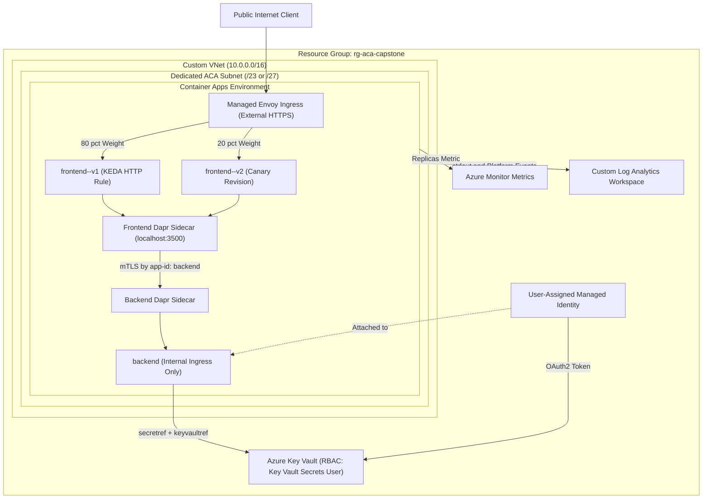
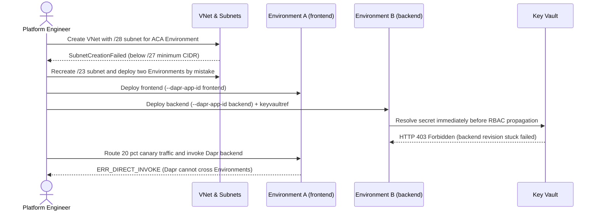

# Capstone Project

> **Prerequisites:** Azure Container Apps Environments, Ingress, KEDA Autoscaling, VNet Integration, Revisions & Dapr, Managed Identity & Key Vault, and Log Analytics (Modules 01–07).  
> **Estimated Reading Time:** 60–90 minutes (hands-on architecture, build, verification, and teardown)  
> **Target Audience:** Backend Engineers, Cloud Platform Engineers, Site Reliability Engineers.

> [!TIP]
> **The Golden Rule of End-to-End Integration:** Build and verify strictly **outside-in** layer by layer—Resource Group -> VNet & Subnet -> Log Analytics Workspace -> Container Apps Environment -> User-Assigned Identity & Vault RBAC -> Internal Backend -> External Frontend -> Canary Split & Load Telemetry—so every fault is isolated to the single layer you just added.

---

## Why This Matters

Every earlier module drilled one capability in isolation. Real systems combine them, and the combining is where the subtle failures live: a VNet that's fine until Dapr needs to cross it, a scale rule that works until traffic splitting changes which revision gets load, a managed identity that authenticates until the role assignment is scoped wrong. This capstone forces you to integrate the whole track into one working deployment, verify it behaves, and then tear it down cleanly — the same loop you'll run in production.

---

## 1. Architectural Mental Model: Full-Stack Integrated ACA Topology

The capstone wires every subsystem from Modules 01–07 inside one VNet-integrated Environment so public requests traverse Envoy canary weights, invoke the private backend over Dapr mTLS, resolve secrets from Key Vault via Managed Identity, and emit correlated metrics and KQL telemetry:



---

## 2. Taxonomic Comparison: Capstone Architecture vs. Raw AKS (Track 07 Preview)

Completing this capstone prepares you directly for Track 07 (`07-aks`), where every managed abstraction you wired here becomes an explicit cluster component you operate yourself:

| Platform Capability | ACA Capstone Implementation | Raw AKS Equivalent (Track 07) | Operational Trade-Off |
| :--- | :--- | :--- | :--- |
| **Network & Mesh Boundary** | VNet-integrated Container Apps Environment | AKS VNet/CNI + Cluster DNS + Ingress Controller + Service Mesh | ACA hides control plane & Envoy; AKS exposes full CNI/routing control |
| **Canary Traffic Splitting** | `multiple` revision mode + `ingress traffic set` | Dual Deployments + Istio/Gateway API weighted `HTTPRoute` | ACA gives 1-command weights; AKS supports arbitrary header/path rules |
| **Service Invocation & mTLS** | Built-in `--enable-dapr` sidecars | Self-managed Dapr Helm chart / Linkerd / Istio control plane | ACA manages sidecar upgrades; AKS lets you customize mesh policies |
| **Autoscaling** | Managed KEDA HTTP / queue scale rules | Self-managed KEDA + HPA + Cluster Autoscaler / Karpenter | ACA scales to zero transparently; AKS requires node pool sizing |
| **Secret & Identity Wiring** | `keyvaultref:` + `--user-assigned` RBAC | Workload Identity (`ServiceAccount` OIDC) + Secrets Store CSI Driver | ACA injects via `secretref:`; AKS mounts CSI volumes or K8s Secrets |
| **Observability** | Built-in `ContainerAppConsoleLogs_CL` / `SystemLogs_CL` | Container Insights DaemonSet + Prometheus / Grafana | ACA pre-wires tables; AKS requires DaemonSet & metric scraping setup |

---

## 3. The Project & Acceptance Criteria

Build a small but complete Container Apps system, entirely with real `az containerapp ...` commands against your subscription, that satisfies every acceptance criterion below. Design it yourself; there is no full solution here, only the requirements and hints.

**Scenario.** A two-service app: a public **frontend** that, per request, invokes a private **backend** over Dapr; the backend reads a secret (e.g. a "license key" or connection string) from Key Vault via managed identity. The frontend autoscales on HTTP load. You ship a v2 of the frontend and run it as a canary. Everything lives in a VNet you built, and all logs/metrics are observable.

Suggested resource group: `rg-aca-capstone` in a single region. Use the quickstart image (`mcr.microsoft.com/k8se/quickstart:latest`) or any small HTTP image; the wiring, not the app code, is the point.

### Acceptance Criteria

- [ ] A **VNet** you created, with a correctly-sized dedicated subnet, hosts the Environment (module 04). Verify the subnet size meets the minimum for your plan.
- [ ] A single **Container Apps Environment** integrated into that VNet, using a **Log Analytics workspace you created** (not auto-generated) (modules 01, 04).
- [ ] A **frontend** app with **external ingress** reachable over HTTPS on its FQDN (modules 02, 04).
- [ ] A **backend** app with **internal ingress** only, not reachable from the public internet (modules 02, 04).
- [ ] **Dapr enabled** on both apps with stable app-ids; the frontend invokes the backend **by app-id** (not IP/FQDN), and you can demonstrate the call succeeds (module 05).
- [ ] The backend reads a secret from **Key Vault** using a **managed identity** with a **role assignment scoped to the vault**; the secret value never appears in the app's plaintext config (module 06).
- [ ] The frontend has a **KEDA scale rule** (HTTP concurrency, or a queue-based rule if you add a queue) and scales up under load and back toward zero when idle (module 03).
- [ ] The frontend runs in **multiple-revision mode** with **two revisions** and a **traffic split** (e.g. 80/20 canary), and you can shift the split and roll back instantly (module 05).
- [ ] **Monitoring is wired up**: you can produce (a) the Replicas metric climbing under load, (b) a KQL query over the console table showing requests, and (c) a system-log entry explaining a revision's state (module 07).
- [ ] **Verification under load**: you drive traffic, observe the frontend scale up (metrics + system logs correlated), and observe the traffic split distributing requests across the two revisions.
- [ ] **Teardown**: everything is deleted with `az group delete` and you confirm no lingering billable resources (Environment, Log Analytics workspace, Key Vault, any VM/NAT/firewall you added).

### Hints

- Build outside-in: resource group -> VNet + subnet -> Log Analytics workspace -> Environment (on the subnet, reusing the workspace) -> backend -> frontend -> identity + Key Vault + role -> scale rule -> second revision + traffic split -> monitoring queries. Verifying each layer before adding the next saves hours.
- Backend internal ingress plus Dapr is the right combination: the frontend reaches it by Dapr app-id over the Environment's internal network; it never needs a public endpoint.
- For the managed-identity-to-Key-Vault step, remember identity **and** role assignment **and** propagation time — grant the role, wait, then roll the revision (module 06's failure mode is the thing to avoid here).
- Give revisions readable suffixes (`--revision-suffix v1`/`v2`) so your `ingress traffic set --revision-weight` commands are legible.
- To *prove* scaling and splitting rather than assume it: correlate the `Replicas` metric (per-minute) with `ContainerAppSystemLogs_CL` scaling events, and hit each revision's dedicated FQDN to confirm both are live before trusting the weighted split.
- If the frontend can reach the backend directly but Dapr invocation fails, check the app-ids and that both apps share the one Environment (module 01/04 boundary), not the network path.
- Keep an eye on cost the whole time: the Environment idles cheap on Consumption, but the Log Analytics workspace bills by volume and any VM/NAT/firewall you add for the VNet bills per hour. Don't leave the capstone running overnight "to finish tomorrow" without deleting the pricey bits.

---

## 4. Production War Story: The Multi-Layer Integration Cascade



### The Incident
During a multi-service production migration modeled almost identically to this capstone, an engineering team batched an entire deployment script into a single unverified run. Within minutes, three independent layers failed simultaneously, obscuring the true root cause of each error.

### Post-Mortem Metrics
* **Severity:** SEV-1 (Staging cutover completely blocked for 4 hours)
* **Mean Time to Detect (MTTD):** Immediate (provisioning errors), but **triage took 190 minutes** due to compounding layer errors
* **Mean Time to Resolution (MTTR):** 45 minutes once layers were rebuilt outside-in.

### Root Cause Analysis
1. **Undersized Subnet CIDR:** A `/28` subnet cannot satisfy ACA Consumption/Workload Profiles infrastructure IP reservations (`/27` or `/23` depending on plan), causing Environment provisioning to fail immediately.
2. **Accidental Environment Split:** Creating a second Environment for the backend silently broke Dapr service invocation because `--dapr-app-id` resolution never crosses Environment boundaries.
3. **RBAC Race Condition:** Referencing Key Vault before verifying `az role assignment list` and allowing RBAC propagation put the backend revision in a failed provisioning state at the exact moment frontend canary traffic arrived.

### The Fix & Architectural Hardening
1. **Enforce Layer Gates:** Never deploy an application before verifying (a) subnet prefix length and delegation, (b) single shared Environment ID, and (c) existing RBAC role assignment propagation.
2. **Verify Revision Health Before Weight Shift:** Smoke-test `frontend--v2`'s dedicated revision FQDN and inspect `ContainerAppSystemLogs_CL` before shifting live traffic weights.

---

## 5. Multi-Language Production Code: Capstone Integration Health & Dapr-to-Vault Probe

If you build or adapt a lightweight custom HTTP service for the capstone (or evaluate how a real `frontend` and `backend` wire Dapr + Key Vault telemetry together), this pattern demonstrates the `frontend` calling `backend` via Dapr and surfacing revision + secret readiness cleanly:

````carousel
### Go (`net/http` Capstone Health Probe)
```go
package main

import (
	"context"
	"encoding/json"
	"fmt"
	"io"
	"net/http"
	"os"
	"time"
)

type IntegrationStatus struct {
	FrontendRevision string `json:"frontend_revision"`
	BackendReachable bool   `json:"backend_reachable"`
	BackendPayload   string `json:"backend_payload,omitempty"`
	Error            string `json:"error,omitempty"`
}

func checkCapstoneHandler(w http.ResponseWriter, r *http.Request) {
	ctx, cancel := context.WithTimeout(r.Context(), 4*time.Second)
	defer cancel()

	daprPort := os.Getenv("DAPR_HTTP_PORT")
	if daprPort == "" {
		daprPort = "3500"
	}

	status := IntegrationStatus{
		FrontendRevision: os.Getenv("CONTAINER_APP_REVISION"),
	}

	// Call internal backend strictly by Dapr app-id inside the shared Environment
	req, _ := http.NewRequestWithContext(ctx, http.MethodGet,
		fmt.Sprintf("http://127.0.0.1:%s/v1.0/invoke/backend/method/healthz", daprPort), nil)
	resp, err := http.DefaultClient.Do(req)
	if err != nil {
		status.Error = err.Error()
		writeJSON(w, http.StatusBadGateway, status)
		return
	}
	defer resp.Body.Close()

	body, _ := io.ReadAll(io.LimitReader(resp.Body, 4096))
	status.BackendReachable = resp.StatusCode == http.StatusOK
	status.BackendPayload = string(body)

	code := http.StatusOK
	if !status.BackendReachable {
		code = http.StatusBadGateway
	}
	writeJSON(w, code, status)
}

func writeJSON(w http.ResponseWriter, code int, v any) {
	w.Header().Set("Content-Type", "application/json")
	w.WriteHeader(code)
	_ = json.NewEncoder(w).Encode(v)
}
```
<!-- slide -->
### TypeScript (`http` Capstone Health Probe)
```typescript
import http from 'node:http';

interface CapstoneStatus {
  frontendRevision: string;
  backendReachable: boolean;
  backendStatusCode?: number;
  error?: string;
}

export async function handleHealthProbe(_req: http.IncomingMessage, res: http.ServerResponse): Promise<void> {
  const daprPort = process.env.DAPR_HTTP_PORT ?? '3500';
  const frontendRevision = process.env.CONTAINER_APP_REVISION ?? 'unknown';
  const invokeUrl = `http://127.0.0.1:${daprPort}/v1.0/invoke/backend/method/healthz`;

  const status: CapstoneStatus = {
    frontendRevision,
    backendReachable: false,
  };

  try {
    const upstream = await fetch(invokeUrl, { signal: AbortSignal.timeout(4000) });
    status.backendReachable = upstream.ok;
    status.backendStatusCode = upstream.status;

    res.writeHead(upstream.ok ? 200 : 502, { 'Content-Type': 'application/json' });
    res.end(JSON.stringify(status));
  } catch (err) {
    status.error = err instanceof Error ? err.message : String(err);
    res.writeHead(502, { 'Content-Type': 'application/json' });
    res.end(JSON.stringify(status));
  }
}
```
<!-- slide -->
### Python (`httpx` Capstone Health Probe)
```python
import os
from typing import Any, Dict
import httpx


def probe_capstone_chain() -> tuple[int, Dict[str, Any]]:
    """Verifies frontend revision identity and Dapr connectivity to internal backend."""
    dapr_port = os.getenv("DAPR_HTTP_PORT", "3500")
    frontend_rev = os.getenv("CONTAINER_APP_REVISION", "unknown")
    url = f"http://127.0.0.1:{dapr_port}/v1.0/invoke/backend/method/healthz"

    try:
        with httpx.Client(timeout=4.0) as client:
            resp = client.get(url)
            healthy = 200 <= resp.status_code < 300
            return (200 if healthy else 502), {
                "frontend_revision": frontend_rev,
                "backend_reachable": healthy,
                "backend_status": resp.status_code,
            }
    except httpx.RequestError as exc:
        return 502, {
            "frontend_revision": frontend_rev,
            "backend_reachable": False,
            "error": str(exc),
        }
```
<!-- slide -->
### C# (ASP.NET Core Minimal API Probe)
```csharp
using System;
using System.Net.Http;
using System.Threading;
using Microsoft.AspNetCore.Builder;
using Microsoft.AspNetCore.Http;

var builder = WebApplication.CreateBuilder(args);
builder.Services.AddHttpClient();
var app = builder.Build();

app.MapGet("/capstone-probe", async (IHttpClientFactory httpFactory, CancellationToken ct) =>
{
    var daprPort = Environment.GetEnvironmentVariable("DAPR_HTTP_PORT") ?? "3500";
    var revision = Environment.GetEnvironmentVariable("CONTAINER_APP_REVISION") ?? "unknown";
    var client = httpFactory.CreateClient();
    client.Timeout = TimeSpan.FromSeconds(4);

    try
    {
        using var resp = await client.GetAsync(
            $"http://127.0.0.1:{daprPort}/v1.0/invoke/backend/method/healthz",
            ct);

        var body = new
        {
            frontendRevision = revision,
            backendReachable = resp.IsSuccessStatusCode,
            backendStatus = (int)resp.StatusCode
        };
        return resp.IsSuccessStatusCode ? Results.Ok(body) : Results.Json(body, statusCode: 502);
    }
    catch (Exception ex)
    {
        return Results.Json(new
        {
            frontendRevision = revision,
            backendReachable = false,
            error = ex.Message
        }, statusCode: 502);
    }
});

app.Run();
```
````

---

## 6. Practical Hands-On Verification CLI Workflows (Outside-In Audit)

Use these verification workflows as you build each layer of your own `rg-aca-capstone` architecture to prove every acceptance criterion passes cleanly—without skipping layers.

### Workflow 1: Verify VNet Subnet, Shared Environment & Log Analytics Binding
After provisioning your VNet, dedicated subnet, custom Log Analytics workspace, and Environment, validate that the Environment sits inside your VNet and points to your workspace:
```powershell
az network vnet subnet show --resource-group rg-aca-capstone --vnet-name vnet-capstone --name snet-aca `
  --query "{Prefix:addressPrefix,Provisioning:provisioningState}" -o table

az containerapp env show --name env-capstone --resource-group rg-aca-capstone `
  --query "{Subnet:properties.vnetConfiguration.infrastructureSubnetId,Workspace:properties.appLogsConfiguration.logAnalyticsConfiguration.customerId}" -o jsonc
```
**Expected Output:**
```json
{
  "Subnet": "/subscriptions/.../resourceGroups/rg-aca-capstone/providers/Microsoft.Network/virtualNetworks/vnet-capstone/subnets/snet-aca",
  "Workspace": "11112222-3333-4444-5555-666677778888"
}
```

### Workflow 2: Verify Ingress Isolation, Key Vault RBAC & Plaintext Secret Hygiene
Confirm `backend` has `external: false` (internal ingress only), its secret stores a `keyVaultUrl` rather than plaintext, and its identity holds `Key Vault Secrets User` scoped exclusively to the vault:
```powershell
az containerapp ingress show --name backend --resource-group rg-aca-capstone -o table
az containerapp secret list --name backend --resource-group rg-aca-capstone -o table
az role assignment list --assignee <backendPrincipalId> --scope <vaultId> -o table
```
**Expected Output:**
```text
External    TargetPort    Transport
----------  ------------  -----------
False       80            Auto

Name         KeyVaultUrl                                              Identity
-----------  -------------------------------------------------------  ----------
license-key  https://kvcapstone.vault.azure.net/secrets/license-key   system
```

### Workflow 3: Verify Multiple-Revision Canary Split, Dapr & Load Correlation
Smoke-test `frontend--v2`'s revision FQDN, verify traffic weights, drive load, and correlate `Replicas` metrics against `ContainerAppSystemLogs_CL` and `ContainerAppConsoleLogs_CL`:
```powershell
az containerapp ingress traffic show --name frontend --resource-group rg-aca-capstone -o table
az containerapp revision show --name frontend --resource-group rg-aca-capstone --revision frontend--v2 --query properties.fqdn -o tsv

$feId = az containerapp show --name frontend --resource-group rg-aca-capstone --query id -o tsv
az monitor metrics list --resource $feId --metric Replicas --interval PT1M -o table

$ws = az containerapp env show --name env-capstone --resource-group rg-aca-capstone `
  --query properties.appLogsConfiguration.logAnalyticsConfiguration.customerId -o tsv
az monitor log-analytics query --workspace $ws `
  --analytics-query "ContainerAppSystemLogs_CL | where ContainerAppName_s == 'frontend' | project TimeGenerated, RevisionName_s, Reason_s, Log_s | order by TimeGenerated desc | take 20" -o table
```
**Expected Output:**
```text
RevisionName    Weight    LatestRevision
--------------  --------  ----------------
frontend--v1    80        False
frontend--v2    20        True
```

### Workflow 4: Full Teardown & Zero-Lingering-Resource Verification
```powershell
az group delete --name rg-aca-capstone --yes --no-wait
# Poll until resource group disappears:
az group list --query "[?name=='rg-aca-capstone']" -o table
```
**Expected Output:**
```text
(empty output once deletion completes; confirm Key Vault soft-delete status if reusing the vault name)
```

---

### Before You Move On

Tear it all down, then rebuild the entire thing from memory a few days from now without rereading the earlier modules — that second, unaided pass is what converts "I followed the steps" into "I can design this." If you get stuck on a specific layer, that's precisely the module to revisit.

Completing this capstone closes out the **Azure Container Apps** track, and with it the whole arc from general networking through Azure networking to a real deployed platform. This track kept raising one honest question it deliberately left open — **when would AKS be the better choice?** (fine-grained control, cluster-wide operators, DaemonSets, complex networking, or existing heavy Kubernetes investment) — and that's exactly what the next track answers. Everything here that felt automatic (an Environment, a revision, a scale rule, a managed identity) has a raw, hand-operated equivalent in Kubernetes that AKS will have you build and run yourself. Knowing what Container Apps abstracted away for you is the best possible preparation for appreciating what AKS gives back.

---

## 7. Common Mistakes & Troubleshooting

- **Undersized or delegated-wrong VNet subnet.** Check the required CIDR size (`/27` minimum for Workload Profiles or `/23` for legacy Consumption-only VNet integration) before building the Environment.
- **Splitting `frontend` and `backend` into two Environments.** Even inside the same VNet, Dapr `app-id` discovery only works inside a **single** Container Apps Environment.
- **Rolling the backend before Key Vault RBAC propagates.** Assign `Key Vault Secrets User` scoped to the vault, wait 60–90 seconds (or use a pre-provisioned User-Assigned Identity), and confirm in `ContainerAppSystemLogs_CL` if startup fails.
- **Canary scale blindness.** When testing `frontend--v2` at 20% weight, normal load may only scale `v1`; target `v2`'s revision FQDN directly if proving `v2` scales independently.
- **Leaving pricey VNet or Log Analytics attachments running.** Delete the entire `rg-aca-capstone` group immediately after verification so no VM jumpbox, NAT Gateway, or Environment remains billing.

---

## 8. Operational Validation Checkpoints

<details>
<summary><strong>Scenario 1: Public Frontend Serves 200 OK, but Dapr Backend Call Returns 500</strong></summary>

**Scenario:** Your capstone `frontend` loads cleanly over HTTPS (`https://frontend.<env>.azurecontainerapps.io`), and `az containerapp ingress show --name backend` confirms internal ingress is active on port 80. Yet every request from `frontend` to `http://localhost:3500/v1.0/invoke/backend/method/` returns HTTP 500.

List the top 3 architectural checks to pinpoint the fault in under 2 minutes.

**Answer:**
1. **Verify both apps share the exact same Environment ID:** Run `az containerapp show --query properties.environmentId` on both `frontend` and `backend`. Dapr cannot invoke across Environments.
2. **Confirm Dapr config & port alignment:** Check `properties.configuration.dapr` on `backend` to ensure `enabled: true`, `appId: "backend"`, and `appPort: 80` matches the container's actual listening port (`targetPort`).
3. **Inspect `ContainerAppSystemLogs_CL` (`--type system`):** Verify the `backend` replica is actually `Running` and didn't fail Key Vault secret resolution during startup.

</details>

<details>
<summary><strong>Scenario 2: Rollback Speed vs. Revision Deactivation Trade-Off</strong></summary>

**Scenario:** During your capstone canary at `80/20` (`frontend--v1=80`, `frontend--v2=20`), you decide to promote `frontend--v2=100` and immediately run `az containerapp revision deactivate --revision frontend--v1`. Ten minutes later, `v2` exhibits a subtle memory leak under peak load.

Can you still perform an instant rollback, and what happens to traffic during the rollback?

**Answer:**
Yes, you can roll back faster than a full image redeploy because `frontend--v1`'s immutable config snapshot is preserved, **but it is not zero-latency**: you must first run `az containerapp revision activate --revision frontend--v1` (which takes seconds to pull/schedule cold replicas) before shifting weights back (`frontend--v1=100`).

**Best Practice:** Leave `v1` **active** at `0%` weight (with `--min-replicas 0` or `1` depending on cold-start SLA) during the post-cutover bake window, and only deactivate `v1` once `v2` is proven healthy.

</details>

<details>
<summary><strong>Scenario 3: Deciding Between ACA and AKS for a Future Workload</strong></summary>

**Scenario:** After finishing the capstone, your architecture review board asks whether a new platform service should deploy onto Azure Container Apps (using this capstone pattern) or Azure Kubernetes Service (AKS). The new service requires custom eBPF network security policies via Cilium, a node-level log collector DaemonSet, and stateful Kafka brokers with local NVMe persistent volumes.

Which platform fits, and why?

**Answer:**
**AKS** is the right choice. ACA intentionally abstracts away nodes and cluster-wide primitives—it does **not** expose DaemonSets, custom CNI/eBPF plugins, privileged host access, or fine-grained PersistentVolume topology control. When you need node-level control, custom operators, or heavy stateful storage orchestration, you graduate from ACA to AKS (Track 07).

</details>

---

## Next

Continue to
[07-aks](../../07-aks/README.md), where you'll run the same kinds of workloads on a cluster you operate directly, and see firsthand everything Container Apps was quietly doing for you here.
