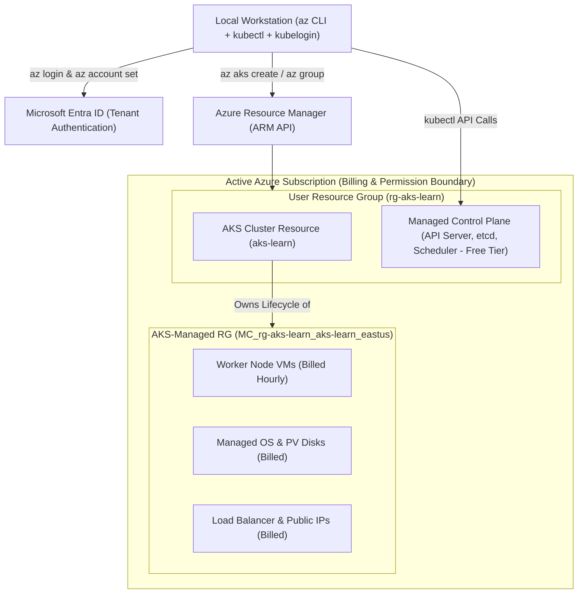
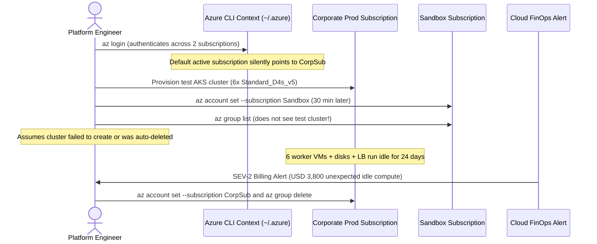

# Azure CLI and Prerequisites

> **Prerequisites:** Docker & container fundamentals, Kubernetes basics (`kind`/`minikube`), and an active Azure account.  
> **Estimated Reading Time:** 25 minutes  
> **Target Audience:** Backend Engineers, DevOps Engineers, Platform Engineers transitioning to managed Kubernetes.

> [!TIP]
> **The Golden Rule of AKS Prerequisites:** Always verify `az account show` before creating any resource—every resource group and AKS node pool inherits the active subscription's billing and RBAC boundary, and worker node VMs incur hourly VM charges the moment they provision regardless of whether a single pod is scheduled.

---

## Why This Matters

Every module after this one assumes `az` is installed, authenticated, and pointed at the right subscription, and that `kubectl` is available in your shell. Get this plumbing right once, here, so you're not debugging authentication instead of Kubernetes later. This module also sets your mental model for AKS pricing before you create anything billable.

---

## 1. Architectural Mental Model: Subscriptions, Resource Groups & AKS Ownership

Before provisioning a cluster, understand how Azure organizes billing, permissions, and the hidden infrastructure resource group AKS creates on your behalf:



### Core Concepts

#### Azure CLI (`az`)
**Azure CLI (`az`)** is the command-line tool you use to create and manage Azure resources — resource groups, AKS clusters, ACR registries, and so on. You already used it in the Docker track to push images to ACR and deploy to ACI/App Service. In this track it's how you provision the cluster itself; `kubectl` takes over once the cluster exists.

#### Resource Groups
**Resource groups** are Azure's container for related resources — a logical folder, not a network boundary. Every AKS cluster lives in a resource group, along with the VMs, disks, and load balancers it creates behind the scenes (those actually land in a second, AKS-managed resource group named `MC_<resourcegroup>_<clustername>_<region>` — more on that in module 01). Deleting a resource group deletes everything inside it, which is why `az group delete` is your main cleanup tool throughout this track.

#### Subscriptions
**Subscriptions** are the billing/permission boundary above resource groups. If your Azure account has access to more than one subscription, you must explicitly select which one `az` operates against, or you can accidentally create (and get billed for) resources in the wrong place.

#### AKS Pricing Model, in Plain Terms
- The Kubernetes **control plane** (API server, scheduler, etcd, etc.) is free on the AKS **Free tier**. Azure runs and manages it for you; you don't pay for it directly.
- You **do** pay for the **worker node VMs** in your node pools — these are ordinary Azure VMs billed at normal VM rates, for as long as they exist, whether or not you're running workloads on them.
- You pay for the **managed disks** attached to those VMs (OS disks, and any PersistentVolume disks you provision).
- You pay for any **Load Balancer** and **public IP address** resources AKS creates for you (e.g. when you expose a Service of type `LoadBalancer`, or use certain Ingress setups).
- You pay for **egress bandwidth** out of Azure, and for anything else you attach — Log Analytics workspaces (module 06), Key Vault (module 07), etc., each billed under its own service.
- There is also a paid **Standard tier** for the control plane, aimed at production workloads that need an SLA; you won't need it for this learning track, but you'll see it mentioned in module 01.

The upshot: **the moment you have running node VMs, you're spending money**, regardless of whether you've deployed anything to them. That's why every module that creates a cluster ends with cleanup instructions — follow them.

#### What AKS Manages for You vs. What You Still Own
Compared to local kind/minikube: locally, kind/minikube gave you a disposable, single-host fake cluster with no real cloud resources behind it. AKS gives you a real multi-node cluster where Azure manages the control plane's availability and upgrades, but **you** still own: node pool sizing and scaling, node OS patching cadence (unless you enable auto-upgrade), what runs on the nodes, networking configuration, RBAC, and cost. You'll see this "managed vs. your responsibility" split called out again in every module.

---

## 2. Taxonomic Comparison: Cluster Environments & Azure Scope Boundaries

| Dimension | Local (`kind` / `minikube`) | AKS Free Tier | AKS Standard Tier |
| :--- | :--- | :--- | :--- |
| **Control Plane Host** | Local Docker container / VM | Azure-managed (multi-tenant) | Azure-managed (dedicated SLA) |
| **Control Plane Cost** | Free (uses local RAM/CPU) | Free (\$0/hr) | Hourly flat fee per cluster |
| **Uptime SLA** | None | None (best-effort) | 99.95% (with Availability Zones) |
| **Worker Node Billing** | Local hardware only | Normal Azure VM hourly rates + disks | Normal Azure VM hourly rates + disks |
| **Ownership Split** | You manage 100% locally | Azure owns control plane; you own nodes/apps | Azure owns control plane + SLA; you own nodes/apps |
| **Target Use Case** | Laptop dev loops | Learning, dev/test clusters | Production workloads |

| Azure Scope | Primary Purpose | Contains | Lifecycle & Cleanup Rule |
| :--- | :--- | :--- | :--- |
| **Microsoft Entra Tenant** | Identity & directory root | Users, service principals, groups | Organization-wide |
| **Subscription** | Billing & quota boundary | Resource groups & provider registrations | Always pin with `az account set` |
| **User Resource Group** | Logical management folder | AKS resource, ACR, Key Vault, VNet | Free when empty; delete with `az group delete` |
| **`MC_*` Managed RG** | Cluster runtime infrastructure | Worker VMs, OS disks, NICs, Load Balancers | Managed by AKS; never delete resources inside manually |

---

## 3. Command Reference

| Command | What it does | Example |
|---|---|---|
| `az --version` | Prints installed Azure CLI and extension versions | `az --version` |
| `az upgrade` | Upgrades the Azure CLI to the latest version | `az upgrade` |
| `az login` | Opens a browser to authenticate you and caches a token locally | `az login` |
| `az account list` | Lists all subscriptions your account can see | `az account list --output table` |
| `az account show` | Shows the currently active subscription | `az account show --output table` |
| `az account set` | Switches the active subscription for all subsequent `az` commands | `az account set --subscription "My Subscription"` |
| `az aks install-cli` | Downloads and installs `kubectl` (and `kubelogin` if needed) via the CLI | `az aks install-cli` |
| `kubectl version --client` | Confirms `kubectl` is installed and shows its version | `kubectl version --client` |
| `az group create` | Creates a resource group in a given Azure region | `az group create --name rg-aks-learn --location eastus` |
| `az group list` | Lists resource groups in the current subscription | `az group list --output table` |
| `az group delete` | Deletes a resource group and everything inside it | `az group delete --name rg-aks-learn --yes --no-wait` |
| `az provider register` | Registers an Azure resource provider (namespace) for your subscription, required before first use of some services | `az provider register --namespace Microsoft.ContainerService` |
| `az provider show` | Checks registration state of a provider | `az provider show --namespace Microsoft.ContainerService --query registrationState` |

---

## 4. Production War Story: The Wrong-Subscription Orphaned Cluster Leak



### The Incident
A backend engineer setting up a temporary benchmark cluster logged into `az` using a corporate account that held access to both a shared company subscription and a personal sandbox subscription. Without running `az account show` first, they spun up a 6-node cluster in the wrong subscription. Later, after switching to the sandbox subscription, `az group list` showed an empty list—leading them to assume the test environment was clean.

### Post-Mortem Metrics
* **Severity:** SEV-2 (Unbudgeted cloud billing leak)
* **Mean Time to Detect (MTTD):** 24 days (monthly FinOps invoice threshold alert)
* **Mean Time to Resolution (MTTR):** 10 minutes (`az account set` + `az group delete`)
* **Financial Impact:** ~\$3,800 spent on zero-workload `Standard_D4s_v5` VMs, managed disks, and Standard Load Balancers.

### Root Cause Analysis
1. **Implicit Subscription Context:** `az` stores one global active subscription locally; switching terminals or re-logging in can silently target a different default subscription.
2. **Scoped Visibility Illusion:** `az group list` only enumerates the currently active subscription, masking orphaned clusters running in another subscription.

### The Fix & Architectural Hardening
1. **Explicit Context Gate:** Every bootstrap script and interactive session must start by asserting `az account show --query id -o tsv` (or passing `--subscription` explicitly on destructive/cost-incurring commands).
2. **Pre-Flight Provider & Budget Checks:** Verify `Microsoft.ContainerService` registration and audit `az group list -o table` at the start and end of every session.

---

## 5. Multi-Language Production Code: Subscription, Provider & Resource Group Pre-Flight Auditor

In platform automation tools, never invoke `az aks create` blindly. Verify the active subscription, assert `Microsoft.ContainerService` is `Registered`, and audit existing resource groups before provisioning billable node pools:

````carousel
### Go (`azidentity` + `armresources`)
```go
package main

import (
	"context"
	"fmt"
	"log"
	"os"
	"time"

	"github.com/Azure/azure-sdk-for-go/sdk/azidentity"
	"github.com/Azure/azure-sdk-for-go/sdk/resourcemanager/resources/armresources"
)

func runPreflightAudit(ctx context.Context, subscriptionID string) error {
	cred, err := azidentity.NewDefaultAzureCredential(nil)
	if err != nil {
		return fmt.Errorf("azure auth failed: %w", err)
	}

	ctx, cancel := context.WithTimeout(ctx, 15*time.Second)
	defer cancel()

	// 1. Check Microsoft.ContainerService registration state before az aks create
	provClient, err := armresources.NewProvidersClient(subscriptionID, cred, nil)
	if err != nil {
		return err
	}
	prov, err := provClient.Get(ctx, "Microsoft.ContainerService", nil)
	if err != nil {
		return fmt.Errorf("query provider state: %w", err)
	}
	fmt.Printf("Subscription: %s | Microsoft.ContainerService State: %s\n",
		subscriptionID, *prov.RegistrationState)

	// 2. Enumerate existing Resource Groups for cost-hygiene audit
	rgClient, err := armresources.NewResourceGroupsClient(subscriptionID, cred, nil)
	if err != nil {
		return err
	}
	pager := rgClient.NewListPager(nil)
	for pager.More() {
		page, err := pager.NextPage(ctx)
		if err != nil {
			return err
		}
		for _, rg := range page.Value {
			fmt.Printf("RG: %-30s Location: %s\n", *rg.Name, *rg.Location)
		}
	}
	return nil
}

func main() {
	subID := os.Getenv("AZURE_SUBSCRIPTION_ID")
	if subID == "" {
		log.Fatal("AZURE_SUBSCRIPTION_ID must be explicitly pinned")
	}
	if err := runPreflightAudit(context.Background(), subID); err != nil {
		log.Fatal(err)
	}
}
```
<!-- slide -->
### TypeScript (`@azure/identity` + `@azure/arm-resources`)
```typescript
import { DefaultAzureCredential } from '@azure/identity';
import { ResourceManagementClient } from '@azure/arm-resources';

export async function auditAksPrerequisites(subscriptionId: string): Promise<void> {
  if (!subscriptionId) {
    throw new Error('Explicit subscriptionId is required to prevent wrong-subscription leaks');
  }

  const client = new ResourceManagementClient(new DefaultAzureCredential(), subscriptionId);

  // 1. Verify AKS resource provider registration
  const provider = await client.providers.get('Microsoft.ContainerService');
  console.log(`Subscription: ${subscriptionId}`);
  console.log(`Provider Microsoft.ContainerService: ${provider.registrationState}`);

  if (provider.registrationState !== 'Registered') {
    throw new Error('Run az provider register --namespace Microsoft.ContainerService before cluster creation');
  }

  // 2. Enumerate resource groups for cost hygiene
  for await (const rg of client.resourceGroups.list()) {
    console.log(`RG: ${rg.name} | Location: ${rg.location}`);
  }
}

auditAksPrerequisites(process.env.AZURE_SUBSCRIPTION_ID ?? '').catch((err) => {
  console.error(err);
  process.exit(1);
});
```
<!-- slide -->
### Python (`azure-identity` + `azure-mgmt-resource`)
```python
import os
import sys
from azure.identity import DefaultAzureCredential
from azure.mgmt.resource import ResourceManagementClient


def run_aks_preflight(subscription_id: str) -> None:
    """Asserts AKS provider readiness and lists resource groups in the pinned subscription."""
    if not subscription_id:
        raise ValueError("AZURE_SUBSCRIPTION_ID must be explicitly set")

    credential = DefaultAzureCredential()
    client = ResourceManagementClient(credential, subscription_id)

    provider = client.providers.get("Microsoft.ContainerService")
    print(f"Subscription: {subscription_id} | AKS Provider: {provider.registration_state}")

    if provider.registration_state != "Registered":
        raise RuntimeError(
            "Microsoft.ContainerService is not Registered. "
            "Run: az provider register --namespace Microsoft.ContainerService"
        )

    print("Active Resource Groups:")
    for rg in client.resource_groups.list():
        print(f"  - {rg.name} ({rg.location})")


if __name__ == "__main__":
    sub_id = os.getenv("AZURE_SUBSCRIPTION_ID", "")
    try:
        run_aks_preflight(sub_id)
    except Exception as exc:
        print(f"Pre-flight failed: {exc}", file=sys.stderr)
        sys.exit(1)
```
<!-- slide -->
### C# (`Azure.Identity` + `Azure.ResourceManager`)
```csharp
using System;
using System.Threading;
using System.Threading.Tasks;
using Azure.Identity;
using Azure.ResourceManager;
using Azure.ResourceManager.Resources;

public static class AksPreflightAuditor
{
    public static async Task AuditAsync(string subscriptionId, CancellationToken ct = default)
    {
        if (string.IsNullOrWhiteSpace(subscriptionId))
        {
            throw new ArgumentException("Pin an explicit subscription ID before provisioning AKS.");
        }

        var armClient = new ArmClient(new DefaultAzureCredential(), subscriptionId);
        SubscriptionResource sub = await armClient.GetDefaultSubscriptionAsync(ct);

        ResourceProviderResource provider = await sub.GetResourceProviderAsync("Microsoft.ContainerService", cancellationToken: ct);
        Console.WriteLine($"Subscription: {sub.Data.DisplayName} ({sub.Data.SubscriptionId})");
        Console.WriteLine($"Microsoft.ContainerService State: {provider.Data.RegistrationState}");

        if (!string.Equals(provider.Data.RegistrationState, "Registered", StringComparison.OrdinalIgnoreCase))
        {
            throw new InvalidOperationException("Register Microsoft.ContainerService before calling az aks create.");
        }

        await foreach (ResourceGroupResource rg in sub.GetResourceGroups().GetAllAsync(ct))
        {
            Console.WriteLine($"RG: {rg.Data.Name} | Location: {rg.Data.Location}");
        }
    }
}
```
````

---

## 6. Practical Hands-On Verification CLI Workflows

### Workflow 1: Azure CLI Auth, Subscription Pinning & `kubectl` Installation (Exercises 1–4)

1. **Check/install the Azure CLI.** Run `az --version`. If it's missing or old, install/upgrade it (on Windows: `winget install Microsoft.AzureCLI`, or inside WSL2/Linux: follow the official install script for your distro). Verify with `az --version` again — confirm you're on a reasonably current version (2.60+ is a safe baseline; anything from the last year or so is fine).
```bash
az --version
```
**Expected Output:**
```text
azure-cli                         2.64.0
core                              2.64.0
...
```

2. **Log in.** Run `az login`. A browser window opens — sign in with the account tied to your Azure subscription. Verify: the terminal prints a JSON list of subscriptions you have access to.
```bash
az login
```

3. **Confirm and select your subscription.** Run `az account list --output table` and note the `SubscriptionId` and `Name` of the one you want to use. If you have more than one and the wrong one is marked `IsDefault True`, run `az account set --subscription "<name-or-id>"`. Verify with `az account show --output table` — confirm the `Name` field matches what you intended.
```bash
az account list --output table
az account set --subscription "<name-or-id>"
az account show --output table
```
**Expected Output:**
```text
EnvironmentName    HomeTenantId                          IsDefault    Name             State    TenantId
-----------------  ------------------------------------  -----------  ---------------  -------  ------------------------------------
AzureCloud         00000000-0000-0000-0000-000000000000  True         My Subscription  Enabled  00000000-0000-0000-0000-000000000000
```

4. **Install `kubectl`.** Run `az aks install-cli`. This installs `kubectl` (and `kubelogin`, used later for Azure AD auth) to a location it prints out, and may ask you to add that location to your `PATH`. Verify with `kubectl version --client` — you should see a client version printed with no connection error (you have no cluster yet, so a "couldn't get server version" message is expected and fine).
```bash
az aks install-cli
kubectl version --client
```
**Expected Output:**
```text
Client Version: v1.30.4
Kustomize Version: v5.0.4-0.20230601165947-6ce0bf390ce3
```

---

### Workflow 2: Provider Registration, Resource Group Setup & Diagnostics (Exercises 5–8)

5. **Register the AKS resource provider.** Run `az provider register --namespace Microsoft.ContainerService`. This is often already registered on subscriptions that have used AKS before, but new subscriptions need it explicitly. Check status with `az provider show --namespace Microsoft.ContainerService --query registrationState -o tsv` — wait until it prints `Registered` (can take a minute or two; poll with `az provider show ...` again if it says `Registering`).
```bash
az provider register --namespace Microsoft.ContainerService
az provider show --namespace Microsoft.ContainerService --query registrationState -o tsv
```
**Expected Output:**
```text
Registered
```

6. **Create your first resource group.** Pick a region close to you (e.g. `eastus`, `westeurope`) and run:
```bash
az group create --name rg-aks-learn --location eastus
az group list --output table
```
**Expected Output:**
```text
Name          Location    Status
------------  ----------  ---------
rg-aks-learn  eastus      Succeeded
```
*(Verify: the create command prints JSON with `"provisioningState": "Succeeded"`, and `az group list --output table` shows `rg-aks-learn` in your chosen region.)*

7. **Diagnose and fix: wrong subscription.** Deliberately run `az account set --subscription "<some-subscription-id-that-does-not-exist>"` and observe the error. Then simulate a subtler version of the same mistake: if you have access to more than one subscription, switch to a different valid one and run `az group list --output table` — notice the resource group you just created is *not* listed, because resource groups are scoped to a subscription. Practice diagnosing "where did my resource go?" by running `az account show` first whenever a resource you expect seems missing. Switch back to the correct subscription before continuing (`az account set --subscription "<correct-name-or-id>"`).

8. **Clean up (or defer).** The resource group `rg-aks-learn` created in exercise 6 contains no billable resources yet (an empty resource group costs nothing), so you may leave it in place — you'll use it in module 01 to create your first cluster. If you'd rather start clean next module, delete it now with `az group delete --name rg-aks-learn --yes --no-wait` and recreate it when module 01 asks you to.

---

### Independent Challenge

No commands given here — figure it out yourself using what you know from this module and earlier ones.

**Task:** Before you spend a cent on nodes in module 01, do a full cost-hygiene audit of your Azure account from scratch. Confirm which subscription `az` is actually pointed at, then enumerate every resource group it currently contains and reason about which ones might still be billing you (including anything left over from the Docker track's ACR/ACI work — conceptually building on the registry-and-container resources you created there). Then stand up one clean, correctly-named, empty resource group in a region of your choosing to hold your future AKS cluster, and prove to yourself the AKS resource provider is registered so module 01's `az aks create` won't fail on first use. When you're done exploring, remove any throwaway resource groups you created purely for this audit so nothing lingers — empty groups are free, but the habit of tearing down what you no longer need is the whole point.

<details>
<summary>Stuck? One hint</summary>

Everything here is reachable with the `az account` and `az group` command families plus the provider-registration check; start by making the active subscription unambiguous before you list or create anything.

</details>

---

## 7. Common Mistakes & Troubleshooting

- **Running commands against the wrong subscription.** If you have a personal subscription and a work/trial subscription, it's easy to create resources in the wrong one. Always sanity-check with `az account show` before creating anything, especially early in a session.
- **`az aks install-cli` installs `kubectl` somewhere not on your `PATH`.** Read its output carefully — it tells you the install path and whether you need to update your shell profile. Restart your terminal after editing `PATH`.
- **Forgetting `--yes --no-wait` shape on `az group delete`.** Without `--yes` it prompts for confirmation (fine interactively, but breaks scripts); without `--no-wait` the command blocks in your terminal until deletion finishes (can take several minutes). Both are optional but used throughout this track for convenience.
- **Provider not registered.** If a later `az aks create` fails with an error mentioning `Microsoft.ContainerService` not being registered, come back to exercise 5.
- **Cost pitfall: forgetting resource groups don't self-delete.** An empty resource group is free, but a resource group is easy to forget about once it has a cluster in it. Get in the habit of listing your resource groups (`az group list --output table`) at the start and end of every study session so nothing billable is left running unnoticed.

---

## 8. Checkpoint Quiz

Write down your answer to each question before expanding it — checking without attempting first is the single easiest way to fool yourself into thinking you've learned this.

1. What's the difference between an Azure subscription and a resource group?
2. Why is `az account show` a useful command to run before creating any resource?
3. On the AKS Free tier, what part of the cluster is free, and what do you still pay for?
4. What does `az group delete --name X --yes --no-wait` do, and why might you want `--no-wait`?
5. Why does an idle AKS cluster still cost money even with zero pods deployed to it?
6. What command installs `kubectl` via the Azure CLI, and what related tool does it also install for later Azure AD authentication?

<details>
<summary>Show answers</summary>

1. A subscription is the billing and access boundary — everything is billed to and permissioned under a subscription. A resource group is a logical container *within* a subscription that groups related resources together for management and bulk deletion; it has no billing identity of its own.
2. Because `az` commands operate against whatever subscription is currently "active." If you have access to multiple subscriptions, the active one might not be the one you intend to use, and resources would be created in (and billed to) the wrong place.
3. The managed control plane (API server, etcd, scheduler) is free on the Free tier. You still pay for the worker node VMs, their disks, any load balancers/public IPs, and egress bandwidth.
4. It deletes the resource group `X` and everything inside it without an interactive confirmation prompt (`--yes`) and without blocking the terminal until deletion completes (`--no-wait`, returns immediately while deletion happens in the background).
5. Because the worker nodes are ordinary Azure VMs billed at normal hourly rates for as long as they exist — billing is tied to the VM running, not to whether it's doing useful work.
6. `az aks install-cli`; it also installs `kubelogin`, used for Azure AD-integrated cluster authentication (covered in module 07).

</details>

---

## 9. Operational Validation Checkpoints

<details>
<summary><strong>Scenario 1: The Vanished Resource Group After Terminal Restart</strong></summary>

**Scenario:** Yesterday you created `rg-aks-learn` and confirmed it succeeded. Today you open a fresh cloud shell / terminal, run `az group list --output table`, and `rg-aks-learn` is completely gone. You haven't deleted anything.

What is the most likely cause, and what single command verifies it?

**Answer:**
Your Azure CLI session defaulted to a **different subscription** (for example, corporate vs. personal/sandbox) after re-authentication or profile reset. Because resource groups are strictly scoped to one subscription, `az group list` only queries the active subscription.

**The Fix:** Run `az account show --output table` to check the active subscription ID/name, list all available subscriptions with `az account list -o table`, and switch back using `az account set --subscription "<correct-id>"`.

</details>

<details>
<summary><strong>Scenario 2: CI/CD Automation Stalling Indefinitely on Cleanup</strong></summary>

**Scenario:** You write a GitHub Actions teardown step that runs `az group delete --name rg-ephemeral-pr-42`. Every PR teardown job hangs at that step until GitHub hits the 60-minute job timeout and fails.

Why does the command block, and what two flags fix both issues?

**Answer:**
1. Without `--yes`, `az group delete` prints an interactive confirmation prompt (`Are you sure you want to perform this operation? (y/n):`) and hangs waiting for `stdin` in non-interactive CI.
2. Without `--no-wait`, the CLI polls Azure synchronously until every VM, NIC, Load Balancer, and disk finishes deleting (which can take 5–15 minutes).

**The Fix:** Always pass `az group delete --name rg-ephemeral-pr-42 --yes --no-wait` in non-interactive scripts (and poll separately if strict deletion completion is required).

</details>

<details>
<summary><strong>Scenario 3: "Free Tier" Cluster Generates Unexpected Daily Charges</strong></summary>

**Scenario:** A developer creates an AKS cluster with `--tier free`, deploys zero application pods to it, and leaves it running over a 3-day weekend expecting a \$0.00 bill. On Monday, Azure Cost Management shows charges for compute, storage, and networking.

Explain precisely which resources generated charges and why `--tier free` did not prevent them.

**Answer:**
`--tier free` applies **only to the managed Kubernetes control plane** (API server, etcd, scheduler). It does **not** make infrastructure free:
1. Worker node VMs in the system node pool are standard Azure VMs billing hourly whether idle or loaded.
2. Each node attaches a managed OS disk billed monthly/hourly.
3. Provisioned Load Balancers / Public IPs and any attached Log Analytics workspace generate their own resource charges.

</details>

---

## Next

[01-creating-an-aks-cluster](../01-creating-an-aks-cluster/README.md) — create your first real AKS cluster and wire up `kubectl` to talk to it.
