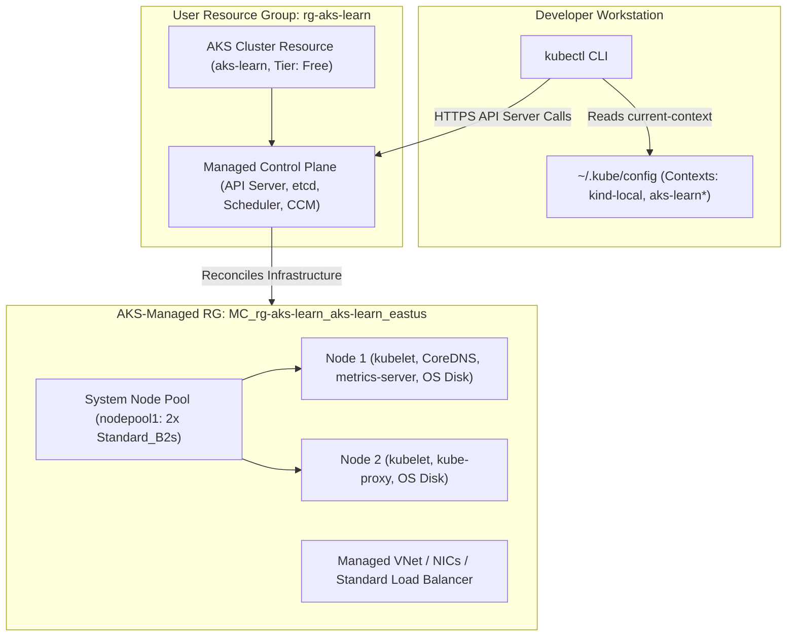
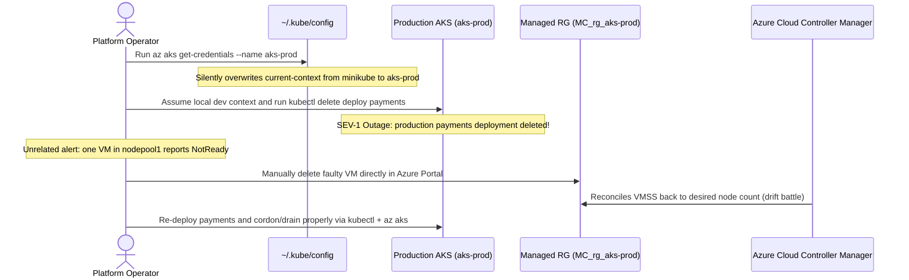

# Creating an AKS Cluster

> **Prerequisites:** Azure CLI installed & authenticated, `kubectl` available, `Microsoft.ContainerService` provider registered, and target resource group prepared (Module 00).  
> **Estimated Reading Time:** 30 minutes  
> **Target Audience:** Backend Engineers, DevOps Engineers, Kubernetes Operators.

> [!TIP]
> **The Golden Rule of AKS Cluster Lifecycle:** Never manually edit or delete VMs, disks, or NICs inside the AKS-managed `MC_*` resource group—AKS continuously reconciles that group against your cluster spec; manage nodes strictly via `az aks` / `kubectl`, and always verify `kubectl config current-context` before executing commands after merging AKS credentials.

---

## Why This Matters

Everything else in this track happens on top of a real cluster. This module is where you turn `az` commands into an actual running set of VMs in Azure, and where the "this costs real money while it's running" reality of the AKS track starts. Getting the initial `az aks create` right — small node pool, right tier, right identity — saves you from surprises later.

---

## 1. Architectural Mental Model: Dual Resource Groups & `kubeconfig` Context Wiring

Running `az aks create` provisions two linked planes across two distinct resource groups, then `az aks get-credentials` merges cluster auth data into your local `~/.kube/config` alongside any local `kind`/`minikube` contexts:



### Core Concepts

#### Node Pools
In kind/minikube, "nodes" were containers or a single VM faking a cluster. In AKS, a node pool is a group of real Azure VMs (of a size/SKU you choose) that all run the same OS image and join the cluster as Kubernetes nodes. Every AKS cluster has at least one **system node pool**, which runs critical cluster add-ons (CoreDNS, metrics-server, etc.) alongside your workloads. You can add additional **user node pools** later for workload isolation (e.g. a pool with GPU VMs) — not needed yet.

#### VM Size (SKU)
Each node pool picks one VM size for all its nodes, e.g. `Standard_B2s` (burstable, cheap, fine for learning) or `Standard_D2s_v5` (steadier general-purpose). Bigger/faster VMs cost more per hour whether or not you use the capacity — for this track, pick the smallest size that can actually run the exercises (2 vCPU / a few GB RAM class is enough).

#### Node Count
How many VMs are in the pool. AKS needs a minimum of one, but a single-node cluster can't demonstrate rescheduling behavior when a node fails, so this track uses two nodes for its learning cluster.

#### Cluster Tiers: Free vs. Standard
This controls the **control plane's** SLA and scale limits, not the nodes. **Free tier** has no uptime SLA (fine for learning — Azure's control plane is still reliable in practice, just not contractually guaranteed) and is what this track uses throughout. **Standard tier** adds an availability SLA and is meant for production clusters; it has an hourly cost for the control plane itself, on top of node costs. Don't pick Standard for a learning cluster you plan to delete the same day.

#### What AKS Manages vs. What You Own at Cluster-Creation Time
Azure manages the control plane's placement, availability, and patching. You are responsible for: the node pool's VM size and count (and therefore its cost), the Kubernetes version you run (Azure offers supported versions; you choose and later upgrade), and the resource group and network the cluster lives in. Unlike kind/minikube, tearing a cluster down here is not "stop a local process" — it's deleting real infrastructure, hence `az group delete`.

#### `az aks get-credentials`
Downloads a kubeconfig context for the cluster and merges it into your local `~/.kube/config`, the same file `kubectl` already reads for your kind/minikube contexts. After this, `kubectl config get-contexts` shows your AKS cluster alongside any local ones, and `kubectl config use-context` (or `--context`) switches between them — a real risk if you have both a local and AKS context and run a command assuming the wrong one is active.

---

## 2. Taxonomic Comparison: Node Pools & Cost-Control Lifecycles

| Dimension | System Node Pool | User Node Pool |
| :--- | :--- | :--- |
| **Mandatory?** | Yes (every cluster requires at least 1) | Optional (0 or more pools) |
| **Primary Responsibility** | Hosts critical cluster system pods (CoreDNS, metrics-server, tunnel) | Isolates application workloads (GPU, high-memory, Spot VMs) |
| **Scale-to-Zero Allowed?** | No (must retain >= 1 node) | Yes (can scale down to 0 nodes when idle) |
| **Can Be Deleted?** | Only if another system pool exists | Yes, anytime |

| Lifecycle Action | Command | Worker VM Billing | Control Plane & Data | Recovery Speed |
| :--- | :--- | :--- | :--- | :--- |
| **Scale Down Pool** | `az aks scale --node-count 1` | Reduced to 1 VM | Cluster stays live | Seconds to 2 minutes |
| **Pause Cluster** | `az aks stop` | Paused (\$0 node compute; disks/IPs may still bill) | Preserved; cluster unreachable while stopped | ~5–10 minutes on `az aks start` |
| **Full Teardown** | `az group delete --yes --no-wait` | Completely eliminated (\$0) | Permanently destroyed (including `MC_*` RG) | Must recreate from scratch |

---

## 3. Command Reference

| Command | What it does | Example |
|---|---|---|
| `az aks create` | Creates a new AKS cluster in a resource group | `az aks create --resource-group rg-aks-learn --name aks-learn --node-count 2 --node-vm-size Standard_B2s --tier free --generate-ssh-keys` |
| `--node-count` | Number of nodes in the initial (system) node pool | `--node-count 2` |
| `--node-vm-size` | VM size/SKU for the node pool | `--node-vm-size Standard_B2s` |
| `--tier` | Control plane tier: `free` or `standard` | `--tier free` |
| `--generate-ssh-keys` | Auto-generates an SSH key pair if you don't already have one, required for node VM provisioning | `--generate-ssh-keys` |
| `--kubernetes-version` | Pins a specific supported Kubernetes version instead of the current default | `--kubernetes-version 1.29.7` |
| `az aks get-credentials` | Downloads/merges kubeconfig for a cluster into `~/.kube/config` | `az aks get-credentials --resource-group rg-aks-learn --name aks-learn` |
| `az aks list` | Lists AKS clusters in the current subscription | `az aks list --output table` |
| `az aks show` | Shows details of one cluster | `az aks show --resource-group rg-aks-learn --name aks-learn --output table` |
| `az aks nodepool list` | Lists node pools in a cluster | `az aks nodepool list --resource-group rg-aks-learn --cluster-name aks-learn --output table` |
| `az aks scale` | Changes the node count of a node pool | `az aks scale --resource-group rg-aks-learn --name aks-learn --node-count 1 --nodepool-name nodepool1` |
| `az aks stop` | Stops the cluster's control plane and nodes (billing pauses for nodes, not for some other resources like disks/IPs) | `az aks stop --resource-group rg-aks-learn --name aks-learn` |
| `az aks start` | Restarts a stopped cluster | `az aks start --resource-group rg-aks-learn --name aks-learn` |
| `kubectl config get-contexts` | Lists kubeconfig contexts (local + AKS) | `kubectl config get-contexts` |
| `kubectl config use-context` | Switches the active kubeconfig context | `kubectl config use-context aks-learn` |
| `kubectl get nodes` | Lists nodes the cluster's API server sees | `kubectl get nodes -o wide` |
| `az group delete` | Deletes the resource group (and cluster) entirely | `az group delete --name rg-aks-learn --yes --no-wait` |

---

## 4. Production War Story: Stale `kubeconfig` Context & `MC_*` Drift Chaos



### The Incident
Two classic AKS operator errors unfolded on the same afternoon. First, a developer who normally worked against `minikube` pulled credentials for a shared staging/prod-shaped AKS cluster via `az aks get-credentials` (which switches `current-context` automatically) and ran a cleanup `kubectl delete` thinking they were still targeting their local cluster. Second, when troubleshooting a `NotReady` node, another engineer bypassed AKS APIs and deleted the underlying VM inside the `MC_*` resource group manually.

### Post-Mortem Metrics
* **Severity:** SEV-1 (Accidental workload deletion + VMSS provisioning lock)
* **Mean Time to Detect (MTTD):** 1 minute (ingress health probes dropped)
* **Mean Time to Resolution (MTTR):** 28 minutes (GitOps re-apply + VMSS instance repair)

### Root Cause Analysis
1. **Unverified Active Context:** `az aks get-credentials` mutates `current-context` in `~/.kube/config`. Any subsequent `kubectl` command without `--context` or prompt awareness hits the newly merged cluster.
2. **Fighting AKS Reconciliation in `MC_*`:** Manually deleting/modifying VMs, NICs, or NSGs in `MC_<rg>_<cluster>_<region>` puts VM Scale Sets out of sync with the Kubernetes node controller, triggering reconciliation errors.

### The Fix & Architectural Hardening
1. **Context Hygiene:** Display `kubectl config current-context` in your shell prompt and pass `--context aks-learn` explicitly on sensitive operations.
2. **Treat `MC_*` as Read-Only:** Lock down manual write RBAC on `MC_*` resource groups; use `az aks nodepool scale`, `az aks nodepool upgrade`, or `kubectl drain` for node lifecycle operations.

---

## 5. Multi-Language Production Code: Explicit Context Node Health & Allocatable Headroom Inspector

Before deploying workloads to a new `Standard_B2s` cluster, inspect how much CPU/memory is `Ready` and `Allocatable` using an **explicit** kubeconfig context (`aks-learn`) rather than trusting whatever `current-context` happens to be active:

````carousel
### Go (`k8s.io/client-go`)
```go
package main

import (
	"context"
	"fmt"
	"log"
	"path/filepath"
	"time"

	corev1 "k8s.io/api/core/v1"
	metav1 "k8s.io/apimachinery/pkg/apis/meta/v1"
	"k8s.io/client-go/kubernetes"
	"k8s.io/client-go/tools/clientcmd"
	"k8s.io/client-go/util/homedir"
)

func main() {
	kubeconfig := filepath.Join(homedir.HomeDir(), ".kube", "config")
	// Pin context explicitly so we never accidentally query minikube/prod
	loadingRules := &clientcmd.ClientConfigLoadingRules{ExplicitPath: kubeconfig}
	overrides := &clientcmd.ConfigOverrides{CurrentContext: "aks-learn"}

	restCfg, err := clientcmd.NewNonInteractiveDeferredLoadingClientConfig(loadingRules, overrides).ClientConfig()
	if err != nil {
		log.Fatalf("load context aks-learn: %v", err)
	}

	clientset, err := kubernetes.NewForConfig(restCfg)
	if err != nil {
		log.Fatalf("create k8s client: %v", err)
	}

	ctx, cancel := context.WithTimeout(context.Background(), 10*time.Second)
	defer cancel()

	nodes, err := clientset.CoreV1().Nodes().List(ctx, metav1.ListOptions{})
	if err != nil {
		log.Fatalf("list nodes: %v", err)
	}

	for _, n := range nodes.Items {
		ready := corev1.ConditionUnknown
		for _, cond := range n.Status.Conditions {
			if cond.Type == corev1.NodeReady {
				ready = cond.Status
			}
		}
		fmt.Printf("Node: %-32s Ready: %-5s Allocatable CPU: %s Mem: %s\n",
			n.Name,
			ready,
			n.Status.Allocatable.Cpu().String(),
			n.Status.Allocatable.Memory().String(),
		)
	}
}
```
<!-- slide -->
### TypeScript (`@kubernetes/client-node`)
```typescript
import * as k8s from '@kubernetes/client-node';

async function inspectAksNodes(targetContext: string): Promise<void> {
  const kc = new k8s.KubeConfig();
  kc.loadFromDefault();

  // Fail fast if target context does not exist in ~/.kube/config
  const ctxExists = kc.getContexts().some((c) => c.name === targetContext);
  if (!ctxExists) {
    throw new Error(`Context '${targetContext}' not found. Run az aks get-credentials first.`);
  }
  kc.setCurrentContext(targetContext);

  const coreApi = kc.makeApiClient(k8s.CoreV1Api);
  const res = await coreApi.listNode();

  for (const node of res.body.items) {
    const readyCond = node.status?.conditions?.find((c) => c.type === 'Ready');
    console.log({
      node: node.metadata?.name,
      ready: readyCond?.status ?? 'Unknown',
      allocatableCpu: node.status?.allocatable?.cpu,
      allocatableMemory: node.status?.allocatable?.memory,
      kubeletVersion: node.status?.nodeInfo?.kubeletVersion,
    });
  }
}

inspectAksNodes('aks-learn').catch((err) => {
  console.error(err);
  process.exit(1);
});
```
<!-- slide -->
### Python (`kubernetes` official client)
```python
from kubernetes import client, config


def inspect_aks_nodes(context_name: str = "aks-learn") -> None:
    """Loads an explicit kubeconfig context and verifies NodeReady + Allocatable headroom."""
    config.load_kube_config(context=context_name)
    v1 = client.CoreV1Api()

    nodes = v1.list_node(timeout_seconds=10)
    for node in nodes.items:
        ready_status = "Unknown"
        for cond in node.status.conditions or []:
            if cond.type == "Ready":
                ready_status = cond.status
                break

        alloc = node.status.allocatable or {}
        print(
            f"Node={node.metadata.name} Ready={ready_status} "
            f"AllocatableCPU={alloc.get('cpu')} AllocatableMem={alloc.get('memory')}"
        )


if __name__ == "__main__":
    inspect_aks_nodes("aks-learn")
```
<!-- slide -->
### C# (`KubernetesClient`)
```csharp
using System;
using System.Linq;
using System.Threading;
using System.Threading.Tasks;
using k8s;

public static class AksNodeInspector
{
    public static async Task InspectNodesAsync(string contextName = "aks-learn", CancellationToken ct = default)
    {
        // Pin context explicitly instead of relying on global current-context
        var cfg = KubernetesClientConfiguration.BuildConfigFromConfigFile(currentContext: contextName);
        using var k8sClient = new Kubernetes(cfg);

        var nodeList = await k8sClient.CoreV1.ListNodeAsync(cancellationToken: ct);
        foreach (var node in nodeList.Items)
        {
            var ready = node.Status.Conditions?
                .FirstOrDefault(c => c.Type == "Ready")?.Status ?? "Unknown";

            node.Status.Allocatable.TryGetValue("cpu", out var cpu);
            node.Status.Allocatable.TryGetValue("memory", out var mem);

            Console.WriteLine($"Node: {node.Metadata.Name} | Ready: {ready} | CPU: {cpu} | Mem: {mem}");
        }
    }
}
```
````

---

## 6. Practical Hands-On Verification CLI Workflows

### Workflow 1: Create the Learning Cluster & Inspect Managed Resource Groups (Exercises 1–3)

1. **Recreate the resource group if needed.** If you deleted `rg-aks-learn` at the end of module 00, recreate it:
```bash
az group create --name rg-aks-learn --location eastus
```

2. **Create a small learning cluster.** Run:
```bash
az aks create \
  --resource-group rg-aks-learn \
  --name aks-learn \
  --node-count 2 \
  --node-vm-size Standard_B2s \
  --tier free \
  --generate-ssh-keys
```
**Expected Output:**
```json
{
  "name": "aks-learn",
  "powerState": {
    "code": "Running"
  },
  "provisioningState": "Succeeded",
  "sku": {
    "name": "Base",
    "tier": "Free"
  }
}
```
*(This takes several minutes. Verify: the command eventually prints JSON with `"provisioningState": "Succeeded"` and `"powerState": {"code": "Running"}`.)*

3. **Look at what got created.** Run `az aks show --resource-group rg-aks-learn --name aks-learn --output table` and note the Kubernetes version and tier. Then run `az group list --output table` — notice a *second*, AKS-managed resource group now exists named something like `MC_rg-aks-learn_aks-learn_eastus`. This is where the actual node VMs, disks, NICs, and (later) load balancers live — don't delete it directly; it's tied to the cluster's lifecycle and gets cleaned up when the cluster is deleted.
```bash
az aks show --resource-group rg-aks-learn --name aks-learn --output table
az group list --output table
```
**Expected Output:**
```text
Name                                 Location    Status
-----------------------------------  ----------  ---------
rg-aks-learn                         eastus      Succeeded
MC_rg-aks-learn_aks-learn_eastus     eastus      Succeeded
```

---

### Workflow 2: Wire `kubectl`, Verify Nodes & Inspect Node Pools (Exercises 4–6)

4. **Wire up `kubectl`.** Run `az aks get-credentials --resource-group rg-aks-learn --name aks-learn`. Verify with `kubectl config get-contexts` — you should see an entry for `aks-learn` (marked `*` as current if it just got set active alongside any existing kind/minikube contexts).
```bash
az aks get-credentials --resource-group rg-aks-learn --name aks-learn
kubectl config get-contexts
```
**Expected Output:**
```text
CURRENT   NAME         CLUSTER      AUTHINFO                                   NAMESPACE
*         aks-learn    aks-learn    clusterUser_rg-aks-learn_aks-learn
```

5. **Verify the nodes.** Run `kubectl get nodes -o wide`. Verify: two nodes listed, `STATUS` = `Ready`, and the `KUBELET-VERSION` matching what `az aks show` reported. Also try `kubectl get nodes -o wide --context aks-learn` explicitly, and compare against a local context if you still have one (`kubectl config get-contexts`) to build the habit of checking which cluster you're pointed at.
```bash
kubectl get nodes -o wide --context aks-learn
```
**Expected Output:**
```text
NAME                                STATUS   ROLES    AGE   VERSION   INTERNAL-IP   EXTERNAL-IP   OS-IMAGE             KERNEL-VERSION
aks-nodepool1-12345678-vmss000000   Ready    <none>   3m    v1.30.x   10.224.0.4    <none>        Ubuntu 22.04.4 LTS   5.15.0-...
aks-nodepool1-12345678-vmss000001   Ready    <none>   3m    v1.30.x   10.224.0.5    <none>        Ubuntu 22.04.4 LTS   5.15.0-...
```

6. **Inspect a node pool.** Run `az aks nodepool list --resource-group rg-aks-learn --cluster-name aks-learn --output table`. Verify: one pool (commonly named `nodepool1`), `COUNT` = 2, `VMSIZE` matching what you requested.
```bash
az aks nodepool list --resource-group rg-aks-learn --cluster-name aks-learn --output table
```
**Expected Output:**
```text
Name       OsType    KubernetesVersion    VmSize        Count    MaxPods    ProvisioningState    Mode
---------  --------  -------------------  ------------  -------  ---------  -------------------  ------
nodepool1  Linux     1.30.x               Standard_B2s  2        110        Succeeded            System
```

---

### Workflow 3: Node Diagnostics, Stop/Start Billing Pause & Cleanup (Exercises 7–9)

7. **Diagnose and fix: nodes not ready.** Simulate/observe a "nodes not ready" investigation even without breaking anything: run `kubectl describe node <one-of-your-node-names>` and read the `Conditions` section (`Ready`, `MemoryPressure`, `DiskPressure`, `PIDPressure`, `NetworkUnavailable` should all be healthy/`False` except `Ready=True`). Now deliberately scale to a size that could strain a `Standard_B2s` node: skip actually deploying anything huge, but note down what you'd check if a node showed `Ready=False` — run `kubectl get events --sort-by=.lastTimestamp` and `kubectl describe node <name>` and look at the `Events` section for causes like disk pressure, kubelet not posting status, or a failed VM extension. *(You'll cause an actual resource-pressure failure on purpose in module 02's diagnose exercise.)*
```bash
kubectl describe node <one-of-your-node-names>
kubectl get events --sort-by=.lastTimestamp
```

8. **Try stop/start (optional, cost-saving).** If you want to pause billing on node VMs without deleting the cluster between study sessions, run `az aks stop --resource-group rg-aks-learn --name aks-learn`, wait for it to complete, then `az aks start --resource-group rg-aks-learn --name aks-learn` before your next session. Verify stop worked with `az aks show --resource-group rg-aks-learn --name aks-learn --query powerState` (should show `Stopped`, then `Running` again after start). Note: stop pauses node VM billing but some resources (disks, reserved public IPs) may still bill while stopped — check the portal if you're unsure.
```bash
az aks stop --resource-group rg-aks-learn --name aks-learn
az aks show --resource-group rg-aks-learn --name aks-learn --query powerState
az aks start --resource-group rg-aks-learn --name aks-learn
```

9. **Clean up.** If you're done with this cluster for the day and don't need it for module 02 immediately, delete everything: `az group delete --name rg-aks-learn --yes --no-wait`. If you're continuing straight into module 02, you may leave the cluster running — just don't forget it's billing while it exists.
```bash
az group delete --name rg-aks-learn --yes --no-wait
```

---

### Independent Challenge

No commands given here — figure it out yourself using what you know from this module and earlier ones.

**Task:** Provision a learning cluster the cost-conscious way, then investigate one thing the exercises above never make you look at: exactly how much of each small node the system add-ons have already claimed before you deploy anything of your own. Create a minimal two-node cluster in the resource group you set up in module 00 (conceptually building on module 00's resource-group and subscription work), wire `kubectl` to it, and confirm both nodes are healthy. Then, without deploying any workload, determine how much CPU and memory on each node is already reserved or requested by the cluster's own system components, and form an opinion on how many of your own pods a node this size could realistically hold. Finally, decide whether to pause billing or tear the cluster down for the day, and actually do it — leaving a two-node cluster idle overnight is exactly the charge this track keeps warning you about.

<details>
<summary>Stuck? One hint</summary>

`kubectl describe node <name>` reports both the node's total capacity and its already-allocated requests near the bottom; compare "Allocatable" against the "Allocated resources" table to see the real headroom.

</details>

---

## 7. Common Mistakes & Troubleshooting

- **Picking too large a VM size "to be safe."** `Standard_D4s_v5` or bigger for a 2-node learning cluster is unnecessary cost for no benefit in this track — `Standard_B2s` (or similar burstable 2 vCPU size) is enough for every exercise here.
- **Choosing `--tier standard` out of habit.** Standard tier adds a control-plane SLA cost meant for production; use `free` for learning clusters you plan to tear down.
- **Forgetting the `MC_*` resource group exists.** It's not a mistake to see it, but people sometimes try to manually delete resources inside it, which fights the cluster's own reconciliation. Manage it through the AKS cluster/node pool, not by hand.
- **Running `kubectl` against the wrong context after adding AKS.** Once you have both local and AKS contexts, always check `kubectl config current-context` before running anything you don't want to accidentally point at production-shaped infrastructure.
- **Cost pitfall: leaving a "just for testing" cluster running for days.** A 2-node `Standard_B2s` cluster left running unattended for a week adds up. Get in the habit of running `az aks stop` between sessions, or `az group delete` if you're done with a module, rather than leaving clusters idle "just in case."

---

## 8. Checkpoint Quiz

Write down your answer to each question before expanding it — checking without attempting first is the single easiest way to fool yourself into thinking you've learned this.

1. What's the difference between the system node pool and a user node pool?
2. What does the `--tier` flag control, and why is `free` the right choice for this track?
3. Where do the actual node VMs, disks, and NICs for your cluster live, resource-group-wise, and why shouldn't you manage that resource group by hand?
4. What does `az aks get-credentials` actually do to your local machine?
5. What's the practical billing difference between `az aks stop` and `az group delete`?
6. If `kubectl get nodes` shows a node as `NotReady`, what two commands would you reach for first to investigate?

<details>
<summary>Show answers</summary>

1. The system node pool runs critical cluster add-ons (CoreDNS, metrics-server, etc.) and can also run your workloads; a user node pool is an additional pool you add later, typically to isolate specific workloads (different VM size, GPU, taints, etc.) from the system pool.
2. `--tier` controls the control plane's SLA/scale tier. `free` has no uptime SLA but no extra control-plane cost, which is appropriate for a learning cluster you don't need contractual uptime guarantees for.
3. In a separate, AKS-managed resource group (named like `MC_<rg>_<cluster>_<region>`). You shouldn't manage it by hand because AKS reconciles its contents to match the cluster/node pool state — manual changes there can be overwritten or cause drift; manage node pools through `az aks`/`kubectl` instead.
4. It fetches the cluster's kubeconfig (API server address, cluster CA, auth info) and merges it as a new context into your local `~/.kube/config`, the same file used for local kind/minikube contexts.
5. `az aks stop` pauses billing on the node VMs (and the cluster is fully deleted-and-recreatable via `start`), but some attached resources may still bill. `az group delete` deletes the cluster and its resource group entirely — no way to "start" it back; you'd recreate from scratch.
6. `kubectl describe node <name>` (check the `Conditions` and `Events` sections) and `kubectl get events --sort-by=.lastTimestamp` (see cluster-wide recent events for context).

</details>

---

## 9. Operational Validation Checkpoints

<details>
<summary><strong>Scenario 1: Attempting to Scale the Only System Node Pool to Zero</strong></summary>

**Scenario:** To eliminate compute costs overnight without using `az aks stop`, an engineer runs:
`az aks scale --resource-group rg-aks-learn --name aks-learn --nodepool-name nodepool1 --node-count 0`
Azure rejects the command with a validation error.

Why does AKS block scaling `nodepool1` to zero, and what are the two valid ways to pause or save costs?

**Answer:**
`nodepool1` is the cluster's sole **System Node Pool**. System node pools run mandatory cluster add-ons (`CoreDNS`, `metrics-server`, `konnectivity-agent`) and cannot scale below 1 node (user node pools can scale to 0).

**The Fix:** Either run `az aks stop --resource-group rg-aks-learn --name aks-learn` to deallocate all node VMs temporarily, or run `az group delete --name rg-aks-learn --yes --no-wait` to tear down the learning cluster completely.

</details>

<details>
<summary><strong>Scenario 2: Orphaned Changes Inside `MC_*` After Manual Portal Edit</strong></summary>

**Scenario:** An engineer notices high network egress on a node and manually opens Azure Portal, navigates to `MC_rg-aks-learn_aks-learn_eastus`, and modifies an NSG rule / deletes a VM instance directly in the portal. Hours later, an AKS upgrade fails or the deleted resource mysteriously reappears or breaks cluster networking.

Why did manual Portal edits break AKS stability?

**Answer:**
The `MC_*` resource group is **owned and reconciled by AKS**. The Azure Cloud Controller Manager and AKS Resource Provider expect that group's NSGs, load balancers, and VMSS instances to match the AKS API model. Manual edits create configuration drift that is either overwritten by reconciliation or blocks cluster operations.

**The Fix:** Manage cluster infrastructure strictly via `az aks` / `az aks nodepool` commands and Kubernetes objects (`Service`, `NetworkPolicy`).

</details>

<details>
<summary><strong>Scenario 3: Sudden `kubectl` Authentication or Wrong-Cluster Execution</strong></summary>

**Scenario:** You run `az aks get-credentials --resource-group rg-aks-prod --name aks-prod` to inspect a pod in production, then switch windows and run `kubectl apply -f experimental-test.yaml`, expecting it to hit your local `kind` cluster.

Why did `experimental-test.yaml` deploy into `aks-prod`, and how do you prevent this permanently?

**Answer:**
By default, `az aks get-credentials` merges the cluster into `~/.kube/config` **and updates `current-context`** to the newly fetched cluster.

**The Fix:**
1. Always inspect `kubectl config current-context` before applying or deleting manifests.
2. Explicitly pin contexts on commands (`kubectl --context kind-kind apply -f ...`), or pass `--overwrite-existing` deliberately while maintaining separate `KUBECONFIG` files for production clusters.

</details>

---

## Next

[02-deploying-workloads-to-aks](../02-deploying-workloads-to-aks/README.md) — deploy real workloads to your AKS cluster and see what's different from kind/minikube.
