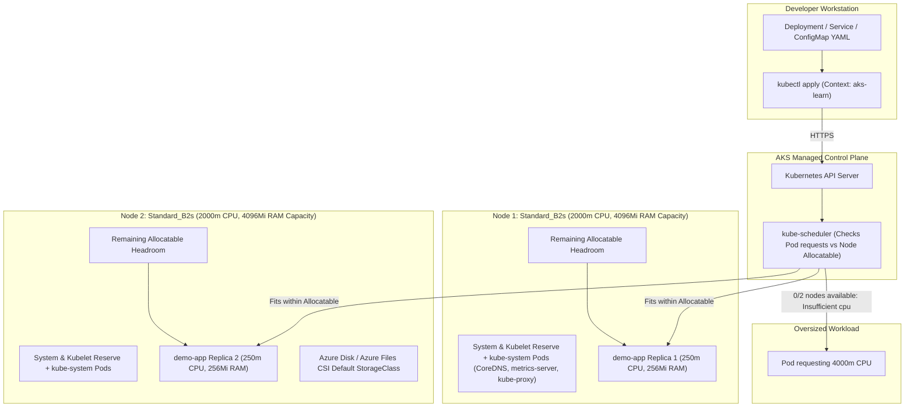
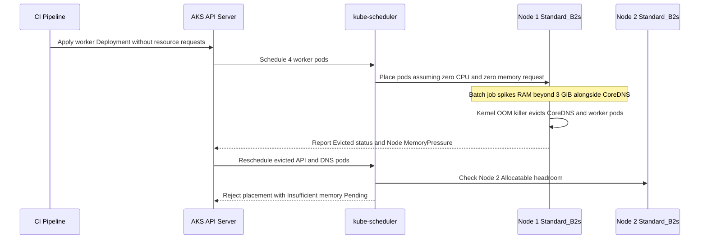

# Deploying Workloads to AKS

> **Prerequisites:** Active `aks-learn` cluster context (2x `Standard_B2s` nodes) created in Module 01, `kubectl` configured, and familiarity with Kubernetes Deployments, Services, ConfigMaps, and Secrets.  
> **Estimated Reading Time:** 35 minutes  
> **Target Audience:** Backend Engineers, DevOps Engineers, Kubernetes Operators.

> [!TIP]
> **The Golden Rule of AKS Workload Scheduling:** Always declare explicit `resources.requests` on every container before deploying to a fixed-size AKS node pool—unlike a local `kind` or `minikube` cluster backed by your entire laptop, Azure VM nodes reserve system and kubelet headroom first, causing unrequested or oversized pods to starve neighbors or stall in `Pending`.

---

## Why This Matters

You already know Deployments, Services, and ConfigMaps/Secrets from local Kubernetes. The API objects do not change on AKS — but the environment around them does: real DNS, real cloud load balancers, real resource limits tied to real VM sizes, and real cost if you oversize something. This module confirms your existing Kubernetes muscle memory transfers cleanly to Azure and teaches the handful of operational realities that are genuinely different on a managed cloud cluster.

---

## 1. Architectural Mental Model: Kubernetes API Continuity vs. Azure VM Node Ceilings

A Deployment manifest applied to AKS hits the exact same Kubernetes API server semantics you used locally, but the scheduler evaluates your pod requests against the **Allocatable** slice of each physical Azure VM after Azure system reservations and `kube-system` add-ons take their share:



### Core Concepts

#### Same API, Different Substrate
A Deployment YAML you wrote for `kind` or `minikube` will `kubectl apply` unchanged against AKS — the Kubernetes API is the Kubernetes API. What changes is what sits underneath: `kubectl get pods -o wide` on AKS shows pods scheduled onto real Azure VM nodes with real (limited) CPU and memory, not a laptop's whole resource pool shared across a simulated multi-node setup.

#### Resource Requests and Limits Matter More Here
On a local cluster, a Pod with no resource requests uses whatever your laptop has free. On a small 2-node AKS cluster of `Standard_B2s` VMs (2 vCPU, 4 GiB RAM per node), each node has a hard, small CPU/memory ceiling—and a noticeable slice is already reserved by AKS kubelet/OS overhead (`Node Allocatable < Node Capacity`) plus system add-ons in `kube-system` (`CoreDNS`, `metrics-server`, `konnectivity-agent`, `azure-cns`/`kube-proxy`). Pods without requests can starve each other or, worse, get stuck `Pending` because nothing fits. This is the most common new failure mode you will meet in this module.

#### Default StorageClass Out of the Box
AKS ships a default `StorageClass` backed by **Azure Disks** (`managed-csi` / `default`) and another backed by **Azure Files** (`azurefile-csi`) out of the box. Running `kubectl get storageclass` shows them immediately, unlike a bare-bones `kind` cluster where you often had to install a provisioner yourself. Any `PersistentVolumeClaim` (PVC) omitting `storageClassName` binds automatically to whichever class AKS marks `(default)`.

#### Namespaces Work Identically
`kubectl create namespace`, per-namespace ConfigMaps/Secrets, and `kubectl config set-context --current --namespace=...` behave identically to local Kubernetes.

#### What AKS Manages vs. What You Own Here
- **Azure Manages:** Node VM provisioning, the container runtime (`containerd`), kubelet health-reporting to the control plane, preinstalled `metrics-server`, and Azure CSI storage drivers.
- **You Own:** Declaring accurate `resources.requests` and `resources.limits` for your workloads, sizing replica counts relative to node `Allocatable` capacity, managing ConfigMap/Secret contents, and reading `kubectl describe` events when pods fail to schedule—none of that is automated away by AKS.

---

## 2. Taxonomic Comparison & Command Reference

### Local Kubernetes vs. 2-Node AKS (`Standard_B2s`) Substrate

| Dimension | Local Cluster (`kind` / `minikube`) | AKS (`2x Standard_B2s` Node Pool) | Operational Impact |
| :--- | :--- | :--- | :--- |
| **Compute Ceiling** | Shared host laptop CPU/RAM | Hard 2 vCPU / 4 GiB cap per VM minus reservations | Requests above ~1.8 vCPU or ~2.8 GiB fail to fit on one node |
| **System Reservations** | Minimal container overhead | Azure OS + kubelet + eviction thresholds + `kube-system` | Always inspect `kubectl describe node` `Allocatable` before sizing |
| **Storage Provisioning** | Usually manual or host-path local provisioner | Built-in Azure Disk CSI (`default`) & Azure Files CSI | PVCs bind automatically to managed Azure disks |
| **Metrics (`kubectl top`)** | Often requires installing `metrics-server` manually | `metrics-server` preinstalled and managed by AKS | `kubectl top nodes` and `kubectl top pods` work immediately |
| **Multi-Node Spread** | Typically single node or simulated containers | Two real VMs across fault/update domains | `kubectl get pods -o wide` shows real cross-node placement |
| **Wrong Context Risk** | Mutates disposable local container | Mutates real billable Azure infrastructure | Always verify `kubectl config current-context` first |

### Pod Failure State Diagnostic Matrix

| Observed Status | Scheduler Decision | Container Started? | Primary Cause | First Diagnostic Command |
| :--- | :--- | :--- | :--- | :--- |
| **`Pending`** | Not placed on any node | No | `Insufficient cpu`, `Insufficient memory`, taint/affinity mismatch | `kubectl describe pod <name>` (inspect `Events`) |
| **`CrashLoopBackOff`** | Scheduled to a node | Yes (exited repeatedly) | App bug, missing ConfigMap/Secret env var, failed startup probe | `kubectl logs <name> --previous` and `kubectl describe pod <name>` |
| **`ImagePullBackOff`** | Scheduled to a node | No (image pull failed) | Missing ACR `AcrPull` auth or typo in image/tag (Module 03) | `kubectl describe pod <name>` (look for `401` vs `not found`) |
| **`OOMKilled` (Exit 137)** | Scheduled to a node | Yes (killed by kernel) | Container memory usage exceeded `resources.limits.memory` or node RAM | `kubectl describe pod <name>` (check `Last State: Terminated`) |

### AKS Default StorageClass Options

| StorageClass Name | CSI Provisioner | Access Modes | Backing Azure Resource | Best Fit |
| :--- | :--- | :--- | :--- | :--- |
| `default` / `managed-csi` | `disk.csi.azure.com` | `ReadWriteOnce` (`RWO`) | Azure Standard SSD Managed Disk | Single-pod databases, state stores |
| `managed-csi-premium` | `disk.csi.azure.com` | `ReadWriteOnce` (`RWO`) | Azure Premium SSD Managed Disk | Latency-sensitive stateful workloads |
| `azurefile-csi` | `file.csi.azure.com` | `ReadWriteMany` (`RWX`) | Azure Files SMB Share | Shared media/config across multiple pods |

### Command Reference & Flag Breakdown

| Command | What it does | Example |
| :--- | :--- | :--- |
| `kubectl create namespace` | Creates a namespace | `kubectl create namespace demo` |
| `kubectl config set-context --current --namespace` | Sets the default namespace for your current context | `kubectl config set-context --current --namespace=demo` |
| `kubectl apply -f` | Creates/updates objects from a manifest | `kubectl apply -f deployment.yaml` |
| `kubectl get pods -o wide` | Lists pods with node/IP columns | `kubectl get pods -o wide` |
| `kubectl describe pod` | Shows detailed status/events for a pod | `kubectl describe pod <name>` |
| `kubectl get events --sort-by=.lastTimestamp` | Shows recent cluster events, oldest first | `kubectl get events --sort-by=.lastTimestamp` |
| `kubectl top nodes` | Shows current CPU/memory usage per node (requires metrics-server, included by default in AKS) | `kubectl top nodes` |
| `kubectl top pods` | Shows current CPU/memory usage per pod | `kubectl top pods` |
| `kubectl get storageclass` | Lists available storage classes | `kubectl get storageclass` |
| `kubectl create configmap` | Creates a ConfigMap from literals or files | `kubectl create configmap app-config --from-literal=ENV=demo` |
| `kubectl create secret generic` | Creates a Secret | `kubectl create secret generic app-secret --from-literal=API_KEY=xyz` |
| `kubectl rollout status` | Watches a Deployment rollout to completion | `kubectl rollout status deployment/demo-app` |
| `kubectl logs` | Shows container logs | `kubectl logs <pod-name>` |

#### Key Diagnostic Flags
- **`-o wide`**: Reveals the `NODE` and pod `IP` columns so you can prove multi-node spread across `Standard_B2s` VMs.
- **`--sort-by=.lastTimestamp`**: Orders cluster events chronologically so scheduling failures surface immediately at the bottom.
- **`--minify`**: In `kubectl config view --minify`, prints only the currently active context and namespace, preventing silent context/namespace confusion.
- **`--rm -it --restart=Never`**: Spins up an ephemeral debugging pod (such as `curlimages/curl`), attaches your terminal, and cleans up the pod automatically on exit.

---

## 3. Production War Story Post-Mortem: Unbounded Worker Pods Starving CoreDNS on a Small Pool

- **Severity:** SEV-2 (Partial Service Degradation & DNS Lookup Timeouts)
- **Detection Time:** 11 minutes after deployment rollout
- **Resolution Time:** 24 minutes
- **Impact:** 35% of internal service-to-service HTTP calls timed out with `i/o timeout` / DNS errors; newly scaled API replicas remained stuck `Pending`.

### What Happened

An engineering team ported a Go API and a background PDF-rendering worker from local `kind` testing onto a staging AKS cluster running two `Standard_B2s` nodes. Because their local manifests worked fine without `resources.requests` or `resources.limits`, the team deployed both workloads with empty `resources` blocks. The scheduler saw `0m` requested CPU/memory on every pod and packed 4 worker pods plus `CoreDNS` onto Node 1. When a batch spike hit, the worker containers consumed all available RAM on Node 1, triggering Linux cgroup OOM kills and CPU throttling that disrupted `CoreDNS`. Kubernetes attempted to reschedule evicted pods onto Node 2, but existing pods already claimed Node 2's memory—stalling replacements in `Pending`.



### Root Cause Analysis
1. **Zero Resource Requests Blinded `kube-scheduler`:** Without `resources.requests`, the scheduler bin-packed pods onto Node 1 without accounting for actual memory footprint.
2. **No Memory Limits Allowed Unbounded Growth:** A single worker burst consumed host memory needed by `kube-system` critical pods (`CoreDNS`), causing cluster-wide DNS resolution jitter.
3. **No `LimitRange` Guardrail in the Namespace:** Nothing prevented unannotated manifests from bypassing capacity accounting.

### The Fix & Architectural Hardening
1. Added explicit `requests` (`cpu: "250m"`, `memory: "256Mi"`) and `limits` (`cpu: "500m"`, `memory: "512Mi"`) to every container spec.
2. Applied a namespace `LimitRange` so any container deployed without explicit `resources` automatically inherits safe defaults (`100m`/`128Mi` request, `500m`/`512Mi` limit).
3. Verified post-rollout node headroom with `kubectl top nodes` and `kubectl describe nodes` to maintain at least 25% unallocated buffer on small VM pools.

---

## 4. Multi-Language Production Implementation

Production platform tools verify node `Allocatable` headroom and diagnose `Pending` vs. `CrashLoopBackOff` states programmatically before or during rollouts.

````carousel
### Go (`k8s.io/client-go`): Pre-Flight Capacity & Pending Pod Auditor

```go
package main

import (
	"context"
	"fmt"
	"log"
	"os"
	"path/filepath"
	"time"

	corev1 "k8s.io/api/core/v1"
	metav1 "k8s.io/apimachinery/pkg/apis/meta/v1"
	"k8s.io/client-go/kubernetes"
	"k8s.io/client-go/tools/clientcmd"
)

type CapacityReport struct {
	NodeName       string
	AllocCPUm      int64
	RequestedCPUm  int64
	AllocMemMi     int64
	RequestedMemMi int64
	FitReplicas    int64
}

func main() {
	ctx, cancel := context.WithTimeout(context.Background(), 15*time.Second)
	defer cancel()

	kubeconfig := filepath.Join(os.Getenv("HOME"), ".kube", "config")
	if kc := os.Getenv("KUBECONFIG"); kc != "" {
		kubeconfig = kc
	}
	cfg, err := clientcmd.BuildConfigFromFlags("", kubeconfig)
	if err != nil {
		log.Fatalf("load kubeconfig: %v", err)
	}
	clientset, err := kubernetes.NewForConfig(cfg)
	if err != nil {
		log.Fatalf("create clientset: %v", err)
	}

	const podReqCPUm = int64(250)
	const podReqMemMi = int64(256)

	nodes, err := clientset.CoreV1().Nodes().List(ctx, metav1.ListOptions{})
	if err != nil {
		log.Fatalf("list nodes: %v", err)
	}
	pods, err := clientset.CoreV1().Pods("").List(ctx, metav1.ListOptions{})
	if err != nil {
		log.Fatalf("list pods: %v", err)
	}

	reqCPUByNode := make(map[string]int64)
	reqMemByNode := make(map[string]int64)
	for _, p := range pods.Items {
		if p.Spec.NodeName == "" || p.Status.Phase == corev1.PodSucceeded || p.Status.Phase == corev1.PodFailed {
			continue
		}
		for _, c := range p.Spec.Containers {
			reqCPUByNode[p.Spec.NodeName] += c.Resources.Requests.Cpu().MilliValue()
			reqMemByNode[p.Spec.NodeName] += c.Resources.Requests.Memory().Value() / (1024 * 1024)
		}
	}

	var totalSlots int64
	for _, n := range nodes.Items {
		allocCPU := n.Status.Allocatable.Cpu().MilliValue()
		allocMem := n.Status.Allocatable.Memory().Value() / (1024 * 1024)
		freeCPU := allocCPU - reqCPUByNode[n.Name]
		freeMem := allocMem - reqMemByNode[n.Name]

		slotsCPU := max(0, freeCPU/podReqCPUm)
		slotsMem := max(0, freeMem/podReqMemMi)
		slots := min(slotsCPU, slotsMem)
		totalSlots += slots

		fmt.Printf("Node=%s Alloc=%dm/%dMi Free=%dm/%dMi FitReplicas(250m/256Mi)=%d\n",
			n.Name, allocCPU, allocMem, freeCPU, freeMem, slots)
	}
	fmt.Printf("Cluster total schedulable replicas (250m/256Mi): %d\n", totalSlots)

	for _, p := range pods.Items {
		if p.Status.Phase == corev1.PodPending {
			for _, cond := range p.Status.Conditions {
				if cond.Type == corev1.PodScheduled && cond.Status == corev1.ConditionFalse {
					fmt.Printf("PENDING ns=%s pod=%s reason=%s msg=%s\n",
						p.Namespace, p.Name, cond.Reason, cond.Message)
				}
			}
		}
	}
}
```
<!-- slide -->
### TypeScript (`@kubernetes/client-node`): Rollout Spread & Request Enforcer

```typescript
import * as k8s from "@kubernetes/client-node";

interface WorkloadAudit {
  podName: string;
  nodeName: string;
  phase: string;
  hasRequests: boolean;
}

async function auditDeploymentWorkload(namespace: string, appLabel: string): Promise<void> {
  const kc = new k8s.KubeConfig();
  kc.loadFromDefault();

  const currentContext = kc.getCurrentContext();
  console.log(`Active kubeconfig context: ${currentContext}`);

  const coreApi = kc.makeApiClient(k8s.CoreV1Api);
  const res = await coreApi.listNamespacedPod({
    namespace,
    labelSelector: `app=${appLabel}`,
  });

  const nodesUsed = new Set<string>();
  const findings: WorkloadAudit[] = [];

  for (const pod of res.items) {
    const containers = pod.spec?.containers ?? [];
    const hasRequests = containers.every(
      (c) => Boolean(c.resources?.requests?.cpu) && Boolean(c.resources?.requests?.memory)
    );
    const nodeName = pod.spec?.nodeName ?? "<unscheduled>";
    if (pod.spec?.nodeName) {
      nodesUsed.add(pod.spec.nodeName);
    }

    findings.push({
      podName: pod.metadata?.name ?? "unknown",
      nodeName,
      phase: pod.status?.phase ?? "Unknown",
      hasRequests,
    });
  }

  console.table(findings);

  const missingReqs = findings.filter((f) => !f.hasRequests);
  if (missingReqs.length > 0) {
    throw new Error(
      `Found ${missingReqs.length} pod(s) missing explicit CPU/memory requests—unsafe for AKS node pools.`
    );
  }

  console.log(`Workload spread across ${nodesUsed.size} distinct AKS node(s): ${[...nodesUsed].join(", ")}`);
}

auditDeploymentWorkload("demo", "demo-app").catch((err) => {
  console.error("Audit failed:", err.message);
  process.exit(1);
});
```
<!-- slide -->
### Python (`kubernetes`): Pending vs. CrashLoopBackOff Failure Classifier

```python
from kubernetes import client, config
from kubernetes.client.exceptions import ApiException
import sys


def classify_namespace_pods(namespace: str) -> int:
    config.load_kube_config()
    _, active_ctx = config.list_kube_config_contexts()
    print(f"Context: {active_ctx['name']} | Namespace: {namespace}")

    v1 = client.CoreV1Api()
    try:
        pods = v1.list_namespaced_pod(namespace=namespace).items
        events = v1.list_namespaced_event(namespace=namespace).items
    except ApiException as exc:
        print(f"Kubernetes API error: {exc.status} {exc.reason}", file=sys.stderr)
        return 2

    issues = 0
    for pod in pods:
        name = pod.metadata.name
        phase = pod.status.phase

        if phase == "Pending":
            issues += 1
            sched_msgs = [
                e.message for e in events
                if e.involved_object.name == name and e.reason == "FailedScheduling"
            ]
            detail = sched_msgs[-1] if sched_msgs else "Awaiting scheduler placement"
            print(f"[PENDING] {name}: {detail}")
            continue

        for cs in (pod.status.container_statuses or []):
            waiting = cs.state.waiting if cs.state else None
            if waiting and waiting.reason in ("CrashLoopBackOff", "ImagePullBackOff", "ErrImagePull"):
                issues += 1
                print(f"[{waiting.reason}] {name}/{cs.name}: {waiting.message}")

    if issues == 0:
        print(f"All {len(pods)} pod(s) healthy and scheduled.")
    return 1 if issues > 0 else 0


if __name__ == "__main__":
    sys.exit(classify_namespace_pods("demo"))
```
<!-- slide -->
### C# (`KubernetesClient`): Default StorageClass & Allocatable Slot Checker

```csharp
using System;
using System.Linq;
using System.Threading.Tasks;
using k8s;

public static class AksWorkloadPreflight
{
    public static async Task Main(string[] args)
    {
        var kubeConfig = KubernetesClientConfiguration.BuildDefaultConfig();
        using var client = new Kubernetes(kubeConfig);

        var storageClasses = await client.StorageV1.ListStorageClassAsync();
        var defaultSc = storageClasses.Items.FirstOrDefault(sc =>
            sc.Metadata.Annotations != null &&
            sc.Metadata.Annotations.TryGetValue("storageclass.kubernetes.io/is-default-class", out var val) &&
            val == "true");

        Console.WriteLine(defaultSc is null
            ? "WARNING: No default StorageClass detected."
            : $"Default StorageClass: {defaultSc.Metadata.Name} (Provisioner: {defaultSc.Provisioner})");

        var nodes = await client.CoreV1.ListNodeAsync();
        foreach (var node in nodes.Items)
        {
            var allocCpu = node.Status.Allocatable["cpu"].ToDecimal();
            var allocMemGi = node.Status.Allocatable["memory"].ToDouble() / (1024.0 * 1024.0 * 1024.0);
            var ready = node.Status.Conditions.FirstOrDefault(c => c.Type == "Ready")?.Status;
            Console.WriteLine($"Node {node.Metadata.Name} | Ready={ready} | Allocatable={allocCpu:F2} vCPU, {allocMemGi:F2} GiB");
        }
    }
}
```
````

---

## 5. Practical Hands-On Verification CLI Workflows

All eight guided steps below verify your workload mechanics on real AKS nodes, followed by the independent capacity challenge.

### Step 1: Confirm Your Cluster Context and Create a Working Namespace

```bash
kubectl config current-context
kubectl create namespace demo
kubectl config set-context --current --namespace=demo
kubectl config view --minify | grep namespace
```

**Expected Output:**
```text
aks-learn
namespace/demo created
Context "aks-learn" modified.
    namespace: demo
```

### Step 2: Deploy a 2-Replica Workload and Verify Multi-Node Placement

Save the following manifest as `deployment.yaml`:

```yaml
apiVersion: apps/v1
kind: Deployment
metadata:
  name: demo-app
spec:
  replicas: 2
  selector:
    matchLabels:
      app: demo-app
  template:
    metadata:
      labels:
        app: demo-app
    spec:
      containers:
        - name: web
          image: nginx:1.27-alpine
          ports:
            - containerPort: 80
          resources:
            requests:
              cpu: "250m"
              memory: "128Mi"
            limits:
              cpu: "500m"
              memory: "256Mi"
```

Apply and inspect node spread:

```bash
kubectl apply -f deployment.yaml
kubectl rollout status deployment/demo-app
kubectl get deployment
kubectl get pods -o wide
```

**Expected Output:**
```text
deployment.apps/demo-app created
deployment "demo-app" successfully rolled out
NAME       READY   UP-TO-DATE   AVAILABLE   AGE
demo-app   2/2     2            2           18s
NAME                        READY   STATUS    RESTARTS   AGE   IP           NODE                                NOMINATED NODE   READINESS GATES
demo-app-7c9d6f4b8c-2xk9p   1/1     Running   0          18s   10.244.0.14  aks-nodepool1-12345678-vmss000000   <none>           <none>
demo-app-7c9d6f4b8c-9mz4q   1/1     Running   0          18s   10.244.1.19  aks-nodepool1-12345678-vmss000001   <none>           <none>
```

> Confirm that the `NODE` column shows pods can land on different VMs (`vmss000000` and `vmss000001`), unlike a single-node local setup.

### Step 3: Expose with a `ClusterIP` Service (Not `LoadBalancer` Yet)

Save `service.yaml`:

```yaml
apiVersion: v1
kind: Service
metadata:
  name: demo-svc
spec:
  type: ClusterIP
  selector:
    app: demo-app
  ports:
    - port: 80
      targetPort: 80
```

Apply and test internal cluster DNS from a disposable `curl` pod:

```bash
kubectl apply -f service.yaml
kubectl run tmp-curl --rm -it --image=curlimages/curl --restart=Never -- \
  curl -s http://demo-svc.demo.svc.cluster.local | head -n 6
```

**Expected Output:**
```text
service/demo-svc created
<!DOCTYPE html>
<html>
<head>
<title>Welcome to nginx!</title>
...
pod "tmp-curl" deleted
```

### Step 4: Wire a ConfigMap and Secret into the Deployment

```bash
kubectl create configmap app-config --from-literal=ENV=demo
kubectl create secret generic app-secret --from-literal=API_KEY=xyz
```

Add `envFrom` (or `env` references) to `deployment.yaml` under `containers[0]`:

```yaml
          env:
            - name: APP_ENV
              valueFrom:
                configMapKeyRef:
                  name: app-config
                  key: ENV
            - name: API_KEY
              valueFrom:
                secretKeyRef:
                  name: app-secret
                  key: API_KEY
```

Re-apply and confirm environment injection inside a running pod:

```bash
kubectl apply -f deployment.yaml
kubectl rollout status deployment/demo-app
POD_NAME=$(kubectl get pods -l app=demo-app -o jsonpath="{.items[0].metadata.name}")
kubectl exec -it "$POD_NAME" -- env | grep -E "APP_ENV|API_KEY"
```

**Expected Output:**
```text
APP_ENV=demo
API_KEY=xyz
```

### Step 5: Verify AKS Built-in Default StorageClass

```bash
kubectl get storageclass
```

**Expected Output:**
```text
NAME                PROVISIONER             RECLAIMPOLICY   VOLUMEBINDINGMODE      ALLOWVOLUMEEXPANSION   AGE
azurefile-csi       file.csi.azure.com      Delete          Immediate              true                   42m
default (default)   disk.csi.azure.com      Delete          WaitForFirstConsumer   true                   42m
managed-csi         disk.csi.azure.com      Delete          WaitForFirstConsumer   true                   42m
```

> Confirm `(default)` appears next to `default` / `managed-csi` with `disk.csi.azure.com`—no manual CSI installation needed.

### Step 6: Inspect Real Node/Pod Resource Usage & `kube-system` Overhead

```bash
kubectl top nodes
kubectl top pods
kubectl get pods -n kube-system
```

**Expected Output:**
```text
NAME                                CPU(cores)   CPU%   MEMORY(bytes)   MEMORY%
aks-nodepool1-12345678-vmss000000   118m         6%     1142Mi          39%
aks-nodepool1-12345678-vmss000001   104m         5%     1098Mi          38%
```

Notice how `kube-system` pods (`coredns`, `metrics-server`, `konnectivity-agent`, `kube-proxy`) already claim roughly 1 GiB of RAM per `Standard_B2s` node before your application runs.

### Step 7: Diagnose and Fix Pods Stuck `Pending` from Insufficient Resources

Edit `deployment.yaml` to deliberately request `cpu: "4"` per replica (double the capacity of an entire `Standard_B2s` VM):

```bash
kubectl patch deployment demo-app --type='json' \
  -p='[{"op":"replace","path":"/spec/template/spec/containers/0/resources/requests/cpu","value":"4"},{"op":"replace","path":"/spec/template/spec/containers/0/resources/limits/cpu","value":"4"}]'
kubectl get pods
```

Inspect the new `Pending` pod and cluster events:

```bash
PENDING_POD=$(kubectl get pods --field-selector=status.phase=Pending -o jsonpath="{.items[0].metadata.name}")
kubectl describe pod "$PENDING_POD"
kubectl get events --sort-by=.lastTimestamp | tail -n 5
```

**Expected Output:**
```text
Events:
  Type     Reason            Age   From               Message
  ----     ------            ----  ----               -------
  Warning  FailedScheduling  22s   default-scheduler  0/2 nodes are available: 2 Insufficient cpu. preemption: 0/2 nodes are available: 2 No preemption victims found for incoming pod.
```

Restore a realistic request (`"250m"`) by re-applying `deployment.yaml` and confirm recovery:

```bash
kubectl apply -f deployment.yaml
kubectl rollout status deployment/demo-app
kubectl get pods
```

### Step 8: Clean Up Resources (and Optionally Stop/Delete the Cluster)

```bash
kubectl delete namespace demo
```

This deletes every resource inside `demo` without touching the AKS cluster nodes (which keep billing while running). If you are finished for the day, stop or delete the cluster as covered in Module 01:

```bash
az aks stop --resource-group rg-aks-learn --name aks-learn
# Or tear down permanently:
# az group delete --name rg-aks-learn --yes --no-wait
```

---

### Independent Challenge

No commands given here — figure it out yourself using what you know from this module and earlier ones.

**Task:** Given a fixed two-node `Standard_B2s` cluster (from Module 01 — conceptually building on that module's node sizing), figure out empirically how many replicas of a modest workload it can actually run before the scheduler runs out of room, and prove the failure is a resource problem rather than anything else. Pick any simple image, give each replica a deliberate, realistic CPU/memory request, and scale the replica count up until new pods stop being placed. Confirm from the pods' own status why the last ones won't schedule, then bring the workload back down to a count that fully fits. Do all of this in a throwaway namespace and delete that namespace when you're done, and decide whether the cluster itself should keep running afterward — the nodes bill whether or not anything is scheduled on them.

<details>
<summary>Stuck? One hint</summary>

The scheduler compares each pod's `resources.requests` against each node's allocatable capacity; when a pod can't fit, `kubectl describe pod` on the stuck pod spells out the reason in its Events, using a phrase like "Insufficient cpu."

</details>

---

## 6. Common Mistakes & Troubleshooting

- **No resource requests/limits on a small cluster.** Locally this was often harmless; on a 2-node `Standard_B2s` AKS cluster it is the single most common cause of surprising scheduling behavior. Set requests deliberately.
- **Assuming `kubectl top` "just works" like on a local cluster without checking.** It does on AKS (`metrics-server` ships by default), but if you ever see it fail, that is a real signal something about the cluster add-ons is broken, not just "expected on this platform."
- **Forgetting which namespace you are in.** `kubectl config set-context --current --namespace=demo` persists in your kubeconfig — if objects seem to have vanished, run `kubectl config view --minify | grep namespace` or add `--all-namespaces` to your `get` command before assuming something is broken.
- **Confusing `Pending` (cannot schedule) with `CrashLoopBackOff` (scheduled but the container keeps failing) or `ImagePullBackOff` (scheduled but the image cannot be pulled — covered in Module 03).** `kubectl describe pod` always tells you which one you are looking at in the `Events` section; read it before guessing.
- **Cost pitfall: leaving a Deployment scaled up "to test scheduling."** Deployment replica count does not add nodes and is not separately billed beyond the node VMs you already have running, but combined with the next module's `LoadBalancer` Services, forgotten test Services can quietly rack up their own IP/LB charges — clean up namespaces you are done with instead of leaving them "for later."

---

## 7. Operational Validation Checkpoints

<details>
<summary><strong>Checkpoint 1: A 4-replica API Deployment shows 2 Running and 2 Pending on your 2-node Standard_B2s cluster—how do you determine whether CPU or Memory blocked placement?</strong></summary>

Run `kubectl describe pod <pending-pod-name>` and read the `Events` table at the bottom. Look for `FailedScheduling` messages such as `0/2 nodes are available: 1 Insufficient cpu, 1 Insufficient memory`. Cross-reference with `kubectl describe nodes` (`Allocated resources` vs `Allocatable`) to see which specific dimension hit zero remaining headroom.

</details>

<details>
<summary><strong>Checkpoint 2: After updating a ConfigMap key, why didn't an existing running pod see the new environment variable, and what verifies it once fixed?</strong></summary>

Environment variables injected via `env` (`configMapKeyRef`) or `envFrom` are only read at container startup—updating a ConfigMap does not restart pods automatically. Trigger a rolling restart via `kubectl rollout restart deployment/<name>` (or change a pod template annotation), wait for `kubectl rollout status`, and confirm with `kubectl exec <new-pod> -- env | grep <KEY>`.

</details>

<details>
<summary><strong>Checkpoint 3: A teammate deleted their Deployment and checked <code>kubectl get pods</code> in <code>default</code>, seeing nothing—yet <code>kubectl top nodes</code> still shows 70% memory consumption. Where should they look?</strong></summary>

Check all namespaces with `kubectl get pods --all-namespaces` and verify their active kubeconfig namespace using `kubectl config view --minify | grep namespace`. Workloads running in a previously switched namespace (e.g. `demo`) remain active even when your context points elsewhere.

</details>

---

## 8. Checkpoint Quiz

Write down your answer to each question before expanding it — checking without attempting first is the single easiest way to fool yourself into thinking you've learned this.

1. Why can a Deployment manifest that worked on kind/minikube fail to fully schedule on a small AKS cluster with no changes to the YAML itself?
2. What command shows current CPU/memory usage per node, and what component makes it work?
3. What does AKS provide out of the box, storage-wise, that a bare kind cluster typically does not?
4. If `kubectl get pods` shows a pod `Pending`, what's the first command you run to find out why, and what section of its output matters most?
5. What's the difference between a pod stuck `Pending` and one in `CrashLoopBackOff`?
6. Why doesn't scaling a Deployment's replica count by itself change your Azure bill?

<details>
<summary>Show answers</summary>

1. Because scheduling now competes for real, limited node CPU/memory (each node is a small VM with its own hard ceiling, plus `kube-system`/kubelet overhead), whereas a local cluster often had a whole laptop's resources effectively available.
2. `kubectl top nodes` (and `kubectl top pods` for pod-level); both rely on `metrics-server`, which ships preinstalled on AKS.
3. A default `StorageClass` (or two — Azure Disk and Azure Files backed) already registered and ready to satisfy PVCs with no `storageClassName` specified, without installing a provisioner yourself.
4. `kubectl describe pod <name>`; the `Events` section at the bottom, which shows scheduler messages like "Insufficient cpu" or "Insufficient memory."
5. `Pending` means the pod hasn't been scheduled to any node yet (usually a resource or constraint problem); `CrashLoopBackOff` means it *was* scheduled and started, but the container keeps exiting and Kubernetes is backing off restart attempts.
6. Because you're billed for the node VMs that exist, not for how many pods/replicas run on them — scaling replicas up (until you run out of node capacity) doesn't add or remove billable infrastructure by itself.

</details>

---

## Next

[03-acr-integration-with-aks](../03-acr-integration-with-aks/README.md) — pull your own images from Azure Container Registry into AKS securely.
