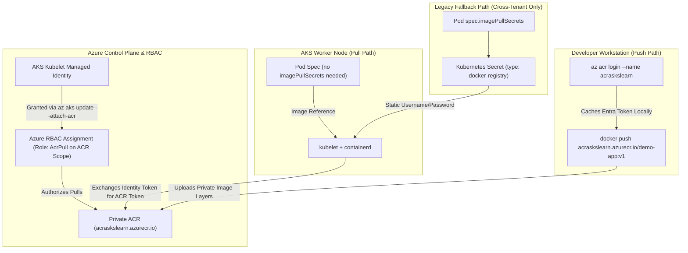
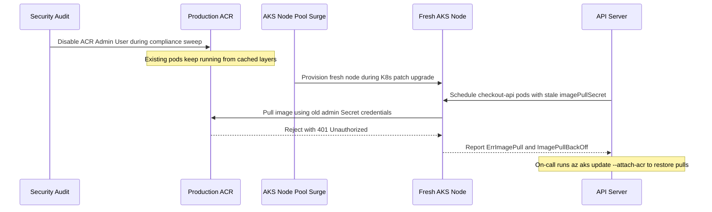

# ACR Integration with AKS

> **Prerequisites:** Completed Module 02 with a running `aks-learn` cluster context, local Docker CLI installed, and `az` CLI authenticated with `Owner` or `User Access Administrator` + `Contributor` permissions to create registries and Azure RBAC role assignments.  
> **Estimated Reading Time:** 35 minutes  
> **Target Audience:** Backend Engineers, DevOps Engineers, Cloud Platform Engineers.

> [!TIP]
> **The Golden Rule of AKS-to-ACR Authentication:** Always bind your Azure Container Registry to AKS using Managed Identity (`az aks update --attach-acr`) rather than enabling the ACR admin account or distributing static `imagePullSecrets`—`az acr login` only authenticates your local Docker CLI for *pushing*, whereas node kubelets require an `AcrPull` Azure RBAC assignment on the cluster's kubelet identity to *pull* private images.

---

## Why This Matters

You already build images and push them to Azure Container Registry (ACR) from the Docker track. Now AKS needs to **pull** those private images to run them as Pods. Getting authentication wrong here is one of the most frequent real-world AKS failures (`ImagePullBackOff`), so this module establishes the managed-identity approach first and explains the legacy `imagePullSecrets` fallback second.

---

## 1. Architectural Mental Model: Local Push Auth vs. Kubelet Managed-Identity Pull

A very common mental error is assuming `az acr login` on your laptop authorizes your cluster. In reality, pushing from your workstation and pulling from AKS worker nodes travel along two completely independent identity paths:



### Core Concepts

#### Why a Private Registry Needs Authentication for Pulls
A public registry like Docker Hub's public library requires no authentication; your own ACR registry is private by default. Every node's kubelet needs *some* credential to pull from it, or every Pod referencing your private image sits in `ImagePullBackOff`.

#### The Modern Way: `az aks update --attach-acr`
AKS clusters run with managed identities (Microsoft Entra ID identities whose credentials Azure rotates automatically, with no secrets for you to store). Attaching an ACR to a cluster grants the cluster's **kubelet managed identity** the `AcrPull` role scoped specifically to that registry — pull-only access, no `imagePullSecrets`, no credential to expire, and no per-namespace YAML to maintain. Because Azure RBAC propagation is eventually consistent, newly created role assignments typically take 30 to 90 seconds to propagate across Entra ID and node token caches. This is the recommended approach whenever the ACR and AKS cluster live under role-assignment permissions you control (almost always true for a single subscription you own).

#### The Fallback: Kubernetes `imagePullSecrets`
Before managed-identity attachment existed (and still today for cross-tenant or cross-subscription setups where you cannot or do not want to grant a role assignment), you authenticate the legacy way: create a `kubernetes.io/dockerconfigjson` (`docker-registry`) Secret holding registry credentials, and reference it in a Pod or Deployment template's `spec.imagePullSecrets`. This works everywhere, but creates a credential that can expire or leak and must be kept synchronized in every namespace.

#### What AKS Manages vs. What You Own Here
- **Azure Manages:** Attaching ACR is a one-time role assignment Azure manages afterward (token exchange, automatic rotation, propagation across all existing and future nodes)—you never edit node-level containerd or Docker credential files yourself.
- **You Own:** Granting `--attach-acr` (or detaching stale registries), verifying pull errors via `kubectl describe pod`, and—if you ever use the `imagePullSecrets` fallback—owning the secret's creation, per-namespace distribution, rotation, and disabling temporary admin accounts immediately afterward.

---

## 2. Taxonomic Comparison & Command Reference

### ACR Authentication Strategies Compared

| Dimension | `az aks update --attach-acr` (Managed Identity) | Kubernetes `imagePullSecrets` (Service Principal / Token) | ACR Admin User (`--admin-enabled true`) |
| :--- | :--- | :--- | :--- |
| **Underlying Identity** | AKS Kubelet Managed Identity (`AcrPull`) | Scoped ACR Token or Entra Service Principal in K8s Secret | Single shared registry-wide admin username + 2 passwords |
| **Static Credentials Stored?** | None | Yes (stored base64-encoded in etcd Secret) | Yes (shared full push/pull credential) |
| **Namespace Scope** | Cluster-wide across all namespaces transparently | Must be duplicated into every namespace | Depends on where Secret is copied |
| **Credential Rotation** | Automatic (managed by Azure) | Manual or external secrets operator required | Manual regeneration breaks all stale secrets |
| **Cross-Tenant Support** | No (same Entra tenant) | Yes | Yes |
| **Production Recommendation** | **Default choice** for single-tenant AKS + ACR | Acceptable **only** for cross-tenant / external CI registries | **Prohibited** outside brief isolated troubleshooting |

### Diagnosing Container Image Pull Errors (`kubectl describe pod`)

| Event Error Message | HTTP / Registry Status | Root Cause | Immediate Fix |
| :--- | :--- | :--- | :--- |
| `unauthorized: authentication required` | `401 Unauthorized` | Missing `AcrPull` RBAC role or missing/invalid `imagePullSecret` | Run `az aks update --attach-acr` and verify `az role assignment list` |
| `manifest unknown` / `not found` | `404 Not Found` | Typo in repository name or image tag never pushed | Run `az acr repository show-tags` and fix `image:` tag |
| `pull access denied` / `forbidden` | `403 Forbidden` | Firewall/private link on ACR blocking AKS outbound egress or wrong role scope | Check ACR networking rules & RBAC scope |
| `dial tcp: lookup ... no such host` | DNS Failure | Wrong registry suffix (e.g. `.azurecr.com` instead of `.azurecr.io`) | Correct `loginServer` hostname to `*.azurecr.io` |

### Command Reference & Flag Breakdown

| Command | What it does | Example |
| :--- | :--- | :--- |
| `az acr create` | Creates a new Azure Container Registry | `az acr create --resource-group rg-aks-learn --name acraskslearn --sku Basic` |
| `az acr list` | Lists ACR registries in the subscription | `az acr list --output table` |
| `az acr login` | Authenticates your local Docker CLI to an ACR (for pushing) | `az acr login --name acraskslearn` |
| `docker tag` / `docker push` | Tags and pushes a local image to ACR | `docker push acraskslearn.azurecr.io/demo-app:v1` |
| `az aks update --attach-acr` | Grants an existing AKS cluster's managed identity `AcrPull` on an ACR registry | `az aks update --resource-group rg-aks-learn --name aks-learn --attach-acr acraskslearn` |
| `az aks update --detach-acr` | Revokes that role assignment | `az aks update --resource-group rg-aks-learn --name aks-learn --detach-acr acraskslearn` |
| `az role assignment list` | Lists Azure role assignments, useful to confirm `AcrPull` exists | `az role assignment list --scope $(az acr show --name acraskslearn --query id -o tsv) --output table` |
| `kubectl create secret docker-registry` | Creates a Kubernetes Secret holding registry credentials (fallback method) | `kubectl create secret docker-registry acr-secret --docker-server=acraskslearn.azurecr.io --docker-username=<user> --docker-password=<pass>` |
| `az acr credential show` | Shows the admin username/password for an ACR (must have admin user enabled) | `az acr credential show --name acraskslearn` |
| `kubectl describe pod` | Shows pull errors in the `Events` section | `kubectl describe pod <name>` |

#### Key Flag Breakdown
- **`--sku Basic`**: Cost-effective registry tier for learning and small dev workloads (vs. `Standard`/`Premium` for geo-replication and Private Link).
- **`--attach-acr <acr-name-or-resource-id>`**: Automatically looks up your AKS kubelet identity and creates the `AcrPull` assignment at the registry's ARM resource ID scope.
- **`--scope $(az acr show ... --query id -o tsv)`**: Scopes RBAC queries strictly to that registry so inherited subscription roles don't clutter the output.
- **`--admin-enabled false`**: Disables the shared registry admin login so static registry-wide passwords cannot be extracted or abused.

---

## 3. Production War Story Post-Mortem: Rotated ACR Admin Password & Stale `imagePullSecrets` Outage

- **Severity:** SEV-1 (Checkout Service Capacity Collapse During Node Upgrade)
- **Detection Time:** 6 minutes after node pool rolling surge began
- **Resolution Time:** 32 minutes
- **Impact:** 100% of newly scheduled pods across 4 production namespaces entered `ImagePullBackOff`, cutting API capacity by 60% under peak traffic.

### What Happened

Months earlier, a team configured deployments using `kubectl create secret docker-registry` populated from the ACR admin user's password. Because existing nodes already cached image layers locally and existing pods stayed running, everything looked stable. During a quarterly security compliance audit, a cloud security engineer noticed `--admin-enabled true` on the ACR and regenerated/disabled the admin credentials. Two weeks later, an automated Kubernetes patch upgrade drained nodes one by one; every freshly provisioned node had an empty containerd image cache and tried pulling from ACR using the invalidated `imagePullSecret`, immediately failing with `401 Unauthorized`.



### Root Cause Analysis
1. **Shared Admin Account Coupling:** Relying on static `imagePullSecrets` coupled cluster availability to an unrotated shared credential.
2. **Cached Image Illusion:** Disabling the admin account appeared harmless for days until new nodes or new image tags triggered actual registry pulls.
3. **Cross-Namespace Secret Drift:** Even after fixing one namespace, three others still held dead `acr-secret` manifests.

### The Fix & Architectural Hardening
1. Ran `az aks update --resource-group rg-prod --name aks-prod --attach-acr acrprod` to assign `AcrPull` to the cluster's kubelet managed identity.
2. Removed `imagePullSecrets` from all Helm charts/Deployment templates and deleted legacy `docker-registry` secrets across namespaces.
3. Verified `--admin-enabled false` stays enforced via Azure Policy and added CI pre-flight checks verifying `AcrPull` role assignments directly.

---

## 4. Multi-Language Production Implementation

These production verification scripts validate ACR RBAC attachment (`AcrPull`), detect legacy `imagePullSecrets`, and classify `ImagePullBackOff` events across Go, TypeScript, Python, and C#.

````carousel
### Go (`azure-sdk-for-go`): Verify AKS Kubelet Identity Holds `AcrPull` on ACR

```go
package main

import (
	"context"
	"fmt"
	"log"
	"os"
	"strings"
	"time"

	"github.com/Azure/azure-sdk-for-go/sdk/azidentity"
	"github.com/Azure/azure-sdk-for-go/sdk/resourcemanager/authorization/armauthorization/v2"
	"github.com/Azure/azure-sdk-for-go/sdk/resourcemanager/containerregistry/armcontainerregistry"
	"github.com/Azure/azure-sdk-for-go/sdk/resourcemanager/containerservice/armcontainerservice/v4"
)

// Built-in Azure RBAC role ID for AcrPull
const acrPullRoleDefSuffix = "/providers/Microsoft.Authorization/roleDefinitions/7f951dda-4ed3-4680-a7ca-43fe172d538d"

func main() {
	subID := os.Getenv("AZURE_SUBSCRIPTION_ID")
	rg := "rg-aks-learn"
	aksName := "aks-learn"
	acrName := "acraskslearn"

	ctx, cancel := context.WithTimeout(context.Background(), 30*time.Second)
	defer cancel()

	cred, err := azidentity.NewDefaultAzureCredential(nil)
	if err != nil {
		log.Fatalf("azure credential: %v", err)
	}

	aksClient, err := armcontainerservice.NewManagedClustersClient(subID, cred, nil)
	if err != nil {
		log.Fatalf("aks client: %v", err)
	}
	cluster, err := aksClient.Get(ctx, rg, aksName, nil)
	if err != nil {
		log.Fatalf("get cluster: %v", err)
	}

	kubeletProfile := cluster.Properties.IdentityProfile["kubeletidentity"]
	if kubeletProfile == nil || kubeletProfile.ObjectID == nil {
		log.Fatal("kubelet identity objectId not found on AKS cluster")
	}
	kubeletObjID := *kubeletProfile.ObjectID

	acrClient, err := armcontainerregistry.NewRegistriesClient(subID, cred, nil)
	if err != nil {
		log.Fatalf("acr client: %v", err)
	}
	acr, err := acrClient.Get(ctx, rg, acrName, nil)
	if err != nil {
		log.Fatalf("get acr: %v", err)
	}

	authClient, err := armauthorization.NewRoleAssignmentsClient(subID, cred, nil)
	if err != nil {
		log.Fatalf("role assignments client: %v", err)
	}

	pager := authClient.NewListForScopePager(*acr.ID, nil)
	found := false
	for pager.More() {
		page, err := pager.NextPage(ctx)
		if err != nil {
			log.Fatalf("list role assignments: %v", err)
		}
		for _, ra := range page.Value {
			if ra.Properties != nil &&
				ra.Properties.PrincipalID != nil &&
				strings.EqualFold(*ra.Properties.PrincipalID, kubeletObjID) &&
				ra.Properties.RoleDefinitionID != nil &&
				strings.HasSuffix(strings.ToLower(*ra.Properties.RoleDefinitionID), strings.ToLower(acrPullRoleDefSuffix)) {
				found = true
			}
		}
	}

	if !found {
		log.Fatalf("MISSING AcrPull assignment for kubelet identity %s on %s", kubeletObjID, *acr.ID)
	}
	fmt.Printf("VERIFIED: AKS kubelet identity %s has AcrPull on %s (AdminUserEnabled=%v)\n",
		kubeletObjID, acrName, *acr.Properties.AdminUserEnabled)
}
```
<!-- slide -->
### TypeScript (`@kubernetes/client-node`): Audit Pull Failures & Legacy `imagePullSecrets`

```typescript
import * as k8s from "@kubernetes/client-node";

async function auditRegistryPullHealth(namespace: string): Promise<void> {
  const kc = new k8s.KubeConfig();
  kc.loadFromDefault();
  const coreApi = kc.makeApiClient(k8s.CoreV1Api);

  const pods = await coreApi.listNamespacedPod({ namespace });
  const events = await coreApi.listNamespacedEvent({ namespace });

  let pullFailures = 0;
  let legacySecretsUsed = 0;

  for (const pod of pods.items) {
    const podName = pod.metadata?.name ?? "unknown";
    const secrets = pod.spec?.imagePullSecrets ?? [];
    if (secrets.length > 0) {
      legacySecretsUsed++;
      console.warn(
        `[AUDIT] Pod ${podName} uses legacy imagePullSecrets (${secrets.map((s) => s.name).join(", ")}); prefer az aks update --attach-acr.`
      );
    }

    for (const cs of pod.status?.containerStatuses ?? []) {
      const reason = cs.state?.waiting?.reason;
      if (reason === "ImagePullBackOff" || reason === "ErrImagePull") {
        pullFailures++;
        const podEvents = events.items
          .filter((e) => e.involvedObject?.name === podName && e.reason === "Failed")
          .map((e) => e.message ?? "");
        const lastMsg = podEvents[podEvents.length - 1] ?? cs.state?.waiting?.message ?? "";
        const category = lastMsg.includes("401") || lastMsg.includes("unauthorized")
          ? "MISSING_AUTH (check AcrPull role)"
          : lastMsg.includes("manifest unknown") || lastMsg.includes("not found")
            ? "BAD_TAG_OR_IMAGE"
            : "OTHER_PULL_ERROR";

        console.error(`[${reason}] ${podName} -> ${category}: ${lastMsg}`);
      }
    }
  }

  console.log(`Summary for namespace '${namespace}': pullFailures=${pullFailures}, legacyImagePullSecrets=${legacySecretsUsed}`);
  if (pullFailures > 0) process.exit(1);
}

auditRegistryPullHealth("demo").catch((err) => {
  console.error(err);
  process.exit(1);
});
```
<!-- slide -->
### Python (`azure-mgmt-containerregistry` + `azure-mgmt-authorization`): ACR Hardening Gate

```python
import os
import sys
from azure.identity import DefaultAzureCredential
from azure.mgmt.authorization import AuthorizationManagementClient
from azure.mgmt.containerregistry import ContainerRegistryManagementClient
from azure.mgmt.containerservice import ContainerServiceClient

ACR_PULL_ROLE_ID = "7f951dda-4ed3-4680-a7ca-43fe172d538d"


def verify_acr_aks_integration(sub_id: str, rg: str, aks_name: str, acr_name: str) -> int:
    cred = DefaultAzureCredential()
    acr_client = ContainerRegistryManagementClient(cred, sub_id)
    aks_client = ContainerServiceClient(cred, sub_id)
    auth_client = AuthorizationManagementClient(cred, sub_id)

    registry = acr_client.registries.get(rg, acr_name)
    if registry.admin_user_enabled:
        print(f"WARN: ACR '{acr_name}' has admin_user_enabled=True. Disable after fallback demos.")

    cluster = aks_client.managed_clusters.get(rg, aks_name)
    kubelet_id = cluster.identity_profile["kubeletidentity"].object_id

    assignments = auth_client.role_assignments.list_for_scope(registry.id)
    has_acr_pull = any(
        a.principal_id.lower() == kubelet_id.lower()
        and a.role_definition_id.lower().endswith(ACR_PULL_ROLE_ID)
        for a in assignments
    )

    if not has_acr_pull:
        print(f"FAIL: Kubelet identity {kubelet_id} lacks AcrPull on {acr_name}.", file=sys.stderr)
        print(f"Run: az aks update -g {rg} -n {aks_name} --attach-acr {acr_name}", file=sys.stderr)
        return 1

    print(f"PASS: {aks_name} ({kubelet_id}) holds AcrPull on {registry.login_server}.")
    return 0


if __name__ == "__main__":
    subscription = os.environ["AZURE_SUBSCRIPTION_ID"]
    sys.exit(verify_acr_aks_integration(subscription, "rg-aks-learn", "aks-learn", "acraskslearn"))
```
<!-- slide -->
### C# (`Azure.ResourceManager`): Automated `--attach-acr` Compliance Check

```csharp
using System;
using System.Linq;
using System.Threading.Tasks;
using Azure.Identity;
using Azure.ResourceManager;
using Azure.ResourceManager.Authorization;
using Azure.ResourceManager.ContainerRegistry;
using Azure.ResourceManager.ContainerService;

public static class AcrIntegrationVerifier
{
    private const string AcrPullRoleGuid = "7f951dda-4ed3-4680-a7ca-43fe172d538d";

    public static async Task<int> Main()
    {
        var armClient = new ArmClient(new DefaultAzureCredential());
        var subscription = await armClient.GetDefaultSubscriptionAsync();
        var rg = await subscription.GetResourceGroupAsync("rg-aks-learn");

        ContainerServiceManagedClusterResource aks = await rg.Value.GetContainerServiceManagedClusterAsync("aks-learn");
        ContainerRegistryResource acr = await rg.Value.GetContainerRegistryAsync("acraskslearn");

        var kubeletPrincipalId = aks.Data.IdentityProfile["kubeletidentity"].ObjectId;
        bool adminEnabled = acr.Data.IsAdminUserEnabled ?? false;

        bool attached = false;
        await foreach (var ra in armClient.GetRoleAssignments(acr.Id).GetAllAsync())
        {
            if (ra.Data.PrincipalId == kubeletPrincipalId &&
                ra.Data.RoleDefinitionId.ToString().EndsWith(AcrPullRoleGuid, StringComparison.OrdinalIgnoreCase))
            {
                attached = true;
                break;
            }
        }

        Console.WriteLine($"ACR Login Server: {acr.Data.LoginServer} | AdminEnabled: {adminEnabled}");
        Console.WriteLine(attached
            ? $"OK: Kubelet identity {kubeletPrincipalId} holds AcrPull."
            : $"ERROR: Missing AcrPull for {kubeletPrincipalId}. Attach ACR via az aks update --attach-acr.");

        return attached && !adminEnabled ? 0 : 1;
    }
}
```
````

---

## 5. Practical Hands-On Verification CLI Workflows

Follow all 8 hands-on exercises below to observe both a real `ImagePullBackOff` failure and its resolution via `--attach-acr`, plus the `imagePullSecrets` comparison.

### Step 1: Create an ACR Registry

Registry names must be globally unique across Azure (`acraskslearn` below is an example—substitute a unique suffix if taken; skip if reusing a registry from the Docker track):

```bash
az acr create --resource-group rg-aks-learn --name acraskslearn --sku Basic
az acr list --output table
```

**Expected Output:**
```text
NAME          RESOURCE GROUP   LOCATION    SKU    LOGIN SERVER              CREATION DATE
------------  ----------------  ----------  -----  ------------------------  --------------------
acraskslearn  rg-aks-learn     eastus      Basic  acraskslearn.azurecr.io   2026-11-11T03:55:00Z
```

### Step 2: Build and Push an Image to ACR

Using an app from earlier tracks (or a one-line `Dockerfile` wrapping `nginx:1.27-alpine`), build, log in, tag, and push:

```bash
printf 'FROM nginx:1.27-alpine\nRUN echo "hello from acr" > /usr/share/nginx/html/index.html\n' > Dockerfile
docker build -t demo-app:latest .
az acr login --name acraskslearn
docker tag demo-app:latest acraskslearn.azurecr.io/demo-app:v1
docker push acraskslearn.azurecr.io/demo-app:v1
az acr repository list --name acraskslearn --output table
```

**Expected Output:**
```text
Login Succeeded
...
v1: digest: sha256:9c8a... size: 1362
Result
--------
demo-app
```

### Step 3: Deliberately Deploy to AKS *Before* Attaching ACR

Save `acr-deployment.yaml`:

```yaml
apiVersion: apps/v1
kind: Deployment
metadata:
  name: acr-demo
spec:
  replicas: 1
  selector:
    matchLabels:
      app: acr-demo
  template:
    metadata:
      labels:
        app: acr-demo
    spec:
      containers:
        - name: web
          image: acraskslearn.azurecr.io/demo-app:v1
          ports:
            - containerPort: 80
          resources:
            requests:
              cpu: "100m"
              memory: "64Mi"
```

Apply and verify the failure:

```bash
kubectl apply -f acr-deployment.yaml
kubectl get pods
```

**Expected Output:**
```text
NAME                        READY   STATUS             RESTARTS   AGE
acr-demo-6b8d9f7c54-kp2vm   0/1     ImagePullBackOff   0          35s
```

### Step 4: Diagnose `ImagePullBackOff` Properly (Pod Events + Azure RBAC)

```bash
POD_NAME=$(kubectl get pods -l app=acr-demo -o jsonpath="{.items[0].metadata.name}")
kubectl describe pod "$POD_NAME"
az role assignment list --scope $(az acr show --name acraskslearn --query id -o tsv) --output table
```

**Expected Output:**
```text
Events:
  Type     Reason     Age               From               Message
  ----     ------     ----              ----               -------
  Normal   Scheduled  42s               default-scheduler  Successfully assigned demo/acr-demo-6b8d9f7c54-kp2vm to aks-nodepool1-12345678-vmss000000
  Normal   Pulling    16s (x2 over 41s) kubelet            Pulling image "acraskslearn.azurecr.io/demo-app:v1"
  Warning  Failed     15s (x2 over 40s) kubelet            Failed to pull image "acraskslearn.azurecr.io/demo-app:v1": failed to pull and unpack image ... unauthorized: authentication required
  Warning  Failed     15s (x2 over 40s) kubelet            Error: ErrImagePull
  Normal   BackOff    3s (x2 over 39s)  kubelet            Back-off pulling image "acraskslearn.azurecr.io/demo-app:v1"
```

And `az role assignment list` is empty (or has no `AcrPull` entry for your cluster's kubelet identity).

### Step 5: Fix It with `az aks update --attach-acr`

```bash
az aks update --resource-group rg-aks-learn --name aks-learn --attach-acr acraskslearn
az role assignment list --scope $(az acr show --name acraskslearn --query id -o tsv) --output table
```

RBAC propagation can take up to a minute. Force an immediate fresh pull by deleting the failed pod so the Deployment recreates it, then confirm `Running`:

```bash
kubectl delete pod "$POD_NAME"
kubectl get pods -l app=acr-demo -w
```

**Expected Output:**
```text
Principal                             Role     Scope
------------------------------------  -------  -----------------------------------------------------------------------
aks-learn-agentpool                   AcrPull  /subscriptions/.../resourceGroups/rg-aks-learn/providers/Microsoft.ContainerRegistry/registries/acraskslearn

NAME                        READY   STATUS    RESTARTS   AGE
acr-demo-6b8d9f7c54-v8m2x   1/1     Running   0          12s
```

### Step 6: Try the Fallback Method (`imagePullSecrets`) for Comparison

Enable the ACR admin user temporarily to obtain credentials for comparison, create the Kubernetes secret, deploy a separate fallback Deployment, and then immediately disable the admin user again:

```bash
az acr update --name acraskslearn --admin-enabled true
az acr credential show --name acraskslearn
```

Create the `docker-registry` secret:

```bash
kubectl create secret docker-registry acr-secret \
  --docker-server=acraskslearn.azurecr.io \
  --docker-username=<username-from-credential-show> \
  --docker-password=<password-from-credential-show>
```

Deploy `acr-fallback-deployment.yaml` (keeping your `--attach-acr` Deployment running):

```yaml
apiVersion: apps/v1
kind: Deployment
metadata:
  name: acr-demo-fallback
spec:
  replicas: 1
  selector:
    matchLabels:
      app: acr-demo-fallback
  template:
    metadata:
      labels:
        app: acr-demo-fallback
    spec:
      imagePullSecrets:
        - name: acr-secret
      containers:
        - name: web
          image: acraskslearn.azurecr.io/demo-app:v1
          ports:
            - containerPort: 80
```

```bash
kubectl apply -f acr-fallback-deployment.yaml
kubectl get pods
az acr update --name acraskslearn --admin-enabled false
```

> Disabling the admin account right after the demo eliminates the shared credential exposure—while your `--attach-acr` Deployment never needed it at all.

### Step 7: Confirm Which Pods Use Which Authentication Method

```bash
kubectl get pods -o yaml | grep -A2 imagePullSecrets
```

**Expected Output:**
```text
    imagePullSecrets:
    - name: acr-secret
```

Only `acr-demo-fallback`'s pod references a secret; `acr-demo`'s pod has no `imagePullSecrets` field at all because authentication happens transparently via the cluster's managed identity at the node/kubelet level.

### Step 8: Clean Up

```bash
kubectl delete deployment acr-demo-fallback
kubectl delete secret acr-secret
```

Leave the `--attach-acr`-based `acr-demo` Deployment if continuing to Module 04, or clean up the namespace (`kubectl delete namespace demo`). Basic-tier ACR registries are inexpensive but not free—if you no longer need the registry after this track, remove it with:

```bash
az acr delete --name acraskslearn --resource-group rg-aks-learn --yes
# Or later delete the whole resource group:
# az group delete --name rg-aks-learn --yes --no-wait
```

---

### Independent Challenge

No commands given here — figure it out yourself using what you know from this module and earlier ones.

**Task:** Prove to yourself that you can turn an `ImagePullBackOff` into a running pod using only the managed-identity path, and that you understand exactly which grant fixed it. Build and push a trivial private image to an ACR, then deploy it to your cluster (reusing the namespace-and-Deployment workflow from Module 02, conceptually building on that module) so that it fails to pull — and confirm from the pod's own events that the failure is an authentication one, not a missing-image typo. Then make the cluster able to pull it without creating any Kubernetes secret, and independently verify at the Azure level that the specific role you granted now exists on the registry. As a final check, reason about why none of your pods reference an `imagePullSecrets` field even though the pull now works. Clean up the test Deployment when done, and remember the ACR and cluster both keep billing until you remove them.

<details>
<summary>Stuck? One hint</summary>

The managed-identity grant is a single `az aks update` flag that adds an `AcrPull` role assignment; you can confirm that assignment landed by listing role assignments scoped to the registry's resource ID.

</details>

---

## 6. Common Mistakes & Troubleshooting

- **Confusing `az acr login` (your local Docker CLI's auth, for pushing) with cluster-to-registry auth (for pulling).** They are unrelated — logging in locally does nothing for the cluster's ability to pull.
- **Attaching the wrong ACR or forgetting the registry name is globally unique.** `az acr create` fails immediately if the name is taken; double-check `az acr list` output before assuming attachment failed for a permissions reason instead.
- **Not waiting for propagation.** `--attach-acr` role assignment can take up to a minute or so to be usable; if a pod created *immediately* after still fails, wait and retry (`kubectl delete pod` to force a fresh pull attempt) before assuming the attach did not work.
- **Leaving the ACR admin user enabled after a fallback-secret demo.** The admin account is a single shared credential with full pull/push rights — leaving it on is a standing security exposure with no corresponding benefit once you have moved to managed-identity auth.
- **Cost pitfall: creating multiple ACR registries "just to try things" and forgetting about them.** Even Basic-tier ACR has a small ongoing cost plus storage cost per image layer. Reuse one registry per track rather than creating a new one per exercise, and delete ones you are not using.

---

## 7. Operational Validation Checkpoints

<details>
<summary><strong>Checkpoint 1: You ran <code>az acr login --name acraskslearn</code> and <code>docker push</code> succeeded, yet AKS pods show <code>ImagePullBackOff</code>. What failed?</strong></summary>

`az acr login` only caches credentials for your local Docker daemon to push images. AKS nodes pull images using the cluster's kubelet managed identity, which still lacks the `AcrPull` RBAC role on `acraskslearn` until you run `az aks update -g rg-aks-learn -n aks-learn --attach-acr acraskslearn`.

</details>

<details>
<summary><strong>Checkpoint 2: Two pods report <code>ErrImagePull</code>. Pod A shows <code>401 unauthorized: authentication required</code>, while Pod B shows <code>manifest unknown</code>. Which one is an ACR attachment issue?</strong></summary>

Pod A (`401 unauthorized`) indicates missing `AcrPull` authorization or bad pull credentials. Pod B (`manifest unknown`) means authentication succeeded against ACR, but the specific repository name or image tag in the Deployment manifest does not exist in the registry.

</details>

<details>
<summary><strong>Checkpoint 3: You attached ACR via <code>--attach-acr</code>, deployed into namespace <code>payments</code>, and <code>kubectl get pods</code> shows <code>Running</code>, yet <code>spec.imagePullSecrets</code> is empty. Is this misconfigured?</strong></summary>

No—that is the exact intended design of managed-identity ACR integration. Node-level kubelet/containerd fetches an Entra ID token using the cluster's `kubeletidentity` (`AcrPull` role) automatically across all namespaces without needing any `imagePullSecrets` in pod YAML.

</details>

---

## 8. Checkpoint Quiz

Write down your answer to each question before expanding it — checking without attempting first is the single easiest way to fool yourself into thinking you've learned this.

1. Why does a private ACR registry need explicit authentication for AKS to pull from it, unlike a public registry?
2. What role does `az aks update --attach-acr` actually grant, and to whom?
3. What's the concrete symptom in `kubectl describe pod` output when a pull fails due to missing authentication, versus a pull failure from a typo'd image name?
4. Why is `--attach-acr` preferred over `imagePullSecrets` when both the ACR and AKS cluster are in a subscription you control?
5. When might you still need `imagePullSecrets` instead of `--attach-acr`?
6. What Kubernetes Secret type does `kubectl create secret docker-registry` produce, and where does a Pod reference it?

<details>
<summary>Show answers</summary>

1. Because ACR registries are private by default — pulling requires a credential of some kind, whereas a public registry allows anonymous pulls.
2. It grants the AKS cluster's managed identity the `AcrPull` role, scoped to that specific ACR registry — pull-only access, nothing else.
3. Missing authentication shows an `Events` message like `unauthorized: authentication required` / `401 Unauthorized`; a typo'd image name or tag typically shows a `manifest unknown` / `not found` style error instead — both surface as `ImagePullBackOff`/`ErrImagePull` states, but the underlying message differs.
4. Because it needs no stored credential, nothing to rotate or leak, and is managed automatically by Azure via the role assignment — strictly less operational burden for the common single-subscription case.
5. When the ACR and AKS cluster live in different tenants/subscriptions where you can't or don't want to grant a cross-boundary role assignment, or in automation contexts that specifically require an explicit credential.
6. `docker-registry` type Secret; a Pod (or its Deployment's pod template) references it via `spec.imagePullSecrets: [{name: <secret-name>}]`.

</details>

---

## 9. Cumulative Review

Closed-book. Don't reopen earlier modules while attempting these — the point is to find out what actually stuck.

1. You run `kubectl get pods` and see one pod `Pending` and another in `ImagePullBackOff`. Explain what each state means, which module's material each traces back to, and why the very first command you run to diagnose both is the same one.
2. Trace the full billing story of a single learning cluster from nothing: which `az` command first creates something billable, which resource groups end up existing (name the second, AKS-managed one), and which single command tears down the cluster, its nodes, and an attached ACR all at once.
3. You created a resource group, a cluster, and an ACR, but a teammate says your pods "obviously can't pull the image." Without looking at any pod yet, what one Azure-level thing would you check to confirm or rule out their claim, and what role name are you looking for?
4. Why does a Deployment that ran fine on kind fail to fully schedule on your two-node `Standard_B2s` cluster, and how does that same node-capacity reality connect to why you keep the cluster small in the first place (cost)?
5. Distinguish `az acr login` from `az aks update --attach-acr`: which one affects your ability to *push* an image, which affects the *cluster's* ability to *pull* it, and why does succeeding at one tell you nothing about the other?
6. You have both a local kind context and your `aks-learn` context in the same kubeconfig. Give the command to confirm which one is active, and explain why this habit matters more now than it did in the pure-local Kubernetes track.
7. An empty resource group, a stopped cluster (`az aks stop`), and a deleted resource group (`az group delete`) each have different cost and recoverability implications. Rank them from "cheapest but gone" to "still there and may still bill," and say which you'd pick between study sessions.
8. Put these in the correct order for going from zero to a running private image on AKS, and name the module each step comes from: attach ACR to the cluster; create the cluster; push the image to ACR; create the resource group; `kubectl apply` the Deployment; `az aks get-credentials`.
9. The managed-identity ACR pull and the fallback `imagePullSecrets` approach both make a private pull work. For a single subscription you own, why is the managed-identity path preferred, and what lingering security exposure does the fallback demo tell you to switch back off afterward?
10. If you switched to the wrong Azure subscription midway through these modules and re-ran `az group list`, why might your cluster's resource group appear to have "vanished," and what single command reorients you before you panic?

<details>
<summary>Show answers</summary>

1. `Pending` (Module 02) means the pod hasn't been scheduled to any node — usually insufficient CPU/memory on your small nodes. `ImagePullBackOff` (Module 03) means it *was* scheduled but the node's kubelet can't pull the image, commonly a missing `AcrPull` authorization. Both are diagnosed first with `kubectl describe pod <name>`, whose Events section states the specific cause in either case.
2. The first billable thing is `az aks create` (Module 01) — an empty resource group from `az group create` (Module 00) costs nothing. You end up with your named group (e.g. `rg-aks-learn`) plus the AKS-managed `MC_<rg>_<cluster>_<region>` group holding the node VMs, disks, NICs, and load balancers. `az group delete` on your named group removes the cluster, the `MC_*` group, and an ACR that lives in that group, all at once.
3. List the role assignments scoped to the ACR's resource ID (`az role assignment list --scope <acr-id>`) and look for an `AcrPull` assignment tied to the cluster's managed identity. Its absence confirms the cluster can't pull; its presence rules the teammate's claim out.
4. On kind the pod effectively shared a whole laptop's resources; on a two-node `Standard_B2s` cluster each node is a small VM with a hard, partly-reserved CPU/memory ceiling, so requests may not fit and pods go `Pending`. You keep the cluster small precisely because those nodes are ordinary billable VMs — the same limited capacity that constrains scheduling is what keeps the bill down.
5. `az acr login` authenticates your *local* Docker CLI so you can push images; `az aks update --attach-acr` grants the *cluster's* identity `AcrPull` so nodes can pull. They target different identities and different operations (push vs. pull), so a successful local login says nothing about whether the cluster can pull, and vice versa.
6. `kubectl config current-context` (or `kubectl config get-contexts`). It matters more now because one of those contexts points at real, billable Azure infrastructure — running a destructive or costly command against the wrong one has real consequences a disposable local cluster didn't.
7. Cheapest but gone: `az group delete` (nothing left, not recoverable — recreate from scratch). Middle: `az aks stop` (cluster still exists and restartable, node-VM billing paused, but some attached resources like disks/IPs may still bill). Still there and still billing: an idle running cluster; an *empty* resource group is the only truly free "still there" state. Between sessions, `az aks stop` is the usual pick.
8. Create the resource group (00) -> create the cluster (01) -> `az aks get-credentials` (01) -> push the image to ACR (03) -> attach ACR to the cluster (03) -> `kubectl apply` the Deployment (02/03). (Pushing the image and attaching ACR can be done in either order relative to each other, but both precede a successful pull.)
9. Managed identity needs no stored credential — nothing to rotate, leak, or keep in sync per-namespace — and Azure manages it automatically, so it's strictly less operational burden for a subscription you own. The fallback demo requires temporarily enabling the ACR admin user, a single shared full-access credential, which you must switch back off afterward to avoid a standing security exposure.
10. Resource groups are scoped to a subscription, so listing groups while pointed at a *different* subscription simply won't show the one your cluster lives in — it isn't gone, you're looking in the wrong place. `az account show` tells you which subscription is active so you can switch back with `az account set`.

</details>

---

## Next

[04-aks-networking-loadbalancer-and-ingress](../04-aks-networking-loadbalancer-and-ingress/README.md) — expose your workloads to the internet with real public IPs and Ingress.
