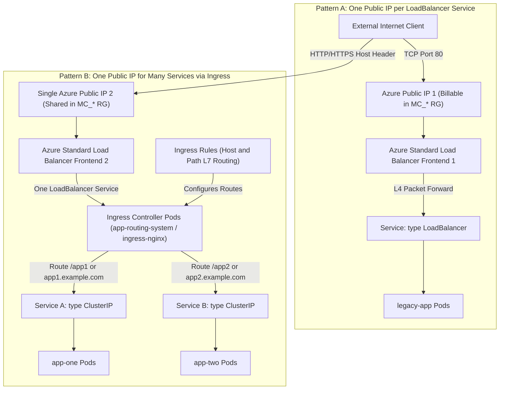
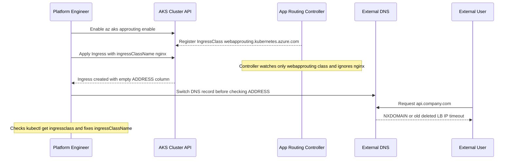

# AKS Networking: LoadBalancer and Ingress

> **Prerequisites:** Completed Module 03 with an active `aks-learn` cluster context, `kubectl` and `az` CLI configured, and optionally `helm` if comparing self-managed `ingress-nginx` against the AKS App Routing add-on.  
> **Estimated Reading Time:** 40 minutes  
> **Target Audience:** Backend Engineers, DevOps Engineers, Cloud Network Engineers.

> [!TIP]
> **The Golden Rule of AKS Ingress Economics:** Every Kubernetes `Service` with `type: LoadBalancer` provisions a real, billable Azure Public IP and Load Balancer frontend inside the `MC_*` node resource group—prefer a single Ingress Controller (`az aks approuting enable` or `ingress-nginx`) fronting multiple `ClusterIP` Services, and routinely audit `kubectl get service --all-namespaces` alongside `az network public-ip list` before ending a session.

---

## Why This Matters

Locally, `kind` and `minikube` simulated `LoadBalancer` Services (or forced you into `kubectl port-forward` / `NodePort` workarounds), and any Ingress controller you installed had no real public IP behind it. On AKS, a `LoadBalancer` Service actually provisions an **Azure Load Balancer and a public IP address** — real, billable cloud infrastructure — while Ingress gives you a single shared entry point without paying for one public IP per Service. Understanding what is real Azure infrastructure versus what is "just YAML" matters both for your monthly bill and for fast incident debugging.

---

## 1. Architectural Mental Model: L4 Cloud Load Balancer vs. L7 Shared Ingress Controller

The diagram below contrasts exposing apps one-by-one through Layer-4 `LoadBalancer` Services against consolidating `N` backend Services behind one Layer-7 Ingress controller:



### Core Concepts

#### `Service` Type `LoadBalancer` on AKS Is Not Simulated
When you `kubectl apply` a Service with `type: LoadBalancer`, AKS's Cloud Controller Manager (CCM) calls Azure Resource Manager to provision a real **Azure Load Balancer** (Standard or Basic SKU depending on cluster networking config) plus an **Azure Public IP address** resource in the `MC_*` resource group, and programs load-balancing rules targeting your Service's backing pods. Both the load balancer rule/frontend and the public IP are billable Azure resources that persist until the Service (or cluster) is deleted — unlike local clusters where `type: LoadBalancer` often meant "pretend, use `kubectl port-forward` or a `NodePort`."

#### Ingress Still Works the Same at the API Level
An `Ingress` object's host and path routing rules are unchanged from local Kubernetes. What differs is the controller serving it on AKS: you either install **`ingress-nginx`** yourself (the same Helm chart used locally, which creates one `LoadBalancer` Service — and therefore one public IP — shared across every Ingress you define) or enable AKS's built-in **App Routing add-on** (`az aks approuting enable`), a managed `ingress-nginx` controller Azure operates and upgrades for you under the `webapprouting.kubernetes.azure.com` `IngressClass`.

#### One IP for Many Services vs. One IP per Service
This is the core economic and operational reason to prefer Ingress over multiple `LoadBalancer` Services: `N` Services fronted by one Ingress controller require only the controller's single public IP and load balancer frontend, not `N` separate public IPs and LBs. Every backend application Service behind Ingress uses `type: ClusterIP`.

#### DNS
A public IP alone is not a friendly hostname. In production you connect an Azure DNS zone (or external DNS provider) or assign an Azure DNS label (`*.cloudapp.azure.com`) to the public IP. This track uses the raw external IP or an HTTP `Host` header (`curl -H "Host: ..."`) for exercises so you do not need to purchase or configure a custom domain.

#### What AKS Manages vs. What You Own
- **Azure Manages:** Cloud Controller Manager provisioning/reconciliation of Azure Load Balancers and Public IPs, synchronizing backend VMSS/pod endpoints, and (if using the App Routing add-on) lifecycle and upgrades of the managed `ingress-nginx` pods.
- **You Own:** Deciding which Services use `type: LoadBalancer` (each creates its own IP + LB cost), writing accurate `Ingress` host/path rules and `ingressClassName` fields, choosing between App Routing vs. self-managed `ingress-nginx`, and deleting test Services/Ingresses before tearing down or pausing sessions to avoid dangling Public IP charges.

---

## 2. Taxonomic Comparison & Command Reference

### Kubernetes Exposure Mechanisms on AKS

| Mechanism | OSI Layer | Azure Public IP Created? | Typical Cost Scaling for `N` Apps | Routing Capabilities | Recommended AKS Role |
| :--- | :--- | :--- | :--- | :--- | :--- |
| **`ClusterIP`** | L4 (Internal) | No | Zero extra networking cost | Cluster-internal DNS only | Backend Services fronted by Ingress or internal microservices |
| **`NodePort`** | L4 (Node VM IP) | No dedicated LB IP | Uses node NSG/ports | Port-per-service (`30000-32767`) | Debugging / legacy node-level protocols only |
| **`LoadBalancer`** | L4 (TCP/UDP) | **Yes (1 per Service)** | `N` Public IPs + LB rules | IP + Port forwarding (no HTTP host/path) | Non-HTTP TCP/UDP apps or single Ingress Controller entrypoint |
| **`Ingress` -> `ClusterIP`** | L7 (HTTP/HTTPS) | **1 total** (owned by controller) | **1 Public IP** shared across all `N` apps | Hostnames, URL paths, TLS termination, headers | Standard production exposure for HTTP/REST/gRPC workloads |

### AKS App Routing Add-On vs. Self-Managed `ingress-nginx` (Helm)

| Dimension | Managed App Routing Add-On (`az aks approuting enable`) | Self-Managed `ingress-nginx` (`helm install`) |
| :--- | :--- | :--- |
| **Operational Ownership** | Azure installs, patches, and upgrades controller pods | You manage Helm upgrades, RBAC, and pod sizing |
| **Default Namespace** | `app-routing-system` | `ingress-nginx` (or custom) |
| **Default `IngressClass`** | `webapprouting.kubernetes.azure.com` | `nginx` |
| **Azure Integrations** | Native Azure DNS and Azure Key Vault TLS certificate hooks | Manual cert-manager / external-dns setup |
| **Controller Customization** | Constrained to supported annotations and add-on configuration | Full `ConfigMap` / custom snippets / Lua plugin control |

### Command Reference & Flag Breakdown

| Command | What it does | Example |
| :--- | :--- | :--- |
| `kubectl expose` / Service manifest with `type: LoadBalancer` | Requests a real Azure Load Balancer + public IP | `kubectl expose deployment demo-app --type=LoadBalancer --port=80 --target-port=8080` |
| `kubectl get service -w` | Watches a Service until `EXTERNAL-IP` is assigned | `kubectl get service demo-app -w` |
| `az network public-ip list` | Lists public IP resources in a resource group (useful to see the IP behind a Service) | `az network public-ip list --resource-group MC_rg-aks-learn_aks-learn_eastus --output table` |
| `az aks approuting enable` | Enables the managed App Routing (ingress-nginx) add-on | `az aks approuting enable --resource-group rg-aks-learn --name aks-learn` |
| `az aks approuting disable` | Disables the App Routing add-on | `az aks approuting disable --resource-group rg-aks-learn --name aks-learn` |
| `helm install ingress-nginx ingress-nginx/ingress-nginx` | Installs a self-managed ingress-nginx controller (same as local track) | `helm install ingress-nginx ingress-nginx/ingress-nginx --namespace ingress-nginx --create-namespace` |
| `kubectl get ingress` | Lists Ingress objects and their address | `kubectl get ingress` |
| `kubectl describe ingress` | Shows Ingress rule details and events | `kubectl describe ingress <name>` |
| `kubectl get service -n ingress-nginx` | Finds the ingress controller's own `LoadBalancer` Service and its external IP | `kubectl get service -n ingress-nginx` |
| `curl` | Tests reachability against the external IP/hostname | `curl http://<external-ip>/` |

#### Key Flag Breakdown
- **`--type=LoadBalancer`**: Instructs AKS CCM to allocate a public Azure Load Balancer frontend and Public IP in `MC_*`.
- **`-w` (`--watch`)**: Streams Service updates until `<pending>` flips to a real routable IPv4 address.
- **`-H "Host: demo.example.com"`**: Overrides the HTTP `Host` header in `curl` so you can validate hostname-based L7 Ingress rules directly against the controller's raw IP without waiting on DNS.
- **`--resource-group MC_...`**: Targets the AKS-managed node resource group where Cloud Controller Manager actually creates Public IPs and Load Balancers.

---

## 3. Production War Story Post-Mortem: Unclaimed `IngressClass` Cutover & 28-LoadBalancer Cost Spike

- **Severity:** SEV-2 (45-Minute Staging/Prod-Preview Blackout & Unexpected Networking Bill)
- **Detection Time:** 14 minutes after DNS cutover
- **Resolution Time:** 29 minutes
- **Impact:** Public API endpoints returned connection timeouts after DNS migration; meanwhile 28 legacy `LoadBalancer` Services left behind continued billing public IPs and triggered Standard LB SNAT port contention.

### What Happened

A backend team ran 28 microservices during rapid feature development, exposing every single Service with `type: LoadBalancer` because "that's how we made URLs reachable quickly." When finance flagged the Public IP and Load Balancer line items, the team enabled the AKS App Routing add-on (`az aks approuting enable`) to consolidate behind a single Ingress IP. However, an engineer copied an Ingress manifest from local `kind` documentation containing `ingressClassName: nginx` instead of checking `kubectl get ingressclass` (`webapprouting.kubernetes.azure.com`). Because `kubectl apply` succeeded cleanly, nobody noticed `ADDRESS` stayed blank before flipping DNS—causing incoming requests to fail until diagnosed.



### Root Cause Analysis
1. **Unverified `IngressClass` Name:** App Routing registers `webapprouting.kubernetes.azure.com` (not `nginx`), so the managed controller silently ignored every Ingress stamped with `ingressClassName: nginx`.
2. **Missing Gate on Empty `ADDRESS`:** Deployment scripts checked `kubectl apply` exit code (`0`) instead of waiting for `status.loadBalancer.ingress[0].ip` to populate.
3. **Forgotten Legacy `LoadBalancer` Services:** Even after creating Ingresses, old `LoadBalancer` Services were not converted to `ClusterIP`, leaving 28 orphaned Azure Public IPs active in `MC_*`.

### The Fix & Architectural Hardening
1. Ran `kubectl get ingressclass`, updated all Ingress manifests to `ingressClassName: webapprouting.kubernetes.azure.com`, and verified `ADDRESS` populated within 30 seconds.
2. Converted all 28 application Services from `type: LoadBalancer` to `type: ClusterIP` and audited `az network public-ip list` in `MC_*` until only the single Ingress controller IP remained.
3. Added a CI deployment check verifying `ADDRESS` is non-empty and testing `curl -H "Host: ..."` against the Ingress IP before any DNS cutover.

---

## 4. Multi-Language Production Implementation

These production network auditors detect orphaned Azure Public IPs in `MC_*`, validate `IngressClass` matching and populated `ADDRESS` fields, and verify L7 routing with explicit `Host` headers.

````carousel
### Go (`azure-sdk-for-go` + `client-go`): Orphaned Azure Public IP Cost Auditor

```go
package main

import (
	"context"
	"fmt"
	"log"
	"os"
	"path/filepath"
	"time"

	"github.com/Azure/azure-sdk-for-go/sdk/azidentity"
	"github.com/Azure/azure-sdk-for-go/sdk/resourcemanager/network/armnetwork/v5"
	corev1 "k8s.io/api/core/v1"
	metav1 "k8s.io/apimachinery/pkg/apis/meta/v1"
	"k8s.io/client-go/kubernetes"
	"k8s.io/client-go/tools/clientcmd"
)

func main() {
	subID := os.Getenv("AZURE_SUBSCRIPTION_ID")
	mcResourceGroup := "MC_rg-aks-learn_aks-learn_eastus"

	ctx, cancel := context.WithTimeout(context.Background(), 30*time.Second)
	defer cancel()

	kubeconfig := filepath.Join(os.Getenv("HOME"), ".kube", "config")
	cfg, err := clientcmd.BuildConfigFromFlags("", kubeconfig)
	if err != nil {
		log.Fatalf("load kubeconfig: %v", err)
	}
	k8sClient, err := kubernetes.NewForConfig(cfg)
	if err != nil {
		log.Fatalf("k8s client: %v", err)
	}

	svcs, err := k8sClient.CoreV1().Services("").List(ctx, metav1.ListOptions{})
	if err != nil {
		log.Fatalf("list services: %v", err)
	}

	activeLBIPs := make(map[string]string)
	for _, s := range svcs.Items {
		if s.Spec.Type == corev1.ServiceTypeLoadBalancer {
			for _, ing := range s.Status.LoadBalancer.Ingress {
				if ing.IP != "" {
					activeLBIPs[ing.IP] = fmt.Sprintf("%s/%s", s.Namespace, s.Name)
				}
			}
		}
	}

	cred, err := azidentity.NewDefaultAzureCredential(nil)
	if err != nil {
		log.Fatalf("azure cred: %v", err)
	}
	pipClient, err := armnetwork.NewPublicIPAddressesClient(subID, cred, nil)
	if err != nil {
		log.Fatalf("public-ip client: %v", err)
	}

	pager := pipClient.NewListPager(mcResourceGroup, nil)
	for pager.More() {
		page, err := pager.NextPage(ctx)
		if err != nil {
			log.Fatalf("list public IPs: %v", err)
		}
		for _, pip := range page.Value {
			ip := "<unallocated>"
			if pip.Properties != nil && pip.Properties.IPAddress != nil {
				ip = *pip.Properties.IPAddress
			}
			if owner, ok := activeLBIPs[ip]; ok {
				fmt.Printf("[IN-USE] Azure PIP=%s (%s) -> K8s Service %s\n", *pip.Name, ip, owner)
			} else {
				fmt.Printf("[AUDIT]  Azure PIP=%s (%s) has no matching K8s LoadBalancer Service (check outbound/orphan)\n", *pip.Name, ip)
			}
		}
	}
}
```
<!-- slide -->
### TypeScript (`@kubernetes/client-node`): `IngressClass` & `ADDRESS` Health Validator

```typescript
import * as k8s from "@kubernetes/client-node";

async function validateIngresses(): Promise<void> {
  const kc = new k8s.KubeConfig();
  kc.loadFromDefault();
  const netApi = kc.makeApiClient(k8s.NetworkingV1Api);

  const classes = await netApi.listIngressClass();
  const validClasses = new Set(classes.items.map((c) => c.metadata?.name ?? ""));
  console.log(`Available IngressClasses: ${[...validClasses].join(", ") || "<none>"}`);

  const ingresses = await netApi.listIngressForAllNamespaces();
  let failures = 0;

  for (const ing of ingresses.items) {
    const ns = ing.metadata?.namespace ?? "default";
    const name = ing.metadata?.name ?? "unknown";
    const className = ing.spec?.ingressClassName ?? "<unset>";
    const address = ing.status?.loadBalancer?.ingress?.[0]?.ip
      ?? ing.status?.loadBalancer?.ingress?.[0]?.hostname
      ?? "";

    if (!validClasses.has(className)) {
      failures++;
      console.error(`[FAIL] ${ns}/${name}: ingressClassName='${className}' matches no cluster IngressClass.`);
    } else if (!address) {
      failures++;
      console.error(`[WAIT] ${ns}/${name}: class='${className}' valid, but ADDRESS is still empty.`);
    } else {
      console.log(`[OK]   ${ns}/${name}: class='${className}' ADDRESS=${address}`);
    }
  }

  if (failures > 0) process.exit(1);
}

validateIngresses().catch((err) => {
  console.error(err);
  process.exit(1);
});
```
<!-- slide -->
### Python (`kubernetes` + `urllib`): Shared Ingress Topology & HTTP Host Probe

```python
import sys
import urllib.request
from kubernetes import client, config


def audit_ingress_economics_and_probe(namespace: str) -> int:
    config.load_kube_config()
    v1 = client.CoreV1Api()
    net_v1 = client.NetworkingV1Api()

    services = {s.metadata.name: s for s in v1.list_namespaced_service(namespace).items}
    ingresses = net_v1.list_namespaced_ingress(namespace).items

    errors = 0
    for ing in ingresses:
        lb_list = ing.status.load_balancer.ingress or []
        address = lb_list[0].ip or lb_list[0].hostname if lb_list else None
        print(f"Ingress {ing.metadata.name} -> ADDRESS={address}")

        for rule in (ing.spec.rules or []):
            host = rule.host
            for path in (rule.http.paths if rule.http else []):
                svc_name = path.backend.service.name
                svc = services.get(svc_name)
                if svc and svc.spec.type == "LoadBalancer":
                    print(f"WARN: Backend Service '{svc_name}' is type=LoadBalancer (double billing!). Use ClusterIP.")
                if address:
                    url = f"http://{address}{path.path or '/'}"
                    req = urllib.request.Request(url, headers={"Host": host} if host else {})
                    try:
                        with urllib.request.urlopen(req, timeout=5) as resp:
                            print(f"  PROBE {url} (Host={host}) -> HTTP {resp.status}")
                    except Exception as exc:
                        errors += 1
                        print(f"  PROBE FAIL {url} (Host={host}): {exc}", file=sys.stderr)
    return 1 if errors else 0


if __name__ == "__main__":
    sys.exit(audit_ingress_economics_and_probe("demo"))
```
<!-- slide -->
### C# (`KubernetesClient`): Cluster-Wide `LoadBalancer` Service & IP Inventory

```csharp
using System;
using System.Linq;
using System.Threading.Tasks;
using k8s;

public static class LoadBalancerInventoryAudit
{
    public static async Task Main()
    {
        var config = KubernetesClientConfiguration.BuildDefaultConfig();
        using var client = new Kubernetes(config);

        var services = await client.CoreV1.ListServiceForAllNamespacesAsync();
        var lbServices = services.Items
            .Where(s => s.Spec.Type == "LoadBalancer")
            .ToList();

        Console.WriteLine($"Total type=LoadBalancer Services across cluster: {lbServices.Count}");
        foreach (var svc in lbServices)
        {
            var extIp = svc.Status?.LoadBalancer?.Ingress?.FirstOrDefault()?.Ip ?? "<pending>";
            var isController = svc.Metadata.NamespaceProperty is "app-routing-system" or "ingress-nginx";
            var tag = isController ? "SHARED-INGRESS" : "DEDICATED-APP-LB";
            Console.WriteLine($"[{tag}] {svc.Metadata.NamespaceProperty}/{svc.Metadata.Name} -> EXTERNAL-IP={extIp}");
        }

        var dedicatedCount = lbServices.Count(s =>
            s.Metadata.NamespaceProperty is not ("app-routing-system" or "ingress-nginx"));
        if (dedicatedCount > 1)
        {
            Console.WriteLine($"COST ALERT: {dedicatedCount} dedicated LoadBalancer Services detected. Consolidate behind Ingress.");
        }
    }
}
```
````

---

## 5. Practical Hands-On Verification CLI Workflows

Complete all 9 guided exercises below to verify real Azure Load Balancers, inspect the `MC_*` Public IP resources behind them, transition to shared L7 Ingress routing, and clean up safely.

### Step 1: Expose a Deployment Directly as `LoadBalancer`

Ensure you have a running Deployment (such as `demo-app` from Module 02 or `acr-demo` from Module 03). Apply `lb-service.yaml` (or use `kubectl expose`):

```yaml
apiVersion: v1
kind: Service
metadata:
  name: demo-lb
spec:
  type: LoadBalancer
  selector:
    app: demo-app
  ports:
    - port: 80
      targetPort: 80
```

```bash
kubectl apply -f lb-service.yaml
kubectl get service demo-lb -w
```

**Expected Output:**
```text
NAME      TYPE           CLUSTER-IP    EXTERNAL-IP     PORT(S)        AGE
demo-lb   LoadBalancer   10.0.142.18   <pending>       80:31842/TCP   4s
demo-lb   LoadBalancer   10.0.142.18   20.119.44.102   80:31842/TCP   48s
```

Press `Ctrl+C` once `EXTERNAL-IP` changes from `<pending>` to a real IPv4 address.

### Step 2: Confirm the Real Azure Public IP Resource Behind It

Find your node resource group (if not `MC_rg-aks-learn_aks-learn_eastus`, check `az aks show -g rg-aks-learn -n aks-learn --query nodeResourceGroup -o tsv`):

```bash
MC_RG=$(az aks show --resource-group rg-aks-learn --name aks-learn --query nodeResourceGroup -o tsv)
az network public-ip list --resource-group "$MC_RG" --output table
```

**Expected Output:**
```text
Name                                  ResourceGroup                     Location    Zones    Address        IdleTimeoutInMinutes    ProvisioningState
------------------------------------  --------------------------------  ----------  -------  -------------  ----------------------  -------------------
a7c9f4e21b3d48f18c901234567890ab      MC_rg-aks-learn_aks-learn_eastus  eastus               20.119.44.102  4                       Succeeded
kubernetes-outbound-ip                MC_rg-aks-learn_aks-learn_eastus  eastus               20.119.12.7    4                       Succeeded
```

Confirm a Public IP resource matches your Service's `EXTERNAL-IP` (`20.119.44.102`).

### Step 3: Reach It from Outside the Cluster

Run `curl` directly from your local machine (no `kubectl port-forward`, no pod shell):

```bash
EXTERNAL_IP=$(kubectl get service demo-lb -o jsonpath="{.status.loadBalancer.ingress[0].ip}")
curl -i "http://${EXTERNAL_IP}/"
```

**Expected Output:**
```text
HTTP/1.1 200 OK
Server: nginx/1.27.x
...
<h1>Welcome to nginx!</h1>
```

This is a genuinely public internet endpoint routed through Azure Load Balancer.

### Step 4: Delete That `LoadBalancer` Service and Enable the AKS App Routing Add-On

```bash
kubectl delete service demo-lb
az network public-ip list --resource-group "$MC_RG" --output table
az aks approuting enable --resource-group rg-aks-learn --name aks-learn
kubectl get pods -n app-routing-system
```

**Expected Output:**
```text
service "demo-lb" deleted
... (Public IP for demo-lb disappears from MC_* after a short delay) ...

NAME                       READY   STATUS    RESTARTS   AGE
nginx-6f8b7c9d4f-2x9mp     1/1     Running   0          25s
nginx-6f8b7c9d4f-7k4lq     1/1     Running   0          25s
```

### Step 5: Switch Your App Service to `ClusterIP` and Create an `Ingress`

Check the exact `IngressClass` registered by App Routing:

```bash
kubectl get ingressclass
```

**Expected Output:**
```text
NAME                                CONTROLLER             PARAMETERS   AGE
webapprouting.kubernetes.azure.com  k8s.io/ingress-nginx   <none>       1m
```

Create `clusterip-service.yaml` and `demo-ingress.yaml`:

```yaml
apiVersion: v1
kind: Service
metadata:
  name: demo-svc
spec:
  type: ClusterIP
  selector:
    app: demo-app
  ports:
    - port: 80
      targetPort: 80
---
apiVersion: networking.k8s.io/v1
kind: Ingress
metadata:
  name: demo-ingress
spec:
  ingressClassName: webapprouting.kubernetes.azure.com
  rules:
    - host: demo.example.com
      http:
        paths:
          - path: /
            pathType: Prefix
            backend:
              service:
                name: demo-svc
                port:
                  number: 80
```

Apply and watch `ADDRESS` populate:

```bash
kubectl apply -f clusterip-service.yaml
kubectl get ingress -w
```

**Expected Output:**
```text
NAME           CLASS                                HOSTS              ADDRESS         PORTS   AGE
demo-ingress   webapprouting.kubernetes.azure.com   demo.example.com   20.119.51.184   80      40s
```

### Step 6: Reach Your App Through the Ingress

Hit the Ingress address directly with a `Host` header (pattern: `curl -H "Host: demo.example.com" http://<ingress-ip>/`):

```bash
INGRESS_IP=$(kubectl get ingress demo-ingress -o jsonpath="{.status.loadBalancer.ingress[0].ip}")
curl -H "Host: demo.example.com" "http://${INGRESS_IP}/"
```

**Expected Output:**
```text
<!DOCTYPE html>
<html>
<head>
<title>Welcome to nginx!</title>
...
```

### Step 7: Add a Second App Behind the *Same* Ingress ("One IP, Many Services")

Deploy a second simple app (`app-two`) returning a distinct response (`app2-deployment.yaml`) and expose it via a `ClusterIP` Service:

```yaml
apiVersion: apps/v1
kind: Deployment
metadata:
  name: app-two
spec:
  replicas: 1
  selector:
    matchLabels:
      app: app-two
  template:
    metadata:
      labels:
        app: app-two
    spec:
      containers:
        - name: echo
          image: hashicorp/http-echo:1.0
          args: ["-text=hello-from-app-two"]
          ports:
            - containerPort: 5678
          resources:
            requests:
              cpu: "50m"
              memory: "32Mi"
---
apiVersion: v1
kind: Service
metadata:
  name: app-two-svc
spec:
  type: ClusterIP
  selector:
    app: app-two
  ports:
    - port: 80
      targetPort: 5678
```

Update `demo-ingress` (`multi-app-ingress.yaml`) to add a second host rule (or second path) sharing the exact same Ingress IP:

```yaml
apiVersion: networking.k8s.io/v1
kind: Ingress
metadata:
  name: demo-ingress
spec:
  ingressClassName: webapprouting.kubernetes.azure.com
  rules:
    - host: demo.example.com
      http:
        paths:
          - path: /
            pathType: Prefix
            backend:
              service:
                name: demo-svc
                port:
                  number: 80
    - host: app2.example.com
      http:
        paths:
          - path: /
            pathType: Prefix
            backend:
              service:
                name: app-two-svc
                port:
                  number: 80
```

Apply and verify both routes hit the exact same IP while returning distinct backend responses, and confirm `az network public-ip list` added **zero** extra IPs:

```bash
kubectl apply -f app2-deployment.yaml -f multi-app-ingress.yaml
curl -H "Host: demo.example.com" "http://${INGRESS_IP}/" | head -n 4
curl -H "Host: app2.example.com" "http://${INGRESS_IP}/"
az network public-ip list --resource-group "$MC_RG" --output table
```

**Expected Output:**
```text
<!DOCTYPE html> ...
hello-from-app-two
```

### Step 8: Diagnose and Fix an Ingress Not Getting a Public IP

Create a deliberately broken Ingress (`bad-ingress.yaml`) referencing a nonexistent `ingressClassName: nginx-typo`:

```yaml
apiVersion: networking.k8s.io/v1
kind: Ingress
metadata:
  name: bad-ingress
spec:
  ingressClassName: nginx-typo
  rules:
    - host: broken.example.com
      http:
        paths:
          - path: /
            pathType: Prefix
            backend:
              service:
                name: demo-svc
                port:
                  number: 80
```

Apply and inspect why `ADDRESS` stays blank:

```bash
kubectl apply -f bad-ingress.yaml
kubectl get ingress bad-ingress
kubectl describe ingress bad-ingress
kubectl logs -n app-routing-system -l app.kubernetes.io/name=ingress-nginx --tail=50
```

**Expected Output:**
```text
NAME          CLASS        HOSTS                ADDRESS   PORTS   AGE
bad-ingress   nginx-typo   broken.example.com             80      25s
```

`kubectl describe ingress bad-ingress` shows `Address:` empty and no controller claiming it (`Events: <none>`), and the controller logs show no sync for `bad-ingress`. Fix it by setting `ingressClassName: webapprouting.kubernetes.azure.com` (matching `kubectl get ingressclass`), re-applying, and confirming `ADDRESS` populates:

```bash
kubectl patch ingress bad-ingress --type=merge \
  -p '{"spec":{"ingressClassName":"webapprouting.kubernetes.azure.com"}}'
kubectl get ingress bad-ingress -w
```

### Step 9: Clean Up All Networking Resources

```bash
kubectl delete ingress --all
kubectl get service --all-namespaces
kubectl delete service demo-svc app-two-svc
kubectl delete deployment app-two
az network public-ip list --resource-group "$MC_RG" --output table
```

If you enabled App Routing solely for this module, disable it so its controller `LoadBalancer` Service and Public IP are removed as well:

```bash
az aks approuting disable --resource-group rg-aks-learn --name aks-learn
az network public-ip list --resource-group "$MC_RG" --output table
```

If you are done for the day, stop or delete the cluster per Module 01 (`az aks stop` or `az group delete`).

---

### Independent Challenge

No commands given here — figure it out yourself using what you know from this module and earlier ones.

**Task:** Demonstrate the "one public IP for many apps" economics for yourself, end to end. Get two different small apps running on your cluster (reuse your ACR-hosted image workflow from Module 03, conceptually building on that module, for at least one of them), then arrange things so that both are reachable from the public internet through a single shared entry point — not through a dedicated `LoadBalancer` Service per app. Prove at the Azure level that you provisioned only one public IP for the pair, and reach each app from your own machine over that one address to confirm the routing actually distinguishes them. Then tear the whole thing down and independently confirm no public IP is left dangling in the node resource group — a forgotten public IP or load balancer is exactly the overnight charge this module warns about.

<details>
<summary>Stuck? One hint</summary>

An Ingress object with two host/path rules pointing at two `ClusterIP` Services shares the single load balancer/IP owned by the ingress controller; compare `az network public-ip list` on the `MC_*` resource group before and after to prove only one IP existed.

</details>

---

## 6. Common Mistakes & Troubleshooting

- **Creating one `LoadBalancer` Service per app "because it is easy."** Each one is its own public IP + load balancer charge. Prefer one Ingress controller fronting many Services once you have more than one or two apps to expose.
- **Forgetting to delete a `LoadBalancer` Service before tearing down a cluster in unusual ways.** Normally `az group delete` cleans up everything including public IPs in the `MC_*` group, but if you ever manage networking resources outside the standard flow, a public IP can be left orphaned and keep billing — always sanity check `az network public-ip list` in the `MC_*` resource group before assuming cleanup is complete.
- **Assuming Ingress "just has an IP" instantly.** Both the ingress controller's own Service provisioning and DNS/IP propagation take a little time; wait and re-check with `kubectl get ingress` / `kubectl get service -n <ingress-namespace>` rather than assuming failure after a few seconds.
- **Wrong `ingressClassName` (or none at all, with multiple controllers installed).** If more than one ingress controller exists in a cluster, an Ingress without an explicit class may go unclaimed. Always check `kubectl get ingressclass` for the exact name.
- **Cost pitfall: forgetting a `LoadBalancer` Service from an early exercise is still around.** `kubectl get service --all-namespaces` at the end of a session is a cheap habit that catches forgotten `LoadBalancer` Services (and their IPs) before they bill you overnight.

---

## 7. Operational Validation Checkpoints

<details>
<summary><strong>Checkpoint 1: After running <code>kubectl apply -f ingress.yaml</code>, <code>kubectl get ingress</code> shows an empty <code>ADDRESS</code> column after 2 minutes. Name two immediate checks to isolate why.</strong></summary>

1. Verify `ingressClassName` in the Ingress spec matches an active controller class returned by `kubectl get ingressclass` (for AKS App Routing, `webapprouting.kubernetes.azure.com`).  
2. Check whether the ingress controller's own `LoadBalancer` Service has obtained an `EXTERNAL-IP` (`kubectl get service -n app-routing-system` or `-n ingress-nginx`) and inspect controller pod health (`kubectl get pods -n app-routing-system`).

</details>

<details>
<summary><strong>Checkpoint 2: Your team hosts 12 HTTP APIs on AKS. One engineer proposes exposing each Service as <code>type: LoadBalancer</code> and adding Ingress on top "just for host routing." What is wrong with this architecture?</strong></summary>

Keeping `type: LoadBalancer` on the 12 backend Services provisions 12 separate Azure Public IPs and Load Balancer rules (plus exposes every API directly at L4 bypassing Ingress rules). Backend Services fronted by an Ingress controller must be `type: ClusterIP` so only the Ingress controller owns a single Public IP.

</details>

<details>
<summary><strong>Checkpoint 3: You deleted a test namespace and want cryptographic certainty no leftover Public IP resources are still billing in Azure. Which command gives the ground truth?</strong></summary>

Fetch the node resource group (`az aks show -g rg-aks-learn -n aks-learn --query nodeResourceGroup -o tsv`) and run `az network public-ip list --resource-group <MC_...> --output table`, cross-checking every listed IP against `kubectl get service --all-namespaces` so only expected cluster outbound or active Ingress IPs remain.

</details>

---

## 8. Checkpoint Quiz

Write down your answer to each question before expanding it — checking without attempting first is the single easiest way to fool yourself into thinking you've learned this.

1. What real Azure resources get created when you apply a Service with `type: LoadBalancer` on AKS, and how is that different from a local kind/minikube cluster?
2. Why is Ingress generally cheaper than N `LoadBalancer` Services for N apps?
3. What's the difference between the App Routing add-on and installing ingress-nginx yourself via Helm?
4. If `kubectl get ingress` shows an empty `ADDRESS` column, what are two things you'd check?
5. Why does an Ingress route to a `ClusterIP` Service rather than a `LoadBalancer` Service?
6. What command would you run to make sure you haven't left any public IPs behind after cleaning up Services?

<details>
<summary>Show answers</summary>

1. An Azure Load Balancer and a public IP address resource, both real and billed. Locally, `type: LoadBalancer` typically had no real cloud infrastructure behind it at all (often just simulated or requiring port-forwarding/NodePort workarounds).
2. Because one ingress controller (and its one `LoadBalancer` Service/public IP) can route to many backend Services by host/path, so you pay for one IP+LB regardless of how many apps sit behind it, instead of one IP+LB per app.
3. The App Routing add-on is a version of ingress-nginx that Azure installs, manages, and upgrades for you as part of the cluster; installing ingress-nginx yourself via Helm gives you the same functionality but you own its lifecycle (upgrades, configuration, troubleshooting its pods) directly.
4. Whether the `ingressClassName` on the Ingress actually matches an existing `IngressClass` (`kubectl get ingressclass`), and whether the ingress controller's own Service has successfully gotten an external IP (`kubectl get service -n <ingress-namespace>`).
5. Because the ingress controller itself is the single externally-exposed entry point (it owns the `LoadBalancer` Service/public IP); it then routes internally to backend Services, which only need to be reachable inside the cluster, i.e. `ClusterIP`.
6. `az network public-ip list --resource-group <MC_* resource group> --output table`, compared against `kubectl get service --all-namespaces` to confirm every remaining public IP is backing a Service you still intend to keep.

</details>

---

## Next

[05-scaling-aks-cluster-autoscaler-and-hpa](../05-scaling-aks-cluster-autoscaler-and-hpa/README.md) — let your cluster grow and shrink automatically, both at the pod and node level.
