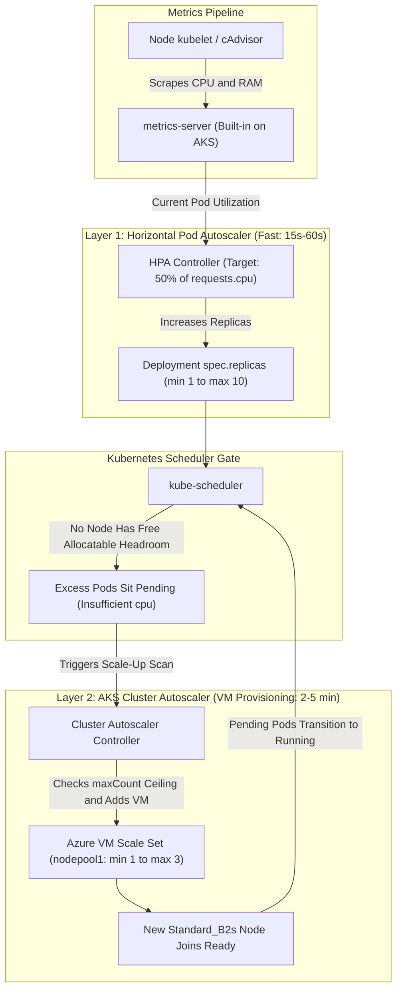
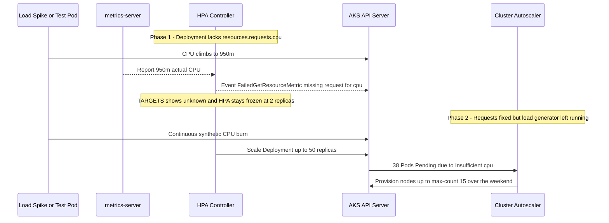

# Scaling AKS: Cluster Autoscaler and HPA

> **Prerequisites:** Completed Module 04 with an active `aks-learn` cluster context, `metrics-server` running (included by default on AKS), and understanding of container `resources.requests` from Module 02.  
> **Estimated Reading Time:** 35 minutes  
> **Target Audience:** Backend Engineers, DevOps Engineers, Site Reliability Engineers (SREs).

> [!TIP]
> **The Golden Rule of Dual-Layer AKS Autoscaling:** Always declare explicit `resources.requests.cpu` on every scaled container and keep Cluster Autoscaler `--max-count` tightly bounded—HPA calculates CPU utilization against your pod's *request* (reporting `<unknown>` when omitted), while `--max-count` acts as your hard financial circuit breaker against runaway node provisioning.

---

## Why This Matters

You already know the Horizontal Pod Autoscaler (HPA) from the Kubernetes track — it adds and removes *pod replicas* based on load. On a small, fixed-size AKS node pool, however, HPA can quickly demand more pods than the existing VMs can physically fit. AKS's **Cluster Autoscaler** solves the other half of the problem: adding and removing *nodes* based on unschedulable demand. Combining both layers is how a production cluster handles traffic spikes elastically without manual resizing — and without paying for idle VMs once demand subsides.

---

## 1. Architectural Mental Model: The Two-Layer Elastic Scaling Loop

HPA and Cluster Autoscaler operate at distinct layers and communicate indirectly through **Pending Pods** in the Kubernetes API:



### Core Concepts

#### HPA Scales Pods; Cluster Autoscaler Scales Nodes
These operate at different layers, and you typically pair both together for variable workloads:
1. **HPA reacts first** (fast, seconds to a couple of minutes) by adjusting replica count against a target metric (CPU%, memory, or custom metrics) using `desiredReplicas = ceil(currentReplicas * (currentMetric / targetMetric))`.
2. **If extra replicas do not fit on existing nodes**, `kube-scheduler` leaves them `Pending` (`FailedScheduling: Insufficient cpu`).
3. **Cluster Autoscaler notices unschedulable `Pending` pods** and provisions a new node in your pool (slower, typically 2–5 minutes because Azure allocates and boots a real VM) so those pods can schedule.

#### Cluster Autoscaler Is Per-Node-Pool, with a Min/Max Range
You enable Cluster Autoscaler on a specific node pool with a floor (`--min-count`) and ceiling (`--max-count`). Azure adds nodes up to the max when pods cannot schedule, and removes nodes back down toward the min only after sustained underutilization (default 10 minutes of unneeded time). Cluster Autoscaler is intentionally conservative about scaling down — it will not remove a node hosting pods it cannot safely evict (e.g., standalone pods without a controller, pods using `local-storage` `emptyDir`, or pods blocked by a strict `PodDisruptionBudget`).

#### Why `--max-count` Matters for Cost
Cluster Autoscaler's ceiling is also your cost ceiling — every additional node it is allowed to add is another billable Azure VM. For a learning cluster, keep `--max-count` small (e.g., `3`–`4`) so an autoscaling experiment or an HPA misconfiguration cannot quietly spin up an expensive fleet of nodes overnight.

#### HPA Still Needs `metrics-server`
HPA reads live pod CPU/memory metrics from `metrics-server` just as on a local cluster — and `metrics-server` already ships preinstalled on AKS by default (which you confirmed in Module 02 with `kubectl top`).

#### What AKS Manages vs. What You Own
- **Azure Manages:** Running and maintaining the Cluster Autoscaler controller (nothing for you to install or upgrade) and provisioning/deprovisioning underlying Azure VMSS instances whenever scaling triggers.
- **You Own:** Setting sensible `--min-count` and `--max-count` bounds (your cost vs. capacity guardrail), defining HPA target metrics and stabilization thresholds, and declaring accurate `resources.requests` on Pods (both HPA CPU percentages and Cluster Autoscaler bin-packing simulations rely directly on requests — under-requesting starves pods, while over-requesting triggers premature node scale-outs).

---

## 2. Taxonomic Comparison & Command Reference

### HPA vs. Cluster Autoscaler Layer Matrix

| Dimension | Horizontal Pod Autoscaler (HPA) | AKS Cluster Autoscaler (CA) |
| :--- | :--- | :--- |
| **What It Scales** | Pod replica count (`Deployment`, `StatefulSet`) | VM node count inside a specific AKS node pool |
| **Primary Trigger** | `metrics-server` CPU/memory % (or custom/external metrics) | Unschedulable `Pending` pods (scale-up) / low node allocation (scale-down) |
| **Scale-Up Latency** | ~15–60 seconds | ~2–5 minutes (provisions real Azure VM) |
| **Scale-Down Latency** | ~5 minutes stabilization window (`autoscaling/v2` default) | ~10 minutes conservative unneeded cooldown |
| **Cost Impact** | Indirect (only bills if pods force node scale-out) | **Direct** (every added node is a billable VM) |
| **Impact of Missing CPU Requests** | Fails with `<unknown>` target; cannot scale | Scheduler misestimates pod footprint; erratic node scaling |

### AKS Node Pool Scaling Configurations

| Mode | Command / Setting | System Pool Min Allowed | User Pool Min Allowed | Best Use Case |
| :--- | :--- | :--- | :--- | :--- |
| **Manual Scaling** | `az aks scale` / `az aks nodepool scale` | `1` node | `0` nodes | Predictable steady load or fixed test runs |
| **Cluster Autoscaler** | `--enable-cluster-autoscaler` | `1` node (must host `kube-system`) | `0` nodes (true scale-to-zero) | Variable traffic, bursty APIs, batch worker pools |

### Command Reference & Flag Breakdown

| Command | What it does | Example |
| :--- | :--- | :--- |
| `az aks nodepool update --enable-cluster-autoscaler` | Turns on the Cluster Autoscaler for a node pool with min/max bounds | `az aks nodepool update --resource-group rg-aks-learn --cluster-name aks-learn --name nodepool1 --enable-cluster-autoscaler --min-count 1 --max-count 3` |
| `az aks nodepool update --disable-cluster-autoscaler` | Turns it off | `az aks nodepool update --resource-group rg-aks-learn --cluster-name aks-learn --name nodepool1 --disable-cluster-autoscaler` |
| `az aks nodepool update --update-cluster-autoscaler` | Changes min/max bounds without disabling/re-enabling | `az aks nodepool update --resource-group rg-aks-learn --cluster-name aks-learn --name nodepool1 --update-cluster-autoscaler --min-count 1 --max-count 4` |
| `az aks nodepool show` | Shows a node pool's config including autoscaler state | `az aks nodepool show --resource-group rg-aks-learn --cluster-name aks-learn --name nodepool1 --output table` |
| `kubectl autoscale deployment` | Creates an HPA imperatively | `kubectl autoscale deployment demo-app --cpu-percent=50 --min=1 --max=10` |
| `kubectl get hpa -w` | Watches HPA current/target metrics and replica counts | `kubectl get hpa -w` |
| `kubectl describe hpa` | Shows HPA scaling events/decisions | `kubectl describe hpa <name>` |
| `kubectl get nodes -w` | Watches node count change as Cluster Autoscaler acts | `kubectl get nodes -w` |
| `kubectl top pods` | Shows live CPU/memory per pod, useful to watch HPA's input metric | `kubectl top pods` |

#### Key Flag Breakdown
- **`--enable-cluster-autoscaler` / `--update-cluster-autoscaler`**: Enables or live-updates node pool min/max limits without disrupting running workloads.
- **`--min-count` / `--max-count`**: Defines the node pool floor and hard VM cost ceiling (`nodepool1` system pool requires `--min-count >= 1`).
- **`--cpu-percent=50`**: Targets average pod CPU utilization equal to 50% of `resources.requests.cpu` across all ready replicas.
- **`--min` / `--max` on `kubectl autoscale`**: Bounds pod replica count (distinct from node pool min/max bounds).

---

## 3. Production War Story Post-Mortem: Missing CPU Requests (`<unknown>`) & Forgotten Load-Test Scale-Out

- **Severity:** SEV-2 (Production Scaling Freeze Followed by Staging Fleet Overspend)
- **Detection Time:** 18 minutes during peak traffic / 38 hours over weekend in staging
- **Resolution Time:** 15 minutes
- **Impact:** Production API dropped checkout requests because HPA stayed pinned at 2 replicas (`<unknown>` target); separately, an uncleaned load generator kept 12 extra nodes running over a weekend in staging.

### What Happened

In **Phase 1**, a backend team added `resources.limits.cpu: "1000m"` to their API Deployment but omitted `resources.requests.cpu`, assuming HPA would scale at 60% of the limit. During a promotional spike, CPU pegged near the 1-core limit while HPA reported `<unknown>/60%` and refused to scale past `minReplicas: 2`. In **Phase 2**, after fixing `requests.cpu: "250m"` in staging and raising Cluster Autoscaler `--max-count` to `15`, an engineer launched a `stress` load-generator Pod to test autoscaling, confirmed scale-out worked, closed their terminal for the weekend without deleting the load generator—leaving HPA at 50 replicas and Cluster Autoscaler holding 14 nodes running until Monday morning.



### Root Cause Analysis
1. **CPU Percentage Requires a Denominator:** HPA computes `(actualUsage / requests.cpu) * 100`. Without `requests.cpu`, `autoscaling` marks `ScalingActive=False` (`FailedGetResourceMetric`).
2. **Oversized Staging Ceiling:** Setting `--max-count 15` on a learning/staging node pool removed the financial circuit breaker.
3. **Orphaned Load Generator:** Closing a terminal after verifying scale-out left the synthetic CPU-burn pod active, blocking scale-down indefinitely.

### The Fix & Architectural Hardening
1. Enforced explicit `resources.requests.cpu` via CI YAML validation and a namespace `LimitRange` fallback.
2. Alerted on `kubectl get hpa` `ScalingActive=False` conditions (`FailedGetResourceMetric`).
3. Kept non-production `--max-count` tightly capped (`3`–`4` nodes) and standardized post-test verification: delete load generators first, verify `kubectl get pods` is clean, and watch `kubectl get nodes` scale back down before ending a session.

---

## 4. Multi-Language Production Implementation

These production scripts audit HPA prerequisites (`resources.requests.cpu`), watch the HPA -> `Pending` -> Cluster Autoscaler handoff, and calculate worst-case node pool cost ceilings.

````carousel
### Go (`k8s.io/client-go`): HPA CPU-Request Prerequisite & `<unknown>` Auditor

```go
package main

import (
	"context"
	"fmt"
	"log"
	"os"
	"path/filepath"
	"time"

	autoscalingv2 "k8s.io/api/autoscaling/v2"
	metav1 "k8s.io/apimachinery/pkg/apis/meta/v1"
	"k8s.io/client-go/kubernetes"
	"k8s.io/client-go/tools/clientcmd"
)

func main() {
	ctx, cancel := context.WithTimeout(context.Background(), 20*time.Second)
	defer cancel()

	kubeconfig := filepath.Join(os.Getenv("HOME"), ".kube", "config")
	cfg, err := clientcmd.BuildConfigFromFlags("", kubeconfig)
	if err != nil {
		log.Fatalf("load kubeconfig: %v", err)
	}
	client, err := kubernetes.NewForConfig(cfg)
	if err != nil {
		log.Fatalf("k8s client: %v", err)
	}

	hpas, err := client.AutoscalingV2().HorizontalPodAutoscalers("").List(ctx, metav1.ListOptions{})
	if err != nil {
		log.Fatalf("list HPAs: %v", err)
	}

	failures := 0
	for _, hpa := range hpas.Items {
		ref := hpa.Spec.ScaleTargetRef
		if ref.Kind != "Deployment" {
			continue
		}
		dep, err := client.AppsV1().Deployments(hpa.Namespace).Get(ctx, ref.Name, metav1.GetOptions{})
		if err != nil {
			log.Printf("[WARN] %s/%s target Deployment %s missing: %v", hpa.Namespace, hpa.Name, ref.Name, err)
			continue
		}

		needsCPUReq := false
		for _, m := range hpa.Spec.Metrics {
			if m.Type == autoscalingv2.ResourceMetricSourceType && m.Resource != nil && m.Resource.Name == "cpu" {
				needsCPUReq = true
			}
		}

		if needsCPUReq {
			for _, c := range dep.Spec.Template.Spec.Containers {
				if c.Resources.Requests.Cpu().IsZero() {
					failures++
					fmt.Printf("[BROKEN] HPA %s/%s targets %s container '%s' with 0 CPU request -> HPA will show <unknown>!\n",
						hpa.Namespace, hpa.Name, dep.Name, c.Name)
				}
			}
		}
		fmt.Printf("[HPA] %s/%s current=%d desired=%d min=%d max=%d\n",
			hpa.Namespace, hpa.Name, hpa.Status.CurrentReplicas, hpa.Status.DesiredReplicas,
			*hpa.Spec.MinReplicas, hpa.Spec.MaxReplicas)
	}
	if failures > 0 {
		os.Exit(1)
	}
}
```
<!-- slide -->
### TypeScript (`@azure/arm-containerservice` + `@kubernetes/client-node`): Node Pool Ceiling & Stray Load Guard

```typescript
import { DefaultAzureCredential } from "@azure/identity";
import { ContainerServiceClient } from "@azure/arm-containerservice";
import * as k8s from "@kubernetes/client-node";

async function auditAutoscalerGuardrails(
  subscriptionId: string,
  rg: string,
  clusterName: string,
  maxAllowedNodesForEnv = 4
): Promise<void> {
  const arm = new ContainerServiceClient(new DefaultAzureCredential(), subscriptionId);
  const pools = arm.agentPools.list(rg, clusterName);

  for await (const pool of pools) {
    console.log(
      `NodePool=${pool.name} count=${pool.count} autoScaling=${Boolean(pool.enableAutoScaling)} min=${pool.minCount} max=${pool.maxCount} sku=${pool.vmSize}`
    );
    if (pool.enableAutoScaling && (pool.maxCount ?? 0) > maxAllowedNodesForEnv) {
      console.warn(
        `COST WARNING: NodePool '${pool.name}' maxCount=${pool.maxCount} exceeds environment cap (${maxAllowedNodesForEnv}).`
      );
    }
  }

  const kc = new k8s.KubeConfig();
  kc.loadFromDefault();
  const coreApi = kc.makeApiClient(k8s.CoreV1Api);
  const pods = await coreApi.listPodForAllNamespaces();

  const suspiciousLoadPods = pods.items.filter((p) => {
    const n = p.metadata?.name ?? "";
    return n.includes("load") || n.includes("stress") || n.includes("hey") || n.includes("busy");
  });

  if (suspiciousLoadPods.length > 0) {
    console.warn(
      `FOUND ${suspiciousLoadPods.length} potential leftover load-generator pod(s): ${suspiciousLoadPods
        .map((p) => `${p.metadata?.namespace}/${p.metadata?.name}`)
        .join(", ")}`
    );
  }
}

auditAutoscalerGuardrails(
  process.env.AZURE_SUBSCRIPTION_ID ?? "",
  "rg-aks-learn",
  "aks-learn"
).catch((err) => {
  console.error(err);
  process.exit(1);
});
```
<!-- slide -->
### Python (`kubernetes`): Dual-Layer Handoff Telemetry (HPA -> Pending -> Nodes)

```python
from kubernetes import client, config


def inspect_scaling_handoff(namespace: str) -> None:
    config.load_kube_config()
    v1 = client.CoreV1Api()
    auto_v2 = client.AutoscalingV2Api()

    nodes = v1.list_node().items
    ready_nodes = sum(
        1 for n in nodes
        if any(c.type == "Ready" and c.status == "True" for c in (n.status.conditions or []))
    )
    print(f"Nodes Ready: {ready_nodes}/{len(nodes)}")

    pods = v1.list_namespaced_pod(namespace=namespace).items
    pending_pods = [p.metadata.name for p in pods if p.status.phase == "Pending"]
    running_pods = [p.metadata.name for p in pods if p.status.phase == "Running"]
    print(f"Namespace '{namespace}' Pods: Running={len(running_pods)} Pending={len(pending_pods)}")
    if pending_pods:
        print(f"  Pending waiting on Cluster Autoscaler: {', '.join(pending_pods[:5])}")

    hpas = auto_v2.list_namespaced_horizontal_pod_autoscaler(namespace=namespace).items
    for hpa in hpas:
        active_cond = next(
            (c for c in (hpa.status.conditions or []) if c.type == "ScalingActive"),
            None,
        )
        status = active_cond.status if active_cond else "Unknown"
        reason = active_cond.reason if active_cond else ""
        print(
            f"  HPA {hpa.metadata.name}: current={hpa.status.current_replicas} "
            f"desired={hpa.status.desired_replicas}/{hpa.spec.max_replicas} ScalingActive={status} ({reason})"
        )


if __name__ == "__main__":
    inspect_scaling_handoff("demo")
```
<!-- slide -->
### C# (`KubernetesClient` + `Azure.ResourceManager.ContainerService`): Capacity & Cost Ceiling Simulator

```csharp
using System;
using System.Linq;
using System.Threading.Tasks;
using Azure.Identity;
using Azure.ResourceManager;
using Azure.ResourceManager.ContainerService;
using k8s;

public static class ScalingCeilingValidator
{
    public static async Task Main()
    {
        var arm = new ArmClient(new DefaultAzureCredential());
        var sub = await arm.GetDefaultSubscriptionAsync();
        var rg = await sub.GetResourceGroupAsync("rg-aks-learn");
        var cluster = await rg.Value.GetContainerServiceManagedClusterAsync("aks-learn");
        var pool = await cluster.Value.GetContainerServiceAgentPoolAsync("nodepool1");

        var maxNodes = pool.Value.Data.MaxCount ?? pool.Value.Data.Count ?? 1;
        var minNodes = pool.Value.Data.MinCount ?? pool.Value.Data.Count ?? 1;
        Console.WriteLine($"AKS Pool 'nodepool1': AutoScaling={pool.Value.Data.EnableAutoScaling}, Min={minNodes}, Max={maxNodes}");

        using var k8sClient = new Kubernetes(KubernetesClientConfiguration.BuildDefaultConfig());
        var nodes = await k8sClient.CoreV1.ListNodeAsync();
        var avgNodeCpuCores = nodes.Items.Average(n => n.Status.Allocatable["cpu"].ToDouble());

        var hpas = await k8sClient.AutoscalingV2.ListHorizontalPodAutoscalerForAllNamespacesAsync();
        foreach (var hpa in hpas.Items)
        {
            Console.WriteLine(
                $"HPA {hpa.Metadata.NamespaceProperty}/{hpa.Metadata.Name}: " +
                $"PodMin={hpa.Spec.MinReplicas}, PodMax={hpa.Spec.MaxReplicas}, Current={hpa.Status.CurrentReplicas}");
        }

        Console.WriteLine($"Estimated max cluster allocatable CPU at maxCount={maxNodes}: {maxNodes * avgNodeCpuCores:F2} cores");
    }
}
```
````

---

## 5. Practical Hands-On Verification CLI Workflows

Walk through all 8 guided steps below to trigger real HPA pod scaling, overflow onto Cluster Autoscaler VM provisioning, verify scale-down, and debug an `<unknown>` HPA failure.

### Step 1: Enable Cluster Autoscaler on Your Node Pool

Confirm your node pool name (`nodepool1`), then turn on Cluster Autoscaler with a tight cost ceiling (`--max-count 3`):

```bash
az aks nodepool list --resource-group rg-aks-learn --cluster-name aks-learn --output table
az aks nodepool update \
  --resource-group rg-aks-learn \
  --cluster-name aks-learn \
  --name nodepool1 \
  --enable-cluster-autoscaler \
  --min-count 1 \
  --max-count 3
az aks nodepool show \
  --resource-group rg-aks-learn \
  --cluster-name aks-learn \
  --name nodepool1 \
  --output table
```

**Expected Output:**
```text
Name       OsType    KubernetesVersion    VmSize        Count    MaxPods    ProvisioningState    Mode
---------  --------  -------------------  ------------  -------  ---------  -------------------  ------
nodepool1  Linux     1.30.x               Standard_B2s  2        110        Succeeded            System
... (EnableAutoScaling: true, MinCount: 1, MaxCount: 3) ...
```

### Step 2: Deploy a CPU-Hungry Test App with an HPA

Save `php-apache.yaml` (classic lightweight HTTP app that burns CPU per request, with explicit `requests.cpu: 200m` so HPA can compute Utilization %):

```yaml
apiVersion: apps/v1
kind: Deployment
metadata:
  name: php-apache
spec:
  replicas: 1
  selector:
    matchLabels:
      app: php-apache
  template:
    metadata:
      labels:
        app: php-apache
    spec:
      containers:
        - name: php-apache
          image: registry.k8s.io/hpa-example
          ports:
            - containerPort: 80
          resources:
            requests:
              cpu: "200m"
              memory: "128Mi"
            limits:
              cpu: "500m"
              memory: "256Mi"
---
apiVersion: v1
kind: Service
metadata:
  name: php-apache
spec:
  selector:
    app: php-apache
  ports:
    - port: 80
```

Apply and create the HPA:

```bash
kubectl create namespace scale-demo
kubectl config set-context --current --namespace=scale-demo
kubectl apply -f php-apache.yaml
kubectl autoscale deployment php-apache --cpu-percent=50 --min=1 --max=15
```

Wait ~60 seconds for `metrics-server` to collect initial CPU samples and confirm `TARGETS` shows a real number (not `<unknown>`):

```bash
kubectl get hpa
```

**Expected Output:**
```text
NAME         REFERENCE               TARGETS   MINPODS   MAXPODS   REPLICAS   AGE
php-apache   Deployment/php-apache   1%/50%    1         15        1          65s
```

### Step 3: Generate Load and Watch the HPA React

Launch an in-cluster busybox load generator (or run CPU burn loops) and watch HPA scale replicas upward:

```bash
kubectl run load-generator --image=busybox:1.36 --restart=Never -- \
  /bin/sh -c "while true; do wget -q -O- http://php-apache; done"
kubectl get hpa -w
```

**Expected Output:**
```text
NAME         REFERENCE               TARGETS    MINPODS   MAXPODS   REPLICAS   AGE
php-apache   Deployment/php-apache   1%/50%     1         15        1          2m
php-apache   Deployment/php-apache   245%/50%   1         15        1          2m30s
php-apache   Deployment/php-apache   245%/50%   1         15        5          2m45s
php-apache   Deployment/php-apache   180%/50%   1         15        12         3m15s
```

### Step 4: Watch Cluster Autoscaler Kick In

Open two terminal panes (or watch sequentially) as `REPLICAS` climbs past the CPU capacity of your existing `Standard_B2s` nodes:

```bash
kubectl get pods -o wide
kubectl get nodes -w
```

**Expected Output:**
```text
NAME                          READY   STATUS    RESTARTS   AGE   IP            NODE
php-apache-6c99b88b6b-7v4km   1/1     Running   0          45s   10.244.0.21   aks-nodepool1-12345678-vmss000000
php-apache-6c99b88b6b-d9k2p   0/1     Pending   0          30s   <none>        <none>
php-apache-6c99b88b6b-m3w8q   0/1     Pending   0          30s   <none>        <none>

# In kubectl get nodes -w after ~2-4 minutes:
aks-nodepool1-12345678-vmss000002   NotReady   <none>   5s    v1.30.x
aks-nodepool1-12345678-vmss000002   Ready      <none>   42s   v1.30.x
```

Once `vmss000002` becomes `Ready`, verify the previously `Pending` pods transition to `Running`. You can also check `kubectl top pods` to monitor per-pod CPU utilization.

### Step 5: Stop the Load and Watch Both Layers Scale Back Down

Delete the load generator first and confirm it is completely gone:

```bash
kubectl delete pod load-generator
kubectl get hpa -w
```

After HPA's stabilization window (~5 minutes), `REPLICAS` drops back toward `--min=1`:

```text
php-apache   Deployment/php-apache   2%/50%   1   15   1   10m
```

Then monitor `kubectl get nodes -w` over a longer interval (Cluster Autoscaler waits roughly 10 minutes of sustained low utilization before safely draining and removing the extra node back toward `--min-count`):

```bash
kubectl get nodes -w
```

### Step 6: Inspect the Cost-Relevant Ceiling

Verify `--max-count` remained tightly bounded:

```bash
az aks nodepool show \
  --resource-group rg-aks-learn \
  --cluster-name aks-learn \
  --name nodepool1 \
  --query "[autoScalerProfile,maxCount,minCount]"
```

**Expected Output:**
```text
[
  null,
  3,
  1
]
```

### Step 7: Diagnose and Fix HPA Showing `<unknown>` for Targets

Deliberately strip `resources.requests` from `php-apache` and observe what happens to HPA:

```bash
kubectl patch deployment php-apache --type='json' \
  -p='[{"op":"remove","path":"/spec/template/spec/containers/0/resources/requests"}]'
sleep 30
kubectl get hpa
kubectl describe hpa php-apache
```

**Expected Output:**
```text
NAME         REFERENCE               TARGETS         MINPODS   MAXPODS   REPLICAS   AGE
php-apache   Deployment/php-apache   <unknown>/50%   1         15        1          14m

Events:
  Type     Reason                        Age   From                       Message
  ----     ------                        ----  ----                       -------
  Warning  FailedGetResourceMetric       15s   horizontal-pod-autoscaler  failed to get cpu utilization: missing request for cpu in container php-apache of Pod php-apache-...
```

Restore `resources.requests.cpu: "200m"` by re-applying `php-apache.yaml`, wait ~30–60 seconds, and confirm `kubectl get hpa` shows a numeric percentage again:

```bash
kubectl apply -f php-apache.yaml
kubectl get hpa -w
```

### Step 8: Clean Up Safely

```bash
kubectl delete hpa php-apache
kubectl delete deployment php-apache
kubectl delete namespace scale-demo
```

Lower `--max-count` back or disable Cluster Autoscaler if finished for the session, and optionally reset the node count to 2 with `az aks scale`:

```bash
az aks nodepool update \
  --resource-group rg-aks-learn \
  --cluster-name aks-learn \
  --name nodepool1 \
  --disable-cluster-autoscaler
az aks scale --resource-group rg-aks-learn --name aks-learn --nodepool-name nodepool1 --node-count 2
```

If done for the day, stop or delete the cluster per Module 01 (`az aks stop` or `az group delete`).

---

### Independent Challenge

No commands given here — figure it out yourself using what you know from this module and earlier ones.

**Task:** Engineer a situation where you can watch both scaling layers act in sequence, safely and cheaply. Enable the Cluster Autoscaler on your node pool with a deliberately tight ceiling so a runaway can't spend much, put an HPA on a CPU-burning workload, and then drive enough load that the HPA wants more replicas than your current nodes can hold. Watch the handoff: the HPA adds replicas, some go `Pending` because they don't fit (the same insufficient-resources scheduling reality from Module 02, conceptually building on that module), and the Cluster Autoscaler then adds a node so they can run. Stop the load and observe both layers retreat. The critical discipline here: before you walk away, confirm the load generator is truly gone and the node count has settled back toward your minimum — an autoscaler left scaled out on a forgotten load test is a real bill. Tear down the test workload and reset the pool when done.

<details>
<summary>Stuck? One hint</summary>

The HPA's scale target is driven by the pod's CPU *request*, so give the workload a small request and set `--cpu-percent` low enough that load pushes it over; watch `kubectl get hpa -w`, `kubectl get pods -o wide`, and `kubectl get nodes -w` side by side to see the layers act.

</details>

---

## 6. Common Mistakes & Troubleshooting

- **Setting `--max-count` too high "to be safe."** Every extra node Cluster Autoscaler is *allowed* to add is a node it *might* add and bill you for, if load (or a misconfigured HPA) demands it. Keep the ceiling tight for a learning cluster.
- **Forgetting CPU requests on the scaled Deployment.** Both HPA CPU-percent targets and Cluster Autoscaler's scheduling-fit decisions are driven by requests, not real-time usage alone. No request means broken or unpredictable scaling in both places.
- **Expecting instant node scale-down.** Cluster Autoscaler intentionally waits out a stabilization period before removing nodes, to avoid flapping. Do not assume it is broken if node count does not drop the moment load ends — give it several minutes.
- **Confusing HPA min/max with Cluster Autoscaler min/max.** They bound different things (pod replicas vs. node count) and are configured with entirely different commands (`kubectl autoscale` / HPA manifest vs. `az aks nodepool update`). Mixing them up leads to debugging the wrong layer.
- **Cost pitfall: leaving Cluster Autoscaler enabled with a generous max and forgetting a load test is still hammering the cluster.** Always confirm your load generator is actually stopped (`kubectl get pods` — no stray busy-loop pods) before walking away, and re-check node count before ending a session.

---

## 7. Operational Validation Checkpoints

<details>
<summary><strong>Checkpoint 1: Your HPA shows <code>TARGETS: &lt;unknown&gt;/60%</code> even though <code>kubectl top pods</code> prints live CPU usage for every pod. Why is HPA failing while <code>kubectl top</code> works?</strong></summary>

`metrics-server` is healthy (which is why `kubectl top` works), so the failure is on the Deployment spec: at least one container in the scaled Deployment is missing `resources.requests.cpu`. HPA needs `requests.cpu` as the denominator to compute percentage utilization; run `kubectl describe hpa <name>` to confirm the `missing request for cpu` event.

</details>

<details>
<summary><strong>Checkpoint 2: HPA scaled a Deployment from 2 to 10 replicas, 4 new pods are <code>Pending</code>, and Cluster Autoscaler is enabled (<code>min: 1, max: 3</code>) — yet after 10 minutes the cluster stays at 3 nodes. Why didn't a 4th node provision?</strong></summary>

Cluster Autoscaler hit its configured `--max-count 3` ceiling on the node pool. Inspect `az aks nodepool show` (or `cluster-autoscaler-status` ConfigMap in `kube-system`) — you will see scale-up stopped because the node group reached its max node limit.

</details>

<details>
<summary><strong>Checkpoint 3: Traffic dropped to near zero 20 minutes ago and HPA returned to <code>1</code> replica, yet one extra node still has not scaled down. What pod-level blockers could prevent Cluster Autoscaler from draining that VM?</strong></summary>

Cluster Autoscaler refuses to evict and remove nodes hosting: (1) standalone pods not backed by a Deployment/ReplicaSet/DaemonSet controller, (2) pods using local `emptyDir` storage without safe-to-evict annotations, (3) `kube-system` pods lacking a permissive `PodDisruptionBudget` (PDB), or (4) any PDB whose `minAvailable` prevents draining.

</details>

---

## 8. Checkpoint Quiz

Write down your answer to each question before expanding it — checking without attempting first is the single easiest way to fool yourself into thinking you've learned this.

1. What's the difference between what HPA scales and what Cluster Autoscaler scales?
2. Why does an HPA-driven scale-up sometimes require Cluster Autoscaler to also act, and what's the visible sign in `kubectl get pods` while waiting?
3. Why is Cluster Autoscaler's `--max-count` a cost control, not just a capacity control?
4. Why does HPA need CPU *requests* set on the target Deployment to compute a CPU percentage?
5. Why is Cluster Autoscaler's scale-down intentionally slower/more conservative than its scale-up?
6. What command changes Cluster Autoscaler's min/max bounds without fully disabling and re-enabling it?

<details>
<summary>Show answers</summary>

1. HPA scales the number of pod replicas for a workload based on a metric (e.g. CPU%). Cluster Autoscaler scales the number of nodes in a node pool based on whether pods can be scheduled.
2. Because HPA can create more replicas than existing nodes have room for; those extra pods sit `Pending` until Cluster Autoscaler notices and provisions a new node for them to schedule onto. The visible sign is pods in `Pending` state in `kubectl get pods -o wide` with no node assigned.
3. Because every additional node the autoscaler is permitted to add is a real, billable Azure VM — the max is effectively the most you're willing to let automatic scaling spend, independent of whether the load turns out to be real traffic or a misconfiguration.
4. Because HPA's `--cpu-percent` target is calculated as (current usage) / (requested CPU) — with no request, there's no denominator, so HPA can't compute a meaningful percentage and reports the target as unknown.
5. To avoid "flapping" — rapidly adding and removing nodes in response to short-lived dips in load, which would be both disruptive (evicting pods) and not actually cost-effective given node provisioning isn't instantaneous either.
6. `az aks nodepool update --update-cluster-autoscaler` with new `--min-count`/`--max-count` values.

</details>

---

## Next

[06-monitoring-aks-azure-monitor-container-insights](../06-monitoring-aks-azure-monitor-container-insights/README.md) — see what's happening across your cluster with real observability tooling instead of ad hoc `kubectl` commands.
