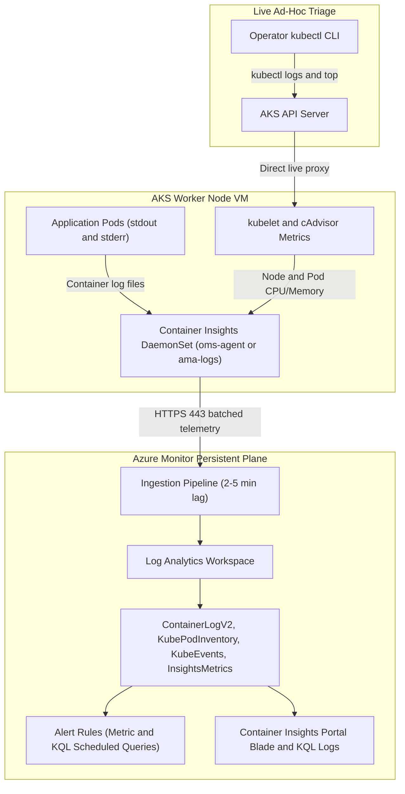
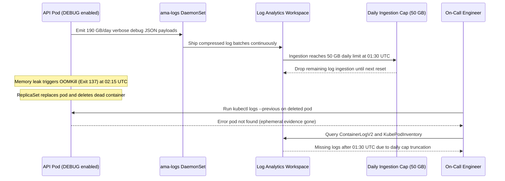

# Monitoring AKS: Azure Monitor & Container Insights

> **Prerequisites:** Running AKS cluster (Module 01), sample workload deployed (Module 02 or 04), Azure CLI authenticated, and `kubectl` configured for your cluster.  
> **Estimated Reading Time:** 30 minutes  
> **Target Audience:** Backend Engineers, SREs, DevOps Engineers, Kubernetes Operators.

> [!TIP]
> **The Golden Rule of AKS Observability:** Container Insights complements—never replaces—live `kubectl` debugging, and every stdout/stderr line printed by your pods becomes billable ingestion inside a Log Analytics workspace; enforce structured `INFO`/`WARN` log levels in production, inspect `az aks show --query addonProfiles.omsagent.config` to confirm the exact workspace ID, and run `az monitor log-analytics workspace list` during teardown because workspaces often outlive `az group delete`.

---

## Why This Matters

So far you've debugged everything with `kubectl describe`, `kubectl logs`, and `kubectl top` — fine for one cluster you're staring at directly, but it doesn't scale to "what happened at 3am" or "which pod is slowly leaking memory over days." **Container Insights** (part of Azure Monitor) collects logs and metrics from your cluster into a queryable, persistent store, so you can investigate after the fact and set up alerts instead of watching a terminal.

---

## 1. Architectural Mental Model: DaemonSet Collection & Log Analytics Ingestion

When you enable the monitoring add-on, AKS deploys a privileged DaemonSet across every node in every pool (`omsagent` on legacy clusters / `ama-logs` Azure Monitor Agent on newer AKS versions). Rather than streaming only live stdout to your laptop like `kubectl logs`, the DaemonSet continuously tails container stdout/stderr, scrapes kubelet/cAdvisor node and pod metrics, and ships batches over HTTPS to a persistent **Log Analytics workspace**:



### Core Concepts

- **Azure Monitor vs. Container Insights:** **Azure Monitor** is Azure's umbrella observability service across all resource types; **Container Insights** is the AKS/Kubernetes-specific feature built on top of it. Enabling it deploys an agent (the Azure Monitor Metrics/Logs agent, running as a DaemonSet — one pod per node) to your cluster, which ships container logs, node/pod metrics, and inventory data to a **Log Analytics workspace**.
- **Log Analytics workspace & KQL:** The workspace is where telemetry actually lives — a queryable store you search with **KQL (Kusto Query Language)**, similar in spirit to `kubectl logs` but across every pod, over any historical time range you retain, with real filtering, joins, and aggregation instead of ad-hoc `grep`.
- **Additive, not a replacement for `kubectl`:** You'll still use `kubectl describe` and `kubectl logs` for "what's wrong with this specific pod right now." Container Insights is for "what happened across the whole cluster over the last day," "show me every pod that OOM-killed this week," or triggering an alert that pages on-call engineers automatically.
- **Retention and cost:** Log Analytics bills for data ingested (per GB) and for retention beyond the free default window (31 days). A busy cluster logging verbosely at `DEBUG` level can generate meaningful log volume — this is a real, easy-to-overlook cost knob distinct from node, LoadBalancer, or disk costs you've already met.
- **What AKS manages vs. what you own:** Enabling Container Insights is a one-command, Azure-managed agent deployment and ingestion pipeline — you don't write Fluent Bit or log-shipping config yourself. You still own: which Log Analytics workspace you point at (and its retention, daily cap, and table-tier cost settings), what KQL queries and alerts you build on top of the collected data, and remembering to disable/detach monitoring and delete the workspace when you're done with a learning cluster, since the workspace can persist independently of the AKS cluster's lifecycle.

---

## 2. Taxonomic Comparison: Ephemeral Tooling & Log Analytics Tables

### Live `kubectl` Triage vs. Container Insights

| Dimension | `kubectl logs` / `describe` / `top` | Container Insights (Log Analytics) |
| :--- | :--- | :--- |
| **Query Latency** | Instant (reads live stream directly from `kubelet`) | 2–5 minute ingestion pipeline lag |
| **Survival After Pod Deletion** | Lost immediately once Pod and container are garbage-collected (`--previous` fails) | Persisted for configured retention window (default 31 days; up to 2–12 years) |
| **Query Scope** | Single Pod/Container (or basic label selector without aggregation) | Fleet-wide across namespaces, nodes, ReplicaSets, and days via KQL |
| **Cost Profile** | Free (uses existing control-plane/node bandwidth) | Billed per GB ingested + long-term retention + alert rule evaluations |
| **Alerting & Automation** | None built-in (manual terminal watching) | Metric & KQL scheduled alerts wired to Action Groups (Email, PagerDuty, Slack) |
| **Best Used For** | Active live crash triage right now | Post-mortems, historical memory leaks, cluster-wide OOM audits, 24/7 paging |

### Core Container Insights Tables in Log Analytics

| Log Analytics Table | Primary Telemetry Signal | Production Question Answered | Starter KQL Filter |
| :--- | :--- | :--- | :--- |
| **`ContainerLogV2`** | Container stdout/stderr lines with structured Pod metadata | "What errors did deleted `checkout` pods emit right before crashing?" | `ContainerLogV2 \| where PodNamespace == "demo" \| take 50` |
| **`KubePodInventory`** | Pod lifecycle states, restarts, node placement, exit codes | "Which pods entered `CrashLoopBackOff` or exited with code 137?" | `KubePodInventory \| where ContainerStatusReason == "OOMKilled"` |
| **`KubeEvents`** | Kubernetes API events (`FailedScheduling`, `BackOff`, `Killing`) | "Why were pods stuck `Pending` during Tuesday's traffic spike?" | `KubeEvents \| where ObjectKind == "Pod" and Reason != "Started"` |
| **`InsightsMetrics` / `Perf`** | Node & container CPU, memory working set, disk, network bytes | "Which container's memory RSS climbed steadily over 72 hours?" | `InsightsMetrics \| where Namespace == "container.azm.ms/kubepods"` |

---

## 3. Production War Story Post-Mortem

### SEV-2: Debug Logging Flood Triggered a Log Analytics Cost Spike & Delayed OOM Post-Mortem

- **Severity:** SEV-2 (Partial Telemetry Blind Spot + Unexpected Cloud Spend)
- **Detection Time:** 14 hours after production release (Finance budget alert + customer latency reports)
- **Resolution Time:** 45 minutes
- **Impact:** A `DEBUG` log flag deployed to a high-throughput API spiked Log Analytics ingestion from 8 GB/day to 190 GB/day, hitting a pre-configured 50 GB workspace daily cap at 01:30 UTC. When an unrelated memory leak OOM-killed payment pods at 02:15 UTC, ReplicaSet replacements erased the dead pods before morning triage.



### Root Cause Analysis

1. **Unbounded Log Verbosity:** An application release accidentally left `LOG_LEVEL=DEBUG` enabled in the production Helm `values.yaml`, logging full HTTP request/response bodies to `stdout`.
2. **Ingestion Blind Spot via Cap Truncation:** Because every stdout line was ingested blindly into the single `ContainerLogV2` Analytics table, hitting the daily ingestion cap dropped critical `ERROR` and `OOMKilled` signals from every namespace in the cluster—not just the noisy service.
3. **Ephemeral vs. Persistent Gap:** By the time the engineer inspected the cluster, the OOM-killed pods had been terminated and evicted from the node, making `kubectl logs --previous` useless.

### The Fix & Architectural Hardening

- **Log-Level & Sampling Controls:** Enforced structured JSON logging capped at `INFO` (with `WARN`/`ERROR` priority) in production containers and added CI validation rejecting `DEBUG` defaults.
- **Data Collection Rules (DCR) & Table Tiers:** Split high-volume debug/access logs into `Basic Logs` tier (cheaper ingestion) or filtered noisy health-check paths (`/healthz`) via Container Insights ConfigMap (`container-azm-ms-agentconfig.yaml`) before ingestion.
- **Explicit Workspace Governance:** Attached clusters via explicit `--workspace-resource-id` with retention policies, budget alerts at 70% expected daily GB, and a dedicated KQL alert rule firing immediately when `KubePodInventory` reports `OOMKilled` (`ExitCode == 137`).

---

## 4. Command Reference & Flag Breakdown

| Command | What it does | Example |
| :--- | :--- | :--- |
| `az aks enable-addons -a monitoring` | Enables Container Insights on an existing cluster | `az aks enable-addons --resource-group rg-aks-learn --name aks-learn --addons monitoring` |
| `az aks disable-addons -a monitoring` | Disables it | `az aks disable-addons --resource-group rg-aks-learn --name aks-learn --addons monitoring` |
| `az monitor log-analytics workspace create` | Creates a Log Analytics workspace explicitly (otherwise one is created/reused automatically) | `az monitor log-analytics workspace create --resource-group rg-aks-learn --workspace-name law-aks-learn` |
| `az monitor log-analytics workspace list` | Lists workspaces in the subscription | `az monitor log-analytics workspace list --output table` |
| `az aks show --query addonProfiles.omsagent` | Confirms the monitoring add-on's status and which workspace it's wired to | `az aks show --resource-group rg-aks-learn --name aks-learn --query addonProfiles.omsagent` |
| `kubectl get pods -n kube-system -l component=oms-agent` | Confirms the monitoring DaemonSet pods are running | `kubectl get pods -n kube-system -l component=oms-agent` |
| (Azure Portal) Container Insights views | Live/historical dashboards: node/pod CPU-memory, logs, workbooks | — |
| (Azure Portal) Log Analytics "Logs" blade, KQL query | Query collected container logs/metrics | `ContainerLogV2 \| where PodNamespace == "demo" \| take 50` |
| `az monitor log-analytics workspace delete` | Deletes a Log Analytics workspace | `az monitor log-analytics workspace delete --resource-group rg-aks-learn --workspace-name law-aks-learn --yes` |

### Key Flag & Parameter Breakdown

| Flag / Field | Scope | Production Significance |
| :--- | :--- | :--- |
| `--addons monitoring` | `az aks enable-addons` | Installs the Container Insights DaemonSet and wires it to an auto-created or specified workspace. |
| `--workspace-resource-id` | `az aks enable-addons` | Pins telemetry to an explicit Log Analytics workspace instead of letting Azure auto-create a `DefaultResourceGroup-*` workspace elsewhere. |
| `addonProfiles.omsagent.config` | `az aks show --query` | Reveals `logAnalyticsWorkspaceResourceID`, the authoritative resource path used for billing and KQL queries. |
| `-l component=oms-agent` / `dsName=ama-logs-rs` | `kubectl get pods -n kube-system` | Legacy clusters label agent pods `component=oms-agent`; newer AKS clusters using Azure Monitor Agent also schedule `ama-logs-*` DaemonSet pods. |
| `--yes` | `az monitor log-analytics workspace delete` | Bypasses interactive confirmation; soft-deletes the workspace (add `--force true` only when permanent immediate purge is intended). |

---

## 5. Multi-Language Production Implementation

Production workloads running on AKS should emit **structured single-line JSON logs** (avoiding multiline stack dumps that fragment across `ContainerLogV2` rows and inflate ingestion cost) and expose automated **KQL diagnostic runners** with bounded time ranges to query `ContainerLogV2` and `KubePodInventory` during incident response.

````carousel
```go
// telemetry.go — Structured ContainerLogV2 JSON logger + bounded KQL request payload builder
package telemetry

import (
	"encoding/json"
	"fmt"
	"log/slog"
	"os"
	"strings"
	"time"
)

// NewProductionLogger emits single-line JSON to stdout so Container Insights
// indexes fields cleanly in ContainerLogV2 without multiline fragmentation.
func NewProductionLogger(minLevel slog.Level) *slog.Logger {
	opts := &slog.HandlerOptions{
		Level: minLevel, // Default to slog.LevelInfo in production to control ingestion cost
		ReplaceAttr: func(_ []string, a slog.Attr) slog.Attr {
			if a.Key == slog.TimeKey {
				a.Value = slog.StringValue(time.Now().UTC().Format(time.RFC3339Nano))
			}
			return a
		},
	}
	pod := os.Getenv("POD_NAME")
	ns := os.Getenv("POD_NAMESPACE")
	return slog.New(slog.NewJSONHandler(os.Stdout, opts)).With(
		slog.String("pod", pod),
		slog.String("namespace", ns),
	)
}

type KQLQueryRequest struct {
	Query    string `json:"query"`
	Timespan string `json:"timespan"`
}

// BuildOOMPostMortemQuery constructs a cost-bounded KQL query against ContainerLogV2
// and KubePodInventory to reconstruct crashes after pods are deleted.
func BuildOOMPostMortemQuery(namespace, podPrefix string, lookback time.Duration) (string, error) {
	if lookback <= 0 || lookback > 7*24*time.Hour {
		return "", fmt.Errorf("lookback must be between 1s and 168h to prevent full-workspace scans")
	}
	if strings.ContainsAny(namespace, `"'|;`) || strings.ContainsAny(podPrefix, `"'|;`) {
		return "", fmt.Errorf("invalid characters in namespace or podPrefix")
	}

	kql := fmt.Sprintf(`KubePodInventory
| where Namespace == "%s" and Name startswith "%s"
| where ContainerStatusReason in ("OOMKilled", "CrashLoopBackOff", "Error")
| join kind=leftouter (
    ContainerLogV2
    | where PodNamespace == "%s" and PodName startswith "%s"
    | project PodName, TimeGenerated, LogMessage, LogLevel
) on $left.Name == $right.PodName
| order by TimeGenerated desc
| take 100`, namespace, podPrefix, namespace, podPrefix)

	payload, err := json.Marshal(KQLQueryRequest{
		Query:    kql,
		Timespan: fmt.Sprintf("PT%dM", int(lookback.Minutes())),
	})
	if err != nil {
		return "", err
	}
	return string(payload), nil
}
```
<!-- slide -->
```typescript
// insightsDiagnostics.ts — Bounded KQL crash-history query using @azure/monitor-query
import { DefaultAzureCredential } from "@azure/identity";
import { LogsQueryClient, LogsQueryResultStatus } from "@azure/monitor-query";

export interface PodCrashRecord {
  timestamp: string;
  podName: string;
  statusReason: string;
  logMessage: string;
}

// Emits single-line structured JSON compatible with ContainerLogV2 ingestion.
export function logStructured(
  level: "INFO" | "WARN" | "ERROR",
  event: string,
  metadata: Record<string, unknown>
): void {
  const minLevel = process.env.LOG_LEVEL ?? "INFO";
  const rank = { INFO: 1, WARN: 2, ERROR: 3 } as const;
  if (rank[level] < (rank[minLevel as keyof typeof rank] ?? 1)) return;

  console.log(
    JSON.stringify({
      ts: new Date().toISOString(),
      level,
      event,
      pod: process.env.POD_NAME ?? "unknown",
      namespace: process.env.POD_NAMESPACE ?? "default",
      ...metadata,
    })
  );
}

export async function fetchDeletedPodCrashHistory(
  workspaceId: string,
  namespace: string,
  maxHours = 6
): Promise<PodCrashRecord[]> {
  if (!/^[a-z0-9-]+$/.test(namespace)) {
    throw new Error("Invalid Kubernetes namespace identifier");
  }
  const client = new LogsQueryClient(new DefaultAzureCredential());
  const kql = `
    ContainerLogV2
    | where PodNamespace == "${namespace}"
    | where LogLevel in ("error", "fatal", "ERROR") or LogMessage has_any ("panic", "OOM", "exit")
    | project TimeGenerated, PodName, ContainerName, LogMessage
    | order by TimeGenerated desc
    | take 50
  `;

  const result = await client.queryWorkspace(workspaceId, kql, {
    duration: `PT${Math.min(maxHours, 168)}H`,
  });

  if (result.status !== LogsQueryResultStatus.Success && !result.partialTables?.length) {
    throw new Error(`Log Analytics query failed: ${result.status}`);
  }

  const tables = result.status === LogsQueryResultStatus.Success ? result.tables : result.partialTables ?? [];
  const rows = tables[0]?.rows ?? [];
  return rows.map((row) => ({
    timestamp: String(row[0] ?? ""),
    podName: String(row[1] ?? ""),
    statusReason: String(row[2] ?? ""),
    logMessage: String(row[3] ?? ""),
  }));
}
```
<!-- slide -->
```python
# container_insights_query.py — Query ContainerLogV2 & KubePodInventory post-pod-deletion
import json
import os
import re
from datetime import timedelta, datetime, timezone
from azure.core.exceptions import HttpResponseError
from azure.identity import DefaultAzureCredential
from azure.monitor.query import LogsQueryClient, LogsQueryStatus

NAMESPACE_RE = re.compile(r"^[a-z0-9]([-a-z0-9]*[a-z0-9])?$")


def emit_structured_log(level: str, message: str, **fields: object) -> None:
    """Emit single-line JSON log with ingestion-cost level filtering."""
    configured = os.getenv("LOG_LEVEL", "INFO").upper()
    order = {"DEBUG": 10, "INFO": 20, "WARN": 30, "ERROR": 40}
    if order.get(level.upper(), 20) < order.get(configured, 20):
        return
    record = {
        "timestamp": datetime.now(timezone.utc).isoformat(),
        "level": level.upper(),
        "message": message,
        "pod": os.getenv("POD_NAME", "local"),
        "namespace": os.getenv("POD_NAMESPACE", "default"),
        **fields,
    }
    print(json.dumps(record, default=str), flush=True)


def inspect_crash_history(workspace_id: str, namespace: str, hours: int = 12) -> list[dict]:
    """Retrieve logs and termination reasons even after Kubernetes deletes failed pods."""
    if not NAMESPACE_RE.match(namespace):
        raise ValueError(f"Unsafe Kubernetes namespace value: {namespace!r}")

    bounded_hours = max(1, min(hours, 168))
    credential = DefaultAzureCredential()
    client = LogsQueryClient(credential)

    kql = (
        f'ContainerLogV2 '
        f'| where PodNamespace == "{namespace}" '
        f'| project TimeGenerated, PodName, ContainerName, LogLevel, LogMessage '
        f'| order by TimeGenerated desc '
        f'| take 50'
    )

    try:
        response = client.query_workspace(
            workspace_id=workspace_id,
            query=kql,
            timespan=timedelta(hours=bounded_hours),
        )
    except HttpResponseError as exc:
        raise RuntimeError(f"Azure Monitor KQL query failed ({exc.status_code}): {exc.message}") from exc

    table = response.tables[0] if response.status == LogsQueryStatus.SUCCESS else response.partial_data[0]
    columns = [col for col in table.columns]
    return [dict(zip(columns, row)) for row in table.rows]
```
<!-- slide -->
```csharp
// ContainerInsightsDiagnostics.cs — .NET Azure Monitor KQL reader for ContainerLogV2 & OOM audits
using System;
using System.Collections.Generic;
using System.Text.RegularExpressions;
using System.Threading;
using System.Threading.Tasks;
using Azure;
using Azure.Identity;
using Azure.Monitor.Query;
using Azure.Monitor.Query.Models;

public sealed record ContainerLogEntry(
    DateTimeOffset TimeGenerated,
    string PodName,
    string ContainerName,
    string LogMessage);

public static class ContainerInsightsDiagnostics
{
    private static readonly Regex SafeName = new("^[a-z0-9-]+$", RegexOptions.Compiled);

    public static async Task<IReadOnlyList<ContainerLogEntry>> QueryDeletedPodLogsAsync(
        string workspaceId,
        string podNamespace,
        TimeSpan lookback,
        CancellationToken ct = default)
    {
        if (!SafeName.IsMatch(podNamespace))
            throw new ArgumentException("Invalid namespace format.", nameof(podNamespace));

        if (lookback <= TimeSpan.Zero || lookback > TimeSpan.FromDays(7))
            throw new ArgumentOutOfRangeException(nameof(lookback), "Bound query window to <= 7 days.");

        var client = new LogsQueryClient(new DefaultAzureCredential());
        string kql = $"""
            ContainerLogV2
            | where PodNamespace == "{podNamespace}"
            | project TimeGenerated, PodName, ContainerName, LogMessage
            | order by TimeGenerated desc
            | take 50
            """;

        try
        {
            Response<LogsQueryResult> response = await client.QueryWorkspaceAsync(
                workspaceId,
                kql,
                new QueryTimeRange(lookback),
                cancellationToken: ct);

            var results = new List<ContainerLogEntry>();
            LogsTable table = response.Value.Table;
            foreach (LogsTableRow row in table.Rows)
            {
                results.Add(new ContainerLogEntry(
                    row.GetDateTimeOffset("TimeGenerated") ?? DateTimeOffset.MinValue,
                    row.GetString("PodName") ?? string.Empty,
                    row.GetString("ContainerName") ?? string.Empty,
                    row.GetString("LogMessage") ?? string.Empty));
            }
            return results;
        }
        catch (RequestFailedException ex) when (ex.Status == 403)
        {
            throw new UnauthorizedAccessException(
                "Missing 'Log Analytics Reader' role on the target workspace.", ex);
        }
    }
}
```
````

---

## 6. Practical Hands-On Verification CLI Workflows

Work through all 9 verification exercises in order, checking each `**Expected Output:**` before moving on.

### 1. Enable Container Insights on Your Cluster

Run the monitoring add-on command (Azure auto-creates or reuses a default Log Analytics workspace unless `--workspace-resource-id` is passed):

```bash
az aks enable-addons \
  --resource-group rg-aks-learn \
  --name aks-learn \
  --addons monitoring

az aks show \
  --resource-group rg-aks-learn \
  --name aks-learn \
  --query addonProfiles.omsagent.enabled
```

**Expected Output:**

```text
true
```

### 2. Confirm the DaemonSet Agent Is Running

```bash
kubectl get pods -n kube-system -l component=oms-agent -o wide
```

*(Note: On newer AKS Kubernetes versions using Azure Monitor Agent, also check `kubectl get pods -n kube-system | grep -E 'omsagent|ama-logs'`.)*

**Expected Output:**

```text
NAME                             READY   STATUS    RESTARTS   AGE   IP           NODE
ama-logs-7k2xp                   2/2     Running   0          2m    10.244.0.9   aks-nodepool1-12345678-vmss000000
ama-logs-p9m4q                   2/2     Running   0          2m    10.244.1.8   aks-nodepool1-12345678-vmss000001
ama-logs-rs-6b87c9d4f-z8v2t      1/1     Running   0          2m    10.244.0.10  aks-nodepool1-12345678-vmss000000
```

Verify one agent pod per node, all `Running`.

### 3. Locate Your Exact Log Analytics Workspace

```bash
az monitor log-analytics workspace list \
  --resource-group rg-aks-learn \
  --output table

# Authoritative workspace resource ID (even if Azure auto-created it in another RG):
az aks show \
  --resource-group rg-aks-learn \
  --name aks-learn \
  --query addonProfiles.omsagent.config
```

**Expected Output:**

```json
{
  "logAnalyticsWorkspaceResourceID": "/subscriptions/<sub-id>/resourcegroups/defaultresourcegroup-eus/providers/microsoft.operationalinsights/workspaces/defaultworkspace-<sub-id>-eus",
  "useAADAuth": "true"
}
```

Note the workspace name and resource group for the portal and cleanup steps below.

### 4. Generate Identifiable Log Data

Deploy a small workload in namespace `demo` (or reuse one from earlier modules) that logs something identifiable in a loop, e.g. `echo "hello from $(hostname)"`:

```bash
kubectl create namespace demo --dry-run=client -o yaml | kubectl apply -f -
kubectl run log-generator -n demo --image=busybox:1.36 --restart=Always \
  -- /bin/sh -c 'while true; do echo "hello from $(hostname) at $(date -u +%FT%TZ)"; sleep 5; done'
```

Let it run for 3–5 minutes so data has time to ship (ingestion typically lags live by a few minutes, unlike `kubectl logs` which is immediate).

### 5. Query Collected Logs in the Azure Portal (`ContainerLogV2`)

In the Azure Portal, open your Log Analytics workspace → **Logs**, and run a KQL query against `ContainerLogV2` filtered to your namespace/pod:

```kql
ContainerLogV2
| where PodNamespace == "demo"
| order by TimeGenerated desc
| take 50
```

**Expected Output:** You see your app's `hello from log-generator ...` lines with timestamps, searchable across pod restarts and across multiple pods simultaneously in a way `kubectl logs` alone cannot provide.

### 6. Inspect Container Insights Dashboards

In the Azure Portal, open your AKS cluster resource → **Insights** (or **Monitoring** → **Insights**). Verify: you can see node CPU/memory utilization over time, a list of pods with their live/historical status, and container-level resource usage — the same kind of telemetry `kubectl top` gives you live, now backed by history.

### 7. Diagnose a Deleted Failure Using Container Insights Instead of `kubectl`

Deliberately cause a pod failure you can investigate after the fact: deploy a `Deployment` whose container exits after a short sleep (causing `CrashLoopBackOff`), let it crash a few times, then investigate it two ways:

```bash
kubectl create deployment crash-test -n demo --image=busybox:1.36 \
  -- /bin/sh -c 'echo "FATAL: simulated startup crash"; sleep 5; exit 1'

# First, traditional live triage:
kubectl get pods -n demo -l app=crash-test
kubectl describe pod -n demo -l app=crash-test
kubectl logs -n demo -l app=crash-test --previous
```

Wait 4–5 minutes for ingestion, then **delete the Deployment** (`kubectl delete deployment crash-test -n demo`) so `kubectl logs --previous` has nothing left to show. Now open the Azure Portal → **Logs** and run:

```kql
KubePodInventory
| where Namespace == "demo" and Name startswith "crash-test"
| project TimeGenerated, Name, PodStatus, ContainerStatusReason, ContainerRestartCount
| order by TimeGenerated desc
| take 20

ContainerLogV2
| where PodNamespace == "demo" and PodName startswith "crash-test"
| project TimeGenerated, PodName, LogMessage
| order by TimeGenerated desc
```

Verify you can reconstruct the crash history and final log lines even after the pod has been completely deleted.

### 8. Set Up a Basic Alert (Optional but Recommended)

In the Azure Portal, under your Log Analytics workspace or the AKS cluster's **Alerts** blade, create a metric alert rule (e.g., node CPU percentage above 80% for 5 minutes) so you experience the alerting pipeline, not just dashboards. Verify the alert rule shows as **Enabled** (you do not need to artificially trigger it).

### 9. Clean Up Safely

```bash
kubectl delete pod log-generator -n demo --ignore-not-found
kubectl delete deployment crash-test -n demo --ignore-not-found

# Stop new telemetry shipping from the cluster:
az aks disable-addons \
  --resource-group rg-aks-learn \
  --name aks-learn \
  --addons monitoring

# Verify no orphaned workspace continues incurring retention/ingestion charges:
az monitor log-analytics workspace list --output table
```

If you created a dedicated workspace (or want the auto-created one deleted), remove it explicitly:

```bash
az monitor log-analytics workspace delete \
  --resource-group <workspace-resource-group> \
  --workspace-name <workspace-name> \
  --yes
```

*(Note: Disabling the add-on stops new data collection, but does not by itself delete already-ingested data or the workspace — delete the workspace explicitly if you want it gone too.)*

---

## Independent Challenge

No commands given here — figure it out yourself using what you know from this module and earlier ones.

**Task:** Prove to yourself that persistent monitoring answers a question live `kubectl` cannot. Enable Container Insights on your cluster, then deploy a workload that fails in a way that destroys its own live evidence — for example a container that crash-loops and is eventually replaced, so that once the old pod is gone `kubectl logs --previous` has nothing left to show (this reuses the crash/diagnosis instinct from module 02's Pending-vs-CrashLoop material, conceptually building on that module). After the pod is gone, reconstruct what happened purely from the collected data: find the crash history and the container's log lines for that specific pod in the Log Analytics workspace. Separately, locate exactly which workspace your cluster is shipping to and which resource group it lives in. When done, disable the add-on and decide whether the workspace should be deleted too — remember it is a separate billable resource that a plain `az group delete` on the cluster's group will not necessarily remove.

<details>
<summary>Stuck? One hint</summary>

The workspace wiring is visible under `az aks show --query addonProfiles.omsagent.config`; once you know the workspace, a KQL query against `ContainerLogV2` (and pod inventory tables) filtered to the pod name surfaces history that outlives the pod itself.

</details>

---

## 7. Common Mistakes & Troubleshooting

- **Expecting portal data instantly:** Ingestion lag means log and metric data can take 2–5 minutes to appear after being generated — don't conclude monitoring is broken after checking 10 seconds later.
- **Not knowing which Log Analytics workspace got created:** If you enable monitoring without specifying `--workspace-resource-id`, Azure auto-creates or reuses a default workspace, sometimes in a different resource group (`DefaultResourceGroup-*`) than expected — always confirm with `az aks show --query addonProfiles.omsagent.config` rather than guessing.
- **Treating Container Insights as a replacement for `kubectl describe`:** It's complementary — for "why is this pod stuck right now," `kubectl` is faster and zero-lag; for historical/aggregate questions across deleted pods, Container Insights is the right tool.
- **Agent pod label mismatch on newer AKS clusters:** Older guides look strictly for `component=oms-agent`, whereas newer AKS clusters using Azure Monitor Agent (`ama-logs`) schedule pods named `ama-logs-*`. Inspect `kubectl get pods -n kube-system` broadly if a specific selector returns empty.
- **Verbose application logging left on indefinitely:** Every log line your app writes is a candidate for ingestion cost once Container Insights is enabled. Debug-level logging that was harmless with `kubectl logs` (ephemeral, free) has a real, ongoing cost once shipped to Log Analytics continuously.
- **Cost pitfall: an orphaned Log Analytics workspace outliving the cluster:** Because the workspace is a separate Azure resource from the AKS cluster, deleting the cluster's resource group does not automatically delete a workspace that lives in a different resource group. Explicitly check `az monitor log-analytics workspace list --output table` across your subscription during final cleanup.

---

## 8. Operational Validation Checkpoints

<details>
<summary><strong>Scenario 1: Missing Crash Evidence After Rollout</strong></summary>

**Scenario:** At 02:30 UTC, an autoscaled payment worker pod hits `OOMKilled` (`ExitCode 137`), restarts twice, and is then terminated when HPA scales back down at 03:00 UTC. At 09:00 UTC, running `kubectl logs` and `kubectl get pods` shows only healthy new pods. How do you prove the OOM kill occurred and inspect its final stdout lines?

**Verification & Answer:** Run a bounded KQL query in the cluster's Log Analytics workspace (`az aks show --query addonProfiles.omsagent.config`) joining `KubePodInventory` (`where ContainerStatusReason == "OOMKilled"` or `ContainerLastStatus contains "137"`) with `ContainerLogV2` filtered to the Pod name prefix and the 02:00–03:15 UTC window. Live `kubectl` lost the container state upon pod deletion, whereas Container Insights persisted both the inventory termination reason and stdout logs.

</details>

<details>
<summary><strong>Scenario 2: Monitoring Enabled, Zero Rows in ContainerLogV2</strong></summary>

**Scenario:** You ran `az aks enable-addons -a monitoring` 20 seconds ago, deployed a noisy pod, opened the Log Analytics workspace in your cluster's resource group (`rg-aks-learn`), and `ContainerLogV2 | take 50` returns 0 records. List the two things to verify before assuming the DaemonSet is broken.

**Verification & Answer:** First, check `az aks show --resource-group rg-aks-learn --name aks-learn --query addonProfiles.omsagent.config` — if `--workspace-resource-id` wasn't passed, Azure often wires the cluster to an auto-created `DefaultResourceGroup-*` workspace in a different RG, meaning you may be querying the wrong workspace. Second, account for the 2–5 minute ingestion pipeline lag and verify `ama-logs` / `oms-agent` pods in `kube-system` are `Running`.

</details>

<details>
<summary><strong>Scenario 3: Post-Delete Billing Surprise</strong></summary>

**Scenario:** You finished a training sprint and deleted the cluster's entire resource group (`az group delete --name rg-aks-learn --yes`), yet the next monthly Azure invoice still shows daily Log Analytics charges. Why, and what single CLI check catches this?

**Verification & Answer:** When `az aks enable-addons -a monitoring` runs without an explicit workspace inside `rg-aks-learn`, Azure frequently creates or reuses a default Log Analytics workspace inside `DefaultResourceGroup-<region>`. Deleting `rg-aks-learn` leaves that separate workspace intact (and any other telemetry/retained data billed). Running `az monitor log-analytics workspace list --output table` across the subscription exposes orphaned workspaces immediately.

</details>

---

## 9. Checkpoint Quiz

Write down your answer to each question before expanding it — checking without attempting first is the single easiest way to fool yourself into thinking you've learned this.

1. What's the relationship between Azure Monitor, Container Insights, and a Log Analytics workspace?
2. What does Container Insights give you that `kubectl logs`/`kubectl top` alone don't?
3. Why might data not appear in the portal the instant you generate it?
4. Name one situation where you'd still prefer `kubectl describe pod` over a KQL query, and one where you'd prefer the KQL query.
5. Why can a Log Analytics workspace outlive the AKS cluster it was monitoring, cost-wise?
6. What table would you query in Log Analytics to see shipped container log lines?

<details>
<summary>Show answers</summary>

1. Azure Monitor is the overall observability platform; Container Insights is its AKS/Kubernetes-specific feature that collects cluster logs/metrics; the collected data is stored in and queried from a Log Analytics workspace.
2. Historical retention (data survives pod restarts/deletion), the ability to query across many pods/namespaces at once with KQL, portal dashboards, and the ability to configure alerts — none of which `kubectl logs`/`kubectl top` provide on their own (they're live-only, single-resource views).
3. Because there's an ingestion lag between data being generated on the node and it being shipped, processed, and indexed in the workspace — typically a few minutes, not instant.
4. `kubectl describe pod` is faster for "what's wrong with this specific pod right now" while it's still running/recent; a KQL query is better for "show me this failure pattern across time or across many pods," especially once a pod has already been deleted and `kubectl logs --previous` has nothing left to show.
5. Because the Log Analytics workspace is its own Azure resource (potentially in its own resource group) with its own billing for ingestion and retention — deleting the AKS cluster's resource group doesn't automatically delete a workspace living elsewhere.
6. `ContainerLogV2` (the current container log table used by Container Insights).

</details>

---

## Next

[07-security-aks-aad-rbac-and-keyvault](../07-security-aks-aad-rbac-and-keyvault/README.md) — lock down who can do what on your cluster and stop putting secrets directly in Kubernetes Secret objects.
