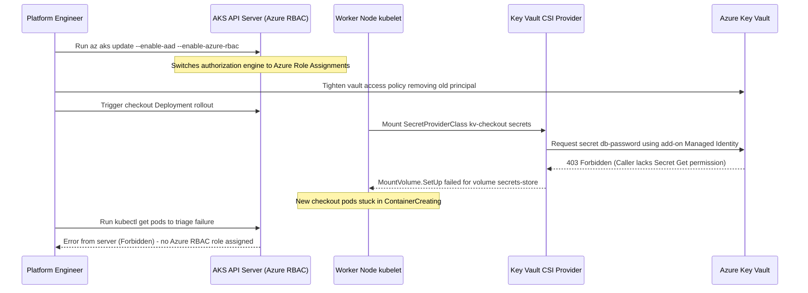

# Security on AKS: Azure AD, RBAC, and Key Vault

> **Prerequisites:** Running AKS cluster (Module 01), ACR & Managed Identity concepts (Module 03), Azure CLI authenticated, `kubectl` and `kubelogin` installed.  
> **Estimated Reading Time:** 40 minutes  
> **Target Audience:** Backend Engineers, Platform Security Engineers, DevOps Engineers, Kubernetes Operators.

> [!TIP]
> **The Golden Rule of AKS Security & Secrets:** Never enable Azure AD or Azure RBAC without first confirming an admin role binding for your own identity, never treat base64-encoded Kubernetes `Secret` objects as your source of truth, and treat Key Vault CSI integration as a two-part contract—enabling `azure-keyvault-secrets-provider` does nothing until the add-on's managed identity (or Workload Identity) holds explicit vault `get`/`list` permissions and a `SecretProviderClass` maps those secrets into your Pod.

---

## Why This Matters

You already know Kubernetes-native RBAC (`Role`/`RoleBinding`) from the local Kubernetes track, and Kubernetes `Secret` objects. On a real cloud cluster with real people and real credentials, two gaps show up: first, you want cluster access tied to actual Azure user identities (not shared kubeconfig files), and second, Kubernetes `Secret` objects are only base64-encoded, not encrypted-at-rest-by-default-with-strong-guarantees, and don't rotate — a real secrets story means pulling from **Azure Key Vault** instead. This module covers both.

---

## 1. Architectural Mental Model: Identity-Bound RBAC & Key Vault CSI Secret Mounting

AKS security separates **human/CI control-plane authorization** (who can call `kubectl`) from **workload data-plane secret retrieval** (which Pod can read database passwords at runtime):

```mermaid
flowchart TD
    subgraph UserPlane["Plane A: Control-Plane AuthN and AuthZ"]
        Dev["Developer / Operator"]
        Kubelogin["kubelogin (Interactive OIDC Login)"]
        AAD["Azure AD / Microsoft Entra ID"]
        APIServer["AKS API Server"]
        Mode1["K8s RoleBinding (Entra Group OID)"]
        Mode2["Azure RBAC for K8s (--enable-azure-rbac)"]
        Dev -->|kubectl get pods| Kubelogin
        Kubelogin -->|Auth code / Device flow| AAD
        AAD -->|Signed JWT Token| APIServer
        APIServer -->|Checks AAD RBAC| Mode1
        APIServer -->|Checks Azure Role Assignment| Mode2
    end

    subgraph WorkloadPlane["Plane B: Pod Secret Mount via Key Vault CSI"]
        Pod["Application Pod (/mnt/secrets-store/db-password)"]
        Kubelet["Node kubelet"]
        CSIDriver["Secrets Store CSI Driver DaemonSet"]
        KVProvider["Azure Key Vault Provider"]
        Identity["Add-on Managed Identity or Workload Identity"]
        KeyVault["Azure Key Vault (Source of Truth and Audit Log)"]
        Pod -->|Requests CSI volume| Kubelet
        Kubelet -->|Invokes NodePublishVolume| CSIDriver
        CSIDriver -->|Reads SecretProviderClass| KVProvider
        KVProvider -->|Authenticates as| Identity
        Identity -->|Fetches secret if Policy or RBAC allows| KeyVault
    end
```



### Core Concepts

- **Kubernetes RBAC vs. Azure AD-integrated Kubernetes RBAC:** Plain Kubernetes RBAC (what you used locally) authorizes based on identities the API server is told about — often static service account tokens or client certs, with no central directory. **Azure AD-integrated RBAC** lets you bind Kubernetes `Role`/`ClusterRole` objects to real Azure AD users/groups, so cluster access follows your organization's actual identity system: someone leaving the team loses cluster access when their Azure AD account is disabled, without you touching kubeconfigs. AKS also offers **Azure RBAC for Kubernetes Authorization**, which goes a step further and lets you manage Kubernetes permissions as Azure role assignments (`az role assignment create`) instead of `RoleBinding` YAML at all — useful when you want one consistent permissions model across Azure and Kubernetes.
- **Managed identities, recap and extension:** You met the cluster's managed identity in module 03 (for ACR pulls). Individual **workloads** can also get their own scoped identity via **workload identity** (Azure AD Workload Identity federation), letting a specific Pod authenticate to Azure services (like Key Vault) as itself, rather than the whole cluster sharing one broad identity.
- **Azure Key Vault + the Secrets Store CSI Driver:** Instead of `kubectl create secret` storing values inside the cluster's etcd, the **Azure Key Vault Provider for Secrets Store CSI Driver** mounts secrets *from* Key Vault into a Pod as files (and can optionally sync them into a regular Kubernetes Secret too), at pod-start time. The secret's source of truth stays in Key Vault — with its own access policies, rotation, and audit log — rather than being duplicated and frozen inside the cluster.
- **What AKS manages vs. what you own:** Azure AD-integration and workload identity federation plumbing is managed by Azure once enabled; you still own which users/groups get which `Role`/`ClusterRole` bindings (or Azure role assignments), what secrets live in Key Vault and their access policies, and — critically — you still need to design least-privilege roles yourself. None of this is automatic just because it's "AKS."

---

## 2. Taxonomic Comparison: AKS Authorization & Secret Delivery Patterns

### Control-Plane Authorization Modes

| Dimension | Plain Kubernetes RBAC | Azure AD-Integrated K8s RBAC (`--enable-aad`) | Azure RBAC for K8s AuthZ (`--enable-azure-rbac`) |
| :--- | :--- | :--- | :--- |
| **User Directory** | None (static certs/tokens in kubeconfig) | Microsoft Entra ID (Azure AD) users & groups | Microsoft Entra ID (Azure AD) users & groups |
| **Permission Definition** | Kubernetes `Role` / `ClusterRoleBinding` YAML | Kubernetes `Role` / `ClusterRoleBinding` targeting AAD OIDs | Azure `az role assignment create` (`Azure Kubernetes Service RBAC ...`) |
| **Offboarding Behavior** | Must manually rotate certs/kubeconfigs | Disabling Entra ID user revokes access automatically | Disabling Entra ID user or Azure RBAC revokes access automatically |
| **Multi-Cluster Governance** | Per-cluster YAML duplication | Per-cluster YAML bindings | Inherited from Azure Subscription / Resource Group scopes |

### Secret Delivery Strategies on AKS

| Mechanism | Source of Truth | Storage Inside Cluster | Rotation Story | Recommended Use Case |
| :--- | :--- | :--- | :--- | :--- |
| **Plain Kubernetes `Secret`** | Cluster etcd | Base64-encoded inside etcd (not strong encryption by default) | Manual recreate + Pod restart | Non-sensitive config or local `kind` testing only |
| **Key Vault CSI Volume Mount** | Azure Key Vault | Mounted in-memory (`tmpfs`) at `/mnt/secrets-store` inside Pod | Polls Key Vault when `--enable-secret-rotation` is enabled | Production DB passwords, API tokens, TLS certs read from file |
| **Key Vault CSI + Synced K8s Secret** | Azure Key Vault | Synced into etcd Secret only while Pod mounts the CSI volume | Syncs updates into K8s Secret (env vars still need Pod restart) | Legacy apps that strictly require `envFrom` / `secretKeyRef` |
| **Workload Identity + Key Vault SDK** | Azure Key Vault | None (fetched in-memory over HTTPS via OIDC token) | Native app cache TTL + Key Vault versioning | Per-Pod fine-grained secret isolation without shared node identity |

---

## 3. Production War Story Post-Mortem

### SEV-1: Cluster Admin Lockout & Checkout CSI Mount Failure During Security Sprint

- **Severity:** SEV-1 (Control-Plane Lockout + Failed Deployment Rollout)
- **Detection Time:** 6 minutes (CI rollout alert + SRE emergency triage blocked)
- **Resolution Time:** 38 minutes
- **Impact:** Enabling `--enable-azure-rbac` during a compliance sprint without pre-assigning an Azure RBAC Cluster Admin role locked out all SRE `kubectl` access (`Error from server (Forbidden)`). Simultaneously, a vault policy tightening removed the CSI add-on identity's `get` permission, causing rolling checkout Pods to hang in `ContainerCreating` with `MountVolume.SetUp failed` (`403 Forbidden`).



### Root Cause Analysis

1. **Missing Pre-Cutover RBAC Assignment:** Switching a cluster to Azure RBAC for Kubernetes Authorization invalidates prior `ClusterRoleBinding` permissions for standard users unless Azure RBAC roles (`Azure Kubernetes Service RBAC Cluster Admin` or `RBAC Admin`) are already scoped to an Entra ID security group.
2. **Untested Identity Removal:** The engineer assumed the cluster's main control-plane identity fetched secrets, not realizing `azure-keyvault-secrets-provider` uses its own separate user-assigned managed identity (`addonProfiles.azureKeyvaultSecretsProvider.identity`).

### The Fix & Architectural Hardening

- **Break-Glass Recovery:** An Owner on the Azure Subscription assigned `Azure Kubernetes Service RBAC Cluster Admin` to the SRE Entra ID group (`az role assignment create`) and restored the CSI add-on identity's `get` permission on Key Vault.
- **Pre-Flight RBAC & Policy Gates:** Mandated creating Azure RBAC assignments *before* toggling `--enable-azure-rbac`, documenting the distinct identities (cluster identity vs. CSI add-on identity vs. per-Pod Workload Identity), and enabling secret rotation polling (`az aks addon update -a azure-keyvault-secrets-provider --enable-secret-rotation`) with Pod-level file watchers.

---

## 4. Command Reference, Flag Breakdown & Reference Manifests

| Command | What it does | Example |
| :--- | :--- | :--- |
| `az aks update --enable-aad` | Enables Azure AD integration for Kubernetes RBAC on an existing cluster | `az aks update --resource-group rg-aks-learn --name aks-learn --enable-aad` |
| `az aks update --enable-azure-rbac` | Enables Azure RBAC for Kubernetes Authorization (manage K8s permissions as Azure role assignments) | `az aks update --resource-group rg-aks-learn --name aks-learn --enable-azure-rbac` |
| `az role assignment create` | Grants an Azure role (e.g. a built-in AKS RBAC role) to a user/group scoped to the cluster | `az role assignment create --assignee <user-or-group-object-id> --role "Azure Kubernetes Service RBAC Reader" --scope <cluster-resource-id>` |
| `az aks get-credentials` | Same as before, but now triggers interactive Azure AD login (via `kubelogin`) instead of a static cert | `az aks get-credentials --resource-group rg-aks-learn --name aks-learn --overwrite-existing` |
| `kubectl apply -f role.yaml` / `rolebinding.yaml` | Native Kubernetes RBAC objects, now bindable to Azure AD group object IDs as `subjects` | `kubectl apply -f rolebinding.yaml` |
| `az keyvault create` | Creates a Key Vault | `az keyvault create --resource-group rg-aks-learn --name kv-aks-learn --location eastus` |
| `az keyvault secret set` | Stores a secret value in Key Vault | `az keyvault secret set --vault-name kv-aks-learn --name db-password --value "s3cr3t"` |
| `az aks addon enable -a azure-keyvault-secrets-provider` | Enables the Secrets Store CSI Driver + Azure Key Vault provider add-on | `az aks enable-addons --resource-group rg-aks-learn --name aks-learn --addons azure-keyvault-secrets-provider` |
| `az aks show --query addonProfiles.azureKeyvaultSecretsProvider` | Confirms the add-on and its managed identity | `az aks show --resource-group rg-aks-learn --name aks-learn --query addonProfiles.azureKeyvaultSecretsProvider` |
| `az keyvault set-policy` | Grants an identity access to a Key Vault | `az keyvault set-policy --name kv-aks-learn --object-id <identity-object-id> --secret-permissions get list` |
| `kubectl apply -f secretproviderclass.yaml` | Declares which Key Vault secrets to mount, via the `SecretProviderClass` CRD | `kubectl apply -f spc.yaml` |

### Key Flag & Identity Distinctions

| Flag / Identity | Purpose | Common Pitfall |
| :--- | :--- | :--- |
| `--enable-aad` | Wires AKS API server to Entra ID JWT validation (still uses K8s `RoleBinding`) | Forgetting `kubelogin` binary on CI runners or local workstations |
| `--enable-azure-rbac` | Delegates K8s AuthZ checks to Azure IAM (`az role assignment`) | Applying K8s `RoleBinding` YAML afterward and wondering why it has no effect |
| `azureKeyvaultSecretsProvider.identity` | User-assigned Managed Identity created specifically for the CSI driver | Using `objectId` vs `clientId` interchangeably (`az keyvault set-policy --object-id` wants `objectId`; `SecretProviderClass` `userAssignedIdentityID` wants `clientId`) |
| `--enable-secret-rotation` | Polls Key Vault periodically to refresh mounted CSI files | Expecting automatic file updates or env-var updates without enabling rotation |

### Reference Manifests (`ClusterRoleBinding`, `SecretProviderClass`, & CSI Pod)

Use these templates as reference for Exercises 3 and 7:

```yaml
# clusterrolebinding-aad.yaml (Exercise 3: bind Entra ID User or Group Object ID to view)
apiVersion: rbac.authorization.k8s.io/v1
kind: ClusterRoleBinding
metadata:
  name: aks-viewers-binding
subjects:
  - kind: User   # Change to Group when binding an Entra ID security group
    name: "<user-or-group-object-id>"
    apiGroup: rbac.authorization.k8s.io
roleRef:
  kind: ClusterRole
  name: view
  apiGroup: rbac.authorization.k8s.io
```

```yaml
# spc-and-pod.yaml (Exercise 7: mount Key Vault secret without creating a K8s Secret)
apiVersion: secrets-store.csi.x-k8s.io/v1
kind: SecretProviderClass
metadata:
  name: kv-aks-learn-spc
spec:
  provider: azure
  parameters:
    usePodIdentity: "false"
    useVMManagedIdentity: "true"
    userAssignedIdentityID: "<addon-identity-client-id>"
    keyvaultName: "kv-aks-learn"
    tenantId: "<azure-tenant-id>"
    objects: |
      array:
        - |
          objectName: db-password
          objectType: secret
---
apiVersion: v1
kind: Pod
metadata:
  name: kv-csi-demo
spec:
  containers:
    - name: busybox
      image: busybox:1.36
      command: ["sleep", "3600"]
      volumeMounts:
        - name: secrets-store-inline
          mountPath: "/mnt/secrets-store"
          readOnly: true
  volumes:
    - name: secrets-store-inline
      csi:
        driver: secrets-store.csi.x-k8s.io
        readOnly: true
        volumeAttributes:
          secretProviderClass: "kv-aks-learn-spc"
```

---

## 5. Multi-Language Production Implementation

When secrets are mounted via the **Secrets Store CSI Driver**, your application reads credentials from `/mnt/secrets-store/<secret-name>` rather than environment variables—enabling **zero-restart rotation** when SHA-256 content hashes change on disk—and can optionally use `DefaultAzureCredential` (Azure Workload Identity) with explicit `403 Forbidden` RBAC/policy diagnostics.

````carousel
```go
// secret_loader.go — CSI-mounted Key Vault file reader with atomic rotation detection
package security

import (
	"bytes"
	"crypto/sha256"
	"errors"
	"fmt"
	"os"
	"path/filepath"
	"sync"
)

type CSISecretStore struct {
	mu       sync.RWMutex
	baseDir  string
	checksum [32]byte
	cached   string
}

func NewCSISecretStore(baseDir string) *CSISecretStore {
	if baseDir == "" {
		baseDir = "/mnt/secrets-store"
	}
	return &CSISecretStore{baseDir: baseDir}
}

// GetSecret reads the CSI-mounted tmpfs secret file and detects Key Vault rotations
// via SHA-256 comparison without caching stale credentials indefinitely.
func (s *CSISecretStore) GetSecret(name string) (value string, rotated bool, err error) {
	cleanName := filepath.Base(name)
	if cleanName != name || cleanName == "." || cleanName == ".." {
		return "", false, fmt.Errorf("invalid secret name %q", name)
	}

	path := filepath.Join(s.baseDir, cleanName)
	raw, err := os.ReadFile(path)
	if err != nil {
		if errors.Is(err, os.ErrNotExist) {
			return "", false, fmt.Errorf("CSI secret %q missing at %s (verify SecretProviderClass and Key Vault policy)", name, path)
		}
		return "", false, fmt.Errorf("failed reading CSI secret %q: %w", name, err)
	}

	trimmed := string(bytes.TrimSpace(raw))
	sum := sha256.Sum256([]byte(trimmed))

	s.mu.Lock()
	defer s.mu.Unlock()
	if s.cached != "" && sum != s.checksum {
		rotated = true
	}
	s.checksum = sum
	s.cached = trimmed
	return s.cached, rotated, nil
}
```
<!-- slide -->
```typescript
// keyVaultSecrets.ts — CSI file reader with Workload Identity SDK fallback & 403 diagnostics
import { createHash } from "node:crypto";
import { promises as fs } from "node:fs";
import path from "node:path";
import { DefaultAzureCredential } from "@azure/identity";
import { SecretClient } from "@azure/keyvault-secrets";

export class AksSecretProvider {
  private lastHash: string | null = null;

  constructor(
    private readonly mountDir = "/mnt/secrets-store",
    private readonly vaultUrl?: string
  ) {}

  async readMountedSecret(secretName: string): Promise<{ value: string; rotated: boolean }> {
    const safeName = path.basename(secretName);
    const fullPath = path.join(this.mountDir, safeName);

    try {
      const raw = await fs.readFile(fullPath, "utf8");
      const value = raw.trim();
      const digest = createHash("sha256").update(value).digest("hex");
      const rotated = this.lastHash !== null && this.lastHash !== digest;
      this.lastHash = digest;
      return { value, rotated };
    } catch (err: unknown) {
      const code = (err as NodeJS.ErrnoException)?.code;
      if (code === "ENOENT" && this.vaultUrl) {
        return this.fetchViaWorkloadIdentity(safeName);
      }
      throw new Error(`CSI secret mount unavailable at ${fullPath}: ${String(err)}`);
    }
  }

  private async fetchViaWorkloadIdentity(secretName: string): Promise<{ value: string; rotated: boolean }> {
    const client = new SecretClient(this.vaultUrl!, new DefaultAzureCredential());
    try {
      const secret = await client.getSecret(secretName);
      if (!secret.value) throw new Error(`Secret ${secretName} has an empty value`);
      return { value: secret.value, rotated: false };
    } catch (err: unknown) {
      const status = (err as { statusCode?: number }).statusCode;
      if (status === 403) {
        throw new Error(
          `Key Vault 403 Forbidden for '${secretName}': grant 'get' policy or Key Vault Secrets User RBAC role to Pod identity.`
        );
      }
      throw err;
    }
  }
}
```
<!-- slide -->
```python
# aks_secret_reader.py — Atomic CSI mount secret loader + Workload Identity Key Vault diagnostics
import hashlib
from pathlib import Path
from azure.core.exceptions import HttpResponseError
from azure.identity import DefaultAzureCredential
from azure.keyvault.secrets import SecretClient


class AksSecretReader:
    def __init__(self, mount_dir: str = "/mnt/secrets-store", vault_url: str | None = None) -> None:
        self._mount_dir = Path(mount_dir)
        self._vault_url = vault_url
        self._last_digest: str | None = None

    def get_secret(self, secret_name: str) -> tuple[str, bool]:
        """Read secret from CSI tmpfs mount; fall back to Workload Identity SDK if configured."""
        if Path(secret_name).name != secret_name:
            raise ValueError(f"Unsafe secret name: {secret_name!r}")

        secret_file = self._mount_dir / secret_name
        if secret_file.is_file():
            value = secret_file.read_text(encoding="utf-8").strip()
            digest = hashlib.sha256(value.encode("utf-8")).hexdigest()
            rotated = self._last_digest is not None and self._last_digest != digest
            self._last_digest = digest
            return value, rotated

        if not self._vault_url:
            raise FileNotFoundError(
                f"CSI secret file {secret_file} missing. Check SecretProviderClass and Key Vault access policy."
            )

        client = SecretClient(vault_url=self._vault_url, credential=DefaultAzureCredential())
        try:
            secret = client.get_secret(secret_name)
            return secret.value or "", False
        except HttpResponseError as exc:
            if exc.status_code == 403:
                raise PermissionError(
                    f"403 Forbidden accessing '{secret_name}' in {self._vault_url}: "
                    "verify Workload Identity / access policy permissions."
                ) from exc
            raise
```
<!-- slide -->
```csharp
// AksSecretProvider.cs — CSI volume reader with rotation tracking & Key Vault RBAC diagnostics
using System;
using System.IO;
using System.Security.Cryptography;
using System.Text;
using System.Threading;
using System.Threading.Tasks;
using Azure;
using Azure.Identity;
using Azure.Security.KeyVault.Secrets;

public sealed class AksSecretProvider
{
    private readonly string _mountDir;
    private readonly Uri? _vaultUri;
    private string? _lastSha256;

    public AksSecretProvider(string mountDir = "/mnt/secrets-store", Uri? vaultUri = null)
    {
        _mountDir = mountDir;
        _vaultUri = vaultUri;
    }

    public async Task<(string Value, bool Rotated)> GetSecretAsync(
        string secretName,
        CancellationToken ct = default)
    {
        if (Path.GetFileName(secretName) != secretName)
            throw new ArgumentException("Invalid secret name.", nameof(secretName));

        string filePath = Path.Combine(_mountDir, secretName);
        if (File.Exists(filePath))
        {
            string value = (await File.ReadAllTextAsync(filePath, ct)).Trim();
            string hash = Convert.ToHexString(SHA256.HashData(Encoding.UTF8.GetBytes(value)));
            bool rotated = _lastSha256 is not null && !string.Equals(_lastSha256, hash, StringComparison.Ordinal);
            _lastSha256 = hash;
            return (value, rotated);
        }

        if (_vaultUri is null)
            throw new FileNotFoundException($"CSI secret file not mounted at {filePath}.");

        var client = new SecretClient(_vaultUri, new DefaultAzureCredential());
        try
        {
            Response<KeyVaultSecret> response = await client.GetSecretAsync(secretName, cancellationToken: ct);
            return (response.Value.Value, false);
        }
        catch (RequestFailedException ex) when (ex.Status == 403)
        {
            throw new UnauthorizedAccessException(
                $"403 Forbidden from Key Vault '{_vaultUri}': grant 'Key Vault Secrets User' or 'get' policy to identity.",
                ex);
        }
    }
}
```
````

---

## 6. Practical Hands-On Verification CLI Workflows

Work through all 9 verification exercises sequentially, verifying each `**Expected Output:**`.

### 1. Enable Azure AD Integration on Your Cluster

```bash
az aks update \
  --resource-group rg-aks-learn \
  --name aks-learn \
  --enable-aad

az aks show \
  --resource-group rg-aks-learn \
  --name aks-learn \
  --query aadProfile
```

**Expected Output:**

```json
{
  "adminGroupObjectIDs": null,
  "enableAzureRbac": null,
  "managed": true,
  "tenantId": "<your-azure-tenant-id>"
}
```

### 2. Re-fetch Credentials and Observe Interactive Azure AD Login

```bash
az aks get-credentials \
  --resource-group rg-aks-learn \
  --name aks-learn \
  --overwrite-existing

kubectl get nodes
```

**Expected Output:** You are prompted to authenticate interactively via a device-code/browser flow (`kubelogin`, e.g., `To sign in, use a web browser to open the page https://microsoft.com/devicelogin...`) the first time — this is Azure AD authentication replacing the old static cluster certificate. Once authenticated, `kubectl get nodes` lists your `Ready` nodes.

### 3. Bind an Azure AD User or Group to a Role and Verify Permissions

If you have permission to create an Entra ID security group ("aks-viewers"), use `az ad group create`; otherwise use your own user's object ID:

```bash
USER_OID=$(az ad signed-in-user show --query id -o tsv)
echo "Binding OID: $USER_OID"
```

Write a `ClusterRoleBinding` (see `clusterrolebinding-aad.yaml` above) whose `subjects` references `$USER_OID` with `kind: User` (or `kind: Group`), bound to the built-in `view` `ClusterRole`. Apply it and verify authorization decisions:

```bash
kubectl apply -f clusterrolebinding-aad.yaml
kubectl auth can-i list pods --as="$USER_OID"
kubectl auth can-i delete pods --as="$USER_OID"
```

**Expected Output:**

```text
yes
no
```

### 4. Create a Key Vault and Store a Secret

*(Remember: Key Vault names must be globally unique across Azure — append random digits if `kv-aks-learn` is taken.)*

```bash
az keyvault create \
  --resource-group rg-aks-learn \
  --name kv-aks-learn \
  --location eastus

az keyvault secret set \
  --vault-name kv-aks-learn \
  --name db-password \
  --value "s3cr3t-value"

az keyvault secret show \
  --vault-name kv-aks-learn \
  --name db-password \
  --query value -o tsv
```

**Expected Output:**

```text
s3cr3t-value
```

### 5. Enable the Key Vault CSI Driver Add-On

```bash
az aks enable-addons \
  --resource-group rg-aks-learn \
  --name aks-learn \
  --addons azure-keyvault-secrets-provider

kubectl get pods -n kube-system -l app=secrets-store-csi-driver
az aks show \
  --resource-group rg-aks-learn \
  --name aks-learn \
  --query addonProfiles.azureKeyvaultSecretsProvider.enabled
```

**Expected Output:**

```text
NAME                                           READY   STATUS    RESTARTS   AGE
aks-secrets-store-csi-driver-xxxxx             3/3     Running   0          45s
aks-secrets-store-csi-driver-yyyyy             3/3     Running   0          45s
true
```

### 6. Grant the Add-On Identity Access to Your Vault

```bash
az aks show \
  --resource-group rg-aks-learn \
  --name aks-learn \
  --query addonProfiles.azureKeyvaultSecretsProvider.identity

# Capture the objectId (for access policy) and clientId (for SecretProviderClass):
CSI_OBJECT_ID=$(az aks show --resource-group rg-aks-learn --name aks-learn --query addonProfiles.azureKeyvaultSecretsProvider.identity.objectId -o tsv)

az keyvault set-policy \
  --name kv-aks-learn \
  --object-id "$CSI_OBJECT_ID" \
  --secret-permissions get

az keyvault show \
  --name kv-aks-learn \
  --query properties.accessPolicies
```

*(Note: If your vault was created with Azure RBAC permission mode instead of Access Policy mode, assign `Key Vault Secrets User` via `az role assignment create` instead of `az keyvault set-policy`.)*

### 7. Mount the Secret Live Into a Pod

Update `spc-and-pod.yaml` with your `userAssignedIdentityID` (`clientId` from step 6), `tenantId`, and `keyvaultName`, then apply and read the mounted secret:

```bash
kubectl apply -f spc-and-pod.yaml
kubectl wait --for=condition=Ready pod/kv-csi-demo --timeout=90s
kubectl exec kv-csi-demo -- cat /mnt/secrets-store/db-password
```

**Expected Output:**

```text
s3cr3t-value
```

The secret is pulled live from Key Vault at pod startup — never stored as a manual Kubernetes `Secret` object.

### 8. Diagnose and Fix: Access Denied Pulling the Secret

Deliberately revoke the add-on identity's policy, recreate the Pod, and inspect the failure:

```bash
az keyvault delete-policy \
  --name kv-aks-learn \
  --object-id "$CSI_OBJECT_ID"

kubectl delete pod kv-csi-demo
kubectl apply -f spc-and-pod.yaml
kubectl describe pod kv-csi-demo
```

**Expected Output (Events section):**

```text
Warning  FailedMount  kubelet  MountVolume.SetUp failed for volume "secrets-store-inline" : rpc error: code = Unknown desc = failed to mount secrets store objects for pod default/kv-csi-demo, err: ... AccessDenied / Forbidden
```

Now restore the policy from exercise 6, recreate the Pod, and confirm recovery:

```bash
az keyvault set-policy \
  --name kv-aks-learn \
  --object-id "$CSI_OBJECT_ID" \
  --secret-permissions get

kubectl delete pod kv-csi-demo
kubectl apply -f spc-and-pod.yaml
kubectl wait --for=condition=Ready pod/kv-csi-demo --timeout=90s
kubectl exec kv-csi-demo -- cat /mnt/secrets-store/db-password
```

### 9. Clean Up Safely

```bash
kubectl delete pod kv-csi-demo --ignore-not-found
kubectl delete secretproviderclass kv-aks-learn-spc --ignore-not-found
kubectl delete clusterrolebinding aks-viewers-binding --ignore-not-found

az keyvault delete \
  --name kv-aks-learn \
  --resource-group rg-aks-learn

# Purge soft-deleted vault if your subscription permits and you are completely done:
az keyvault purge --name kv-aks-learn

az aks disable-addons \
  --resource-group rg-aks-learn \
  --name aks-learn \
  --addons azure-keyvault-secrets-provider
```

*(Note: Key Vault has soft-delete enabled by default — deleting without purging leaves the vault in a recoverable state holding your globally unique vault name for the retention window.)*

---

## Independent Challenge

No commands given here — figure it out yourself using what you know from this module and earlier ones.

**Task:** Get a real secret into a running Pod without ever creating a Kubernetes `Secret` object by hand, and then prove the access control is what's actually gating it. Put a secret value into a Key Vault, enable the Key Vault CSI driver add-on, and mount that secret into a Pod as a file so the container can read it live from the vault. Then deliberately break it: revoke the add-on identity's access to the vault, force the Pod to be recreated, and confirm from the Pod's own status that it now fails to start with an access/authorization error rather than any image or scheduling problem — a useful contrast with the `ImagePullBackOff` authentication failures you diagnosed back in module 03 (conceptually building on that module's "which identity is allowed to do what" thinking). Restore access, confirm the mount succeeds again, then clean up: delete the test Pod and its `SecretProviderClass`, and remember Key Vault's soft-delete means a deleted vault may linger unless you purge it.

<details>
<summary>Stuck? One hint</summary>

The add-on's own managed identity (find it under `az aks show --query addonProfiles.azureKeyvaultSecretsProvider.identity`) must be granted `get` on the vault's secrets via `az keyvault set-policy`; removing that policy is what turns a working mount into a `Forbidden`/access-denied failure visible in `kubectl describe pod`.

</details>

---

## 7. Common Mistakes & Troubleshooting

- **Enabling Azure AD RBAC and then locking yourself out:** Always bind at least one role (ideally an admin-equivalent one) to your own user identity or Entra ID group before relying solely on Azure AD auth, or you can end up authenticated (`kubelogin` succeeds) yet authorized for nothing (`Forbidden`).
- **Confusing Kubernetes-native RBAC objects with Azure RBAC for Kubernetes Authorization:** If you enabled `--enable-azure-rbac`, permissions are managed via `az role assignment create` against built-in roles like `"Azure Kubernetes Service RBAC Reader"` — applying a Kubernetes `RoleBinding` YAML won't have the effect you expect in that mode. Know which mode your cluster is in.
- **Forgetting the access policy step for Key Vault:** The CSI driver add-on being `"enabled"` doesn't imply it can read your specific vault — it needs its identity explicitly granted `get`/`list` on secrets via `az keyvault set-policy` (or an Azure RBAC role assignment like `Key Vault Secrets User` on the vault, depending on the vault's permission model).
- **Treating Key Vault-mounted secrets as fire-and-forget:** The CSI driver's default behavior mounts secrets as files at pod-start; some configurations need explicit rotation-poll settings (`--enable-secret-rotation`) to pick up Key-Vault-side changes without a pod restart — don't assume live updates happen automatically unless you've configured it.
- **Cost pitfall: soft-deleted Key Vaults lingering:** Key Vault's default soft-delete retention means a "deleted" vault can still exist (and in some configurations still incur minor effects/hold your unique name) for a retention window. If you're cleaning up permanently and your account has purge protection off, purge it explicitly rather than assuming `delete` alone is final.

---

## 8. Operational Validation Checkpoints

<details>
<summary><strong>Scenario 1: CSI Mount Uses Wrong Identity UUID Field</strong></summary>

**Scenario:** You enabled `azure-keyvault-secrets-provider`, queried `addonProfiles.azureKeyvaultSecretsProvider.identity`, passed `objectId` into `SecretProviderClass.spec.parameters.userAssignedIdentityID`, and ran `az keyvault set-policy --object-id <clientId>`. New pods hang in `ContainerCreating` with an identity-not-found / unauthorized error. What went wrong?

**Verification & Answer:** Azure managed identities expose two distinct GUIDs: `clientId` and `objectId` (principalId). `SecretProviderClass` requires `userAssignedIdentityID` to be the **`clientId`**, whereas `az keyvault set-policy --object-id` (and `az role assignment create --assignee`) requires the **`objectId`**. Swapping them breaks both MSI token lookup and Key Vault authorization.

</details>

<details>
<summary><strong>Scenario 2: RoleBinding YAML Ignored After Security Upgrade</strong></summary>

**Scenario:** After running `az aks update --enable-aad --enable-azure-rbac`, a team creates a Kubernetes `RoleBinding` granting an Entra ID group `edit` rights in namespace `payments`, yet every `kubectl apply -n payments` from members of that group returns `Error from server (Forbidden)`. Why?

**Verification & Answer:** Enabling `--enable-azure-rbac` switches AKS from evaluating Kubernetes `Role`/`RoleBinding` objects to evaluating **Azure IAM role assignments**. The team must use `az role assignment create --assignee <group-oid> --role "Azure Kubernetes Service RBAC Writer" --scope <cluster-id>/namespaces/payments` instead of applying Kubernetes `RoleBinding` manifests.

</details>

<details>
<summary><strong>Scenario 3: Key Vault Secret Rotated, Pod Still Uses Old Password</strong></summary>

**Scenario:** You rotated `db-password` in Azure Key Vault (`az keyvault secret set`) to cut off a leaked credential, yet an already-running microservice Pod keeps failing DB logins with the old password 30 minutes later. Why didn't the change take effect?

**Verification & Answer:** Two reasons commonly stack: (1) by default, the CSI add-on mounts secrets at Pod start unless `--enable-secret-rotation` is enabled on the add-on, and (2) even if the file in `/mnt/secrets-store/db-password` updates (or syncs to a K8s `Secret`), processes that loaded the credential once at startup (especially via environment variables) will continue using the stale value until either the application watches the file for changes or the Pods are rolled (`kubectl rollout restart`).

</details>

---

## 9. Checkpoint Quiz

Write down your answer to each question before expanding it — checking without attempting first is the single easiest way to fool yourself into thinking you've learned this.

1. What's the difference between plain Kubernetes RBAC and Azure AD-integrated Kubernetes RBAC?
2. What's the difference between Azure AD-integrated RBAC (still using `RoleBinding` YAML) and Azure RBAC for Kubernetes Authorization (`--enable-azure-rbac`)?
3. Why is pulling a secret from Key Vault via the CSI driver generally preferable to a plain Kubernetes `Secret` for sensitive values?
4. What two things does the Key Vault CSI driver's managed identity need before it can mount a secret into a pod?
5. What real risk do you run by enabling Azure AD RBAC without first binding a role to your own identity?
6. What does Key Vault's soft-delete behavior mean for cleanup, cost-wise?

<details>
<summary>Show answers</summary>

1. Plain Kubernetes RBAC authorizes based on identities the API server knows about directly (certs, static tokens, service accounts) with no central directory; Azure AD-integrated RBAC lets `Role`/`RoleBinding` subjects reference real Azure AD users/groups, so access follows your organization's actual identity system and login goes through Azure AD authentication.
2. With Azure AD-integrated RBAC, you still author Kubernetes `Role`/`RoleBinding` YAML, just with Azure AD identities as subjects. With Azure RBAC for Kubernetes Authorization enabled, you instead manage Kubernetes permissions entirely as Azure role assignments (`az role assignment create` with built-in roles), and Kubernetes-native RoleBindings are no longer the enforcement mechanism.
3. Because the secret's source of truth and lifecycle (rotation, access policies, audit logging) stay in Key Vault, a purpose-built secrets service, rather than being duplicated as a base64-encoded value stored inside the cluster with no built-in rotation.
4. The add-on's managed identity needs to be granted access on the specific Key Vault (via `az keyvault set-policy` or an Azure RBAC role assignment on the vault), and a `SecretProviderClass` must correctly reference the vault name and secret names to mount.
5. You could authenticate successfully via Azure AD but have no Kubernetes permissions bound to your identity at all, effectively locking yourself out of an otherwise-working cluster.
6. A "deleted" Key Vault isn't necessarily gone immediately — it can be retained in a recoverable, soft-deleted state for a retention period (and may still hold its unique name / incur minor effects), so full cleanup sometimes requires an explicit purge rather than relying on `delete` alone.

</details>

---

## 10. Cumulative Review

Closed-book. Don't reopen earlier modules while attempting these — the point is to find out what actually stuck.

1. You expose two apps to the internet through one Ingress, put an HPA on one of them, and drive load until the Cluster Autoscaler adds a node. Explain how many public IPs this whole setup uses and why, and why the new node appearing does *not* change that IP count.
2. Three different failures all surface as a Pod that won't run correctly: an Ingress whose `ADDRESS` stays empty, a Pod stuck `Pending` during an HPA-driven scale-up, and a Pod that won't start because it can't mount a Key Vault secret. For each, name the layer at fault and the single command whose output points you at the real cause.
3. `--max-count` on the Cluster Autoscaler and verbose application logging under Container Insights are both described as "cost knobs" distinct from node/disk cost. Explain what each one actually bills you for and why each is easy to leave running unnoticed.
4. Your HPA won't scale under load and its target shows `<unknown>`. What's the most likely cause, and how does that same missing piece also affect whether the Cluster Autoscaler makes correct decisions?
5. Compare the three managed identities you've touched by module 07: the cluster's identity used for ACR pulls (module 03), the Key Vault CSI add-on's identity, and a user's Azure AD identity used for cluster access. For each, what grant makes it actually able to do its job?
6. You enable Azure AD-integrated RBAC on a cluster and immediately can't do anything even though login succeeds. What happened, and how does this failure mode differ conceptually from being unable to *authenticate* at all?
7. Container Insights and a Key Vault can both outlive an `az group delete` on the cluster's resource group. Explain why each can survive, and what you'd run during final cleanup to catch each one.
8. Walk the request path for a user hitting one of your apps through Ingress: from the public IP, to the ingress controller, to the backing Service type, to the Pod. Why is the backing Service a `ClusterIP` and not a `LoadBalancer`, and where would monitoring let you see this traffic historically rather than live?
9. You want to prove, after the fact, that a Pod OOM-killed or crash-looped last night and was then replaced. Why is `kubectl logs --previous` insufficient, and what module-06 capability answers the question instead?
10. Rank these by how quickly they react to a sudden traffic spike, fastest first, and say which two work together to fully absorb the spike: the HPA adding replicas, the Cluster Autoscaler adding a node, an Azure AD role assignment taking effect. Explain the one that's a distractor.

<details>
<summary>Show answers</summary>

1. One public IP — owned by the single ingress controller's own `LoadBalancer` Service, which fronts both apps by host/path routing. The Cluster Autoscaler adds a *node* (a VM) so more pods can schedule; nodes are not public IPs, and Ingress routing is unchanged, so the IP count stays at one.
2. Empty Ingress `ADDRESS`: the ingress/networking layer — `kubectl describe ingress <name>` (check the `ingressClassName` matches an existing `IngressClass`). `Pending` during scale-up: the scheduling/capacity layer — `kubectl describe pod <name>` (Events show "Insufficient cpu" until the autoscaler adds a node). Key Vault mount failure: the secrets/identity layer — `kubectl describe pod <name>` (Events show a CSI mount `Forbidden`/access-denied).
3. `--max-count` bills you for every additional node VM the autoscaler is *allowed* to add and does add under load or a misconfiguration; it's easy to miss because a runaway HPA or a load test left running can push you to the ceiling silently. Container Insights bills for log/metric data ingested and retained; verbose logging that was free and ephemeral under `kubectl logs` now accrues ongoing ingestion cost the moment it's shipped to Log Analytics.
4. The target Deployment is missing a CPU `request`, so HPA has no denominator to compute a CPU percentage against and reports `<unknown>`. The same requests drive the Cluster Autoscaler's scheduling-fit decisions, so absent or wrong requests break correct node-scaling decisions too — both layers depend on requests, not raw usage.
5. The cluster's identity needs the `AcrPull` role assignment on the ACR (via `--attach-acr`). The Key Vault CSI add-on's identity needs a vault access grant (`az keyvault set-policy` for `get`/`list`, or an equivalent Azure RBAC role on the vault). A user's Azure AD identity needs a Kubernetes `Role`/`ClusterRole` binding (or an Azure RBAC role assignment, if the cluster uses Azure RBAC for Kubernetes Authorization) to be authorized on the cluster.
6. You authenticated successfully via Azure AD but have no Kubernetes permissions bound to your identity, so you're authorized for nothing — an *authorization* gap. That's different from an *authentication* failure, where you can't even prove who you are; here login works, you just can't do anything until a role is bound to you.
7. A Log Analytics workspace is a separate Azure resource, sometimes in a different resource group, so deleting the cluster's group doesn't remove it — check `az monitor log-analytics workspace list`. A Key Vault has soft-delete, so a "deleted" vault can linger recoverably (and hold its name) — check `az keyvault list` / `az keyvault list-deleted` and purge if needed.
8. Public IP → ingress controller's `LoadBalancer` Service → the app's `ClusterIP` Service → Pods. The backing Service is `ClusterIP` because the ingress controller is the single external entry point; backends only need to be reachable *inside* the cluster, so giving each its own `LoadBalancer`/public IP would waste money. Historical view of that traffic/behavior lives in Container Insights / Log Analytics, versus live `kubectl`.
9. Once the crashed Pod has been deleted and replaced, `kubectl logs --previous` has no prior container instance left to read from — it's live-only. Container Insights retains the shipped logs and pod inventory (queryable via KQL against `ContainerLogV2`/pod inventory tables), so the crash history survives the Pod's deletion.
10. Fastest first: HPA adding replicas (seconds to a couple minutes) → Cluster Autoscaler adding a node (minutes, real VM provisioning). Those two work together to absorb the spike — HPA reacts first, and when the replicas don't fit, the autoscaler adds capacity. The Azure AD role assignment is the distractor: it governs *who is allowed to do what*, not runtime capacity, and has nothing to do with absorbing traffic load.

</details>

---

## Next

[08-cicd-github-actions-to-aks](../08-cicd-github-actions-to-aks/README.md) — automate building, pushing, and deploying to AKS instead of running every step by hand.
