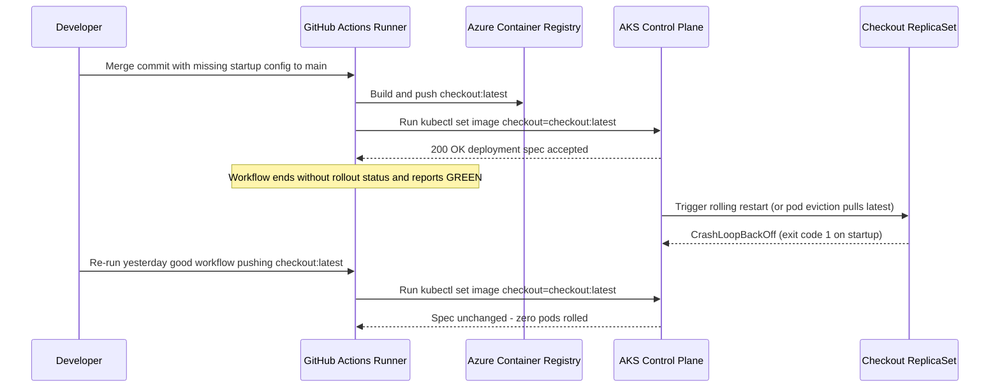

# CI/CD: GitHub Actions to AKS

> **Prerequisites:** Running AKS cluster (Module 01), ACR attached with `AcrPull` (Module 03), Deployment + Ingress running (Modules 02 & 04), and a GitHub repository with Actions enabled.  
> **Estimated Reading Time:** 35 minutes  
> **Target Audience:** Backend Engineers, DevOps Engineers, Platform Engineers, Release Engineers.

> [!TIP]
> **The Golden Rule of AKS CI/CD Pipelines:** Authenticate GitHub Actions to Azure using short-lived **OIDC federation** (zero stored secrets, plus `permissions: id-token: write`), tag every build with an immutable commit SHA (`${{ github.sha }}`) rather than `:latest`, and always conclude your deploy job with `kubectl rollout status --timeout=...` so a `CrashLoopBackOff` release fails the pipeline red instead of silently passing green.

---

## Why This Matters

Every deploy so far in this track has been you, typing `docker build`, `docker push`, and `kubectl apply`/`kubectl set image` by hand. That's fine for learning, but it doesn't scale to a team, and it's easy to forget a step or push a stale tag under pressure. This module wires up a GitHub Actions workflow that does exactly the steps you've been doing manually — build, push to ACR, roll out to AKS — automatically on every push to `main`, so "deploy" becomes "merge," and the actual mechanics get consistent and auditable.

---

## 1. Architectural Mental Model: Secretless OIDC Federation & Immutable Rollouts

A production AKS pipeline decouples **build-and-push identity** (GitHub Actions runner holding `AcrPush` and cluster user rights via short-lived OIDC tokens) from **runtime pull identity** (AKS worker nodes holding `AcrPull` from Module 03):

```mermaid
flowchart LR
    subgraph GitHub["GitHub Actions Runner (push to main)"]
        Code["Checkout Commit SHA"]
        OIDCReq["Request OIDC JWT (id-token write)"]
        AzLogin["azure/login@v2"]
        BuildPush["docker build and push (tag = github.sha)"]
        KubectlDeploy["kubectl set image + rollout status"]
        Code --> OIDCReq --> AzLogin --> BuildPush --> KubectlDeploy
    end

    subgraph AzureIdentity["Microsoft Entra ID"]
        FedCred["Federated Credential (sub = repo org/repo main)"]
        ShortToken["Short-Lived Access Token"]
        FedCred -->|Validates GitHub JWT| ShortToken
    end

    subgraph AzureInfra["Azure Container Registry and AKS"]
        ACR["ACR (acraskslearn.azurecr.io)"]
        AKSAPI["AKS API Server"]
        Nodes["AKS Nodes (Kubelet with AcrPull Identity)"]
        BuildPush -->|AcrPush Role| ACR
        KubectlDeploy -->|AKS Cluster User Role| AKSAPI
        AKSAPI -->|Creates new ReplicaSet| Nodes
        Nodes -->|AcrPull pulls SHA image| ACR
    end

    AzLogin -->|Presents OIDC JWT| FedCred
    ShortToken -->|Authorizes runner session| BuildPush
```



### Core Concepts

- **What a GitHub Actions workflow is, briefly:** A YAML file in `.github/workflows/` in your repo that GitHub runs on specified triggers (here: `push` to `main`), executing a sequence of steps on a GitHub-hosted (or self-hosted) runner VM. Each step is either a shell command or a reusable "action" (a packaged step someone else wrote, like `azure/login`).
- **Two ways for the workflow to authenticate to Azure — service principal vs. OIDC federation:**
  - A **service principal (SP)** is an Azure AD application identity with a password/certificate you generate once (`az ad sp create-for-rbac`) and store as a long-lived secret in GitHub (`AZURE_CREDENTIALS`). The workflow logs in using that stored secret. Simple to set up, but it's a standing credential that can leak from GitHub secrets and must be manually rotated.
  - **OIDC (OpenID Connect) federation** configures Azure AD to trust GitHub's own token issuer for a specific repo/branch, so GitHub Actions requests a short-lived token at run time and Azure AD verifies it against the trust relationship — **no password or secret is stored in GitHub at all**. This is the modern, recommended approach: nothing long-lived to leak, nothing to rotate, and the trust is scoped to exactly the repo (and optionally branch) you configure.
  This module sets up OIDC as the primary path and explains the SP approach only for comparison — prefer OIDC for any new setup.
- **What the workflow actually does, step by step:** checkout code → log in to Azure (via OIDC) → log in to ACR → build the Docker image → push it to ACR tagged with the Git commit SHA (not `latest` — you want every deploy traceable to an exact commit) → get AKS credentials → update the running Deployment to the new image tag (`kubectl set image`, or re-applying a manifest/Helm chart with the new tag templated in) → wait for the rollout to finish and fail the workflow if it doesn't.
- **Why tag by commit SHA, not `latest`:** `kubectl set image` (or any redeploy) only actually triggers a rolling update if the image reference changes. If every push builds and pushes `myapp:latest`, the Deployment's pod spec never changes text, so Kubernetes has no way to know a new image exists and won't roll anything out. Tagging with the immutable commit SHA guarantees each push produces a distinct, traceable image reference that forces a real rollout.
- **What AKS/Azure manages vs. what you own here:** Azure AD handles OIDC token validation once the federated credential trust is configured — you don't manage any secret rotation for that path. You still own: the workflow YAML itself, which branch/environment triggers a deploy, the image tagging scheme, and — importantly — verifying the rollout actually succeeded (a broken image that starts but crash-loops will not necessarily fail a naive `kubectl apply` step unless you also check rollout status).

---

## 2. Taxonomic Comparison: Authentication & Rollout Mechanics

### Service Principal Secret vs. OIDC Federation

| Dimension | Service Principal Secret (`AZURE_CREDENTIALS`) | OIDC Federation (`azure/login@v2`) |
| :--- | :--- | :--- |
| **Credential Lifespan** | Long-lived password or certificate (months/years) | Short-lived OIDC JWT + access token (minutes, per job) |
| **GitHub Secret Exposure** | High — static secret stored in GitHub repository secrets | Minimal — only non-secret IDs (`client-id`, `tenant-id`, `subscription-id`) |
| **Rotation Burden** | Manual rotation before expiry or after team changes | Zero secret rotation required |
| **Scope Enforcement** | Any workflow with access to the secret can use it | Entra ID checks exact `subject` claim (`repo`, `branch`, or `environment`) |
| **Workflow Requirement** | Standard `contents: read` | Requires `permissions: id-token: write` |

### Tagging Strategy & Rollout Safety

| Deployment Pattern | Triggers Rolling Update? | Traceability & Rollback | CI Outcome on `CrashLoopBackOff` |
| :--- | :--- | :--- | :--- |
| **`myapp:latest` + `kubectl set image` only** | No (Pod spec string unchanged) | Ambiguous — cannot map running pods to a Git commit | False Green (step exits 0 immediately after API submit) |
| **`myapp:<sha>` + `kubectl set image` only** | Yes (new Pod template tag) | Exact 1-to-1 Git SHA traceability | False Green (CI passes while production crashes) |
| **`myapp:<sha>` + `kubectl rollout status --timeout=180s`** | Yes | Exact SHA traceability + clean `kubectl rollout undo` | **True Red** (exits non-zero when deadline hits) |

---

## 3. Production War Story Post-Mortem

### SEV-1: "Green" Pipeline Shipped a Crash-Looping Binary While `:latest` Blocked Emergency Rollback

- **Severity:** SEV-1 (52-minute checkout partial degradation during peak traffic)
- **Detection Time:** 18 minutes (customer error-rate pager, NOT CI failure)
- **Resolution Time:** 34 minutes
- **Impact:** A startup panic caused by a missing config key was merged to `main`. Because the pipeline pushed `:latest` and omitted `kubectl rollout status`, GitHub Actions exited `0` (green). When nodes recycled pods, new pods entered `CrashLoopBackOff`. Worse, re-running the previous known-good GitHub Actions job pushed an older build under the *same* `:latest` tag—so `kubectl set image` saw zero diff and refused to roll pods back.



### Root Cause Analysis

1. **Missing Rollout Verification:** `kubectl set image` is asynchronous; without `kubectl rollout status --timeout=...`, GitHub Actions has no signal of pod startup health.
2. **Mutable `:latest` Tagging:** Reusing `:latest` violates Deployment template immutability, preventing Kubernetes from distinguishing a broken release from a rollback build.

### The Fix & Architectural Hardening

- **Immutable Commit SHA Tags:** Switched every build to `acraskslearn.azurecr.io/demo-app:${{ github.sha }}`.
- **Mandatory Rollout Gate:** Added `kubectl rollout status deployment/demo-app --timeout=180s` plus readiness probes and `maxUnavailable: 0` (`maxSurge: 1`) so broken pods never evict healthy old replicas.
- **OIDC Least Privilege:** Replaced shared `AZURE_CREDENTIALS` JSON secrets with Entra ID OIDC federated credentials scoped strictly to `refs/heads/main`.

---

## 4. Command Reference & Role Separation Breakdown

| Command | What it does | Example |
| :--- | :--- | :--- |
| `az ad app create` | Creates an Azure AD application (identity) to federate with GitHub OIDC | `az ad app create --display-name gh-actions-aks-learn` |
| `az ad sp create-for-rbac` | Creates a service principal with a password/cert (the older, non-OIDC auth path) | `az ad sp create-for-rbac --name gh-actions-aks-learn --role contributor --scopes <resource-group-id> --sdk-auth` |
| `az ad app federated-credential create` | Adds a federated identity credential trusting GitHub's OIDC issuer for a specific repo/branch | `az ad app federated-credential create --id <app-id> --parameters credential.json` |
| `az role assignment create` | Grants the app's service principal a role (e.g. `Contributor` or `Azure Kubernetes Service Cluster User Role`) scoped to your resource group/cluster | `az role assignment create --assignee <app-id> --role "Azure Kubernetes Service Cluster User Role" --scope <cluster-resource-id>` |
| `az aks update --attach-acr` | (From module 03) still how the *cluster* pulls images; the workflow instead needs its own push rights on the ACR | `az aks update --resource-group rg-aks-learn --name aks-learn --attach-acr acraskslearn` |
| `az role assignment create --role AcrPush` | Grants the workflow's identity push rights on the ACR (separate from the cluster's `AcrPull`) | `az role assignment create --assignee <app-id> --role AcrPush --scope <acr-resource-id>` |
| `azure/login@v2` (GitHub Action) | Authenticates the workflow to Azure using OIDC | `uses: azure/login@v2` with `client-id`/`tenant-id`/`subscription-id` inputs |
| `az acr build` / `docker build` + `docker push` | Builds and pushes the image from the workflow | `docker push acraskslearn.azurecr.io/demo-app:${{ github.sha }}` |
| `az aks get-credentials` | Fetches kubeconfig inside the workflow runner (via the `azure/aks-set-context` action or the raw CLI call) | `az aks get-credentials --resource-group rg-aks-learn --name aks-learn` |
| `kubectl set image` | Updates a Deployment's container image and triggers a rolling update | `kubectl set image deployment/demo-app demo-app=acraskslearn.azurecr.io/demo-app:${{ github.sha }}` |
| `kubectl rollout status` | Blocks until a rollout completes or fails, giving CI a real pass/fail signal | `kubectl rollout status deployment/demo-app --timeout=180s` |

### Identity & Permission Separation Matrix

| Identity | Azure Role / Permission | Target Scope | Why Separate? |
| :--- | :--- | :--- | :--- |
| **GitHub Actions App Identity** | `AcrPush` | ACR Resource | CI builds & pushes new SHA images; should not mutate unrelated Azure billing/VMs |
| **GitHub Actions App Identity** | `Azure Kubernetes Service Cluster User Role` (+ K8s RBAC if AAD-enabled) | AKS Cluster | Allows fetching kubeconfig and submitting `kubectl set image` / checking `rollout status` |
| **AKS Cluster Kubelet Identity** | `AcrPull` (Module 03) | ACR Resource | Worker nodes only pull verified images; compromised pods should not push poisoned images to ACR |
| **GitHub Workflow Permission** | `id-token: write` | Workflow Job | Allows GitHub Actions runner to mint the short-lived OIDC JWT (`ACTIONS_ID_TOKEN_REQUEST_URL`) |

---

## 5. Multi-Language Production Implementation

Before `kubectl set image` runs—and while waiting on rollout completion—CI/CD automation scripts enforce **immutable SHA tags**, validate **OIDC federated `subject` claims**, and evaluate Kubernetes **Deployment rollout conditions** (`Available`, `Progressing`, `ProgressDeadlineExceeded`) to fail broken deployments deterministically.

````carousel
```go
// ci_gate.go — Immutable SHA image validator, OIDC subject verifier, & rollout readiness evaluator
package cicd

import (
	"fmt"
	"regexp"
	"strings"
)

var shaTagRegex = regexp.MustCompile(`^[a-f0-9]{40}$`)

// ValidateImmutableImageRef rejects mutable tags like :latest so kubectl set image
// always modifies the Pod template and preserves commit traceability.
func ValidateImmutableImageRef(imageRef string) error {
	parts := strings.Split(imageRef, ":")
	if len(parts) < 2 {
		return fmt.Errorf("image reference %q has no tag", imageRef)
	}
	tag := parts[len(parts)-1]
	if tag == "latest" || tag == "main" || tag == "dev" {
		return fmt.Errorf("mutable tag %q is forbidden in AKS CI/CD; use commit SHA", tag)
	}
	if !shaTagRegex.MatchString(tag) && !strings.Contains(imageRef, "@sha256:") {
		return fmt.Errorf("tag %q is neither a 40-char Git SHA nor a sha256 digest", tag)
	}
	return nil
}

// ExpectedOIDCSubject builds the exact Entra ID federated credential subject string.
func ExpectedOIDCSubject(org, repo, branch string) string {
	return fmt.Sprintf("repo:%s/%s:ref:refs/heads/%s", org, repo, branch)
}

type DeploymentStatus struct {
	Generation         int64
	ObservedGeneration int64
	Replicas           int32
	UpdatedReplicas    int32
	AvailableReplicas  int32
	ProgressReason     string
}

func IsRolloutComplete(s DeploymentStatus) (done bool, err error) {
	if s.ProgressReason == "ProgressDeadlineExceeded" {
		return false, fmt.Errorf("rollout failed: ProgressDeadlineExceeded (check pod CrashLoopBackOff)")
	}
	if s.ObservedGeneration < s.Generation {
		return false, nil
	}
	ready := s.UpdatedReplicas == s.Replicas && s.AvailableReplicas == s.Replicas
	return ready, nil
}
```
<!-- slide -->
```typescript
// deployGate.ts — CI/CD OIDC subject & immutable SHA rollout verification
export interface RolloutCondition {
  type: string;
  status: "True" | "False" | "Unknown";
  reason?: string;
  message?: string;
}

export interface DeploymentSnapshot {
  metadataGeneration: number;
  observedGeneration: number;
  desiredReplicas: number;
  updatedReplicas: number;
  availableReplicas: number;
  conditions: RolloutCondition[];
}

export function assertImmutableImage(registry: string, image: string, tag: string): string {
  if (tag === "latest" || !/^[a-f0-9]{40}$/i.test(tag)) {
    throw new Error(
      `Refusing mutable/non-SHA tag '${tag}'. Tag builds with 40-char commit SHA (github.sha).`
    );
  }
  return `${registry}/${image}:${tag}`;
}

export function verifyFederatedSubject(actualSub: string, org: string, repo: string, branch = "main"): void {
  const expected = `repo:${org}/${repo}:ref:refs/heads/${branch}`;
  if (actualSub !== expected) {
    throw new Error(`OIDC subject mismatch: got '${actualSub}', expected '${expected}'`);
  }
}

export function evaluateRollout(snap: DeploymentSnapshot): "IN_PROGRESS" | "COMPLETE" {
  const progressing = snap.conditions.find((c) => c.type === "Progressing");
  if (progressing?.status === "False" && progressing.reason === "ProgressDeadlineExceeded") {
    throw new Error(`Deployment stalled: ${progressing.message ?? "CrashLoopBackOff / image pull error"}`);
  }

  const allUpdated =
    snap.observedGeneration >= snap.metadataGeneration &&
    snap.updatedReplicas === snap.desiredReplicas &&
    snap.availableReplicas === snap.desiredReplicas;

  return allUpdated ? "COMPLETE" : "IN_PROGRESS";
}
```
<!-- slide -->
```python
# release_gate.py — Enforce immutable SHA tags, OIDC claims, and Kubernetes rollout status
import re
from dataclasses import dataclass

SHA40_RE = re.compile(r"^[0-9a-f]{40}$")
EXPECTED_AUDIENCE = "api://AzureADTokenExchange"


@dataclass(frozen=True)
class FederatedCredentialSpec:
    org: str
    repo: str
    branch: str = "main"

    @property
    def subject(self) -> str:
        return f"repo:{self.org}/{self.repo}:ref:refs/heads/{self.branch}"


def validate_image_tag(image_ref: str) -> None:
    if ":" not in image_ref:
        raise ValueError(f"Image '{image_ref}' is missing an explicit tag")
    tag = image_ref.rsplit(":", 1)[-1]
    if tag == "latest" or not SHA40_RE.match(tag):
        raise ValueError(
            f"Tag '{tag}' rejected: use immutable 40-char commit SHA so kubectl set image triggers a rollout."
        )


def validate_oidc_claims(claims: dict, spec: FederatedCredentialSpec) -> None:
    if claims.get("aud") != EXPECTED_AUDIENCE and EXPECTED_AUDIENCE not in (claims.get("aud") or []):
        raise PermissionError(f"Unexpected OIDC audience: {claims.get('aud')!r}")
    if claims.get("sub") != spec.subject:
        raise PermissionError(f"OIDC subject '{claims.get('sub')}' != expected '{spec.subject}'")


def check_rollout_health(status: dict, desired: int) -> bool:
    for cond in status.get("conditions", []):
        if cond.get("type") == "Progressing" and cond.get("reason") == "ProgressDeadlineExceeded":
            raise RuntimeError(f"Rollout failed: {cond.get('message', 'deadline exceeded')}")
    return (
        status.get("updatedReplicas", 0) == desired
        and status.get("availableReplicas", 0) == desired
        and status.get("unavailableReplicas", 0) == 0
    )
```
<!-- slide -->
```csharp
// AksDeployGate.cs — Immutable SHA tag guard, OIDC federated spec, & rollout evaluator
using System;
using System.Collections.Generic;
using System.Linq;
using System.Text.RegularExpressions;

public sealed record RolloutCondition(string Type, string Status, string? Reason, string? Message);

public static class AksDeployGate
{
    private static readonly Regex ShaPattern = new("^[a-f0-9]{40}$", RegexOptions.Compiled);

    public static string BuildImmutableImageRef(string acrServer, string imageName, string gitSha)
    {
        if (string.Equals(gitSha, "latest", StringComparison.OrdinalIgnoreCase) || !ShaPattern.IsMatch(gitSha))
            throw new ArgumentException($"Mutable or invalid commit SHA tag '{gitSha}'.", nameof(gitSha));

        return $"{acrServer}/{imageName}:{gitSha}";
    }

    public static string ExpectedFederatedSubject(string org, string repo, string branch = "main")
        => $"repo:{org}/{repo}:ref:refs/heads/{branch}";

    public static bool IsRolloutHealthy(
        long generation,
        long observedGeneration,
        int desiredReplicas,
        int updatedReplicas,
        int availableReplicas,
        IEnumerable<RolloutCondition> conditions)
    {
        var stalled = conditions.FirstOrDefault(
            c => c.Type == "Progressing" && c.Reason == "ProgressDeadlineExceeded");

        if (stalled is not null)
            throw new InvalidOperationException($"AKS rollout failed: {stalled.Message}");

        return observedGeneration >= generation
            && updatedReplicas == desiredReplicas
            && availableReplicas == desiredReplicas;
    }
}
```
````

---

## 6. Practical Hands-On Verification CLI Workflows

Work through all 8 exercises sequentially, checking each `**Expected Output:**`.

### 1. Create an Azure AD App Registration for GitHub OIDC

```bash
APP_ID=$(az ad app create --display-name gh-actions-aks-learn --query appId -o tsv)
echo "App ID: $APP_ID"

# Confirm a service principal exists for the app (create one if missing):
az ad sp show --id "$APP_ID" || az ad sp create --id "$APP_ID"
```

*(Note: `az ad sp create-for-rbac --name gh-actions-aks-learn` is **not** needed for the OIDC path — that command is for generating a long-lived SP-secret credential.)*

**Expected Output:** `az ad sp show` returns the Service Principal JSON object containing `appId` and `id` (objectId).

### 2. Add a Federated Credential Trusting Your Repo's `main` Branch

Write `credential.json` (replacing `<your-org>` and `<your-repo>`):

```json
{
  "name": "gh-actions-main",
  "issuer": "https://token.actions.githubusercontent.com",
  "subject": "repo:<your-org>/<your-repo>:ref:refs/heads/main",
  "audiences": ["api://AzureADTokenExchange"]
}
```

Apply and verify:

```bash
az ad app federated-credential create --id "$APP_ID" --parameters credential.json
az ad app federated-credential list --id "$APP_ID" --output table
```

**Expected Output:**

```text
Audiences                        Id                                    Issuer                                       Name             Subject
-------------------------------  ------------------------------------  -------------------------------------------  ---------------  -----------------------------------------
['api://AzureADTokenExchange']   xxxxxxxx-xxxx-xxxx-xxxx-xxxxxxxxxxxx  https://token.actions.githubusercontent.com  gh-actions-main  repo:<your-org>/<your-repo>:ref:refs/heads/main
```

### 3. Grant the App the Two Required Azure Roles

It needs `AcrPush` on your ACR and `Azure Kubernetes Service Cluster User Role` (or `Contributor` for simplicity in a learning context) on the AKS cluster:

```bash
ACR_ID=$(az acr show --name acraskslearn --query id -o tsv)
AKS_ID=$(az aks show --resource-group rg-aks-learn --name aks-learn --query id -o tsv)

az role assignment create --assignee "$APP_ID" --role AcrPush --scope "$ACR_ID"
az role assignment create --assignee "$APP_ID" --role "Azure Kubernetes Service Cluster User Role" --scope "$AKS_ID"

az role assignment list --assignee "$APP_ID" --output table
```

*(Note: If your cluster also uses Azure AD RBAC from Module 07, also grant the Service Principal permission inside Kubernetes to patch Deployments, e.g., `Azure Kubernetes Service RBAC Writer` if `--enable-azure-rbac` is active, or bind its Object ID to an `edit` RoleBinding.)*

**Expected Output:** Both `AcrPush` (scoped to ACR) and `Azure Kubernetes Service Cluster User Role` (scoped to AKS) appear in the table.

### 4. Store Non-Secret Identifiers in GitHub Repo Settings

In your GitHub repo **Settings → Secrets and variables → Actions**, add:

- `AZURE_CLIENT_ID`: your `$APP_ID`
- `AZURE_TENANT_ID`: output of `az account show --query tenantId -o tsv`
- `AZURE_SUBSCRIPTION_ID`: output of `az account show --query id -o tsv`

None of these are secret credentials by themselves (that's the whole point of OIDC) — they're just identifiers the workflow uses to tell Entra ID which identity, tenant, and subscription to exchange the short-lived token for.

### 5. Write and Commit `.github/workflows/deploy-aks.yml`

Make sure a Deployment named `demo-app` with a container named `demo-app` already exists on your cluster from an earlier module (or adjust `DEPLOYMENT_NAME` / `CONTAINER_NAME` to match):

```yaml
name: Build and Deploy to AKS

on:
  push:
    branches: [main]

permissions:
  id-token: write   # required for OIDC
  contents: read

env:
  ACR_NAME: acraskslearn
  ACR_LOGIN_SERVER: acraskslearn.azurecr.io
  IMAGE_NAME: demo-app
  RESOURCE_GROUP: rg-aks-learn
  CLUSTER_NAME: aks-learn
  DEPLOYMENT_NAME: demo-app
  CONTAINER_NAME: demo-app

jobs:
  build-and-deploy:
    runs-on: ubuntu-latest
    steps:
      - name: Checkout
        uses: actions/checkout@v4

      - name: Azure login (OIDC)
        uses: azure/login@v2
        with:
          client-id: ${{ secrets.AZURE_CLIENT_ID }}
          tenant-id: ${{ secrets.AZURE_TENANT_ID }}
          subscription-id: ${{ secrets.AZURE_SUBSCRIPTION_ID }}

      - name: Log in to ACR
        run: az acr login --name ${{ env.ACR_NAME }}

      - name: Build and push image
        run: |
          docker build -t ${{ env.ACR_LOGIN_SERVER }}/${{ env.IMAGE_NAME }}:${{ github.sha }} .
          docker push ${{ env.ACR_LOGIN_SERVER }}/${{ env.IMAGE_NAME }}:${{ github.sha }}

      - name: Get AKS credentials
        uses: azure/aks-set-context@v4
        with:
          resource-group: ${{ env.RESOURCE_GROUP }}
          cluster-name: ${{ env.CLUSTER_NAME }}

      - name: Deploy new image
        run: |
          kubectl set image deployment/${{ env.DEPLOYMENT_NAME }} \
            ${{ env.CONTAINER_NAME }}=${{ env.ACR_LOGIN_SERVER }}/${{ env.IMAGE_NAME }}:${{ github.sha }}

      - name: Wait for rollout
        run: kubectl rollout status deployment/${{ env.DEPLOYMENT_NAME }} --timeout=180s
```

Commit and push this file to `main`.

### 6. Watch the Workflow Run and Cross-Check From Your Terminal

In GitHub, open the **Actions** tab and verify every step turns green, especially `Wait for rollout`. Then cross-check locally:

```bash
kubectl get deployment demo-app -o jsonpath='{.spec.template.spec.containers[0].image}'
echo ""
az acr repository show-tags --name acraskslearn --repository demo-app --output table
```

**Expected Output:**

```text
acraskslearn.azurecr.io/demo-app:<40-char-commit-sha>
Result
----------------------------------------
<40-char-commit-sha>
```

### 7. Make a Real Code Change and Verify End-to-End Automation

Change something visible in your app (e.g., a response string or version banner), commit, and push to `main` (or merge a PR into `main`). Without running any `docker`, `az`, or `kubectl` command manually, curl your app's external Ingress endpoint (from Module 04) once the workflow completes and verify the new response is live.

### 8. Diagnose and Fix: Rollout Step Fails / Times Out

Deliberately push a commit that builds cleanly but crashes on startup (e.g., an uncaught exception or `os.Exit(1)` at boot). Watch the **Actions** tab — `kubectl rollout status --timeout=180s` should time out and fail the run (exit non-zero) rather than falsely reporting green. Investigate locally:

```bash
kubectl rollout status deployment/demo-app
kubectl get pods -l app=demo-app
kubectl describe pod <new-pod-name>
```

**Expected Output:** `CrashLoopBackOff` visible on the new pod while healthy old pods remain served (assuming standard `RollingUpdate` limits). Fix the code, push to `main`, and verify the next run goes green and scales the failed ReplicaSet to `0`:

```bash
kubectl get replicaset -l app=demo-app
```

---

## Independent Challenge

No commands given here — figure it out yourself using what you know from this module and earlier ones.

**Task:** Stand up a fully hands-off deploy pipeline and then prove it protects you from a bad release. Wire a GitHub Actions workflow that, on a push to `main`, authenticates to Azure without storing any long-lived secret, builds your app image, pushes it to your ACR under a tag that guarantees a real rollout, and updates the running Deployment — reusing the ACR and cluster you set up in modules 03 and 01 (conceptually building on module 03's push-vs-pull distinction, since the pipeline's identity needs a different grant than the cluster's own pull identity). First prove the happy path end to end: make a visible code change, push, and confirm the new behavior is live at your app's public endpoint without you running a single `docker`, `az`, or `kubectl` command by hand. Then deliberately ship a build that compiles but crashes on startup, and confirm the pipeline *fails the run* rather than reporting a false success — reason about which single workflow step is what makes a crash-looping deploy show up as red. Keep the trigger scoped to `main` only so you're not burning CI minutes and piling up ACR image tags on every branch, and remember the cluster and ACR keep billing between runs.

<details>
<summary>Stuck? One hint</summary>

Two things make the difference: tagging the image by immutable commit SHA (so `kubectl set image` actually changes the pod spec and triggers a rollout) and following the deploy with `kubectl rollout status --timeout=...` (so a crash-loop produces a non-zero exit and fails the workflow instead of passing silently). The secretless auth is OIDC federation, which also needs `permissions: id-token: write`.

</details>

---

## 7. Common Mistakes & Troubleshooting

- **Tagging every build `latest`:** As explained above, this silently breaks `kubectl set image`-based rollouts — the image reference string never changes, so no rolling update is triggered even though a new image was pushed. Always tag with something unique per build (commit SHA is simplest and most traceable).
- **Using a service-principal secret when OIDC was available:** If you set up `AZURE_CREDENTIALS` as a long-lived JSON secret instead of OIDC, you've created a standing credential in GitHub that needs manual rotation and is a bigger blast radius if leaked. Prefer OIDC federation for anything new.
- **Forgetting `permissions: id-token: write` in the workflow:** Without it, `azure/login@v2` with OIDC fails to obtain a token — this is a common first-time OIDC setup mistake and the error message (something like `"unable to get ACTIONS_ID_TOKEN_REQUEST_URL"`) doesn't always make the missing permission obvious at first glance.
- **Scoping the federated credential's `subject` too broadly or incorrectly:** A typo'd `subject` (wrong org/repo/branch pattern) means Azure AD will reject the token exchange even though everything else is configured correctly — double check it matches `repo:<org>/<repo>:ref:refs/heads/<branch>` exactly.
- **Deploying without a rollout-status check:** A workflow that just runs `kubectl set image` and stops "succeeds" even if the new pods immediately crash-loop — always follow with `kubectl rollout status --timeout=...` so a bad deploy fails the workflow, not just fails silently in production.
- **Cost pitfall: CI building and pushing images on every commit to every branch, not just `main`:** If the `on:` trigger is too broad (e.g. all branches, all PRs) instead of scoped to `push: branches: [main]`, you accumulate ACR storage (many image layers/tags never cleaned up) and burn CI minutes for builds that were never meant to deploy anywhere — keep the trigger scoped, and consider an ACR retention/cleanup policy for old tags.

---

## 8. Operational Validation Checkpoints

<details>
<summary><strong>Scenario 1: OIDC Login Fails With ACTIONS_ID_TOKEN_REQUEST_URL Error</strong></summary>

**Scenario:** Your `azure/login@v2` step fails with `Error: Unable to get ACTIONS_ID_TOKEN_REQUEST_URL env variable` even though `AZURE_CLIENT_ID`, `AZURE_TENANT_ID`, and `AZURE_SUBSCRIPTION_ID` are populated accurately in GitHub secrets. What single YAML block is missing?

**Verification & Answer:** The workflow (or job) is missing `permissions: id-token: write` (alongside `contents: read`). GitHub Actions does not expose the OIDC token-minting endpoint URL or bearer token to runners unless `id-token: write` is explicitly granted.

</details>

<details>
<summary><strong>Scenario 2: Pipeline Succeeds Green on PR Branches Instead of Main Only — or Fails After Renaming Default Branch</strong></summary>

**Scenario:** A team renames their default branch from `master` to `main` and updates `deploy-aks.yml` to trigger on `push: branches: [main]`, yet `azure/login@v2` starts failing with `AADSTS70021: No matching federated identity record found for presented assertion`. Why?

**Verification & Answer:** The Entra ID federated credential's `subject` claim is still pinned to `repo:<org>/<repo>:ref:refs/heads/master`. Azure AD rejects the OIDC token exchange whenever the GitHub JWT `sub` claim differs from the exact federated credential `subject`. Update the federated credential `subject` to `repo:<org>/<repo>:ref:refs/heads/main`.

</details>

<details>
<summary><strong>Scenario 3: AKS Pulls Fail After CI Pushes Successfully</strong></summary>

**Scenario:** GitHub Actions successfully authenticates via OIDC, builds the image tagged with commit SHA, pushes it to `acraskslearn.azurecr.io`, and updates the Deployment—yet `kubectl rollout status` times out because pods enter `ImagePullBackOff` (`401 Unauthorized`). Which identity is missing what role?

**Verification & Answer:** Pushing and pulling use two different identities. The CI identity has `AcrPush`, which succeeded. However, the **AKS cluster's kubelet managed identity** is missing `AcrPull` on the ACR (configured via `az aks update --resource-group rg-aks-learn --name aks-learn --attach-acr acraskslearn` from Module 03).

</details>

---

## 9. Checkpoint Quiz

Write down your answer to each question before expanding it — checking without attempting first is the single easiest way to fool yourself into thinking you've learned this.

1. What's the core security advantage of OIDC federation over a stored service-principal secret for GitHub Actions?
2. What GitHub Actions workflow permission is required for OIDC login to work, and what happens if it's missing?
3. Why must each build be tagged with something other than `latest` for `kubectl set image` to actually trigger a rollout?
4. What two Azure roles does the CI identity need, and why are they different from the roles the AKS cluster itself needs (module 03)?
5. Why is a `kubectl rollout status` step necessary even after `kubectl set image` succeeds?
6. What's a realistic cost consequence of triggering the build/push job on every branch and PR instead of only on `push` to `main`?

<details>
<summary>Show answers</summary>

1. OIDC federation requires no long-lived secret to be stored in GitHub at all — Azure AD trusts short-lived tokens issued by GitHub's own OIDC provider for a specifically scoped repo/branch, so there's nothing durable to leak or need to rotate, unlike a stored service-principal password/certificate.
2. `permissions: id-token: write` at the workflow or job level. Without it, the runner can't request an OIDC token from GitHub, and `azure/login@v2` fails to authenticate.
3. Kubernetes only triggers a rolling update when the Deployment's pod template actually changes (e.g. a different image reference). If every push reuses the tag `latest`, the stored spec never changes text, so no rollout happens even though a new image was pushed to the registry.
4. The CI identity needs `AcrPush` (to push new images to the registry) and a role letting it act against the AKS cluster (e.g. "Azure Kubernetes Service Cluster User Role" or broader `Contributor`). This is different from the *cluster's own* managed identity, which only needs `AcrPull` (module 03) to run images already in the registry — pushing and pulling are different operations needing different privilege.
5. Because `kubectl set image` only submits the change and returns immediately — it doesn't wait to see whether the new pods actually become healthy. Without `rollout status`, a deploy that crash-loops would still report the workflow step as "succeeded."
6. It generates and pushes container images (consuming ACR storage as image layers/tags) and consumes CI runner minutes for commits/branches that were never intended to deploy anywhere, accumulating cost with no corresponding benefit.

</details>

---

## Next

[09-capstone-project](../09-capstone-project/README.md) — put everything from this entire track together in one real, end-to-end AKS project.
