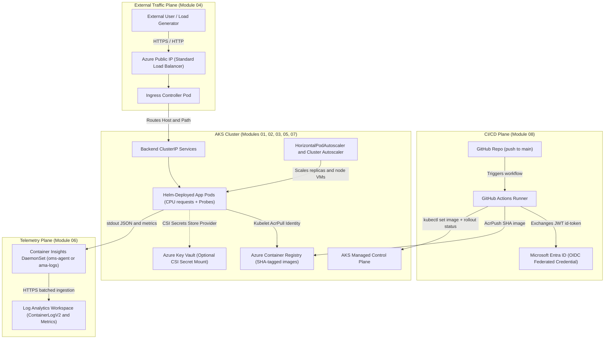
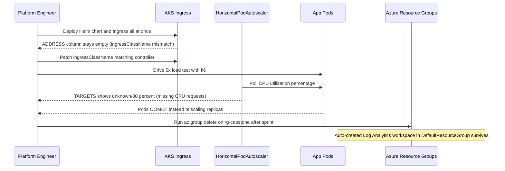

# Capstone Project

> **Prerequisites:** Completion of AKS Track Modules 00–08 and the Kubernetes track capstone ([03-kubernetes/12-capstone-project](../../03-kubernetes/12-capstone-project/README.md)).  
> **Estimated Reading Time:** 90–120 minutes (end-to-end build, load verification, CI/CD validation, and teardown)  
> **Target Audience:** Backend Engineers, DevOps Engineers, Platform Engineers, Cloud Architects.

> [!TIP]
> **The Golden Rule of the AKS Capstone:** Build and validate vertically layer-by-layer—cluster and ACR `AcrPull` identity first, baseline manifests or Helm chart second, Ingress public IP third, Container Insights and HPA fourth, and OIDC CI/CD last—because debugging Helm templating, Azure networking, and RBAC simultaneously masks the failing boundary; keep an explicit inventory of every resource created so final teardown leaves zero orphaned Log Analytics workspaces, Key Vaults, or public IPs.

---

## Overview

This is the last module of the entire curriculum. There's no new concept section and no quiz here — the goal is to combine everything from modules 00-08 of this track (and the Helm chart you built in the Kubernetes track's capstone, [03-kubernetes/12-capstone-project](../../03-kubernetes/12-capstone-project/README.md)) into one real, working, monitored, autoscaling, CI/CD-deployed application running on a real AKS cluster.

Treat this as a project, not a checklist of isolated exercises — pieces depend on each other in the order you'd actually build them in the real world.

---

## 1. Architectural Mental Model: Full-Stack Production AKS Topology

Every component you practiced independently in Modules 01–08 interlocks in this production architecture:



### Shared Responsibility Summary (Managed by AKS vs. Operated by You)

- **Managed by Azure / AKS:** Control plane HA (`etcd`, API server, scheduler, controller-manager), underlying VM provisioning/healing (`MC_*` resource group), OIDC JWT cryptographic verification, ACR pull token plumbing via `--attach-acr`, LoadBalancer public IP attachment, and Container Insights DaemonSet collection pipeline.
- **Configured & Owned by You:** Node pool VM SKUs and `--min-count`/`--max-count` cost bounds, Helm chart templates and `values.yaml` CPU `requests`/`limits`, container liveness/readiness probes, Ingress `ingressClassName` and routing rules, least-privilege IAM roles (`AcrPush` vs `AcrPull`), Log Analytics retention/cleanup, and GitHub Actions OIDC workflow triggers and rollout gates.

---

## 2. Taxonomic Comparison: Capstone Layer Integration & Failure Signatures

| Layer | Azure / K8s Resource | Identity / Auth Mechanism | Healthy Signal Command | Classic Failure Signature |
| :--- | :--- | :--- | :--- | :--- |
| **1. Cluster & Nodes** | AKS Cluster + System/User Node Pool | Subscription RBAC + Managed Identity | `kubectl get nodes` (`Ready`) | Wrong `kubectl` context or `Insufficient cpu` (`Pending`) |
| **2. Registry Pull** | ACR + `--attach-acr` | Cluster kubelet identity (`AcrPull`) | `az role assignment list --scope <acr-id>` | `ImagePullBackOff` / `401 Unauthorized` |
| **3. Helm App** | Helm Release (`Deployments`, `Services`) | `kubeconfig` / Cluster User Role | `helm status <release>` & `kubectl get deploy` | `CrashLoopBackOff` or broken chart template syntax |
| **4. Ingress** | `Ingress` + Ingress Controller `LoadBalancer` | Azure Cloud Controller Manager | `kubectl get ingress` (populated `ADDRESS`) | Blank `ADDRESS` due to mismatched `ingressClassName` |
| **5. Monitoring** | Container Insights + Log Analytics | DaemonSet workspace key / AAD auth | `ContainerLogV2` rows in Portal Logs | Wrong workspace RG checked or checking before 2–5 min lag |
| **6. Autoscaling** | `HPA` + Cluster Autoscaler | `metrics-server` + VMSS scale permissions | `kubectl get hpa -w` (scales up & down) | HPA target shows `<unknown>` (missing CPU `requests`) |
| **7. CI/CD** | `.github/workflows/*.yml` | Entra ID OIDC (`id-token: write`, `AcrPush`) | Green Actions run + updated commit SHA image | `:latest` skips rollout, or missing `rollout status` masks crash |

---

## 3. Production War Story Post-Mortem

### SEV-1: Capstone Go-Live Stalled by Cascading Layer Seams & Orphaned Telemetry Spend

- **Severity:** SEV-1 (Launch Blocked + Silent Post-Teardown Billing Leak)
- **Detection Time:** 25 minutes during pre-launch load verification
- **Resolution Time:** 55 minutes
- **Impact:** An engineer deployed the entire multi-service stack in one shot without layer-by-layer checks: external requests timed out because `Ingress` had no `ADDRESS`; after fixing `ingressClassName`, a 5x synthetic load test caused OOM kills because HPA stayed stuck at `<unknown>` (`values.yaml` dropped CPU `requests`); and after deleting the capstone resource group, an auto-created Log Analytics workspace in `DefaultResourceGroup-*` continued billing silently for weeks.



### Root Cause Analysis

1. **Simultaneous Multi-Layer Debugging:** Combining unproven Helm values with unverified Ingress class names hid which layer was failing.
2. **Missing Resource Requests:** Omitting `resources.requests.cpu` blinded both the HPA denominator (`<unknown>`) and Cluster Autoscaler bin-packing.
3. **Incomplete Teardown Inventory:** Deleting only the cluster resource group missed independent resources (Log Analytics workspace / soft-deleted Key Vault).

### The Fix & Architectural Hardening

- **Vertical Layer Validation:** Verify nodes → ACR `AcrPull` → Pod health/probes → Ingress `ADDRESS` → Container Insights → HPA under load → OIDC CI/CD sequentially.
- **Production Manifest Defaults:** Require `resources.requests`, `/healthz` + `/readyz` probes, and `maxUnavailable: 0` in Helm `values.yaml`.
- **Subscription-Wide Cleanup Check:** Run `az monitor log-analytics workspace list`, `az keyvault list-deleted`, and `az group list` before signing off teardown.

---

## 4. The Project Blueprint & Capstone Command Reference

### The project

Take the multi-component application and Helm chart you built for the Kubernetes track's capstone, and run it for real on Azure:

1. Create a real AKS cluster (module 01) sized appropriately for the app's needs — don't just reuse leftover single-purpose exercise clusters from earlier modules; start from a clean, deliberately-sized resource group for this project.
2. Attach an ACR to the cluster using the managed-identity approach (module 03), and push your application's image(s) to it.
3. Deploy the application using its Helm chart (from the Kubernetes track) against the real AKS cluster, adjusting `values.yaml` as needed for the AKS environment (image references pointing at your ACR, resource requests sized for your node VMs, etc.).
4. Expose the application through a real Ingress (module 04) with a public IP — not a bare `LoadBalancer` Service per component.
5. Enable Container Insights (module 06) and confirm you can see live metrics and logs for the running application in the Azure Portal.
6. Apply an HPA to at least one component of the app (module 05), and prove it scales under real load using a simple load-generation tool (e.g. `hey`, `k6`, `locust`, or even a scripted loop of concurrent `curl`s) — watch replica count and, if load is high enough, node count change in real time.
7. Set up the GitHub Actions workflow from module 08 so that pushing to `main` builds the image, pushes it to your ACR, and rolls the update out to the running AKS deployment automatically.

### Capstone Integration Command Reference

| Milestone | Primary Command | Key Purpose |
| :--- | :--- | :--- |
| **1. Cluster & Autoscaler** | `az aks create --resource-group rg-capstone --name aks-capstone --node-count 2 --node-vm-size Standard_D2s_v5 --enable-cluster-autoscaler --min-count 2 --max-count 4` | Provisions right-sized AKS cluster with node autoscaling ceiling |
| **2. ACR & Pull Identity** | `az aks update -g rg-capstone -n aks-capstone --attach-acr <acr-name>` | Grants cluster kubelet identity `AcrPull` (Module 03) |
| **3. Helm Deploy** | `helm upgrade --install capstone ./chart -f values-aks.yaml --wait` | Deploys multi-component app with ACR image refs & CPU requests |
| **4. Ingress Exposure** | `kubectl get ingress` & `kubectl get ingressclass` | Confirms public IP `ADDRESS` wired to Ingress controller |
| **5. Container Insights** | `az aks enable-addons -g rg-capstone -n aks-capstone -a monitoring` | Ships `ContainerLogV2` & metrics to Log Analytics |
| **6. Load & HPA** | `kubectl get hpa -w` & `kubectl get nodes -w` | Observes live replica & node scaling under synthetic load |
| **7. OIDC CI/CD** | `az ad app federated-credential create` + `.github/workflows/deploy-aks.yml` | Automates SHA build/push (`AcrPush`) + `kubectl rollout status` |

---

## 5. Multi-Language Production Implementation

Your capstone service must pass **Kubernetes readiness probes (`/readyz`)** during Helm rollouts and HPA scale-outs, separate **liveness (`/healthz`)** from downstream dependencies (avoiding restart storms), drain cleanly on `SIGTERM` before Ingress removes endpoints, and emit structured JSON logs cleanly into **Container Insights (`ContainerLogV2`)**.

````carousel
```go
// capstone_probes.go — Liveness, Readiness, SIGTERM drain, & ContainerLogV2 structured telemetry
package main

import (
	"context"
	"encoding/json"
	"log/slog"
	"net/http"
	"os"
	"os/signal"
	"sync/atomic"
	"syscall"
	"time"
)

type ServerHealth struct {
	draining   atomic.Bool
	secretPath string
}

func (h *ServerHealth) liveness(w http.ResponseWriter, _ *http.Request) {
	// Liveness only checks that the process event loop is responsive.
	w.WriteHeader(http.StatusOK)
	_, _ = w.Write([]byte(`{"status":"alive"}`))
}

func (h *ServerHealth) readiness(w http.ResponseWriter, r *http.Request) {
	if h.draining.Load() {
		http.Error(w, `{"status":"draining"}`, http.StatusServiceUnavailable)
		return
	}
	if h.secretPath != "" {
		if _, err := os.Stat(h.secretPath); err != nil {
			http.Error(w, `{"status":"missing_csi_secret"}`, http.StatusServiceUnavailable)
			return
		}
	}
	_ = json.NewEncoder(w).Encode(map[string]string{"status": "ready"})
}

func main() {
	logger := slog.New(slog.NewJSONHandler(os.Stdout, &slog.HandlerOptions{Level: slog.LevelInfo}))
	health := &ServerHealth{secretPath: os.Getenv("CSI_SECRET_PATH")}

	mux := http.NewServeMux()
	mux.HandleFunc("/healthz", health.liveness)
	mux.HandleFunc("/readyz", health.readiness)
	mux.HandleFunc("/", func(w http.ResponseWriter, _ *http.Request) {
		_, _ = w.Write([]byte("capstone ok\n"))
	})

	srv := &http.Server{Addr: ":8080", Handler: mux, ReadHeaderTimeout: 5 * time.Second}
	go func() {
		if err := srv.ListenAndServe(); err != nil && err != http.ErrServerClosed {
			logger.Error("server crashed", slog.String("err", err.Error()))
			os.Exit(1)
		}
	}()

	stop := make(chan os.Signal, 1)
	signal.Notify(stop, syscall.SIGTERM, syscall.SIGINT)
	<-stop

	// Mark /readyz unhealthy first so Ingress stops sending new traffic during pod termination.
	health.draining.Store(true)
	logger.Info("draining connections before shutdown")
	time.Sleep(5 * time.Second)

	ctx, cancel := context.WithTimeout(context.Background(), 10*time.Second)
	defer cancel()
	_ = srv.Shutdown(ctx)
}
```
<!-- slide -->
```typescript
// capstoneHealth.ts — Readiness, Liveness, Graceful SIGTERM Drain & Structured JSON Logging
import http from "node:http";
import { promises as fs } from "node:fs";

let isDraining = false;
const secretPath = process.env.CSI_SECRET_PATH;

function logJson(level: "INFO" | "ERROR", msg: string, extra: Record<string, unknown> = {}): void {
  console.log(JSON.stringify({ ts: new Date().toISOString(), level, msg, ...extra }));
}

const server = http.createServer(async (req, res) => {
  if (req.url === "/healthz") {
    res.writeHead(200, { "Content-Type": "application/json" });
    res.end(JSON.stringify({ status: "alive" }));
    return;
  }

  if (req.url === "/readyz") {
    if (isDraining) {
      res.writeHead(503, { "Content-Type": "application/json" });
      res.end(JSON.stringify({ status: "draining" }));
      return;
    }
    if (secretPath) {
      try {
        await fs.access(secretPath);
      } catch {
        res.writeHead(503, { "Content-Type": "application/json" });
        res.end(JSON.stringify({ status: "secret_unavailable" }));
        return;
      }
    }
    res.writeHead(200, { "Content-Type": "application/json" });
    res.end(JSON.stringify({ status: "ready" }));
    return;
  }

  res.writeHead(200, { "Content-Type": "text/plain" });
  res.end("capstone ok\n");
});

server.listen(8080, () => logJson("INFO", "capstone service listening", { port: 8080 }));

process.on("SIGTERM", () => {
  isDraining = true;
  logJson("INFO", "SIGTERM received; failing /readyz and draining");
  setTimeout(() => {
    server.close(() => process.exit(0));
  }, 5000);
});
```
<!-- slide -->
```python
# capstone_probes.py — Kubernetes /healthz, /readyz, SIGTERM drain, & JSON stdout logger
import json
import os
import signal
import sys
import time
from http.server import BaseHTTPRequestHandler, ThreadingHTTPServer
from pathlib import Path
from threading import Event

DRAINING = Event()
SECRET_PATH = os.getenv("CSI_SECRET_PATH")


def log_json(level: str, message: str, **fields: object) -> None:
    print(json.dumps({"level": level, "message": message, **fields}), flush=True)


class CapstoneHandler(BaseHTTPRequestHandler):
    def do_GET(self) -> None:
        if self.path == "/healthz":
            self._respond(200, {"status": "alive"})
            return

        if self.path == "/readyz":
            if DRAINING.is_set():
                self._respond(503, {"status": "draining"})
                return
            if SECRET_PATH and not Path(SECRET_PATH).is_file():
                self._respond(503, {"status": "missing_csi_secret"})
                return
            self._respond(200, {"status": "ready"})
            return

        self._respond(200, {"service": "capstone", "status": "ok"})

    def _respond(self, code: int, payload: dict) -> None:
        body = json.dumps(payload).encode("utf-8")
        self.send_response(code)
        self.send_header("Content-Type", "application/json")
        self.send_header("Content-Length", str(len(body)))
        self.end_headers()
        self.wfile.write(body)

    def log_message(self, format: str, *args: object) -> None:
        return  # Suppress noisy default stderr logs; emit structured JSON explicitly.


def handle_sigterm(_signum: int, _frame: object) -> None:
    DRAINING.set()
    log_json("INFO", "SIGTERM received; failing /readyz before shutdown")
    time.sleep(5)
    sys.exit(0)


if __name__ == "__main__":
    signal.signal(signal.SIGTERM, handle_sigterm)
    server = ThreadingHTTPServer(("0.0.0.0", 8080), CapstoneHandler)
    log_json("INFO", "capstone service started", port=8080)
    server.serve_forever()
```
<!-- slide -->
```csharp
// CapstoneProbes.cs — ASP.NET Core /healthz, /readyz, CSI check, & graceful drain hook
using System;
using System.IO;
using System.Text.Json;
using System.Threading;
using Microsoft.AspNetCore.Builder;
using Microsoft.AspNetCore.Http;
using Microsoft.Extensions.Hosting;

var builder = WebApplication.CreateBuilder(args);
var app = builder.Build();

int draining = 0;
string? secretPath = Environment.GetEnvironmentVariable("CSI_SECRET_PATH");

app.Lifetime.ApplicationStopping.Register(() =>
{
    Interlocked.Exchange(ref draining, 1);
    Console.WriteLine(JsonSerializer.Serialize(new { level = "INFO", msg = "Draining /readyz on SIGTERM" }));
    Thread.Sleep(TimeSpan.FromSeconds(5));
});

app.MapGet("/healthz", () => Results.Ok(new { status = "alive" }));

app.MapGet("/readyz", () =>
{
    if (Volatile.Read(ref draining) == 1)
        return Results.Json(new { status = "draining" }, statusCode: StatusCodes.Status503ServiceUnavailable);

    if (!string.IsNullOrEmpty(secretPath) && !File.Exists(secretPath))
        return Results.Json(new { status = "missing_csi_secret" }, statusCode: StatusCodes.Status503ServiceUnavailable);

    return Results.Ok(new { status = "ready" });
});

app.MapGet("/", () => Results.Ok(new { service = "capstone", status = "ok" }));

app.Run();
```
````

---

## 6. Acceptance Criteria & Practical Verification CLI Workflows

### Acceptance criteria

Work through these in order; each depends on the previous ones actually working, not just existing.

- [ ] A resource group exists containing a real AKS cluster you created specifically for this project, sized to comfortably run your app (not a single undersized learning node pool left over from an earlier module).
- [ ] `az aks get-credentials` is run and `kubectl get nodes` shows all nodes `Ready`.
- [ ] An ACR is attached to the cluster via `az aks update --attach-acr`, and `az role assignment list --scope <acr-id>` shows the `AcrPull` assignment for the cluster's identity.
- [ ] Your application's image(s) are pushed to that ACR, tagged meaningfully (not just `latest`).
- [ ] `helm install` (or `helm upgrade --install`) deploys the full multi-component app from your Kubernetes-track Helm chart onto the cluster, with every component's Deployment reporting all replicas `Ready` (`kubectl get deployments` / `helm status`).
- [ ] An Ingress object routes real external traffic to the app, and `kubectl get ingress` shows a populated `ADDRESS`; `curl`-ing that address (with a `Host` header if applicable) returns the application's real response from outside the cluster.
- [ ] Container Insights is enabled and you can find your application's logs and pod/node metrics in the Azure Portal (not just via `kubectl`).
- [ ] At least one component has an HPA configured, and you have first-hand evidence (a screenshot, terminal output, or a `kubectl get hpa -w` transcript) of replica count increasing under generated load and decreasing again after load stops.
- [ ] A GitHub Actions workflow exists (`.github/workflows/...yml`) that, on push to `main`, builds the image, pushes it to your ACR using OIDC federation (not a stored SP secret), and updates the running Deployment — and you've proven it works by pushing a real code change and observing it deployed without running any manual `docker`/`kubectl` command yourself.
- [ ] You can explain, for every piece above, what Azure/AKS manages automatically versus what you configured or are responsible for operating — if you can't explain a piece, that's a sign to go back and actually understand it rather than just having copy-pasted a command that worked.

### Practical Verification CLI Sequence

Run these milestone checks as you progress through the acceptance criteria:

```bash
# 1 & 2. Verify cluster nodes and ACR AcrPull role assignment:
az aks get-credentials --resource-group <your-capstone-rg> --name <your-capstone-aks> --overwrite-existing
kubectl get nodes
ACR_ID=$(az acr show --name <your-acr> --query id -o tsv)
az role assignment list --scope "$ACR_ID" --query "[?roleDefinitionName=='AcrPull']" --output table

# 3 & 4. Verify Helm release, Deployment readiness, and Ingress external IP:
helm status <release-name>
kubectl get deployments
kubectl get ingress
curl -i "http://<ingress-address>/" -H "Host: <your-host-if-set>"

# 5. Verify Container Insights DaemonSet and workspace wiring:
az aks show --resource-group <your-capstone-rg> --name <your-capstone-aks> --query addonProfiles.omsagent.config

# 6. Watch HPA and nodes react during synthetic load (e.g. hey -z 90s -c 30 http://<ingress-address>/):
kubectl get hpa -w

# 7. Confirm CI/CD rolled out exact commit SHA image:
kubectl get deployment <app-deployment> -o jsonpath='{.spec.template.spec.containers[0].image}'
```

**Expected Output (Sample Passing Signals):**

```text
# kubectl get nodes
NAME                                STATUS   ROLES    AGE   VERSION
aks-nodepool1-xxxxxxxx-vmss000000   Ready    agent    10m   v1.29.x
aks-nodepool1-xxxxxxxx-vmss000001   Ready    agent    10m   v1.29.x

# kubectl get hpa -w (under load -> cooldown)
NAME          REFERENCE            TARGETS   MINPODS   MAXPODS   REPLICAS   AGE
capstone-api  Deployment/api       12%/70%   2         8         2          4m
capstone-api  Deployment/api       145%/70%  2         8         5          6m
capstone-api  Deployment/api       14%/70%   2         8         2          14m
```

---

## 7. Hints, Common Mistakes & Troubleshooting

### Hints

- Start smaller than you think you need to, then scale up. Get the app running with `kubectl apply`/plain manifests first if the Helm chart gives you trouble, then move to Helm once the basics work — don't debug two unfamiliar layers (Helm templating and AKS-specific networking) at the same time if you can avoid it.
- Reuse resource names and patterns you already validated in modules 00-08 (e.g. the same node VM size, the same ACR attach flow) rather than inventing new configuration for the capstone — the goal is integration, not new discovery.
- If the HPA doesn't visibly scale under your load test, check the same things module 05's diagnose-and-fix exercise covered: does the target component have CPU requests set, and is your load actually hitting the component the HPA is watching (not, say, only hitting a frontend that's not the CPU bottleneck)?
- If Ingress won't get a public IP, revisit module 04's diagnose exercise: check `kubectl get ingressclass` and confirm your Ingress object's `ingressClassName` matches exactly.
- If the GitHub Actions workflow can authenticate but `kubectl` commands in it fail with permission errors, revisit module 08's role assignment step — the CI identity needs a role that lets it act against the cluster, separate from the cluster's own `AcrPull` identity.
- Keep a running note of every resource you create (cluster name, ACR name, Key Vault if you use one, Log Analytics workspace) so final cleanup is a checklist, not an archaeology exercise.

### Common Cross-Module Integration Mistakes

- **Helm overwriting CI-deployed commit SHA tags:** If your GitHub Actions pipeline runs `helm upgrade` using a static `values.yaml` image tag while CI elsewhere used `kubectl set image`, pick *one* source of truth—either `helm upgrade --install --set image.tag=${{ github.sha }}` or `kubectl set image` + `kubectl rollout status` consistently.
- **Wrong `kubectl` context during manual checks:** Running Helm or `kubectl` commands against a leftover `kind` or earlier module's AKS cluster instead of your new capstone cluster (`kubectl config current-context` prevents this immediately).
- **Orphaned spend outside `<your-capstone-rg>`:** Leaving an auto-created Log Analytics workspace in `DefaultResourceGroup-*` or a soft-deleted Key Vault holding charges after `az group delete`.

---

## 8. Operational Validation Checkpoints

<details>
<summary><strong>Scenario 1: Helm Release Deploys Green, Ingress Returns 502 or Blank ADDRESS</strong></summary>

**Scenario:** `helm status` shows `deployed` and `kubectl get pods` shows all replicas `1/1 Running`, yet `kubectl get ingress` shows an empty `ADDRESS` column after 5 minutes (or returns `502 Bad Gateway`). Where are the two most likely seams?

**Verification & Answer:** For an empty `ADDRESS`, inspect `kubectl describe ingress` and `kubectl get ingressclass`: the Helm chart's `ingressClassName` almost always mismatches the installed controller (e.g., `nginx` vs `webapprouting.kubernetes.azure.com`). For a `502` with a valid IP, inspect `kubectl get endpoints <service-name>` to ensure the Service `selector` labels and `targetPort` match the Helm Deployment's Pod labels and container port.

</details>

<details>
<summary><strong>Scenario 2: Load Test Saturates CPU, HPA Stays Frozen at Minimum Replicas</strong></summary>

**Scenario:** Your `k6` load generator pushes Pod CPU to throttling, `metrics-server` pods are running in `kube-system`, and yet `kubectl get hpa` shows `TARGETS: <unknown>/70%` and replicas stay pinned at `2`. What two misconfigurations cause this?

**Verification & Answer:** First, check the target Deployment's Helm `values.yaml`: if `resources.requests.cpu` is unset on *any* container in the Pod, HPA lacks a denominator and outputs `<unknown>`. Second, ensure the load test targets the API route backed by the HPA-watched Deployment rather than hitting a static frontend cache or returning early `404`s.

</details>

<details>
<summary><strong>Scenario 3: CI/CD Workflow Pushes to ACR, Fails on Cluster Update</strong></summary>

**Scenario:** In your capstone repo, `azure/login@v2` (OIDC) and `docker push` to ACR both succeed, but `kubectl set image` / `helm upgrade` fails with `Forbidden` or unauthorized cluster errors. How do you diagnose which IAM or K8s RBAC gap exists?

**Verification & Answer:** Check whether your cluster uses standard Kubernetes RBAC or Azure AD / Azure RBAC (Module 07). Verify the GitHub Actions App ID holds `Azure Kubernetes Service Cluster User Role` on the AKS resource (`az role assignment list --assignee <appId>`). If `--enable-azure-rbac` is active, the CI identity also needs `Azure Kubernetes Service RBAC Writer` scoped to the cluster or namespace; if `--enable-aad` with K8s RBAC is active, bind the CI Service Principal's Object ID in a Kubernetes `RoleBinding`.

</details>

---

## 9. Final Cleanup

This is the end of the curriculum's real-Azure-spend section — clean up deliberately rather than leaving anything running "just in case."

1. Confirm what you're about to delete:
   `az resource list --resource-group <your-capstone-rg> --output table`.
2. Delete the resource group and everything in it:
   `az group delete --name <your-capstone-rg> --yes --no-wait`.
3. If you created a Log Analytics workspace or Key Vault in a *different* resource group at any point in the track (check with `az monitor log-analytics workspace list --output table` and `az keyvault list --output table` across your subscription), delete those explicitly too — they don't get cleaned up by deleting an unrelated resource group.
4. If you ever purge-protected a Key Vault or left one soft-deleted, check `az keyvault list-deleted --output table` and purge anything you don't need retained.
5. Do a final sweep: `az group list --output table` and `az aks list --output table` across your subscription — confirm nothing from this entire track is still listed. An empty result from both is your signal you're no longer being billed for any of this.

---

## Before You Move On

Once everything above is torn down, don't consider this finished yet. Wait a few days, then — with no notes, no earlier modules open, and none of the commands in front of you — stand the entire capstone back up from memory: a fresh cluster, ACR attached by managed identity, the app deployed via Helm, a real Ingress with a public IP, Container Insights enabled, an HPA that visibly scales under load, and the GitHub Actions pipeline deploying on push. Rebuilding the whole thing cold, and noticing exactly where you stall, is the truest retention check there is — and passing it is the real end of this four-track curriculum. Tear it all down again afterward.

---

## Where to Go From Here

You've now taken an application from a Dockerfile through a local Kubernetes cluster to a monitored, autoscaling, CI/CD-deployed service on a real managed cloud cluster — that's a genuinely complete path, and most production Kubernetes setups aren't conceptually more sophisticated than what you just built. A few directions worth exploring next, roughly in order of how directly they build on what you already know:

- **GitOps (ArgoCD or Flux):** instead of a CI pipeline directly running `kubectl`/`helm` against the cluster, a GitOps controller running inside the cluster continuously reconciles against a Git repo as the source of truth — a different (arguably more auditable and safer) deployment model than what module 08 built.
- **Service mesh (Istio, Linkerd, or Open Service Mesh):** adds mutual TLS between services, fine-grained traffic splitting (canary releases, blue/green), and much deeper observability of service-to-service traffic than Ingress alone gives you.
- **Multi-cluster and multi-region:** running AKS clusters in more than one region for resilience or latency, and the traffic-routing/data-replication questions that raises.
- **Cost optimization in depth:** spot node pools for interruption-tolerant workloads, right-sizing based on actual Container Insights data rather than guesses, reserved instances/savings plans for steady-state production clusters, and automated start/stop scheduling for non-production clusters.
- **Policy and compliance at scale:** Azure Policy for AKS and/or OPA Gatekeeper, for enforcing organization-wide rules (allowed image registries, required resource limits, etc.) across many clusters and teams instead of trusting individual discipline.

There's no required next step — pick whichever of these solves a problem you actually have.
