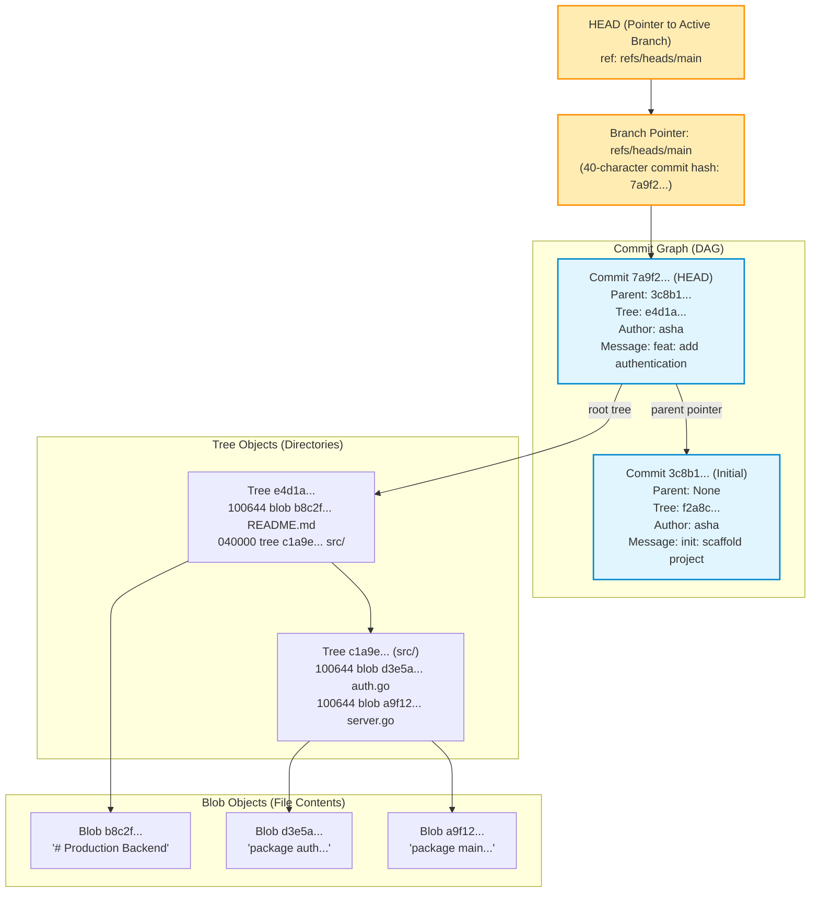

# Module 00: Git's Object Model and Internal Mental Model

> **Prerequisites:** Linux Terminal navigation, basic text editing literacy.  
> **Estimated Reading Time:** 25 minutes  
> **Target Audience:** Backend Developers, DevOps Engineers, System Architects.

> [!TIP]
> **The Golden Rule of Git Internals:** Git is not a file differencing tool; it is a **content-addressed Directed Acyclic Graph (DAG) of immutable snapshots**. There are only four fundamental object types stored in `.git/objects`: **Blobs** (raw file payload data), **Trees** (directory nodes mapping names to hashes and POSIX modes), **Commits** (metadata, author, timestamp, parent pointer, root tree pointer), and **Annotated Tags**. Branches and `HEAD` are not containers; they are simply lightweight, 41-byte mutable text files storing a 40-character commit hash.

---

## 1. Architectural Mental Model: The Git Object Graph (DAG)

Underneath the high-level porcelain interface (`git add`, `git commit`), Git is a low-level key-value database keyed by SHA-1 (or SHA-256) hashes:



### The Key Properties of the Object Model
1. **Content Addressing:** The key for any object is the hash of its header plus its bytes: `sha1(type + " " + size + "\0" + payload)`.
2. **Immutability:** You cannot change a single byte in a file without changing its blob hash. Changing the blob hash changes its parent tree hash, which in turn changes the commit hash. History is cryptographically sealed.
3. **De-duplication:** If ten identical files exist across different directories or branches, Git stores only **one single blob** on disk; the tree entries merely reference the same hash.

---

## 2. Taxonomic Reference: The Four Core Git Object Types

| Object Type | Header Prefix | What it Contains | Human Analogy | How to Inspect |
| :--- | :--- | :--- | :--- | :--- |
| **Blob** | `blob <size>\0` | Raw binary or text file payload data (no filename, no permissions) | The pure contents of a sheet of paper | `git cat-file -p <hash>` |
| **Tree** | `tree <size>\0` | List of entries: POSIX mode (`100644`, `100755`, `040000`), object type, hash, and filename | A folder directory containing labeled files | `git cat-file -p <hash>` |
| **Commit** | `commit <size>\0` | Pointer to root tree hash, zero or more parent commit hashes, author/committer metadata, timestamp, commit message | A signed snapshot manifest | `git cat-file -p <hash>` |
| **Annotated Tag** | `tag <size>\0` | Pointer to target commit, tagger identity, timestamp, GPG signature, and release message | A wax seal affixed to an immutable commit | `git cat-file -p <hash>` |

---

## 3. Systematic Breakdown: The Three Trees of Git

A common source of confusion is failing to distinguish between Git's three operational stages:

```
  WORKING DIRECTORY              STAGING AREA (INDEX)             COMMIT HISTORY (HEAD)
  ┌───────────────────────┐      ┌─────────────────────────┐      ┌─────────────────────────┐
  │ Local files on disk   │      │ .git/index (Binary Map) │      │ .git/objects/ (Database)│
  │ (Edited by your IDE)  │      │ Cache of proposed tree  │      │ Immutable committed DAG │
  └──────────┬────────────┘      └────────────┬────────────┘      └────────────┬────────────┘
             │                                │                                │
             │──── git add <file> ───────────▶│                                │
             │                                │──── git commit ───────────────▶│
             │◀─── git checkout/restore ──────│                                │
             │◀─── git reset --hard ───────────────────────────────────────────│
```

1. **Working Directory:** The sandbox where you edit files with your editor. These are real filesystem files and may contain unstaged modifications.
2. **The Staging Area (The Index):** Located in `.git/index`. A binary cache holding the exact tree structure proposed for the next commit. `git add` writes blobs into `.git/objects` and updates the index file.
3. **The Commit History (`HEAD`):** The immutable DAG stored in `.git/objects/`. `HEAD` points to your current branch, which in turn points to the latest commit.

---

## 4. Production War Story: The Public `.git` Directory Security Disaster

```mermaid
sequenceDiagram
    actor Attacker as Remote Malicious Actor
    participant Nginx as Misconfigured Web Server (S3 / Nginx)
    participant FS as Web Root (/var/www/html/.git)
    participant Cloud as Corporate AWS Account

    Note over Nginx,FS: Deploy script copied repo directly: cp -r . /var/www/html/
    Attacker->>Nginx: GET /.git/HEAD
    Nginx-->>Attacker: 200 OK: "ref: refs/heads/main"
    Attacker->>Nginx: GET /.git/refs/heads/main
    Nginx-->>Attacker: 200 OK: "4f8a19bc01..." (Commit Hash)
    Attacker->>Nginx: GET /.git/objects/4f/8a19bc01...
    Note over Attacker: Attacker downloads commit object and reads root tree hash!
    Attacker->>Nginx: Systematically recursively downloads all objects in /.git/objects/
    Note over Attacker: Attacker extracts historical commit from 4 months ago:
    Note over Attacker: Finds deleted file: configs/aws_root_keys.json containing AWS_SECRET_ACCESS_KEY!
    Attacker->>Cloud: Authenticate as AWS root administrator
    Note over Cloud: Attacker provisions 500 GPU crypto-mining instances; $80k bill accrued!
```

### The Incident
A fast-growing fintech startup deployed its marketing frontend using a simple `git pull` directly inside the Nginx web root directory `/var/www/html/`. An external security researcher noticed that `https://example.com/.git/HEAD` returned `200 OK`. 

Within 40 minutes, the researcher reconstructed the entire commit history and discovered production AWS IAM credentials committed to a test branch 6 months prior.

### The Post-Mortem Data
* **Severity:** SEV-1 (Critical Security Breach)
* **Mean Time to Detect (MTTD):** 15 minutes
* **Mean Time to Resolution (MTTR):** 45 minutes (Immediate credential revocation & security rule deployment)

### The Root Cause
Developers assumed that because Nginx directory indexing (`autoindex on`) was disabled, browsing files was impossible. However, **Git's object model is a deterministically traversable graph**:
1. Download `/.git/HEAD` to find the active branch name (`refs/heads/main`).
2. Download `/.git/refs/heads/main` to find the head commit SHA-1.
3. Download `/.git/objects/XX/XXXX...` to unpack the commit, tree, and all historical blobs.
Tools like `git-dumper` can extract an entire repository and every historic secret in seconds.

### The Fix & Hardening
1. **Block `.git` at the Edge / Reverse Proxy:**
```nginx
# Nginx Configuration Hardening
location ~ /\.git {
    deny all;
    return 404;
}
```
2. **Never deploy `.git` to production:** Build clean deployment artifacts (`dist/` or Docker images) using multi-stage builds that exclude `.git`.
3. **Automated Secret Scanning in CI:** Run TruffleHog or Gitleaks on every commit to block hardcoded secrets from ever entering the Git DAG.

---

## 5. Multi-Language Production Code: Calculating Git Object Hashes

To prove that Git's hashing is deterministic and reproducible, you can compute a Git blob hash programmatically in any language.

### Go
```go
package main

import (
	"crypto/sha1"
	"encoding/hex"
	"fmt"
)

// ComputeGitBlobHash calculates the exact 40-character SHA-1 Git object hash for content.
// Formula: sha1("blob <size>\x00<content>")
func ComputeGitBlobHash(content []byte) string {
	header := fmt.Sprintf("blob %d\x00", len(content))
	hasher := sha1.New()
	hasher.Write([]byte(header))
	hasher.Write(content)
	return hex.EncodeToString(hasher.Sum(nil))
}

func main() {
	payload := []byte("hello world\n")
	hash := ComputeGitBlobHash(payload)
	fmt.Printf("Content: %q\n", payload)
	fmt.Printf("Calculated Git Hash: %s\n", hash)
	fmt.Println("Verify via CLI: echo 'hello world' | git hash-object --stdin")
	// Matches: 3b18e512dba79e4c8300dd08aeb37f8e728b8dad
}
```

### Node.js / TypeScript
```typescript
import * as crypto from 'crypto';

/**
 * Computes the Git content-addressed blob hash.
 */
export function calculateGitBlobHash(content: string): string {
  const buffer = Buffer.from(content, 'utf-8');
  const header = `blob ${buffer.length}\0`;
  const store = Buffer.concat([Buffer.from(header, 'utf-8'), buffer]);

  return crypto.createHash('sha1').update(store).digest('hex');
}

const testContent = "hello world\n";
const gitHash = calculateGitBlobHash(testContent);
console.log(`Git Object Hash: ${gitHash}`);
// Output: 3b18e512dba79e4c8300dd08aeb37f8e728b8dad
```

### Python
```python
import hashlib

def compute_git_blob_sha1(data: bytes) -> str:
    """
    Computes standard Git SHA-1 hash for arbitrary byte payload.
    """
    header = f"blob {len(data)}\0".encode("utf-8")
    full_blob = header + data
    return hashlib.sha1(full_blob).hexdigest()

if __name__ == "__main__":
    payload = b"hello world\n"
    print(f"Git Hash: {compute_git_blob_sha1(payload)}")
    # Output: 3b18e512dba79e4c8300dd08aeb37f8e728b8dad
```

---

## 6. Practical Hands-On Verification CLI Workflows

Work in your Ubuntu terminal to inspect Git's raw plumbing database:

### Workflow 1: Generate Raw Git Objects with Plumbing Tools
```bash
# 1. Initialize an empty disposable repository
mkdir -p /tmp/git-internals && cd /tmp/git-internals
git init

# 2. Store a raw string directly into the object database
BLOB_HASH=$(echo "Production backend architecture" | git hash-object -w --stdin)
echo "Generated Blob Hash: $BLOB_HASH"

# 3. Inspect where Git stored the object on disk
ls -l .git/objects/${BLOB_HASH:0:2}/${BLOB_HASH:2}
```
**Expected Output:**
```text
Generated Blob Hash: 34a2e...
-r--r--r-- 1 asha asha 48 Nov 10 17:00 .git/objects/34/a2e...
```
*(Notice how Git splits the 40-character hex hash: the first 2 characters become the subdirectory name, and the remaining 38 characters become the filename).*

### Workflow 2: Inspect Object Type and Content via `cat-file`
```bash
# 1. Print the object type (-t)
git cat-file -t $BLOB_HASH

# 2. Print the object contents (-p)
git cat-file -p $BLOB_HASH
```
**Expected Output:**
```text
blob
Production backend architecture
```

### Workflow 3: Clean Up
```bash
cd ~ && rm -rf /tmp/git-internals
```

---

## 7. Operational Validation Checkpoint

<details>
<summary><strong>Question 1: Deduplication Across Renames and Duplicates</strong></summary>

**Scenario:** A developer creates a 500 MB video file in a repository: `assets/promo.mp4`. Later, another developer copies that same file to `marketing/video.mp4` and renames the original to `docs/demo.mp4`. Both commits are pushed to main.

How much additional disk space does Git allocate in `.git/objects` to store these three identical 500 MB files across different directories?

**Answer:**
**Zero additional disk space** (beyond negligible 40-byte tree references). 

Git is a **content-addressed store**. Because all three files contain identical bytes, their SHA-1 hashes are identical. Git creates exactly **one 500 MB blob object** in `.git/objects`. The directory trees (`assets/`, `marketing/`, `docs/`) each contain metadata pointing to that same single blob hash.
</details>

<details>
<summary><strong>Question 2: Why Creating a Git Branch is $O(1)$ Instantaneous</strong></summary>

**Scenario:** In Subversion (SVN), creating a branch requires copying an entire directory tree across the server. In Git, creating a branch in a 200 GB repository containing 1,000,000 files takes less than 2 milliseconds.

Explain the underlying data structure mechanism that makes `git branch` $O(1)$ in time and space.

**Answer:**
In Git, a branch is **not a copy of files or history**. 

A branch is merely a **pointer file containing a 41-byte text string** (a 40-character commit hex hash followed by a newline `\n`) stored inside `.git/refs/heads/<branch-name>`. 

Running `git branch feature` simply creates a 41-byte text file on disk writing the current commit hash:
```bash
echo "7a9f2bc..." > .git/refs/heads/feature
```
Because no objects, trees, or file payloads are copied, branch creation is strictly instantaneous regardless of repository size.
</details>

<details>
<summary><strong>Question 3: Demystifying the "Detached HEAD" State</strong></summary>

**Scenario:** A developer runs `git checkout 3c8b1a` (referencing a historical commit hash). Git displays an alarming notice:
`You are in 'detached HEAD' state...`
The developer fears that their repository has suffered corruption.

What does "Detached HEAD" mean in Git's object model, and what happens if you commit while in this state?

**Answer:**
Normally, `HEAD` points to a **symbolic branch reference** (e.g. `ref: refs/heads/main`), which in turn points to a commit. 

When you check out a specific commit hash directly (`git checkout <hash>`), `HEAD` points **directly to the commit itself** rather than to a branch pointer. You are "detached" from any named branch pointer.

If you make new commits while in detached HEAD state, the commits are created normally and linked into the DAG. However, because no branch pointer references them, if you subsequently checkout `main`, those new commits become **unreferenced orphan commits** and will eventually be permanently removed by `git gc` (garbage collection) after 30 days unless a branch is created to point to them (`git branch my-rescued-work`).
</details>

---

## Next Step

Now that you understand Git's content-addressed object model, DAG nodes, and pointers, proceed to **[01 · Basic Local Workflow](../01-basic-local-workflow/README.md)** to master staging discipline, `.gitignore` architecture, and atomic commits.
