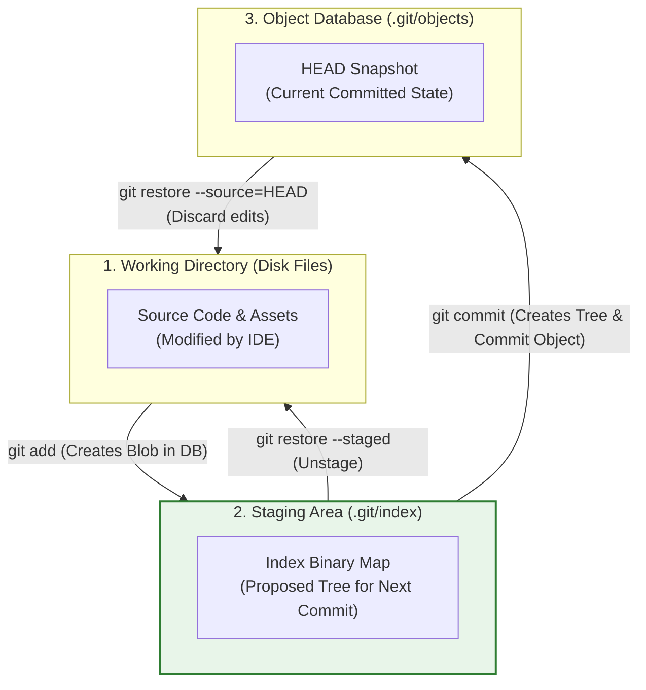
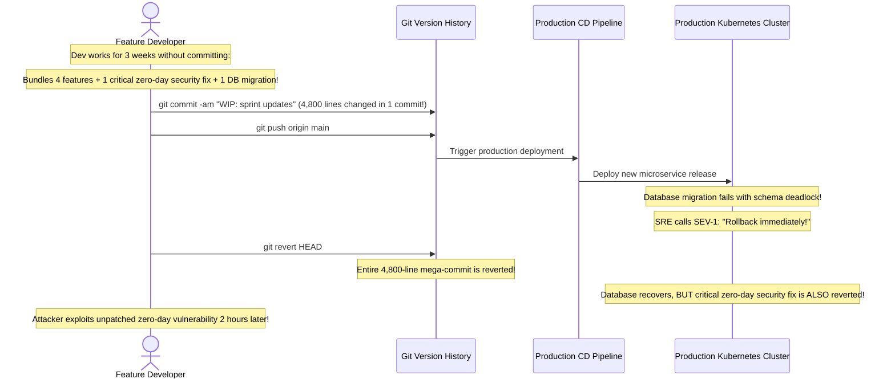

# Module 01: The Basic Local Git Workflow

> **Prerequisites:** Module 00 (Git's Object Model and Internal Mental Model).  
> **Estimated Reading Time:** 25 minutes  
> **Target Audience:** Backend Developers, DevOps Engineers, Software Engineers.

> [!TIP]
> **The Golden Rule of Local Git Discipline:** Never use `git add .` or `git commit -am` blindly. Commit **atomically**: each commit should represent a single logical, testable unit of work that passes all test suites. Use `git add -p` (patch mode) to stage specific hunks of code, use `git diff --staged` to review your exact proposed snapshot before recording it, and write imperative commit messages (`fix: resolve race condition in auth cache`).

---

## 1. Architectural Mental Model: The Staging Pipeline

The Git local workflow is a deliberate, two-phase transaction process between three distinct filesystem states:



### The Power of the Staging Area
Many version control systems couple "saving changes" directly with "recording a revision". Git's **Staging Area (the Index)** acts as a staging sandbox:
* It lets you craft clean, coherent commits even if your working directory contains experimental changes, temporary debug logs, or edits across 10 different files.
* You can stage half of a file using patch mode (`git add -p`) to commit a bugfix immediately, while keeping feature work unstaged in your working directory.

---

## 2. Taxonomic Reference: Status Codes and State Transitions

Running `git status -s` (porcelain short status) outputs concise two-letter state codes for every file:

| Code (`X Y`) | Staged Status (`X`) | Unstaged Status (`Y`) | Real-World Translation |
| :--- | :--- | :--- | :--- |
| **`??`** | Untracked | Untracked | Brand new file on disk; Git does not track it yet. |
| **`A `** | **Added (Staged)** | Unmodified | New file staged; will be recorded in the next commit. |
| **` M`** | Clean | **Modified (Unstaged)** | File changed on disk since last commit, but **not yet staged**. |
| **`M `** | **Modified (Staged)** | Clean | Changes staged in index; ready to commit. |
| **`MM`** | **Modified (Staged)** | **Modified (Unstaged)** | Changes staged, then *modified again* on disk! |
| **` D`** | Clean | **Deleted (Unstaged)** | File deleted on disk using standard `rm`, but deletion not staged. |
| **`D `** | **Deleted (Staged)** | Clean | Deletion staged; file will be removed from next commit snapshot. |

---

## 3. Systematic Breakdown: Comparing Diff & Restore Tools

| Operation | Command | What it Compares / Reverts | Production Engineering Use Case |
| :--- | :--- | :--- | :--- |
| **Review Unstaged Work** | `git diff` | Working Directory vs. Index | See what you changed in your editor before running `git add`. |
| **Review Staged Snapshot** | `git diff --staged` | Index vs. Current `HEAD` Commit | **Mandatory pre-commit review:** The exact diff that will be recorded! |
| **Interactive Hunk Staging** | `git add -p <file>` | Prompts per code block (`y, n, s, e`) | Split bugfixes from refactoring within the same file into separate commits. |
| **Unstage a File** | `git restore --staged <file>` | Removes from Index without modifying disk | Fix an accidental `git add secret.env`. |
| **Discard Unstaged Changes** | `git restore <file>` | Replaces working tree file with Index | Discard local experimental edits and revert to last known state. |

---

## 4. Production War Story: The Mega-Commit Rollback Catastrophe



### The Incident
During a major platform release, an engineering team deployed a single 4,800-line commit containing three new payment integrations, a database schema migration, and a critical zero-day patch for an authentication vulnerability. 

Ten minutes after deployment, the database migration locked the transactions table, triggering a SEV-1 outage. The incident commander ordered an immediate `git revert HEAD`.

### The Post-Mortem Data
* **Severity:** SEV-1 (Database Lockout & Unpatched Security Vulnerability)
* **Mean Time to Detect (MTTD):** 10 minutes
* **Mean Time to Resolution (MTTR):** 120 minutes

### The Root Cause
Because 3 weeks of work was crammed into a single **"mega-commit"**, the team could not revert the broken database migration without also reverting the critical authentication security patch. Two hours later, automated bot traffic exploited the unpatched authentication vulnerability.

### The Fix & Hardening
1. **Enforce Atomic Commits:** Each logical change must be an isolated commit:
   * Commit 1: `fix(auth): patch timing attack on token validator` (Deployable independently!)
   * Commit 2: `feat(db): add non-blocking index on orders table`
   * Commit 3: `feat(payment): integrate stripe webhook processor`
2. **Interactive Staging (`git add -p`):** Break large files into granular, reviewable commits before pushing.
3. **Automated CI Commit Scrutiny:** Add linting checks (e.g. `commitlint`) to enforce Conventional Commits and warn if a single commit modifies more than 500 lines across unrelated packages.

---

## 5. Multi-Language Production Code: Validating Git Working Tree State

Deployment scripts, CLI publishing tools, and CI runners must verify that the local repository is clean (no unstaged files, no untracked secrets) before initiating a release.

### Go
```go
package main

import (
	"bytes"
	"context"
	"fmt"
	"os/exec"
	"strings"
	"time"
)

// AssertCleanWorkingTree ensures no uncommitted or untracked changes exist before a release.
func AssertCleanWorkingTree(ctx context.Context) error {
	// git status --porcelain returns empty string if working directory is clean
	cmd := exec.CommandContext(ctx, "git", "status", "--porcelain")
	var stdout bytes.Buffer
	cmd.Stdout = &stdout

	if err := cmd.Run(); err != nil {
		return fmt.Errorf("failed to execute git status: %w", err)
	}

	output := strings.TrimSpace(stdout.String())
	if output != "" {
		return fmt.Errorf("working directory is dirty! Uncommitted changes detected:\n%s", output)
	}

	fmt.Println("✅ Git working tree is completely clean. Ready for release build.")
	return nil
}

func main() {
	ctx, cancel := context.WithTimeout(context.Background(), 3*time.Second)
	defer cancel()

	if err := AssertCleanWorkingTree(ctx); err != nil {
		fmt.Printf("❌ Release blocked: %v\n", err)
		return
	}
}
```

### Node.js / TypeScript
```typescript
import { execFile } from 'child_process';
import { promisify } from 'util';

const execFileAsync = promisify(execFile);

/**
 * Asserts that no sensitive files (.env) are accidentally staged in the Git index.
 */
export async function assertNoStagedSecrets(): Promise<void> {
  const { stdout } = await execFileAsync('git', ['diff', '--cached', '--name-only']);
  const stagedFiles = stdout.trim().split('\n').filter(Boolean);

  const forbiddenPatterns = ['.env', 'id_rsa', 'secret', '.pem'];
  const violations = stagedFiles.filter((file) =>
    forbiddenPatterns.some((pattern) => file.toLowerCase().includes(pattern))
  );

  if (violations.length > 0) {
    throw new Error(
      `CRITICAL SECURITY VIOLATION: Attempting to commit sensitive files:\n${violations.join('\n')}\n` +
      `Run: git restore --staged <file> immediately!`
    );
  }

  console.log('✅ Staged files verified: Zero secret files detected.');
}

assertNoStagedSecrets().catch((err) => {
  console.error(err.message);
  process.exit(1);
});
```

### Python
```python
import subprocess
import sys

def verify_git_cleanliness() -> bool:
    """
    Validates that the repository has zero uncommitted changes.
    """
    res = subprocess.run(["git", "status", "--porcelain"], capture_output=True, text=True)
    if res.returncode != 0:
        sys.stderr.write("Error: Not a git repository or git command missing.\n")
        return False

    dirty_files = res.stdout.strip()
    if dirty_files:
        print("❌ Cannot proceed with deployment. Working tree contains uncommitted edits:")
        print(dirty_files)
        return False

    print("✅ Repository clean. All commits synced.")
    return True

if __name__ == "__main__":
    if not verify_git_cleanliness():
        sys.exit(1)
```

---

## 6. Practical Hands-On Verification CLI Workflows

Follow these workflows in your Ubuntu terminal:

### Workflow 1: Inspect Staging Area State Transitions
```bash
# 1. Initialize a temporary scratch repo
mkdir -p /tmp/git-workflow-lab && cd /tmp/git-workflow-lab
git init

# 2. Create and stage a new file
echo "PORT=8080" > config.env
git status -s    # Shows: ?? config.env
git add config.env
git status -s    # Shows: A  config.env

# 3. Modify the file AGAIN while staged
echo "DEBUG=true" >> config.env
git status -s    # Shows: AM config.env (Staged changes + unstaged changes!)
```

### Workflow 2: Compare `git diff` vs. `git diff --staged`
```bash
# Compare unstaged edits against index
git diff

# Compare staged index against last commit
git diff --staged
```
**Expected Output:**
```text
diff --git a/config.env b/config.env
@@ -1 +1,2 @@
 PORT=8080
+DEBUG=true
```

### Workflow 3: Unstage Safely Without Losing Edits
```bash
# Unstage config.env from the index
git restore --staged config.env
git status -s    # Shows: ?? config.env (Untracked; local disk edits preserved!)

# Clean up
cd ~ && rm -rf /tmp/git-workflow-lab
```

---

## 7. Operational Validation Checkpoint

<details>
<summary><strong>Question 1: Why `.gitignore` Ignores Files That Are Already Tracked</strong></summary>

**Scenario:** A developer adds `app.log` to `.gitignore`. When they edit `app.log`, `git status` continues to show `modified: app.log`. 

Why does Git ignore the rule in `.gitignore`, and what is the exact command to resolve this?

**Answer:**
`.gitignore` dictates what Git does with **untracked files**. 

If a file has already been tracked and committed to Git's index history in a previous commit, adding its name to `.gitignore` has **zero effect**; Git will continue tracking all subsequent modifications to that file.

**The Fix:** Remove the file from the staging index while keeping it physically on your disk:
```bash
git rm --cached app.log
git commit -m "chore: stop tracking app.log"
```
Now `app.log` is untracked and `.gitignore` will properly ignore it.
</details>

<details>
<summary><strong>Question 2: The Danger of `git commit -am`</strong></summary>

**Scenario:** A developer relies on `git commit -am "update"` as their default command. After pushing to GitHub, they realize their newly created source file `auth_service.go` was omitted from the commit, breaking the continuous integration build.

Why did `git commit -am` fail to include `auth_service.go`?

**Answer:**
The `-a` (all) flag in `git commit` automatically stages modifications and deletions for **files that are ALREADY tracked by Git**. 

It **never stages newly created untracked files (`??`)**. Because `auth_service.go` had never been explicitly added via `git add`, `git commit -am` silently skipped it. 

**Best Practice:** Always run `git status` first, and use explicit `git add` commands before committing.
</details>

<details>
<summary><strong>Question 3: Difference Between `git restore` and `git restore --staged`</strong></summary>

**Scenario:** You edited `server.go` and staged it with `git add server.go`. Then you realized the change is flawed.
What is the difference between running:
1. `git restore --staged server.go`
2. `git restore server.go`

**Answer:**
* **`git restore --staged server.go`:** Copies the version of `server.go` from `HEAD` into the **Staging Area (Index)**. Your local disk edits in your working directory remain untouched; the file is simply un-staged.
* **`git restore server.go`:** Overwrites your **Working Directory file on disk** with whatever is currently in the Staging Area. Any unstaged edits you made in your editor are **permanently destroyed and unrecoverable**!
</details>

---

## Next Step

Now that you have mastered atomic local commits and staging discipline, proceed to **[02 · Branching and Merging](../02-branching-and-merging/README.md)** to master fast-forward merges, 3-way merge commits, conflict resolution, and the branch lifecycle.
