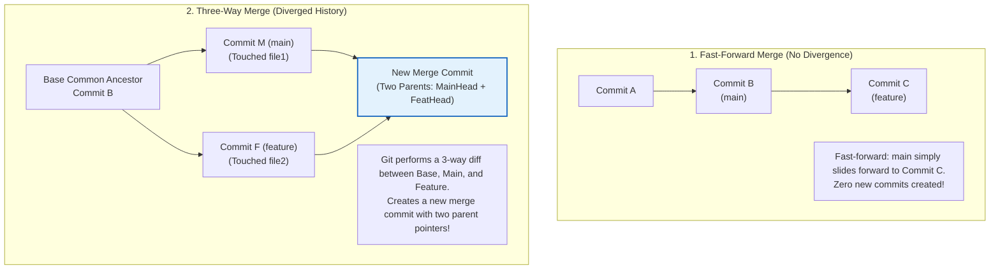
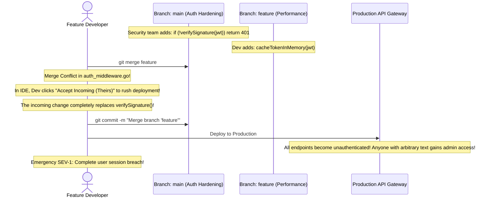

# Module 02: Branching and Merging

> **Prerequisites:** Module 00 (Git Object Model), Module 01 (Basic Local Workflow).  
> **Estimated Reading Time:** 25 minutes  
> **Target Audience:** Backend Developers, DevOps Engineers, Team Leads.

> [!TIP]
> **The Golden Rule of Branch Merging:** A merge conflict is not an error; it is Git politely notifying you that two human beings modified the exact same lines of code concurrently and refusing to guess which intention is correct. When resolving conflicts, never blindly accept "ours" or "theirs"; understand the architectural intent of **both** branches, run your automated test suite *before* finalizing the commit, and remember that `git merge --abort` is your emergency reset button.

---

## 1. Architectural Mental Model: Fast-Forward vs. 3-Way Merge

In Git's DAG, a branch is merely a movable pointer to a commit. How Git integrates two branches depends entirely on whether their history has diverged:



### The Three-Way Merge Logic
When histories diverge, Git computes a diff using **three points in the DAG**:
1. **The Merge Base (CommonAncestor):** The latest common ancestor commit shared by both branches.
2. **Ours (`HEAD` / Target Branch):** Your current active branch (`main`).
3. **Theirs (Source Branch):** The branch you are merging in (`feature`).
If `feature` modified a line that `main` left untouched relative to the Common Ancestor, Git applies the change cleanly with zero conflict. Git only prompts for conflict resolution if **both branches modified the exact same lines differently**.

---

## 2. Taxonomic Reference: Merge Strategies Compared

| Strategy | Command | Preserves Commit History? | Creates New Commit? | Production Engineering Use Case |
| :--- | :--- | :--- | :--- | :--- |
| **Fast-Forward** | `git merge feature` | Yes | **No** (Advances pointer) | Local branches that are direct descendants of `main`. |
| **No-Fast-Forward** | `git merge --no-ff feature` | Yes | **Yes** (Explicit merge commit) | Feature releases on `main`; documents feature boundary in history. |
| **Squash Merge** | `git merge --squash feature` | Compresses commits into 1 | No (Leaves changes staged) | Merging messy PRs (15 "wip" commits compressed into 1 clean commit). |
| **Rebase Merge** | `git rebase main` | Re-writes commit hashes | Re-creates commits on top | Keeping feature branch fresh with latest `main` without merge bubbles. |

---

## 3. Anatomy of a Merge Conflict

When a conflict occurs, Git modifies the working directory file, injecting conflict demarcation markers:

```text
<<<<<<< HEAD (Current change on main)
func VerifyToken(token string) bool {
    return jwt.ValidateWithSignature(token, secretKey)
}
======= (Separator)
func VerifyToken(token string) bool {
    return jwt.ValidateWithExpiration(token, 3600)
}
>>>>>>> feature-auth (Incoming change from feature branch)
```

### The Conflict Resolution Invariant
1. Inspect the code between `<<<<<<<` and `=======` (your active branch's version).
2. Inspect the code between `=======` and `>>>>>>>` (the incoming branch's version).
3. Synthesize the correct code (e.g. combining both signature verification *and* expiration).
4. Delete all conflict markers (`<<<<<<<`, `=======`, `>>>>>>>`).
5. Run `git add <file>` to notify Git the conflict is resolved.

---

## 4. Production War Story: The Blind Conflict Resolution Authentication Bypass



### The Incident
During a Friday evening release, two developers merged concurrent changes to an API gateway's `auth_middleware.go`. Branch A added mandatory cryptographic JWT signature verification. Branch B added memory caching for high-throughput tokens.

When merging Branch B into `main`, a merge conflict arose. Rushing to meet a release deadline, the developer clicked "Accept Incoming Changes" in their IDE conflict resolution UI. This wiped out the `verifySignature()` call introduced by Branch A.

### The Post-Mortem Data
* **Severity:** SEV-1 (Critical Authentication Bypass)
* **Mean Time to Detect (MTTD):** 20 minutes
* **Mean Time to Resolution (MTTR):** 45 minutes

### The Root Cause
The developer treated merge conflict resolution as a mechanical chore rather than an architectural decision. Because automated test suites were skipped locally and CI pipelines had inadequate integration tests asserting that forged tokens were rejected, the code compiled cleanly and shipped to production.

### The Fix & Hardening
1. **Never Resolve Conflicts in Isolation:** When resolving conflicts in security-sensitive packages, peer review is mandatory.
2. **Execute Full Test Suites Before Finalizing Merge:**
```bash
# Resolve markers, stage, then test before committing:
git add auth_middleware.go
npm test || pytest || go test ./...
git commit -m "merge: resolve auth conflict safely"
```
3. **Emergency Abort:** If you feel uncertain or confused during a conflict resolution session, abort immediately:
```bash
git merge --abort
```
*(Returns your repository to the exact pristine state prior to initiating the merge).*

---

## 5. Multi-Language Production Code: Automating Git Branch Hygiene

In enterprise microservices, teams accumulate hundreds of obsolete local and remote branches. Scripts can automatically detect and clean merged branches.

### Go
```go
package main

import (
	"bytes"
	"context"
	"fmt"
	"os/exec"
	"strings"
	"time"
)

// ListMergedBranches returns all local branches that are safely merged into main.
func ListMergedBranches(ctx context.Context, baseBranch string) ([]string, error) {
	cmd := exec.CommandContext(ctx, "git", "branch", "--merged", baseBranch)
	var stdout bytes.Buffer
	cmd.Stdout = &stdout

	if err := cmd.Run(); err != nil {
		return nil, fmt.Errorf("failed to query merged branches: %w", err)
	}

	lines := strings.Split(stdout.String(), "\n")
	var merged []string

	for _, line := range lines {
		branch := strings.TrimSpace(line)
		// Skip active branch pointer (*) and protected main/master branches
		if branch == "" || strings.HasPrefix(branch, "*") || branch == "main" || branch == "master" {
			continue
		}
		merged = append(merged, branch)
	}

	return merged, nil
}

func main() {
	ctx, cancel := context.WithTimeout(context.Background(), 3*time.Second)
	defer cancel()

	branches, err := ListMergedBranches(ctx, "main")
	if err != nil {
		fmt.Printf("Error: %v\n", err)
		return
	}

	fmt.Printf("Found %d merged branches eligible for safe deletion:\n", len(branches))
	for _, b := range branches {
		fmt.Printf(" - %s (Run: git branch -d %s)\n", b, b)
	}
}
```

### Node.js / TypeScript
```typescript
import { execFile } from 'child_process';
import { promisify } from 'util';

const execFileAsync = promisify(execFile);

/**
 * Checks if the current branch has active unmerged conflicts.
 */
export async function isMergeInProgress(): Promise<boolean> {
  try {
    const { stdout } = await execFileAsync('git', ['status', '--porcelain']);
    // 'UU' in porcelain status means Unmerged / Both Modified (Conflict)
    return stdout.split('\n').some((line) => line.startsWith('UU '));
  } catch {
    return false;
  }
}

async function auditRepository() {
  const inConflict = await isMergeInProgress();
  if (inConflict) {
    console.warn('⚠️  Active merge conflicts detected! Run git merge --abort or resolve markers.');
  } else {
    console.log('✅ No unmerged conflict states found.');
  }
}

auditRepository();
```

### Python
```python
import subprocess
import sys

def audit_git_conflicts():
    """
    Scans working tree files for unresolved merge conflict markers.
    """
    try:
        res = subprocess.run(
            ["git", "diff", "--name-only", "--diff-filter=U"],
            capture_output=True,
            text=True,
            check=True
        )
        conflicted_files = res.stdout.strip().splitlines()
        if conflicted_files:
            print("🚨 Merge conflicts detected in:")
            for f in conflicted_files:
                print(f"  - {f}")
            return False
        print("✅ Clean: Zero unresolved merge conflicts.")
        return True
    except subprocess.CalledProcessError as e:
        print(f"Error checking git conflicts: {e}")
        return False

if __name__ == "__main__":
    if not audit_git_conflicts():
        sys.exit(1)
```

---

## 6. Practical Hands-On Verification CLI Workflows

Follow these workflows in your Ubuntu terminal:

### Workflow 1: Fast-Forward Merge Simulation
```bash
# 1. Initialize temporary repo
mkdir -p /tmp/git-branch-lab && cd /tmp/git-branch-lab
git init -b main

# 2. Base commit
echo "API v1.0" > api.txt && git add api.txt && git commit -m "init: base api"

# 3. Create feature branch and add commit
git switch -c feature-metrics
echo "METRICS=enabled" >> api.txt
git commit -am "feat: add metrics"

# 4. Merge feature into main (Fast-Forward!)
git switch main
git merge feature-metrics
git log --oneline
```
**Expected Output:**
```text
Updating 3c8b1a..7a9f2b
Fast-forward
 api.txt | 1 +
 1 file changed, 1 insertion(+)
```

### Workflow 2: Manufacture and Abort a Merge Conflict
```bash
# 1. Diverge main branch
echo "PORT=8080" >> api.txt
git commit -am "fix: change port on main"

# 2. Diverge feature branch on same line
git switch feature-metrics
echo "PORT=9090" >> api.txt
git commit -am "fix: change port on feature"

# 3. Attempt to merge (Triggers conflict!)
git switch main
git merge feature-metrics || echo "Conflict encountered as expected!"

# 4. Inspect conflict status
git status -s

# 5. Safely abort merge
git merge --abort
git status -s    # Perfectly clean!

# Clean up
cd ~ && rm -rf /tmp/git-branch-lab
```

---

## 7. Operational Validation Checkpoint

<details>
<summary><strong>Question 1: Fast-Forward vs. `--no-ff` Merge Commits</strong></summary>

**Scenario:** A company enforces a policy: "All Pull Requests merged into `main` must use `--no-ff` (No Fast Forward), even if the branch can be cleanly fast-forwarded."

What is the engineering advantage of forcing a merge commit via `--no-ff`?

**Answer:**
If a feature consisting of 6 commits is fast-forwarded, the commits are seamlessly blended into `main`'s linear history. If the feature subsequently causes a production bug, you cannot easily identify which commits belonged to that feature, and reverting requires reverting 6 separate commits.

Using **`--no-ff` creates an explicit merge commit** with two parent pointers that encapsulates the entire feature branch. 
1. The Git DAG clearly shows the start and end boundaries of the feature.
2. The entire feature can be reverted in production with a single command:
   ```bash
   git revert -m 1 <merge_commit_hash>
   ```
</details>

<details>
<summary><strong>Question 2: Safe Branch Deletion (`-d` vs `-D`)</strong></summary>

**Scenario:** A developer finishes work on `experiment-branch` and runs:
```bash
git branch -d experiment-branch
```
Git rejects the deletion with:
`error: The branch 'experiment-branch' is not fully merged.`
`If you are sure you want to delete it, run 'git branch -D experiment-branch'.`

Why did Git refuse to delete the branch, and what does `-D` do under the hood?

**Answer:**
Lowercase **`-d` (`--delete`)** is a safety check: Git verifies whether the tip commit of `experiment-branch` is an ancestor of your current `HEAD` commit. If it is not merged, deleting the branch pointer would leave those commits orphaned in the DAG, risking permanent loss of unmerged code.

Uppercase **`-D` (`--delete --force`)** overrides the safety check and deletes the 41-byte branch pointer file from `.git/refs/heads/experiment-branch` regardless of whether the commits have been merged into `main`.
</details>

<details>
<summary><strong>Question 3: Why `git add` Marks Conflicts as Resolved</strong></summary>

**Scenario:** During a merge conflict on `server.go`, a developer edits the file and deletes the `<<<<<<<` and `>>>>>>>` markers. They run `git commit`, but Git blocks them: `fatal: Exiting because of an unresolved conflict`.

What missing step informs Git that the conflict in `server.go` is officially resolved?

**Answer:**
Git tracks unresolved conflicts in the **Staging Area (Index)** by holding multiple conflicting versions of the file at different stages (Stage 1 = Ancestor, Stage 2 = Ours, Stage 3 = Theirs). 

Simply editing the file on disk does not update the Index. You must run:
```bash
git add server.go
```
`git add` reads the resolved file from disk, hashes it into a clean blob, and collapses the conflicting stages in `.git/index` into a single resolved entry. Once all conflicted files are staged with `git add`, `git commit` (or `git merge --continue`) will succeed.
</details>

---

## Next Step

Now that you understand branching, fast-forwards, 3-way merges, and conflict mechanics, proceed to **[03 · Rebasing and History Rewriting](../03-rebasing-and-history-rewriting/README.md)** to master linear history, interactive squashing, `rebase -i`, and the Golden Rule of Rebasing.
