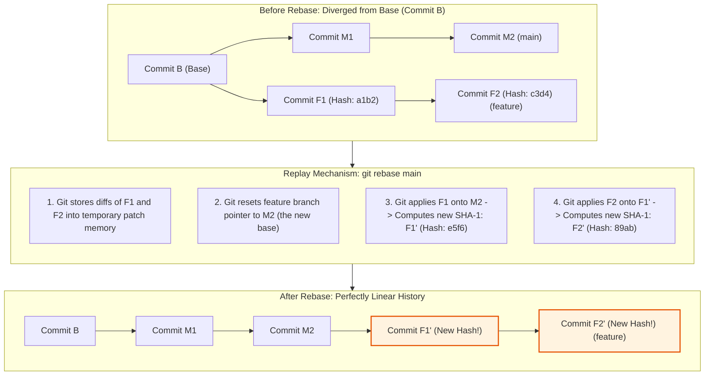
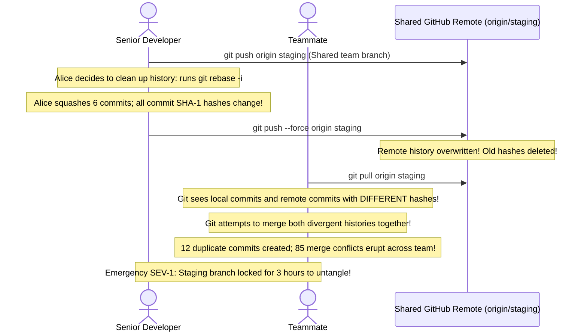

# Module 03: Rebasing and History Rewriting

> **Prerequisites:** Module 00 (Git Object Model), Module 02 (Branching and Merging).  
> **Estimated Reading Time:** 25 minutes  
> **Target Audience:** Backend Developers, DevOps Engineers, GitOps Practitioners.

> [!TIP]
> **The Golden Rule of Rebasing:** **Never rebase commits that have already been pushed to a public or shared branch.** Rebasing changes the parent commit pointer, which fundamentally computes brand new SHA-1 hashes for every replayed commit. If you rewrite shared history, you break your teammates' local DAG tracking branches. Use rebasing exclusively on **private local feature branches** to clean up commits before opening a Pull Request, and always use `git push --force-with-lease` rather than raw `--force`.

---

## 1. Architectural Mental Model: How Git Replays Commits

Rebasing is not a merge; it is a **replay engine**. Git lifts your branch's unique commits, resets your branch pointer to the target base, and re-applies each commit diff sequentially as brand new commits:



### Why Commit Hashes Change
In Git's cryptographic model, a commit hash is computed from:
`sha1(tree_hash + parent_commit_hash + author + timestamp + message)`
When you rebase `feature` onto `main`, the parent of `F1` changes from `Commit B` to `Commit M2`. Because the parent hash changed, the resulting commit hash **must change** (`F1'`). Consequently, every subsequent child commit (`F2'`) also receives a brand new hash.

---

## 2. Systematic Breakdown: Interactive Rebase (`git rebase -i`)

Running `git rebase -i HEAD~4` opens an interactive todo list in your terminal editor:

```text
pick a1b2c3d feat(auth): add login endpoint
squash e4f5g6h fix: typo in auth route
fixup 7i8j9k0 wip: debugging prints
reword 1m2n3o4 feat(auth): add rate limiting
```

| Command | Short | Action Performed | Production Use Case |
| :--- | :--- | :--- | :--- |
| **`pick`** | `p` | Keep commit as-is | Default; leaves the commit unchanged. |
| **`reword`** | `r` | Keep commit contents, but **prompt to edit commit message** | Fix spelling or format commit according to Conventional Commits. |
| **`edit`** | `e` | Pause rebase at this commit to amend files or split commit | Add a forgotten file or split a large commit into two. |
| **`squash`** | `s` | **Meld commit into the previous commit** and combine messages | Merge 5 "work-in-progress" commits into one feature commit. |
| **`fixup`** | `f` | Meld commit into previous commit, **discarding this commit's message** | Absorb minor bugfix commits without cluttering the final message. |
| **`drop`** | `d` | **Delete the commit entirely** | Purge an accidental debug commit or temporary experimentation. |

---

## 3. Merging vs. Rebasing: The Engineering Trade-off

| Dimension | Merge (`git merge main`) | Rebase (`git rebase main`) |
| :--- | :--- | :--- |
| **DAG Topology** | Non-linear with branching bubbles and merge commits | **Strictly linear single-line history** |
| **Commit Hash Stability** | **100% immutable**; original commit hashes never change | Rewrites all commit hashes on the rebased branch |
| **Safety on Public Branches** | Safe for shared collaborative branches | **DANGEROUS**; causes upstream sync chaos if shared |
| **Conflict Resolution** | Resolved **once** inside the single merge commit | Resolved **per-commit** as each patch is replayed |
| **Git Bisect Debugging** | Difficult (bisect traverses complex merge branches) | **Extremely simple** (clean linear progression) |

---

## 4. Production War Story: The Shared Branch Force-Push Havoc



### The Incident
During sprint freeze, an engineer cleaned up their commits on a shared integration branch (`staging`) using `git rebase -i` and force-pushed to GitHub:
```bash
git push --force origin staging
```
Ten other developers attempting to `git pull` encountered immediate divergence. Several developers ran `git pull` (which defaulted to merge), re-introducing the old deleted commits with conflicting hashes. The commit history was littered with duplicated commits and dozens of false merge conflicts, blocking CI deployments for half a day.

### The Post-Mortem Data
* **Severity:** SEV-1 (Engineering Velocity Freeze)
* **Mean Time to Detect (MTTD):** 15 minutes
* **Mean Time to Resolution (MTTR):** 60 minutes (Repository history reset from reflog)

### The Root Cause
The engineer violated the **Golden Rule of Rebasing**: never rewrite public history. Force-pushing (`--force`) unconditionally overwrites remote branch pointers even if other teammates have pushed new commits.

### The Fix & Hardening
1. **GitHub / GitLab Branch Protection Rules:** Enable "Do not allow force pushes" on all shared branches (`main`, `staging`, `release/*`).
2. **Always Use `--force-with-lease`:** If force-pushing a private feature branch, use:
```bash
git push --force-with-lease
```
`--force-with-lease` acts as an atomic Compare-And-Swap: it checks if the remote branch has received commits that you have not fetched locally. If a teammate pushed to the branch, the push is safely rejected.

---

## 5. Multi-Language Production Code: Validating Commit History Linearity

CI/CD automation pipelines often validate that Pull Requests are rebased onto `main` and contain no merge bubbles before merging.

### Go
```go
package main

import (
	"bytes"
	"context"
	"fmt"
	"os/exec"
	"strings"
	"time"
)

// AssertLinearHistory verifies that a branch contains no merge commits (more than 1 parent).
func AssertLinearHistory(ctx context.Context, baseBranch, featureBranch string) error {
	// Query commits between base and feature, printing commit hash and parent hashes
	cmd := exec.CommandContext(ctx, "git", "rev-list", "--parents", fmt.Sprintf("%s..%s", baseBranch, featureBranch))
	var stdout bytes.Buffer
	cmd.Stdout = &stdout

	if err := cmd.Run(); err != nil {
		return fmt.Errorf("git rev-list failed: %w", err)
	}

	lines := strings.Split(strings.TrimSpace(stdout.String()), "\n")
	for _, line := range lines {
		if line == "" {
			continue
		}
		parts := strings.Fields(line)
		// A line format: <commit-hash> <parent1> <parent2> ...
		// If more than 2 elements, the commit has multiple parents (a merge commit!)
		if len(parts) > 2 {
			return fmt.Errorf("non-linear history detected! Commit %s is a merge commit with parents %v", parts[0], parts[1:])
		}
	}

	fmt.Println("✅ Verified: Feature branch history is strictly linear.")
	return nil
}

func main() {
	ctx, cancel := context.WithTimeout(context.Background(), 3*time.Second)
	defer cancel()

	if err := AssertLinearHistory(ctx, "main", "HEAD"); err != nil {
		fmt.Printf("❌ CI Quality Gate Failed: %v\n", err)
	}
}
```

### Node.js / TypeScript
```typescript
import { execFile } from 'child_process';
import { promisify } from 'util';

const execFileAsync = promisify(execFile);

/**
 * Validates that commit messages follow the Conventional Commits specification.
 */
export async function auditCommitMessages(baseBranch = 'main'): Promise<void> {
  const { stdout } = await execFileAsync('git', ['log', `${baseBranch}..HEAD`, '--oneline']);
  const commits = stdout.trim().split('\n').filter(Boolean);

  const conventionalRegex = /^[a-f0-9]+ (feat|fix|docs|style|refactor|perf|test|chore|ci)(\(.*\))?: .+/;

  for (const commit of commits) {
    if (!conventionalRegex.test(commit)) {
      throw new Error(
        `Non-conforming commit message detected:\n  "${commit}"\n` +
        `Rebase and format using: git rebase -i ${baseBranch} and 'reword'!`
      );
    }
  }

  console.log(`✅ All ${commits.length} commits conform to Conventional Commits standard.`);
}
```

### Python
```python
import subprocess
import sys

def verify_single_commit_per_pr(base_branch: str = "main") -> bool:
    """
    Checks if feature branch has been properly squashed to 1 commit.
    """
    res = subprocess.run(
        ["git", "rev-list", "--count", f"{base_branch}..HEAD"],
        capture_output=True,
        text=True,
        check=True
    )
    count = int(res.stdout.strip())
    if count > 1:
        print(f"⚠️ PR contains {count} commits. Policy mandates squashing to 1 commit.")
        return False
    print("✅ Exactly 1 squashed commit present.")
    return True

if __name__ == "__main__":
    verify_single_commit_per_pr()
```

---

## 6. Practical Hands-On Verification CLI Workflows

Follow these workflows in your Ubuntu terminal:

### Workflow 1: Linear Rebase onto Master
```bash
# 1. Initialize temporary scratch repo
mkdir -p /tmp/git-rebase-lab && cd /tmp/git-rebase-lab
git init -b main

# 2. Base commit
echo "Service v1" > app.txt && git add app.txt && git commit -m "init: v1"

# 3. Create feature branch and add commit
git switch -c feature-db
echo "DB_URL=postgres" >> db.env && git add db.env && git commit -m "feat: add db"

# 4. Advance main branch concurrently
git switch main
echo "Service v2" > app.txt && git commit -am "feat: update to v2"

# 5. Rebase feature-db onto main
git switch feature-db
git rebase main
git log --oneline --graph
```
**Expected Output:**
```text
* 89a1b2c (HEAD -> feature-db) feat: add db
* 3c8b1a2 (main) feat: update to v2
* 7a9f2bc init: v1
```
*(Notice that `feature-db` sits directly on top of `main` in a single straight line with zero merge bubbles!)*

### Workflow 2: Amend Last Commit Without Spawning New Commits
```bash
# Realize you forgot to update a comment in the last commit:
echo "DB_TIMEOUT=5s" >> db.env
git add db.env
git commit --amend --no-edit
git log --oneline -n 1
```
*(The commit is updated in place, absorbing the change into the existing commit).*

### Workflow 3: Clean Up
```bash
cd ~ && rm -rf /tmp/git-rebase-lab
```

---

## 7. Operational Validation Checkpoint

<details>
<summary><strong>Question 1: `git push --force` vs. `git push --force-with-lease`</strong></summary>

**Scenario:** You rebased your feature branch locally. You need to push to GitHub. 
Why should you run:
`git push --force-with-lease`
instead of:
`git push --force`?

**Answer:**
`git push --force` is a **blind hammer**: it instructs the remote Git server to overwrite the remote branch pointer to match your local commit, destroying any commits that exist on the remote. If a teammate or automated CI runner pushed a commit to that branch in the meantime, their work is silently erased.

`git push --force-with-lease` is an **atomic Compare-and-Swap**: it tells the remote server: "Only update the branch pointer if the remote branch is *still at the exact same commit hash* as my local remote-tracking ref (`origin/feature`)." If someone else pushed a commit, the lease check fails and Git aborts the push, preventing accidental overwrites.
</details>

<details>
<summary><strong>Question 2: Recovering from a Rebase Gone Wrong</strong></summary>

**Scenario:** During an interactive rebase with 15 conflicts, a developer becomes thoroughly lost, commits half-broken states, and accidentally drops two important commits. They realize their repository is in a broken state.

What command immediately terminates the rebase and restores the repository to its exact pre-rebase condition?

**Answer:**
```bash
git rebase --abort
```
If the rebase already finished and the developer wants to undo the completed rebase, they can use the **Git Reflog**:
```bash
git reflog
# Find the commit hash before the rebase started (e.g. HEAD@{5})
git reset --hard HEAD@{5}
```
Because Git's object database is append-only, original commits are preserved in `.git/objects` and tracked in `reflog` for at least 30 days.
</details>

<details>
<summary><strong>Question 3: Squashing with `fixup` vs `squash`</strong></summary>

**Scenario:** In an interactive rebase todo list (`git rebase -i`), what is the difference between specifying `squash` versus `fixup` for a commit?

**Answer:**
* **`squash` (`s`):** Melds the commit's diff into the parent commit, and **prompts you in an editor to combine or rewrite both commit messages**.
* **`fixup` (`f`):** Melds the commit's diff into the parent commit, but **automatically discards the fixup commit's message**, keeping only the parent commit's original message. 

`fixup` is ideal for minor tweaks, typo corrections, and lint fixes where keeping the intermediate commit message is unnecessary.
</details>

---

## Next Step

Now that you understand rebasing, squashing, and commit replay mechanics, proceed to **[04 · Remotes and Collaboration](../04-remotes-and-collaboration/README.md)** to master remote-tracking branches, upstream synchronization, `fetch` vs `pull`, and push rejection recovery.
