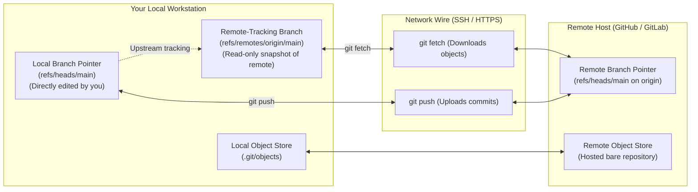
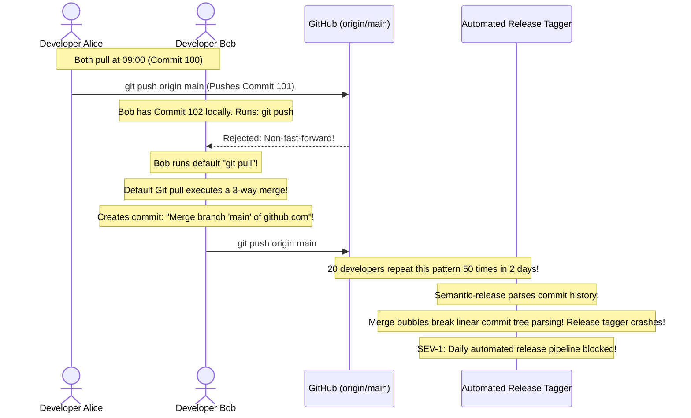

# Module 04: Remotes and Collaboration

> **Prerequisites:** Module 01 (Basic Local Workflow), Module 02 (Branching and Merging).  
> **Estimated Reading Time:** 25 minutes  
> **Target Audience:** Backend Developers, DevOps Engineers, Team Leads.

> [!TIP]
> **The Golden Rule of Git Collaboration:** `git fetch` is safe and read-only; it downloads new objects and updates your **remote-tracking branches** (`origin/main`) without modifying your working files. `git pull` is a composite command: it runs `git fetch` followed immediately by a merge (or rebase). In production engineering, always configure **`git config --global pull.rebase true`** to eliminate recursive "Merge branch 'main'" merge bubbles when synchronizing your local branches with upstream changes.

---

## 1. Architectural Mental Model: The Distributed Remote Topography

Git is a decentralized version control system. A remote repository on GitHub, GitLab, or Azure DevOps is not an authoritative master controller; it is simply another clone of the repository's DAG hosted on a remote server:



### The Three Branches You Must Track
1. **Local Branch (`main`):** The pointer at `refs/heads/main`. This is where your new commits are recorded.
2. **Remote-Tracking Branch (`origin/main`):** A read-only bookmark at `refs/remotes/origin/main`. It represents where `main` was on the remote server the last time you ran `git fetch`.
3. **The Remote Branch (`main` on GitHub):** The real branch pointer living on GitHub's disk.

---

## 2. Taxonomic Reference: Remote Synchronization Commands

| Command | Modifies Working Directory? | Network Call? | Architectural Operation |
| :--- | :--- | :--- | :--- |
| **`git remote -v`** | No | No | Lists configured remote names (`origin`) and their fetch/push URLs. |
| **`git fetch origin`** | **NO (100% Safe)** | **Yes** | Downloads new objects from remote; updates `origin/main` bookmark. |
| **`git pull origin main`** | **YES** | **Yes** | Executes `git fetch`, then runs `git merge origin/main` into local branch. |
| **`git pull --rebase`** | **YES** | **Yes** | Executes `git fetch`, then replays local commits on top of `origin/main`. |
| **`git push origin feature`** | No | **Yes** | Uploads local objects to remote and fast-forwards remote branch pointer. |
| **`git push -u origin <br>`** | No | **Yes** | Pushes branch and sets up **upstream tracking configuration**. |
| **`git remote prune origin`** | No | **Yes** | Deletes local `origin/*` references for branches that were deleted on GitHub. |

---

## 3. Systematic Breakdown: SSH vs. HTTPS Protocol

| Feature | SSH (`git@github.com:...`) | HTTPS (`https://github.com/...`) |
| :--- | :--- | :--- |
| **Authentication** | Asymmetric Ed25519/RSA key pairs | Personal Access Tokens (PAT) or OAuth credentials |
| **Port** | TCP Port 22 | TCP Port 443 |
| **Firewall Traversability** | Sometimes blocked on strict corporate proxies | **Universally permitted** across all corporate firewalls |
| **Interactive Prompts** | Zero password prompts (managed by `ssh-agent`) | Requires Git Credential Manager or token entry |
| **Recommended Verdict** | **Standard for developer workstations** | Preferred for CI/CD runners and restricted networks |

---

## 4. Production War Story: The Default `git pull` Merge Bubble Outage



### The Incident
During an active sprint with 25 backend developers pushing to a shared repository, the team's automated CI release engine (which relied on Conventional Commits to calculate SemVer version bumps) crashed. Over 120 spurious commits titled `"Merge branch 'main' of https://github.com/..."` flooded the Git DAG.

### The Post-Mortem Data
* **Severity:** SEV-1 (Automated Continuous Delivery Failure)
* **Mean Time to Detect (MTTD):** 25 minutes
* **Mean Time to Resolution (MTTR):** 40 minutes

### The Root Cause
By default on older Git versions, when `git push` is rejected due to upstream changes, developers instinctively run `git pull`. 

A raw `git pull` triggers a 3-way merge between your local branch and `origin/main`. This creates an extraneous merge commit whenever local and remote commits diverge. When dozens of developers do this daily, the repository history degrades into a tangled web of redundant merge bubbles that breaks automated changelog and semantic release tools.

### The Fix & Hardening
1. **Configure Git to Rebase on Pull Globally:**
```bash
git config --global pull.rebase true
git config --global rebase.autoStash true
```
* `pull.rebase true`: `git pull` automatically fetches and replays your local unpushed commits on top of incoming upstream commits, preserving a clean linear history.
* `rebase.autoStash true`: Automatically stashes any unstaged local edits before pulling, and pops them back afterward.
2. **Rebase Before Pushing:**
```bash
git fetch origin
git rebase origin/main
git push origin feature
```

---

## 5. Multi-Language Production Code: Inspecting Remote Divergence

Deployment scripts must check whether the local branch is behind the remote upstream branch before initiating releases.

### Go
```go
package main

import (
	"bytes"
	"context"
	"fmt"
	"os/exec"
	"strconv"
	"strings"
	"time"
)

// CheckRemoteDivergence returns how many commits local is ahead and behind remote.
func CheckRemoteDivergence(ctx context.Context, branch string) (ahead int, behind int, err error) {
	// 1. Fetch latest remote state quietly
	fetchCmd := exec.CommandContext(ctx, "git", "fetch", "origin", branch)
	if err := fetchCmd.Run(); err != nil {
		return 0, 0, fmt.Errorf("git fetch failed: %w", err)
	}

	// 2. Compare local branch against remote tracking ref: git rev-list --left-right --count branch...origin/branch
	revCmd := exec.CommandContext(ctx, "git", "rev-list", "--left-right", "--count", fmt.Sprintf("%s...origin/%s", branch, branch))
	var out bytes.Buffer
	revCmd.Stdout = &out

	if err := revCmd.Run(); err != nil {
		return 0, 0, fmt.Errorf("git rev-list failed: %w", err)
	}

	fields := strings.Fields(out.String())
	if len(fields) == 2 {
		ahead, _ = strconv.Atoi(fields[0])
		behind, _ = strconv.Atoi(fields[1])
	}

	return ahead, behind, nil
}

func main() {
	ctx, cancel := context.WithTimeout(context.Background(), 5*time.Second)
	defer cancel()

	ahead, behind, err := CheckRemoteDivergence(ctx, "main")
	if err != nil {
		fmt.Printf("Notice: %v\n", err)
		return
	}

	fmt.Printf("[Remote Sync Status] Ahead: %d commits | Behind: %d commits\n", ahead, behind)
	if behind > 0 {
		fmt.Println("⚠️  Local branch is behind upstream! Run: git pull --rebase")
	} else if ahead > 0 {
		fmt.Println("🚀 Local commits ready to push.")
	} else {
		fmt.Println("✅ Local branch is fully synchronized with origin/main.")
	}
}
```

### Node.js / TypeScript
```typescript
import { execFile } from 'child_process';
import { promisify } from 'util';

const execFileAsync = promisify(execFile);

/**
 * Validates that local branch is up to date with remote tracking branch.
 */
export async function assertUpToDate(branch = 'main'): Promise<void> {
  await execFileAsync('git', ['fetch', 'origin', branch]);
  const { stdout } = await execFileAsync('git', ['rev-list', '--count', `HEAD..origin/${branch}`]);
  const behindCount = parseInt(stdout.trim(), 10);

  if (behindCount > 0) {
    throw new Error(
      `Deployment Blocked: Local branch is behind origin/${branch} by ${behindCount} commits.\n` +
      `Run 'git pull --rebase' before triggering production release!`
    );
  }

  console.log('✅ Remote synchronization verified: Zero pending upstream commits.');
}
```

### Python
```python
import subprocess
import sys

def check_remote_sync():
    """
    Checks if local repository is behind origin/main.
    """
    subprocess.run(["git", "fetch", "origin"], check=True)
    res = subprocess.run(
        ["git", "rev-list", "--count", "HEAD..origin/main"],
        capture_output=True,
        text=True,
        check=True
    )
    behind = int(res.stdout.strip())
    if behind > 0:
        print(f"❌ Local repository is behind origin/main by {behind} commits.")
        return False
    print("✅ Local repository synchronized with origin/main.")
    return True

if __name__ == "__main__":
    if not check_remote_sync():
        sys.exit(1)
```

---

## 6. Practical Hands-On Verification CLI Workflows

Follow these workflows in your Ubuntu terminal:

### Workflow 1: Inspect Remotes and Upstream Tracking
```bash
# 1. Inspect configured remotes
git remote -v

# 2. Inspect detailed upstream tracking branch configuration
git branch -vv
```
**Expected Output:**
```text
* main 7a9f2bc [origin/main] feat: update architecture
```
*(Notice `[origin/main]` indicates that your local `main` tracks `origin/main`)*.

### Workflow 2: Safe Synchronization with `fetch` and `diff`
```bash
# 1. Download new commits from remote without touching working directory
git fetch origin

# 2. Preview what incoming commits will change before integrating
git log HEAD..origin/main --oneline

# 3. Integrate via rebase
git rebase origin/main
```

### Workflow 3: Prune Stale Remote Tracking References
```bash
# Remove local origin/feature references for branches deleted on GitHub
git fetch origin --prune
```

---

## 7. Operational Validation Checkpoint

<details>
<summary><strong>Question 1: The "Push Rejected (non-fast-forward)" Error</strong></summary>

**Scenario:** A developer runs `git push origin main`. Git rejects the command:
`! [rejected]        main -> main (non-fast-forward)`  
`error: failed to push some refs to 'github.com:org/repo.git'`  
`hint: Updates were rejected because the remote contains work that you do not have locally.`

What is the safest, standard sequence of commands to resolve this without force-pushing or creating merge bubbles?

**Answer:**
Execute:
```bash
git fetch origin
git rebase origin/main
git push origin main
```
1. `git fetch origin` safely downloads the new commits from GitHub and advances `origin/main`.
2. `git rebase origin/main` replays your unpushed local commits cleanly on top of the newly fetched upstream commits.
3. Because your local branch is now a direct descendant of `origin/main`, `git push origin main` executes cleanly as a **fast-forward**.
</details>

<details>
<summary><strong>Question 2: What Does `git push -u` Actually Do?</strong></summary>

**Scenario:** When pushing a new feature branch for the first time, why does Git recommend `git push -u origin feature-auth` instead of bare `git push origin feature-auth`?

**Answer:**
The `-u` (or `--set-upstream`) flag instructs Git to configure an **upstream tracking reference** between your local branch and the remote branch. 

It records two configuration directives in `.git/config`:
```ini
[branch "feature-auth"]
    remote = origin
    merge = refs/heads/feature-auth
```
Once upstream tracking is configured, all future invocations on that branch can be simplified to bare **`git push`** and **`git pull`** without needing to type the remote name and branch name every time.
</details>

<details>
<summary><strong>Question 3: Pruning Stale Remote Branches</strong></summary>

**Scenario:** Teammates have merged and deleted 20 feature branches on GitHub. However, when you run `git branch -r`, all 20 deleted branches still appear as `origin/feature-X`.

Why do deleted remote branches persist locally, and what command cleans them up?

**Answer:**
Git does not delete local **remote-tracking bookmarks** (`refs/remotes/origin/*`) during standard `git fetch` operations to prevent accidental data loss. 

To instruct Git to interrogate the remote server and purge local tracking references for any branches that have been deleted on the remote, run:
```bash
git fetch --prune origin
# Or:
git remote prune origin
```
To enable this permanently for all future fetches:
```bash
git config --global fetch.prune true
```
</details>

---

## Next Step

Now that you understand remotes, tracking branches, and collaborative workflows, proceed to **[05 · Pull Requests and Code Review](../05-pull-requests-and-code-review/README.md)** to master PR lifecycles, review etiquette, draft PRs, and branch protection policies.
