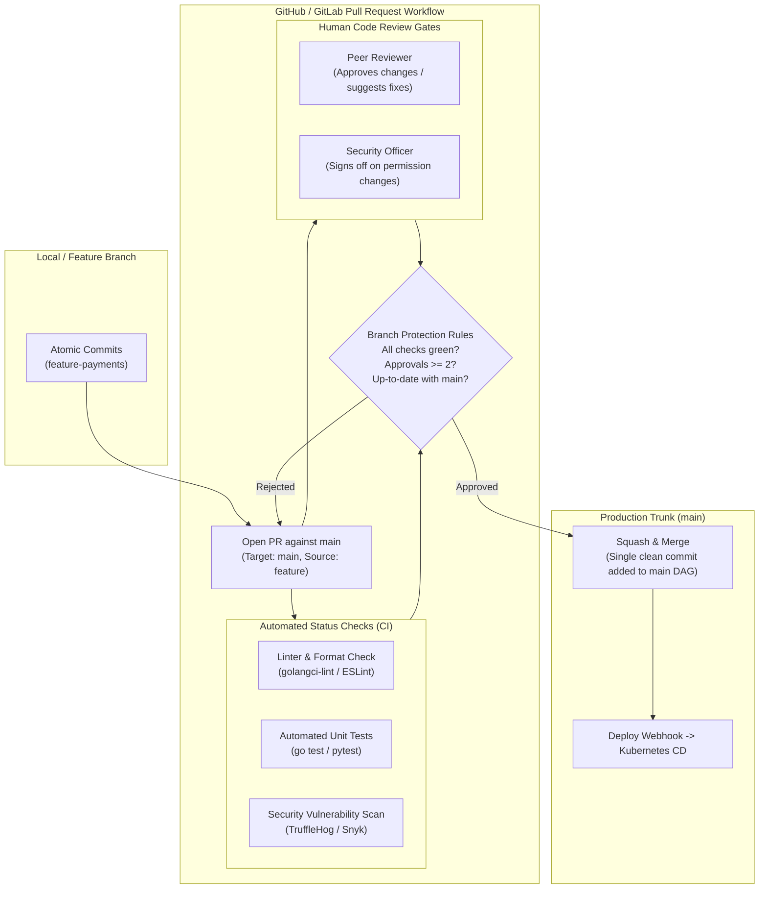
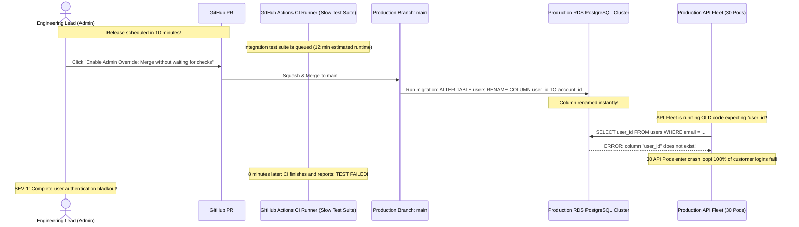

# Module 05: Pull Requests and Code Review

> **Prerequisites:** Module 02 (Branching and Merging), Module 04 (Remotes and Collaboration).  
> **Estimated Reading Time:** 25 minutes  
> **Target Audience:** Backend Developers, Engineering Leads, DevOps Practitioners.

> [!TIP]
> **The Golden Rule of Pull Requests:** A Pull Request is not a code dumping ground; it is an **engineering publication**. Keep PRs small and focused ($< 400$ lines of code). Provide a clear problem statement, testing evidence, and architectural justification. Never bypass branch protection rules with administrative privileges; an automated test failure in CI is not an obstacle to be bypassed, but a production incident prevented.

---

## 1. Architectural Mental Model: The Pull Request Quality Gateway

In modern engineering teams, a Pull Request (or GitLab Merge Request) serves as the formal boundary between unverified private development and production-bound code:



---

## 2. Taxonomic Reference: GitHub PR Merge Methods Compared

When closing a PR on GitHub or GitLab, you choose between three merge methods:

| Merge Method | Git Mechanics | Commit History on `main` | Rollback Ergonomics | Recommended Production Use Case |
| :--- | :--- | :--- | :--- | :--- |
| **Squash and Merge** | Combines all branch commits into **one single commit** on `main` | **Clean, linear history**; 1 commit per PR | **Trivial** (`git revert <hash>`) | **STANDARD FOR FEATURE WORK.** Collapses WIP commits cleanly. |
| **Rebase and Merge** | Replays individual commits on top of `main` without merge commit | Linear history; preserves individual commits | Complex (requires reverting multiple commits) | Long-lived projects requiring granular commit-by-commit bisecting. |
| **Create a Merge Commit** (`--no-ff`) | Creates a 3-way merge commit with two parents | Non-linear DAG with branching bubbles | Simple (`git revert -m 1 <hash>`) | Large multi-service monorepo releases and epic branch merges. |

---

## 3. Systematic Breakdown: Code Review Etiquette and Prefixes

High-performing engineering teams use standardized prefixes on PR review comments to differentiate blocking issues from minor suggestions:

| Prefix | Semantic Meaning | Must Author Address Before Merge? | Example |
| :--- | :--- | :--- | :--- |
| **`blocking:`** | Critical architectural flaw, security hole, or bug | **YES (Mandatory)** | `blocking: This endpoint lacks rate limiting; vulnerable to DDoS.` |
| **`nit:`** | Minor cosmetic, naming, or style suggestion | No (Author's discretion) | `nit: Consider renaming 'userData' to 'user' for consistency.` |
| **`question:`** | Seeking clarification or context | Yes (Requires reply) | `question: Why did we choose Redis over in-memory sync.Map here?` |
| **`suggestion:`** | Proposed optimization or cleaner alternative | No | `suggestion: You can use strings.Cut here instead of Split.` |
| **`praise:`** | Positive feedback acknowledging good engineering | No | `praise: Clean implementation of the circuit breaker pattern!` |

---

## 4. Production War Story: The Admin Override Schema Disaster



### The Incident
Fifteen minutes before a scheduled marketing launch, an engineering lead approved a database refactoring Pull Request that renamed `user_id` to `account_id`. Because CI integration tests were queued behind an unrelated build, the lead clicked **"Merge without waiting for requirements to be met (Admin Override)"**.

Within 3 minutes of deployment, the production database migration executed. Every running API container began crashing with `column "user_id" does not exist`.

### The Post-Mortem Data
* **Severity:** SEV-1 (Complete Global Outage)
* **Mean Time to Detect (MTTD):** 5 minutes
* **Mean Time to Resolution (MTTR):** 60 minutes

### The Root Cause
The database schema change lacked backwards compatibility (it was not a dual-write phased migration). The CI test suite had already detected the failure in staging, but the administrative override allowed unverified code to ship directly to production.

### The Fix & Hardening
1. **Disable Admin Overrides in Branch Protection:**
In GitHub branch settings, enable **"Do not allow bypassing the above settings"** (applies rules even to repository administrators).
2. **Require Passing Status Checks:**
Enforce that all CI test workflows must report success before the merge button unlocks.
3. **Phased Zero-Downtime Migration Policy:**
Enforce database migration guidelines:
   * Phase 1: Add new column `account_id` and dual-write.
   * Phase 2: Backfill historical data.
   * Phase 3: Update readers to use `account_id`.
   * Phase 4: Drop old column `user_id`.

---

## 5. Multi-Language Production Code: Interacting with GitHub Pull Request APIs

Backend automation bots frequently interact with GitHub's REST/GraphQL API to inspect or label PRs.

### Go (`google/go-github`)
```go
package main

import (
	"context"
	"fmt"
	"os"
	"github.com/google/go-github/v60/github"
	"golang.org/x/oauth2"
)

// CheckPRStatus validates that a PR is approved and all CI status checks are green.
func CheckPRStatus(ctx context.Context, owner, repo string, prNumber int) error {
	token := os.Getenv("GITHUB_TOKEN")
	if token == "" {
		return fmt.Errorf("GITHUB_TOKEN is missing")
	}

	ts := oauth2.StaticTokenSource(&oauth2.Token{AccessToken: token})
	tc := oauth2.NewClient(ctx, ts)
	client := github.NewClient(tc)

	pr, _, err := client.PullRequests.Get(ctx, owner, repo, prNumber)
	if err != nil {
		return fmt.Errorf("failed to fetch PR #%d: %w", prNumber, err)
	}

	if pr.GetDraft() {
		return fmt.Errorf("PR #%d is in draft state; not ready for merge", prNumber)
	}

	// Inspect Combined Status Checks on the PR HEAD SHA
	status, _, err := client.Repositories.GetCombinedStatus(ctx, owner, repo, pr.GetHead().GetSHA(), nil)
	if err != nil {
		return fmt.Errorf("failed to get status checks: %w", err)
	}

	if status.GetState() != "success" {
		return fmt.Errorf("CI quality gates pending or failed! State: %s (%d/%d checks passed)",
			status.GetState(), status.GetTotalCount(), status.GetTotalCount())
	}

	fmt.Printf("✅ PR #%d (%s) is green and ready for production merge.\n", prNumber, pr.GetTitle())
	return nil
}

func main() {
	fmt.Println("🚀 GitHub PR Status Gatekeeper initialized.")
}
```

### Node.js / TypeScript (`@octokit/rest`)
```typescript
import { Octokit } from '@octokit/rest';

const octokit = new Octokit({ auth: process.env.GITHUB_TOKEN });

/**
 * Automates adding a standardized review comment to a Pull Request.
 */
export async function postReviewComment(
  owner: string,
  repo: string,
  pullNumber: number,
  body: string
): Promise<void> {
  await octokit.rest.pulls.createReview({
    owner,
    repo,
    pull_number: pullNumber,
    body,
    event: 'COMMENT',
  });
  console.log(`✅ Review comment posted to PR #${pullNumber}`);
}
```

### Python
```python
import os
import requests

def verify_pr_mergeability(owner: str, repo: str, pr_num: int) -> bool:
    """
    Queries GitHub REST API to verify if PR is mergeable without conflicts.
    """
    token = os.environ.get("GITHUB_TOKEN")
    headers = {"Authorization": f"Bearer {token}", "Accept": "application/vnd.github.v3+json"}
    url = f"https://api.github.com/repos/{owner}/{repo}/pulls/{pr_num}"
    
    resp = requests.get(url, headers=headers)
    if resp.status_code != 200:
        return False

    data = resp.json()
    return data.get("mergeable", False) is True

if __name__ == "__main__":
    print("Python GitHub PR validator initialized.")
```

---

## 6. Practical Hands-On Verification CLI Workflows

Manage Pull Requests directly from your terminal using the GitHub CLI (`gh`):

### Workflow 1: Open a Structured Pull Request from CLI
```bash
# 1. Create a branch and commit changes
git switch -c feat/jwt-auth
echo "JWT_ENABLED=true" >> config.env
git commit -am "feat(auth): enable jwt validation"
git push -u origin feat/jwt-auth

# 2. Create PR with structured title and markdown body via gh
gh pr create --title "feat(auth): enable jwt validation" \
             --body "## Summary
- Introduces JWT signature verification
- Resolves issue #42
## Testing Evidence
- Passed unit tests locally via go test"
```

### Workflow 2: Check PR Status and Review Feedback
```bash
# View active PR status in terminal
gh pr status

# Check out a colleague's PR locally for testing
gh pr checkout 142
```

### Workflow 3: Squash and Merge via CLI
```bash
# Merge PR once checks pass and delete the remote branch automatically
gh pr merge 142 --squash --delete-branch
```

---

## 7. Operational Validation Checkpoint

<details>
<summary><strong>Question 1: Squash and Merge vs. Rebase and Merge</strong></summary>

**Scenario:** A developer submits a Pull Request containing 12 commits with messages like `wip`, `fix typo`, `oops`, `really fix typo`, and `working now`. 
Which GitHub merge method should you enforce, and why?

**Answer:**
Enforce **Squash and Merge**. 

If you use "Rebase and Merge", all 12 messy intermediate commits are preserved and appended directly to `main`'s permanent history, cluttering git log and making future debugging (`git bisect`) painful. 

**Squash and Merge** collapses all 12 commits into a **single clean commit** on `main` with a descriptive message (`feat(auth): add multi-factor authentication (#142)`), keeping trunk history clean and making future reverts trivial.
</details>

<details>
<summary><strong>Question 2: The Purpose of "Draft Pull Requests"</strong></summary>

**Scenario:** A developer is halfway through building a complex feature. They want early architectural feedback from a senior engineer, but they don't want teammates to think the PR is ready to merge or trigger expensive 45-minute cloud end-to-end test suites.

How should the developer open the PR?

**Answer:**
Open it as a **Draft Pull Request** (`gh pr create --draft`). 

* Draft PRs cannot be merged (the merge button is disabled).
* They clearly signal to teammates that work is in progress.
* Many CI systems can be configured to skip expensive end-to-end deployment workflows on Draft PRs, saving computing costs and reducing noisy notification pings.
</details>

<details>
<summary><strong>Question 3: Why "Require Branches to be Up-to-Date" is Mandatory</strong></summary>

**Scenario:** PR #1 passes CI tests against `main` on Monday morning. On Monday afternoon, PR #2 is merged to `main`, changing a shared database utility function. On Tuesday, an engineer merges PR #1 without re-testing against Tuesday's `main`. Production breaks immediately upon merge.

Which GitHub branch protection setting eliminates this class of integration failure?

**Answer:**
Enable: **"Require branches to be up to date before merging"** (Strict status checks). 

When this setting is active, if `main` advances with new commits after your PR's tests passed, GitHub marks your PR's status as out-of-date and **blocks the merge button** until you update your branch (`git pull --rebase origin main` or clicking "Update branch") and the CI test suite re-runs against the true combined state.
</details>

---

## Next Step

Now that you understand Pull Requests, code review workflows, and branch protection quality gates, proceed to **[06 · Git Hooks and Automation](../06-git-hooks-and-automation/README.md)** to master client-side pre-commit hooks, server-side pre-receive quality enforcement, and automated secret prevention.
