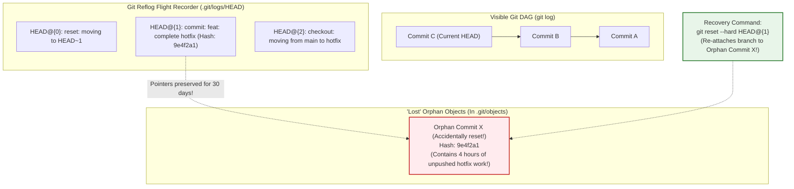
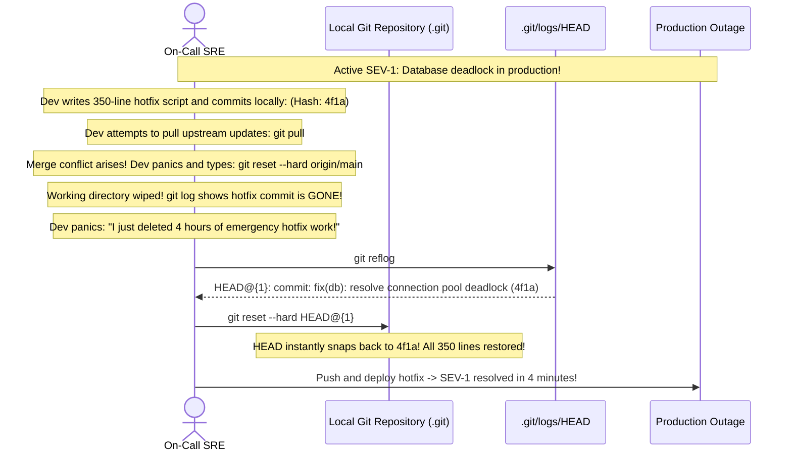

# Module 07: Git Troubleshooting and Disaster Recovery

> **Prerequisites:** Module 00 (Git Object Model), Module 02 (Branching and Merging), Module 03 (Rebasing).  
> **Estimated Reading Time:** 25 minutes  
> **Target Audience:** Backend Developers, Site Reliability Engineers, DevOps Incident Handlers.

> [!TIP]
> **The Golden Rule of Git Recovery:** **In Git, almost nothing that has been committed is ever truly lost.** Git's object store is append-only. When you make a catastrophic mistake (such as `git reset --hard` or a botched rebase), the commits are not deleted—only the branch pointer moved! Use **`git reflog`** to find the lost commit hash and restore your work with `git reset --hard HEAD@{n}`.

---

## 1. Architectural Mental Model: The Reflog Safety Net

The **Reflog (Reference Log)** is Git's private local flight recorder. It tracks every single time a reference pointer (`HEAD` or a branch) moves on your local machine:



### Why Commits Don't Disappear
When you execute `git reset --hard HEAD~1`:
1. Git updates `.git/refs/heads/main` to point to the parent commit.
2. The child commit `Commit X` is removed from `git log` output.
3. However, **the commit object and its tree and blobs remain physically intact inside `.git/objects/`**.
4. The Reflog records the previous position in `.git/logs/HEAD`. Git's automatic garbage collector (`git gc`) preserves unreferenced objects in reflog for at least **30 to 90 days**.

---

## 2. Taxonomic Reference: Reset Modes Compared

When moving `HEAD` backward, you choose how Git handles the Staging Area and Working Directory:

| Reset Flag | Moves `HEAD` Pointer? | Modifies Staging Area (Index)? | Modifies Working Directory (Disk Files)? | Risk of Data Loss | Production Use Case |
| :--- | :--- | :--- | :--- | :--- | :--- |
| **`git reset --soft HEAD~1`** | **YES** | **NO** (Changes stay staged) | **NO** (Files untouched on disk) | Zero risk | Undoing a commit to fix the message or split files into two commits. |
| **`git reset --mixed HEAD~1`** *(default)* | **YES** | **YES** (Changes un-staged) | **NO** (Files untouched on disk) | Zero risk | Undoing commit and staging area; keeps edits as un-staged disk changes. |
| **`git reset --hard HEAD~1`** | **YES** | **YES** (Index reset) | **YES (Overwrites files on disk!)** | **HIGH** | Completely discarding unwanted commits and all local file modifications. |

---

## 3. Systematic Breakdown: The Disaster Recovery Playbooks

### Playbook 1: Accidental `git reset --hard` Recovery
```bash
# 1. View your local flight recorder
git reflog

# 2. Identify the entry right before the bad reset (e.g. HEAD@{1})
# Output: HEAD@{1}: commit: feat: critical payment processing logic

# 3. Restore the branch pointer instantly
git reset --hard HEAD@{1}
```

### Playbook 2: Accidental Commit on the Wrong Branch
You committed feature work to `main` instead of `feature`:
```bash
# 1. Create a new branch pointing to current commit
git branch feature-auth

# 2. Reset main backward by one commit (leaves main clean)
git reset --hard HEAD~1

# 3. Switch to your feature branch where the commit lives safely
git switch feature-auth
```

### Playbook 3: Bisecting a Regression Across 500 Commits
A production bug was introduced somewhere in the last 500 commits:
```bash
# 1. Start bisect
git bisect start

# 2. Mark current HEAD as broken
git bisect bad

# 3. Mark last known good release commit (e.g. v2.4.0)
git bisect good v2.4.0

# 4. Git automatically checks out middle commit (Binary Search $O(\log N)$)
# Test your application, then tell Git:
git bisect good   # If bug is absent
# or
git bisect bad    # If bug is present

# 5. When Git pinpoint the exact offending commit, reset back to normal:
git bisect reset
```

---

## 4. Production War Story: The `git reset --hard` Panic Recovery



### The Incident
During an active SEV-1 outage affecting customer order processing, an on-call engineer wrote and committed a 350-line patch resolving a database deadlock. 

When attempting to sync with upstream before pushing, the engineer encountered a merge conflict. In a moment of high cognitive stress, the engineer ran:
```bash
git reset --hard origin/main
```
The terminal reported `HEAD is now at origin/main`. The hotfix commit was gone from `git log`. The engineer believed four hours of critical recovery code had been permanently destroyed.

### The Post-Mortem Data
* **Severity:** SEV-1 (Extended High-Priority Outage)
* **Mean Time to Detect (MTTD):** 2 minutes
* **Mean Time to Resolution (MTTR):** 15 minutes

### The Root Cause
The engineer did not understand Git's internal object store immutability. When `git reset --hard` executed, the commit `4f1a` was unlinked from the branch pointer, but **its data remained untouched in `.git/objects`**.

### The Fix & Hardening
1. The lead engineer instructed the on-call engineer to run:
```bash
git reflog
```
2. The reflog immediately revealed:
```text
4f1a9e2 HEAD@{1}: commit: fix(db): resolve connection pool deadlock
```
3. Running `git reset --hard HEAD@{1}` restored the entire 350-line patch in 1.2 seconds, allowing the team to ship the fix and resolve the outage.

---

## 5. Multi-Language Production Code: Automated Bug Hunting with `git bisect run`

Instead of manually testing commits during `git bisect`, you can feed Git an automated test script. Git will binary search across hundreds of commits automatically in seconds.

### Python: Bisect Test Script (`test_regression.py`)
```python
#!/usr/bin/env python3
import sys
import subprocess

def test_critical_endpoint():
    """
    Returns exit code 0 if test passes (good commit).
    Returns exit code 1 if test fails (bad commit).
    Returns exit code 125 if commit cannot be tested (skip).
    """
    # Run test suite on current checked-out commit
    res = subprocess.run(["go", "test", "-run", "TestAuthenticationPipeline", "./..."])
    
    if res.returncode == 0:
        # Success: commit is GOOD
        sys.exit(0)
    else:
        # Failure: commit is BAD
        sys.exit(1)

if __name__ == "__main__":
    test_critical_endpoint()
```

Run fully automated binary search:
```bash
git bisect start HEAD v2.0.0
git bisect run python3 ./test_regression.py
```
*(Git automatically checks out commits, runs the script, narrows down the window, and prints the exact commit author and diff that broke the test).*

---

## 6. Practical Hands-On Verification CLI Workflows

Follow these workflows in your Ubuntu terminal:

### Workflow 1: Accidentally Lose and Rescue a Commit
```bash
# 1. Initialize temporary scratch repo
mkdir -p /tmp/git-recovery-lab && cd /tmp/git-recovery-lab
git init -b main

# 2. Base commit
echo "Initial baseline" > app.txt && git add app.txt && git commit -m "init: base"

# 3. Create important commit
echo "CRITICAL PRODUCTION HOTFIX" > hotfix.txt
git add hotfix.txt && git commit -m "fix(prod): emergency patch"
git log --oneline

# 4. Simulate catastrophic disaster: reset --hard backward!
git reset --hard HEAD~1
git log --oneline    # Notice: hotfix.txt and the commit are GONE!

# 5. Inspect Reflog to locate lost commit
git reflog

# 6. Rescue the lost commit!
git reset --hard HEAD@{1}
cat hotfix.txt       # Restored!
```
**Expected Output:**
```text
CRITICAL PRODUCTION HOTFIX
```

### Workflow 2: Clean Up
```bash
cd ~ && rm -rf /tmp/git-recovery-lab
```

---

## 7. Operational Validation Checkpoint

<details>
<summary><strong>Question 1: The Leaked Secret Illusion</strong></summary>

**Scenario:** A developer accidentally commits an AWS secret key:
```bash
git commit -am "fix: add api key"
```
Realizing the mistake, the developer immediately creates a second commit deleting the key:
```bash
git commit -am "security: delete api key"
git push origin main
```
The developer tells the security team: "The repository is secure now because the secret is not in the latest version."

Why is the repository still critically compromised?

**Answer:**
Git does not store files as a single state; it stores a **complete immutable Directed Acyclic Graph (DAG) of every snapshot that ever existed**. 

Even though the secret is absent from `HEAD`, the commit that introduced it (`"fix: add api key"`) remains **permanently recorded in the repository's `.git/objects` history**. Anyone who clones the repository can run `git log -p` or inspect historical trees to extract the plaintext secret in seconds.

**The Action Required:**
1. **Immediately rotate/revoke the AWS secret key in the cloud console!** (Assume it is compromised).
2. Rewrite the repository history using tools like `git-filter-repo` or BFG Repo-Cleaner to permanently purge the blob from the object database.
</details>

<details>
<summary><strong>Question 2: What Can the Reflog NOT Recover?</strong></summary>

**Scenario:** An engineer edits 500 lines of code in their editor. They have NOT yet run `git add` or `git commit`. They accidentally run:
```bash
git restore .
# Or: git checkout -- .
```
Can `git reflog` restore their lost 500 lines of work?

**Answer:**
**NO.** 
The Reflog only tracks **commits and reference movements**. 

If files were never staged (`git add`) or committed (`git commit`), Git's object database never received the bytes. Uncommitted working directory modifications discarded via `git restore .` or `git reset --hard` are overwritten directly on disk by the operating system and are **permanently unrecoverable by Git**.
</details>

<details>
<summary><strong>Question 3: Safely Undoing an Accidental Commit Without Losing Edits</strong></summary>

**Scenario:** You committed changes locally with `git commit -m "wip"`, but realize you forgot to run the linter and want to make additional modifications before committing. 

Which command undos the commit while leaving all your modified files staged in the index ready to edit?

**Answer:**
```bash
git reset --soft HEAD~1
```
`--soft` moves the `HEAD` and branch pointer backward by one commit, but leaves **the Staging Area (Index) and Working Directory completely untouched**. All changes from the undone commit remain staged, allowing you to add more edits and commit cleanly.
</details>

---

## Next Step

Now that you have mastered Git troubleshooting, reflogs, and disaster recovery, proceed to **[08 · Capstone Project: Realistic Collaboration History](../08-capstone-project/README.md)** to synthesize the entire Git curriculum in a multi-week simulation.
