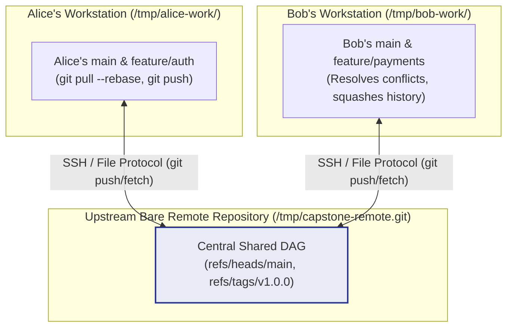
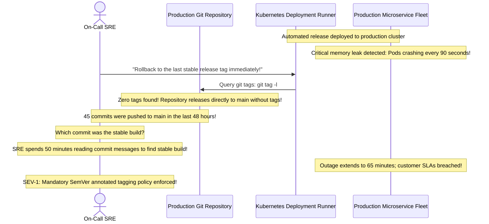

# Module 08: Capstone Project — Realistic Collaboration History

> **Prerequisites:** Modules 00 through 07 (Object Model, Local Workflow, Branching, Rebasing, Remotes, PRs, Hooks, Recovery).  
> **Estimated Reading Time:** 35 minutes  
> **Target Audience:** Backend Developers, DevOps Engineers, Team Leads.

> [!TIP]
> **The Golden Rule of Git Collaboration:** Real version control fluency is not about memorizing commands—it is about **navigating the Directed Acyclic Graph (DAG) with complete mental clarity**. In this capstone, you will simulate a complete multi-engineer enterprise development lifecycle: bare upstream remotes, diverged concurrent branches, merge conflict triage, interactive commit squashing, annotated release tagging, and emergency reflog disaster recovery.

---

## 1. Architectural Mental Model: The Multi-Engineer Simulation Topology

In this capstone, you will establish a fully self-contained distributed Git topology on your local machine, simulating two collaborating engineers (Alice and Bob) pushing and synchronizing through a central bare upstream repository:



---

## 2. Taxonomic Reference: Capstone Project Phase Matrix

| Phase | Core Objective | Key Git Commands Exercised | Production Skill Demonstrated |
| :--- | :--- | :--- | :--- |
| **Phase 1: Bare Remote & Baseline** | Create bare upstream server and baseline project | `git init --bare`, `git clone`, `git commit` | Setting up central repositories and origin remotes. |
| **Phase 2: Concurrent Feature Branches** | Alice and Bob develop concurrent features simultaneously | `git switch -c`, `git commit` | Branch isolation and parallel team velocity. |
| **Phase 3: Conflict Triage & Rebase** | Resolve upstream divergence cleanly | `git fetch`, `git rebase origin/main`, `git add` | Clean linear integration without merge bubbles. |
| **Phase 4: History Squashing & Release Tag** | Compress WIP commits into 1 atomic Conventional Commit | `git rebase -i`, `git tag -a -m` | Preparing reviewable PRs and immutable SemVer releases. |
| **Phase 5: Reflog Disaster Recovery** | Intentionally break branch with `--hard` and rescue | `git reset --hard`, `git reflog` | Incident recovery and data loss prevention. |

---

## 3. Systematic Breakdown: Lightweight vs. Annotated Git Tags

When cutting a production release, choosing the correct tag type is essential:

```
  LIGHTWEIGHT TAG: A simple pointer to a commit
  "v1.0.0" ──▶ Commit 7a9f2bc... (Hash only, no author metadata)

  ANNOTATED TAG: A full cryptographic Git object in .git/objects/
  "v1.0.0" ──▶ Tag Object 4d8e1a...
                 ├── Tagger: Asha <asha@example.com>
                 ├── Date:   Tue Nov 10 17:30:00 2026 UTC
                 ├── Message: "release: v1.0.0 enterprise launch"
                 └── Target: Commit 7a9f2bc...
```

| Dimension | Lightweight Tag (`git tag v1.0.0`) | Annotated Tag (`git tag -a v1.0.0 -m "msg"`) |
| :--- | :--- | :--- |
| **Object Type** | Simple text reference file in `.git/refs/tags/` | Full **Tag Object** in `.git/objects/` |
| **Metadata** | None (Inherits commit's date and author) | Dedicated tagger identity, timestamp, and message |
| **GPG Cryptographic Signing** | No | **Yes** (`git tag -s`) |
| **Production Standard** | Private temporary local bookmarks | **MANDATORY FOR PRODUCTION RELEASES & RELEASES** |

---

## 4. Production War Story: The Untagged Microservice Rollback Disaster



### The Incident
During a major infrastructure deployment, a newly deployed payment service developed a memory leak that exhausted pod memory every 90 seconds. The incident commander ordered an immediate rollback to the previous stable release.

When the SRE inspected the repository to find the prior release version, running `git tag` returned empty. The team had been deploying commits directly off `main` without creating release tags.

### The Post-Mortem Data
* **Severity:** SEV-1 (Extended High-Priority Outage)
* **Mean Time to Detect (MTTD):** 5 minutes
* **Mean Time to Resolution (MTTR):** 65 minutes

### The Root Cause
Because no Git tags existed, engineers spent 50 minutes manually comparing Git logs, container image SHAs, and pull request dates to determine which historical commit was running prior to the failure.

### The Fix & Hardening
1. **Mandatory Annotated Semantic Version Tags:**
Every production deployment must be triggered by an annotated Git tag:
```bash
git tag -a v2.4.1 -m "release: v2.4.1 hotfix"
git push origin v2.4.1
```
2. **Immutable CD Triggers:**
Configure continuous deployment systems to build and deploy **only when an annotated tag matching `v*.*.*` is pushed**.

---

## 5. Multi-Language Production Code: Automating Release Tag Verification

Deployment pipelines should verify that the checked-out commit is associated with a signed or annotated Git tag.

### Go
```go
package main

import (
	"bytes"
	"context"
	"fmt"
	"os/exec"
	"strings"
	"time"
)

// VerifyCurrentCommitTag ensures the active HEAD is tagged with an annotated SemVer tag.
func VerifyCurrentCommitTag(ctx context.Context) (string, error) {
	// git describe --exact-match returns tag name if HEAD points to a tag
	cmd := exec.CommandContext(ctx, "git", "describe", "--exact-match", "--tags")
	var stdout bytes.Buffer
	cmd.Stdout = &stdout

	if err := cmd.Run(); err != nil {
		return "", fmt.Errorf("HEAD is not pointing to an explicit Git release tag! Deployments must be tagged")
	}

	tag := strings.TrimSpace(stdout.String())
	if !strings.HasPrefix(tag, "v") {
		return "", fmt.Errorf("invalid tag format: %s (Must follow SemVer: vX.Y.Z)", tag)
	}

	return tag, nil
}

func main() {
	ctx, cancel := context.WithTimeout(context.Background(), 3*time.Second)
	defer cancel()

	tag, err := VerifyCurrentCommitTag(ctx)
	if err != nil {
		fmt.Printf("❌ Release blocked: %v\n", err)
		return
	}

	fmt.Printf("✅ Release verified: Deploying tagged version %s\n", tag)
}
```

### Node.js / TypeScript
```typescript
import { execFile } from 'child_process';
import { promisify } from 'util';

const execFileAsync = promisify(execFile);

/**
 * Validates that current HEAD has an annotated tag before triggering CD deployment.
 */
export async function getReleaseTag(): Promise<string> {
  try {
    const { stdout } = await execFileAsync('git', ['describe', '--tags', '--exact-match']);
    const tag = stdout.trim();
    console.log(`✅ Verified production release tag: ${tag}`);
    return tag;
  } catch {
    throw new Error('FATAL: HEAD does not point to a valid Git tag. Aborting deployment.');
  }
}
```

### Python
```python
import subprocess
import sys

def check_annotated_tag():
    """
    Verifies that the latest tag is an annotated tag object (not lightweight).
    """
    try:
        tag = subprocess.check_output(["git", "describe", "--tags", "--abbrev=0"], text=True).strip()
        obj_type = subprocess.check_output(["git", "cat-file", "-t", tag], text=True).strip()
        
        if obj_type != "tag":
            print(f"⚠️ Warning: Tag {tag} is lightweight! Production mandates annotated tags.")
            return False
            
        print(f"✅ Verified annotated tag object: {tag}")
        return True
    except subprocess.CalledProcessError:
        print("❌ No git tags found.")
        return False

if __name__ == "__main__":
    if not check_annotated_tag():
        sys.exit(1)
```

---

## 6. Practical Hands-On Capstone Deployment Workflow

Execute this end-to-end multi-engineer collaboration simulation in your Ubuntu terminal:

### Step 1: Initialize the Central Bare Remote
```bash
# 1. Create a workspace
mkdir -p /tmp/capstone-sim && cd /tmp/capstone-sim

# 2. Create the central bare remote repository
git init --bare /tmp/capstone-sim/remote.git

# 3. Clone for Alice and Bob
git clone /tmp/capstone-sim/remote.git /tmp/capstone-sim/alice-repo
git clone /tmp/capstone-sim/remote.git /tmp/capstone-sim/bob-repo
```

### Step 2: Alice Initializes Baseline Project on `main`
```bash
cd /tmp/capstone-sim/alice-repo
git checkout -b main
echo "# Payment Gateway Service" > README.md
echo "PORT=8080" > config.env
git add . && git commit -m "chore: initial project scaffold"
git push -u origin main
```

### Step 3: Alice and Bob Develop Concurrent Conflicting Features
```bash
# Alice updates config on her branch
cd /tmp/capstone-sim/alice-repo
git switch -c feat/alice-config
echo "DB_POOL=20" >> config.env
git commit -am "feat(config): increase db pool size"
git push -u origin feat/alice-config

# Bob concurrently updates the same file on his clone
cd /tmp/capstone-sim/bob-repo
git pull origin main
git switch -c feat/bob-timeout
echo "DB_TIMEOUT=10s" >> config.env
git commit -am "feat(config): set connection timeout"
```

### Step 4: Alice Merges to Main First
```bash
cd /tmp/capstone-sim/alice-repo
git switch main
git merge feat/alice-config
git push origin main
```

### Step 5: Bob Pulls with Rebase & Resolves Conflict
```bash
cd /tmp/capstone-sim/bob-repo
# Bob fetches upstream and rebases his feature branch onto updated main
git fetch origin
git switch feat/bob-timeout
git rebase origin/main || echo "Conflict encountered as expected!"

# Inspect conflict markers in config.env and resolve
cat << 'EOF' > config.env
PORT=8080
DB_POOL=20
DB_TIMEOUT=10s
EOF

# Complete the rebase
git add config.env
git rebase --continue
```

### Step 6: Bob Creates Annotated Tag & Pushes Release
```bash
# Bob fast-forwards main and cuts release tag v1.0.0
git switch main
git merge feat/bob-timeout
git tag -a v1.0.0 -m "release: v1.0.0 production deployment"
git push origin main --tags
```

### Step 7: Simulate Catastrophic Reset & Rescue via Reflog
```bash
# Simulate accidental hard reset
git reset --hard HEAD~2
git log --oneline    # Commits are gone!

# Rescue via reflog
git reflog
git reset --hard HEAD@{1}
git log --oneline    # Commits and tag restored!

# Clean up
cd ~ && rm -rf /tmp/capstone-sim
```

---

## 7. Operational Validation Checkpoint

<details>
<summary><strong>Question 1: Why Bare Repositories (`git init --bare`) are Used for Remotes</strong></summary>

**Scenario:** An engineer attempts to push commits to a standard non-bare Git repository on a remote server: `git push server main`. 
Git rejects the push with:
`remote: error: refusing to update checked out branch: refs/heads/main`  
`remote: error: By default, updating the current branch in a non-bare repository is denied.`

Why does Git forbid pushing to the checked-out branch of a non-bare repository, and why are bare repositories required for remotes?

**Answer:**
A standard Git repository has a **Working Directory** on disk where files are actively checked out. 

If Git permitted a remote push to advance the branch pointer of a checked-out branch, the repository's commit history would advance while the files on disk in the working directory would remain unchanged, creating a corrupted and confusing state where `git status` on the remote server reports that all incoming files have been modified or deleted.

**A Bare Repository (`git init --bare`)** contains **only the `.git` database** (objects, refs, and config) with **zero working directory files**. Because no branch is ever checked out, it is impossible to cause working directory desynchronization, making bare repositories the required architecture for central shared remotes (GitHub, GitLab, and self-hosted Git servers).
</details>

<details>
<summary><strong>Question 2: Pushing Tags to Remote Servers</strong></summary>

**Scenario:** An engineer creates an annotated release tag locally:
```bash
git tag -a v2.0.0 -m "release: version 2.0.0"
git push origin main
```
On GitHub, the tag does not appear, and the automated CD release workflow fails to trigger. 

Why was the tag not uploaded, and what is the proper command?

**Answer:**
By default, **`git push` pushes branch commits only; it NEVER pushes Git tags automatically**. 

To push a specific tag:
```bash
git push origin v2.0.0
```
Or to push all local tags that do not yet exist on the remote:
```bash
git push origin --tags
```
</details>

<details>
<summary><strong>Question 3: Reflog Limitations Across Clones</strong></summary>

**Scenario:** A developer accidentally destroys a branch using `git reset --hard` on their laptop. Can a teammate on another computer use *their* local `git reflog` to recover the first developer's lost commits?

**Answer:**
**NO.** 
The Git **Reflog is strictly local to each individual repository clone**. 

When you push or fetch, Git transmits commit DAG objects, trees, and blobs—it **never transmits reflog entries**. A teammate's reflog records only the reference movements that occurred on *their* workstation. 

However, if the lost commits were ever pushed to the remote prior to the accidental reset, the teammate can retrieve them from the remote-tracking branch. If they were never pushed, recovery is only possible on the physical machine where the commits were created.
</details>

---

## Path 8 Complete!

Congratulations! You have completed the entire **Linux and Git (`linux-and-git`)** curriculum path:
* **Step 1: Linux System Fundamentals** (17 Modules: 00 through 16) — Completed & Standardized
* **Step 2: Git and Version Control** (9 Modules: 00 through 08) — Completed & Standardized

Your command of the Linux kernel, processes, pipelines, storage, network wire diagnostics, systemd services, Git object internals, branching models, rebase engines, and disaster recovery playbooks is fully operational and standardized to gold-standard production excellence.
