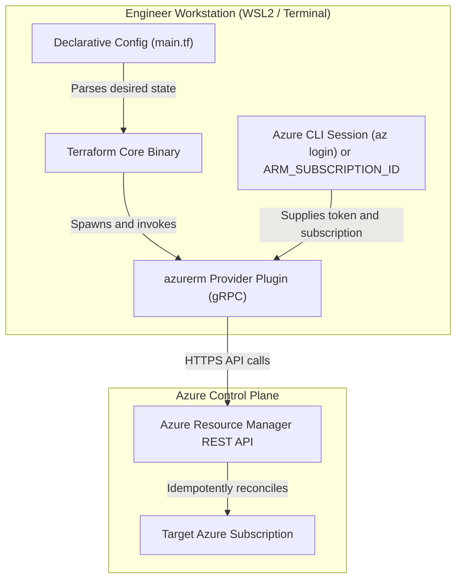
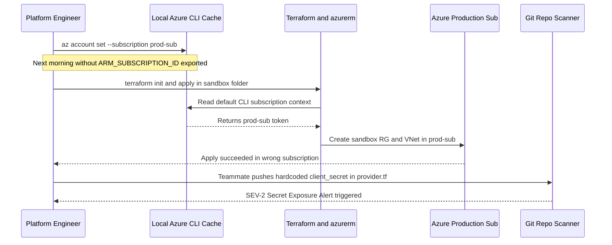

# IaC Concepts & Terraform Setup

> **Prerequisites:** Azure CLI installed and authenticated (`az login`), WSL2 or Linux/macOS terminal, basic familiarity with Azure Resource Groups and Virtual Networks (Tracks 5–7), and Git fundamentals (Track 8).  
> **Estimated Reading Time:** 25 minutes  
> **Target Audience:** Backend Engineers, DevOps Engineers, Cloud Platform Beginners.

> [!TIP]
> **The Golden Rule of Terraform Setup:** Never hard-code subscription IDs, tenant IDs, or service principal secrets in `.tf` files—supply `ARM_SUBSCRIPTION_ID` via environment variables or federated OIDC, and always include the mandatory empty `features {}` block inside `provider "azurerm"` before running `terraform init`.

---

## Why This Matters

Every Azure resource you've built in tracks 5–7 was created by typing an `az` command — imperative, one-off, and invisible the moment the command scrolled off your screen. Infrastructure as Code (IaC) replaces that with a **declarative source file** that describes what should exist, versioned in Git and applied by a tool. This module explains why that shift is worth making, installs Terraform, and gets the `azurerm` provider authenticated against the same Azure login you already use — the foundation for everything else in this track.

---

## 1. Architectural Mental Model: Declarative Reconciliation & Provider Plugins

Terraform Core itself has zero built-in knowledge of Azure APIs. Instead, Terraform reads declarative `.tf` HCL files, downloads the `hashicorp/azurerm` provider plugin into `.terraform/`, and communicates with that plugin over local gRPC. The provider translates HCL resource blocks into Azure Resource Manager (ARM) REST calls using your active `az login` session or `ARM_*` environment variables:



### Core Concepts

#### Imperative vs. Declarative — What Actually Changes
In track 5 you ran `az network vnet create -g rg -n hub-vnet --address-prefixes 10.0.0.0/16`. That's **imperative**: you told Azure the exact steps, in order, right now. If you run it twice you get an error (it already exists) or a second resource. There's no file that represents "the VNet we want" — only the side effects of commands you've already run.

Terraform is **declarative**: you write a block that says "a VNet named `hub-vnet` with address space `10.0.0.0/16` should exist," and Terraform compares that desired state to reality and makes only the changes needed to close the gap. Run it once, it creates the VNet. Run it again with no changes, it does nothing (**idempotent**). Change the address space in the file, it updates just that. The file *is* the infrastructure's definition.

#### Why Declarative Wins for Infrastructure
Four concrete payoffs, each of which you've felt the absence of already:

- **Repeatability.** Standing up an identical dev/test/prod environment is `terraform apply` three times against three configs, not re-typing dozens of `az` commands hoping you got every flag the same.
- **Reviewability.** Because it's code in Git (track 8), an infrastructure change is a pull request: someone can read the diff, see exactly which resources change, and approve it *before* it touches Azure.
- **Auditability.** `git log` on your Terraform repo is a complete history of who changed what infrastructure and when — something no amount of `az` command history gives you.
- **Drift detection.** Terraform can tell you when someone changed a resource in the portal behind your back (you'll see this in module 01).

#### HCL: The Language You'll Write
Terraform configs are written in **HCL** (HashiCorp Configuration Language), in files ending `.tf`. The core building block is a **block**:

```hcl
resource "azurerm_resource_group" "main" {
  name     = "rg-tf-learn"
  location = "eastus"
}
```

`resource` is the block type; `"azurerm_resource_group"` is the resource type (which provider + which kind of thing); `"main"` is a local name *you* choose to refer to it elsewhere in your code; and the `{ ... }` body holds the arguments. You'll dissect this fully in module 02 — for now, just recognize the shape.

#### Providers: How Terraform Talks to Azure
Terraform's core knows nothing about Azure specifically. A **provider** is a plugin that translates HCL resource blocks into API calls against a particular platform. For Azure that's the **`azurerm`** provider (maintained by HashiCorp), which under the hood calls the same Azure Resource Manager APIs that `az` does. You declare which providers you need and pin their versions in a `terraform { required_providers { ... } }` block, then Terraform downloads them during `terraform init` (module 01).

There are actually several Azure providers — `azurerm` (the main one, and all this track uses), `azuread` (Entra ID objects), and `azapi` (raw ARM for brand-new resources `azurerm` hasn't added yet). Stick with `azurerm`.

#### Authenticating the `azurerm` Provider
The `azurerm` provider needs credentials to call Azure. There are several methods; two matter here:

- **Azure CLI auth (what you'll use for learning).** If you've run `az login`, the provider reuses that session automatically — no secrets in your config. This is the recommended path for a human running Terraform locally, and it's what every exercise in this track assumes.
- **Service principal auth (what pipelines use).** A non-human identity (an Entra ID app registration) with a client ID + secret, or — better — OIDC federation with no stored secret at all. You'll set this direction up conceptually in module 07 (CI/CD). Never hard-code a service principal secret into a `.tf` file; it would end up in Git.

> [!NOTE]
> **One `azurerm` v4 gotcha up front:** The provider now requires a **subscription ID** to be set explicitly (via the provider block, or the `ARM_SUBSCRIPTION_ID` environment variable). With Azure CLI auth it will often pick up your CLI's default subscription, but setting it explicitly avoids "which subscription am I even deploying to?" surprises.

#### A Minimal, Complete Config
Putting it together, the smallest real Terraform config for Azure is two blocks — a `terraform` block declaring the provider, and a `provider` block configuring it:

```hcl
terraform {
  required_version = ">= 1.9.0"
  required_providers {
    azurerm = {
      source  = "hashicorp/azurerm"
      version = "~> 4.0"
    }
  }
}

provider "azurerm" {
  features {}
  subscription_id = "00000000-0000-0000-0000-000000000000"
}
```

The `features {}` block is **mandatory and must be present even when empty** — it's where per-resource-type behavior overrides live. Leaving it out is the single most common first-config error. You'll add actual resources to this skeleton in module 01.

---

## 2. Taxonomic Comparison: Paradigm, Providers & Authentication

| Dimension | Imperative (`az` CLI Scripts) | Declarative (Terraform HCL) |
| :--- | :--- | :--- |
| **Definition Model** | Ordered sequence of action commands | Desired end-state resource graph |
| **Re-Run Behavior** | Errors (`AlreadyExists`) or duplicates resources | Idempotent: converges only on detected diffs |
| **Pre-Execution Preview** | None natively; side effects happen immediately | `terraform plan` diffs config vs. reality first |
| **Change Reviewability** | Fragile shell diffs with no dependency context | Clean Git PR diffs + deterministic plan output |
| **Drift Awareness** | Silent out-of-band portal edits go unnoticed | Detected automatically during `plan` refresh |

| Azure Provider | Registry Source | API Target | Primary Use Case |
| :--- | :--- | :--- | :--- |
| **`azurerm`** | `hashicorp/azurerm` | Azure Resource Manager (curated) | Core Azure infra (RGs, VNets, AKS, Storage) — used across this track |
| **`azuread`** | `hashicorp/azuread` | Microsoft Graph / Entra ID | App registrations, security groups, service principals |
| **`azapi`** | `hashicorp/azapi` | Raw ARM JSON REST API | Brand-new preview resource properties not yet in `azurerm` |

| Auth Mechanism | Credential Source | Secret in `.tf` File? | Ideal Context |
| :--- | :--- | :--- | :--- |
| **Azure CLI (`az login`)** | Local CLI token cache + `ARM_SUBSCRIPTION_ID` | No | Local developer workstation |
| **OIDC Workload Federation** | Short-lived Entra ID federated token | No | GitHub Actions / Azure DevOps CI/CD |
| **Service Principal + Secret** | `ARM_CLIENT_ID` + `ARM_CLIENT_SECRET` env vars | Never in `.tf` | Legacy CI systems lacking OIDC support |

---

## 3. Command Reference & Configuration Field Breakdown

| Command | What it does | Example |
|---|---|---|
| `terraform version` | Prints the Terraform CLI version (and provider versions once initialized) | `terraform version` |
| `terraform -help` | Lists top-level subcommands | `terraform -help` |
| `az login` | Logs the Azure CLI in; the azurerm provider reuses this session | `az login` |
| `az account show` | Shows the currently active subscription | `az account show -o table` |
| `az account set` | Sets the active subscription | `az account set --subscription "<sub-id-or-name>"` |
| `az account list` | Lists subscriptions your login can see | `az account list -o table` |

**Flag/field breakdown — the `terraform` block above:**
- `required_version = ">= 1.9.0"` — refuses to run if the Terraform CLI is older than this. Guards against a teammate on an ancient version.
- `source = "hashicorp/azurerm"` — the provider's address in the public registry (`registry.terraform.io/hashicorp/azurerm`).
- `version = "~> 4.0"` — a **pessimistic constraint**: allows `4.x` (any `4.y` >= `4.0`) but not `5.0`. Pinning is covered fully in module 02.

**Flag/field breakdown — the `provider "azurerm"` block:**
- `features {}` — required container for behavior overrides; must be present even if empty.
- `subscription_id` — which subscription to deploy into. Can instead be supplied via the `ARM_SUBSCRIPTION_ID` environment variable (preferred, so the ID isn't hard-coded).

---

## 4. Production War Story Post-Mortem: Wrong-Subscription Deployment & Credential Leak

| Field | Incident Details |
| :--- | :--- |
| **Severity** | SEV-2 (Cross-Subscription Contamination & Credential Exposure) |
| **Detection Time** | 18 minutes (alerted by Azure Policy non-compliant RG tag in Production + Git secret scanner) |
| **Resolution Time** | 52 minutes (subscription cleanup, credential rotation, CI OIDC migration) |
| **Impact** | Unapproved dev networking resources created in Production subscription; emergency rotation of a committed Service Principal secret |

### What Happened
During a late-night incident, a platform engineer switched their local Azure CLI context with `az account set --subscription "prod-sub"` to inspect a production VNet. The next morning, while testing a new Terraform sandbox config locally without `ARM_SUBSCRIPTION_ID` set, the engineer ran `terraform init` and `terraform apply` expecting it to hit their dev subscription. Because `azurerm` fell back to the active CLI context, it targeted `prod-sub`. Simultaneously, a teammate debugging CI hard-coded a `client_secret` inside `provider "azurerm"` and pushed it to a feature branch, triggering an immediate secret-scanning alert.



### Root Cause Analysis
1. **Implicit CLI Context Fallback:** Relying on whatever subscription `az login` happened to point at last created silent cross-environment ambiguity.
2. **Hardcoded Provider Arguments:** Putting credentials or environment-specific subscription IDs directly inside `.tf` source files mixed code with environment secrets.
3. **Over-Reliance on `terraform validate`:** Team treated a green `terraform validate` check as proof that Azure auth and target subscription bindings were safe.

### The Fix & Architectural Hardening
1. Exported `ARM_SUBSCRIPTION_ID` explicitly per shell/environment and added a pre-flight check script verifying `ARM_SUBSCRIPTION_ID` matches the intended non-prod subscription before local runs.
2. Rotated the leaked Service Principal immediately and migrated CI/CD pipelines to passwordless Entra ID OIDC workload identity federation.
3. Enabled repository pre-commit hooks and branch protection secret scanning to reject any `.tf` commit containing `client_secret` or hardcoded UUID credentials.

---

## 5. Multi-Language Production Implementation

Production platform teams wrap Terraform initialization with **pre-flight setup verification**: checking the Terraform CLI minimum version, validating that `ARM_SUBSCRIPTION_ID` is explicitly exported and matches `az account show`, and verifying `provider "azurerm"` defines `features {}` without hardcoded secrets before executing `terraform init` and `terraform validate`.

````carousel
**Go — Pre-Flight Azure Terraform Setup Guard**
```go
package main

import (
	"encoding/json"
	"fmt"
	"os"
	"os/exec"
	"regexp"
	"strings"
)

type tfVersionOut struct {
	TerraformVersion string `json:"terraform_version"`
}

func runPreflight(workDir string) error {
	subID := strings.TrimSpace(os.Getenv("ARM_SUBSCRIPTION_ID"))
	if subID == "" {
		return fmt.Errorf("ARM_SUBSCRIPTION_ID must be exported explicitly")
	}

	verBytes, err := exec.Command("terraform", "version", "-json").Output()
	if err != nil {
		return fmt.Errorf("terraform binary unavailable: %w", err)
	}
	var ver tfVersionOut
	if err := json.Unmarshal(verBytes, &ver); err != nil {
		return err
	}
	fmt.Printf("Terraform CLI verified: v%s\n", ver.TerraformVersion)

	mainTf, err := os.ReadFile(workDir + "/main.tf")
	if err != nil {
		return err
	}
	content := string(mainTf)
	if !strings.Contains(content, "features {}") && !strings.Contains(content, "features{}") {
		return fmt.Errorf("missing mandatory features {} block in provider azurerm")
	}
	secretPattern := regexp.MustCompile(`client_secret\s*=`)
	if secretPattern.MatchString(content) {
		return fmt.Errorf("hardcoded client_secret detected in main.tf")
	}

	valCmd := exec.Command("terraform", "-chdir="+workDir, "validate", "-json")
	out, err := valCmd.CombinedOutput()
	if err != nil {
		return fmt.Errorf("terraform validate failed: %s", string(out))
	}
	fmt.Println("Pre-flight setup & validation passed for subscription:", subID)
	return nil
}

func main() {
	if err := runPreflight("."); err != nil {
		fmt.Fprintln(os.Stderr, "ERROR:", err)
		os.Exit(1)
	}
}
```
<!-- slide -->
**TypeScript — Pre-Flight Azure Terraform Setup Guard**
```typescript
import { execFileSync } from "node:child_process";
import { readFileSync } from "node:fs";
import { join } from "node:path";

interface TerraformVersion {
  terraform_version: string;
}

function verifyTerraformSetup(workDir: string): void {
  const armSubId = process.env.ARM_SUBSCRIPTION_ID?.trim();
  if (!armSubId) {
    throw new Error("ARM_SUBSCRIPTION_ID is unset. Export it from az account show.");
  }

  const versionJson = execFileSync("terraform", ["version", "-json"], {
    encoding: "utf8",
  });
  const versionInfo: TerraformVersion = JSON.parse(versionJson);
  console.log(`Verified Terraform CLI v${versionInfo.terraform_version}`);

  const activeSub = execFileSync(
    "az",
    ["account", "show", "--query", "id", "-o", "tsv"],
    { encoding: "utf8" }
  ).trim();

  if (activeSub !== armSubId) {
    throw new Error(
      `Subscription mismatch: ARM_SUBSCRIPTION_ID=${armSubId} vs az CLI=${activeSub}`
    );
  }

  const hcl = readFileSync(join(workDir, "main.tf"), "utf8");
  if (!/features\s*\{\s*\}/.test(hcl)) {
    throw new Error('provider "azurerm" must contain a features {} block.');
  }
  if (/client_secret\s*=/.test(hcl)) {
    throw new Error("Hardcoded client_secret found in main.tf; use OIDC or env vars.");
  }

  execFileSync("terraform", [`-chdir=${workDir}`, "validate"], {
    stdio: "inherit",
  });
}

verifyTerraformSetup(".");
```
<!-- slide -->
**Python — Pre-Flight Azure Terraform Setup Guard**
```python
import json
import os
import re
import subprocess
from pathlib import Path


def verify_terraform_setup(work_dir: Path) -> None:
    sub_id = os.environ.get("ARM_SUBSCRIPTION_ID", "").strip()
    if not sub_id:
        raise RuntimeError("ARM_SUBSCRIPTION_ID is required; export it before running Terraform.")

    version_raw = subprocess.check_output(
        ["terraform", "version", "-json"], text=True
    )
    version_data = json.loads(version_raw)
    print(f"Terraform CLI detected: v{version_data['terraform_version']}")

    az_sub = subprocess.check_output(
        ["az", "account", "show", "--query", "id", "-o", "tsv"], text=True
    ).strip()
    if az_sub != sub_id:
        raise RuntimeError(
            f"Context drift: ARM_SUBSCRIPTION_ID={sub_id} does not match az CLI={az_sub}"
        )

    main_tf = (work_dir / "main.tf").read_text(encoding="utf-8")
    if not re.search(r"features\s*\{\s*\}", main_tf):
        raise ValueError("Mandatory 'features {}' block missing from provider 'azurerm'.")
    if re.search(r"client_secret\s*=", main_tf):
        raise ValueError("Refusing hardcoded client_secret inside .tf configuration.")

    subprocess.run(
        ["terraform", f"-chdir={work_dir}", "validate"], check=True
    )
    print(f"Validation succeeded against verified subscription {sub_id}")


if __name__ == "__main__":
    verify_terraform_setup(Path("."))
```
<!-- slide -->
**C# — Pre-Flight Azure Terraform Setup Guard**
```csharp
using System;
using System.Diagnostics;
using System.IO;
using System.Text.Json;
using System.Text.RegularExpressions;

public static class TerraformSetupVerifier
{
    private static string RunCli(string fileName, string args)
    {
        var psi = new ProcessStartInfo(fileName, args)
        {
            RedirectStandardOutput = true,
            RedirectStandardError = true,
            UseShellExecute = false
        };
        using var proc = Process.Start(psi) ?? throw new InvalidOperationException($"Failed to start {fileName}");
        string stdout = proc.StandardOutput.ReadToEnd();
        string stderr = proc.StandardError.ReadToEnd();
        proc.WaitForExit();
        if (proc.ExitCode != 0)
            throw new InvalidOperationException($"{fileName} {args} failed: {stderr}");
        return stdout.Trim();
    }

    public static void Main()
    {
        string? armSubId = Environment.GetEnvironmentVariable("ARM_SUBSCRIPTION_ID")?.Trim();
        if (string.IsNullOrEmpty(armSubId))
            throw new InvalidOperationException("ARM_SUBSCRIPTION_ID environment variable must be set.");

        using var verDoc = JsonDocument.Parse(RunCli("terraform", "version -json"));
        string tfVersion = verDoc.RootElement.GetProperty("terraform_version").GetString() ?? "unknown";
        Console.WriteLine($"Terraform CLI verified: v{tfVersion}");

        string azSub = RunCli("az", "account show --query id -o tsv");
        if (!string.Equals(azSub, armSubId, StringComparison.OrdinalIgnoreCase))
            throw new InvalidOperationException($"Subscription mismatch: env={armSubId}, az={azSub}");

        string mainTf = File.ReadAllText("main.tf");
        if (!Regex.IsMatch(mainTf, @"features\s*\{\s*\}"))
            throw new InvalidDataException("Missing mandatory features {} block in provider azurerm.");
        if (Regex.IsMatch(mainTf, @"client_secret\s*="))
            throw new InvalidDataException("Hardcoded client_secret prohibited in .tf files.");

        Console.WriteLine(RunCli("terraform", "validate"));
    }
}
```
````

---

## 6. Practical Hands-On Verification CLI Workflows

You'll run these in **WSL2** (your Linux environment), the same shell you use for `az`. Terraform is a single static binary, so installing it there is quick.

1. **Confirm your Azure CLI login works.** Terraform is going to piggyback on this session, so make sure it's healthy first:
   ```bash
   az login
   az account show -o table
   ```

   **Expected Output:**
   ```text
   Name                 CloudName    SubscriptionId                        State    IsDefault
   -------------------  -----------  ------------------------------------  -------  -----------
   Azure Learning Sub   AzureCloud   11111111-2222-3333-4444-555555555555  Enabled  True
   ```
   > Verify: `az account show` prints a subscription with `IsDefault` true. Note its **SubscriptionId** — you'll need it in exercise 4.

2. **Install Terraform in WSL2.** Add HashiCorp's apt repository and install (this is the current documented method for Debian/Ubuntu):
   ```bash
   wget -O - https://apt.releases.hashicorp.com/gpg | \
     sudo gpg --dearmor -o /usr/share/keyrings/hashicorp-archive-keyring.gpg
   echo "deb [signed-by=/usr/share/keyrings/hashicorp-archive-keyring.gpg] \
     https://apt.releases.hashicorp.com $(lsb_release -cs) main" | \
     sudo tee /etc/apt/sources.list.d/hashicorp.list
   sudo apt update && sudo apt install terraform
   ```
   > If apt gives you trouble, the alternative is to download the zip from the HashiCorp releases page, unzip it, and move the single `terraform` binary onto your `$PATH` — that's all "installing" Terraform is.

3. **Verify the install.** Run:
   ```bash
   terraform version
   ```

   **Expected Output:**
   ```text
   Terraform v1.9.8
   on linux_amd64
   ```
   > Verify: it prints something like `Terraform v1.9.x` (or newer). If you get "command not found," the binary isn't on your `$PATH`.

4. **Create your first config.** Make a clean directory and a single file:
   ```bash
   mkdir -p ~/tf-labs/00-setup && cd ~/tf-labs/00-setup
   ```
   Create `main.tf` with exactly the minimal config from the "A Minimal, Complete Config" section above, but replace the placeholder `subscription_id` with your real subscription ID from exercise 1.

5. **Initialize the working directory.** This downloads the `azurerm` provider named in your config:
   ```bash
   terraform init
   ```

   **Expected Output:**
   ```text
   Initializing the backend...
   Initializing provider plugins...
   - Finding hashicorp/azurerm versions matching "~> 4.0"...
   - Installing hashicorp/azurerm v4.x.y...
   - Installed hashicorp/azurerm v4.x.y (signed by HashiCorp)

   Terraform has been successfully initialized!
   ```
   > Verify: output ends with `Terraform has been successfully initialized!` and a note that it installed `hashicorp/azurerm`. A new hidden `.terraform/` directory and a `.terraform.lock.hcl` file now exist. You'll learn what those are in module 01 — for now, confirm they appeared.

6. **Confirm the provider version.** Now that the directory is initialized, run:
   ```bash
   terraform version
   ```

   **Expected Output:**
   ```text
   Terraform v1.9.8
   on linux_amd64
   + provider registry.terraform.io/hashicorp/azurerm v4.x.y
   ```
   > Verify: it now *also* lists `+ provider registry.terraform.io/hashicorp/azurerm vX.Y.Z` — proof the provider downloaded and your `~> 4.0` constraint resolved to a real `4.x` version.

7. **Diagnose and fix: the missing `features` block.** Deliberately break your config to learn its most common error. Delete the `features {}` line from your `provider "azurerm"` block, save, and run:
   ```bash
   terraform validate
   ```

   **Expected Output:**
   ```text
   │ Error: Insufficient features blocks
   │
   │   on main.tf line 10, in provider "azurerm":
   │   10: provider "azurerm" {
   │
   │ At least 1 "features" block is required.
   ```
   > Verify: it errors with something like `Insufficient features blocks; at least 1 "features" block is required`. This is *the* error new Terraform-on-Azure users hit. Put the `features {}` line back and run `terraform validate` again — it should now report `Success! The configuration is valid.`

8. **Set the subscription via environment variable instead (better practice).** Remove the hard-coded `subscription_id` line from your provider block, then export it from the shell:
   ```bash
   export ARM_SUBSCRIPTION_ID="$(az account show --query id -o tsv)"
   terraform validate
   ```

   **Expected Output:**
   ```text
   Success! The configuration is valid.
   ```
   > Verify: `terraform validate` still succeeds. You've now kept the subscription ID out of the file entirely — the pattern you'll use for the rest of the track. (This export lasts only for the current shell session; you'd re-run it, or add it to your shell profile, next time.)

9. **No cleanup needed — nothing was created.** Everything so far is local config and a provider download; you have **not** created any Azure resource yet (no `apply`), so there's nothing billing and nothing to destroy. That changes in module 01.

### Independent Challenge
Without copying the exercise commands, get a *second*, completely separate Terraform working directory initialized and validating against a **different** subscription than your default one (if you only have one subscription, use the same one but prove to yourself you could target another). Your config should hard-code neither the subscription ID nor any secret in a `.tf` file. Confirm with `terraform validate` that it's valid, and confirm with the right `az` command which subscription that ID actually belongs to. This draws on this module's auth and provider-config concepts plus the subscription-switching you learned with `az` back in track 5/7.

<details><summary>Stuck? One hint</summary>

`terraform validate` only checks that your config is internally consistent — it does **not** contact Azure, so it will pass even against a subscription you can't actually reach. To confirm the subscription ID is real and yours, resolve it with `az account list --query "[?id=='<the-id>']" -o table`. The clean way to feed the ID to Terraform without hard-coding is the `ARM_SUBSCRIPTION_ID` environment variable from exercise 8.

</details>

---

## 7. Operational Validation Checkpoints

<details><summary><strong>Checkpoint 1: A CI pipeline fails immediately after adding provider "azurerm" with "At least 1 features block is required." Why?</strong></summary>

The `azurerm` provider mandates an explicit `features {}` block inside every `provider "azurerm"` configuration block—even if you are not overriding any resource deletion or Key Vault behaviors. Adding `features {}` satisfies the provider schema without changing runtime behavior.

</details>

<details><summary><strong>Checkpoint 2: Your pull request passes `terraform validate` in GitHub Actions, yet fails at `terraform plan` with an Azure authorization error. Why didn't `validate` catch it?</strong></summary>

`terraform validate` runs completely offline against local HCL syntax, variable types, and provider schemas; it never contacts Azure Resource Manager or verifies Entra ID permissions or `ARM_SUBSCRIPTION_ID`. Auth and RBAC checks only occur when `plan` or `apply` connects to Azure.

</details>

<details><summary><strong>Checkpoint 3: A teammate puts `subscription_id` and `client_secret` directly in `main.tf` to unblock local testing. What is the safer pattern?</strong></summary>

Remove both attributes from `.tf` files so nothing environment-specific or sensitive enters Git history. Locally, rely on `az login` combined with `export ARM_SUBSCRIPTION_ID="$(az account show --query id -o tsv)"`; in CI/CD pipelines, use Entra ID OIDC workload identity federation or `ARM_*` environment variables injected by a secret store.

</details>

---

## Common Mistakes & Troubleshooting

- **Omitting the empty `features {}` block.** The provider refuses to initialize without it. It must be present even when it contains nothing.
- **Assuming `terraform validate` talks to Azure.** It doesn't — it only checks syntax and internal references. A config can `validate` fine and still fail at `plan`/`apply` because a subscription or permission is wrong. Validation is necessary, not sufficient.
- **Hard-coding the subscription ID (or worse, a secret) in `.tf` files.** These files go in Git. Use `ARM_SUBSCRIPTION_ID` / the other `ARM_*` environment variables, or CLI auth, so nothing sensitive is committed.
- **Not being logged into `az` first.** With CLI auth, `az login` is what gives the provider its credentials. If you're not logged in, `plan` (module 01) fails with an authentication error, not a config error.
- **Editing files on the Windows side but running Terraform in WSL.** Keep your Terraform project inside the WSL filesystem (e.g. `~/tf-labs/...`), not under `/mnt/c/...`, to avoid line-ending and file-watching quirks.
- **Cost note:** nothing in this module bills — you never ran `apply`. Installing Terraform and running `init`/`validate` create only local files and a provider download. The cost warnings start in module 01, the moment you first `apply`.

---

## Checkpoint Quiz

Write down your answer to each question before expanding it — checking without attempting first is the single easiest way to fool yourself into thinking you've learned this.

1. In one sentence each, what's the difference between an imperative `az network vnet create` and a declarative Terraform `resource` block?
2. Name two concrete advantages of declarative IaC that you personally felt the *absence* of while doing tracks 5-7 by hand.
3. What is a Terraform "provider," and which one does this track use for Azure?
4. What does the empty `features {}` block do, and what happens if you omit it?
5. When you run Terraform locally with Azure CLI auth, where do its credentials come from?
6. What does `~> 4.0` mean as a version constraint, and what would it *not* allow?
7. You've run `terraform init` and `terraform validate` with no errors. Have you created anything in Azure yet? How do you know?

<details><summary>Show answers</summary>

1. Imperative: you tell Azure the exact action to perform *now*, and re-running errors or duplicates. Declarative: you describe the desired end state, and Terraform makes only the changes needed to reach it, idempotently.
2. Any two of: repeatability (rebuilding an identical environment), reviewability (infra change as a reviewable PR diff), auditability (`git log` of infra history), drift detection (knowing when someone changed a resource out-of-band).
3. A plugin that translates HCL resource blocks into API calls against a specific platform. This track uses the `azurerm` provider.
4. It's a required container for per-resource-type behavior overrides; it must be present even when empty. Omitting it makes the provider refuse to initialize (`at least 1 "features" block is required`).
5. From the `az login` session — the provider reuses the Azure CLI's cached credentials, so no secret is stored in your config.
6. It allows any `4.x` version at or above `4.0` but not `5.0` or higher (a "pessimistic" constraint locking the major version).
7. No. `init` only downloads providers and `validate` only checks config syntax/references — neither contacts Azure to create anything. Nothing is created until `terraform apply`, which you haven't run.

</details>

---

## Sources & Further Reading

- HashiCorp Terraform Documentation: [Install Terraform](https://developer.hashicorp.com/terraform/install)
- HashiCorp Registry: [`hashicorp/azurerm` Provider Documentation](https://registry.terraform.io/providers/hashicorp/azurerm/latest/docs)
- Microsoft Learn: [Authenticate Terraform to Azure](https://learn.microsoft.com/en-us/azure/developer/terraform/authenticate-to-azure)

---

## Next
[01 — The core workflow & state](../01-core-workflow-and-state/README.md): run your first real `plan`/`apply`/`destroy`, create an actual resource group in Azure, and meet the state file that makes it all work.
