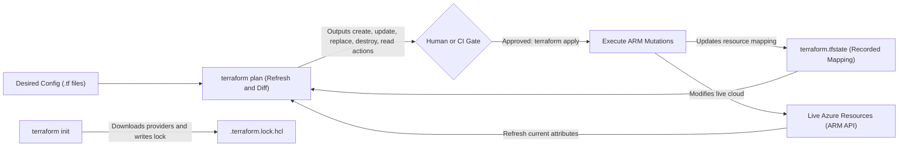
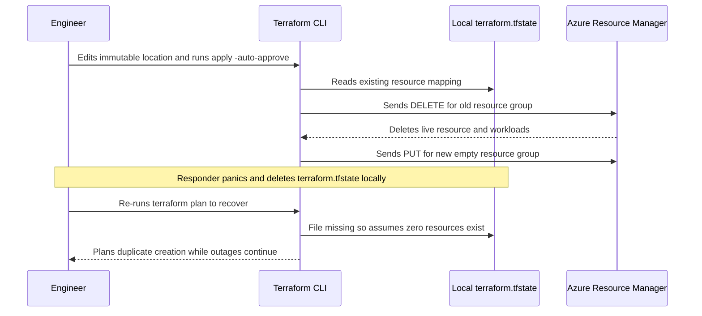

# The Core Workflow & State

> **Prerequisites:** Terraform >= 1.9.0 installed, `az login` active, `ARM_SUBSCRIPTION_ID` exported, and the minimal `azurerm` provider skeleton prepared (Module 00).  
> **Estimated Reading Time:** 30 minutes  
> **Target Audience:** Backend Engineers, DevOps Engineers, Cloud Infrastructure Operators.

> [!TIP]
> **The Golden Rule of Core Workflow & State:** Never run `terraform apply -auto-approve` locally or ignore a `-/+` replacement symbol in `terraform plan`—`terraform.tfstate` is Terraform's sole memory of what it manages, so inspect every plan summary line, commit `.terraform.lock.hcl`, and strictly `.gitignore` state files.

---

## Why This Matters

`init` → `plan` → `apply` → `destroy` is the loop you'll run thousands of times. More importantly, this module introduces the **state file** — the single most misunderstood and most dangerous part of Terraform. State is how Terraform remembers what it created; corrupt it, lose it, or let reality drift away from it, and Terraform gets confused in ways that can delete real infrastructure. Understanding it now prevents expensive mistakes later.

---

## 1. Architectural Mental Model: The Core Loop & State Reconciliation

Terraform operates by reconciling three distinct sources of truth during every run: your **desired config** (`.tf` files), **recorded state** (`terraform.tfstate`), and **live reality** (Azure Resource Manager APIs):



### Core Concepts

#### The Core Workflow
Four commands do the everyday work, and you'll internalize this rhythm:

- **`terraform init`** — prepares a working directory: downloads the providers your config declares, sets up the backend (where state lives), and writes the dependency lock file. Run once per directory, and again whenever you add a provider or module. Safe to re-run; it's idempotent.
- **`terraform plan`** — computes the difference between your config (desired) and state+reality (current), and prints exactly what it *would* do, without doing it. This is your safety check. **Read it every time.**
- **`terraform apply`** — runs a plan and, after you confirm, actually makes the API calls to create/update/delete resources, then records the result in state.
- **`terraform destroy`** — the inverse of apply: deletes everything in the state file. This is how you avoid leaving billable resources running.

#### Reading a Plan
Every plan prints a symbol per resource and a summary line. Learn to read both at a glance:

| Symbol | Meaning |
|---|---|
| `+` | create |
| `-` | destroy |
| `~` | update in place |
| `-/+` | **destroy and recreate** (replacement — pay attention) |
| `<=` | read (data source) |

The last line is the one that matters most: `Plan: 1 to add, 0 to change, 0 to destroy.` If those numbers don't match your mental model of what you asked for, **stop and figure out why before typing `yes`** — this is where a `count` mistake or an accidental replacement gets caught.

#### What the State File Is
When Terraform creates a resource, it records a mapping in a JSON file (`terraform.tfstate` by default, in your working directory) between the **resource address in your config** (e.g. `azurerm_resource_group.main`) and the **real object in Azure** (its resource ID, plus every attribute's current value). State is Terraform's memory. Without it, Terraform would have no idea that the `azurerm_resource_group.main` in your config corresponds to the actual `rg-tf-learn` already in Azure.

#### Why State Matters (and Why It's Dangerous)
State is what lets `plan` be fast and precise: instead of querying all of Azure, Terraform reads state, refreshes the specific resources it tracks, and diffs against your config. Consequences of that design:

- **State is the source of truth about what Terraform manages.** If a resource isn't in state, Terraform doesn't know it exists (even if it's in Azure). If it's in state but you delete the config block, Terraform will *destroy* it.
- **Deleting or corrupting state is catastrophic.** Lose the state file and Terraform forgets it ever created your resources — a subsequent `apply` would try to create duplicates, and `destroy` couldn't clean up. Never hand-edit state; never commit it to Git (it can contain secrets in plaintext); back it up (module 05 moves it to durable remote storage).
- **State can contain secrets.** Resource attributes like generated passwords or keys are stored in state in plaintext. This is the second reason (after "it's machine-managed") never to commit `terraform.tfstate` to Git — always `.gitignore` it.

#### Drift: When Reality and State Disagree
**Drift** is when someone changes a Terraform-managed resource *outside* Terraform — a colleague edits it in the portal, or an `az` command tweaks a tag. Terraform detects drift during the refresh phase of `plan`: it queries each resource's real current state, notices it no longer matches what's in your config, and shows you a diff to bring it back. This is one of IaC's superpowers — your config is the enforced source of truth, and drift shows up as a plan that would "fix" the out-of-band change. You'll deliberately cause and observe drift in the exercises.

#### The Dependency Lock File
`terraform init` writes `.terraform.lock.hcl`, which pins the *exact* provider versions (and their checksums) selected under your version constraints. Unlike state, this file **should be committed to Git** — it guarantees everyone on the team (and your CI) uses byte-identical provider versions, the same idea as a `package-lock.json`. Your `~> 4.0` constraint says "any 4.x"; the lock file records "specifically 4.37.0" so builds are reproducible.

---

## 2. Taxonomic Comparison: Plan Symbols, Workspace Artifacts & Drift Handling

| Plan Symbol | Operation | Resource Downtime / Identity Impact | Operator Action |
| :--- | :--- | :--- | :--- |
| **`+`** | Create new resource | None (net-new object) | Verify count matches intent |
| **`~`** | Update in place | Usually zero; preserves resource ID & IP | Verify modified attributes are expected |
| **`-/+`** | Destroy then recreate (`# forces replacement`) | **High:** deletes data, rotates IDs/public IPs | **Stop and verify** why immutable field changed |
| **`-`** | Destroy resource | **Critical:** permanently deletes object in Azure | Confirm removal was explicitly requested |
| **`<=`** | Read data source | None (read-only lookup) | Confirm target resource already exists |

| Local Artifact | Purpose | Contains Plaintext Secrets? | Commit to Git? |
| :--- | :--- | :--- | :--- |
| **`main.tf` / `*.tf`** | Declarative infrastructure source code | Never (use env vars / secret managers) | **Yes** |
| **`.terraform.lock.hcl`** | Pins exact provider versions and OS checksums | No | **Yes** |
| **`terraform.tfstate`** | Maps Terraform addresses to real Azure resource IDs | **Yes** (passwords, keys, tokens) | **Never** (`.gitignore` + remote backend) |
| **`tfplan`** | Binary saved plan file from `plan -out=tfplan` | **Yes** (embedded values & state snapshot) | **Never** (ephemeral CI artifact only) |
| **`.terraform/`** | Downloaded provider binary cache & module links | No | **Never** (regenerated by `terraform init`) |

| Drift Response | Command / Action | Effect on Live Azure Resource | Effect on Config & State |
| :--- | :--- | :--- | :--- |
| **Revert Drift (Config Wins)** | `terraform apply` | Overwrites manual portal change back to HCL spec | State re-aligned with HCL config |
| **Adopt Drift (Code Update)** | Edit `.tf` to match portal, then `terraform plan` | Preserves manual change; zero API mutations | Config, state, and Azure agree |
| **Sync State Only** | `terraform apply -refresh-only` | Preserves manual change | Updates `terraform.tfstate` to match reality |

---

## 3. Command Reference & Flag Breakdown

| Command | What it does | Example |
|---|---|---|
| `terraform init` | Downloads providers, configures backend, writes lock file | `terraform init` |
| `terraform plan` | Shows what apply would change; makes no changes | `terraform plan` |
| `terraform plan -out=tfplan` | Saves the plan to a file for a guaranteed-identical apply | `terraform plan -out=tfplan` |
| `terraform apply` | Applies changes after interactive confirmation | `terraform apply` |
| `terraform apply tfplan` | Applies a previously saved plan, no prompt | `terraform apply tfplan` |
| `terraform apply -auto-approve` | Applies without the `yes` prompt (dangerous; CI only) | `terraform apply -auto-approve` |
| `terraform destroy` | Destroys everything in state after confirmation | `terraform destroy` |
| `terraform apply -refresh-only` | Reconciles state with real-world drift without changing config-driven resources | `terraform apply -refresh-only` |
| `terraform state list` | Lists resource addresses tracked in state | `terraform state list` |
| `terraform state show <addr>` | Shows all recorded attributes of one resource | `terraform state show azurerm_resource_group.main` |
| `terraform show` | Prints the full current state (or a saved plan) human-readably | `terraform show` |
| `terraform fmt` | Rewrites files to canonical formatting | `terraform fmt` |

**Flag breakdown — `terraform plan -out=tfplan`:**
- `-out=tfplan` — writes the computed plan to a file named `tfplan`. `terraform apply tfplan` then applies *exactly* that plan with no re-computation and no prompt — the pattern used in CI (module 07) so the thing reviewed is exactly the thing applied.

**Flag breakdown — `terraform apply -refresh-only`:**
- `-refresh-only` — updates state to match real-world drift (so state reflects reality) *without* trying to change resources back to match config. Use it to accept an out-of-band change, versus a normal `apply` which would revert the drift.

---

## 4. Production War Story Post-Mortem: Unreviewed `-/+` Replacement & Deleted Local State

| Field | Incident Details |
| :--- | :--- |
| **Severity** | SEV-1 (Production Data Loss & Orphaned Resource Recovery Outage) |
| **Detection Time** | 4 minutes (API gateway alerts + failed health checks on vanished endpoint) |
| **Resolution Time** | 3 hours 40 minutes (manual backup restore and `terraform import` reconciliation) |
| **Impact** | Live stateful resource destroyed and recreated with a new Azure endpoint; local state deletion blocked rollback |

### What Happened
An engineer intended to standardize tags and adjust a region label on an active resource group configuration. After editing `location`, they skipped reading the plan diff and ran `terraform apply -auto-approve`. Because `location` is immutable in Azure Resource Manager, Terraform emitted `-/+ destroy and recreate` (`# forces replacement`), deleting the resource group and everything inside it before recreating an empty replacement. Panicking when a subsequent apply failed partway, a second responder deleted `terraform.tfstate` thinking "clearing cache" would reset Terraform—causing Terraform to lose its entire mapping to surviving Azure resources.



### Root Cause Analysis
1. **Bypassed Plan Review:** Using `-auto-approve` suppressed the confirmation gate that would have exposed `Plan: 1 to add, 0 to change, 1 to destroy` and `# forces replacement`.
2. **Misunderstood Local State:** Treating `terraform.tfstate` as disposable cache severed the ID mapping between HCL blocks and real Azure resources.
3. **Lack of Saved Plan Promotion:** Applying directly instead of reviewing a saved `tfplan` artifact allowed destructive replacements to run unchecked.

### The Fix & Architectural Hardening
1. Banned `-auto-approve` on human workstations and standardized CI on `terraform plan -out=tfplan` followed by human/policy inspection before `terraform apply tfplan`.
2. Enforced `.gitignore` for `*.tfstate*` and `*.tfplan` while migrating production workloads to versioned, locked Azure Storage remote state (Module 05).
3. Added automated plan JSON policy gates in CI that reject any plan containing `delete` or `["delete", "create"]` (`-/+`) transitions without an explicit override label.

---

## 5. Multi-Language Production Implementation

Automation pipelines prevent accidental `-/+` replacements and unintended deletions by running `terraform plan -out=tfplan`, exporting the machine-readable graph via `terraform show -json tfplan`, and inspecting `resource_changes[].change.actions` before calling `terraform apply tfplan`.

````carousel
**Go — Saved Plan Safety & Replacement Gate**
```go
package main

import (
	"encoding/json"
	"fmt"
	"os"
	"os/exec"
)

type planDocument struct {
	ResourceChanges []struct {
		Address string `json:"address"`
		Change  struct {
			Actions []string `json:"actions"`
		} `json:"change"`
	} `json:"resource_changes"`
}

func auditSavedPlan(planPath string, allowDestroy bool) error {
	raw, err := exec.Command("terraform", "show", "-json", planPath).Output()
	if err != nil {
		return fmt.Errorf("failed to inspect plan %s: %w", planPath, err)
	}

	var doc planDocument
	if err := json.Unmarshal(raw, &doc); err != nil {
		return err
	}

	adds, updates, replaces, deletes := 0, 0, 0, 0
	for _, rc := range doc.ResourceChanges {
		actions := rc.Change.Actions
		switch {
		case len(actions) == 2 && actions[0] == "delete" && actions[1] == "create":
			replaces++
			fmt.Printf("[WARN] Replacement (-/+) detected on %s\n", rc.Address)
		case len(actions) == 1 && actions[0] == "delete":
			deletes++
			fmt.Printf("[WARN] Destroy (-) detected on %s\n", rc.Address)
		case len(actions) == 1 && actions[0] == "create":
			adds++
		case len(actions) == 1 && actions[0] == "update":
			updates++
		}
	}

	fmt.Printf("Summary: %d add, %d change, %d replace, %d destroy\n", adds, updates, replaces, deletes)
	if !allowDestroy && (replaces > 0 || deletes > 0) {
		return fmt.Errorf("safety gate blocked plan: %d replacement(s), %d destroy(s)", replaces, deletes)
	}
	return nil
}

func main() {
	if err := auditSavedPlan("tfplan", false); err != nil {
		fmt.Fprintln(os.Stderr, err)
		os.Exit(1)
	}
}
```
<!-- slide -->
**TypeScript — Saved Plan Safety & Replacement Gate**
```typescript
import { execFileSync } from "node:child_process";

interface ResourceChange {
  address: string;
  change: {
    actions: string[];
  };
}

interface PlanJson {
  resource_changes?: ResourceChange[];
}

function auditSavedPlan(planFile: string, allowDestructive: boolean): void {
  const raw = execFileSync("terraform", ["show", "-json", planFile], {
    encoding: "utf8",
  });
  const plan: PlanJson = JSON.parse(raw);

  const destructive: string[] = [];
  let creates = 0;
  let updates = 0;

  for (const rc of plan.resource_changes ?? []) {
    const acts = rc.change.actions;
    if (acts.includes("delete") && acts.includes("create")) {
      destructive.push(`REPLACE (-/+): ${rc.address}`);
    } else if (acts.includes("delete")) {
      destructive.push(`DESTROY (-): ${rc.address}`);
    } else if (acts.includes("create")) {
      creates++;
    } else if (acts.includes("update")) {
      updates++;
    }
  }

  console.log(`Plan totals: ${creates} add, ${updates} update, ${destructive.length} destructive`);
  if (!allowDestructive && destructive.length > 0) {
    throw new Error(`Safety gate halted apply:\n${destructive.join("\n")}`);
  }
}

auditSavedPlan("tfplan", false);
```
<!-- slide -->
**Python — Saved Plan Safety & Replacement Gate**
```python
import json
import subprocess
import sys


def audit_saved_plan(plan_file: str, allow_destructive: bool = False) -> None:
    raw = subprocess.check_output(
        ["terraform", "show", "-json", plan_file], text=True
    )
    plan = json.loads(raw)

    blocked = []
    counts = {"create": 0, "update": 0}

    for rc in plan.get("resource_changes", []):
        actions = rc["change"]["actions"]
        addr = rc["address"]
        if actions == ["delete", "create"] or actions == ["create", "delete"]:
            blocked.append(f"REPLACE (-/+) on {addr}")
        elif actions == ["delete"]:
            blocked.append(f"DESTROY (-) on {addr}")
        elif actions == ["create"]:
            counts["create"] += 1
        elif actions == ["update"]:
            counts["update"] += 1

    print(f"Plan summary: {counts['create']} add, {counts['update']} change, {len(blocked)} destructive")
    if blocked and not allow_destructive:
        for item in blocked:
            print(f"BLOCKED: {item}", file=sys.stderr)
        sys.exit(2)


if __name__ == "__main__":
    audit_saved_plan("tfplan", allow_destructive=False)
```
<!-- slide -->
**C# — Saved Plan Safety & Replacement Gate**
```csharp
using System;
using System.Collections.Generic;
using System.Diagnostics;
using System.Linq;
using System.Text.Json;

public static class PlanSafetyGate
{
    public static void Main()
    {
        var psi = new ProcessStartInfo("terraform", "show -json tfplan")
        {
            RedirectStandardOutput = true,
            UseShellExecute = false
        };
        using var proc = Process.Start(psi) ?? throw new InvalidOperationException("Cannot invoke terraform");
        string json = proc.StandardOutput.ReadToEnd();
        proc.WaitForExit();
        if (proc.ExitCode != 0) Environment.Exit(proc.ExitCode);

        using var doc = JsonDocument.Parse(json);
        var blocked = new List<string>();
        int adds = 0, updates = 0;

        if (doc.RootElement.TryGetProperty("resource_changes", out var changes))
        {
            foreach (var rc in changes.EnumerateArray())
            {
                string addr = rc.GetProperty("address").GetString() ?? "";
                var actions = rc.GetProperty("change").GetProperty("actions")
                    .EnumerateArray().Select(x => x.GetString() ?? "").ToArray();

                if (actions.Contains("delete") && actions.Contains("create"))
                    blocked.Add($"REPLACE (-/+): {addr}");
                else if (actions.Contains("delete"))
                    blocked.Add($"DESTROY (-): {addr}");
                else if (actions.SequenceEqual(new[] { "create" }))
                    adds++;
                else if (actions.SequenceEqual(new[] { "update" }))
                    updates++;
            }
        }

        Console.WriteLine($"Adds: {adds}, Updates: {updates}, Destructive: {blocked.Count}");
        if (blocked.Count > 0)
        {
            blocked.ForEach(Console.Error.WriteLine);
            Environment.Exit(2);
        }
    }
}
```
````

---

## 6. Practical Hands-On Verification CLI Workflows

Work in a fresh directory. These create **real** (but free) resources — a resource group costs nothing, but you'll still `destroy` at the end to practice the habit.

1. **Set up the working directory.** Create the folder and a `main.tf`:
   ```bash
   mkdir -p ~/tf-labs/01-workflow && cd ~/tf-labs/01-workflow
   ```
   Put the provider skeleton from module 00 into `main.tf` (the `terraform` and `provider "azurerm"` blocks), then add a resource group below it:
   ```hcl
   resource "azurerm_resource_group" "main" {
     name     = "rg-tf-workflow"
     location = "eastus"
   }
   ```
   Make sure `ARM_SUBSCRIPTION_ID` is exported (module 00, exercise 8):
   ```bash
   export ARM_SUBSCRIPTION_ID="$(az account show --query id -o tsv)"
   ```

2. **Initialize and plan.** Run:
   ```bash
   terraform init
   terraform plan
   ```

   **Expected Output:**
   ```text
   Terraform will perform the following actions:

     # azurerm_resource_group.main will be created
     + resource "azurerm_resource_group" "main" {
         + id       = (known after apply)
         + location = "eastus"
         + name     = "rg-tf-workflow"
       }

   Plan: 1 to add, 0 to change, 0 to destroy.
   ```
   > Verify: the plan shows `azurerm_resource_group.main` with a `+` (create) and ends with `Plan: 1 to add, 0 to change, 0 to destroy.` Read every line — this is the habit that saves you money.

3. **Apply and confirm in Azure.** Run `terraform apply`, review the same plan, and type `yes`:
   ```bash
   terraform apply
   ```
   Then confirm the resource group really exists, using the CLI you already know:
   ```bash
   az group show -n rg-tf-workflow -o table
   ```

   **Expected Output:**
   ```text
   Apply complete! Resources: 1 added, 0 changed, 0 destroyed.

   Location    Name
   ----------  --------------
   eastus      rg-tf-workflow
   ```
   > Verify: `apply` ends with `Apply complete! Resources: 1 added` and `az group show` finds the group. A `terraform.tfstate` file now exists in your directory.

4. **Inspect the state.** Look at what Terraform is now tracking:
   ```bash
   terraform state list
   terraform state show azurerm_resource_group.main
   ```

   **Expected Output:**
   ```text
   azurerm_resource_group.main

   # azurerm_resource_group.main:
   resource "azurerm_resource_group" "main" {
       id       = "/subscriptions/11111111-.../resourceGroups/rg-tf-workflow"
       location = "eastus"
       name     = "rg-tf-workflow"
   }
   ```
   > Verify: `state list` prints `azurerm_resource_group.main`, and `state show` prints its recorded attributes including the full Azure resource `id`. This mapping is Terraform's memory.

5. **Prove idempotency.** Run `terraform plan` again *without changing anything*.

   **Expected Output:**
   ```text
   No changes. Your infrastructure matches the configuration.
   ```
   > Verify: `No changes. Your infrastructure matches the configuration.` Desired state already equals current state, so there's nothing to do — the defining property of declarative IaC.

6. **Make a change and watch an in-place update.** Add a tag to the resource group block:
   ```hcl
   resource "azurerm_resource_group" "main" {
     name     = "rg-tf-workflow"
     location = "eastus"
     tags = {
       environment = "learning"
     }
   }
   ```
   Run `terraform plan`, then `terraform apply`.

   **Expected Output:**
   ```text
   # azurerm_resource_group.main will be updated in-place
   ~ resource "azurerm_resource_group" "main" {
       id       = "/subscriptions/.../resourceGroups/rg-tf-workflow"
       name     = "rg-tf-workflow"
     ~ tags     = {
         + "environment" = "learning"
       }
   }

   Plan: 0 to add, 1 to change, 0 to destroy.
   ```
   > Verify: the plan shows `~` (update in place) for the resource group and `Plan: 0 to add, 1 to change, 0 to destroy.` — not a destroy-and-recreate. Tags update in place.

7. **Diagnose and fix: drift from an out-of-band change.** Simulate a colleague editing the resource in the portal by using `az` to add a tag Terraform doesn't know about:
   ```bash
   az group update -n rg-tf-workflow --set tags.owner=someone-else
   ```
   Now run `terraform plan`.

   **Expected Output:**
   ```text
   Note: Objects have changed outside of Terraform
     ~ tags = {
           "environment" = "learning"
         - "owner"       = "someone-else" -> null
       }
   Plan: 0 to add, 1 to change, 0 to destroy.
   ```
   > Observe: Terraform detects the drift during refresh and shows a plan that would **remove** the `owner` tag (because your config doesn't mention it) — reasserting your config as the source of truth. You have two correct fixes depending on intent:
   > - **Revert the drift** (config wins): run `terraform apply` and let it remove the `owner` tag.
   > - **Accept the drift** (adopt it): add `owner = "someone-else"` to your config's `tags` block, then `terraform plan` shows no changes — reality and config now agree.
   >
   > Do the *revert* path here so you've seen Terraform enforce config.

8. **Diagnose and fix: an unexpected destroy-and-recreate.** Some attributes can't be changed in place — changing them forces replacement. Change the resource group's `location`:
   ```hcl
   location = "westus"
   ```
   Run `terraform plan`.

   **Expected Output:**
   ```text
   # azurerm_resource_group.main must be replaced
   -/+ resource "azurerm_resource_group" "main" {
         ~ id       = "/subscriptions/.../rg-tf-workflow" -> (known after apply)
         ~ location = "eastus" -> "westus" # forces replacement
           name     = "rg-tf-workflow"
       }

   Plan: 1 to add, 0 to change, 1 to destroy.
   ```
   > Observe: the plan now shows `-/+ destroy and recreate` and `Plan: 1 to add, 1 to change... 1 to destroy` (look for the `# forces replacement` annotation on the `location` line). A resource group's location is immutable, so Terraform would delete and re-create it. **This is exactly the plan you must never blindly `yes`.** Fix it by reverting `location` back to `eastus` and confirm `terraform plan` shows no changes.

9. **Look at the lock file.** Open `.terraform.lock.hcl`:
   ```bash
   cat .terraform.lock.hcl
   ```
   > Verify: it pins an exact `azurerm` version and checksums. Note this is the file you *commit* to Git — unlike `terraform.tfstate`, which you never commit.

10. **Create a `.gitignore` and clean up.** Protect yourself from ever committing state, then destroy everything:
    ```bash
    printf '*.tfstate\n*.tfstate.*\n.terraform/\n*.tfplan\n' > .gitignore
    terraform destroy
    ```
    Review the destroy plan (`Plan: 0 to add, 0 to change, 1 to destroy`), type `yes`, then confirm it's gone:
    ```bash
    az group show -n rg-tf-workflow -o table
    ```

    **Expected Output:**
    ```text
    Destroy complete! Resources: 1 destroyed.
    (ResourceGroupNotFound) Resource group 'rg-tf-workflow' could not be found.
    ```
    > Verify: `destroy` reports `Destroy complete! Resources: 1 destroyed` and `az group show` now errors with `ResourceGroupNotFound`. Nothing is left billing.

### Independent Challenge
Starting from an empty directory and *without* copying exercise commands, create a config with **two** resource groups (in different regions), apply it, then use only state-inspection commands to answer: how many objects is Terraform tracking, and what are their full Azure resource IDs? Then make a single change that causes a plan of exactly "1 to change" (not add, not destroy, not replace), verify the plan matches that expectation before applying, and finally destroy everything and prove with an `az` command that both groups are gone. This draws on this module's workflow, state inspection, and plan-reading, plus module 00's provider setup.

<details><summary>Stuck? One hint</summary>

To get a clean "1 to change" plan, modify an attribute that updates **in place** rather than one that forces replacement — a `tags` change is in-place (`~`), a `location` change is a replacement (`-/+`). Use `terraform state list` to count tracked objects and `terraform state show <address>` (or `terraform show`) to read each one's `id`.

</details>

---

## 7. Operational Validation Checkpoints

<details><summary><strong>Checkpoint 1: You changed a single attribute on an AKS cluster / resource group and `terraform plan` printed `Plan: 1 to add, 0 to change, 1 to destroy`. What happened?</strong></summary>

You modified an immutable Azure attribute (such as `location` or `name`) annotated with `# forces replacement`, turning an expected in-place update (`~`) into a destructive `-/+` replacement. Do not approve it unless destroying the live resource and losing its ID/data is intentional.

</details>

<details><summary><strong>Checkpoint 2: An operator added an emergency NSG rule in the Azure Portal during an outage, and you want Terraform state to accept that rule rather than delete it. Which command workflow applies?</strong></summary>

First run `terraform apply -refresh-only` to synchronize `terraform.tfstate` with Azure without reverting the live rule, and simultaneously add the matching rule block to your `.tf` HCL code so future normal `terraform plan` runs stay idempotent (`No changes`).

</details>

<details><summary><strong>Checkpoint 3: A developer accidentally committed `terraform.tfstate` into a Git pull request and asks if running `rm terraform.tfstate` locally is the right cleanup. What is the risk?</strong></summary>

Deleting `terraform.tfstate` locally wipes Terraform's mapping to real Azure resources, leaving live infrastructure orphaned and causing the next `apply` to attempt duplicate creation. Furthermore, secrets inside the committed state already live in Git history—rotate any exposed credentials, remove the file from Git history/tracking via `.gitignore`, and migrate state to a locked remote backend.

</details>

---

## Common Mistakes & Troubleshooting

- **Typing `yes` without reading the plan.** The entire safety model of Terraform is the plan. If you auto-approve habitually, you *will* eventually destroy-and-recreate something important. Read the summary line every single time.
- **Committing `terraform.tfstate` to Git.** State can contain secrets in plaintext and is machine-managed — never commit it. Add a `.gitignore` before your first commit (exercise 10).
- **Hand-editing `terraform.tfstate`.** It's valid JSON, which tempts people, but a wrong edit desynchronizes state from reality and can cause Terraform to destroy or duplicate resources. Use `terraform state` subcommands (module 04+) instead of a text editor.
- **Losing state entirely.** With default *local* state, deleting the file (or losing the machine) means Terraform forgets everything it manages. This is exactly why teams use remote state (module 05).
- **Ignoring `-/+` in a plan.** A destroy-and-recreate on a database, a public IP, or anything stateful can mean data loss or a changed IP address. Always investigate what's forcing replacement before applying.
- **Cost pitfall:** a resource group is free, but you `destroy`ed anyway to build the habit. From module 06 on, the resources are billable — the same `terraform destroy` discipline is what keeps an idle AKS cluster from running up a bill over a weekend.

---

## Checkpoint Quiz

Write down your answer to each question before expanding it — checking without attempting first is the single easiest way to fool yourself into thinking you've learned this.

1. What does each of `init`, `plan`, `apply`, `destroy` do, in one phrase each?
2. What does the plan symbol `-/+` mean, and why should it make you stop and look?
3. What is the state file, and what mapping does it hold?
4. Give two reasons you must never commit `terraform.tfstate` to Git.
5. What is drift, and how does Terraform detect it?
6. You changed a resource in the portal by hand and want Terraform to *accept* that change rather than revert it. What do you do?
7. Which file should you commit — `.terraform.lock.hcl` or `terraform.tfstate` — and why that one and not the other?
8. A plan shows `Plan: 1 to add, 0 to change, 1 to destroy` for a resource you only meant to *modify*. What has probably happened?

<details><summary>Show answers</summary>

1. `init`: download providers / set up backend + lock file. `plan`: show what would change without changing anything. `apply`: make the changes after confirmation and record them in state. `destroy`: delete everything tracked in state.
2. Destroy-and-recreate (replacement): Terraform will delete the resource and make a new one because an immutable attribute changed. It can mean data loss or a changed IP/identity, so never apply it blindly.
3. A JSON file mapping each resource address in your config to the real Azure object (its resource ID and current attribute values) — Terraform's memory of what it manages.
4. It can contain secrets (passwords, keys) in plaintext, and it's machine-managed state that doesn't belong under manual version control; committing it risks leaking secrets and causing merge conflicts on a file you must never hand-edit.
5. Drift is a Terraform-managed resource being changed outside Terraform. Terraform detects it during the refresh phase of `plan` by querying each resource's real current state and diffing it against config.
6. Add the changed attribute to your config so config matches reality (or use `terraform apply -refresh-only` to record the current real state) — then `plan` shows no changes. A plain `apply` would instead revert it.
7. `.terraform.lock.hcl` — it pins exact provider versions/checksums so the team and CI build reproducibly, and it's safe to share. `terraform.tfstate` must *not* be committed (secrets, machine-managed).
8. An attribute that forces replacement (an immutable field like a resource group's `location` or a resource's `name`) was changed, turning your intended in-place update into a destroy-and-recreate.

</details>

---

## Sources & Further Reading

- HashiCorp Terraform Documentation: [Basic CLI Features & Plan Output](https://developer.hashicorp.com/terraform/cli/commands/plan)
- HashiCorp Terraform Documentation: [Purpose of State & State Locking](https://developer.hashicorp.com/terraform/language/state)
- HashiCorp Terraform Documentation: [Dependency Lock File](https://developer.hashicorp.com/terraform/language/files/dependency-lock)

---

## Next
[02 — Providers, resources & the azurerm provider](../02-providers-resources-and-the-azurerm-provider/README.md): go deeper on resource blocks, how resources reference each other, and how version pinning keeps your infrastructure reproducible.
