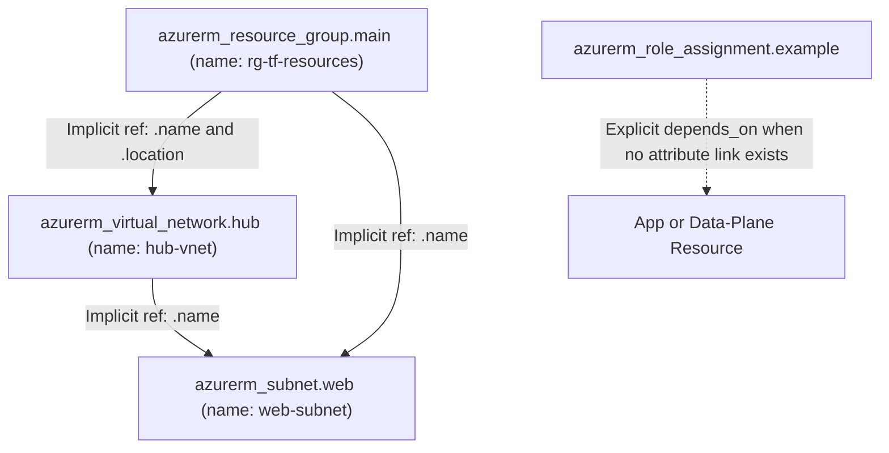
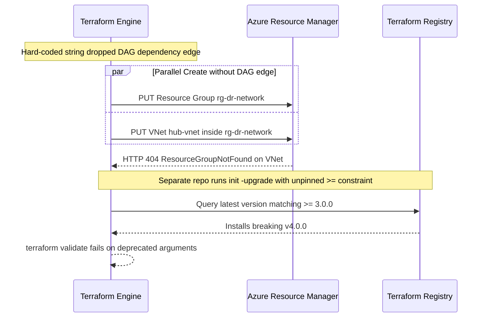

# Providers, Resources & the azurerm Provider

> **Prerequisites:** Terraform core workflow (`init`/`plan`/`apply`/`destroy`), state inspection, and `azurerm` provider authentication (Modules 00–01).  
> **Estimated Reading Time:** 35 minutes  
> **Target Audience:** Backend Engineers, Cloud Network Engineers, Infrastructure Developers.

> [!TIP]
> **The Golden Rule of Resource Wiring & Provider Pinning:** Always wire cross-resource arguments using attribute references (`azurerm_resource_group.main.name`) instead of hard-coded strings so Terraform builds a valid dependency graph, and pin `azurerm` with `~> 4.0` alongside a multi-platform `.terraform.lock.hcl` so breaking major updates never slip into `init -upgrade`.

---

## Why This Matters

You've run the workflow; now you need to actually *write* configurations that build more than a lone resource group. Real infrastructure is many resources that reference each other — a subnet belongs to a VNet, an NSG attaches to a subnet. This module covers the anatomy of a resource block, how resources reference each other by address (which is also how Terraform figures out what order to create things in), and how version pinning keeps your builds reproducible across a team.

---

## 1. Architectural Mental Model: Resource Addressing, DAG Ordering & Provider Aliases

Terraform converts attribute references (`<type>.<local_name>.<attribute>`) into a **Directed Acyclic Graph (DAG)**. Creation walks forward from root dependencies to leaf resources; `terraform destroy` automatically walks the exact reverse path:



### Core Concepts

#### Anatomy of a Resource Block
Every resource block has the same four-part header and a body of arguments:

```hcl
resource "azurerm_virtual_network" "hub" {
  name                = "hub-vnet"
  resource_group_name = azurerm_resource_group.main.name
  location            = azurerm_resource_group.main.location
  address_space       = ["10.0.0.0/16"]
}
```

- `resource` — the block type.
- `"azurerm_virtual_network"` — the **resource type**: the provider prefix (`azurerm`) plus the specific kind. This maps to an Azure resource type and is defined by the provider, not by you.
- `"hub"` — the **local name**, chosen by you, unique within this type in this module. It's how you refer to this resource elsewhere. It is *not* the Azure name.
- The body — arguments (`name`, `address_space`, …). Which arguments exist, which are required, and their exact spellings come from the provider's registry documentation. This VNet is the same one you built with `az network vnet create` in track 5, module 01 — here's its declarative form.

#### Resource Addressing and References
A resource's **address** is `<type>.<local_name>` — e.g. `azurerm_resource_group.main`. To use one resource's attribute in another, you write `<type>.<local_name>.<attribute>`:

```hcl
resource_group_name = azurerm_resource_group.main.name
```

This says "use the `name` attribute of the resource group I named `main`." Referencing an attribute does two things at once: it wires the value through, *and* it tells Terraform that this resource depends on that one.

#### Implicit Dependencies and Apply Ordering
Because `azurerm_virtual_network.hub` references `azurerm_resource_group.main.name`, Terraform knows the resource group must exist first. It builds a **dependency graph** from these references and creates resources in the correct order automatically (and destroys them in reverse). You almost never specify order manually — you just reference attributes and let the graph sort it out. This is why you write `azurerm_resource_group.main.name` instead of hard-coding the string `"rg-tf-learn"`: the hard-coded string would create the same *value* but lose the *dependency*, and Terraform might try to build the VNet before the group exists.

#### Explicit Dependencies with `depends_on`
Occasionally two resources depend on each other in a way that isn't expressed through an attribute reference (e.g. a role assignment that must exist before some data plane operation, with no direct attribute link). For those rare cases, `depends_on = [azurerm_role_assignment.example]` forces ordering explicitly. Reach for it only when there's no natural attribute reference to use — overusing it makes your graph rigid.

#### Reading the Registry Docs (Don't Invent Arguments)
The authoritative reference for every resource type is the Terraform Registry: `registry.terraform.io/providers/hashicorp/azurerm/latest/docs`. Each resource page lists its arguments (required vs optional), its exported **attributes** (values you can reference elsewhere, like an `id`), and examples. **Do not guess argument names.** Azure resources have specific, sometimes surprising argument spellings (`address_space` is a list; `address_prefixes` on a subnet is also a list; a network security rule uses `destination_port_range`, singular, or `destination_port_ranges`, plural — you pick one). When unsure of an exact current argument name, check the resource's registry page rather than inventing one.

#### Provider Configuration and Version Pinning
Two different version numbers matter, and confusing them is common:

- **The Terraform CLI version** — pinned with `required_version` in the `terraform` block.
- **The provider version** — pinned per-provider in `required_providers`.

The constraint operators you'll use:

| Constraint | Allows | Typical use |
|---|---|---|
| `= 4.37.0` | exactly that version | rarely; too rigid |
| `>= 4.0.0` | that version or newer | risky — allows major bumps |
| `~> 4.0` | `>= 4.0, < 5.0` (any 4.x) | pin the **major** version |
| `~> 4.37.0` | `>= 4.37.0, < 4.38.0` | pin **major+minor**, allow patches |

Pin the major version (`~> 4.0`) at minimum, so a `5.0` provider with breaking changes never sneaks in on a routine `terraform init -upgrade`. The `.terraform.lock.hcl` file (module 01) then records the *exact* version resolved, so the whole team is byte-identical.

#### Multiple Provider Configurations (Aliases)
Sometimes you deploy to two subscriptions or two regions in one config. You give a provider block an `alias` and reference it per-resource with `provider = azurerm.<alias>`:

```hcl
provider "azurerm" {
  features {}
  subscription_id = var.primary_subscription_id
}

provider "azurerm" {
  alias           = "dr"
  features {}
  subscription_id = var.dr_subscription_id
}
```

A resource then opts into the aliased provider with `provider = azurerm.dr`. You won't need this until multi-region work, but recognize the pattern.

---

## 2. Taxonomic Comparison: Dependency Mechanisms & Resource Identifiers

| Dependency Strategy | Syntax Example | Builds DAG Ordering? | Graph Parallelism | Recommended Usage |
| :--- | :--- | :--- | :--- | :--- |
| **Implicit Attribute Reference** | `resource_group_name = azurerm_resource_group.main.name` | **Yes** | Optimal | Default choice for 99% of resource links |
| **Explicit `depends_on`** | `depends_on = [azurerm_role_assignment.example]` | **Yes** | Constrains concurrency | Rare cases with no attribute path (RBAC propagation) |
| **Hard-Coded Literal String** | `resource_group_name = "rg-tf-resources"` | **No** | Race conditions on create/destroy | **Anti-pattern** for Terraform-managed dependencies |

| Concept | Example | Scope & Mutability |
| :--- | :--- | :--- |
| **Terraform Local Name** | `hub` in `azurerm_virtual_network.hub` | Terraform-internal label; renaming forces state move or destroy/create |
| **Azure `name` Argument** | `name = "hub-vnet"` | Cloud resource name in Azure; usually immutable (forces `-/+`) |
| **Full Azure Resource ID** | `/subscriptions/.../virtualNetworks/hub-vnet` | Exported read-only attribute (`.id`) computed after `apply` |

---

## 3. Command Reference & Flag Breakdown

| Command | What it does | Example |
|---|---|---|
| `terraform init -upgrade` | Re-resolves provider versions to the newest allowed by constraints, updating the lock file | `terraform init -upgrade` |
| `terraform providers` | Shows the providers this configuration requires | `terraform providers` |
| `terraform providers lock` | Records provider checksums for multiple platforms in the lock file | `terraform providers lock -platform=linux_amd64` |
| `terraform graph` | Emits the dependency graph in DOT format | `terraform graph` |
| `terraform state list` | Lists tracked resource addresses | `terraform state list` |
| `terraform fmt -recursive` | Formats all `.tf` files in this and subdirectories | `terraform fmt -recursive` |
| `terraform validate` | Checks config syntax and internal references | `terraform validate` |

**Flag breakdown — `terraform init -upgrade`:**
- `-upgrade` — ignores the currently locked versions and re-selects the newest versions permitted by your `required_providers` constraints, then rewrites `.terraform.lock.hcl`. Run it intentionally when you *want* to move up; a plain `terraform init` respects the existing lock.

**Flag breakdown — `terraform providers lock -platform=linux_amd64`:**
- `-platform=<os_arch>` — adds checksums for a specific OS/architecture to the lock file. Run it for each platform your team + CI use (e.g. `linux_amd64`, `darwin_arm64`, `windows_amd64`) so `init` never fails a checksum verification on someone else's machine.

---

## 4. Production War Story Post-Mortem: Hard-Coded RG Race & Unpinned Provider Breakage

| Field | Incident Details |
| :--- | :--- |
| **Severity** | SEV-2 (Greenfield DR Deployment Failure & CI Pipeline Outage) |
| **Detection Time** | 3 minutes (automated disaster recovery failover drill aborted) |
| **Resolution Time** | 1 hour 15 minutes (dependency refactor + lockfile pinning restoration) |
| **Impact** | Greenfield DR region deployment failed mid-apply due to parallel `ResourceGroupNotFound`; separate CI run broke after an unpinned `>=` provider pulled a breaking major release |

### What Happened
During a quarterly disaster-recovery failover drill into a clean subscription, `azurerm_virtual_network.hub` failed immediately with `ResourceGroupNotFound` even though `azurerm_resource_group.main` was in the exact same `main.tf`. An engineer had hard-coded `resource_group_name = "rg-dr-network"` instead of referencing `azurerm_resource_group.main.name`, so Terraform attempted to create both in parallel. Meanwhile, a separate service repo used `version = ">= 3.0.0"` without an upper bound and ran `terraform init -upgrade`, pulling `4.0` and failing `validate` due to breaking schema changes.



### Root Cause Analysis
1. **Broken Implicit Graph Edge:** Using a string literal duplicated the name value while severing Terraform's dependency graph edge between the Resource Group and VNet.
2. **Unbounded Provider Version Constraint:** Using `>=` rather than pessimistic `~>` allowed a major breaking provider version to resolve automatically on `-upgrade`.
3. **Single-OS Lockfile Drift:** Developers on `darwin_arm64` ran `init -upgrade` without updating `linux_amd64` hashes, causing CI runners to reject `.terraform.lock.hcl`.

### The Fix & Architectural Hardening
1. Replaced every literal cross-resource reference with attribute wiring (`azurerm_resource_group.main.name` and `.location`), verified via `terraform graph`.
2. Switched all `required_providers` constraints to pessimistic major pins (`~> 4.0`) and checked `terraform providers` in code review.
3. Standardized lock updates on `terraform providers lock -platform=linux_amd64 -platform=darwin_arm64 -platform=windows_amd64` plus `terraform fmt -check -recursive` in CI.

---

## 5. Multi-Language Production Implementation

Platform linting pipelines parse `terraform graph` DOT output and `.tf` provider constraints to catch two common failures early: resources lacking a dependency edge back to their resource group, and unsafe `>=` provider pins missing an upper major-version bound.

````carousel
**Go — Graph Dependency & Provider Pin Auditor**
```go
package main

import (
	"fmt"
	"os"
	"os/exec"
	"regexp"
	"strings"
)

func auditGraphAndPins(workDir string) error {
	dotOut, err := exec.Command("terraform", "-chdir="+workDir, "graph").Output()
	if err != nil {
		return fmt.Errorf("terraform graph failed: %w", err)
	}
	dot := string(dotOut)
	if strings.Contains(dot, "azurerm_virtual_network.") &&
		!strings.Contains(dot, "azurerm_resource_group.") {
		return fmt.Errorf("VNet exists without resource_group dependency in graph")
	}

	edgeRe := regexp.MustCompile(`"\[root\] ([^"]+)" -> "\[root\] ([^"]+)"`)
	edges := edgeRe.FindAllStringSubmatch(dot, -1)
	fmt.Printf("Verified %d dependency graph edges.\n", len(edges))

	mainTf, err := os.ReadFile(workDir + "/main.tf")
	if err != nil {
		return err
	}
	unsafePin := regexp.MustCompile(`version\s*=\s*"\s*>=`)
	if unsafePin.Match(mainTf) {
		return fmt.Errorf("unsafe >= provider constraint found; use ~> major pinning")
	}
	return nil
}

func main() {
	if err := auditGraphAndPins("."); err != nil {
		fmt.Fprintln(os.Stderr, "AUDIT FAILED:", err)
		os.Exit(1)
	}
}
```
<!-- slide -->
**TypeScript — Graph Dependency & Provider Pin Auditor**
```typescript
import { execFileSync } from "node:child_process";
import { readFileSync } from "node:fs";
import { join } from "node:path";

function auditGraphAndConstraints(workDir: string): void {
  const dot = execFileSync("terraform", [`-chdir=${workDir}`, "graph"], {
    encoding: "utf8",
  });

  const edgeMatches = [...dot.matchAll(/"([^"]+)"\s*->\s*"([^"]+)"/g)];
  const hasVnetToRgEdge = edgeMatches.some(
    ([, from, to]) =>
      from.includes("azurerm_virtual_network.") &&
      to.includes("azurerm_resource_group.")
  );

  if (dot.includes("azurerm_virtual_network.") && !hasVnetToRgEdge) {
    throw new Error(
      "Missing DAG edge from azurerm_virtual_network to azurerm_resource_group (avoid hard-coded strings)."
    );
  }

  const tfSource = readFileSync(join(workDir, "main.tf"), "utf8");
  if (/version\s*=\s*"\s*>=/.test(tfSource)) {
    throw new Error("Unsafe unbounded '>=' version constraint detected; prefer '~> 4.0'.");
  }

  console.log(`Graph audit passed (${edgeMatches.length} edges verified).`);
}

auditGraphAndConstraints(".");
```
<!-- slide -->
**Python — Graph Dependency & Provider Pin Auditor**
```python
import re
import subprocess
from pathlib import Path


def audit_graph_and_pins(work_dir: Path) -> None:
    dot = subprocess.check_output(
        ["terraform", f"-chdir={work_dir}", "graph"], text=True
    )
    edges = re.findall(r'"([^"]+)"\s*->\s*"([^"]+)"', dot)

    if "azurerm_virtual_network." in dot:
        linked = any(
            "azurerm_virtual_network." in src and "azurerm_resource_group." in dst
            for src, dst in edges
        )
        if not linked:
            raise RuntimeError(
                "VNet lacks implicit dependency on azurerm_resource_group; replace hard-coded RG name."
            )

    main_tf = (work_dir / "main.tf").read_text(encoding="utf-8")
    if re.search(r'version\s*=\s*"\s*>=', main_tf):
        raise ValueError("Unbounded '>=' constraint detected; use pessimistic '~> 4.0'.")

    print(f"DAG and provider pin checks passed ({len(edges)} graph edges).")


if __name__ == "__main__":
    audit_graph_and_pins(Path("."))
```
<!-- slide -->
**C# — Graph Dependency & Provider Pin Auditor**
```csharp
using System;
using System.Diagnostics;
using System.IO;
using System.Linq;
using System.Text.RegularExpressions;

public static class TerraformGraphAuditor
{
    public static void Main()
    {
        var psi = new ProcessStartInfo("terraform", "graph")
        {
            RedirectStandardOutput = true,
            UseShellExecute = false
        };
        using var proc = Process.Start(psi) ?? throw new InvalidOperationException("Cannot launch terraform");
        string dot = proc.StandardOutput.ReadToEnd();
        proc.WaitForExit();
        if (proc.ExitCode != 0) Environment.Exit(proc.ExitCode);

        var edges = Regex.Matches(dot, "\"([^\"]+)\"\\s*->\\s*\"([^\"]+)\"")
            .Cast<Match>()
            .Select(m => (From: m.Groups[1].Value, To: m.Groups[2].Value))
            .ToList();

        if (dot.Contains("azurerm_virtual_network.") &&
            !edges.Any(e => e.From.Contains("azurerm_virtual_network.") && e.To.Contains("azurerm_resource_group.")))
        {
            throw new InvalidOperationException("VNet missing implicit dependency edge to resource group.");
        }

        string mainTf = File.ReadAllText("main.tf");
        if (Regex.IsMatch(mainTf, @"version\s*=\s*""\s*>="))
            throw new InvalidDataException("Unbounded '>=' provider constraint found; pin with '~>'.");

        Console.WriteLine($"Graph audit passed with {edges.Count} verified edges.");
    }
}
```
````

---

## 6. Practical Hands-On Verification CLI Workflows

These create free resources (resource group, VNet, subnet). Destroy at the end regardless.

1. **Set up.** New directory, provider skeleton, subscription exported:
   ```bash
   mkdir -p ~/tf-labs/02-resources && cd ~/tf-labs/02-resources
   export ARM_SUBSCRIPTION_ID="$(az account show --query id -o tsv)"
   ```
   Create `main.tf` with the module 00 provider skeleton and a resource group named `rg-tf-resources` in `eastus`.

2. **Add a VNet that references the resource group.** Append:
   ```hcl
   resource "azurerm_virtual_network" "hub" {
     name                = "hub-vnet"
     resource_group_name = azurerm_resource_group.main.name
     location            = azurerm_resource_group.main.location
     address_space       = ["10.0.0.0/16"]
   }
   ```
   Run `terraform init` then `terraform plan`.

   **Expected Output:**
   ```text
   Plan: 2 to add, 0 to change, 0 to destroy.
   ```
   > Verify: `Plan: 2 to add`. Note that even though the VNet block is written *after* the resource group, Terraform will create the group first because of the reference — confirm by reading the plan.

3. **Apply and inspect the dependency graph.** Run `terraform apply` (`yes`), then:
   ```bash
   terraform state list
   ```

   **Expected Output:**
   ```text
   azurerm_resource_group.main
   azurerm_virtual_network.hub
   ```
   > Verify: both `azurerm_resource_group.main` and `azurerm_virtual_network.hub` are listed. Confirm in Azure with `az network vnet show -g rg-tf-resources -n hub-vnet -o table` — this is the same VNet you'd have built with `az network vnet create`.

4. **Add a subnet referencing the VNet.** Append:
   ```hcl
   resource "azurerm_subnet" "web" {
     name                 = "web-subnet"
     resource_group_name  = azurerm_resource_group.main.name
     virtual_network_name = azurerm_virtual_network.hub.name
     address_prefixes     = ["10.0.1.0/24"]
   }
   ```
   Run `terraform plan` then `apply`.

   **Expected Output:**
   ```text
   Plan: 1 to add, 0 to change, 0 to destroy.
   Apply complete! Resources: 1 added, 0 changed, 0 to destroy.
   ```
   > Verify: `Plan: 1 to add`. The subnet references the VNet's `name`, so Terraform orders it after the VNet automatically.

5. **Prove the reference creates a real dependency.** Run:
   ```bash
   terraform state show azurerm_subnet.web
   ```

   **Expected Output:**
   ```text
   # azurerm_subnet.web:
   resource "azurerm_subnet" "web" {
       address_prefixes     = ["10.0.1.0/24"]
       id                   = "/subscriptions/.../resourceGroups/rg-tf-resources/providers/Microsoft.Network/virtualNetworks/hub-vnet/subnets/web-subnet"
       name                 = "web-subnet"
       resource_group_name  = "rg-tf-resources"
       virtual_network_name = "hub-vnet"
   }
   ```
   > Verify: the subnet's `id` embeds the VNet and resource group names — exactly the values you referenced, wired through by Terraform rather than hard-coded.

6. **Read the registry to add a correct argument.** Suppose you want the VNet to have custom DNS servers. *Before writing anything*, open the `azurerm_virtual_network` page on the Terraform Registry and find the correct argument name (it's `dns_servers`, a list). Add:
   ```hcl
     dns_servers = ["10.0.0.4", "10.0.0.5"]
   ```
   Run `terraform plan`.

   **Expected Output:**
   ```text
   Plan: 0 to add, 1 to change, 0 to destroy.
   ```
   > Verify: `Plan: 0 to add, 1 to change` (`~` update in place). The point of this exercise is the *habit* of confirming the argument name in the docs instead of guessing.

7. **Diagnose and fix: a made-up argument.** Now do the wrong thing on purpose. Add a plausible-but-fake argument to the VNet:
   ```hcl
     enable_ddos = true
   ```
   Run `terraform validate`.

   **Expected Output:**
   ```text
   │ Error: Unsupported argument
   │
   │ An argument named "enable_ddos" is not expected here.
   ```
   > Verify: it errors with `An argument named "enable_ddos" is not expected here`. Terraform validates argument names against the provider schema, catching invented arguments. Remove the line. (The real DDoS setting is configured via a separate `ddos_protection_plan` block — another reason to read the docs.)

8. **Diagnose and fix: an unpinned provider bites you (thought experiment + real command).** Look at your current constraint (`~> 4.0`) and run:
   ```bash
   terraform providers
   ```

   **Expected Output:**
   ```text
   Providers required by configuration:
   .
   └── provider[registry.terraform.io/hashicorp/azurerm] ~> 4.0
   ```
   > Verify: it prints `provider[registry.terraform.io/hashicorp/azurerm] ~> 4.0`. Now imagine you'd written `>= 4.0.0` instead and a `5.0` provider shipped with breaking changes: a routine `terraform init -upgrade` would pull it and your config could break. The fix is exactly what you have — pin the major version with `~>`. Confirm the lock file recorded a specific version: `grep version .terraform.lock.hcl`.

9. **Format your code.** Deliberately mangle the indentation in `main.tf`, then:
   ```bash
   terraform fmt
   ```

   **Expected Output:**
   ```text
   main.tf
   ```
   > Verify: `fmt` prints the filename it fixed and the indentation is now canonical. Run `terraform fmt -check` — it exits 0 (clean). This is the check CI will run in module 07.

10. **Clean up.** Everything here is free, but destroy anyway:
    ```bash
    terraform destroy
    ```
    Confirm with `az group show -n rg-tf-resources -o table` that it's gone (`ResourceGroupNotFound`).

### Independent Challenge
Without copying the exercise blocks, write a single configuration that builds a resource group, a VNet with **two** subnets, and adds a second, non-overlapping address space to the VNet — reproducing declaratively what you did imperatively in track 5, module 01 (the multi-subnet VNet with a second address space). Every cross-resource value must be a *reference*, not a hard-coded string. Before applying, predict the exact "N to add" number and confirm the plan matches. After applying, use `terraform state show` to prove the subnets' IDs embed the VNet you created. Destroy when done. This draws on this module's addressing/dependency concepts and track 5's VNet subnetting rules.

<details><summary>Stuck? One hint</summary>

A VNet's `address_space` is a **list**, so a second address space is just a second element: `address_space = ["10.0.0.0/16", "10.10.0.0/16"]`. Each subnet is its own `azurerm_subnet` resource with a unique local name, both referencing `azurerm_virtual_network.<name>.name`. Read the plan's summary line — you should be predicting `4 to add` (group + VNet + 2 subnets).

</details>

---

## 7. Operational Validation Checkpoints

<details><summary><strong>Checkpoint 1: Your configuration passes on a re-run in dev, yet fails in a fresh subscription with `ResourceGroupNotFound` when creating a subnet. What is the likely cause?</strong></summary>

The subnet used a hard-coded `resource_group_name = "rg-app"` string instead of `azurerm_resource_group.main.name`. Without an implicit attribute reference, Terraform has no dependency edge forcing the resource group to finish creating before the subnet API call runs.

</details>

<details><summary><strong>Checkpoint 2: After updating providers on macOS (`darwin_arm64`), CI runners on `linux_amd64` fail `terraform init` with a checksum mismatch error on `.terraform.lock.hcl`. How do you resolve it?</strong></summary>

Run `terraform providers lock -platform=linux_amd64 -platform=darwin_arm64 -platform=windows_amd64` locally and commit the updated `.terraform.lock.hcl` so checksums for every developer and CI architecture are recorded in the lock file.

</details>

<details><summary><strong>Checkpoint 3: You must deploy a primary VNet in Subscription A and a disaster-recovery VNet in Subscription B within one root configuration. How do you wire the second provider?</strong></summary>

Add a second `provider "azurerm"` block with `alias = "dr"` and Subscription B's ID, then attach `provider = azurerm.dr` to every resource intended for Subscription B while leaving Subscription A resources on the default unaliased provider.

</details>

---

## Common Mistakes & Troubleshooting

- **Hard-coding a value instead of referencing it.** Writing `resource_group_name = "rg-tf-resources"` produces the right value but drops the dependency edge, so Terraform may try to build in the wrong order. Always reference `azurerm_resource_group.main.name`.
- **Inventing argument names.** The provider schema is exact. Guessing (`enable_ddos`, `subnet_name` on a VNet, etc.) fails `validate`. Read the resource's registry page.
- **Confusing the local name with the Azure name.** `"hub"` in `azurerm_virtual_network.hub` is your Terraform label; the Azure name is the `name = "hub-vnet"` argument. They can differ and often do.
- **Not pinning the provider major version.** `>= 4.0.0` invites a breaking `5.0` on the next `-upgrade`. Use `~> 4.0`, and commit the lock file.
- **Overusing `depends_on`.** If you can express a dependency through an attribute reference, do that instead — it's clearer and keeps the graph accurate. Reserve `depends_on` for genuinely reference-less ordering.
- **Cost pitfall:** these specific resources (RG, VNet, subnets) are free, but the same *pattern* in module 06 creates billable AKS/load-balancer resources. The destroy habit you're building now is what stops those from lingering.

---

## Checkpoint Quiz

Write down your answer to each question before expanding it — checking without attempting first is the single easiest way to fool yourself into thinking you've learned this.

1. Break down the header `resource "azurerm_subnet" "web"` — what is each of the three parts?
2. What's the difference between a resource's *local name* and its Azure `name` argument?
3. When you write `resource_group_name = azurerm_resource_group.main.name`, what *two* things does that reference accomplish?
4. How does Terraform decide what order to create resources in? Do you usually set it manually?
5. What does `~> 4.0` allow and disallow, and why is it better than `>= 4.0.0`?
6. You're not sure whether a subnet argument is `address_prefix` or `address_prefixes`. What's the right way to find out?
7. When is `depends_on` actually necessary, given implicit dependencies exist?

<details><summary>Show answers</summary>

1. `resource` = block type; `"azurerm_subnet"` = the resource type (provider + kind, defined by the provider); `"web"` = the local name you chose to reference it by.
2. The local name is your Terraform-internal label (used in addresses and references); the `name` argument is the actual name Azure gives the resource. They're independent and often different.
3. It passes the resource group's name into the subnet as a value, *and* it creates a dependency edge so Terraform creates the group before the subnet (and destroys in reverse).
4. From the dependency graph it builds out of attribute references. You usually don't set order manually — references imply it; `depends_on` is the rare exception.
5. It allows any `4.x` (`>= 4.0, < 5.0`) and disallows `5.0`+. It's better than `>= 4.0.0` because it prevents a breaking major-version bump from being pulled in automatically.
6. Read the `azurerm_subnet` page in the Terraform Registry docs — it lists exact argument names. (It's `address_prefixes`, a list.) Don't guess.
7. Only when two resources must be ordered but have no attribute reference linking them (e.g. a permission that must exist before a data-plane action). If an attribute reference can express it, use that instead.

</details>

---

## Cumulative Review

Closed-book. Cover the answers and write out each one before checking — this mixes everything from modules 00-02.

1. Contrast imperative (`az`) and declarative (Terraform) infrastructure management, and give one advantage of declarative you experienced the absence of in tracks 5-7.
2. What are the two mandatory blocks in a minimal Azure Terraform config, and what one easy-to-forget empty block must the provider block contain?
3. Put these in the order you'd run them the first time and say what each does: `apply`, `plan`, `init`, `destroy`.
4. What is the state file, why must it never be committed to Git, and what *related* file *should* be committed?
5. In a plan, what do `+`, `~`, and `-/+` each mean, and which one should make you stop before applying?
6. A teammate changed a Terraform-managed NSG rule in the portal. What is this called, how does Terraform surface it, and what are your two valid responses?
7. Why do you write `resource_group_name = azurerm_resource_group.main.name` rather than the literal string, in terms of the dependency graph?
8. Your CI must apply exactly the plan a reviewer approved, with no re-computation. Which two commands, in order, achieve that?
9. What does `~> 4.0` mean, and what disaster does it prevent compared to `>= 4.0.0`?

<details><summary>Show answers</summary>

1. Imperative issues ordered commands that mutate state immediately and don't leave a reusable definition; declarative describes desired end state that Terraform reconciles idempotently. Advantages felt earlier: no reviewable/auditable record of infra changes, and no easy repeatable rebuild — you re-typed `az` commands by hand.
2. The `terraform` block (with `required_providers`) and the `provider "azurerm"` block; the latter must contain an empty `features {}` block.
3. `init` (download providers / set up backend), then `plan` (preview changes), then `apply` (make and record them), then `destroy` (tear everything down).
4. It's the JSON mapping of config addresses to real Azure objects (Terraform's memory). Never commit it: it can hold plaintext secrets and is machine-managed. The `.terraform.lock.hcl` lock file *should* be committed.
5. `+` create, `~` update in place, `-/+` destroy-and-recreate. `-/+` should make you stop — it can mean data loss or a changed identity/IP.
6. Drift. Terraform surfaces it during `plan`'s refresh as a diff that would revert the change. Valid responses: apply to revert (config wins), or update config / `apply -refresh-only` to adopt the change.
7. The reference both passes the value through and creates a dependency edge, so Terraform creates the resource group before the resource that references it; a literal string would pass the value but lose the ordering guarantee.
8. `terraform plan -out=tfplan` then `terraform apply tfplan`.
9. `~> 4.0` allows any `4.x` but not `5.0`+. It prevents a breaking major-version provider upgrade from being pulled automatically, which `>= 4.0.0` would permit.

</details>

---

## Sources & Further Reading

- HashiCorp Registry: [`hashicorp/azurerm` Provider Latest Docs](https://registry.terraform.io/providers/hashicorp/azurerm/latest/docs)
- HashiCorp Terraform Language: [Resource Dependencies & `depends_on`](https://developer.hashicorp.com/terraform/language/resources/behavior)
- HashiCorp Terraform Language: [Version Constraints & Provider Aliases](https://developer.hashicorp.com/terraform/language/expressions/version-constraints)

---

## Next
[03 — Variables, outputs & data sources](../03-variables-outputs-and-data-sources/README.md): stop hard-coding names and regions, expose useful values after apply, and reference existing Azure resources you didn't create with Terraform.
